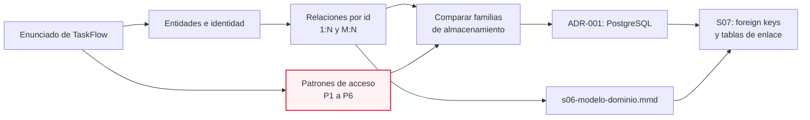
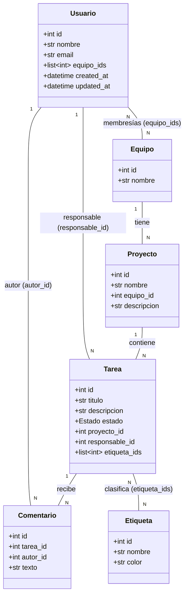
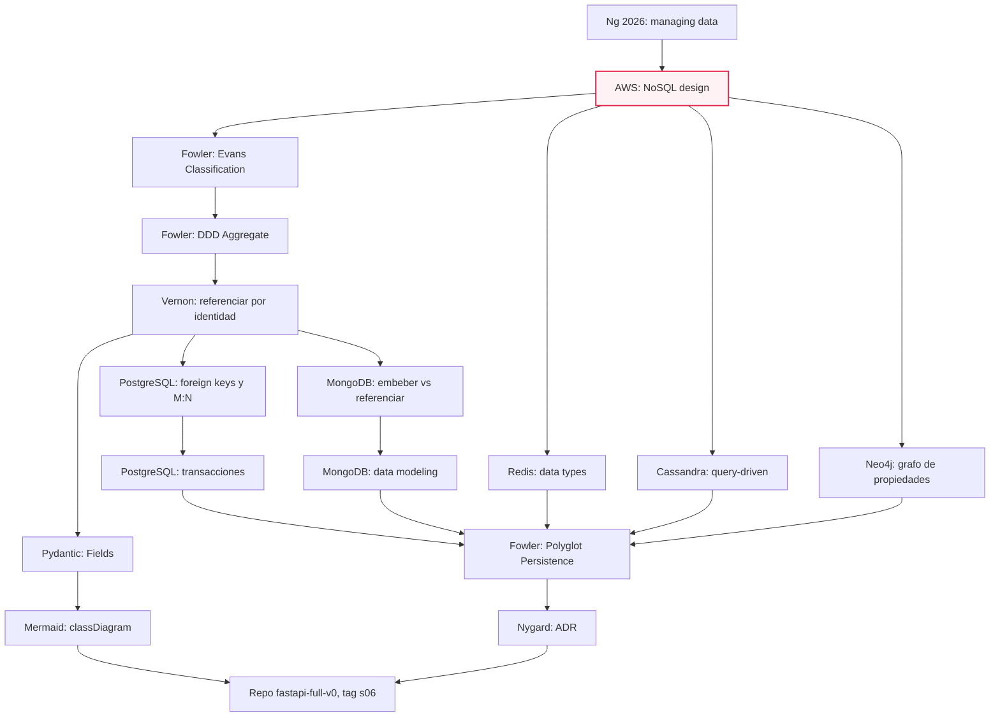

# M07·S06 — Elegir base de datos según el patrón de acceso: el modelo de dominio de TaskFlow y `ADR-001`

| | |
|---|---|
| **Sesión** | M07·S06 |
| **Fecha** | [Completar por el profesor: fecha] |
| **Módulo** | 07 — Fundamentos de Software + System Design para AI Engineers · Semana 2 (Gestión de datos y diseño de APIs) |
| **Tema** | Del enunciado al modelo de dominio completo de TaskFlow (seis entidades referenciadas por id), y de los patrones de acceso a la elección de la base de datos, registrada como `ADR-001` |
| **Duración estimada de estudio** | ~8 h: ~2 h 45 min de recursos, ~1 h 30 min de notas, ~1 h 30 min de guía práctica y ~2 h 30 min de ejercicios |
| **Punto de partida → entrega** | tag `s05` → tag `s06` del repo `fastapi-full-v0` |

---

## 1. Objetivos de aprendizaje

Al terminar esta sesión vas a poder:

1. **Derivar** los patrones de acceso de una aplicación —qué se lee, qué se escribe, con qué frecuencia, con qué forma y con qué exigencia de consistencia— **antes** de nombrar una tecnología, y escribirlos en una tabla para TaskFlow.
2. **Explicar** las cinco familias de almacenamiento —relacional, documental, key-value, wide-column y grafo— diciendo para cada una qué pregunta le resulta barata y cuál le resulta cara.
3. **Justificar** la elección de una base de datos en términos de velocidad, escalabilidad y costo, incluido el precio de sumar una segunda base (*polyglot persistence*).
4. **Construir** el modelo de dominio completo de TaskFlow como clases Pydantic en `app/models/` —`Usuario`, `Equipo`, `Proyecto`, `Tarea`, `Comentario`, `Etiqueta`— con referencias por id, dos relaciones M:N y la base común `EntidadConTiempos`.
5. **Diagramar** ese modelo como `classDiagram` en `docs/diagrams/s06-modelo-dominio.mmd` y **leerlo críticamente** contra el código.
6. **Registrar** la decisión de base de datos como `ADR-001` en `docs/trade-offs.md` y distinguir cuándo una decisión merece un ADR y cuándo alcanza una entrada `[s06]` de la bitácora.

---

## 2. Resumen ejecutivo

En M07·S05 levantaste el prototipo de TaskFlow: `Tarea` y `Proyecto` en memoria, tres endpoints y un PostgreSQL en Docker al que la app todavía no le habla. Hoy se toma la decisión que ese Postgres daba por supuesta: **¿qué base de datos le conviene a TaskFlow, y por qué?**

La sesión tiene dos mitades que se alimentan entre sí. En la primera completás el **modelo de dominio**: de dos entidades pasás a las seis del proyecto, relacionadas **por id** y no anidando objetos, con dos relaciones muchos-a-muchos y timestamps heredados de una base común. Todavía sin persistencia. En la segunda, con el modelo y los **patrones de acceso** en la mano (un tablero que se lee todo el tiempo, varias personas moviendo y comentando tareas a la vez, datos muy relacionados, un esquema estable), recorrés las familias de almacenamiento y dejás la elección escrita como **`ADR-001`: PostgreSQL**.

¿Por qué importa para un AI Engineer? Andrew Ng lo pone como competencia central del bloque (la viste en M07·S01): gestionar datos es pensar los patrones de acceso para elegir el modelo y el tipo de almacenamiento, y los datos son relativamente difíciles de cambiar **aun con agentes ayudando en las migraciones**. Por eso esta decisión se escribe como ADR —el formato de Nygard que practicaste en MA·S05— y no como una línea suelta. Y por eso, si le pedís a un agente "guardá esto en una base" sin patrones de acceso, va a elegir por vos. En M07·S07 este modelo se convierte en tablas reales.

---

## 3. Conceptos clave / glosario

Lo que ya viste se refresca en una línea. Lo nuevo va con definición, para qué y por qué así.

### Ya vistos (refresco)

| Término | Dónde | Refresco |
|---|---|---|
| Pydantic, `BaseModel`, validación del body | M07·S03 (y módulo 01 a nivel de temario) | La clase que declara campos tipados y que FastAPI usa para validar y serializar. |
| `Field(default_factory=...)` | M07·S03 | Un default que se calcula de nuevo para cada instancia. |
| Capas router → service → repository → datos | M07·S04 | Cada capa con una responsabilidad; el dominio no importa la persistencia. |
| Prototipo de TaskFlow, `sessions/sXX.md`, `RepositorioProyectosEnMemoria`, `ServicioTareas`, `POST /tasks` | M07·S05 | El incremento de la sesión anterior, del que partís hoy. |
| Entradas `[sXX]` en `docs/trade-offs.md` | M07·S05 | La bitácora de decisiones de TaskFlow: el trade-off journal de S01 viviendo dentro del repo. |
| Diagrama de clases, multiplicidad, extracción de entidades desde sustantivos | MA·S05 | Cómo se dibuja un dominio y cómo se lee `1`, `0..1`, `N` en cada extremo. |
| ADR (formato de Nygard) y el criterio "¿cuesta revertirla?" | MA·S05 | Un documento corto que registra una decisión de arquitectura con contexto, decisión, estado y consecuencias. |
| La C de ACID vs la C de CAP | M07·S01 | Consistencia de reglas dentro de una transacción vs. consistencia entre réplicas. |
| Bases vectoriales | Módulo 04 | Otro tipo de almacenamiento, para búsqueda por similitud; vuelven en M07·S08. |

### Criterio de decisión

| Término | Qué es | Para qué se usa | Por qué así |
|---|---|---|---|
| **Patrón de acceso** (*access pattern*) | Una pregunta concreta que la aplicación le hace a sus datos, con su forma, su frecuencia y lo que exige ("traer todas las tareas de un proyecto agrupadas por estado, muchas veces por minuto"). | Elegir el almacenamiento por lo que la app *hace* con el dato, no por moda ni por costumbre. | La alternativa —elegir la base primero y adaptar las preguntas después— funciona hasta que la pregunta más frecuente resulta ser la más cara. |
| **Data size / shape / velocity** | Las tres propiedades del patrón que la guía de AWS pide conocer antes de diseñar: cuánto dato hay, con qué forma se consulta y a qué ritmo llega o se pide. | Pasar de "el tablero se usa mucho" a algo que se puede comparar entre opciones. | Tres ejes chicos y concretos evitan la discusión abstracta "SQL vs NoSQL". |
| **Hot spot** | Una parte del almacenamiento que recibe una porción desproporcionada de las lecturas o escrituras (por ejemplo, una sola clave o una sola partición). | Detectar el punto donde una base distribuida deja de escalar aunque tenga muchas máquinas. | Escalar agregando nodos no sirve si todo el tráfico cae en el mismo. |
| **Relacional por defecto** | Posición del bloque: cuando el modelo es relacional y las preguntas todavía pueden cambiar, se empieza por una base relacional y se suma otra solo con un patrón que lo justifique. | Tener un punto de partida razonable y no reabrir la discusión en cada proyecto. | Un esquema normalizado se puede consultar de formas que no anticipaste; la mayoría de las familias NoSQL te pide conocer las preguntas de antemano. |
| **Polyglot persistence** | Usar varias tecnologías de almacenamiento en una misma organización o aplicación, cada una elegida según cómo se manipula el dato. | Darle a cada patrón la base que lo resuelve mejor. | Tiene precio: cada base extra es otra interfaz que aprender, operar y mantener consistente. |

### Modelo de dominio

| Término | Qué es | Para qué se usa | Por qué así |
|---|---|---|---|
| **Modelo de dominio** | El conjunto de clases que representan los conceptos del negocio (tareas, proyectos, usuarios) y sus relaciones, independiente de cómo se guardan. | Que el código hable el idioma del problema y que la persistencia se pueda cambiar sin tocarlo. | Si el modelo nace atado a las tablas, cada cambio de base obliga a reescribir la lógica. |
| **Entidad** | Un objeto con identidad propia que persiste en el tiempo: una tarea sigue siendo *la misma* aunque cambie de título o de estado. | Saber qué cosas necesitan un `id` estable. | La igualdad se define por identidad, no por atributos: dos tareas con el mismo título siguen siendo dos. |
| **Value object** | Un objeto que importa solo por sus valores: dos con los mismos atributos son intercambiables. Conviene que sea inmutable. | Modelar cosas sin identidad propia, como un color o un rango de fechas. | Darle `id` a algo que no lo necesita agrega tablas y referencias sin ganar nada. |
| **Agregado** | Un grupo de objetos de dominio que se trata como una unidad: se carga y se guarda entero, y las transacciones no deberían cruzar sus bordes. | Decidir qué va adentro de qué y qué se referencia desde afuera. | Un agregado grande se vuelve lento de cargar y genera conflictos cuando varios usuarios lo tocan a la vez. |
| **Raíz del agregado** | La entidad principal de un agregado: la única a la que se referencia desde afuera. | Tener un único punto de entrada para modificar el grupo. | Si desde afuera se tocan las piezas internas, nadie garantiza las reglas del conjunto. |
| **`EntidadConTiempos`** | La clase base de `app/models/base.py` con `created_at` y `updated_at`, de la que heredan las seis entidades. | No repetir los dos campos de auditoría en seis clases. | Herencia de modelos Pydantic: un solo lugar que cambiar; en S06 los campos valen `None` porque los pobla la persistencia en S07. |
| **Default mutable** | Un valor por defecto que se puede modificar, como `[]`. En Python común es un bug clásico porque la misma lista se comparte entre llamadas o instancias. | Entender por qué `etiqueta_ids: list[int] = []` es seguro en Pydantic. | Pydantic hace una copia profunda del default para cada instancia; un `@dataclass` directamente lo rechaza y te obliga a `default_factory`. |

### Relaciones

| Término | Qué es | Para qué se usa | Por qué así |
|---|---|---|---|
| **Cardinalidad** (1:1, 1:N, M:N) | Cuántas instancias de un lado se relacionan con cuántas del otro. Se lee en las dos direcciones: "un proyecto tiene N tareas; una tarea pertenece a 1 proyecto". | Saber dónde se guarda cada referencia y qué estructura hace falta. | Leerla en una sola dirección es el error que convierte una M:N en una 1:N sin que nadie lo note. |
| **Opcionalidad** (`0..1`) | Que un extremo de la relación pueda no existir: una tarea puede no tener responsable. | Distinguir campos obligatorios de opcionales en el modelo y en el diagrama. | `"1"` y `"0..1"` generan código distinto (`int` vs `int | None`); el diagrama tiene que decir lo mismo que el código. |
| **Referencia por id** | Guardar el identificador de la otra entidad (`proyecto_id: int`) en vez del objeto completo. | Relacionar entidades sin duplicar datos ni cargar de más. | Anidar objetos es cómodo en memoria, pero copia datos que después hay que mantener sincronizados y no se mapea a tablas. |
| **Carga ansiosa** (*eager loading*) | Traer de la base, junto con un objeto, todos los objetos relacionados, se usen o no. | Entender por qué referenciar por id hace a los objetos más livianos. | Lo contrario —traer lo relacionado solo cuando se pide— es lo que permite la referencia por id. |
| **M:N de un solo lado** | En el dominio, la relación muchos-a-muchos se guarda en una sola de las dos clases: `Usuario.equipo_ids`, y no también `Equipo.usuario_ids`. | Evitar dos listas que hay que mantener iguales a mano. | Guardarla de los dos lados duplica la verdad; en S07 una sola tabla de enlace resuelve las dos direcciones. |
| **Tabla de enlace** (anticipo de S07) | Una tabla con dos foreign keys, una por cada lado de una M:N (`usuario_equipo`, `tarea_etiqueta` en TaskFlow). | Representar una M:N en una base relacional. | Una columna no puede guardar una lista con integridad; una tabla con una fila por par, sí. |
| **Foreign key** (FK) | Una restricción que exige que el valor de una columna exista como clave en otra tabla. | Que la base impida comentarios de tareas que no existen. | Si la integridad la valida solo el código, cualquier camino que no pase por ese código la rompe. |
| **Integridad referencial** | La garantía de que toda referencia apunta a algo que existe. | No dejar comentarios huérfanos ni asignar tareas a usuarios inexistentes. | Es uno de los argumentos centrales de `ADR-001`. |
| **Embeber vs referenciar** | En una base documental, guardar lo relacionado *dentro* del documento (embeber) o guardar solo su id (referenciar). | La misma decisión del modelo de TaskFlow, vista desde una base documental. | Embeber ahorra consultas; referenciar evita duplicación y documentos que crecen sin techo. |
| **Normalizar / desnormalizar** | Normalizar es guardar cada dato una sola vez y referenciarlo; desnormalizar es copiarlo donde se lee para no tener que buscarlo. | Elegir entre consistencia fácil (normalizado) y lecturas baratas (desnormalizado). | Las formas normales con nombre llegan en S07; hoy alcanza con la idea. |

### Familias de almacenamiento

| Término | Qué es | Para qué se usa | Por qué así |
|---|---|---|---|
| **Base relacional** | Datos en tablas con esquema fijo, relacionadas por claves, consultadas con SQL y con transacciones. | Datos muy relacionados que se consultan de muchas formas y exigen integridad. | Reorganiza el dato al consultar (JOIN), así que no necesita conocer todas las preguntas de antemano. |
| **Transacción** | Un grupo de operaciones que se ejecuta todo o nada. | Que "mover la tarea y registrar la actividad" no quede a medias. | Sin ella, un corte entre dos escrituras deja datos inconsistentes. |
| **ACID** | Las cuatro garantías de una transacción: Atomicidad, Consistencia, aIslamiento y Durabilidad. | Saber qué promete una base cuando dice que es transaccional. | Cada letra cubre una forma distinta de perder o corromper datos. |
| **Base documental** | Datos como documentos (tipo JSON) agrupados en colecciones, con esquema flexible. | Datos jerárquicos que se leen enteros y se relacionan poco. | Guarda el dato con la forma en que se lee: una lectura, cero JOINs, a cambio de duplicar. |
| **Key-value** | Un almacén que guarda valores bajo una clave y los recupera por esa clave. Redis es un *data structure server* en memoria. | Caché, sesiones, contadores: "dame el valor de esta clave". | Muy barato por clave; no sirve para "dame las tareas en progreso de este proyecto con la etiqueta urgente". |
| **Caché vs fuente de verdad** | La fuente de verdad es donde vive el dato oficial; una caché es una copia rápida que se puede perder y reconstruir. | Sumar velocidad sin poner en riesgo los datos. | Si la caché se vuelve fuente de verdad, perder la memoria es perder el negocio. |
| **Wide-column** | Tablas particionadas por clave, distribuidas en muchos nodos, sin JOINs, diseñadas una por consulta (Cassandra). | Escrituras masivas y lecturas por clave a gran escala. | Es la versión más extrema del modelado guiado por consultas. No es lo mismo que una base columnar analítica. |
| **Partition key** | La parte de la clave que decide en qué nodo vive una fila en una base wide-column. | Distribuir datos y consultas entre nodos. | Mal elegida, concentra todo en un nodo: un hot spot. |
| **Base de grafos** | Nodos y relaciones con propiedades (*property graph*); cada relación tiene inicio, fin y un tipo. | Preguntas de recorrido: "¿quién depende de quién, a cualquier profundidad?". | Brilla cuando la relación *es* la pregunta; para listas filtradas no aporta. |

---

## 4. Notas de estudio por subtema

### 4.0 El mapa de la sesión

Antes de entrar en cada subtema, el recorrido completo. Dos caminos salen del mismo enunciado y se juntan en la decisión: el del **modelo** (qué cosas existen y cómo se relacionan) y el de los **patrones de acceso** (qué preguntas les hace la app). La decisión se escribe, y lo que hoy son ids en clases mañana (S07) son claves y tablas.



El nodo resaltado es el que la sesión discute de verdad: sin patrones de acceso, la comparación de familias es un catálogo de bases sin criterio.

---

### 4.1 El patrón de acceso como criterio

**Para qué.** Si le preguntás a alguien "¿qué base uso?", te va a contestar con su favorita. Si le preguntás "¿qué base resuelve barato que veinte personas abran el tablero cada pocos segundos mientras otras cinco mueven tareas?", la respuesta empieza a depender del problema. El patrón de acceso es la forma de convertir la primera pregunta en la segunda.

**Qué es.** Un patrón de acceso describe una operación concreta sobre los datos con cinco atributos:

1. **Qué**: lectura o escritura, y de qué.
2. **Forma** (*shape*): un registro, una lista, un árbol, un recorrido.
3. **Frecuencia** (*velocity*): cuántas veces, comparada con las otras operaciones.
4. **Volumen** (*size*): cuánto dato toca.
5. **Exigencia**: consistencia, atomicidad, latencia.

La guía de AWS *NoSQL design for DynamoDB* lo formula así: en una base relacional podés crear un modelo normalizado **sin pensar en los patrones de acceso** y extenderlo después, porque la base reorganiza (*reshapes*) el dato cuando consultás; en una base NoSQL como DynamoDB no deberías empezar a diseñar el esquema hasta conocer las preguntas que tiene que responder, porque el dato se guarda con la forma en que se va a consultar. La guía nombra las tres propiedades a conocer antes de diseñar: **data size, data shape, data velocity**. Es documentación de un producto de AWS, pero el criterio es general: lo vas a ver repetido por MongoDB y por Cassandra con otras palabras.

Ng lo pone como competencia: gestionar datos es pensar los patrones de acceso para decidir qué guardar y por cuánto tiempo, y elegir modelos de datos y tipos de almacenamiento (tablas relacionales, documentos, key-value, grafos), sabiendo que eso afecta velocidad, escalabilidad, disponibilidad, confiabilidad y costo.

**Ejemplo práctico: los patrones de acceso de TaskFlow.** Salen del contexto de `ADR-001` y de lo que TaskFlow hace (plan del módulo: tablero, mover, asignar, comentar). Las frecuencias son **cualitativas a propósito**: en un proyecto nuevo no tenés métricas, y una cifra inventada da una falsa sensación de precisión.

| # | Patrón de acceso | Lectura / escritura | Forma del dato | Frecuencia | Qué exige | Familia que lo resuelve mejor |
|---|---|---|---|---|---|---|
| P1 | Tablero de un proyecto: tareas agrupadas/filtradas por estado, responsable y etiquetas | Lectura | Lista de tareas con datos de otras entidades | Muy alta | Filtros combinables sobre relaciones | Relacional (JOIN + índices); documental si el dato se duplica |
| P2 | Mover una tarea de estado | Escritura | Un registro | Alta, concurrente | No perder una transición; atomicidad | Relacional (transacción) |
| P3 | Comentar una tarea | Escritura (append) | Lista que crece sin techo | Media | Que el autor y la tarea existan | Relacional (FK); en documental, referenciado |
| P4 | Asignar responsable / etiquetar | Escritura | Referencias a otras entidades | Media | Integridad referencial | Relacional (FK, tabla de enlace) |
| P5 | Membresías de usuarios en equipos | Lectura y escritura | M:N | Baja | Sin duplicar la relación | Relacional (tabla de enlace) |
| P6 | *(futuro, sin sesión asignada)* lecturas del tablero "muy calientes" | Lectura por clave | El tablero ya armado | Muy alta | Latencia | Key-value como **caché**, no fuente de verdad |

**Por qué así.** La tabla se escribe *antes* de mirar bases, y la última columna se llena al final. Si empezás por la columna de la derecha, terminás justificando una elección que ya hiciste. Fijate también que P1 domina: es la lectura más frecuente y la más rica en relaciones. Cuando una sola operación pesa tanto, la decisión se inclina hacia la base que la resuelve mejor, aunque otra base resuelva un poco mejor algún patrón secundario.

**Errores comunes.**
- **Listar entidades en vez de operaciones.** "Usuarios, tareas, comentarios" no es un patrón: "comentar una tarea" sí.
- **Olvidar la exigencia.** Dos operaciones de escritura iguales en forma pueden tener exigencias distintas: perder un "me gusta" es tolerable; perder una transición de estado, no.
- **Inventar cifras.** "10.000 lecturas por segundo" en un proyecto que no existe es decorado. Usá relativos: muy alta, alta, media, baja.
- **Diseñar para un futuro hipotético.** P6 está en la tabla como *futuro*: se nombra para saber qué haríamos, no para construirlo hoy.

> 💡 Para profundizar: *NoSQL design for DynamoDB* (AWS) y la sección *Managing data* del *AI Engineering Skills Map* de Ng. Links en la sección 10.

---

### 4.2 Modelado de dominio: entidades, identidad y agregados

**Para qué.** En S05 TaskFlow tenía dos clases. El producto que describe el plan tiene usuarios, equipos, proyectos, tareas, comentarios y etiquetas. Si cada sesión agrega una clase "cuando haga falta", el modelo crece a los parches y cada parche choca con el anterior. Modelar el dominio completo ahora, aunque sin persistencia, te deja ver todas las relaciones juntas y decidir *una vez* cómo se referencian.

**Del enunciado a las entidades.** El procedimiento de MA·S05 se aplica tal cual: sustantivos candidatos del enunciado ("equipos colaboran en proyectos; cada proyecto tiene tareas que se mueven entre estados; las tareas tienen responsable, comentarios y etiquetas") → descarte de sinónimos y de **atributos disfrazados de entidad** → verbos como relaciones → multiplicidades. Dos descartes importantes:

- **"Estado" no es una entidad.** Es un valor dentro de un conjunto cerrado (`backlog`, `en progreso`, `hecho`). Por eso en TaskFlow es el Enum `Estado` de `app/models/estado.py`, sin `id` ni tabla.
- **"Responsable" no es una entidad nueva**: es un `Usuario` mirado desde una tarea. Se vuelve una referencia (`responsable_id`), no una clase.

**Identidad: entidad vs value object.** Según Fowler, siguiendo la clasificación de Eric Evans, una **entidad** es un objeto con identidad propia que persiste en el tiempo y a través de distintas representaciones, y un **value object** importa solo por la combinación de sus atributos: dos con los mismos valores son iguales (y conviene que sean inmutables). Las seis clases de TaskFlow son entidades: una tarea sigue siendo *la misma* tarea aunque le cambies el título, el estado y el responsable. Por eso todas tienen `id`. Y por eso una referencia por id apunta a una **identidad**, no a una copia del dato.

**Agregados.** Fowler define un agregado de DDD como "a cluster of domain objects that can be treated as a single unit" (un grupo de objetos de dominio que se puede tratar como una unidad): se carga y se guarda entero, "transactions should not cross aggregate boundaries" (las transacciones no deberían cruzar sus bordes) y desde afuera solo se referencia su raíz. No necesitás DDD completo para TaskFlow; necesitás la **pregunta** que el agregado te obliga a hacer: *¿esto vive adentro de aquello, o es otra cosa que lo referencia?*

- ¿El comentario vive adentro de la tarea? Lo escribe otro usuario, en otro momento, y crecen sin techo. Si fuera parte del agregado `Tarea`, comentar sería modificar la tarea entera, y dos personas comentando a la vez chocarían. → `Comentario` es su propia entidad y apunta a la tarea con `tarea_id`.
- ¿La etiqueta vive adentro de la tarea? La etiqueta `bug` existe aunque ninguna tarea la use, y la comparten muchas tareas. → `Etiqueta` es su propia entidad y la tarea guarda `etiqueta_ids`.

**Ejemplo práctico: la base común.** `app/models/base.py` tal como está en el tag `s06`:

```python
"""Base común de las entidades de dominio (s06).

Agrupa los campos de auditoría (created_at / updated_at) para no repetirlos en cada
entidad. Son opcionales: en s06 el modelo solo los declara; los valores reales los
poblará la capa de persistencia en s07. El resto de las entidades hereda de acá.
"""

from datetime import datetime

from pydantic import BaseModel


class EntidadConTiempos(BaseModel):
    created_at: datetime | None = None   # None hoy: no hay persistencia que lo complete
    updated_at: datetime | None = None   # ídem; en S07 lo pobla la capa de datos
```

**Por qué así.**
- **Herencia de un `BaseModel`.** En Pydantic, una subclase hereda los campos de la clase padre y los suma a los suyos. Las seis entidades declaran `class Usuario(EntidadConTiempos)` y obtienen `created_at`/`updated_at` sin escribirlos. La alternativa —copiarlos en cada clase— funciona hasta el día que alguien agrega `deleted_at` en cinco clases y se olvida de la sexta.
- **`None` como default.** Los timestamps los decide quien guarda, no quien crea el objeto en memoria. Si fueran obligatorios, cada `Tarea(...)` del prototipo tendría que inventar una fecha; si tuvieran `default_factory=datetime.now`, el dominio estaría decidiendo algo que es responsabilidad de la persistencia. En S07 los completa la capa de datos.
- **Por qué no `@dataclass`.** La decisión `[s05] Representación de entidades sin ORM` fijó Pydantic para todo (dominio = body HTTP). S06 la respeta.

**Ejemplo práctico: una entidad nueva.** `app/models/comentario.py` en el tag `s06`:

```python
"""Entidad de dominio Comentario (s06).

Mensaje que un usuario deja en una tarea. Relaciones N:1 por id: pertenece a una tarea
(`tarea_id`) y tiene un autor (`autor_id`). Los timestamps sirven para ordenar el hilo
cronológicamente. Sin persistencia (se conecta en s07).
"""

from app.models.base import EntidadConTiempos


class Comentario(EntidadConTiempos):
    id: int          # entidad: identidad propia, aunque no tenga endpoint todavía
    tarea_id: int    # N:1 con Tarea -> el comentario apunta a la tarea, no al revés
    autor_id: int    # N:1 con Usuario
    texto: str
```

**Por qué así.** La flecha va de `Comentario` a `Tarea` (el hijo conoce al padre), no al revés: así agregar un comentario no toca la tarea. Si `Tarea` tuviera `comentarios: list[Comentario]`, cada comentario nuevo reescribiría la tarea entera y cargar una tarea traería todo su hilo aunque solo quisieras su título.

**Errores comunes.**
- **Darle `id` a todo.** Un color no necesita identidad; si mañana TaskFlow tuviera "rango de fechas", sería un value object, no una entidad.
- **Confundir "aparece en la UI junto" con "es parte del mismo agregado".** El tablero muestra tareas con sus etiquetas y su responsable, pero eso es una *vista* (en S08 vas a ver que TaskFlow la construye aparte), no una razón para anidar.
- **Pensar que heredar de `EntidadConTiempos` vuelve los timestamps automáticos.** Hoy son `None` siempre. Si en el REPL ves `created_at=None`, no es un bug.

> 💡 Para profundizar: *Evans Classification* y *DDD Aggregate*, de Martin Fowler.

---

### 4.3 Relaciones 1:N y M:N y referencias por id

**Para qué.** Una vez que sabés qué entidades hay, tenés que decidir **cómo se apuntan entre sí**. Es la decisión que más se arrastra: si hoy anidás objetos, en S07 vas a tener que desarmarlos para convertirlos en tablas.

**Cardinalidades, en las dos direcciones.**

| Relación | Se lee | Cardinalidad | Dónde se guarda en S06 |
|---|---|---|---|
| Equipo → Proyecto | Un equipo tiene N proyectos; un proyecto es de 1 equipo | 1:N | `Proyecto.equipo_id` |
| Proyecto → Tarea | Un proyecto contiene N tareas; una tarea es de 1 proyecto | 1:N | `Tarea.proyecto_id` |
| Usuario → Tarea (responsable) | Un usuario es responsable de N tareas; una tarea tiene 0 o 1 responsable | 1:N, opcional | `Tarea.responsable_id: int | None` |
| Tarea → Comentario | Una tarea recibe N comentarios; un comentario es de 1 tarea | 1:N | `Comentario.tarea_id` |
| Usuario → Comentario (autor) | Un usuario escribe N comentarios; un comentario tiene 1 autor | 1:N | `Comentario.autor_id` |
| Usuario ↔ Equipo | Un usuario está en N equipos; un equipo tiene N usuarios | M:N | `Usuario.equipo_ids` |
| Tarea ↔ Etiqueta | Una tarea tiene N etiquetas; una etiqueta clasifica N tareas | M:N | `Tarea.etiqueta_ids` |

La regla práctica de las 1:N: **la referencia la guarda el lado "N"**. Cada tarea sabe a qué proyecto pertenece (un número); el proyecto no guarda la lista de sus tareas (que sería una lista que crece y que hay que mantener).

**Referenciar por identidad.** Vaughn Vernon, en el capítulo de agregados de *Implementing Domain-Driven Design*, lo llama *"Rule: Reference Other Aggregates by Identity"*: referenciar otros agregados por su identidad y no por el objeto. Su justificación: los agregados quedan más chicos porque esas referencias nunca se cargan de forma ansiosa, cargan más rápido, ocupan menos memoria, y se evita la tentación de modificar varios agregados en una misma transacción. El repo suma su propio argumento en la entrada `[s06] Modelado del dominio`: se mapea 1:1 al esquema relacional de S07, evita duplicación y ciclos.

**Ejemplo práctico: `Tarea` y `Usuario` en el tag `s06`.**

```python
# app/models/tarea.py
from app.models.base import EntidadConTiempos
from app.models.estado import Estado


class Tarea(EntidadConTiempos):
    id: int | None = None               # opcional: Tarea sigue siendo el body de POST /tasks,
                                        # y el id lo asigna el repository
    titulo: str
    descripcion: str | None = None
    estado: Estado = Estado.BACKLOG
    proyecto_id: int = 1                # N:1 con Proyecto (default de S05: el proyecto "General")
    responsable_id: int | None = None   # N:1 con Usuario (opcional)
    etiqueta_ids: list[int] = []        # M:N con Etiqueta
```

```python
# app/models/usuario.py
from app.models.base import EntidadConTiempos


class Usuario(EntidadConTiempos):
    id: int
    nombre: str
    email: str
    equipo_ids: list[int] = []  # M:N con Equipo (membresías)
```

**Por qué así, línea por línea.**
- **`id: int | None = None` solo en `Tarea`.** Las otras cinco entidades tienen `id: int` obligatorio. `Tarea` es distinta porque desde S05 es también el body de `POST /tasks` (modelo Pydantic único): el cliente no manda id y el repository lo asigna. Las entidades nuevas no tienen endpoint, así que nada las obliga a aceptar un id vacío.
- **`responsable_id: int | None = None`.** La opcionalidad del dominio ("una tarea puede no tener responsable") se escribe en el tipo. Si fuera `int`, toda tarea creada desde el cliente de S05 sin responsable fallaría con 422.
- **Los campos nuevos tienen default.** Así `POST /tasks` con `{"titulo": "..."}` sigue funcionando igual que en S05: el modelo crece sin romper a sus clientes.
- **`list[int] = []` es seguro en Pydantic.** La documentación de Pydantic lo dice explícitamente: "In the event that the default value is not hashable, Pydantic will create a deep copy of the default value when creating each instance of the model" (si el default no es hashable, Pydantic crea una copia profunda para cada instancia). En una función o clase Python común, ese `[]` sería la misma lista compartida por todos; un `@dataclass` ni siquiera acepta el código y te obliga a `field(default_factory=list)`. En Pydantic podés escribir `Field(default_factory=list)` (lo viste en S03) y es igual de correcto; el repo eligió la forma corta.
- **`email: str`, no un tipo de email validado.** Validar el formato pediría una dependencia extra y `requirements.txt` no cambia en S06. Es una decisión de alcance, no un descuido: no lo "mejores" en tu repo hoy.

**M:N de un solo lado.** La membresía `Usuario↔Equipo` vive solo en `Usuario.equipo_ids`: **no hay `Equipo.usuario_ids`**. El docstring de `equipo.py` lo justifica: "para no duplicar la lista de membresías en ambos lados". Si estuviera en los dos, agregar a Ana al equipo 1 te obligaría a tocar dos listas, y el día que alguien toque una sola, el modelo se contradice. El costo: para saber "quiénes están en el equipo 1" tenés que recorrer todos los usuarios. Ese costo desaparece en S07, cuando la M:N se vuelve **una** tabla de enlace (`usuario_equipo`) que se consulta igual de fácil en las dos direcciones. Lo mismo con `Tarea.etiqueta_ids` → `tarea_etiqueta`.

**Ejemplo práctico: qué significa "referencia por id" en la mano.** En un REPL de Python, desde la raíz del repo y con el entorno virtual activado:

```python
from app.models.etiqueta import Etiqueta
from app.models.tarea import Tarea
from app.models.usuario import Usuario

# Un "catálogo" de etiquetas en un dict por id: lo que en S07 va a ser la tabla
etiquetas = {1: Etiqueta(id=1, nombre="bug", color="#d73a4a"),
             3: Etiqueta(id=3, nombre="urgente")}
ana = Usuario(id=2, nombre="Ana", email="ana@example.com", equipo_ids=[1])

t = Tarea(titulo="Arreglar el filtro del tablero", responsable_id=ana.id, etiqueta_ids=[1, 3])
t2 = Tarea(titulo="Otra tarea")        # etiqueta_ids toma el default []
t3 = Tarea(titulo="Y otra más")        # ídem

t2.etiqueta_ids.append(99)
print(t3.etiqueta_ids)                                # []  -> el default [] no se comparte
print([etiquetas[i].nombre for i in t.etiqueta_ids])  # ['bug', 'urgente'] -> el "join a mano"
```

**Por qué así.** La tarea guarda `[1, 3]`, no los nombres. Para mostrar "bug, urgente" tenés que **buscar** cada id en otro lado: eso es un JOIN hecho a mano. Hoy lo hacés vos con un dict; en S07 lo hace la base, con integridad garantizada. Y el `append` sobre `t2` no contamina a `t3`: la copia profunda del default funcionando.

**Anticipo de S07: en qué se convierte cada id.** La documentación de PostgreSQL define la foreign key como la restricción que exige que los valores de una columna coincidan con los de alguna fila de otra tabla, y así mantiene la **integridad referencial**. También explica que una tabla con más de una FK es la forma de implementar una relación muchos-a-muchos (su ejemplo es de productos y pedidos, con una tabla intermedia de clave primaria compuesta), y que con `ON DELETE CASCADE` se borran las filas que referencian y con `RESTRICT` se impide el borrado. Traducido a TaskFlow, sin escribir todavía el esquema:

- `proyecto_id`, `responsable_id`, `tarea_id`, `autor_id`, `equipo_id` → columnas con FK.
- `equipo_ids` → tabla de enlace `usuario_equipo`; `etiqueta_ids` → tabla de enlace `tarea_etiqueta`.

**La misma pregunta en una base documental.** El manual de MongoDB tiene una tabla de decisión: **embeber** cuando la relación es de "contiene", se consulta junto, se actualiza junto; **referenciar** cuando "the child side of the relationship has high cardinality" (el lado hijo tiene muchos elementos), cuando "your embedded data grows without bounds" (lo embebido crece sin techo), o cuando el hijo existe sin el padre. Aplicado a TaskFlow: los comentarios crecen sin techo → se referencian; las etiquetas existen sin la tarea y se comparten → se referencian. **"Por id" no es un capricho relacional**: aun en MongoDB, este modelo se referenciaría.

**El diagrama del modelo.** Es el entregable `docs/diagrams/s06-modelo-dominio.mmd`, tal como está en el tag (el archivo abre con tres líneas de comentario `%%`: modelo de dominio de s06 en clases, aún sin persistencia; relaciones por id con cardinalidades N:1 y M:N; el ER formal con tablas de enlace es entregable de S07):



**Por qué así.** Usa tres piezas de la sintaxis de `classDiagram` de Mermaid: la cardinalidad entre comillas a cada lado de la flecha (`"1" -- "N"`), la etiqueta de la relación después de `:` y los tipos genéricos con `~` (`list~int~`: Mermaid escribe los genéricos con `~` en lugar de `<` y `>`). Las flechas son `--` (asociación simple) y no `*--` (composición) porque **ninguna clase contiene a otra**: si dibujaras composición entre `Tarea` y `Comentario` estarías diciendo lo contrario de lo que decidiste. Y las etiquetas nombran el campo (`(responsable_id)`) para que quien lee el diagrama encuentre la línea de código.

**Dos detalles para leerlo con ojo crítico** (no se corrigen en el repo, pero tenés que poder verlos):
1. Solo `Usuario` muestra `created_at`/`updated_at`, aunque las seis clases los heredan de `EntidadConTiempos`, que no aparece dibujada.
2. `Usuario "1" -- "N" Tarea` no deja ver que `responsable_id` es **opcional**: con la sintaxis de Mermaid, ese extremo sería `"0..1"`. Lo vas a corregir en una copia en los ejercicios.

**Errores comunes.**
- **Guardar la 1:N del lado equivocado** (`Proyecto.tarea_ids`): una lista que crece sin techo y que hay que mantener en cada alta y baja.
- **Guardar la M:N de los dos lados**: dos verdades que se desincronizan.
- **Creer que el id garantiza que la cosa existe.** Hoy nada valida que `responsable_id=999` sea un usuario real. Lo vas a ver en Swagger en la guía práctica.
- **Dibujar el diagrama "como debería ser" y no como es el código.** El diagrama es entregable: tiene que coincidir con `app/models/`.

> 💡 Para profundizar: Vernon (*Reference Other Aggregates by Identity*), PostgreSQL *Foreign Keys*, MongoDB *Embedded Data Versus References* y la sintaxis de *Class diagrams* de Mermaid.

---

### 4.4 Familias de almacenamiento

**Para qué.** Con el modelo y los patrones en la mano, la pregunta es: ¿qué familia de bases hace **barato** lo que TaskFlow hace todo el tiempo y **tolerable** lo que hace poco? Cada familia optimiza una forma de pregunta y paga en otra. Las vas a recorrer con el mismo dato: la tarea "Arreglar el filtro del tablero", de Ana, con las etiquetas `bug` y `urgente`.

#### Relacional (PostgreSQL)

**Qué es.** Tablas con esquema fijo, una fila por entidad, relaciones por claves (FK), consultas en SQL que combinan tablas con JOIN, y transacciones.

**La transacción y ACID.** La doc de PostgreSQL lo resume en una frase: "The essential point of a transaction is that it bundles multiple steps into a single, all-or-nothing operation" (una transacción agrupa varios pasos en una sola operación de todo o nada). Su ejemplo es bancario: debitar de una cuenta y acreditar en otra no puede quedar a medias. También aclara que, si no abrís una transacción con `BEGIN`, Postgres envuelve cada sentencia suelta en su propia transacción implícita. Las cuatro garantías:

| Letra | Qué garantiza | En TaskFlow |
|---|---|---|
| **A**tomicidad | Todo o nada | Mover una tarea y registrar la actividad: o las dos cosas o ninguna. |
| **C**onsistencia | La base pasa de un estado válido a otro válido según sus reglas (FK, unicidad, checks) | No se puede guardar un comentario de una tarea que no existe. |
| a**I**slamiento | Las transacciones concurrentes no se pisan de formas no previstas | Dos personas moviendo la misma tarea no producen un estado mezclado. |
| **D**urabilidad | Lo confirmado sobrevive a un corte | Un `COMMIT` exitoso no se pierde si se cae el servidor. |

Recordá de S01 que esta C es la de ACID, no la de CAP. La práctica de transacciones, aislamiento y concurrencia es de S07: hoy entra como **criterio de elección**.

**La tarea en relacional.** Una fila en la tabla de tareas con `responsable_id = 2`, dos filas en la tabla de enlace tarea–etiqueta (`1` y `3`), y las etiquetas en su propia tabla. Para el tablero (P1), una consulta une las tablas y filtra. El dato se guarda **una vez** (normalizado) y se reorganiza al consultar.

**Cuándo gana.** Datos muy relacionados, integridad importante, escrituras concurrentes que no pueden perderse, preguntas que cambian. **Cuándo cuesta.** Escalar escrituras horizontalmente es más difícil que en familias pensadas para eso; esquemas que cambian por registro.

#### Documental (MongoDB)

**Qué es.** Documentos tipo JSON agrupados en colecciones. El manual de MongoDB lo dice con su principio: "Data that's accessed together should be stored together" (lo que se accede junto se guarda junto). Los documentos de una colección no necesitan tener los mismos campos (esquema flexible).

**La tarea como documento** (ilustrativo, sin driver ni base):

```json
{
  "_id": 1,
  "titulo": "Arreglar el filtro del tablero",
  "estado": "en progreso",
  "proyecto": {"id": 1, "nombre": "General"},
  "responsable": {"id": 2, "nombre": "Ana"},
  "etiquetas": [{"id": 1, "nombre": "bug"}, {"id": 3, "nombre": "urgente"}]
}
```

**Por qué se vería así, y qué cuesta.** Para que el tablero se lea en una sola consulta sin JOIN, el documento **copia** el nombre de Ana y los nombres de las etiquetas. Rápido de leer. Pero si Ana cambia de nombre o `bug` cambia de color, hay que actualizar **cada documento que lo copió**: es exactamente el "obligaría a duplicar usuarios/etiquetas en cada documento o a hacer 'joins' a mano" de `ADR-001`. Y los comentarios, que crecen sin techo, irían referenciados igual (la regla de 4.3). El esquema flexible, su gran ventaja, aporta poco en TaskFlow: el modelo es estable y conocido.

**Cuándo gana.** Datos jerárquicos que se leen enteros y se relacionan poco (un catálogo de productos con atributos distintos por categoría, el perfil de un usuario con preferencias variables). **Cuándo cuesta.** Muchas relaciones compartidas y que cambian.

#### Key-value (Redis)

**Qué es.** La doc de Redis lo presenta como "a data structure server": guarda bajo una clave estructuras nativas (strings, hashes, listas, sets, sets ordenados, streams, JSON, entre otras), y se usa desde caché hasta colas y procesamiento de eventos.

**La tarea en key-value.** Podrías guardar el tablero del proyecto 1 ya armado bajo una clave (por ejemplo, una con el formato `tablero:proyecto:1`, ilustrativa) y leerlo de un saque. Redis guarda los datos en memoria y los busca por clave, por eso una lectura por clave es mucho más barata que una consulta con filtros. Pero la pregunta "las tareas en progreso del proyecto 1 con la etiqueta urgente, asignadas a Ana" no tiene clave: tendrías que haber armado de antemano una clave por cada combinación de filtros.

**Cuándo gana.** Caché, sesiones, contadores, colas: "dame el valor de esta clave". **Cuándo cuesta.** Como fuente de verdad con relaciones y consultas por atributos. Por eso `ADR-001` lo deja como caché eventual (P6), **nunca como fuente de verdad**.

#### Wide-column (Cassandra)

**Qué es.** Tablas distribuidas en muchos nodos, donde la *partition key* decide en qué nodo vive cada fila. La doc de Cassandra es tajante: "Data modeling is query-driven" (el modelado lo guían las consultas) y "Joins are not supported in Cassandra so all required fields (columns) must be grouped together in a single table" (no hay JOIN, así que todas las columnas que una consulta necesita tienen que estar juntas en una tabla). Consecuencia: **una tabla por consulta**, con el dato duplicado a propósito.

**La tarea en wide-column** (solo concepto). Para el tablero filtrado por estado necesitarías una tabla particionada por proyecto y ordenada por estado; para filtrar por responsable, otra; por etiqueta, otra; por estado **y** responsable **y** etiqueta, otra más. Cada vez que Ana mueve una tarea, se escribe en todas. Es la versión más extrema del "conocé tus preguntas antes de diseñar".

**Cuándo gana.** Volúmenes de escritura enormes y lecturas por clave conocida a gran escala (series de eventos, mediciones, historiales por usuario). **Cuándo cuesta.** Filtros combinables que cambian, como el tablero de TaskFlow.

> ⚠️ **Wide-column no es "columnar analítico".** Una base columnar analítica (las de un data warehouse) guarda cada columna junta en disco para hacer agregaciones sobre millones de filas. Cassandra guarda filas agrupadas por partición para leer y escribir por clave a gran escala. Comparten media palabra y nada más.

#### Grafo (Neo4j)

**Qué es.** El modelo de grafo de propiedades: **nodos** con *labels* y propiedades, y **relaciones** con dirección que siempre tienen un nodo de inicio, un nodo de fin y exactamente un tipo, también con propiedades. Según Neo4j, los recorridos no necesitan los JOINs costosos de una base relacional (es la afirmación del fabricante).

**La tarea en grafo** (solo concepto). Un nodo `Tarea`, un nodo `Usuario` Ana con una relación de responsable hacia la tarea, y dos relaciones hacia nodos `Etiqueta`. Funciona, pero el tablero es una **lista filtrada**, no un recorrido: el grafo no te ahorra nada en P1.

**Cuándo ganaría.** Si la pregunta central fuera un recorrido de profundidad variable: "¿qué tareas quedan bloqueadas, en cadena, si esta se atrasa?" (dependencias entre tareas). **TaskFlow no tiene esa funcionalidad**, y por eso hoy el grafo no se justifica.

#### Las cinco familias, lado a lado

Comparación cualitativa, sin cifras: depende siempre del motor, la configuración y la carga.

| Familia | Pregunta que le sale barata | Pregunta que le sale cara | Velocidad | Escalabilidad | Costo (operar y aprender) | Para TaskFlow |
|---|---|---|---|---|---|---|
| Relacional | Filtros y JOINs sobre datos relacionados; transacciones | Escrituras masivas repartidas en muchos nodos | Buena en general, con índices | Vertical primero; horizontal con más trabajo | Bajo: SQL es conocido y el equipo ya tiene Postgres levantado | **Elegida** (`ADR-001`) |
| Documental | Leer un documento entero con todo lo que contiene | Datos compartidos que cambian (hay que actualizar cada copia) | Muy buena por documento | Buena horizontal | Medio | Descartada: duplicaría usuarios y etiquetas |
| Key-value | "Dame el valor de esta clave" | Consultas por atributos y relaciones | Muy alta por clave | Muy buena | Bajo para caché, alto como fuente de verdad | Caché futura (P6) |
| Wide-column | Escrituras enormes y lecturas por clave conocida | Filtros combinables que cambian | Muy alta por partición | Muy buena horizontal | Alto: una tabla por consulta y operación de clúster | Descartada |
| Grafo | Recorridos de profundidad variable | Listas filtradas y agregaciones | Muy buena en recorridos | Depende del motor | Medio-alto: otro lenguaje de consulta | Descartada: no hay recorridos |

**Errores comunes.**
- **"NoSQL escala, SQL no".** Escala *otra cosa*. La pregunta es si escala tu patrón dominante.
- **Elegir documental "porque es JSON y FastAPI devuelve JSON".** La forma de la respuesta HTTP no es el patrón de acceso.
- **Usar Redis como base principal porque "es rápido".** Rápido para una clave; inútil para un filtro que no anticipaste.
- **Confundir wide-column con columnar.** Ver el callout de arriba.

> 💡 Para profundizar: PostgreSQL *Transactions*, MongoDB *Data Modeling*, Redis *Data types*, Cassandra *Data Modeling — Introduction* y Neo4j *What is a graph database?*.

---

### 4.5 Método: patrón → almacenamiento → justificación

**Para qué.** Para que la elección se pueda **defender** —ante tu equipo, ante un revisor o ante vos mismo dentro de seis meses— y para que un agente pueda ejecutarla sin decidir por vos.

**El método en tres pasos.**

1. **Patrón.** Escribí la tabla de patrones (4.1). Marcá el dominante: el más frecuente o el que más duele si sale mal.
2. **Almacenamiento.** Para cada familia, preguntá: ¿resuelve barato el dominante? ¿Qué cuesta en los demás? Descartá con un motivo concreto, no con "no me gusta".
3. **Justificación.** En tres ejes:
   - **Velocidad**: ¿el patrón dominante es barato? (P1 con JOIN e índices, sí).
   - **Escalabilidad**: ¿el volumen previsible entra? (TaskFlow: volumen moderado, esquema estable).
   - **Costo**: no solo dinero. Lo que cuesta aprender, operar y mantener consistente esa base. Una base que el equipo ya conoce y ya tiene corriendo cuesta menos.

**Relacional por defecto.** La posición de este bloque: cuando el modelo es relacional y las preguntas todavía pueden cambiar, empezá por una base relacional. La razón técnica es la de la guía de AWS: una base relacional te deja crear un modelo normalizado sin conocer todas las preguntas y consultarlo de formas nuevas después; las familias NoSQL te piden las preguntas de antemano. Un producto que recién empieza todavía está descubriendo sus preguntas.

**Polyglot persistence y su precio.** Fowler lo resumió en 2011: "Increasingly we'll be first asking how we want to manipulate the data and only then figuring out what technology is the best bet for it" (cada vez más vamos a preguntar primero cómo queremos manipular el dato y recién después qué tecnología conviene). La consecuencia natural es usar varias bases según el patrón, incluso dentro de una misma aplicación. Pero Fowler también advierte el costo: cada almacenamiento es una interfaz nueva que aprender y operar, con más complejidad, incluida la de mantener consistencia y disponibilidad. Es exactamente la última línea de `ADR-001`: *si* aparecieran lecturas del tablero muy calientes, se podría sumar Redis **como caché, no como fuente de verdad**. Las dos mitades importan: el permiso y la advertencia.

**Ejemplo práctico: el método aplicado en una frase por paso.**
- **Patrón dominante:** P1 (tablero filtrado por estado, responsable y etiquetas), con P2 (mover, concurrente) como el que más duele si falla.
- **Descartes:** documental (duplicaría usuarios y etiquetas), key-value (no consulta por atributos), wide-column (una tabla por combinación de filtros), grafo (no hay recorridos).
- **Justificación:** relacional resuelve P1 con JOIN e índices, P2 con transacciones, P3–P5 con FK y tablas de enlace; volumen moderado; costo bajo porque Postgres 16 ya está en `docker-compose.yml` desde S05.

**Por qué así.** El orden importa: si arrancás por "Postgres ya está levantado", el resto es racionalización. Fijate que el ADR de TaskFlow pone la infraestructura existente como argumento **adicional** ("coincide además"), no como el principal. Es un buen criterio para leer cualquier decisión: ¿el argumento técnico se sostiene solo, sin el "ya lo teníamos"?

**Errores comunes.**
- **Elegir por el currículum** ("quiero aprender Mongo"). Es legítimo en un proyecto personal; en uno de equipo se escribe como tal, no se disfraza de argumento técnico.
- **Sumar una segunda base el día uno "por si acaso".** Pagás la complejidad hoy por un problema que quizás nunca llega.
- **Olvidar el costo humano.** Una base que nadie del equipo sabe operar es cara aunque su licencia sea gratis.

> 💡 Para profundizar: *Polyglot Persistence*, de Martin Fowler.

---

### 4.6 Registrar la decisión: `ADR-001`

**Para qué.** Dentro de seis meses alguien (quizás un agente leyendo el repo) va a preguntar "¿por qué Postgres y no Mongo?". Si la respuesta vive en la cabeza de alguien, se pierde. Ng da el argumento de por qué esta decisión en particular merece documento propio: los datos son relativamente difíciles de cambiar aun cuando los agentes ayudan con las migraciones. Es el criterio de MA·S05: *¿cuesta revertirla?* Sí, mucho.

**El formato de Nygard, en una línea por sección** (ya lo viste en MA·S05): **Title** (frase corta), **Context** (las fuerzas en juego), **Decision** (la respuesta, en oraciones completas y voz activa), **Status** (*proposed*, *accepted*, después *deprecated* o *superseded*), **Consequences** (todo lo que resulta, bueno y malo). Nygard pide que el documento ocupe una o dos páginas y que "ADRs will be numbered sequentially and monotonically. Numbers will not be reused" (se numeran de forma secuencial y monótona, sin reusar números).

**Ejemplo práctico: `ADR-001` tal como está en `docs/trade-offs.md` del tag `s06`.**

```markdown
## [s06] ADR-001 — Tipo de base de datos para TaskFlow

- **Fecha:** 2026-09-30
- **Estado:** Aceptada

### Contexto: patrones de acceso de TaskFlow
- **Lecturas intensivas del tablero:** la operación más frecuente es traer todas las
  tareas de un proyecto, agrupadas/filtradas por estado, responsable y etiquetas. Requiere
  filtros y ordenamientos sobre relaciones (tarea → proyecto → equipo).
- **Escrituras concurrentes sobre tareas:** varios miembros mueven de estado, comentan y
  asignan tareas al mismo tiempo. Importa la consistencia (no perder una transición) y
  operaciones atómicas (mover + registrar actividad, comentar).
- **Datos fuertemente relacionados:** Usuario, Equipo, Proyecto, Tarea, Comentario y
  Etiqueta se referencian entre sí, con relaciones 1:N y M:N. La integridad referencial
  (no dejar comentarios huérfanos, no asignar a un usuario inexistente) es central.
- **Volumen moderado, esquema estable:** el modelo es conocido y no cambia por registro.

### Decisión
- **Alternativas consideradas:**
  - **Relacional (PostgreSQL)** — modela naturalmente las relaciones (FK, tablas de
    enlace M:N), da integridad referencial, transacciones ACID para mover/comentar y un
    lenguaje de consulta (SQL/JOIN) ideal para las vistas del tablero.
  - **Documental (MongoDB)** — bueno para datos jerárquicos y poco relacionados; acá
    obligaría a duplicar usuarios/etiquetas en cada documento o a hacer "joins" a mano,
    complicando la consistencia y las queries del tablero.
  - **Key-value (Redis)** — acceso por clave ultrarrápido, pero no es fuente de verdad con
    relaciones ni consultas por atributos; encajaría como caché más adelante, no ahora.
- **Elección:** **Relacional — PostgreSQL.**
- **Por qué:** los patrones dominantes (relaciones fuertes + integridad + transacciones +
  consultas filtradas del tablero) son exactamente lo que un motor relacional resuelve
  mejor. Coincide además con la infraestructura ya levantada en s05.
- **Consecuencias / a revisar más adelante:** habrá que definir el esquema ER y las tablas
  de enlace M:N (usuario–equipo, tarea–etiqueta) en s07. Si aparecieran lecturas del
  tablero muy calientes, se podría sumar Redis como caché (no como fuente de verdad).
```

**Por qué así: cómo se compara con el original de Nygard.**
- **Sigue a Nygard** en Contexto / Decisión / Estado / Consecuencias, y el contexto son **fuerzas concretas** (los patrones de acceso), no "queremos una base buena".
- **Vive dentro de `docs/trade-offs.md`**, no en un archivo por ADR. Nygard sugiere guardarlos en el repo como `doc/arch/adr-NNN.md`; TaskFlow prefiere una sola bitácora con todas las decisiones, así el que lee tiene el historial completo en un archivo. La desventaja: el archivo crece. Para un proyecto de ocho sesiones, es razonable.
- **Mete las alternativas dentro de "Decisión"**, siguiendo la plantilla de la bitácora del repo. Nygard no tiene una sección de alternativas; muchas variantes posteriores sí.
- **Numeración `ADR-NNN` con tres dígitos.** `ADR-001` es el primero de TaskFlow; la próxima decisión arquitectónica pesada será `ADR-002`, y los números no se reusan. Ojo: no es el formato de cuatro dígitos con un archivo por ADR que usaste en el expediente VEGA del módulo A. Cada proyecto fija su convención; esta es la de TaskFlow.
- **Compara tres familias, no cinco.** Es lo que pide `sessions/s06.md` ("relacional vs documental vs key-value"). Wide-column y grafo los estudiaste en 4.4 y los descartaste con argumento; sumarlos al ADR es un buen ejercicio (sección 6).

**ADR o entrada `[s06]`: dos tipos de registro, una sola bitácora.** La nota al principio de `docs/trade-offs.md` fija la convención: una entrada `[sXX] título` por decisión, la más reciente arriba; las decisiones arquitectónicas más pesadas se escriben como ADR con la misma plantilla. Por eso, en S06:

- La **base de datos** es `ADR-001` (encabezado `## [s06] ADR-001 — ...`, con `Fecha` y `Estado`): cuesta mucho revertirla.
- El **modelado por id** es una entrada `### [s06] Modelado del dominio: relaciones por id y cardinalidades`, sin número: es importante, pero se puede ajustar en S07 sin rehacer el proyecto.

**Errores comunes.**
- **ADR sin contexto.** "Elegimos Postgres porque es robusto" no es un ADR: falta *qué fuerzas* lo hacen la respuesta.
- **Alternativas de paja.** Nombrar una opción solo para descartarla sin motivo. Cada alternativa lleva su "por qué no".
- **Editar el ADR cuando cambia la decisión.** Un ADR aceptado no se reescribe: se escribe uno nuevo que lo reemplaza (*superseded*), con su propio número.
- **El render engañoso.** `ADR-001` usa `##` y las entradas de bitácora usan `###`, así que al ver el Markdown renderizado la entrada `[s06] Modelado…` y las tres `[s05]` parecen estar "dentro" del ADR. Es una rareza de formato del archivo de referencia: copiá la convención tal cual (`##` para ADR, `###` para entradas), pero no te confundas al leerlo.

> 💡 Para profundizar: *Documenting Architecture Decisions*, de Michael Nygard.

---

### 4.7 Práctica sobre el proyecto: dirigir al agente con `sessions/s06.md`

**Para qué.** El incremento de hoy es chico en líneas y grande en decisiones. El riesgo con un agente no es que escriba mal las clases, sino que **se adelante**: que conecte Postgres, arme un ORM o cree endpoints para usuarios "porque es lo que sigue". El `CLAUDE.md` del repo y `sessions/s06.md` son tu herramienta para evitarlo.

**El alcance, tal cual en `sessions/s06.md`:**

```markdown
## Objetivo
Elegir con criterio el tipo de base de datos para TaskFlow a partir de sus patrones de
acceso, dejar la decisión registrada como ADR, y definir el modelo de dominio completo
como clases (todavía sin persistencia real).

## Entra
- Derivar los **patrones de acceso** de TaskFlow (lecturas intensivas del tablero,
  escrituras concurrentes sobre tareas).
- Elegir tipo de BD comparando **relacional vs documental vs key-value**.
- Registrar la decisión como **ADR corto** en la bitácora (`docs/trade-offs.md`).
- Definir el **modelo de dominio completo** como clases de dominio:
  **Usuario, Equipo, Proyecto, Tarea, Comentario, Etiqueta**.

## NO entra
- Conectar la app a PostgreSQL (eso es s07).
- Persistencia real / ORM.

## Entregables
- ADR (decisión de almacenamiento) en `docs/trade-offs.md`.
- Modelos de dominio (clases) en la capa correspondiente.
```

**Ejemplo práctico: el prompt de arranque.** El protocolo del `CLAUDE.md` del repo es: decís "arrancamos la sesión s06", el agente lee `sessions/s06.md`, verifica que existe el tag `s05`, propone un plan y **espera tu confirmación** antes de tocar código. Sobre eso, sumá lo que tu equipo ya decidió:

```text
arrancamos la sesión s06

Antes de proponer el plan, tené en cuenta:
- Primero quiero discutir los patrones de acceso y las alternativas de base (relacional,
  documental, key-value) y recién después escribir el ADR. No elijas por mí.
- Las relaciones entre entidades van por id (campos *_id y listas *_ids), nunca objetos
  anidados. Las M:N se guardan de un solo lado: Usuario.equipo_ids y Tarea.etiqueta_ids.
- created_at y updated_at van en una base común en app/models/base.py.
- Los campos nuevos de Tarea tienen que tener default para no romper POST /tasks.
- No crees repositorios, services ni endpoints para Usuario, Equipo, Comentario ni
  Etiqueta. No toques requirements.txt.
- Verificación: la app arranca con uvicorn, scripts/client.py sigue funcionando, y
  git diff --stat s05 solo muestra app/models/, proyecto_repository.py, docs/ y README.
```

**Por qué así.**
- **"No elijas por mí"** obliga al agente a cumplir la regla del `CLAUDE.md` de presentar alternativas y preguntar. Sin ella, un agente tiende a escribir "elegimos PostgreSQL" porque ya ve un `docker-compose.yml` con Postgres: llega a la respuesta correcta por el motivo equivocado.
- **Las decisiones de modelado van explícitas** porque son las que el agente decidiría distinto: anidar objetos es lo "natural" en Python.
- **La lista de "no crees..."** completa el "NO entra" del archivo con lo que tu equipo decidió. `sessions/s06.md` dice "sin persistencia"; no dice "sin endpoints de usuarios", y un agente podría leerlo como permiso.
- **La verificación es ejecutable**: el agente puede correrla y vos podés comprobarla. Es el cierre de bucle que practicaste en S05.

**El efecto dominó que vas a ver.** `Proyecto.equipo_id` es **obligatorio** (sin default), a diferencia de los campos nuevos de `Tarea`. Por eso hay un único archivo fuera de `app/models/` que cambia: la siembra de `app/repositories/proyecto_repository.py`.

```python
from app.models.proyecto import Proyecto


class RepositorioProyectosEnMemoria:
    def __init__(self) -> None:
        # Sembramos un proyecto por defecto para que las tareas tengan dónde vivir.
        # equipo_id=1 es conceptual por ahora; el cableado real de equipos llega en s07.
        self._proyectos: dict[int, Proyecto] = {
            1: Proyecto(id=1, nombre="General", equipo_id=1),
        }

    def obtener(self, proyecto_id: int) -> Proyecto | None:
        return self._proyectos.get(proyecto_id)

    def existe(self, proyecto_id: int) -> bool:
        return proyecto_id in self._proyectos
```

**Por qué así.** Respecto de S05 cambia una sola línea: `Proyecto(id=1, nombre="General")` pasa a `Proyecto(id=1, nombre="General", equipo_id=1)`. Sin ese cambio la app **no arranca**: el repositorio se instancia al importar `app/dependencies.py`, Pydantic rechaza el `Proyecto` sin `equipo_id` y la importación falla. Es un buen ejemplo de que el modelo de dominio se propaga a quien lo construye. ¿Por qué no darle un default a `equipo_id`? Porque un proyecto sin equipo no tiene sentido en el dominio: el default escondería un error. El `equipo_id=1` apunta a un equipo que **no existe** en ningún repositorio (no hay repo de equipos en S06): es "conceptual por ahora", y lo dice el comentario.

**Lo que no cambia.** Services, routers, `app/dependencies.py`, `app/main.py` (sigue en `version="0.5.0"`) y `requirements.txt`.

**Errores comunes.**
- **Aceptar el plan del agente sin leerlo.** Si el plan menciona SQLAlchemy, `create_engine` o un router de usuarios, se está adelantando.
- **Cambiar el modelo y no el diagrama** (o al revés). Los dos son entregables y tienen que decir lo mismo.
- **"Arreglar" lo que la sesión deja abierto a propósito**: validar que `responsable_id` exista, usar un tipo de email validado, poblar timestamps. Cada una tiene su sesión o su motivo.

> 💡 Para profundizar: el repo de referencia `fastapi-full-v0` en el tag `s06`.

---

### 4.8 Mapa de relaciones entre recursos

Cómo se conectan los recursos de la sección 10. El nodo resaltado es el central: la idea de la guía de AWS (conocé las preguntas antes de diseñar) es la que MongoDB y Cassandra repiten con otras palabras.



Lo que el diagrama no dice:
- **PostgreSQL FK y MongoDB embeber/referenciar son la misma pregunta en dos familias**: leelos juntos.
- **Las familias NoSQL son independientes entre sí**: documental y key-value primero (las que compara `ADR-001`), después wide-column y grafo.
- **El repo es de consulta durante la práctica**, no lectura previa.

---

## 5. Guía práctica paso a paso

Construís el incremento del tag `s06` en el repo de tu equipo. **Partís del tag `s05`**: ya tenés FastAPI en capas con `Tarea` y `Proyecto` en memoria, `POST /tasks`, `GET /tasks`, `POST /tasks/{tarea_id}/move` y `GET /health`, `scripts/client.py`, PostgreSQL 16 en `docker-compose.yml` (sin conexión) y tres entradas `[s05]` en `docs/trade-offs.md`. **Terminás en el tag `s06`** con el modelo de dominio completo, el diagrama, `ADR-001`, la entrada `[s06]` de modelado y el README actualizado.

**Cómo se reparte la sesión de 180 min:** 40 min de concepto (patrones de acceso, entidades, agregados y referencias por id); 60 min de taller guiado con el agente (construir `app/models/` y el `.mmd` desde `sessions/s06.md`); 45 min de práctica en equipo (recorrer las cinco familias con el mismo dato y redactar `ADR-001`); 20 min de puesta en común (cada equipo defiende su ADR y compara su tabla de patrones); 15 min de cierre (entrada `[s06]`, commit, tag y anticipo de S07).

### Prerrequisitos

- [ ] El repo de tu equipo en el tag `s05`, con el entorno virtual creado y `requirements.txt` instalado (no cambia hoy).
- [ ] La app arranca con `uvicorn app.main:app --reload` y `python scripts/client.py` funciona contra ella.
- [ ] Docker **no** hace falta hoy: Postgres puede quedar apagado. La app sigue sin conectarse.
- [ ] Tu agente de código (Claude Code por defecto) abierto en la raíz del repo.

### Paso 1 — Leer el alcance y arrancar al agente

1. Abrí `sessions/s06.md` y leelo entero (está transcripto en 4.7).
2. En el agente, en plan mode, mandá el prompt de arranque de 4.7.
3. Leé el plan que propone **antes** de confirmar.

**Verificación:** el plan menciona patrones de acceso, comparación de alternativas, seis entidades en `app/models/`, `base.py`, el `.mmd`, `ADR-001` y la entrada de modelado. **No** menciona SQLAlchemy, ORM, conexión a Postgres ni endpoints nuevos. Si menciona algo de eso, corregilo antes de confirmar.

### Paso 2 — Escribir los patrones de acceso (antes de elegir)

1. En equipo, armá la tabla de patrones de TaskFlow (podés partir de la de 4.1, pero discutí cada fila).
2. Marcá el patrón dominante y el que más duele si falla.
3. No llenes todavía la columna "familia que lo resuelve mejor".

**Verificación:** cada fila es una **operación** ("mover una tarea de estado"), no una entidad ("tareas").

### Paso 3 — La base común

Creá `app/models/base.py` con `EntidadConTiempos` (código en 4.2).

**Verificación:** el archivo importa solo `datetime` y `BaseModel`. Nada de `sqlalchemy` ni de `app.repositories`.

### Paso 4 — Las cuatro entidades nuevas

Creá `app/models/usuario.py`, `app/models/equipo.py`, `app/models/comentario.py` y `app/models/etiqueta.py`. Los campos exactos:

| Clase | Campos |
|---|---|
| `Usuario(EntidadConTiempos)` | `id: int`, `nombre: str`, `email: str`, `equipo_ids: list[int] = []` |
| `Equipo(EntidadConTiempos)` | `id: int`, `nombre: str` |
| `Comentario(EntidadConTiempos)` | `id: int`, `tarea_id: int`, `autor_id: int`, `texto: str` |
| `Etiqueta(EntidadConTiempos)` | `id: int`, `nombre: str`, `color: str | None = None` |

Cada archivo con un docstring de 2–3 líneas que diga qué representa y cómo se relaciona (los del repo están en 4.2 y 4.3; el de `equipo.py` explica por qué la M:N vive del lado de `Usuario`).

**Verificación:** `Equipo` **no** tiene `usuario_ids` y `Etiqueta` **no** tiene `tarea_ids`.

### Paso 5 — Extender `Proyecto` y `Tarea`

1. `app/models/proyecto.py`: `Proyecto` pasa a heredar de `EntidadConTiempos` y suma `equipo_id: int` (obligatorio) y `descripcion: str | None = None`.
2. `app/models/tarea.py`: `Tarea` pasa a heredar de `EntidadConTiempos` y suma `responsable_id: int | None = None` y `etiqueta_ids: list[int] = []`. Lo demás queda igual (código en 4.3).
3. `app/models/estado.py` **no cambia**.

**Verificación:** todavía no arranques la app. Seguí al paso 6: vas a ver por qué.

### Paso 6 — El efecto dominó: la siembra de proyectos

1. Levantá la app: `uvicorn app.main:app --reload`. **Debería fallar** al arrancar con un error de validación de Pydantic por `equipo_id` faltante. Ese error es la prueba de que `equipo_id` es obligatorio.
2. En `app/repositories/proyecto_repository.py`, cambiá la siembra a `Proyecto(id=1, nombre="General", equipo_id=1)` y agregá el comentario de que `equipo_id=1` es conceptual (código en 4.7).
3. Levantá la app de nuevo.

**Verificación:** la app arranca y `http://127.0.0.1:8000/docs` abre.

### Paso 7 — Verificar que la API no se rompió (y ver lo que quedó abierto)

1. Con el server arriba, en otra terminal: `python scripts/client.py`. Las tareas que imprime ahora traen `responsable_id: None`, `etiqueta_ids: []`, `created_at: None` y `updated_at: None`.
2. En Swagger, abrí el schema **Tarea**: tiene los campos nuevos.
3. Con *Try it out* en `POST /tasks`, mandá este body:

```json
{"titulo": "Revisar el filtro de etiquetas", "responsable_id": 999, "etiqueta_ids": [42]}
```

**Verificación:** responde 201 y guarda `responsable_id: 999` y `etiqueta_ids: [42]`, aunque no existan ni el usuario ni la etiqueta. **No lo corrijas.** El service solo valida el proyecto, como en S05. Es el argumento vivo de por qué `ADR-001` pide integridad referencial: llega con las foreign keys de S07.

### Paso 8 — Probar el modelo en el REPL

Abrí un REPL de Python en la raíz del repo (con el entorno virtual activado) y corré el ejemplo de 4.3.

**Verificación:** `t3.etiqueta_ids` imprime `[]` (el default no se comparte) y la comprensión de lista imprime `['bug', 'urgente']`.

### Paso 9 — El diagrama

Creá `docs/diagrams/s06-modelo-dominio.mmd` con el `classDiagram` de 4.3, abriendo con tres líneas de comentario `%%` que digan qué es, cómo se relaciona y qué queda para S07.

**Verificación:** cada campo de cada clase del diagrama existe en `app/models/`, y cada relación del diagrama corresponde a un campo `*_id` o `*_ids`. Si lo abrís en un visor de Mermaid (GitHub, VS Code, Obsidian), renderiza sin error.

### Paso 10 — `ADR-001` y la entrada de modelado

1. Ahora sí, completá la última columna de tu tabla de patrones y decidí.
2. En `docs/trade-offs.md`, **debajo de la `## Plantilla`** y arriba de las entradas `[s05]` (la más reciente arriba), escribí `## [s06] ADR-001 — Tipo de base de datos para TaskFlow` con `Fecha` (la de hoy), `Estado: Aceptada`, `### Contexto: patrones de acceso de TaskFlow` y `### Decisión` (modelo en 4.6).
3. Debajo del ADR, la entrada `### [s06] Modelado del dominio: relaciones por id y cardinalidades` (modelo en la Unidad 4 de la sección 6).

**Verificación:** el contexto del ADR habla de **patrones de acceso concretos**, y cada alternativa tiene su motivo de descarte.

### Paso 11 — README

En la sección **Estado** del `README.md`, arriba del párrafo de s05, agregá el párrafo de s06:

```markdown
**s06 — Decisión de almacenamiento + modelo de dominio.** Se eligió **PostgreSQL
(relacional)** con un ADR basado en los patrones de acceso (ver `docs/trade-offs.md`), y
se definió el **modelo de dominio completo** como clases Pydantic en `app/models/`:
Usuario, Equipo, Proyecto, Tarea, Comentario, Etiqueta (relaciones por id, M:N donde
corresponde, con timestamps). Todavía **sin persistencia real**: la conexión a Postgres
llega en s07.
```

### Paso 12 — Revisar el diff y cerrar

1. Mirá qué tocaste respecto de la sesión anterior: `git diff --stat s05`.
2. Decile al agente "cerramos la sesión". Según el protocolo del `CLAUDE.md`, verifica que los entregables estén completos (código + diagrama + bitácora), hace el commit final con prefijo `s06:` y crea el tag `s06`.

**Verificación:** el diff toca solo `app/models/` (cuatro archivos nuevos más `base.py`, y dos modificados), `app/repositories/proyecto_repository.py`, `docs/diagrams/s06-modelo-dominio.mmd`, `docs/trade-offs.md` y `README.md`. Si aparece algo más, preguntate por qué.

### Opcional — Compararte con el repo de referencia

En un clon del repo de referencia `fastapi-full-v0`:

```bash
# Ver qué cambió entre la sesión anterior y esta
git fetch --tags
git diff --stat s05 s06          # archivos tocados por S06
git diff s05 s06 -- app/models   # el modelo de dominio, línea por línea

# Ver el efecto en la API (el schema de Tarea en Swagger trae los campos nuevos)
git checkout s06
uvicorn app.main:app --reload    # -> http://127.0.0.1:8000/docs, schema "Tarea"
```

`git diff --stat A B` lista archivos y líneas cambiadas entre dos tags; `-- app/models` acota la ruta. `git checkout s06` deja el clon en *detached HEAD* sobre el tag: sirve para mirar, no para commitear encima. Tu equipo trabaja en su propio repo.

> 📝 **Nota para el profesor:** el reparto de los 180 min (40/60/45/20/15), los equipos (los mismos equipos de 3 de S05, cada uno sobre su repo partiendo de su tag `s05`), la forma de entrega (commits `s06: …` + tag `s06` con los mismos entregables del tag de referencia) y la rúbrica sugerida (4 criterios de igual peso: las seis entidades por id con las dos M:N; diagrama coherente con el código; `ADR-001` que parte de patrones de acceso concretos con al menos tres alternativas y su descarte; el equipo defiende una pregunta de "por qué así", p. ej. por qué los comentarios no se anidan) son defaults: ajustalos si los fijaste distinto. Los datos de ejemplo del REPL y de la sección 4 (Ana con id 2, `ana@example.com`, la tarea "Arreglar el filtro del tablero", las etiquetas `bug` id 1 color `#d73a4a` y `urgente` id 3) son ilustrativos; `bug` y `urgente` coinciden a propósito con las etiquetas que siembra S08.

---
## 6. Checklist de autoevaluación

- [ ] Puedo explicar qué es un patrón de acceso y escribir cinco para TaskFlow sin mirar los apuntes, con forma, frecuencia y exigencia.
- [ ] Puedo explicar por qué una base relacional tolera preguntas nuevas y una documental o wide-column te pide conocerlas antes.
- [ ] Puedo decir, para cada una de las cinco familias, una pregunta que le sale barata y una que le sale cara.
- [ ] Puedo explicar la diferencia entre entidad y value object, y por qué `Estado` no tiene `id`.
- [ ] Puedo justificar por qué `Comentario` apunta a `Tarea` con `tarea_id` y no al revés.
- [ ] Puedo explicar por qué la M:N `Usuario↔Equipo` se guarda solo en `Usuario.equipo_ids` y en qué se convierte en S07.
- [ ] Puedo explicar por qué `etiqueta_ids: list[int] = []` es seguro en Pydantic y no en un `@dataclass`.
- [ ] Puedo explicar por qué `Proyecto.equipo_id` obligó a cambiar `proyecto_repository.py` y por qué no se le puso default.
- [ ] Puedo leer `s06-modelo-dominio.mmd` y señalar dos lugares donde no dice exactamente lo mismo que el código.
- [ ] Puedo decidir si una decisión merece un `ADR-NNN` o una entrada `[sXX]`, y defender `ADR-001` ante alguien que propone MongoDB.

---

## 7. Preguntas de repaso

1. Te toca elegir la base de datos de un producto nuevo y el equipo está dividido entre PostgreSQL y MongoDB. ¿Qué preguntas hacés antes de opinar, y qué respuesta te haría elegir MongoDB?
2. En TaskFlow, los comentarios no se anidan dentro de la tarea y las etiquetas no se copian en ella. Explicá la decisión usando el concepto de agregado y explicá qué diría el manual de MongoDB si TaskFlow usara una base documental.
3. Hoy `POST /tasks` acepta `responsable_id: 999` aunque ese usuario no exista. ¿Es un bug? ¿Dónde debería resolverse —service, base de datos, ambos— y qué ganás y qué perdés con cada opción?
4. `ADR-001` dice que Postgres "coincide además con la infraestructura ya levantada en s05". ¿Es un argumento válido en un ADR? ¿Cómo distinguís un argumento de contexto legítimo de una racionalización?
5. Seis meses después, el tablero de TaskFlow se volvió lento por la cantidad de lecturas. Alguien propone migrar todo a Redis. ¿Qué le respondés, qué propondrías en su lugar y cómo quedaría registrado en `docs/trade-offs.md`?

---

## 8. Recursos adicionales

### Imprescindibles

- **AWS — *NoSQL design for DynamoDB*** (Amazon DynamoDB Developer Guide). El criterio de la sesión: conocer las preguntas antes de diseñar; data size, shape y velocity. https://docs.aws.amazon.com/amazondynamodb/latest/developerguide/bp-general-nosql-design.html
- **Andrew Ng — *AI Engineering Skills Map: Software engineering fundamentals*** (2026), sección *Managing data*. La competencia de gestión de datos y por qué los datos son difíciles de cambiar aun con agentes. Visto en M07·S01 vía The Batch (`deeplearning.ai`).
- **Martin Fowler — *DDD Aggregate*** (2013). Qué va adentro de qué. https://martinfowler.com/bliki/DDD_Aggregate.html
- **Vaughn Vernon — *Implementing Domain-Driven Design*, cap. 10, "Rule: Reference Other Aggregates by Identity"** (extracto en InformIT). El respaldo de "relaciones por id". https://www.informit.com/articles/article.aspx?p=2020371&seqNum=4
- **MongoDB Manual — *Embedded Data Versus References***. La misma decisión vista desde una base documental. https://www.mongodb.com/docs/manual/data-modeling/concepts/embedding-vs-references/
- **Michael Nygard — *Documenting Architecture Decisions*** (2011). El formato original de los ADR, para contrastar con `ADR-001`. https://www.cognitect.com/blog/2011/11/15/documenting-architecture-decisions
- **Repo de referencia `fastapi-full-v0`, tag `s06`**. El estado con el que termina la sesión. https://github.com/Luc5k4yw4lk3r/fastapi-full-v0/tree/s06

### Recomendados

- **Martin Fowler — *Evans Classification*** (2005). Entidad vs value object. https://martinfowler.com/bliki/EvansClassification.html
- **Pydantic — *Fields***. Defaults, `default_factory` y la copia profunda de los defaults mutables. https://pydantic.dev/docs/validation/latest/concepts/fields/
- **PostgreSQL 16 — 5.4. Constraints (5.4.5 Foreign Keys)**. En qué se convierten los ids en S07. https://www.postgresql.org/docs/16/ddl-constraints.html
- **PostgreSQL 16 — Tutorial: 3.4. Transactions**. La transacción como todo o nada. https://www.postgresql.org/docs/16/tutorial-transactions.html
- **MongoDB Manual — *Data Modeling***. La alternativa documental contada por el fabricante. https://www.mongodb.com/docs/manual/data-modeling/
- **Martin Fowler — *Polyglot Persistence*** (2011). El permiso y el precio de sumar bases. https://martinfowler.com/bliki/PolyglotPersistence.html
- **Mermaid — *Class diagrams***. Sintaxis de cardinalidades, etiquetas y genéricos. https://mermaid.js.org/syntax/classDiagram.html

### Opcionales

- **Redis — *Data types***. Qué estructuras ofrece un *data structure server*. https://redis.io/docs/latest/develop/data-types/
- **Apache Cassandra — *Data Modeling: Introduction***. El modelado guiado por consultas en su versión más extrema. https://cassandra.apache.org/doc/latest/cassandra/developing/data-modeling/intro.html
- **Neo4j — *What is a graph database?***. El modelo de grafo de propiedades. https://neo4j.com/docs/getting-started/graph-database/

---
