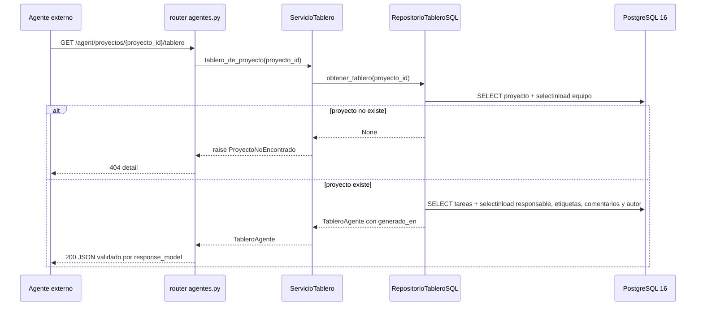
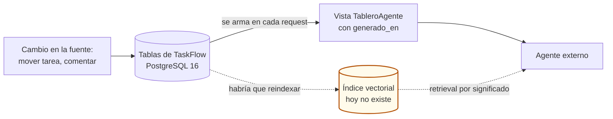
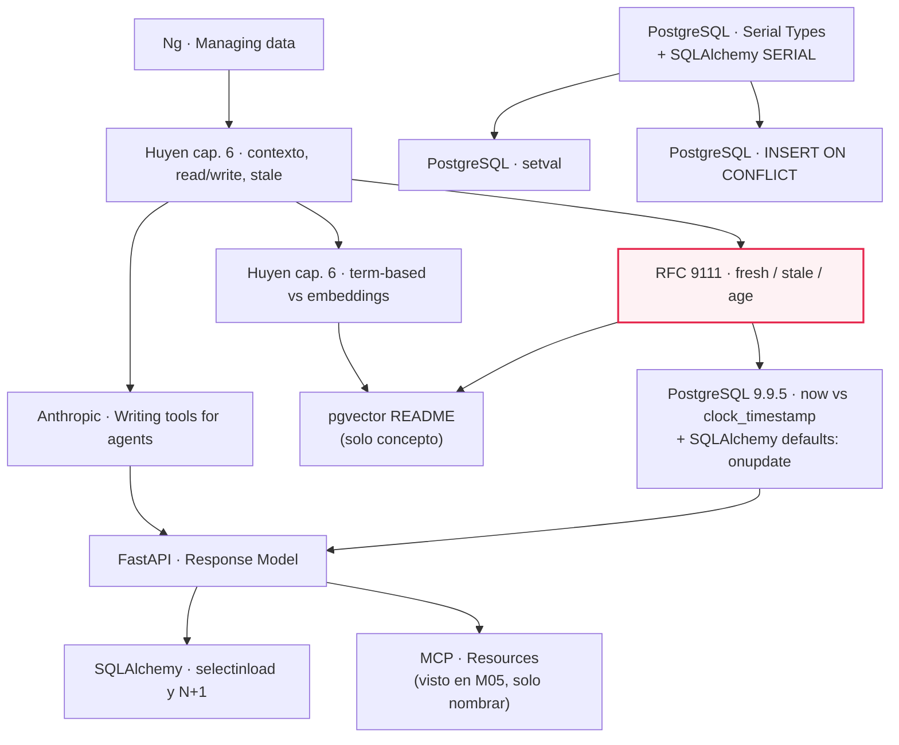

# M07·S08 — Datos para IA y agentes

**Módulo 07 — Fundamentos de Software + System Design para AI Engineers** · Semana 2 (Gestión de datos y diseño de APIs)
**Fecha:** [Completar por el profesor: fecha]
**Tema:** la capa de datos de TaskFlow pensada para un consumidor automatizado: frescura y ciclo de vida, seeds idempotentes y un endpoint de lectura autocontenido para agentes
**Proyecto:** TaskFlow, repo `fastapi-full-v0`: partís del tag `s07` y entregás el tag `s08`
**Duración estimada de estudio:** unas 7 h en total (2 h 40 min de lectura de recursos, 1 h 30 min de guía práctica y 3 h de ejercicios)

---

## 1. Objetivos de aprendizaje

Al terminar esta sesión vas a poder:

1. **Explicar** por qué la arquitectura de datos condiciona lo que un sistema de IA "puede saber", usando TaskFlow como ejemplo: qué datos necesita un agente para entender un proyecto y de dónde los saca.
2. **Documentar** la frescura y el ciclo de vida de cada entidad de un sistema (`docs/datos.md`), y **razonar** con el vocabulario *fresh* / *stale* / *age* sobre cuándo una lectura dejó de ser confiable para tomar una decisión.
3. **Ubicar** los vectores y el RAG como *un* tipo de almacenamiento más: un dato derivado con su propia frescura. También vas a poder **justificar** por qué TaskFlow hoy no los necesita.
4. **Construir** un endpoint de solo lectura pensado para consumo por agentes (`GET /agent/proyectos/{proyecto_id}/tablero`): un DTO de vista autocontenido, `response_model` como contrato y filtro, nombres resueltos en lugar de ids y carga anticipada con `selectinload` para no caer en N+1.
5. **Escribir y debuggear** un seed idempotente por clave natural (`scripts/seed.py`), incluido el error clásico de las secuencias `SERIAL` que no avanzaron, y **comparar** la idempotencia por convención con la idempotencia por constraint (`ON CONFLICT`).
6. **Registrar** en `docs/trade-offs.md` dos decisiones de datos con alternativas y consecuencias propias.

---

## 2. Resumen ejecutivo

En M07·S01 apareció una frase de Andrew Ng que hoy se vuelve concreta. Según el *AI Engineering Skills Map* (2026), sección *Managing data*, los sistemas de IA toman su contexto de las fuentes de datos, así que una arquitectura de datos mal elegida los deja sin saber lo que no saben. En S06 elegiste PostgreSQL por sus patrones de acceso (`ADR-001`) y en S07 TaskFlow pasó a Postgres real, con el ER completo y SQLAlchemy 2.0. Hoy te hacés otra pregunta, que es de **ingeniería de datos y no de modelos**: si mañana un agente tuviera que entender el estado de un proyecto de TaskFlow, ¿qué datos necesita, qué tan frescos tienen que estar y en qué forma se los das?

La respuesta del tag `s08` es chica y defendible. Primero, documentás cada cuánto cambia cada entidad (`docs/datos.md`). Después, cargás datos realistas que se pueden recargar sin romper nada (`scripts/seed.py`). Y por último exponés **una sola lectura autocontenida**, `GET /agent/proyectos/{proyecto_id}/tablero`, que entrega el tablero entero con nombres en vez de ids y una marca de frescura `generado_en`. TaskFlow sigue **sin ningún componente de IA**: el "agente" es cualquier consumidor automatizado externo, por ejemplo el asistente que un equipo conecta a su chat.

¿Por qué importa en tu rol? El RAG que construiste en M04 y los agentes y servidores MCP de M05 viven **encima** de una capa de datos como esta. Si esa capa entrega datos viejos, ambiguos o desparramados en diez endpoints, ningún prompt lo arregla.

---

## 3. Mapa rápido de la sesión

| Pieza | Archivo del tag `s08` | Qué resuelve |
|---|---|---|
| Frescura y ciclo de vida | `docs/datos.md` | Qué datos envejecen rápido y qué puede asumir estable un agente |
| Seeds realistas | `scripts/seed.py` | Datos de ejemplo recargables, idempotentes por clave natural |
| Vista para agentes | `app/models/tablero.py` | DTOs de respuesta (`TableroAgente` y sus partes) |
| Lectura consolidada | `app/repositories/tablero_repository.py` | Una consulta con `selectinload` y el mapeo ORM → vista |
| Caso de uso | `app/services/tablero_service.py` | `ServicioTablero.tablero_de_proyecto`, que levanta `ProyectoNoEncontrado` |
| Borde HTTP | `app/routers/agentes.py` | `GET /agent/proyectos/{proyecto_id}/tablero`, 404 traducido |
| Ensamblado | `app/main.py` | Monta `agentes.router`, seed mínimo por nombre, `version="0.8.0"` |
| Bitácora | `docs/trade-offs.md` | Dos entradas `[s08]` |

---

## 4. Conceptos clave / glosario

Los términos marcados como *visto en…* ya los trabajaste: acá solo los refrescás en una línea.

### Datos y contexto para agentes

| Término | Definición | Para qué se usa | Por qué así |
|---|---|---|---|
| **Contexto (de una query)** | La información específica que un sistema le da a un modelo para resolver *esa* pregunta, a diferencia de las instrucciones, que son comunes a todas las queries. | Para que el modelo responda sobre datos que no estaban en su entrenamiento: el estado de *tu* tablero. | Huyen (*AI Engineering*, 2025, cap. 6) lo compara con el feature engineering del ML clásico: armar contexto es diseñar la entrada, no "pegar todo". |
| **Agente (en esta sesión)** | Cualquier consumidor automatizado de la API que necesita entender el estado de TaskFlow: un asistente con tools, un script, un servidor MCP. *Agentes y tools, vistos en M05.* | Para tratar al agente como **un cliente más** de la capa de datos, con contrato, límites y permisos. | Si lo tratás como "algo especial de IA", terminás con un endpoint ad hoc sin contrato. Si lo tratás como cliente, aplicás lo que ya sabés de APIs. |
| **Knowledge augmentation** | Herramientas que le dan al agente información que no tiene, por ejemplo un ejecutor de SQL o una API de inventario que devuelve el estado de los productos (Huyen, cap. 6). | Para que el agente *perciba* datos privados de la organización. | El tablero de S08 es exactamente esto: una "API de inventario" con tareas en lugar de stock. |
| **Read-only vs write action** | Una herramienta de solo lectura deja al agente *percibir* el entorno; una de escritura le deja *actuar* sobre él (Huyen, cap. 6). | Para decidir qué exponer primero y con qué permisos. | Arrancar por lectura acota el daño posible. Es la misma lógica de no darle a un pasante permiso para borrar la base de producción. |
| **Infraestructura de datos para agentes** | Datos, endpoints y formatos pensados para que los consuma un sistema automatizado, no solo un humano o un software tradicional. | Para que el agente obtenga contexto correcto, completo y fechado con pocas llamadas. | Ng lo describe como un área que evoluciona rápido. El endpoint de S08 es una práctica razonable de hoy, no un estándar asentado. |

### Frescura y ciclo de vida

| Término | Definición | Para qué se usa | Por qué así |
|---|---|---|---|
| **Dato fuente vs dato derivado** | La fuente es donde el dato nace y se corrige (las tablas de Postgres). Un derivado es algo calculado a partir de ella: una vista armada, una caché, un resumen o un índice vectorial. | Para saber qué puede quedar viejo: el derivado **siempre** puede atrasarse respecto de la fuente. | Un derivado tiene que poder **reconstruirse** desde la fuente. Si no se puede, en realidad es una segunda fuente con un problema de consistencia. |
| **Frescura (freshness)** | Qué tan actual es un dato respecto de la realidad que representa. | Para decidir si alcanza con la lectura que tenés o si conviene releer antes de actuar. | Ng la pone junto a "limpio" y "consistente" como propiedad que la gestión de datos tiene que asegurar. |
| ***Fresh* / *stale*** | En RFC 9111 (*HTTP Caching*, §4.2), una respuesta es *fresh* si su *age* no superó su *freshness lifetime*, y *stale* si la superó. | Para hablar de la frescura de un JSON con vocabulario estándar en vez de "más o menos actualizado". | S08 toma prestado el vocabulario, no enseña caché HTTP. *Analogía:* la leche tiene fecha de envasado y fecha de vencimiento: la *age* se cuenta desde la primera y es *stale* cuando pasó la segunda. |
| ***Age*** | Tiempo transcurrido desde que el origen generó (o validó) la respuesta. En el tablero, `ahora − generado_en`. | Para medir cuánto envejeció la lectura que tiene el agente. | Se mide desde el origen y no desde que el cliente la recibió, porque lo que importa es cuándo se miró la base. |
| ***Freshness lifetime*** | Cuánto tiempo puede considerarse válida una respuesta. | Para fijar, por entidad, cuándo hay que releer. | No hay un valor único: minutos para el estado de una tarea, días para el nombre de un proyecto. |
| **Marca de frescura (`generado_en`)** | Timestamp UTC que el servidor pone en la respuesta del tablero: el instante en que se armó la vista. | Para que el consumidor sepa **de cuándo** es lo que está leyendo. | Dice cuándo se armó la vista, **no hasta cuándo vale**. La vida útil la decide el consumidor según `docs/datos.md`. |
| **Ciclo de vida del dato** | Las etapas de una entidad desde que se crea hasta que se archiva o se borra. | Para saber qué puede cambiar, qué es inmutable y qué desaparece. | Ng lo cuenta dentro de *Managing data*: también hay que decidir qué guardar y por cuánto tiempo. |
| **Append-only** | Datos que solo se agregan y nunca se editan ni se borran. En TaskFlow, los comentarios. | Para que un consumidor guarde lo que ya leyó y solo pida lo nuevo. | Un dato inmutable no envejece: lo que envejece es la afirmación "no hay comentarios nuevos". |
| **Timestamp de transacción vs hora real** | En PostgreSQL, `now()` / `CURRENT_TIMESTAMP` devuelven el **inicio de la transacción** y no cambian durante ella; `clock_timestamp()` devuelve la hora real (doc de PostgreSQL 16, §9.9.5). | Para interpretar bien los `created_at` / `updated_at` que lee un agente. | La doc lo llama *"a feature"*: todas las escrituras de una transacción quedan con la misma marca. |
| **Default del cliente vs del servidor** | `default` / `onupdate` los ejecuta SQLAlchemy cuando **él** emite el `INSERT`/`UPDATE`; `server_default` vive en el DDL de la tabla (doc de SQLAlchemy 2.0, *Column INSERT/UPDATE Defaults*). | Para saber quién mantiene `updated_at`. | En TaskFlow lo mantiene el ORM, así que un `UPDATE` hecho a mano en `psql` no lo toca. Para que lo haga la base hace falta un trigger, y SQLAlchemy no lo genera. |
| **Datetime aware vs naive** | En Python, un `datetime` *aware* lleva zona horaria (`tzinfo`) y uno *naive* no. | Para no comparar horas que significan cosas distintas. | Python no te deja restar un aware y un naive: tira `TypeError`, y es mejor que adivinar. |

### Diseño del endpoint

| Término | Definición | Para qué se usa | Por qué así |
|---|---|---|---|
| **DTO / modelo de vista** | Clase que describe la **forma de una respuesta**, no una entidad del dominio ni una tabla. En S08, `TableroAgente` y sus partes. | Para darle al consumidor exactamente la forma que necesita, sin acoplarla al ORM ni al dominio. | Si devolvieras las entidades de dominio, cada cambio interno rompería al agente. El DTO es la frontera. |
| **`response_model`** | *Visto en M07·S03.* El modelo que FastAPI usa para validar, documentar y filtrar la salida de un endpoint. | Acá es el **contrato** que lee el agente en `/docs` y `openapi.json`, y el **filtro** que impide que se cuele un campo interno. | La doc de FastAPI destaca que filtrar la salida es *"particularly important for security"*. |
| **Endpoint autocontenido / consolidado** | Una sola llamada que devuelve todo lo necesario para una tarea, con las relaciones ya resueltas. | Para que el agente entienda el tablero sin encadenar diez requests. | Anthropic recomienda consolidar operaciones que se usan juntas en vez de envolver cada endpoint como tool. |
| **Round-trip** | Un viaje completo request → response entre cliente y servidor. | Para medir el costo de "una llamada vs muchas". | Cada round-trip suma latencia y, en un agente, tokens de razonamiento entre llamada y llamada. |
| **Desnormalizar en la lectura** | Repetir en la respuesta datos que en la base están normalizados (el nombre del responsable en cada tarea, no un id). | Para que la respuesta se entienda sola. | La base sigue en 3FN (S07). Solo la *vista* repite, así que se paga en peso de respuesta y no en anomalías de escritura. |
| **Lazy loading** | El ORM carga una relación recién cuando accedés al atributo (`tarea.responsable`), con un `SELECT` en ese momento. | Para no traer datos que quizás no uses. | Cómodo en código interactivo, peligroso dentro de un bucle. |
| **Problema N+1** | Una query para traer N filas y después una más por cada fila al acceder a una relación: N+1 queries. | Es el antipatrón que hay que evitar cuando armás una vista grande. | Con un tablero de 50 tareas y cuatro relaciones por tarea se van a cientos de queries. |
| **`selectinload`** | Estrategia de carga anticipada de SQLAlchemy: un segundo `SELECT … WHERE id IN (…)` trae todas las relaciones de todos los padres de una vez. | Para que la cantidad de queries sea **fija**, sin importar cuántas tareas haya. | La doc de SQLAlchemy dice que, en la mayoría de los casos, es la forma más simple y eficiente de cargar colecciones anticipadamente. |
| **MCP resource** | *MCP, visto en M05·S19–S21.* Dato que un servidor MCP comparte como contexto para modelos, identificado por una URI; lo elige la aplicación host, no el modelo. | Sería la forma natural de enchufar el tablero a un agente real. | Trae una anotación estándar `lastModified`, que es el pariente de `generado_en`. |

### Vectores (enganche con M04, solo concepto)

| Término | Definición | Para qué se usa | Por qué así |
|---|---|---|---|
| **Embeddings e índice vectorial** | *Vistos en M03·S01 y M04.* Vectores que representan significado y la estructura que permite buscarlos por similitud. | Recuperar texto por significado en un RAG. | Hoy los mirás como **dato derivado**: si el texto fuente cambia y nadie reindexa, el agente "sabe" lo viejo. |
| **Retrieval term-based (BM25)** | *Visto en M04·S04.* Búsqueda por coincidencia de términos. | Es el baseline barato y fuerte. | Huyen lo describe como *baseline* formidable y mucho más liviano de implementar que el retrieval por embeddings. |
| **pgvector** | Extensión de PostgreSQL que agrega un tipo de columna vector, operadores de distancia e índices aproximados (README oficial). | Guardar vectores **junto al resto de tus datos**, con las mismas transacciones y backups. | Es la alternativa a sumar una base vectorial dedicada como servicio aparte. |
| **Índice aproximado (HNSW / IVFFlat)** | Índice que acelera la búsqueda de vecinos a cambio de no garantizar el resultado exacto. | Búsqueda vectorial rápida sobre muchos vectores. | Según el README de pgvector, después de agregarlo **cambian los resultados**, no solo los tiempos. |

### Seeds

| Término | Definición | Para qué se usa | Por qué así |
|---|---|---|---|
| **Seed** | Script que carga datos de ejemplo en una base. | Para probar el sistema con datos realistas, no con "test1, test2". | Un seed realista muestra problemas (relaciones vacías, nombres largos) que los datos de relleno esconden. |
| **Idempotencia** | Propiedad de una operación que da el mismo resultado si la corrés una vez o N veces. | Para poder correr el seed "por las dudas" sin duplicar ni romper. | Es lo que separa a un script que alguien se anima a correr de uno que nadie toca. |
| **Clave natural vs clave sustituta** | La natural identifica la fila por un dato del dominio (`email`, `nombre`, `titulo`); la sustituta es un id generado sin significado (`id`). | La natural sirve para encontrar "la misma" fila entre corridas sin conocer su id. | Sin una constraint `UNIQUE`, una clave natural es **una convención, no una garantía**. |
| **`SERIAL` / secuencia / `nextval`** | Una columna `serial` es una secuencia `tabla_columna_seq` más un `DEFAULT nextval(...)` en la columna (doc de PostgreSQL 16, §8.1.4). SQLAlchemy la emite para las PK enteras. | Generar ids sin que la app los elija. | Si insertás con un id explícito, el default no se evalúa y la secuencia **no avanza**. |
| **`setval`** | Función de Postgres que fija el valor de una secuencia (§9.17). | Realinear una secuencia que quedó atrás. | Con dos argumentos, el próximo `nextval` devuelve valor + 1; con `false` como tercero, devuelve el valor exacto. |
| **Upsert (`INSERT … ON CONFLICT`)** | Insertar, o no hacer nada, o actualizar si ya existe, en una sola sentencia atómica (doc de PostgreSQL 16, *INSERT*). | Idempotencia garantizada por la base, incluso con concurrencia. | **Exige** un índice único o una constraint como árbitro del conflicto. |
| **`Identity`** | Alternativa moderna a `SERIAL` en SQLAlchemy, que genera `GENERATED BY DEFAULT AS IDENTITY`. | Columnas de id autogeneradas con sintaxis estándar. | Se nombra como alternativa; TaskFlow no cambia su modelo. |

---

## 5. Notas de estudio por subtema

### El diagrama ancla: cómo un agente lee el tablero

Este es el recorrido completo de la pieza central de la sesión, tal como está en el tag `s08`. Tenelo a mano mientras leés el resto: cada subtema explica una flecha.



Fijate en tres cosas. Las capas son las mismas de siempre (`router → service → repository → datos`). El repository devuelve **ya** el DTO, así el ORM no se filtra hacia arriba. Y la cantidad de idas a Postgres es fija.

---

### 5.1 La arquitectura de datos condiciona lo que la IA "puede saber"

**Para qué.** Imaginá que el equipo Plataforma conecta un asistente a su chat y le pregunta "¿qué está trabado en Onboarding App y quién lo tiene?". El modelo puede ser excelente, pero si la única forma de averiguarlo es llamar a `GET /tasks` (todas las tareas de todos los proyectos, con `responsable_id: 4` en vez de un nombre), va a contestar mal o va a gastar diez llamadas en resolver ids. **La calidad de la respuesta queda limitada por la calidad del acceso a los datos.**

**La idea.** Ng lo formula así en el *AI Engineering Skills Map* (2026), sección *Managing data*: como los sistemas de IA toman su contexto de las fuentes de datos, una arquitectura de datos mal elegida los deja sin saber lo que no saben. Y agrega que construir infraestructura de datos **para agentes**, no solo para humanos o software tradicional, es un área que evoluciona rápido y cuyas buenas prácticas se siguen ajustando. Leé el endpoint de hoy con esa humildad: es una práctica razonable, no un estándar.

Huyen (*AI Engineering*, 2025, cap. 6) te da el vocabulario sin meterte en el modelo:

- Las **instrucciones** son comunes a todas las queries; el **contexto** es específico de cada una (p. 541). El tablero de "Onboarding App" es contexto: cambia según qué proyecto pregunte el agente.
- RAG y agentes son los dos patrones dominantes para **construir contexto** (pp. 541–542), y construir contexto es el equivalente del feature engineering (p. 544). Ya los construiste en M04 y M05. Hoy estás del otro lado: sos quien diseña la **fuente** de la que ese contexto sale.
- Las herramientas read-only le permiten al agente **percibir**; las de escritura, **actuar** (pp. 594–595). Entre las de *knowledge augmentation* hay ejemplos como un ejecutor de SQL o una API de inventario que devuelve el estado de los productos, y muchas exponen información privada de la organización (pp. 595–596).
- Huyen usa además una analogía (p. 600): así como no le darías a un pasante autoridad para borrar la base de producción, no deberías dejar que una IA poco confiable ejecute acciones críticas.

**Cómo se traduce en TaskFlow.**

| Decisión del tag `s08` | Por qué |
|---|---|
| El agente es **un cliente más** de la capa de datos | Recibe el mismo tratamiento que un frontend o un tercero: contrato (`response_model`), errores con código (404) y límites conocidos. El versionado (`/v1`) llega en S09. |
| El endpoint es **de solo lectura** | Percibir antes que actuar. Las escrituras (crear comentario, CRUD completo) llegan en S10 y con otras reglas. |
| Es **un** endpoint consolidado, no un CRUD envuelto | El agente necesita "el estado del proyecto", no seis recursos sueltos. |
| **Sin autenticación** por ahora | Hoy cualquiera que llegue al puerto lee cualquier tablero. Es una deuda explícita: auth y RBAC son de S16–S17. |

> ⚠️ **No confundas "datos para agentes" con "meterle IA a TaskFlow".** TaskFlow no llama a ningún modelo y no necesita API key. Todo lo de hoy es diseño de datos y de API: el agente vive afuera.

---

### 5.2 Frescura y ciclo de vida de los datos de TaskFlow

**Para qué.** Un agente lee el tablero a las 14:05, y a las 14:06 alguien mueve "Validar formulario de registro" a `en progreso`. A las 14:20 el agente sugiere "tomá Validar formulario de registro, que está en backlog". La respuesta era correcta **cuando se leyó** y es falsa **cuando se usa**. La frescura es el criterio para saber cuándo una lectura sigue sirviendo, y el ciclo de vida te dice qué puede cambiar y qué no.

**El vocabulario estándar.** RFC 9111 (*HTTP Caching*, IETF, junio de 2022; Fielding, Nottingham y Reschke, eds.), §4.2, define:

- ***age***: el tiempo transcurrido desde que el origen generó (o validó) la respuesta;
- ***freshness lifetime***: cuánto puede vivir esa respuesta antes de expirar;
- ***fresh*** si *age* ≤ *freshness lifetime*, y ***stale*** si la superó.

En el tablero, el origen es TaskFlow y el instante de generación es `generado_en`, así que *age* = `ahora − generado_en`. La *freshness lifetime* **no la pone el servidor**: la decide el consumidor según la entidad. Huyen usa la misma palabra, *stale*, para un **modelo** cuyos datos de entrenamiento quedaron viejos (cap. 6, p. 596). Hoy hablamos de la *respuesta* rancia, no del modelo, pero la idea es la misma.

**La tabla de frescura de TaskFlow** (`docs/datos.md` del tag `s08`):

| Entidad | Frecuencia de cambio | Notas |
|---|---|---|
| **Tarea** (estado) | **Alta** | El `estado` se mueve seguido (backlog → en progreso → hecho). Es el dato más volátil. |
| **Tarea** (título/descr.) | Media | Se edita al refinar la tarea; menos que el estado. |
| **Comentario** | Media/Alta | Se agregan durante la actividad; nunca se editan en el modelo actual. |
| **Responsable / Etiquetas** de una tarea | Media | Cambian al reasignar o reclasificar. |
| **Proyecto** | Baja | Nombre/descripción casi no cambian tras crearlo. |
| **Equipo** / membresías | Baja | Altas/bajas esporádicas. |
| **Usuario** | Muy baja | Datos de perfil estables. |

De esa tabla salen las **cuatro implicaciones para un agente** que el mismo documento deja escritas:

1. **Preferir lecturas autocontenidas**: el tablero en una sola llamada, sin resolver ids.
2. **Usar la marca de frescura**: releer antes de decidir si pasó un tiempo desde `generado_en`.
3. **Asumir estable lo de baja frescura**: proyecto, equipo y usuarios se pueden cachear durante una interacción; el estado de las tareas, no.
4. **Comentarios append-only**: el agente se queda con los que ya leyó y solo trae los nuevos.

**Ciclo de vida** (también de `docs/datos.md`): la tarea nace en `backlog`, pasa a `en progreso` y termina en `hecho`. Hoy no se borra ni se archiva (eso llega con el CRUD completo en S10). El comentario es inmutable. Proyecto, equipo, usuario y etiqueta se crean y perduran. Las relaciones M:N se agregan y se quitan sin afectar a las entidades.

**Ejemplo práctico: cómo se ve la marca en el código y en la respuesta.**

```python
# app/repositories/tablero_repository.py (fragmento del tag s08)
return TableroAgente(
    generado_en=datetime.now(timezone.utc),   # hora de Python, CON zona (aware)
    proyecto=ProyectoVista(...),
    resumen=resumen,
    columnas=columnas,
)

# _a_tarea_vista, mismo archivo
ComentarioVista(autor=c.autor.nombre, texto=c.texto, fecha=c.created_at)  # hora de la transacción que lo creó
```

**Por qué así.** `generado_en` se calcula en Python en el momento de armar la vista y no se lee de la base, porque lo que querés fechar es **la vista** (un dato derivado), no una fila. `timezone.utc` la hace *aware*, y en el JSON aparece con `Z` al final. La alternativa, `datetime.now()` sin zona, deja una hora que depende de dónde corre el servidor: un consumidor en otro huso no sabría interpretarla.

> ⚠️ **Dos relojes en la misma respuesta.** `fecha` de cada comentario sale de `created_at`, que el ORM declara como `datetime` **sin zona** y que Postgres llena con `now()` de la transacción. Mirá tu salida: si `fecha` llega sin offset, un agente que reste `generado_en − fecha` en Python obtiene un `TypeError`. Son dos marcas distintas: "cuándo se armó la vista" y "cuándo se creó el comentario".

> 💡 **Los dos comentarios de "Arreglar el orden de columnas" tienen la misma `fecha`.** No es un bug: el seed los inserta en una sola transacción, y `now()` devuelve el **inicio de la transacción** y no cambia durante ella (doc de PostgreSQL 16, §9.9.5, donde se lo presenta como *"a feature"*). Si quisieras la hora real de cada sentencia, existe `clock_timestamp()`.

**Quién actualiza `updated_at`.** En `app/db/models.py` cada entidad tiene:

```python
updated_at: Mapped[datetime] = mapped_column(
    server_default=func.now(), onupdate=func.now()
)
```

`server_default` queda en el DDL de la tabla y lo aplica Postgres en el `INSERT`. `onupdate`, en cambio, **lo agrega SQLAlchemy** al `UPDATE` que él emite (doc de SQLAlchemy 2.0, *Column INSERT/UPDATE Defaults*). Consecuencias:

- `POST /tasks/{tarea_id}/move` pasa por el ORM, así que `updated_at` se actualiza.
- Un `UPDATE tareas SET estado = 'hecho' WHERE id = 3;` hecho a mano en `psql` **no** lo toca.
- Mover una tarea al **mismo** estado que ya tenía no genera `UPDATE` (el ORM no ve cambios), así que `updated_at` tampoco cambia.

Por eso `docs/datos.md` dice que `updated_at` "se actualiza en cada cambio": es verdad **mientras el cambio pase por la app**. Si la base tuviera que garantizarlo, haría falta un trigger, que SQLAlchemy no genera. No es parte del tag `s08`: queda como discusión.

**Errores comunes**

- Creer que `generado_en` dice hasta cuándo vale la lectura. Dice **cuándo se armó**. La lectura del paso 1 del lab queda *stale* en el instante en que alguien mueve una tarea, aunque la marca no cambie.
- Pensar que la frescura es una propiedad del dato. Es una relación entre el dato, el momento en que lo leíste y la decisión que vas a tomar con él.
- Tratar los comentarios como algo que envejece. Lo leído sigue siendo verdad; lo que envejece es "no hay nuevos".

**Para profundizar:** RFC 9111 §4.2; PostgreSQL 16 §9.9.5; SQLAlchemy 2.0 *Column INSERT/UPDATE Defaults* (links en la sección 11).

---

### 5.3 Datos para RAG: los vectores como un tipo de almacenamiento más

**Para qué.** En M04 construiste un RAG y en M05 lo convertiste en herramienta de un agente. La pregunta de hoy no es "cómo hacer RAG", sino **dónde encaja un índice vectorial en la arquitectura de datos** y qué responsabilidades trae. Respondiéndola podés defender por qué TaskFlow **no** lo necesita todavía, que es tan importante como saber armarlo.

**El índice vectorial es un dato derivado.** Volvé a la distinción fuente/derivado: el texto de un comentario vive en `comentarios.texto` (fuente), y su embedding sería un **derivado**. Todo derivado tiene su propia frescura: si el comentario cambiara y nadie reindexara, el agente seguiría encontrando la versión vieja. En TaskFlow los comentarios son append-only, así que solo habría que indexar los nuevos. En un sistema donde el texto se edita, reindexar es parte del ciclo de vida.



La vista del tablero se arma **en cada request**, así que nace fresca y solo envejece del lado del consumidor. Un índice vectorial, en cambio, se construye **antes** de la consulta: puede estar viejo en el momento mismo en que lo consultás.

**Lo que dice la teoría que ya viste.** Huyen (cap. 6) recuerda que BM25 y sus variantes son *baselines* formidables y que los retrievers term-based son mucho más livianos de implementar; los basados en embeddings son más intensivos y tienen potencial de superarlos (pp. 554 y 650–651). Con embeddings, lo fácil es guardar vectores y lo difícil es **buscarlos** rápido; además, la query se embebe **con el mismo modelo** que se usó al indexar (pp. 556–558). Esa regla ya la viste en M03·S01: cambiar de modelo obliga a reindexar todo, otra cara del ciclo de vida del derivado.

**"Vectores junto al resto de tus datos".** El README de pgvector (consultado el 1 de octubre de 2026) presenta la extensión, versión 0.8.6, compatible con Postgres 13+, con el lema *"Store your vectors with the rest of your data"*: ACID, point-in-time recovery y JOINs junto a los vectores, búsqueda exacta y aproximada, e índices **HNSW** e **IVFFlat**. Para tu arquitectura significa esto:

| Opción | Ganás | Pagás |
|---|---|---|
| Vectores en el mismo Postgres (pgvector) | Una sola base, transacciones y backups compartidos, JOIN entre el vector y la tarea | Una extensión más que operar; la búsqueda compite por recursos con el resto de la app |
| Base vectorial dedicada | Escala y features de búsqueda propias | Otro servicio, otra fuente que sincronizar, consistencia entre dos sistemas |
| Nada de vectores (TaskFlow hoy) | Cero costo, cero sincronización | No hay búsqueda por significado sobre texto libre |

Dos advertencias del mismo README que son **problemas de datos, no de modelo**:

- *"Unlike typical indexes, you will see different results for queries after adding an approximate index"*: un índice aproximado cambia **qué** devuelve la consulta, no solo cuánto tarda.
- Con índices aproximados, el filtrado (por proyecto, por permisos) se aplica **después** del escaneo del índice. Si filtrás por proyecto, podés recibir menos resultados de los que pediste.

**Por qué TaskFlow no lo necesita hoy.** El tablero tiene seis entidades relacionales y preguntas estructuradas ("¿qué está en progreso?", "¿quién tiene qué?"): una consulta SQL bien armada **es** el contexto. Los vectores entran cuando hay texto libre abundante y preguntas por significado ("¿hubo alguna discusión sobre el logo?" sobre miles de comentarios). Cuando llegue ese día, el término-based es el primer escalón. Por eso `docs/datos.md` lo deja explícito: RAG, embeddings y búsqueda vectorial **no** van en TaskFlow.

**Errores comunes**

- Agregar vectores porque "es un proyecto de IA". Sin texto libre abundante y preguntas por significado, es complejidad sin retorno.
- Olvidar que el índice es un derivado y no planificar el reindexado.
- Medir un índice aproximado solo por latencia y no por resultados.

**Para profundizar:** README de pgvector (sección 11). Huyen, cap. 6, en la biblioteca del curso.

---

### 5.4 Infraestructura de datos para consumo por agentes: el endpoint autocontenido

**Para qué.** Que un agente entienda el estado de un proyecto **en una sola llamada**, con datos legibles, con fecha y con una forma garantizada. Sin este endpoint, tendría que llamar a `GET /tasks`, filtrar por proyecto, pedir cada responsable por id, cada etiqueta y cada comentario con su autor: muchos round-trips, mucho espacio para equivocarse y muchos tokens.

**La justificación de diseño.** El artículo *Writing effective tools for AI agents* (Ken Aizawa, Anthropic Engineering, 11 sep 2025) da los principios, y se leen como guía de **diseño de API y de datos**:

- No convertir cada endpoint existente en tool. En vez de un `list_contacts` que devuelve todo, algo como `search_contacts`.
- **Consolidar** operaciones que se usan juntas. Su ejemplo es un `get_customer_context` que junta toda la información relevante de un cliente.
- Devolver solo información **de alta señal**.
- Resolver identificadores alfanuméricos a **lenguaje con significado** mejora la precisión en tareas de retrieval.
- Cuidar los tokens con paginación, filtrado y truncado con defaults sensatos. Claude Code limita las respuestas de tools a 25.000 tokens por defecto.

`GET /agent/proyectos/{proyecto_id}/tablero` es literalmente un "get_project_context": consolida proyecto, equipo, tareas, responsables, etiquetas y comentarios, y resuelve ids a nombres (`"responsable": "Lin Torvalds"`, no `"responsable_id": 2`).

**Ejemplo práctico 1: el DTO de vista** (`app/models/tablero.py`, completo, tal como está en el tag):

```python
"""Modelos de vista para el endpoint de lectura de agentes (s08).

Son DTOs de RESPUESTA (no entidades de dominio): describen un tablero autocontenido,
con el contexto ya resuelto (nombres en vez de ids, tareas agrupadas por columna, con
responsable, etiquetas y comentarios). Pensados para que un agente entienda el estado
del proyecto en una sola llamada, sin tener que resolver relaciones por su cuenta.
"""

from datetime import datetime

from pydantic import BaseModel


class EquipoVista(BaseModel):
    nombre: str


class EtiquetaVista(BaseModel):
    nombre: str
    color: str | None = None


class ComentarioVista(BaseModel):
    autor: str
    texto: str
    fecha: datetime | None = None


class TareaVista(BaseModel):
    id: int
    titulo: str
    descripcion: str | None = None
    responsable: str | None = None  # nombre, no id
    etiquetas: list[EtiquetaVista] = []
    comentarios: list[ComentarioVista] = []


class ColumnasTablero(BaseModel):
    backlog: list[TareaVista] = []
    en_progreso: list[TareaVista] = []
    hecho: list[TareaVista] = []


class ProyectoVista(BaseModel):
    id: int
    nombre: str
    descripcion: str | None = None
    equipo: EquipoVista


class ResumenTablero(BaseModel):
    total_tareas: int
    por_estado: dict[str, int]


class TableroAgente(BaseModel):
    """Respuesta autocontenida del tablero de un proyecto, lista para un agente."""

    generado_en: datetime  # marca de frescura: cuándo se armó esta vista
    proyecto: ProyectoVista
    resumen: ResumenTablero
    columnas: ColumnasTablero
```

**Por qué así:**

- **Es un DTO, no una entidad.** No hay tabla `tableros` ni entidad `Tablero` con identidad propia: es una *vista* armada a pedido. Vive en `app/models/` porque es Pydantic y no depende del ORM, pero el docstring deja claro que es "de respuesta". La alternativa, devolver `Tarea` del dominio con `responsable_id` y `etiqueta_ids`, obligaría al agente a resolver relaciones.
- **Las tareas conservan `id`; el resto, no.** El responsable, el autor y el equipo llegan como nombre porque el agente los **lee**. La tarea lleva `id` porque es lo que el agente necesitaría para pedir una acción después, como `POST /tasks/{tarea_id}/move`.
- **`en_progreso` con guion bajo.** En la base y en el Enum `Estado` el valor es `"en progreso"` (con espacio), pero un campo Pydantic no puede tener espacios. Un consumidor tiene que conocer **las dos formas**: es un detalle de contrato.
- **`etiquetas: list[...] = []`** como default mutable no es el bug clásico de Python: Pydantic copia el default por instancia, así que dos `TareaVista` no comparten la lista.
- **El DTO no tiene `email`, `updated_at` ni ids internos.** Lo que no está declarado no sale, aunque el ORM lo tenga.

**`response_model` como contrato y filtro.** S03 ya presentó `response_model`; acá lo relees con un consumidor automatizado del otro lado. Según la doc de FastAPI (*Response Model — Return Type*), el response model **valida** la salida (si el código arma algo inválido es un error del servidor y no se manda basura), **agrega su JSON Schema** a OpenAPI y **limita y filtra** la salida a lo declarado, *"particularly important for security"*. Para el agente, `response_model=TableroAgente` es el schema que puede leer en `/docs` y `openapi.json`, la garantía de que la forma no cambia sin que nadie lo note y el filtro que impide que se cuele un email.

**Ejemplo práctico 2: la consulta sin N+1** (fragmento de `RepositorioTableroSQL.obtener_tablero`):

```python
tareas = self._session.scalars(
    select(TareaORM)
    .where(TareaORM.proyecto_id == proyecto_id)
    .order_by(TareaORM.id)
    .options(
        selectinload(TareaORM.responsable),
        selectinload(TareaORM.etiquetas),
        selectinload(TareaORM.comentarios).selectinload(ComentarioORM.autor),
    )
).all()
```

**Por qué así.** `_a_tarea_vista` toca, para **cada** tarea, `t.responsable`, `t.etiquetas`, `t.comentarios` y el `autor` de cada comentario. Con lazy loading (el default), cada acceso dispara un `SELECT`: es el **problema N+1** que describe la doc de SQLAlchemy 2.0 (*Relationship Loading Techniques*). `selectinload` emite **un** `SELECT … WHERE … IN (…)` por relación con las PK de todos los padres, y la misma doc dice que, en la mayoría de los casos, es la forma más simple y eficiente de cargar colecciones anticipadamente. El encadenado `.selectinload(ComentarioORM.autor)` resuelve el segundo nivel (comentario → autor) también de una vez. Resultado: un puñado **fijo** de queries, tenga el tablero 3 tareas o 300. Es el costo oculto de "darle todo de una vez": sin esto, el consejo de consolidar se paga en queries.

> 💡 La alternativa `joinedload` haría un `JOIN` en la misma query. Con colecciones (etiquetas, comentarios) multiplica filas: una tarea con 3 etiquetas y 5 comentarios aparece 15 veces en el resultado crudo. Por eso, para colecciones, la elección es `selectinload`.

**El 404 traducido en el router** (igual que en `/tasks`): el repository devuelve `None` si el proyecto no existe, el service lo convierte en la excepción de dominio `ProyectoNoEncontrado` (reutilizada de `app/services/tarea_service.py`) y el router la traduce a `404` con `{"detail": "El proyecto 999 no existe"}`. Ninguna capa conoce lo que no le corresponde: el repository no sabe de HTTP y el router no sabe de SQL.

**Cómo se enchufaría a un agente real (sin construirlo).** MCP ya lo viste en M05·S19–S21, donde incluso expusiste el RAG de M04 como server. La especificación de MCP, versión 2026-07-28, define los **resources** como datos que un servidor comparte para dar contexto a modelos de lenguaje, identificados por una URI y con un modelo de interacción *application-driven*: decide la aplicación host, no el modelo, a diferencia de las tools. El tablero encaja naturalmente como resource, por ejemplo con una URI `taskflow://proyectos/{id}/tablero`. Los resources tienen anotaciones opcionales `audience`, `priority` y `lastModified` (timestamp ISO 8601), y esta última es la contraparte estándar de `generado_en`. La misma spec dice que `resources/list` puede variar según la autorización del request y que los servidores **SHOULD** implementar controles de acceso para recursos sensibles: otra razón por la que el endpoint sin auth es deuda. MCP **no** se implementa en TaskFlow.

**Tamaño y deuda.** La respuesta es más pesada y desnormalizada que un CRUD. La entrada `[s08]` de `docs/trade-offs.md` ya lo anota como consecuencia: para tableros muy grandes convendrá paginar o filtrar, y eso se formaliza en el contrato de S09–S10. Hoy no.

**Errores comunes**

- Envolver `GET /tasks` como tool y llamarlo "endpoint para agentes".
- Mandar ids "porque el agente puede resolverlos": cada resolución es un round-trip y una oportunidad de error.
- Quitar las `.options(...)` "porque funciona igual". Funciona, pero con N+1.
- Devolver el ORM directamente sin `response_model`: se cuelan columnas que no querías exponer.

**Para profundizar:** Anthropic, *Writing effective tools for AI agents*; FastAPI, *Response Model*; SQLAlchemy, *Relationship Loading Techniques*; spec de MCP, *Resources* (sección 11).

---

### 5.5 Seeds idempotentes por clave natural

**Para qué.** Para probar el tablero hace falta un tablero con vida: dos equipos, cuatro personas, tareas en las tres columnas, etiquetas y comentarios. Y tenés que poder recargar esos datos cuando quieras, en tu base, en la de tu compañero o después de un `down -v`, sin duplicar nada y sin borrar lo que ya creaste a mano.

**Las tres estrategias de seed.**

| Estrategia | Cómo funciona | Ganás | Pagás |
|---|---|---|---|
| **Reset** (truncate + insert) | Borra todo y vuelve a cargar | Estado 100 % reproducible | Destruye lo que había |
| **Insertar si falta** (la del tag) | Busca por clave natural y crea solo lo que no está | Conserva lo existente, no duplica | El estado final depende de lo que ya existiera; no corrige filas que cambiaron |
| **Upsert** (`ON CONFLICT`) | Una sentencia atómica: inserta o actualiza | Garantía de la base, atómico aun con concurrencia | Exige un índice único sobre la clave natural |

**El corazón del seed** (`scripts/seed.py`, tal cual el tag):

```python
def _get_or_create(db: Session, modelo, filtros: dict, extra: dict | None = None):
    """Devuelve la fila que cumple `filtros` o la crea con filtros+extra."""
    fila = db.scalars(select(modelo).filter_by(**filtros)).first()
    if fila is not None:
        return fila
    fila = modelo(**filtros, **(extra or {}))
    db.add(fila)
    db.flush()
    return fila
```

Uso:

```python
plataforma = _get_or_create(db, EquipoORM, {"nombre": "Plataforma"})
ada = _get_or_create(db, UsuarioORM, {"email": "ada@taskflow.dev"}, {"nombre": "Ada Lovelace"})
```

**Por qué así:**

- **`filtros` es la clave natural; `extra`, el resto.** Se busca por `{"email": "ada@taskflow.dev"}` y, si no existe, se crea con email **y** nombre. Separar los dos dicts deja explícito qué identifica a la fila y qué es solo dato.
- **`db.flush()`** manda el `INSERT` sin confirmar la transacción. Hace falta por dos motivos: el `id` lo asigna la secuencia de Postgres al insertar (y `core.id` se usa enseguida como `equipo_id` del proyecto), y `SessionLocal` está configurada con `autoflush=False`, así que sin flush explícito la próxima búsqueda no vería la fila recién agregada.
- **Sin ids fijos.** Se busca por nombre, email o título, nunca por `id=1`. Esto viene del punto siguiente.

**Por qué "sin ids fijos": la secuencia.** Una columna `serial` equivale a una secuencia `tabla_columna_seq` más un `DEFAULT nextval('tabla_columna_seq')` (doc de PostgreSQL 16, §8.1.4), y SQLAlchemy emite `SERIAL` para las PK enteras (doc del dialecto PostgreSQL). Por eso tu tabla `equipos` tiene una secuencia `equipos_id_seq` aunque nunca la escribiste. El `nextval` vive **en el default**: si insertás con `id=1` explícito, el default no se evalúa y la secuencia no avanza. El próximo insert sin id pide `nextval`, recibe `1` y choca con la PK.

Eso es justo lo que hacía el lifespan de s07, y por eso el tag `s08` lo **cambia**:

```python
# s07: ids explícitos, la secuencia no avanza
if db.get(EquipoORM, 1) is None:
    db.add(EquipoORM(id=1, nombre="Core"))
if db.get(ProyectoORM, 1) is None:
    db.add(ProyectoORM(id=1, nombre="General", equipo_id=1))

# s08: búsqueda por nombre, la secuencia asigna el id
equipo = db.scalars(select(EquipoORM).where(EquipoORM.nombre == "Core")).first()
if equipo is None:
    equipo = EquipoORM(nombre="Core")
    db.add(equipo)
    db.flush()
if db.scalars(select(ProyectoORM).where(ProyectoORM.nombre == "General")).first() is None:
    db.add(ProyectoORM(nombre="General", equipo_id=equipo.id))
```

Como el lifespan y `seed.py` buscan "Core" y "General" por nombre, da igual cuál corra primero: el segundo encuentra lo que creó el primero.

**Idempotencia también en las relaciones.** Las membresías (`afiliar`) y las etiquetas de una tarea se agregan solo si faltan (`if equipo not in usuario.equipos`). Los comentarios se identifican por `(tarea, texto)`. Todo el seed corre en **una** transacción con un solo `db.commit()` al final: si algo falla a mitad de camino, no queda un seed a medias.

**La clave natural sin `UNIQUE` y su costo.** En `app/db/models.py` solo `usuarios.email` es único. `equipos.nombre`, `proyectos.nombre`, `etiquetas.nombre` y `tareas.titulo` **no tienen constraint**. Eso tiene dos consecuencias:

1. La idempotencia es **por convención**: si dos personas corrieran el seed exactamente a la vez, las dos podrían no encontrar "Plataforma" y crearla dos veces. "Buscar y después insertar" son dos pasos desde Python, no una operación atómica.
2. La clave natural de una tarea es el **título global**, no `(proyecto, título)`. Si en una base limpia creás por la API una tarea "Publicar guía de onboarding" en el proyecto 1 **antes** de sembrar, el seed la encuentra por título y no crea la de "Onboarding App".

La alternativa que el repo **no** eligió enseña mucho: `INSERT … ON CONFLICT DO NOTHING | DO UPDATE` hace de la idempotencia una garantía de la base, y `ON CONFLICT DO UPDATE` garantiza un resultado atómico de insert o update aun con alta concurrencia. Pero necesita como árbitro un **índice único o una constraint** (con `DO UPDATE`, el `conflict_target` es obligatorio) (doc de PostgreSQL 16, *INSERT*). Agregar ese índice es un cambio de esquema, y con `create_all` (que no altera tablas existentes) no es gratis. Para un seed que corre una persona en su máquina, la convención alcanza, y ese razonamiento es el que va a la bitácora.

> ⚠️ **"Insertar si falta" no corrige.** Si en el lab movés "Validar formulario de registro" a `en progreso` y volvés a correr el seed, **no** vuelve a `backlog`: la tarea ya existe, así que el seed no la toca. Es la consecuencia que anota la entrada `[s08]`: el estado final depende de lo que ya existiera.

**El gotcha de la base heredada.** Si tu base viene de s07, tiene `equipos.id = 1` y `proyectos.id = 1` insertados con id explícito y las secuencias sin consumir. La primera corrida de `seed.py` falla con algo como `duplicate key value violates unique constraint "equipos_pkey"` al crear "Plataforma". El arreglo con `setval` está en la guía práctica (paso 3). `setval(seq, n)` deja `is_called = true` y el próximo `nextval` devuelve `n + 1`; con `false` como tercer argumento, devuelve exactamente `n` (doc de PostgreSQL 16, §9.17).

**Errores comunes**

- Sembrar con ids fijos "para que sea predecible". Es predecible hasta que alguien inserta sin id.
- Olvidar el `flush()` con `autoflush=False` y no encontrar la fila que acabás de agregar.
- Creer que la clave natural está protegida porque "nadie va a repetir un nombre".
- Esperar que el seed "resetee" el estado.

**Para profundizar:** PostgreSQL 16 *Serial Types*, *Sequence Manipulation Functions* e *INSERT*; SQLAlchemy, dialecto PostgreSQL (sección 11).

---

### 5.6 Mapa de relaciones entre los recursos

El orden importa: primero el porqué (Ng y Huyen), después la frescura, que es el criterio con el que se diseña todo lo demás, y recién entonces el endpoint. Los vectores son una rama lateral y los seeds, un bloque independiente.



Lo que el diagrama no alcanza a mostrar:

- **RFC 9111 y Huyen dicen lo mismo con sujetos distintos:** la RFC habla de la *respuesta* rancia y Huyen del *modelo* rancio. Hoy trabajás la primera.
- **Anthropic justifica la forma del endpoint y FastAPI la garantiza:** "consolidá y devolvé alta señal con nombres legibles" se vuelve contrato validado y filtrado con `response_model`.
- **`selectinload` es el costo de la consolidación:** sin él, el consejo de Anthropic se paga en queries.
- **MCP Resources** retoma `lastModified` como equivalente estándar de `generado_en`: leelo después de hacer el paso de frescura del lab.

---

## 6. Guía práctica paso a paso

**Partís del tag `s07`:** TaskFlow corre sobre PostgreSQL 16 con SQLAlchemy 2.0 (ORM en `app/db/models.py`, separado del dominio), el ER completo se crea con `create_all` y el lifespan siembra `Core`/`General` con ids fijos. La única puerta HTTP es `app/routers/tareas.py` (`/tasks`, `/tasks/{tarea_id}/move`) más `GET /health`, con app `version="0.7.0"`.
**Terminás en el tag `s08`:** `docs/datos.md`, `scripts/seed.py`, el endpoint `GET /agent/proyectos/{proyecto_id}/tablero` en cuatro capas, el seed mínimo del lifespan por nombre, dos entradas `[s08]` en `docs/trade-offs.md`, README actualizado y `version="0.8.0"`.

**Prerrequisitos**

- El repo de tu equipo en el tag `s07`, con `.venv` creado y `requirements.txt` instalado. **S08 no agrega dependencias.**
- Docker funcionando y `.env` copiado de `.env.example` (lo hiciste en S05), con `DATABASE_URL=postgresql+psycopg://…`.
- Claude Code (o el agente que uses) en el repo.
- **No hace falta ninguna API key ni LLM.** El "agente" del lab sos vos con `curl` y Swagger.

### Paso 0 — Arrancar la sesión con el agente

Mismo protocolo que en S05: le decís al agente **"arrancamos la sesión s08"**, él lee `sessions/s08.md` y te propone un plan, y vos lo aprobás o lo corregís.

`sessions/s08.md` define una sesión **liviana en código**. **Entra:** documentar frescura y ciclo de vida, seeds realistas y un endpoint de lectura autocontenido para agentes. **No entra:** RAG ni vectores reales.

Antes de aprobar, chequeá que el plan:

- [ ] no agregue dependencias, Alembic, pgvector ni nada de embeddings;
- [ ] respete las capas: modelo de vista → repository → service → router;
- [ ] haga el endpoint **solo lectura** y **sin versionar** (el `/v1` es de S09);
- [ ] cambie el seed mínimo del lifespan a búsqueda por nombre.

**Verificación:** el plan nombra los archivos de la tabla de la sección 3 y nada más.

### Paso 1 — Levantar y sembrar

```bash
source .venv/bin/activate
docker compose up -d                       # PostgreSQL 16 (servicio db)
python scripts/seed.py                     # datos realistas, idempotente
uvicorn app.main:app --reload --env-file .env
#   -> Swagger:  http://127.0.0.1:8000/docs
#   -> Tablero:  GET http://127.0.0.1:8000/agent/proyectos/1/tablero
```

**Por qué así:**

- `python scripts/seed.py` corre **sin** `--env-file`: el script trae un mini-cargador de `.env` (`_cargar_env`) que setea las variables que falten, y **recién después** importa `app.db.database`, porque el engine lee `DATABASE_URL` al importarse. Por ese orden los imports llevan `# noqa: E402` (el linter se queja de imports que no están arriba de todo, y acá es a propósito).
- `seed.py` llama a `Base.metadata.create_all(engine)`, así que funciona antes o después de levantar la API, y en una base vacía también crea las tablas.
- `--env-file .env` en `uvicorn` le da `DATABASE_URL` a la app, igual que en s07.

**Verificación:** el seed imprime los conteos (ver paso 2) y `http://127.0.0.1:8000/docs` muestra un grupo **agentes** con el endpoint nuevo.

> Si el seed falla con `duplicate key value violates unique constraint "equipos_pkey"`, saltá al paso 3 y volvé.

### Paso 2 — Probar la idempotencia del seed

```bash
python scripts/seed.py
python scripts/seed.py      # segunda vez: mismos conteos, nada duplicado
```

Salida esperada en una base limpia (forma; la imprime `sembrar()`):

```
Seeds cargados (idempotente):
  equipos=2  usuarios=4  proyectos=2  tareas=6  comentarios=3
```

**Verificación:** las dos corridas dan los **mismos** números. Si tu base tenía tareas creadas por la API en s07, `tareas` da más de 6: el seed **conserva** lo que había. Es la elección "insertar si falta" frente a "reset".

**Para ver el límite de la clave natural** (opcional, en base limpia): creá por la API, **antes** de sembrar, una tarea con título `"Publicar guía de onboarding"` en el proyecto 1 (`POST /tasks` desde Swagger). Después corré el seed: la encuentra por título y **no** crea la de "Onboarding App".

### Paso 3 — Gotcha: base heredada de s07 (secuencias sin avanzar)

Si tu base viene de s07, el lifespan de entonces insertó `equipos.id = 1` y `proyectos.id = 1` **explícitos** y las secuencias quedaron sin consumir. El default del lab es la **opción A**, que conserva tus datos:

```bash
# Opción A (conserva los datos): llevar cada secuencia al máximo id actual
docker compose exec db psql -U taskflow -d taskflow -c \
  "SELECT setval('equipos_id_seq',   (SELECT max(id) FROM equipos));
   SELECT setval('proyectos_id_seq', (SELECT max(id) FROM proyectos));"
```

- `setval` con dos argumentos deja `is_called = true`, así que el próximo `nextval` devuelve `max(id) + 1`.
- Los nombres `equipos_id_seq` y `proyectos_id_seq` salen de la convención `tabla_columna_seq` de `SERIAL`.
- Si una tabla está vacía, `max(id)` es `NULL` y `setval` falla: en ese caso no hace falta tocarla.

Plan B, si algo más se rompe (perdés las tareas creadas a mano en s07, porque `-v` borra el volumen `taskflow_pgdata`):

```bash
# Opción B (base limpia): recrear el volumen y dejar que create_all + seed armen todo
docker compose down -v && docker compose up -d
python scripts/seed.py
```

**Verificación:** `python scripts/seed.py` termina sin error y muestra `equipos=2`.

### Paso 4 — Revisar las capas del endpoint

El modelo de vista (`app/models/tablero.py`) está completo en la sección 5.4 y el repository, anotado línea por línea, en la Unidad 2 de la sección 7. Estas son las otras tres piezas tal como quedan en el tag. Compará lo que generó tu agente contra esto.

`app/services/tablero_service.py`:

```python
"""Capa service: caso de uso de lectura del tablero para agentes (s08).

Orquesta la obtención del tablero autocontenido delegando en el repositorio. Solo
lectura, sin transacciones de escritura. Levanta ProyectoNoEncontrado (reutilizada del
service de tareas) si el proyecto no existe, para que el router responda 404.
"""

from app.models.tablero import TableroAgente
from app.repositories.tablero_repository import RepositorioTableroSQL
from app.services.tarea_service import ProyectoNoEncontrado


class ServicioTablero:
    def __init__(self, repo_tablero: RepositorioTableroSQL) -> None:
        self._repo_tablero = repo_tablero

    def tablero_de_proyecto(self, proyecto_id: int) -> TableroAgente:
        tablero = self._repo_tablero.obtener_tablero(proyecto_id)
        if tablero is None:
            raise ProyectoNoEncontrado(proyecto_id)
        return tablero
```

**Por qué así:** el service parece trivial, y lo es **hoy**. Existe para que la regla "proyecto inexistente = error de dominio" viva en una sola capa y para que, cuando lleguen permisos (S16–S17), haya un lugar donde ponerlos sin tocar ni SQL ni HTTP. Reutiliza `ProyectoNoEncontrado` en vez de crear otra excepción porque significa exactamente lo mismo que en `/tasks`. No hace `commit` porque no escribe nada.

`app/routers/agentes.py`:

```python
"""Capa router: endpoint de lectura para agentes (s08).

Expone una vista autocontenida del tablero de un proyecto, pensada para consumo por un
agente: en una sola llamada devuelve el proyecto, su equipo y las tareas agrupadas por
columna con responsable, etiquetas y comentarios ya resueltos. Sin versionar todavía
(el `/v1` es s09). Delega en el service y traduce ProyectoNoEncontrado a 404.
"""

from fastapi import APIRouter, Depends, HTTPException, status
from sqlalchemy.orm import Session

from app.db.database import get_db
from app.models.tablero import TableroAgente
from app.repositories.tablero_repository import RepositorioTableroSQL
from app.services.tablero_service import ServicioTablero
from app.services.tarea_service import ProyectoNoEncontrado

router = APIRouter(prefix="/agent", tags=["agentes"])


def obtener_servicio_tablero(db: Session = Depends(get_db)) -> ServicioTablero:
    return ServicioTablero(RepositorioTableroSQL(db))


@router.get("/proyectos/{proyecto_id}/tablero", response_model=TableroAgente)
def tablero_de_proyecto(
    proyecto_id: int,
    servicio: ServicioTablero = Depends(obtener_servicio_tablero),
) -> TableroAgente:
    try:
        return servicio.tablero_de_proyecto(proyecto_id)
    except ProyectoNoEncontrado:
        raise HTTPException(
            status_code=status.HTTP_404_NOT_FOUND,
            detail=f"El proyecto {proyecto_id} no existe",
        )
```

**Por qué así:**

- **`prefix="/agent"`** separa en la URL lo que es para consumidores automatizados, y `tags=["agentes"]` lo agrupa en Swagger.
- **`obtener_servicio_tablero` es una dependencia local**, mientras que `obtener_servicio_tareas` vive en `app/dependencies.py`. El tag deja el cableado del tablero junto a su único router; si mañana otro router lo necesitara, lo natural sería moverlo a `app/dependencies.py`. Es una inconsistencia menor y vale la pena notarla.
- **La `Session` es por request** (vía `get_db`): el repository lee dentro de la transacción de ese request y `get_db` la cierra al final.
- **`proyecto_id: int`**: si alguien pide `/agent/proyectos/abc/tablero`, FastAPI responde 422 sin tocar la base.

`app/main.py` (cambios respecto de s07): monta el router nuevo, cambia el seed mínimo a búsqueda por nombre (sección 5.5) y sube la versión.

```python
from app.routers import agentes, tareas
# ...
app = FastAPI(title="TaskFlow", version="0.8.0", lifespan=lifespan)

app.include_router(tareas.router)
app.include_router(agentes.router)
```

**Verificación:** `uvicorn` levanta sin errores y en `/docs` el endpoint muestra el schema `TableroAgente` en la sección *Schemas*.

### Paso 5 — Consumir el tablero como lo haría un agente

```bash
curl -s http://127.0.0.1:8000/agent/proyectos/1/tablero | python -m json.tool
curl -s -o /dev/null -w "%{http_code}\n" http://127.0.0.1:8000/agent/proyectos/999/tablero   # -> 404
docker compose exec db psql -U taskflow -d taskflow -c "SELECT id, nombre FROM proyectos;"   # ids reales
```

Forma esperada para "General" con el seed (los ids, el orden y los timestamps varían):

```json
{
  "generado_en": "2026-10-01T14:05:12.345678Z",
  "proyecto": {
    "id": 1, "nombre": "General", "descripcion": null,
    "equipo": { "nombre": "Core" }
  },
  "resumen": {
    "total_tareas": 3,
    "por_estado": { "backlog": 1, "en_progreso": 1, "hecho": 1 }
  },
  "columnas": {
    "backlog": [
      { "id": 3, "titulo": "Escribir documentación de la API", "descripcion": null,
        "responsable": null, "etiquetas": [{ "nombre": "docs", "color": "#0091ff" }],
        "comentarios": [] }
    ],
    "en_progreso": [
      { "id": 2, "titulo": "Arreglar el orden de columnas", "descripcion": null,
        "responsable": "Lin Torvalds",
        "etiquetas": [{ "nombre": "bug", "color": "#e5484d" }, { "nombre": "urgente", "color": "#f76b15" }],
        "comentarios": [
          { "autor": "Lin Torvalds", "texto": "El orden se rompe al mover una tarjeta a 'hecho'.", "fecha": "2026-10-01T14:01:03.120000" },
          { "autor": "Ada Lovelace", "texto": "Lo miro hoy, parece el índice de ordenamiento.", "fecha": "2026-10-01T14:01:03.120000" }
        ] }
    ],
    "hecho": [
      { "id": 1, "titulo": "Configurar el tablero inicial", "descripcion": null,
        "responsable": "Ada Lovelace", "etiquetas": [{ "nombre": "feature", "color": "#30a46c" }],
        "comentarios": [] }
    ]
  }
}
```

**Qué mirar** (y anotar para la puesta en común):

- [ ] **Nombres, no ids:** `responsable`, `autor`, `equipo` y etiquetas llegan resueltos; las tareas conservan `id`.
- [ ] **`en_progreso` vs `"en progreso"`:** la clave del JSON y el valor del Enum son distintos.
- [ ] **Dos relojes:** `generado_en` con `Z`; mirá si `fecha` llega con o sin offset en **tu** salida.
- [ ] **Comentarios con la misma `fecha`:** misma transacción del seed.
- [ ] **404 con `detail`:** `{"detail": "El proyecto 999 no existe"}`.
- [ ] **Sin auth:** cualquiera que llegue al puerto lee cualquier tablero.

### Paso 6 — Ver la frescura en acción

```bash
# 1) Leer y anotar generado_en y la columna de "Validar formulario de registro" (proyecto Onboarding App)
curl -s http://127.0.0.1:8000/agent/proyectos/<ID_ONBOARDING>/tablero | python -m json.tool

# 2) Moverla (endpoint de s05, sin cambios)
curl -s -X POST http://127.0.0.1:8000/tasks/<ID_TAREA>/move \
  -H "Content-Type: application/json" -d '{"estado": "en progreso"}'

# 3) Releer: la tarea cambió de columna y generado_en es posterior
curl -s http://127.0.0.1:8000/agent/proyectos/<ID_ONBOARDING>/tablero | python -m json.tool
```

**Placeholders:** `<ID_ONBOARDING>` sale del `SELECT id, nombre FROM proyectos;` del paso 5. `<ID_TAREA>` es el `id` de "Validar formulario de registro" en el primer GET.

**Verificación y lectura:** en el paso 3, la tarea pasó de `backlog` a `en_progreso`, `resumen.por_estado` cambió y `generado_en` es posterior. La lectura del paso 1 quedó **stale** en el instante en que moviste la tarea, aunque su `generado_en` no lo diga. Es la regla 2 de `docs/datos.md`: releer antes de decidir si pasó un tiempo desde `generado_en`.

### Paso 7 — (Opcional, exploratorio) contar las queries del tablero

```python
# app/db/database.py — SOLO para mirar en clase; no se commitea
engine = create_engine(DATABASE_URL, pool_pre_ping=True, echo=True)
```

Con `echo=True`, cada request a `/agent/...` imprime el SQL en la consola de `uvicorn`. Deberías ver una query para el proyecto, más la del equipo, y una por cada `selectinload`, **sin importar cuántas tareas** tenga el tablero. Para contrastar, comentá las `.options(...)` del repository y mirá cómo crece la cantidad de `SELECT` con las tareas (N+1).

> ⚠️ Volvé **todo** atrás antes de commitear: el tag `s08` no lleva `echo=True` ni las `.options(...)` comentadas. `git diff` tiene que salir limpio en esos dos archivos.

### Paso 8 — Documentar, registrar y entregar

1. **`docs/datos.md`:** revisá que tenga las cuatro partes (frescura por entidad, ciclo de vida, cuatro implicaciones para un agente, fuera de alcance) y que **vos** puedas defender cada fila de la tabla.
2. **`docs/trade-offs.md`:** dos entradas nuevas arriba de las de s07, con la plantilla del archivo:
   - `[s08] Endpoint de lectura para agentes: forma autocontenida`: alternativas "tablero de proyecto autocontenido" vs "contexto de una sola tarea"; consecuencia: respuesta más pesada y desnormalizada, con paginación o filtros para tableros grandes en S09–S10.
   - `[s08] Estrategia de seeds: idempotente por clave natural`: alternativas "reset (truncate + insert)" vs "idempotente (insert si falta)"; consecuencia: el estado final depende de lo que ya existiera.
   Escribí las alternativas y consecuencias **con tus palabras y tus razones**: pueden sumar el upsert (`ON CONFLICT`) como tercera alternativa y la falta de `UNIQUE` sobre `titulo` como consecuencia.
3. **`README.md`:** paso 3 "Datos de ejemplo realistas" (`python scripts/seed.py`), la ruta del tablero en el paso 4 y un párrafo "s08 — Datos para agentes" en Estado.
4. **Commit y tag:**

```bash
git add -A
git commit -m "s08: datos para agentes (seed idempotente, tablero autocontenido, docs/datos.md)"
git tag s08
git push && git push --tags
```

**Verificación final:** `git show s08 --stat` lista `docs/datos.md`, `scripts/seed.py`, los cuatro archivos del endpoint, `app/main.py`, `docs/trade-offs.md` y `README.md`.

> 📝 **Nota para el profesor:** defaults usados en esta guía, todos ajustables. **Timing de los 180 min:** 40 concepto (5.1–5.3, con 10–15 min de vectores sin lab) / 60 taller guiado (pasos 0–3) / 45 práctica autónoma (pasos 5–7) / 20 puesta en común (¿tablero autocontenido o contexto por tarea? ¿idempotencia por convención o por constraint?) / 15 cierre (paso 8). **Equipos:** los mismos de 3 de S05. **Entrega:** commits con prefijo `s08:` y tag `s08`. **Consumo del "agente":** `curl` y Swagger, sin LLM ni API key. Como opcional, quien quiera puede pegar el JSON del tablero en el asistente que use, preguntarle "¿qué está trabado y quién lo tiene?" y comparar la respuesta con y sin `generado_en`. **Base heredada:** opción A (`setval`) por defecto. **Diagrama:** el tag `s08` no agrega `.mmd`; el diagrama de secuencia de la sección 5 es apoyo de clase, no entregable. Si lo quieren en el repo, el nombre natural sería `docs/diagrams/s08-tablero-agente.mmd`. **Rúbrica (4 criterios de igual peso):** (a) `seed.py` corre dos veces sin duplicar y el alumno explica por qué; (b) el tablero responde 200 con nombres resueltos y 404 para un proyecto inexistente; (c) el alumno explica qué significa `generado_en` y cuándo una lectura quedó *stale* (paso 6); (d) las dos entradas `[s08]` tienen alternativas y consecuencias propias, no copiadas.


---

## 7. Checklist de autoevaluación

- [ ] Puedo explicar, sin mirar los apuntes, por qué "la IA no sabe lo que no sabe" es un problema de arquitectura de datos y no del modelo.
- [ ] Puedo definir *age*, *freshness lifetime*, *fresh* y *stale*, y aplicarlos a una respuesta del tablero.
- [ ] Puedo explicar qué dice `generado_en` y qué **no** dice.
- [ ] Puedo explicar por qué `updated_at` no cambia con un `UPDATE` hecho en `psql`.
- [ ] Puedo justificar por qué el índice vectorial es un dato derivado y por qué TaskFlow no lo necesita hoy.
- [ ] Puedo explicar qué hace `response_model=TableroAgente` en sus tres funciones: contrato, validación y filtro.
- [ ] Puedo explicar qué es N+1, mostrarlo con `echo=True` y decir cómo lo evita `selectinload`.
- [ ] Puedo explicar por qué `scripts/seed.py` no usa ids fijos y arreglar una secuencia atrasada con `setval`.
- [ ] Puedo comparar "insertar si falta" con reset y con upsert, y decir qué exige cada uno.
- [ ] Mis dos entradas `[s08]` en `docs/trade-offs.md` tienen alternativas y consecuencias escritas por mí.

---

## 8. Preguntas de repaso

1. Un equipo quiere conectar un asistente a TaskFlow y propone exponer como tools todos los endpoints CRUD existentes. ¿Qué le responderías? ¿Qué diseñarías en su lugar y qué costos tiene tu alternativa?
2. Un agente leyó el tablero hace 40 segundos y está por recomendar a quién asignar una tarea. ¿Cómo decide si releer? ¿Qué información le falta a la respuesta actual para decidirlo solo, y quién debería aportarla, el servidor o el consumidor?
3. Te piden agregar búsqueda semántica sobre los comentarios de TaskFlow. ¿Qué preguntas hacés antes de aceptar? Si se hace, ¿pgvector en el mismo Postgres o una base vectorial dedicada? ¿Qué nuevo problema de frescura aparece?
4. Explicá con un ejemplo de TaskFlow por qué una idempotencia "por convención" puede fallar y qué tendrías que cambiar en el esquema para que sea una garantía. ¿Qué te costaría ese cambio hoy?
5. El endpoint del tablero no tiene autenticación. Describí el riesgo concreto con los datos del seed y explicá por qué igual es razonable que el tag `s08` salga así.

---

## 9. Recursos adicionales

### Imprescindibles

- **Andrew Ng, *AI Engineering Skills Map: Software engineering fundamentals* (2026), sección "Managing data".** Biblioteca del curso. Lectura de 5 min: la tesis de la sesión.
- **Chip Huyen, *AI Engineering* (2025), cap. 6: apertura de "RAG and Agents" y "Tools".** Biblioteca del curso, pp. 541–545 y 594–600 del PDF. 20 min: contexto, read-only vs write y *stale*.
- **[Writing effective tools for AI agents — Anthropic Engineering](https://www.anthropic.com/engineering/writing-tools-for-agents).** 20 min: la justificación del endpoint consolidado.
- **[Response Model — Return Type — FastAPI](https://fastapi.tiangolo.com/tutorial/response-model/).** 15 min: el contrato y el filtro.
- **[RFC 9111 — HTTP Caching](https://www.rfc-editor.org/rfc/rfc9111.html).** Solo §4.2 *Freshness*, 10 min: el vocabulario de frescura.

### Recomendados

- **[Relationship Loading Techniques — SQLAlchemy 2.0](https://docs.sqlalchemy.org/en/20/orm/queryguide/relationships.html).** Secciones "Lazy Loading", "Select IN loading" y "What Kind of Loading to Use?", 15 min.
- **[Column INSERT/UPDATE Defaults — SQLAlchemy 2.0](https://docs.sqlalchemy.org/en/20/core/defaults.html).** "Python-Side Defaults" y "Server-invoked DDL-Explicit Default Expressions", 10 min.
- **[9.9.5. Current Date/Time — PostgreSQL 16](https://www.postgresql.org/docs/16/functions-datetime.html).** Solo §9.9.5, 5 min.
- **[8.1.4. Serial Types — PostgreSQL 16](https://www.postgresql.org/docs/16/datatype-numeric.html).** Solo §8.1.4, 5 min.
- **[9.17. Sequence Manipulation Functions — PostgreSQL 16](https://www.postgresql.org/docs/16/functions-sequence.html).** 5 min: `setval`.
- **[INSERT — ON CONFLICT — PostgreSQL 16](https://www.postgresql.org/docs/16/sql-insert.html).** Sección "ON CONFLICT Clause", 10 min.
- **Chip Huyen, *AI Engineering* (2025), cap. 6: term-based vs embedding-based retrieval.** Biblioteca del curso, pp. 549–558 y 650–651 del PDF, 15 min.

### Opcionales

- **[pgvector — README oficial](https://github.com/pgvector/pgvector).** Intro, Getting Started e Indexing, 10 min. Solo concepto, no se implementa.
- **[Resources — Model Context Protocol, especificación 2026-07-28](https://modelcontextprotocol.io/specification/latest/server/resources).** User Interaction Model, Annotations y Security Considerations, 10 min.
- **[PostgreSQL dialect — Sequences/SERIAL/IDENTITY — SQLAlchemy 2.0](https://docs.sqlalchemy.org/en/20/dialects/postgresql.html).** Sección "Sequences/SERIAL/IDENTITY", 5 min.


