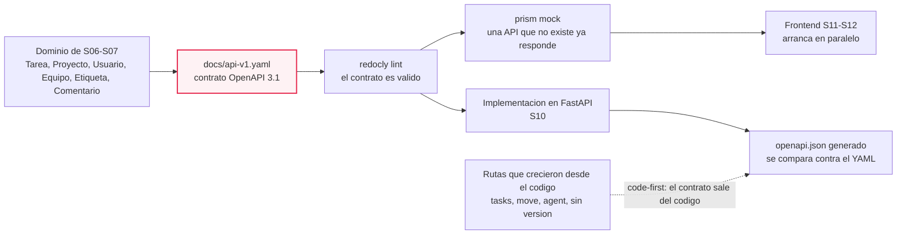
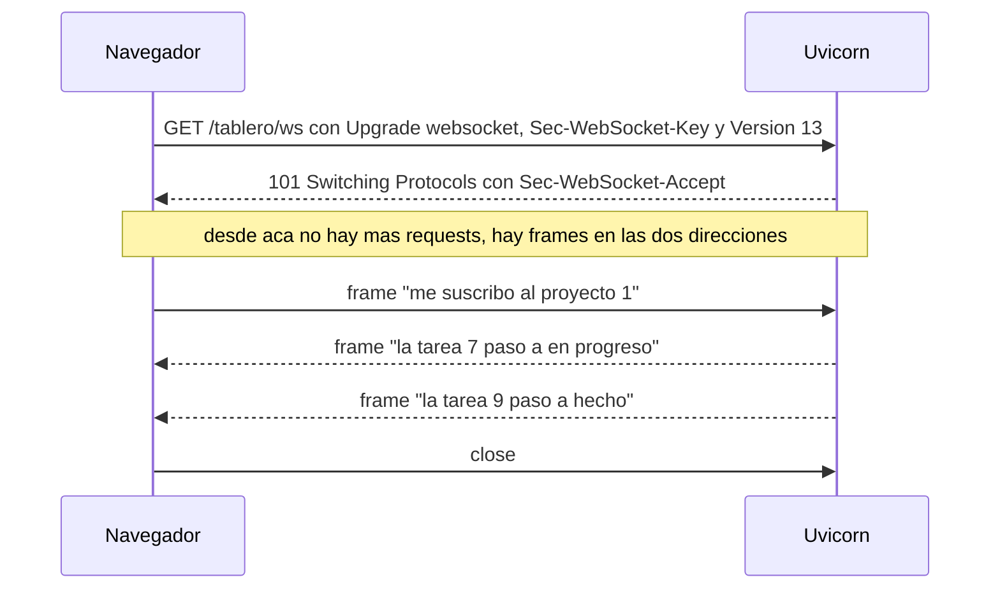
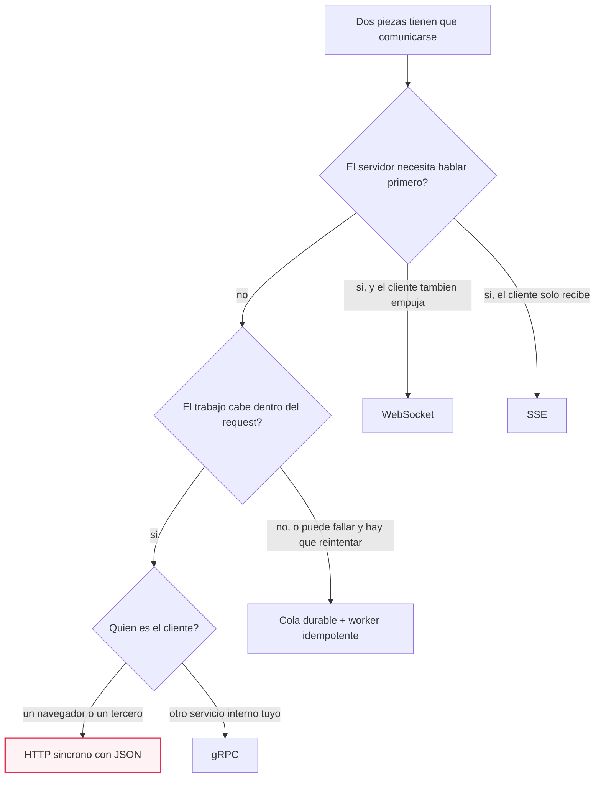
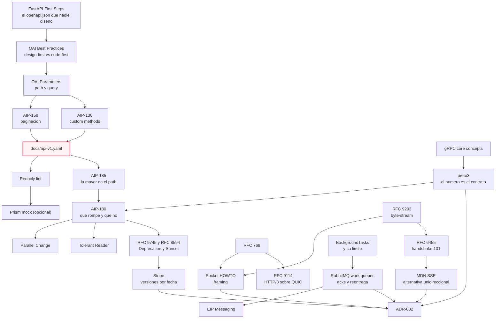

# M07·S09 — Diseño de APIs y protocolos

**Módulo 07 — Fundamentos de Software + System Design para AI Engineers** · Semana 2 (Gestión de datos y diseño de APIs)
**Fecha:** [Completar por el profesor: fecha]
**Tema:** diseñar el contrato de la API de TaskFlow **antes** de implementarlo (OpenAPI 3.1 top-down, recursos en plural y en español bajo `/v1`, paginación) y elegir con criterio el protocolo de comunicación: HTTP síncrono, WebSockets/SSE, colas o gRPC, sobre TCP o UDP
**Proyecto:** TaskFlow, repo `fastapi-full-v0`: partís del tag `s08` y entregás el tag `s09`
**Duración estimada de estudio:** unas 8 h (3 h 30 min de lectura de recursos, 4 h 30 min de ejercicios incluido el lab de la Unidad 1)

---

## 1. Objetivos de aprendizaje

Al terminar esta sesión vas a poder:

1. **Explicar** la diferencia entre diseñar una API *top-down* (design-first: el contrato primero) y *bottom-up* (code-first: el contrato sale del código), y **decidir** cuál manda en un proyecto que ya tiene código escrito.
2. **Escribir** un contrato OpenAPI 3.1 a mano (`docs/api-v1.yaml`) —recursos en plural, parámetros de path y de query, `components/schemas`, una acción que no es CRUD, paginación `limit`/`offset`— y **validarlo** con un linter antes de que exista una línea de FastAPI.
3. **Versionar** una API de forma explícita (`/v1` → `/v2`): **clasificar** un cambio como compatible o incompatible, comunicar la deprecación con `Deprecation` y `Sunset`, y **comparar** el prefijo en el path con sus alternativas (parallel change, tolerant reader, versionado por fecha).
4. **Elegir** el protocolo según el caso —HTTP/HTTPS síncrono, WebSockets, SSE, colas de mensajes, gRPC— sabiendo qué problema resuelve cada uno y qué costo operativo agrega.
5. **Explicar y demostrar** la diferencia entre TCP (confiable, ordenado, *byte-stream*) y UDP (datagramas sin garantía), y **debuggear** el problema de framing que aparece al mandar varios mensajes por una conexión TCP.
6. **Registrar** la decisión de protocolo como `ADR-002` en `docs/trade-offs.md`, con alternativas descartadas y condiciones concretas de revisión.

---

## 2. Resumen ejecutivo

Hasta el tag `s08`, la API de TaskFlow **creció desde el código**. En S05 nacieron `POST /tasks`, `GET /tasks` y `POST /tasks/{tarea_id}/move`; en S08 se sumó `GET /agent/proyectos/{proyecto_id}/tablero`. Funciona, pero nadie diseñó eso: las rutas están sin versionar, mezclan inglés y español y el listado no acepta ni un parámetro. En S03 viste que FastAPI publica solo su esquema en `/openapi.json` — el contrato **salía** del código. Hoy se invierte la flecha, porque S10 implementa la API completa y la pregunta que conviene contestar antes es: ¿quién decide cómo se ve esa API, el código o un contrato escrito primero?

La sesión tiene dos mitades que terminan en el mismo entregable. La primera es **diseño de API**: escribir `docs/api-v1.yaml` top-down, lintearlo y ponerle `/v1` adelante para poder cambiar de opinión sin romper a los clientes que ya existan (el frontend de S11–S12 es el primero). La segunda es **protocolos**: un contrato HTTP request/response alcanza para el CRUD del tablero, pero no para "ver la tarea moverse sin recargar" (WebSockets o SSE), ni para "mandar el email de asignación sin frenar la respuesta" (colas), ni para "hablar con otro servicio interno con un contrato tipado y binario" (gRPC). Debajo de todos ellos hay un transporte —TCP casi siempre, UDP cuando la pérdida se tolera— cuyas propiedades explican por qué cada protocolo de arriba tiene la forma que tiene.

¿Por qué importa en tu rol? Porque elegir protocolo es uno de esos trade-offs que, según el *AI Engineering Skills Map* de Ng con el que abrió el bloque en S01, un agente de código decide mal cuando nadie se los especifica: pedile "que el tablero se actualice en vivo" sin contexto y vas a recibir polling cada dos segundos o un connection manager en memoria. Las dos cosas se rompen cuando TaskFlow escale. El cierre de la sesión es dejar de heredar la decisión por omisión: `ADR-002` convierte "HTTP síncrono" en una elección con alternativas descartadas y condiciones de revisión.

---

## 3. Mapa rápido de la sesión

| Pieza | Dónde vive | Qué resuelve |
|---|---|---|
| Contrato de la API v1 | `docs/api-v1.yaml` (nuevo en `s09`) | Qué recursos, métodos, parámetros y respuestas existen, escrito **antes** del código |
| Validación del contrato | `npx @redocly/cli@latest lint docs/api-v1.yaml` | Que el YAML sea un contrato válido y no un archivo plausible |
| Mock del contrato (opcional) | `prism mock docs/api-v1.yaml` | Pegarle requests a una API que todavía no existe |
| Decisión de protocolo | `## [s09] ADR-002` en `docs/trade-offs.md` | Por qué HTTP síncrono y no WebSockets, cola o gRPC |
| Decisiones del contrato | `### [s09] Diseño del contrato v1…` en `docs/trade-offs.md` | `/v1` en el path, `limit`/`offset`, `/mover` como subruta |
| Demos de transporte | carpeta de clase **fuera** del repo (`demos-s09/`) | Ver con los ojos que TCP es un stream de bytes y UDP no promete nada |
| Snippets de WebSocket, cola y gRPC | solo en el material | Discutir forma y costo; **ninguno entra al repo en `s09`** |

> ⚠️ **El código no cambia en esta sesión.** `app/`, `scripts/`, `docker-compose.yml` y `requirements.txt` quedan idénticos al tag `s08`. S09 entrega **contrato**; la implementación de `/v1` es de S10. El `docker-compose.yml` sigue teniendo solo PostgreSQL 16: no entra ningún broker de mensajes.

---

## 4. Conceptos clave / glosario

Los términos marcados como *visto en…* ya los trabajaste: acá van refrescados en una línea.

### 4.1 Diseño del contrato

| Término | Definición | Para qué se usa | Por qué así |
|---|---|---|---|
| **OpenAPI description (OAD)** | Documento YAML o JSON que describe una API HTTP: paths, operaciones, parámetros, bodies y respuestas. | Para que humanos y herramientas lean la misma definición: documentación, linters, mocks y clientes generados salen del mismo archivo. | Es texto: vive en Git y se revisa en un PR. La guía *Best Practices* de la OpenAPI Initiative pide tratarlo como un *"first-class source file"*, commiteado y dentro del CI. |
| **Design-first (top-down)** | Escribir la descripción primero y el código después. | Para cerrar la forma de la API cuando cambiarla todavía es gratis: antes de endpoints, tests y frontend pegados a ella. | La OAI es enfática: *"the importance of using Design-first cannot be stressed strongly enough"*, porque OpenAPI no describe cualquier API HTTP y diseñar primero garantiza que la API **sea describible**. |
| **Code-first (bottom-up)** | Derivar la descripción del código ya escrito (anotaciones, introspección). | Para arrancar rápido sin mantener dos archivos: es el camino natural de FastAPI. | La OAI lo llama el camino más fácil. El costo aparece cuando hay clientes: la forma la terminó decidiendo el framework, no el diseño. |
| **Single source of truth / drift** | Una sola definición que manda; el *drift* es que haya dos y divergan sin que nadie se entere. | Para poder responder "¿cuál de las dos está mal?" cuando el YAML dice una cosa y el código otra. | Desde hoy TaskFlow tiene dos descripciones (el YAML y el `openapi.json` generado). La OAI pide declarar cuál manda y, si hay dos, un test de CI que verifique la consistencia: ese diff se cobra en S10. |
| **`operationId`** | Identificador único por operación (`listarTareas`). | Para que un cliente generado tenga nombres de método legibles. | Sin él, el generador fabrica nombres a partir de la URL: el día que cambie el path, cambia el método de todos los clientes. |
| **`components/schemas`** | Tipos reutilizables referenciados con `$ref`. | Para describir `Tarea` una vez y usarla en el listado, el detalle y `mover`. | Escribir el objeto inline en cada respuesta deja tres definiciones que se desincronizan. Regla práctica: a `components` va lo que aparece más de una vez o tiene nombre propio en el dominio. |
| **Path templating / parámetro de path** | Un `{placeholder}` en el path declarado con `in: path`. | Para identificar **a cuál** recurso le hablás. | La guía *Parameters* exige que cada placeholder tenga su parámetro homónimo y que los de path declaren `required: true`: no hay recurso "opcional" en medio de una URL. |
| **Parámetro de query** | Parámetro después del `?`, declarado con `in: query`. | Para modular *cómo* querés la respuesta de una colección: filtrar, ordenar, paginar. | Son opcionales por defecto (`required: false`), que es justo lo que querés en un filtro: sin filtros, la colección entera (paginada). |
| **Custom method (acción no-CRUD)** | Operación que no se expresa bien como crear/leer/actualizar/borrar y se modela aparte, verbo + sustantivo. | Para transiciones con reglas, no ediciones de campos: mover una tarea de columna. | AIP-136 la reserva para *"functionality that can not be easily expressed via standard methods"*, pide `:` + verbo en la URI y *"`POST` must be used if the method has side effects or mutates resources or data"*. |
| **Envelope de paginación** | Objeto que envuelve la lista con metadata (`{resultados, total, limit, offset}`). | Para decir cuántos hay en total y en qué página estás sin inventar headers. | Un array pelado no tiene dónde crecer: agregar `total` o un cursor después cambia el tipo de la respuesta, que es breaking. Con envelope es un campo más. |
| **Offset vs cursor** | Offset: "dame 20 salteando 40". Cursor: "dame 20 a partir de este token opaco". | Para devolver colecciones grandes en pedazos. | Offset es lo que SQL hace sin esfuerzo (`LIMIT … OFFSET …`, visto en S07) y lo que todos entienden el día uno. AIP-158 prefiere cursor porque el offset recorre filas y se desincroniza si alguien inserta entre dos páginas. TaskFlow elige offset **sabiendo** lo otro. |
| **Token opaco** | String que el servidor emite y el cliente devuelve sin interpretarlo. | Para cambiar la paginación por dentro sin romper al cliente. | AIP-158 exige que los tokens *"must be opaque (but URL-safe) strings, and must not be user-parseable"* y que no otorguen autorización: si el cliente aprende a fabricarlos, pasan a ser parte del contrato. |
| **Linter de contrato** | Herramienta que reporta errores y warnings con regla, severidad, archivo, línea y columna. | Para saber en segundos si lo que escribiste es un contrato válido o un YAML con buena pinta. | Es el equivalente a que pasen los tests. Sin linter, el design-first es un acto de fe. |
| **Mock server** | Servidor que responde usando solo la descripción, sin implementación. | Para que el frontend de S11–S12 arranque el mismo día que se escribió el contrato. | Es el argumento contra "el YAML es burocracia": con el contrato ya se le pueden pegar requests a una API que no existe. |
| **AsyncAPI** | El análogo de OpenAPI para eventos: *"a communication contract between senders and receivers within an event-driven system"*, con canales, mensajes y operaciones. | Para documentar los mensajes de un WebSocket o de una cola, que también son contrato. | Sin él, los eventos son el único contrato no escrito del sistema: cambiás un campo del payload y rompés consumidores igual que con un endpoint. Hoy se nombra y no se practica: TaskFlow no emite eventos. |

### 4.2 Versionado y compatibilidad

| Término | Definición | Para qué se usa | Por qué así |
|---|---|---|---|
| **Versión mayor en el path** | El primer segmento declara la versión mayor: `/v1/tareas`. | Para publicar una forma nueva e incompatible sin apagar la que tus clientes usan. | AIP-185 pide la mayor y solo la mayor: *"Google APIs must not expose minor or patch version numbers"*, porque los cambios compatibles llegan "en el lugar" y no deberían obligar a migrar de URL. |
| **Breaking change** | Cambio que rompe código escrito contra la versión anterior. | Para saber cuándo *tenés* que crear `/v2` y cuándo podés publicar sin avisar. | AIP-180 lista los casos: campos obligatorios nuevos, quitar componentes, cambiar el tipo de un campo *"even if the new type is wire-compatible"*, y renombrar, que *"is semantically equivalent to 'remove and add'"*. |
| **Cambio aditivo** | Agregar algo opcional: un campo en la respuesta, una operación, un valor de enum. | Para evolucionar dentro de la misma versión mayor. | Es compatible **si el cliente es tolerante**; con un cliente que valida contra un schema cerrado, hasta un campo nuevo rompe. |
| **Cambio semántico silencioso** | El schema queda igual y cambia el significado: otro default, otro formato, otro límite. | Para detectar los breaking changes que ningún diff muestra. | Subir el `limit` máximo de 100 a 500 no rompe; bajarlo a 10 sí, y las dos ediciones se ven idénticas en el archivo. |
| **Parallel change (expand / migrate / contract)** | Cambio incompatible en tres pasos: soportar viejo y nuevo a la vez, migrar clientes de a poco, quitar lo viejo. | Para renombrar o reestructurar sin versionar toda la API. | Danilo Sato lo describe como *"an alternative to using an explicit version in the exposed API"*. Con un solo cliente propio suele ser más barato que mantener dos árboles de rutas. |
| **Tolerant reader** | Consumidor que toma solo los campos que necesita e ignora el resto. | Para que el proveedor agregue campos sin coordinar un release con cada cliente. | La recomendación de Fowler es *"only take the elements you need, ignore anything you don't"*, apoyada en la ley de Postel. Del lado servidor, Pydantic ya ignora los campos extra del body: TaskFlow **es** un lector tolerante sin haberlo decidido. |
| **`Deprecation` / `Sunset`** | Headers de respuesta: el primero avisa que un recurso está (o va a estar) deprecado; el segundo fija cuándo la URI *"is likely to become unresponsive"*. | Para que la deprecación la lea una máquina en cada respuesta, no un mail que nadie abrió. | **No comparten formato**: `Deprecation` usa una Date estructurada (`@1688169599`) y `Sunset` un HTTP-date (`Sat, 31 Dec 2018 23:59:59 GMT`). Y el sunset *"MUST NOT be earlier than the one given in the Deprecation header field"*. |
| **Versionado por fecha (Stripe)** | Cada versión es una fecha; la cuenta queda fijada a la vigente en su primer request y se sobrescribe por request con `Stripe-Version`. | Para que cada integración actualice cuando quiera, sin corte global. | Por dentro, cada cambio incompatible vive en un *version change module* y las respuestas se transforman **hacia atrás** hasta la versión del cliente. Más caro de operar, compra compatibilidad casi perpetua. |

### 4.3 Protocolos y transporte

| Término | Definición | Para qué se usa | Por qué así |
|---|---|---|---|
| **HTTP request/response** | El cliente inicia, el servidor contesta, la interacción termina. *Visto en S02.* | Para casi todo: CRUD, consultas, formularios. Cacheable y depurable con `curl`. | Sus dos límites abren el resto de la sesión: el servidor no puede hablar primero y el trabajo lento ocupa el request. |
| **Polling / long polling** | Preguntar cada N segundos; o retener el request abierto hasta que haya novedad o venza un timeout. | Para simular push sin cambiar de protocolo. | Polling es trivial y desperdicia requests; long polling ahorra requests pero ocupa una conexión y un worker por cliente esperando. Son el punto de comparación honesto de SSE y WebSockets. |
| **WebSocket** | Canal **bidireccional** sobre una conexión TCP: *"an opening handshake followed by basic message framing, layered over TCP"*. | Para que cliente y servidor se manden mensajes en cualquier momento: tablero en vivo, presencia, "está escribiendo…". | Empieza siendo HTTP (`Upgrade: websocket` → `101 Switching Protocols`), así que entra por el mismo puerto y lo sirve el mismo Uvicorn. Después del 101 ya no hay requests: autenticación y validación de `Origin` se resuelven en el handshake o no se resuelven. |
| **SSE** | Stream de eventos servidor → cliente sobre una sola conexión HTTP, **unidireccional**, con `Content-Type: text/event-stream`. | Para el caso real del tablero, que solo **recibe** (los movimientos siguen viajando por HTTP). | Más barato de operar: sin protocolo nuevo, el navegador **reconecta solo** y el stream es texto (`event`, `data`, `id`, `retry`). Costo concreto: en HTTP/1.x los navegadores permiten 6 conexiones por navegador y dominio, compartidas entre pestañas (en HTTP/2 el techo son los streams negociados, 100 por defecto). Es además el transporte con el que las APIs de modelos streamean token a token (enganche con M04–M05). |
| **Cola de mensajes / work queue** | Intermediario durable donde un productor deja mensajes y uno o varios consumidores los toman. | Para sacar del request lo que no tiene por qué pasar ahora: el email de asignación. | Lo que compra no es velocidad, es **desacople temporal**: el servicio de email puede estar caído cuando se asigna la tarea y el email sale igual más tarde. |
| **Ack y reentrega** | El consumidor confirma (`basic_ack`) y recién entonces el broker borra; si el canal cae antes del ack, el mensaje **se reencola** y va a otro consumidor. | Para no perder trabajo cuando un worker muere a mitad de camino. | Convierte "mandé el mensaje" en "alguien lo hizo". El precio es que el mismo mensaje puede llegar dos veces. |
| **at-most-once / at-least-once / "exactly-once efectivo"** | Puede perder y nunca duplica / nunca pierde y puede duplicar / at-least-once **más un consumidor idempotente**. | Para elegir qué falla preferís y diseñar el worker en consecuencia. | No hay cuarta opción mágica: entre perder y duplicar hay que elegir, y casi siempre se elige duplicar y desduplicar en el consumidor. |
| **Idempotencia del worker** | Procesar el mismo mensaje dos veces tiene el mismo efecto que una. *Visto en S08 con los seeds por clave natural.* | Para que la reentrega sea inofensiva: el usuario no recibe dos emails. | Se consigue con una **clave de idempotencia** derivada del mensaje (`aviso-asignacion:{tarea_id}:{responsable_id}`) y un registro de claves ya procesadas. La alternativa es confiar en que nunca haya reentrega. |
| **`BackgroundTasks`** | Mecanismo de FastAPI para correr una función **después** de devolver la respuesta, en el mismo proceso. | Para el primer escalón del trabajo asíncrono sin agregar infraestructura. | Es el default correcto hoy en TaskFlow. Su límite es duro: sin persistencia ni reintentos, si el proceso se reinicia el trabajo se pierde sin rastro. La doc remite a herramientas mayores (Celery) que *"require more complex configurations, a message/job queue manager, like RabbitMQ or Redis"*. |
| **gRPC** | RPC con el servicio y sus tipos definidos en un IDL (por defecto Protocol Buffers) y transporte binario. | Para el borde entre dos servicios internos tuyos, con contrato tipado, streaming y deadlines. | Da dos cosas que HTTP no: los cuatro tipos de RPC (unario, server/client streaming, bidireccional) y el **deadline como parte del protocolo** —el cliente declara cuánto espera y al vencer la llamada termina con `DEADLINE_EXCEEDED`—. No lo habla el navegador. |
| **Field number (protobuf)** | En el formato binario, lo que identifica a un campo es su **número**, no su nombre. | Para evolucionar un contrato binario sin romper lectores. | *"'Changing' a field number is equivalent to deleting that field and creating a new field with the same type but a new number"*. Renombrar no rompe el wire; reusar un número sí, y por eso al borrar un campo se **reserva** su número. |
| **TCP** | Transporte orientado a conexión que *"provides a reliable, in-order, byte-stream service to applications"*. | Para que lo que mandás llegue entero y en orden: está debajo de HTTP, WebSocket y gRPC. | La palabra clave es **byte-stream**: entrega bytes en orden, **no mensajes**. No sabe dónde empieza y termina lo que escribiste. |
| **Framing** | Marcar los límites de cada mensaje en el stream: largo fijo, delimitador, prefijo de largo o cerrar la conexión. | Para mandar más de un mensaje por una conexión TCP y que el otro lado los separe bien. | Es consecuencia directa del byte-stream, y la razón de que HTTP use `Content-Length`, WebSocket frames y gRPC HTTP/2. El HOWTO de Python ordena las opciones sin diplomacia: largo fijo *"(yuck)"*, delimitado *"(shrug)"*, indicar el largo *"(much better)"*. |
| **UDP / datagrama** | Transporte sin conexión con *"a minimum of protocol mechanism"*, donde *"delivery and duplicate protection are not guaranteed"*. | Para cuando perder un mensaje cuesta menos que esperarlo: audio, video, telemetría. | Respeta los límites de cada mensaje (un `recvfrom` = un datagrama) y no promete nada más. Orden, reintentos y deduplicación los construye la aplicación. Su RFC tiene tres páginas, y eso *es* la explicación. |
| **Head-of-line blocking** | Un mensaje atascado al frente demora a los que vienen detrás. | Para entender que multiplexar streams sobre una conexión TCP no es gratis. | HTTP/2 lo saca de la capa HTTP, pero el stream sigue siendo TCP: si se pierde un segmento, TCP retiene los bytes posteriores. El bloqueo se mudó de capa, no desapareció. |
| **QUIC / HTTP/3** | HTTP/3 mapea la semántica de HTTP sobre QUIC (multiplexado de streams, control de flujo por stream, conexión de baja latencia) **sobre UDP**. | Para tener garantías tipo TCP construidas en espacio de usuario. | Rompe el binario "UDP = sin garantías". Y trae la lección del RFC 9114: como la red puede bloquear UDP, *"clients SHOULD attempt to use TCP-based versions of HTTP in this case"*. |
| **ADR** | Registro de una decisión de arquitectura con contexto, alternativas, elección y consecuencias. *Visto en MA·S05 y usado en S06 con `ADR-001`.* | Para que en seis meses nadie adivine por qué TaskFlow habla HTTP y no WebSockets. | En `docs/trade-offs.md` las decisiones pesadas van como `## [sXX] ADR-NNN — título` con Fecha y Estado; el resto, como `### [sXX] título`. |

---

## 5. Notas de estudio por subtema

El diagrama de abajo es el mapa de la sesión: las dos flechas posibles entre el código y el contrato. La de arriba (design-first) es la que recorrés hoy; la punteada es la que TaskFlow venía recorriendo sin nombre desde S03.



### 5.1 Top-down (design-first) vs bottom-up (code-first)

**Para qué.** Cuando una API tiene clientes, su forma es la parte más cara de cambiar: no es un refactor interno, es una migración coordinada con gente que no está en tu equipo. El design-first mueve esa discusión al momento en que todavía es gratis.

**La explicación.** En FastAPI el contrato es un **subproducto**: escribís rutas y modelos Pydantic y el framework publica el esquema en `/openapi.json`, que además alimenta `/docs` y `/redoc`. Eso es code-first, y tiene una virtud enorme (el contrato nunca está desactualizado respecto del código) y un defecto: la API termina con la forma que fue quedando. Es exactamente lo que le pasó a TaskFlow: `/tasks` y `move` en inglés, `proyectos` en español, sin `/v1`, sin paginación.

Design-first invierte la flecha: escribís la descripción, la validás, la mockeás y después implementás. Lo que ganás: una discusión de diseño sobre un archivo de texto en vez de sobre un PR de 800 líneas, un linter que te dice si el contrato es válido, un mock contra el que el frontend arranca el mismo día y clientes generables. Lo que pagás: **dos fuentes que pueden divergir**. Desde hoy existen `docs/api-v1.yaml` escrito a mano y el `openapi.json` generado; la guía *Best Practices* de la OpenAPI Initiative pide declarar cuál manda y, si hay dos, poner un test de CI que verifique la consistencia. En TaskFlow manda el YAML, y el diff se cobra en S10.

**Ejemplo práctico — leer la API que nadie diseñó.**

```bash
docker compose up -d                                  # PostgreSQL 16, igual que en s07-s08
uvicorn app.main:app --env-file .env                  # en otra terminal
curl -s localhost:8000/openapi.json | python -m json.tool | head -30
```

Leé en voz alta la salida: las rutas son `/tasks`, `/tasks/{tarea_id}/move` y `/agent/proyectos/{proyecto_id}/tablero`; **no hay `/v1`**; hay dos idiomas mezclados; el listado no acepta ni un parámetro. Fijate también qué versión de OpenAPI declara el documento y qué `version` de app (en `s08`, `0.8.0`).

**Por qué así:** el paso no es decorativo, es el que hace que escribir el YAML deje de parecer papeleo. Empezar directo por el contrato ahorra cinco minutos y pierde el argumento entero.

> 💡 El ejemplo de la documentación oficial de FastAPI muestra el esquema generado arrancando con `"openapi": "3.1.0"`. Comprobalo con tu propio `curl` en vez de creerle al material.

**Gotchas**

- Creer que el YAML implementa algo: no implementa nada, y si nadie lo revisa contra S10, en tres sesiones es ficción.
- Confundir YAML válido con OpenAPI válido: la indentación correcta no te salva de un documento inválido.
- Declarar una versión del estándar distinta de la que emite tu framework: la primera línea del diff ya es una diferencia que no dice nada.

**Para profundizar:** [Best Practices — OpenAPI Initiative](https://learn.openapis.org/best-practices.html) · [First Steps — FastAPI](https://fastapi.tiangolo.com/tutorial/first-steps/).

### 5.2 Anatomía del contrato `docs/api-v1.yaml`

**Para qué.** Un contrato existe para que dos equipos (o vos y vos en tres semanas) no negocien cada vez que alguien manda un request. Contesta: ¿qué puedo pedirle a esta API, qué me devuelve y qué pasa si lo que pido no existe?

**La explicación.** Un documento OpenAPI 3.1 tiene dos campos obligatorios de primer nivel, `openapi` e `info`, y tiene que incluir al menos uno de `paths`, `components` o `webhooks`. Para hoy alcanza con cinco secciones:

| Sección | Qué contiene | Qué estás decidiendo ahí |
|---|---|---|
| `openapi` | Versión del estándar | Comparabilidad con lo que emite tu framework |
| `info` | Título, versión de **tu API**, descripción | Que `info.version` es de la API, no del estándar ni del paquete |
| `servers` | Dónde vive la API | Qué base usan el mock y los clientes generados |
| `paths` | Una entrada por ruta, dentro una por método | Recursos, acciones y parámetros |
| `components/schemas` | Tipos reutilizables con `$ref` | Qué cosas del dominio tienen nombre propio en el borde |

Las cinco decisiones de forma de TaskFlow: recursos como **sustantivos en plural y en español** (`/v1/tareas`, `/v1/proyectos`, `/v1/usuarios`, `/v1/equipos`, `/v1/etiquetas`, `/v1/comentarios`), consistentes con las tablas de S07 —consecuencia: `POST /tasks` **queda viejo** y traducirlo es trabajo de S10—; **`/v1` como primer segmento**; la acción no-CRUD como **subruta** `POST /v1/tareas/{tarea_id}/mover` con `POST` porque muta; **paginación `limit`/`offset` con default y máximo en el schema**, más filtros y orden por query params; y **envelope** en las colecciones, nunca un array pelado.

**Ejemplo práctico — el listado de tareas** (el archivo completo está en la sección 11, Unidad 1):

```yaml
openapi: 3.1.0              # la linea 3.1, para poder comparar con lo que genera FastAPI
info:
  title: TaskFlow API
  version: 1.0.0            # version de ESTA API, no del estandar
paths:
  /v1/tareas:
    get:
      operationId: listarTareas        # el nombre del metodo en cualquier cliente generado
      summary: Lista tareas con filtros, orden y paginación
      parameters:
        - name: proyecto_id
          in: query
          required: false              # los filtros son opcionales por definicion
          schema: { type: integer, minimum: 1 }
        - name: estado
          in: query
          required: false
          schema:
            type: string
            enum: ["backlog", "en progreso", "hecho"]   # los literales del Enum de dominio
        - name: limit
          in: query
          required: false
          description: Tamaño de página. Default 20, máximo 100.
          schema: { type: integer, minimum: 1, maximum: 100, default: 20 }
        - name: offset
          in: query
          required: false
          schema: { type: integer, minimum: 0, default: 0 }
      responses:
        "200":
          description: Página de tareas
          content:
            application/json:
              schema: { $ref: "#/components/schemas/PaginaDeTareas" }
components:
  schemas:
    PaginaDeTareas:
      type: object
      required: [resultados, total, limit, offset]
      properties:
        resultados:
          type: array
          items: { $ref: "#/components/schemas/Tarea" }
        total: { type: integer }
        limit: { type: integer }
        offset: { type: integer }
```

**Por qué así, decisión por decisión:**

- **`maximum: 100` y `default: 20` en el schema, no en un comentario.** El máximo es **parte del contrato**: bajarlo mañana a 10 rompe a todo cliente que pedía 50, y no se ve como campo agregado ni borrado. En el schema, el linter y el mock lo conocen y el cambio queda en el diff.
- **Envelope `PaginaDeTareas` en vez de `[Tarea]`.** Un array pelado no tiene dónde poner `total`, y menos un cursor. Con envelope, sumar un cursor es aditivo.
- **`enum` con los literales del dominio** (`backlog`, `en progreso`, `hecho`, de S05). Si el contrato dijera `in_progress`, alguien tendría que traducir en la implementación y el bug sería silencioso.
- **`type: ["string", "null"]`** para opcional y nulleable (lo vas a ver en `descripcion` y `responsable_id`): es la forma de 3.1, que adopta JSON Schema. `nullable: true` es de 3.0 y acá el linter lo rebota.
- **`mover` como subruta.** AIP-136 convencionaliza `POST /v1/tareas/123:mover`; TaskFlow elige la subruta por legibilidad y porque se rutea sin fricción, y **registra el desvío**. Una convención no es una ley; lo que no se perdona es desviarse sin saberlo.

**Gotchas**

- Olvidar el parámetro `in: path`: si el path dice `{tarea_id}`, el parámetro tiene que existir con ese nombre exacto y `required: true`.
- Poner `schema` y `content` juntos en un parámetro: tiene que haber **exactamente uno**.
- Nombres case-sensitive: `limit` y `Limit` son dos parámetros distintos.
- **Paginar "después".** AIP-158 insiste en que la paginación esté desde el día uno, porque agregarla cambia la forma de la respuesta de todas las colecciones. Por eso hoy se escribe aunque nada esté implementado.

**Para profundizar:** [Parameters — OAI](https://learn.openapis.org/specification/parameters.html) · [AIP-158: Pagination](https://google.aip.dev/158) · [AIP-136: Custom methods](https://google.aip.dev/136) · [OpenAPI Specification v3.1.1](https://spec.openapis.org/oas/v3.1.1.html) (24 de octubre de 2024; la versión vigente del estándar es la 3.2.1, del 10 de septiembre de 2026, y TaskFlow usa 3.1 a propósito).

### 5.3 Versionado explícito `/v1` → `/v2`

**Para qué.** Resuelve un problema que no existe hasta el día en que tenés un cliente, y existe para siempre desde ese día: cambiar la forma de la API sin dejar a nadie colgado. TaskFlow está justo en el borde —el primer cliente es la UI de S11–S12—, y por eso hoy poner el prefijo es barato.

**La explicación.** Primero hay que distinguir qué rompe y qué no, porque versionar es caro y solo se justifica para lo que rompe:

| Cambio sobre el contrato de hoy | ¿Rompe? | Por qué |
|---|---|---|
| Agregar `fecha_limite` opcional a la respuesta de `/v1/tareas` | No | Aditivo; el cliente tolerante lo ignora |
| Agregar `DELETE /v1/tareas/{tarea_id}` | No | Nadie la llamaba |
| Agregar un valor al enum `estado` | No en el request; con cuidado en la respuesta | El cliente puede no saber qué hacer con un valor nuevo: el enum de respuesta hay que documentarlo como extensible |
| Agregar un campo **obligatorio** al body de `POST /v1/tareas` | Sí | Todo request que funcionaba empieza a fallar |
| Renombrar `responsable_id` a `asignado_a` | Sí, dos veces | Renombrar *"is semantically equivalent to 'remove and add'"* |
| Cambiar `proyecto_id` de integer a string | Sí | Rompe aun si el nuevo tipo es compatible en el wire |
| Subir el `limit` máximo de 100 a 500 | No | Nadie pedía más de 100 |
| Bajar el `limit` máximo de 100 a 10 | **Sí, y es invisible** | Ningún campo cambió; el cliente que pedía 50 empieza a recibir error |

Las dos últimas filas son la lección: hay breaking changes que no se ven en el schema. Son los **semánticos** —otro default, otro formato, otro límite— y te enterás por un ticket, no por un diff.

Cuando el cambio sí rompe tenés cuatro caminos:

1. **Versión mayor en el path.** AIP-185: *"All Google API interfaces must provide a major version number"* como primer segmento del path REST, y nada de minor ni patch. Las versiones **conviven** (*"Different versions of the same API must be able to work at the same time"*) y la nueva no depende de la vieja: el día que exista `/v2`, la lógica nueva vive ahí y `/v1` se vuelve un adaptador que traduce hacia atrás, nunca al revés. La vieja se apaga tras un período de deprecación comunicado (la guía recomienda del orden de 180 días para retirar funcionalidad beta deprecada).
2. **Parallel change** (expand → migrate → contract), que el propio artículo presenta como *"an alternative to using an explicit version in the exposed API"*.
3. **Tolerant reader**: no cambiar la estrategia de versionado sino el acoplamiento del cliente, para que muchos cambios dejen de romper.
4. **Versionado por fecha** (Stripe): la cuenta queda fijada a la versión vigente en su primer request, se sobrescribe con el header `Stripe-Version`, y por dentro cada cambio incompatible transforma la respuesta hacia atrás. Con eso afirman: *"To date, we've maintained compatibility with every version of our API since the company's inception in 2011."*

**Ejemplo práctico — comunicar la deprecación con headers.**

```http
HTTP/1.1 200 OK
Content-Type: application/json
Deprecation: @1688169599
Sunset: Sat, 31 Dec 2018 23:59:59 GMT
Link: <https://example.com/docs/migracion-v2>; rel="deprecation"
```

**Por qué así:** `Deprecation` (RFC 9745, 2025) lleva una fecha estructurada con `@` y epoch, y puede estar en el futuro (deprecación planificada) o en el pasado (ya deprecado); `Sunset` (RFC 8594, mayo de 2019) lleva un HTTP-date y marca el apagado. El orden es normativo: el sunset nunca antes que la deprecación. La relación de link `deprecation` apunta a la guía de migración y es lo que vuelve accionable el aviso. La alternativa que todos usan —un mail y un banner en la doc— falla porque ningún cliente automatizado lee mails; con estos headers, un cliente puede loguear una advertencia en cada llamada y la migración arranca antes del último día.

> ⚠️ En S09 esto es **concepto, no implementación**: no hay `/v2` del que deprecar nada y las fechas del snippet son las de los ejemplos de los propios RFC, no de TaskFlow.

**Gotchas**

- Poner `/v1.2.3` en el path: obliga a migrar de URL por cambios que no afectan al cliente.
- Crear `/v2` para un cambio aditivo: duplicás el árbol de rutas por nada.
- Hacer que `/v2` llame a `/v1`: la dirección correcta es la inversa, o cada versión arrastra la deuda de todas.
- Suponer que "agregar un campo no rompe" sin mirar al cliente: un frontend que valida contra un schema cerrado se rompe, y el bug va a parecer del backend.

**Para profundizar:** [AIP-185](https://google.aip.dev/185) · [AIP-180](https://google.aip.dev/180) · [Parallel Change — Danilo Sato](https://martinfowler.com/bliki/ParallelChange.html) (13 de mayo de 2014) · [Tolerant Reader — Martin Fowler](https://martinfowler.com/bliki/TolerantReader.html) (9 de mayo de 2011) · [RFC 9745](https://www.rfc-editor.org/rfc/rfc9745) · [RFC 8594](https://www.rfc-editor.org/rfc/rfc8594) · [Stripe, *APIs as infrastructure*](https://stripe.com/blog/api-versioning) (Brandur Leach, 5 de agosto de 2017).

### 5.4 HTTP síncrono: qué resuelve y dónde se queda corto

**Para qué.** Es el protocolo que ya usás, y las razones por las que funciona tan bien para TaskFlow son las mismas por las que no alcanza en dos casos concretos. Nombrarlos abre el resto de la sesión.

**La explicación.** HTTP es request/response: **el cliente siempre inicia**, el servidor contesta y la interacción termina. Es stateless (cada request se entiende solo, aunque haya sesión por encima), cacheable y trivial de depurar con `curl`. Sus dos límites:

1. **El servidor no puede hablar primero.** Si una tarea se mueve, no hay forma de contárselo a los navegadores que están mirando el tablero. Las salidas dentro de HTTP son **polling** y **long polling**. Esto motiva 5.5.
2. **El trabajo lento ocupa el request.** Si al mover una tarea hay que mandar un email y conectarse al servidor de mail tarda varios segundos, el cliente espera por algo que no le importa. Esto motiva 5.6.

**Ejemplo práctico — el polling que el frontend de S11–S12 podría hacer, y su costo.**

```js
// Polling del tablero: la salida mas simple dentro de HTTP.
// Cada 5 s se pide la pagina de tareas del proyecto 1 y se vuelve a dibujar.
setInterval(async () => {
  const r = await fetch("/v1/tareas?proyecto_id=1&limit=100");
  const pagina = await r.json();
  dibujarTablero(pagina.resultados);     // el envelope: resultados + total + limit + offset
}, 5000);
```

**Por qué así y qué pasa si se hace distinto:** este código no necesita nada nuevo en el backend —es el contrato de hoy tal cual— y por eso es la consecuencia declarada de `ADR-002`. El costo: con 10 tableros abiertos son 2 requests por segundo que casi siempre devuelven lo mismo, y la novedad tarda hasta 5 segundos. Bajar el intervalo a 1 segundo multiplica el tráfico por cinco sin mejorar mucho la sensación: si producto pide "en vivo de verdad", la respuesta no es bajar el intervalo, es cambiar de mecanismo.

**Gotchas**

- Confundir "stateless" con "sin sesión" (visto en S02 y S04).
- Creer que long polling es gratis: cada cliente esperando ocupa recursos, con la presión de una conexión persistente y sin sus ventajas.
- Resolver "en vivo" con polling agresivo: es lo que un agente elige si no le especificás nada, y lo más caro de revertir una vez que está en el frontend.

### 5.5 WebSockets y SSE: el tablero en vivo

**Para qué.** El problema real: dos personas mirando el mismo tablero y una mueve una tarea. Con HTTP, la otra se enfrenta a recargar o a preguntar cada N segundos. Lo que hace falta es que el **servidor** avise.

**La explicación.** WebSocket resuelve el caso general: un canal bidireccional sobre una conexión TCP, que arranca con un handshake HTTP y después deja de ser HTTP.



Que el handshake sea HTTP es lo que lo hace adoptable: entra por el mismo puerto (`ws://` 80, `wss://` 443), pasa por los mismos proxies y lo sirve el mismo Uvicorn. Cualquier respuesta que no sea `101` significa que el handshake no se completó. Y como después del 101 no hay más requests, todo lo que normalmente colgás de un header —autenticación, validar el `Origin`— se resuelve en el handshake o no se resuelve.

SSE es la alternativa unidireccional: el servidor empuja un stream de eventos sobre una sola conexión HTTP con `Content-Type: text/event-stream`, el cliente usa `EventSource` y **el navegador reconecta solo** si se corta. Para el tablero de TaskFlow alcanza, porque el tablero solo **recibe**: los movimientos siguen viajando por `POST /v1/tareas/{tarea_id}/mover`. El WebSocket se gana el lugar cuando el cliente también empuja por el mismo canal (presencia, cursores, "está escribiendo…").

**Ejemplo práctico — las dos formas, lado a lado** (ninguna entra al repo en `s09`):

```python
# WebSocket en FastAPI: la forma minima, y su limite
@app.websocket("/v1/proyectos/{proyecto_id}/tablero/ws")
async def tablero_ws(websocket: WebSocket, proyecto_id: int):
    await websocket.accept()                       # sin accept() no hay 101
    try:
        while True:
            evento = await websocket.receive_json()
            await websocket.send_json({"recibido": evento})
    except WebSocketDisconnect:                     # el cliente cerro: hay que sacarlo de la lista
        ...
```

```js
// SSE del lado cliente: tres lineas y reconexion gratis
const es = new EventSource("/v1/proyectos/1/tablero/eventos");
es.addEventListener("tarea_movida", (e) => dibujarTarea(JSON.parse(e.data)));
es.onerror = () => console.warn("se corto; el navegador reintenta solo");
```

**Por qué así y qué pasa si se hace distinto:** la doc oficial de FastAPI trae un `ConnectionManager` con una lista en memoria y avisa textualmente que, *"as everything is handled in memory, in a single list, it will only work while the process is running, and will only work with a single process"*. Ese es el regalo pedagógico de la sesión: la solución obvia **se rompe** en cuanto haya más de un worker, y correr varios workers es exactamente lo que va a pasar cuando TaskFlow escale. Con SSE el costo es otro y también concreto: en HTTP/1.x los navegadores permiten 6 conexiones por navegador y dominio, compartidas entre pestañas (en HTTP/2 el techo son los streams negociados, 100 por defecto), así que tres pestañas con stream abierto se comen la mitad del presupuesto de conexiones del dominio.

> 💡 **La única línea de IA de la sesión:** SSE es también el transporte con el que las APIs de modelos streamean su respuesta token a token. Lo que viste en M04 y M05 como "la respuesta aparece de a pedazos" es, por debajo, este mismo `text/event-stream`.

**Gotchas**

- Guardar las conexiones en una lista del proceso: funciona en tu máquina y falla con varios workers.
- Mandar el token por querystring en la URL del WebSocket: queda en logs y en el historial. La autenticación se piensa en el handshake.
- Elegir WebSocket "porque es más moderno" cuando el cliente solo recibe: pagás estado por conexión y reconexión manual sin usar la mitad del canal.

**Para profundizar:** [RFC 6455](https://www.rfc-editor.org/rfc/rfc6455) (Fette y Melnikov, diciembre de 2011) · [WebSockets — FastAPI](https://fastapi.tiangolo.com/advanced/websockets/) · [Using server-sent events — MDN](https://developer.mozilla.org/en-US/docs/Web/API/Server-sent_events/Using_server-sent_events).

### 5.6 Colas y mensajería: desacoplar el trabajo del request

**Para qué.** El caso de TaskFlow: cuando se asigna una tarea, al responsable hay que avisarle por email. Conectarse a un servidor de mail tarda segundos y puede fallar. Nadie quiere que el `POST` que mueve una tarea dependa de eso.

**La explicación.** Hay dos escalones. El primero es `BackgroundTasks`: FastAPI corre la función **después** de devolver la respuesta, en el mismo proceso. Es gratis, no agrega infraestructura y resuelve el 90 % de los casos de una app de clase. Su límite es duro: no hay persistencia ni reintentos, y si Uvicorn se reinicia entre la respuesta y el envío, **el email se pierde sin dejar rastro** — nadie se enteró de que le asignaron la tarea y no hay dónde mirarlo.

El segundo escalón es una **cola durable**. El productor publica un mensaje, el broker lo guarda, y uno o varios consumidores lo toman. Las tres propiedades que importan: el reparto entre varios workers es round-robin; el mensaje **no se borra hasta que alguien confirma** (ack manual con `basic_ack` por el mismo canal donde llegó), y si el canal o la conexión se cierran antes del ack el mensaje **se reencola y va a otro worker**; y "durable" no es "indestructible": declarar la cola durable y publicar en modo persistente mejora las chances de sobrevivir un reinicio del broker, pero no garantiza cero pérdidas (hay una ventana antes de que el broker lo guarde y las escrituras pueden quedar en caché). Para garantías más fuertes, publisher confirms.

De ahí sale la consecuencia que hay que llevarse: una cola con ack manual te da **at-least-once**, así que el worker **tiene que ser idempotente**. Y vale subir un escalón de abstracción: la mensajería no es un truco para no bloquear el request, es un **estilo de integración**. El catálogo *Enterprise Integration Patterns* lo plantea como la respuesta a *"How can I integrate multiple applications so that they work together and can exchange information?"* — *"Use Messaging to transfer packets of data frequently, immediately, reliably, and asynchronously, using customizable formats"* — y su mejor argumento es el **desacople temporal**: mandar un mensaje no exige que los dos sistemas estén corriendo al mismo tiempo.

**Ejemplo práctico — el primer escalón y el segundo:**

```python
# Escalon 1: BackgroundTasks. Lo que TaskFlow usaria hoy si tuviera emails.
@router.post("/v1/tareas/{tarea_id}/mover")
def mover(tarea_id: int, cuerpo: MoverTarea, tareas_de_fondo: BackgroundTasks):
    tarea = servicio.mover_tarea(tarea_id, cuerpo.estado)
    tareas_de_fondo.add_task(avisar_por_email, tarea)   # corre DESPUES de la respuesta
    return tarea
```

```python
# Escalon 2: el worker de la cola. Lo central no es la libreria, son el ack y la idempotencia.
def procesar(canal, metodo, propiedades, cuerpo):
    aviso = json.loads(cuerpo)
    clave = f"aviso-asignacion:{aviso['tarea_id']}:{aviso['responsable_id']}"
    if ya_procesado(clave):                 # at-least-once: el mismo mensaje puede llegar dos veces
        canal.basic_ack(delivery_tag=metodo.delivery_tag)
        return
    enviar_email(aviso)
    registrar_procesado(clave)
    canal.basic_ack(delivery_tag=metodo.delivery_tag)   # recien aca el broker lo borra

canal.basic_qos(prefetch_count=1)           # fair dispatch: un mensaje sin confirmar por worker
canal.basic_consume(queue="avisos_de_asignacion", on_message_callback=procesar)
```

**Por qué así y qué pasa si se hace distinto:** si confirmás **antes** de enviar el email, convertís la cola en at-most-once y volvés a perder trabajo cuando el envío falla. Si confirmás después pero el worker no es idempotente, una reentrega manda el email dos veces. Y sin `prefetch_count=1`, el broker le adelanta mensajes a un worker que está ocupado con una tarea lenta mientras otro está libre. El timeout de confirmación por defecto es de 30 minutos, para detectar consumidores colgados: si tu procesamiento puede durar más, hay que ajustarlo.

> ⚠️ En S09 **no se instala nada**: el `docker-compose.yml` sigue con PostgreSQL solo. Lo que entra al repo es la alternativa descartada de `ADR-002`, no un broker.

**Gotchas**

- Usar `BackgroundTasks` para cómputo pesado: comparte proceso con la app y le roba CPU a los requests.
- Pensar que la cola hace el trabajo "más rápido": lo hace *más tarde* y más confiable.
- Olvidar qué pasa con el mensaje que falla siempre: sin un destino para los mensajes irreprocesables, un mensaje roto se reentrega para siempre.

**Para profundizar:** [Background Tasks — FastAPI](https://fastapi.tiangolo.com/tutorial/background-tasks/) · [RabbitMQ tutorial 2 — Work Queues](https://www.rabbitmq.com/tutorials/tutorial-two-python) · [Messaging — Enterprise Integration Patterns](https://www.enterpriseintegrationpatterns.com/patterns/messaging/Messaging.html) · [AsyncAPI Document](https://www.asyncapi.com/docs/concepts/asyncapi-document).

### 5.7 gRPC y contratos binarios entre servicios

**Para qué.** El caso hipotético, declarado como tal: si el envío de emails de TaskFlow se separara en un servicio propio, ese borde —tu backend hablándole a tu servicio de notificaciones— es el que modelarías con gRPC. No la API que consume el navegador, que gRPC no habla.

**La explicación.** En gRPC el servicio, sus métodos y sus tipos se definen en un IDL, por defecto Protocol Buffers, y de ahí se generan stubs tipados en varios lenguajes. Lo que te da y HTTP no: los **cuatro tipos de RPC** (unario, server streaming, client streaming y bidireccional), el **deadline como parte del protocolo** —el cliente declara cuánto está dispuesto a esperar, el servidor puede consultar cuánto queda y al vencer la llamada termina con `DEADLINE_EXCEEDED`—, cancelación desde cualquiera de los dos lados, **metadata** clave-valor por llamada (las claves que empiezan con `grpc-` están reservadas y las binarias terminan en `-bin`) y el **channel** hacia host:puerto desde el que se crean los stubs.

Pero la parte que más vale para esta sesión es otra: **es el subtema del versionado otra vez, con otras reglas**. En protobuf, lo que identifica al campo en el formato binario es el **número**, no el nombre.

**Ejemplo práctico:**

```protobuf
// El contrato binario: lo que identifica al campo es el NUMERO, no el nombre
syntax = "proto3";
package taskflow.notificaciones.v1;

message AvisoDeAsignacion {
  int64 tarea_id = 1;
  int64 responsable_id = 2;
  reserved 3;                  // aca vivio un campo borrado: su numero no se reusa nunca
  string titulo = 4;
}
```

**Por qué así:** renombrar `responsable_id` en este `.proto` **no** rompe el wire (los bytes siguen diciendo "campo 2"), mientras que en JSON renombrarlo rompe a todos los clientes. Y al revés: reusar el número 3 para un campo nuevo vuelve ambigua la decodificación de mensajes viejos, y por eso se **reserva** (conviene reservar también el nombre, para que sigan funcionando JSON y TextFormat). La guía de proto3 clasifica los cambios en *wire-unsafe* (cambiar el número de un campo), *wire-safe* (agregar campos, quitarlos sin reusar el número, agregar valores de enum) y *wire-compatible pero condicional* (`int32` → `int64`, `string` → `bytes`, singular → `repeated`: pueden perder información y necesitan un rollout cuidadoso). La moraleja: "breaking change" no es una propiedad moral, es una propiedad del formato. El versionado no se resuelve eligiendo bien la herramienta, se resuelve sabiendo **qué parte del contrato leen tus clientes**.

**Gotchas**

- Exponer gRPC al navegador: no lo habla directo.
- Cambiar el número de un campo "para ordenar el archivo": es el peor cambio posible en protobuf.
- Elegir gRPC con un solo servicio: todo el costo (generación de stubs, tooling, debugging binario) sin el beneficio.

**Para profundizar:** [Core concepts — gRPC](https://grpc.io/docs/what-is-grpc/core-concepts/) · [Language Guide (proto 3)](https://protobuf.dev/programming-guides/proto3/).

### 5.8 TCP vs UDP

**Para qué.** Todos los protocolos anteriores se apoyan en un transporte, y una propiedad de ese transporte explica una rareza que arrastraste toda la sesión: por qué WebSocket, HTTP/2 y gRPC tienen que definir su propio framing si TCP "ya es confiable".

**La explicación.** TCP *"provides a reliable, in-order, byte-stream service to applications"*: orientado a conexión, detecta pérdidas con números de secuencia y errores con checksum. La palabra que cambia todo es **byte-stream**: TCP garantiza que lleguen todos los bytes y en orden, **no** dónde empieza y termina cada mensaje. De ahí sale el framing, y de ahí sale que cada protocolo de arriba tenga que inventarse el suyo: `Content-Length` en HTTP, frames en WebSocket, HTTP/2 en gRPC.

UDP es el contrario exacto: *"a minimum of protocol mechanism"*, *"transaction oriented"*, y *"delivery and duplicate protection are not guaranteed"*. Respeta los límites de los mensajes (un `recvfrom` = un datagrama) y no promete nada más. Comparar el tamaño de las dos especificaciones enseña más que cualquier tabla: la de UDP son tres páginas, porque UDP casi no hace nada.

¿Qué usa cada pieza de TaskFlow? Todo TCP: el navegador contra Uvicorn, la app contra PostgreSQL, y un eventual WebSocket. El único lugar donde TaskFlow podría tocar UDP sin enterarse es detrás de un CDN o proxy con HTTP/3: el navegador habla QUIC (sobre UDP) con el borde y el borde habla HTTP/1.1 con Uvicorn.

**Ejemplo práctico — la demo que convierte la definición en un bug** (va en `demos-s09/`, **fuera** del repo, igual que las demos de concurrencia de S07):

```python
# tcp_receptor.py — TCP es un stream de bytes, no de mensajes
import socket

with socket.create_server(("127.0.0.1", 9009)) as servidor:
    print("escuchando en 9009")
    conexion, origen = servidor.accept()      # el socket servidor solo produce sockets cliente
    with conexion:
        while True:
            datos = conexion.recv(4096)
            if datos == b"":                  # 0 bytes = el otro lado cerro
                print("cerrado por el cliente")
                break
            print(f"recv() devolvió: {datos!r}")
```

```python
# tcp_emisor.py
import socket

with socket.create_connection(("127.0.0.1", 9009)) as s:
    s.sendall(b"tarea 1 movida")
    s.sendall(b"tarea 2 movida")
    s.sendall(b"tarea 3 movida")
```

**Qué se ve y por qué:** el receptor casi nunca imprime tres líneas. Imprime algo como `b'tarea 1 movidatarea 2 movidatarea 3 movida'`, o parte de un mensaje y después el resto. **Esa es la demo.** El arreglo es framing: delimitador (`b"\n"`) o prefijo de largo —que la propia doc de Python marca como *"much better"*—. Y hay dos detalles que el *Socket Programming HOWTO* subraya y que explican el bug: `send` y `recv` *"do not necessarily handle all the bytes you hand them"* (por eso se usan en bucle, o `sendall`), y *"when a `recv` returns 0 bytes, it means the other side has closed"*.

La versión UDP del mismo experimento (`udp_receptor.py` / `udp_emisor.py` con `sendto` y `recvfrom`) muestra lo contrario: cada `recvfrom` devuelve **un mensaje entero**, y si corrés el emisor con el receptor apagado, el emisor no falla ni se queja — los datagramas simplemente no llegan a ninguna parte.

**Gotchas**

- Asumir un `recv` por `send`: es la causa número uno de protocolos caseros roto.
- Usar un delimitador que puede aparecer dentro del mensaje.
- Leer un prefijo de largo y suponer que llegó entero en un solo `recv`.
- Pensar que UDP es "TCP rápido": QUIC/HTTP/3 muestra que las garantías se pueden reconstruir encima, pero alguien las tiene que escribir.

**Para profundizar:** [RFC 9293 — TCP](https://www.rfc-editor.org/rfc/rfc9293) (W. Eddy, ed., 2022, STD 7) · [RFC 768 — UDP](https://www.rfc-editor.org/rfc/rfc768) (J. Postel, 28 de agosto de 1980) · [Socket Programming HOWTO](https://docs.python.org/3/howto/sockets.html) · [módulo `socket`](https://docs.python.org/3/library/socket.html) · [RFC 9114 — HTTP/3](https://www.rfc-editor.org/rfc/rfc9114).

### 5.9 Elegir el protocolo y registrar la decisión

**Para qué.** Para que "HTTP síncrono" deje de ser lo que pasó por default y pase a ser una elección. Es la diferencia entre un sistema que *quedó* así y uno que *está* así por un motivo que podés defender en una revisión.

**La explicación.** El árbol de decisión tiene tres preguntas, en este orden:



Para TaskFlow las tres respuestas son claras: nadie necesita que el servidor hable primero (el tablero se recarga o se pollea), todo el trabajo cabe en el request (no hay emails todavía) y el único cliente previsto es el navegador de S11–S12. Resultado: HTTP síncrono. Lo valioso no es el resultado, es que ahora está **escrito** con sus alternativas y con las condiciones que lo harían cambiar. Como lo plantea el *AI Engineering Skills Map* de Ng, la elección y el diseño de APIs y el procesamiento asíncrono son competencias full-stack de primer orden, y un agente al que le pedís "que el tablero se actualice en vivo" sin más contexto va a elegir por vos un trade-off que vos no sabías que existía.

**Ejemplo práctico — el formato de la decisión.** En `docs/trade-offs.md`, las decisiones pesadas van como `## [sXX] ADR-NNN — título` con Fecha y Estado (convención de S06), y el resto como `### [sXX] título`. Esta sesión escribe una de cada tipo: `ADR-002` para el protocolo y una entrada `###` para las decisiones del contrato. El contenido completo de las dos está en la sección 11 (Unidad 1).

**Por qué así:** el valor del ADR no está en el "Elección", está en **"Alternativas consideradas"** y en **"Consecuencias / a revisar más adelante"**. Un ADR que dice "elegimos HTTP porque es simple" no sirve: no te dice qué mirarías para cambiar de opinión. Uno que dice "si producto pide notificación en vivo → SSE primero, WebSocket si el cliente también empuja; si aparecen emails → cola durable con worker idempotente; si aparece un segundo servicio interno → gRPC" convierte la decisión en un disparador, y eso es lo que lo hace revisable.

> 📝 **Nota para el profesor:** las fechas de ejemplo de `Deprecation`/`Sunset` de 5.3 son las de los propios RFC, porque no hay `/v2` que deprecar. Si querés que el ejercicio pegue más, plantá fechas "del proyecto" y avisá que son hipotéticas.

### 5.10 Mapa de relaciones entre los recursos



Lo que el diagrama no alcanza a decir:

- **Hay un solo entregable y todo converge ahí:** `docs/api-v1.yaml` y las entradas `[s09]`. Los recursos de 5.5 a 5.8 no producen código: producen las **alternativas descartadas** del ADR. Si el tiempo aprieta, se recortan esos y el entregable sale igual.
- **Tres recursos son contrapuntos, no instrucciones:** AIP-158 (el cursor que TaskFlow *no* usa), AIP-136 (la sintaxis `:verbo` que *no* usa) y Stripe (el versionado por fecha que *no* usa). Están para que las decisiones se puedan defender.
- **proto3 y AIP-180 cierran el mismo círculo desde lados opuestos:** el mismo cambio (renombrar un campo) rompe en JSON y no rompe en protobuf. Conviene leerlos seguidos aunque estén en subtemas distintos.
- **La cadena de transporte se lee de abajo hacia arriba:** RFC 9293 (byte-stream) → Socket HOWTO (framing) explica *por qué* WebSocket necesita frames. Si lees WebSocket antes que TCP, el handshake queda como magia.
- **Ya visto, no se re-explica:** HTTP y HTTPS/TLS (S02), `async def` e I/O-bound (S04), `LIMIT … OFFSET` (S07), el endpoint autocontenido del tablero (S08), ADR de Nygard (MA·S05).

---

## 6. Ejercicios

Formato workbook: cada unidad arranca con la teoría mínima para hacerla sola, sigue con un ejemplo resuelto y comentado, y cierra con tres ejercicios graduados. **La Unidad 1 es el lab de la sesión**: el paso a paso que lleva TaskFlow del tag `s08` al `s09`. Intentá cada ejercicio antes de mirar su solución en la sección 11.

### Unidad 1 — El lab: escribir el contrato `docs/api-v1.yaml` y registrar `ADR-002`

**Teoría mínima.** Diseñar top-down es escribir la descripción OpenAPI antes del código, validarla con un linter y recién después implementar. El contrato declara recursos (sustantivos en plural y en español, bajo `/v1`), parámetros de path y de query, schemas reutilizables en `components` y una acción no-CRUD (`POST /v1/tareas/{tarea_id}/mover`). La paginación va desde el día uno, con default y máximo **en el schema**, y las colecciones responden un envelope, no un array pelado. Al cierre, las decisiones quedan en `docs/trade-offs.md`: la de protocolo como `ADR-002` y las del contrato como entrada `###`.

**Prerequisitos**

- El repo `fastapi-full-v0` en el tag `s08` (`git checkout s08`), con `.venv` creado y `pip install -r requirements.txt` hecho.
- Docker corriendo, `.env` copiado de `.env.example` (los `POSTGRES_*` y `DATABASE_URL` son los placeholders a revisar; si el 5432 está ocupado, cambiá `POSTGRES_PORT` **y** `DATABASE_URL`).
- Node 18+ para `npx` (opcional: hay variante Docker y variante "lo lintea el profesor en pantalla").

#### Ejemplo resuelto y comentado — el lab, paso por paso

**Paso 0 — Ver la API que nadie diseñó (10 min).**

```bash
docker compose up -d
uvicorn app.main:app --env-file .env                  # en otra terminal
curl -s localhost:8000/openapi.json | python -m json.tool | head -30
```

*Verificación:* la salida lista `/tasks`, `/tasks/{tarea_id}/move` y `/agent/proyectos/{proyecto_id}/tablero`, sin `/v1` y sin parámetros en el listado. Anotá en un papel las tres cosas que cambiarías. *Por qué este paso primero:* sin él, el YAML parece burocracia; con él, es la primera vez que alguien decide la forma de la API.

**Paso 1 — Escribir el contrato (40 min).** Creá `docs/api-v1.yaml` y escribí, en este orden: `openapi: 3.1.0`, `info` (`title: TaskFlow API`, `version: 1.0.0`), `servers` (`http://localhost:8000`, Desarrollo local), `paths` y `components/schemas`. Resolvé **`tareas` entera** (listar con filtros/orden/paginación, crear, obtener y mover) y dejá las otras cinco colecciones como esqueleto. Los schemas salen del dominio de S06–S07: `Tarea` con `id`, `titulo`, `descripcion`, `estado`, `proyecto_id`, `responsable_id`, `etiqueta_ids`; más `Estado`, `MoverTarea` y `PaginaDeTareas`.

*Decisiones ya tomadas que no se vuelven a discutir:* `/v1` en el path; recursos en plural y en español; `limit` default 20 y máximo 100, `offset` default 0; filtros `proyecto_id`, `estado` y `responsable_id`; `orden` con un solo parámetro que acepta `created_at` o `-created_at`; envelope `PaginaDeTareas` con `resultados`, `total`, `limit`, `offset`; `responsable_id` (el nombre del dominio, no `assignee` ni `asignado_a`); y `GET /agent/proyectos/{proyecto_id}/tablero` documentado como **endpoint interno fuera de `/v1`**, con la nota de que es para consumo de agentes y que su versionado se decide cuando tenga un cliente real.

*Verificación:* `grep -c operationId docs/api-v1.yaml` devuelve tantos como operaciones escribiste. El archivo completo está en la sección 11.

**Paso 2 — Lintear antes de que exista código (10 min).**

```bash
npx @redocly/cli@latest lint docs/api-v1.yaml
# alternativa sin Node local:
docker run --rm -v "$PWD":/spec redocly/cli lint docs/api-v1.yaml
```

La salida tiene esta forma: cada problema con **regla, severidad, archivo, línea y columna**, y al final el conteo. Por ejemplo, una operación sin `operationId` sale como `error` y una sin `description` como `warning`.

*Verificación:* cero errores. Los warnings se pueden dejar, pero anotá cuáles y por qué. **Un contrato que no lintea limpio no se commitea**: es el equivalente, para el YAML, de que pasen los tests.

**Paso 3 (opcional) — Mockear el contrato (10 min).**

```bash
npm install -g @stoplight/prism-cli       # requiere Node.js >= 18.20.1
prism mock docs/api-v1.yaml               # los ejemplos del README usan localhost:4010
curl -s "http://localhost:4010/v1/tareas?limit=2" | python -m json.tool
```

*Verificación:* te responde una página de tareas sin que exista una línea de FastAPI. Ese es el momento en que el design-first se entiende solo: el frontend de S11–S12 ya podría arrancar.

**Paso 4 — Registrar las dos decisiones (20 min).** En `docs/trade-offs.md`, arriba de las entradas `[s08]`: `## [s09] ADR-002 — Protocolo de comunicación para TaskFlow` (Estado: Aceptada; decisión: HTTP/HTTPS síncrono con el contrato versionado en `/v1`; alternativas: WebSockets/SSE, cola de mensajes, gRPC, cada una con lo que agrega y lo que no resuelve hoy; consecuencias con las tres condiciones de revisión) y `### [s09] Diseño del contrato v1: top-down y versión mayor en el path` (OpenAPI antes del código, `/v1` vs parallel change vs versión por fecha, `limit`/`offset` vs cursor, `/mover` vs `:mover`). El texto completo está en la sección 11.

**Paso 5 — Párrafo en el README y entrega (10 min).** Agregá al README el párrafo `s09` describiendo el contrato y cómo validarlo (`npx @redocly/cli@latest lint docs/api-v1.yaml`). Commiteá con prefijo `s09:` y dejá el tag `s09`.

*Verificación final:* `git diff --stat s08` muestra exactamente tres archivos tocados: `docs/api-v1.yaml` (nuevo), `docs/trade-offs.md` y `README.md`. **Si aparece algo de `app/`, te fuiste de alcance:** la implementación es S10.

#### 🟢 Agregar `GET /v1/tareas/{tarea_id}` al contrato

Completá el contrato con la operación que falta para que `tareas` esté entera: obtener una tarea por id. Tiene que declarar el parámetro de path como corresponde, devolver `Tarea` en `200` y documentar el `404`. Dale un `operationId` coherente con los otros.

<details><summary>Pista</summary>

Mirá cómo quedó declarado `{tarea_id}` en la operación de `mover`: el parámetro es el mismo y la regla de `required` también.

</details>

**Lo lograste si:** `npx @redocly/cli@latest lint docs/api-v1.yaml` sigue dando cero errores y la operación aparece con su `404` documentado.

#### 🟡 Diseñar la colección `/v1/comentarios`

Convertí el esqueleto de comentarios en una colección completa. Pasos: (1) definí el schema `Comentario` a partir del dominio de S06 (`id`, `tarea_id`, `autor_id`, `texto`); (2) escribí `GET /v1/comentarios` con filtro por `tarea_id` y la misma paginación que tareas, devolviendo un envelope propio; (3) escribí `POST /v1/comentarios` con un body que **no** incluya `id` ni timestamps; (4) linteá. Respetá la decisión de S08 de que los comentarios son append-only: no escribas `PUT` ni `DELETE`.

<details><summary>Pista</summary>

El envelope es el mismo patrón que `PaginaDeTareas` con otro array de `resultados`. Para el body de creación conviene un schema aparte en vez de reusar `Comentario`: el cliente no manda el `id`.

</details>

**Lo lograste si:** el contrato lintea limpio, la paginación de comentarios tiene los mismos defaults y máximo que la de tareas, y podés explicar por qué el body de creación es un schema distinto del de respuesta.

#### 🔴 Completar el contrato entero y defenderlo

Terminá las cinco colecciones restantes (`/v1/proyectos`, `/v1/usuarios`, `/v1/equipos`, `/v1/etiquetas`, `/v1/comentarios`) con sus schemas, su paginación y los filtros que tengan sentido para el dominio, documentá `GET /agent/proyectos/{proyecto_id}/tablero` como endpoint interno fuera de `/v1`, dejá el contrato linteando limpio y escribí al pie de `docs/trade-offs.md` tres renglones defendiendo una decisión que te costó tomar (por ejemplo: si `/v1/comentarios` debería ser una subcolección de la tarea).

**Lo lograste si:** cero errores de lint; cada colección tiene listado paginado con envelope; ningún endpoint usa vocabulario en inglés ni nombres genéricos; y `git diff --stat s08` sigue sin tocar `app/`.

> 📝 **Nota para el profesor:** todo el lab está escrito con defaults funcionales para que el alumno pueda hacerlo sin esperar nada. Conviene revisar antes de publicar: **timing** (la propuesta es el ritmo estándar de la semana 2 — 40 min de concepto para 5.1–5.3, 60 min de taller guiado escribiendo y linteando el YAML, 45 min de práctica autónoma con las colecciones que faltan más las demos de `socket`, 20 min de puesta en común comparando contratos entre equipos y 15 min de cierre con `ADR-002`); **equipos** (default: los mismos de 3 de S05, sin rotar); **entrega** (commits `s09:` + tag `s09`); **rúbrica** (los 4 criterios de S05–S08: contrato válido y completo, decisiones justificadas, consistencia con el dominio de S06–S07, claridad del `ADR-002`); **los valores de paginación** (20/100/0 es una decisión de producto disfrazada de detalle técnico: el máximo es parte del contrato y bajarlo después rompe clientes); **el nombre del envelope** y los filtros/orden; **qué pasa con el endpoint de agentes** (acá se documenta fuera de `/v1`; la alternativa de moverlo a `GET /v1/proyectos/{proyecto_id}/tablero` con alias es trabajo de implementación y caería en S10); **la herramienta de lint** (Redocly por `npx`, variante Docker, o lint en pantalla) y que Prism queda opcional; y la **herramienta de agente** (default: Claude Code en plan mode, con el prompt pidiéndole escribir el YAML a partir de los modelos de dominio y **no tocar `app/`**). Queda abierto desde S05 si la bitácora unifica `TJ-NNN` con las entradas `[sXX]`: acá se respeta el formato del proyecto.

### Unidad 2 — Versionado y compatibilidad

**Teoría mínima.** Dentro de una misma versión mayor solo entran cambios compatibles: agregar operaciones, campos opcionales y valores de enum. Rompen: agregar campos obligatorios, quitar, renombrar (= quitar + agregar), cambiar tipos y los cambios **semánticos** (otro default, otro formato, otro límite), que son invisibles en el diff. Cuando algo rompe, las opciones son `/v2` en el path, parallel change (expand → migrate → contract), volver tolerante al cliente, o versionar por fecha. Y la deprecación se comunica con `Deprecation` (Date estructurada) y `Sunset` (HTTP-date), en ese orden temporal.

#### Ejemplo resuelto y comentado — clasificar y planificar un cambio

Supongamos que producto pide dos cosas sobre el contrato que acabás de escribir: (a) que las tareas tengan `fecha_limite`, y (b) que `responsable_id` pase a llamarse `asignado_a`.

**(a) `fecha_limite` opcional en `Tarea`.** Clasificación: **compatible**. Es un campo nuevo, opcional y nulleable, en la respuesta y en el body de creación. Se publica en `/v1` sin pedirle nada a nadie:

```yaml
    Tarea:
      type: object
      required: [id, titulo, estado, proyecto_id]
      properties:
        # ...
        fecha_limite: { type: ["string", "null"], format: date }   # aditivo: no entra en required
```

*Por qué así:* si entrara en `required`, el mismo campo pasaría a ser un breaking change, porque todo cliente que no lo manda empezaría a fallar. La condición oculta es el tolerant reader: esto no rompe **porque** el frontend lee los campos que usa e ignora el resto.

**(b) renombrar `responsable_id` a `asignado_a`.** Clasificación: **incompatible**, dos veces (quita un campo y agrega otro). No se publica de una. Plan de parallel change, sin crear `/v2`:

1. **Expand:** la respuesta devuelve los dos campos con el mismo valor; el body acepta cualquiera de los dos (si vienen ambos y no coinciden, `422`). Documentado en el contrato con `deprecated: true` sobre el viejo.
2. **Migrate:** el frontend de S11–S12 pasa a leer y mandar `asignado_a`. Como el único cliente es propio, esto es un PR, no una negociación.
3. **Contract:** se quita `responsable_id` del contrato y de la implementación.

*Por qué parallel change y no `/v2`:* con un solo cliente propio, mantener dos árboles de rutas cuesta más que sostener un campo duplicado unas semanas. `/v2` se justifica cuando hay consumidores que no controlás o cuando el cambio es tan grande que la convivencia campo por campo se vuelve inmanejable. Y mientras dura el expand, la respuesta puede avisar:

```http
Deprecation: @1688169599
Link: <https://example.com/docs/migracion-asignado-a>; rel="deprecation"
```

#### 🟢 Clasificar seis cambios

Para cada uno, decidí si es compatible o incompatible y escribí la razón en una línea: (1) agregar el filtro `etiqueta_id` al listado de tareas; (2) cambiar el default de `limit` de 20 a 50; (3) quitar `etiqueta_ids` de la respuesta de `Tarea`; (4) agregar el estado `archivado` al enum `Estado`; (5) hacer obligatorio `proyecto_id` en el body de creación (hoy el dominio tiene default `1`); (6) pasar `total` del envelope de integer a string.

<details><summary>Pista</summary>

Dos de ellos son los casos "invisibles": no agregan ni quitan campos pero cambian el comportamiento observable. Y uno es compatible en el request e incómodo en la respuesta.

</details>

**Lo lograste si:** marcás como incompatibles el 3, el 5 y el 6, discutís el 2 y el 4 como semánticos (y decís qué los hace molestos), y el 1 como aditivo.

#### 🟡 Escribir el plan de deprecación de una operación

`POST /tasks/{tarea_id}/move` (la ruta vieja del tag `s08`) va a desaparecer cuando S10 implemente `/v1`. Escribí el plan completo en `docs/trade-offs.md` como entrada `###`: qué headers devuelve la ruta vieja durante la convivencia, con qué formato cada uno, qué fecha de sunset propondrías y por qué, qué documentación apunta el `Link`, y cómo te enterarías de que todavía alguien la usa.

<details><summary>Pista</summary>

`Deprecation` y `Sunset` no comparten formato y tienen un orden obligatorio entre sí. Para lo último: el servidor puede loguear cada request a la ruta deprecada.

</details>

**Lo lograste si:** el plan tiene los dos headers con el formato correcto, la fecha de sunset no es anterior a la de deprecación, y explicás cómo se mide si la ruta vieja sigue viva antes de apagarla.

#### 🔴 Diseñar la convivencia `/v1` y `/v2` de una colección

Producto decidió que el listado de tareas tiene que paginar por cursor porque el tablero de un proyecto grande se desincroniza. Diseñá el cambio: definí si entra en `/v1` o exige `/v2`, escribí en el contrato la operación resultante (con su envelope y sus parámetros), dejá dicho qué pasa con `limit`/`offset` durante la convivencia, qué devuelve cada versión y cuál es el plan de apagado. Justificá por qué elegiste ese camino y no los otros tres.

**Lo lograste si:** el contrato lintea limpio; los tokens de cursor son opacos y no parseables por el cliente; está claro cuál de las dos versiones tiene la lógica nueva y cuál adapta; y tu justificación nombra explícitamente parallel change y versionado por fecha como alternativas descartadas, con el motivo.

### Unidad 3 — Elegir protocolo, y el transporte que hay debajo

**Teoría mínima.** El árbol tiene tres preguntas: ¿el servidor necesita hablar primero? (sí y el cliente también empuja → WebSocket; sí y solo recibe → SSE), ¿el trabajo cabe en el request? (no → cola durable con worker idempotente), ¿quién es el cliente? (navegador o tercero → HTTP + JSON; otro servicio interno tuyo → gRPC). Debajo de todos hay transporte: TCP es confiable, ordenado y **byte-stream** —entrega bytes, no mensajes, y por eso cada protocolo de arriba define su framing—; UDP entrega datagramas con límites respetados y ninguna garantía.

#### Ejemplo resuelto y comentado — framing por delimitador sobre TCP

El receptor del subtema 5.8 imprime los tres mensajes pegados. Esta es la corrección mínima, comentada:

```python
# tcp_receptor_framing.py — el mismo receptor, pero separando mensajes por delimitador
import socket

DELIMITADOR = b"\n"

with socket.create_server(("127.0.0.1", 9009)) as servidor:
    conexion, origen = servidor.accept()
    with conexion:
        buffer = b""                            # lo que llego y todavia no es un mensaje completo
        while True:
            datos = conexion.recv(4096)
            if datos == b"":                    # 0 bytes = el otro lado cerro
                break
            buffer += datos                     # TCP puede partir Y pegar: siempre acumular
            while DELIMITADOR in buffer:
                mensaje, buffer = buffer.split(DELIMITADOR, 1)   # 1: solo el primer corte
                print(f"mensaje completo: {mensaje.decode()!r}")
        if buffer:
            print(f"quedo sin terminar: {buffer!r}")   # mensaje sin delimitador al cerrar
```

Y el emisor que lo acompaña: `s.sendall(b"tarea 1 movida\ntarea 2 movida\ntarea 3 movida\n")` o tres `sendall` con `\n` al final de cada uno — **el receptor no puede notar la diferencia**, y eso es exactamente el punto.

*Por qué así, y qué alternativas hay:* el buffer acumulador es obligatorio porque un `recv` puede traer medio mensaje o dos y medio. El `while` de adentro saca **todos** los mensajes completos que haya, no solo el primero: si procesás uno por `recv`, los mensajes se te van atrasando. El delimitador es la opción del medio (*"shrug"* para la doc de Python): cuesta nada pero se rompe si el delimitador puede aparecer dentro del mensaje —con texto libre de un comentario de TaskFlow, un `\n` es perfectamente posible—. La opción *"much better"* es el prefijo de largo: mandás 4 bytes con el tamaño y después el payload; soporta cualquier contenido, binario incluido, y es lo que hacen HTTP (`Content-Length`), WebSocket (frames) y gRPC (HTTP/2).

#### 🟢 Pasar el framing a prefijo de largo

Reescribí el receptor y el emisor para que cada mensaje viaje como 4 bytes de largo (big-endian) seguidos del payload. El receptor tiene que funcionar aunque el prefijo llegue partido entre dos `recv`.

<details><summary>Pista</summary>

`int.to_bytes(4, "big")` y `int.from_bytes(..., "big")`. Y no leas el payload hasta tener los 4 bytes del prefijo **y** los `largo` bytes del cuerpo en el buffer.

</details>

**Lo lograste si:** mandás tres mensajes, uno de ellos conteniendo un `\n`, y el receptor imprime exactamente tres líneas correctas.

#### 🟡 Elegir protocolo para tres pedidos de producto

Para cada pedido, recorré el árbol de decisión en voz alta y escribí la elección con una línea de justificación y una de costo: (a) "cuando alguien comenta una tarea, quiero ver el comentario sin recargar"; (b) "cada vez que una tarea pasa a hecho, mandar un resumen semanal por email al equipo"; (c) "el equipo de reporting quiere leer tareas desde su propio servicio interno en Go, con tipos y sin parsear JSON a mano". Para cada uno, nombrá además qué revisarías dentro de tres meses para saber si la elección sigue siendo buena.

<details><summary>Pista</summary>

En (a) preguntate si el cliente **también** empuja por ese canal. En (b), qué pasa si el envío falla. En (c), quién es el cliente y si el navegador está involucrado.

</details>

**Lo lograste si:** las tres decisiones salen del árbol y no de la preferencia, cada una nombra el componente operativo que agrega, y en (a) justificás SSE o WebSocket con un criterio, no con "es más moderno".

#### 🔴 `ADR-00X` para una funcionalidad en vivo

Producto confirma el pedido (a) de arriba: el tablero tiene que actualizarse en vivo. Escribí el ADR completo que tomaría esa decisión —en un archivo aparte, **no** en el `docs/trade-offs.md` del repo, porque en el alcance de S09 no entra— con el formato de `ADR-002` (el `00X` es a propósito: el número real lo asigna la sesión que lleve la decisión al repo): contexto, las cuatro alternativas con lo que agrega cada una, elección, por qué, y consecuencias. Tiene que incluir explícitamente: qué pasa con el fan-out cuando TaskFlow corra con varios workers, cómo se autentica la conexión, y qué harías si el mecanismo elegido quedara bloqueado por la red de un cliente.

**Lo lograste si:** tu ADR nombra el límite del connection manager en memoria, resuelve la autenticación en el handshake o en el request de apertura del stream, propone un plan B, y termina con condiciones de revisión concretas en vez de "lo vemos más adelante".

> 📝 **Nota para el profesor:** las demos de `socket` están pensadas para correrse en parejas, 15 minutos, en una carpeta de clase fuera del repo (mismo precedente que las demos de concurrencia de S07). Si el tiempo aprieta, se miran en pantalla: el entregable de la sesión no depende de ellas.

---

## 7. Ruta de estudio sugerida

El orden tiene dependencias reales: el mapa de 5.10 las muestra. En resumen:

1. **FastAPI *First Steps*** (5 min, solo la parte de OpenAPI) + el **Paso 0 del lab** (10 min). Primero el síntoma, después la teoría.
2. **Best Practices de la OpenAPI Initiative** (10 min) y **Parameters** (10 min). Con estas dos ya podés escribir YAML.
3. **AIP-158** (15 min) y **AIP-136** (10 min): paginación y acción no-CRUD, las dos decisiones de forma del contrato.
4. **Unidad 1 completa** (90–120 min): escribí, linteá, registrá y entregá. Es el corazón de la sesión.
5. **AIP-185** (10 min) y **AIP-180** (15 min), seguidos. Después **Parallel Change** (8 min) y **Tolerant Reader** (5 min).
6. **Unidad 2** (45 min).
7. **RFC 9293** (15 min, abstract y §2) → **Socket Programming HOWTO** (20 min) → **RFC 768** (5 min, son tres páginas). En este orden, o el framing no se entiende.
8. **RFC 6455** (15 min, abstract y handshake) → **WebSockets en FastAPI** (20 min) → **MDN SSE** (10 min).
9. **Background Tasks** (10 min) → **RabbitMQ Work Queues** (20 min) → **EIP Messaging** (10 min).
10. **gRPC Core concepts** (15 min) → **proto3** (20 min, las secciones de field numbers, `reserved` y actualización de mensajes). Leelo pegado a AIP-180.
11. **Unidad 3** (60 min), y después los opcionales: Stripe (15 min), RFC 9745 y 8594 (15 min), RFC 9114 (5 min), AsyncAPI (10 min).

> 💡 Si tenés poco tiempo: los puntos 1 a 4 te dan el entregable completo. Los subtemas de protocolos se pueden leer después de clase sin perder el lab.

---

## 8. Checklist de autoevaluación

- [ ] Puedo explicar, sin mirar los apuntes, la diferencia entre design-first y code-first y por qué TaskFlow ahora tiene dos descripciones de su API.
- [ ] Puedo escribir de memoria la estructura mínima de un documento OpenAPI 3.1 (qué es obligatorio y qué no).
- [ ] Sé declarar un parámetro de path y uno de query, y digo qué pasa si me olvido el `required: true` del de path.
- [ ] Puedo justificar `limit`/`offset` frente al cursor, y nombrar el problema concreto del offset.
- [ ] Clasifico un cambio como compatible o incompatible, incluidos los dos casos semánticos invisibles.
- [ ] Explico qué hace cada uno de los headers `Deprecation` y `Sunset`, y por qué no comparten formato.
- [ ] Recorro el árbol de decisión de protocolo con un caso nuevo y nombro el costo operativo de cada opción.
- [ ] Explico por qué un `ConnectionManager` en memoria se rompe con varios workers.
- [ ] Explico por qué at-least-once obliga a que el worker sea idempotente, y cómo elegiría la clave de idempotencia.
- [ ] Explico con una frase por qué TCP necesita framing y en qué se diferencia de UDP.

---

## 9. Preguntas de repaso

1. Tenés una API en FastAPI con clientes y te piden "documentarla". ¿La generás desde el código o escribís el contrato a mano? Justificá, y decí cómo evitarías que las dos descripciones divergan.
2. Un compañero propone agregar el campo `prioridad` obligatorio al body de creación de tareas "porque agregar campos no rompe nada". ¿Qué le contestás, y qué le propondrías en su lugar?
3. Explicá el handshake de WebSocket y por qué el hecho de que empiece siendo HTTP es lo que lo hace adoptable. ¿Qué consecuencia tiene eso para la autenticación?
4. "Pusimos una cola para que la app sea más rápida." ¿Qué tiene de impreciso esa frase? ¿Qué compra realmente una cola, y qué te obliga a hacer en el consumidor?
5. Si TCP ya garantiza que los bytes llegan completos y en orden, ¿por qué WebSocket, HTTP/2 y gRPC tienen que definir cada uno su propio framing?

---

## 10. Recursos adicionales

**Imprescindibles**

- [Best Practices — OpenAPI Initiative](https://learn.openapis.org/best-practices.html) — design-first vs code-first, fuente primaria del subtema (10 min).
- [Parameters — OpenAPI Initiative](https://learn.openapis.org/specification/parameters.html) — `in: path` / `in: query`, `required`, path templating (10 min).
- [First Steps — FastAPI](https://fastapi.tiangolo.com/tutorial/first-steps/) — el `openapi.json` generado, `/docs` y `/redoc` (5 min).
- [Redocly CLI — Installation](https://redocly.com/docs/cli/installation) y [comando `lint`](https://redocly.com/docs/cli/commands/lint) — cómo validar el contrato, con `npx` o Docker (5 min + 10 de práctica).
- [AIP-158: Pagination — Google](https://google.aip.dev/158) — paginar desde el día uno, cursor vs offset (15 min).
- [AIP-136: Custom methods — Google](https://google.aip.dev/136) — cuándo una acción merece su propia operación (10 min).
- [AIP-185: API Versioning — Google](https://google.aip.dev/185) — la versión mayor en el path y la convivencia (10 min).
- [AIP-180: Backwards compatibility — Google](https://google.aip.dev/180) — la taxonomía de qué rompe y qué no (15 min).
- [Socket Programming HOWTO — Python](https://docs.python.org/3/howto/sockets.html) — `send`/`recv` parciales y las cuatro formas de delimitar (20 min).

**Recomendados**

- [OpenAPI Specification v3.1.1](https://spec.openapis.org/oas/v3.1.1.html) — consulta puntual de sintaxis; versión 3.1.1 del 24 de octubre de 2024.
- [Parallel Change — Danilo Sato (martinfowler.com)](https://martinfowler.com/bliki/ParallelChange.html) — expand / migrate / contract (8 min).
- [Tolerant Reader — Martin Fowler](https://martinfowler.com/bliki/TolerantReader.html) — la condición oculta de "agregar no rompe" (5 min).
- [RFC 6455 — The WebSocket Protocol](https://www.rfc-editor.org/rfc/rfc6455) — abstract y handshake (15 min).
- [WebSockets — FastAPI](https://fastapi.tiangolo.com/advanced/websockets/) — la forma mínima y el límite del proceso único (20 min).
- [Using server-sent events — MDN](https://developer.mozilla.org/en-US/docs/Web/API/Server-sent_events/Using_server-sent_events) — `EventSource`, reconexión y el límite de conexiones (10 min).
- [Background Tasks — FastAPI](https://fastapi.tiangolo.com/tutorial/background-tasks/) — el primer escalón y su caveat (10 min).
- [RabbitMQ tutorial 2 — Work Queues](https://www.rabbitmq.com/tutorials/tutorial-two-python) — acks, reentrega, durabilidad y fair dispatch (20 min).
- [Messaging — Enterprise Integration Patterns](https://www.enterpriseintegrationpatterns.com/patterns/messaging/Messaging.html) — la mensajería como estilo de integración (10 min).
- [Core concepts, architecture and lifecycle — gRPC](https://grpc.io/docs/what-is-grpc/core-concepts/) — los cuatro RPC, deadlines, metadata (15 min).
- [Language Guide (proto 3) — Protocol Buffers](https://protobuf.dev/programming-guides/proto3/) — field numbers, `reserved`, compatibilidad (20 min).
- [RFC 9293 — TCP](https://www.rfc-editor.org/rfc/rfc9293) — abstract y §2 (15 min).
- [RFC 768 — UDP](https://www.rfc-editor.org/rfc/rfc768) — tres páginas, y eso es el argumento (5 min).
- [módulo `socket` — Python](https://docs.python.org/3/library/socket.html) — `SOCK_STREAM`/`SOCK_DGRAM`, `create_server`, `sendto`/`recvfrom` (10 min).
- [Prism — Stoplight](https://github.com/stoplightio/prism) — mock server a partir del contrato (5 min).

**Opcionales**

- [APIs as infrastructure: future-proofing Stripe with versioning](https://stripe.com/blog/api-versioning) — el contraejemplo serio del `/v1` en el path (15 min).
- [RFC 9745 — The Deprecation HTTP Response Header Field](https://www.rfc-editor.org/rfc/rfc9745) (10 min).
- [RFC 8594 — The Sunset HTTP Header Field](https://www.rfc-editor.org/rfc/rfc8594) (5 min).
- [RFC 9114 — HTTP/3](https://www.rfc-editor.org/rfc/rfc9114) — abstract y §3.1: QUIC sobre UDP y el fallback (5 min).
- [AsyncAPI Document](https://www.asyncapi.com/docs/concepts/asyncapi-document) — los eventos también son contrato (10 min).
- Ng, A. (2026), *AI Engineering Skills Map: Software engineering fundamentals*, sección "Building full-stack applications" — la elección y el diseño de APIs y el procesamiento asíncrono como competencias full-stack (material de la biblioteca del curso, 5 min).

---

## 11. Soluciones comentadas

### Unidad 1 — El lab: escribir el contrato `docs/api-v1.yaml` y registrar `ADR-002`

#### Código completo del lab — `docs/api-v1.yaml` (colección `tareas` resuelta)

```yaml
openapi: 3.1.0
info:
  title: TaskFlow API
  version: 1.0.0
  description: |
    Gestión de tareas colaborativo para equipos. Contrato diseñado antes de
    implementarse (s09); la implementación es de s10.
servers:
  - url: http://localhost:8000
    description: Desarrollo local

paths:
  /v1/tareas:
    get:
      operationId: listarTareas
      summary: Lista tareas con filtros, orden y paginación
      parameters:
        - name: proyecto_id
          in: query
          required: false
          schema: { type: integer, minimum: 1 }
        - name: estado
          in: query
          required: false
          schema: { $ref: "#/components/schemas/Estado" }
        - name: responsable_id
          in: query
          required: false
          schema: { type: integer, minimum: 1 }
        - name: orden
          in: query
          required: false
          description: Campo de orden. El prefijo "-" invierte la dirección.
          schema:
            type: string
            enum: ["created_at", "-created_at"]
            default: "-created_at"
        - name: limit
          in: query
          required: false
          description: Tamaño de página. Default 20, máximo 100.
          schema: { type: integer, minimum: 1, maximum: 100, default: 20 }
        - name: offset
          in: query
          required: false
          schema: { type: integer, minimum: 0, default: 0 }
      responses:
        "200":
          description: Página de tareas
          content:
            application/json:
              schema: { $ref: "#/components/schemas/PaginaDeTareas" }
    post:
      operationId: crearTarea
      summary: Crea una tarea en un proyecto existente
      requestBody:
        required: true
        content:
          application/json:
            schema: { $ref: "#/components/schemas/CrearTarea" }
      responses:
        "201":
          description: Tarea creada
          content:
            application/json:
              schema: { $ref: "#/components/schemas/Tarea" }
        "404":
          description: El proyecto no existe
        "422":
          description: El cuerpo no cumple el schema

  /v1/tareas/{tarea_id}:
    get:
      operationId: obtenerTarea
      summary: Devuelve una tarea por id
      parameters:
        - name: tarea_id
          in: path
          required: true
          schema: { type: integer, minimum: 1 }
      responses:
        "200":
          description: La tarea pedida
          content:
            application/json:
              schema: { $ref: "#/components/schemas/Tarea" }
        "404":
          description: La tarea no existe

  /v1/tareas/{tarea_id}/mover:
    post:
      operationId: moverTarea
      summary: Mueve una tarea a otro estado
      description: |
        Acción de dominio, no un CRUD: cambia el estado de la tarea en el tablero.
        Se modela como subruta (y no con la convención ":mover") por legibilidad;
        ver docs/trade-offs.md.
      parameters:
        - name: tarea_id
          in: path
          required: true
          schema: { type: integer, minimum: 1 }
      requestBody:
        required: true
        content:
          application/json:
            schema: { $ref: "#/components/schemas/MoverTarea" }
      responses:
        "200":
          description: Tarea movida
          content:
            application/json:
              schema: { $ref: "#/components/schemas/Tarea" }
        "404":
          description: La tarea no existe

  # --- Esqueletos a completar en el lab (una colección por entidad del dominio) ---
  /v1/proyectos:
    get:
      operationId: listarProyectos
      summary: Lista proyectos con paginación
      responses:
        "200":
          description: Página de proyectos
  /v1/usuarios:
    get:
      operationId: listarUsuarios
      summary: Lista usuarios con paginación
      responses:
        "200":
          description: Página de usuarios
  /v1/equipos:
    get:
      operationId: listarEquipos
      summary: Lista equipos con paginación
      responses:
        "200":
          description: Página de equipos
  /v1/etiquetas:
    get:
      operationId: listarEtiquetas
      summary: Lista etiquetas con paginación
      responses:
        "200":
          description: Página de etiquetas
  /v1/comentarios:
    get:
      operationId: listarComentarios
      summary: Lista comentarios de una tarea, con paginación
      responses:
        "200":
          description: Página de comentarios

  # --- Endpoint interno, fuera de /v1 ---
  /agent/proyectos/{proyecto_id}/tablero:
    get:
      operationId: obtenerTableroParaAgente
      summary: Tablero autocontenido de un proyecto, para consumo de agentes (s08)
      description: |
        Endpoint interno: NO forma parte de la superficie /v1. Su versionado se
        decide cuando tenga un cliente real.
      parameters:
        - name: proyecto_id
          in: path
          required: true
          schema: { type: integer, minimum: 1 }
      responses:
        "200":
          description: Tablero del proyecto con nombres resueltos y marca de frescura
        "404":
          description: El proyecto no existe

components:
  schemas:
    Estado:
      type: string
      enum: ["backlog", "en progreso", "hecho"]
    Tarea:
      type: object
      required: [id, titulo, estado, proyecto_id]
      properties:
        id: { type: integer }
        titulo: { type: string, minLength: 1 }
        descripcion: { type: ["string", "null"] }
        estado: { $ref: "#/components/schemas/Estado" }
        proyecto_id: { type: integer }
        responsable_id: { type: ["integer", "null"] }
        etiqueta_ids:
          type: array
          items: { type: integer }
    CrearTarea:
      type: object
      required: [titulo, proyecto_id]
      properties:
        titulo: { type: string, minLength: 1 }
        descripcion: { type: ["string", "null"] }
        proyecto_id: { type: integer, minimum: 1 }
        responsable_id: { type: ["integer", "null"] }
        etiqueta_ids:
          type: array
          items: { type: integer }
    MoverTarea:
      type: object
      required: [estado]
      properties:
        estado: { $ref: "#/components/schemas/Estado" }
    PaginaDeTareas:
      type: object
      required: [resultados, total, limit, offset]
      properties:
        resultados:
          type: array
          items: { $ref: "#/components/schemas/Tarea" }
        total: { type: integer }
        limit: { type: integer }
        offset: { type: integer }
```

**Por qué cada decisión, y qué se descartó:**

- **`CrearTarea` separado de `Tarea`.** El cliente no manda `id` ni timestamps, y el `estado` lo fuerza el service (toda tarea nace en `backlog`, decisión de S05). Reusar `Tarea` como body obligaría a documentar "mandá `id: null`", que es exactamente el acoplamiento que tiene el tag `s08` y que el contrato viene a corregir.
- **`estado` como `$ref` al mismo `Estado` en el filtro y en el schema.** La alternativa (repetir el `enum` inline en cada lugar) deja tres listas que se desincronizan en el primer estado nuevo.
- **`orden` como un solo parámetro con prefijo `-`.** Descartado `sort_by` + `direction`: dos parámetros que pueden contradecirse y que hay que validar juntos. Con un enum cerrado, el linter y el mock ya conocen los valores válidos.
- **El endpoint de agentes documentado pero fuera de `/v1`.** Lo opuesto —no documentarlo— deja un endpoint vivo que ningún contrato menciona; moverlo a `/v1/proyectos/{proyecto_id}/tablero` es trabajo de implementación y cae en S10. Documentarlo como interno dice la verdad: existe, y su versionado todavía no se decidió.
- **Los esqueletos con `operationId` y `summary` pero sin schemas.** Un esqueleto que lintea limpio se puede commitear; uno a medio escribir, no. Y el `operationId` desde el principio evita renombrar métodos de clientes después.

#### Entradas completas de `docs/trade-offs.md`

```markdown
## [s09] ADR-002 — Protocolo de comunicación para TaskFlow
- **Fecha:** AAAA-MM-DD
- **Estado:** Aceptada
- **Decisión:** HTTP/HTTPS síncrono (request/response, JSON) como único protocolo de la API,
  con el contrato versionado en `/v1`.
- **Alternativas consideradas:**
  - **HTTP síncrono** — lo que ya hay; simple de operar, cacheable, testeable con `curl`.
  - **WebSockets / SSE** — el tablero se actualizaría sin recargar; agrega estado por conexión
    y se rompe con varios workers si el fan-out vive en memoria.
  - **Cola de mensajes** — desacoplaría trabajo lento (emails); agrega un servicio al compose
    y obliga a workers idempotentes.
  - **gRPC** — contrato tipado y binario entre servicios internos; no lo habla el navegador y
    hoy no hay un segundo servicio.
- **Elección:** HTTP síncrono.
- **Por qué:** el único cliente previsto es la UI del navegador de s11–s12, el volumen es de
  clase, no hay trabajo de fondo real todavía y ninguna pieza necesita que el servidor hable
  primero. Cada alternativa agrega un componente operativo sin resolver un problema que hoy
  exista.
- **Consecuencias / a revisar más adelante:** el tablero se actualiza con recarga o polling
  del cliente. Se revisa si aparece (a) notificación en vivo pedida por producto → SSE primero,
  WebSocket si el cliente también empuja; (b) envío de emails → cola durable con worker
  idempotente; (c) un segundo servicio interno → gRPC.

### [s09] Diseño del contrato v1: top-down y versión mayor en el path
- **Fecha:** AAAA-MM-DD
- **Decisión:** el contrato se escribe primero, a mano, en `docs/api-v1.yaml` (OpenAPI 3.1), con
  recursos como sustantivos en plural y en español bajo `/v1`, paginación `limit`/`offset` y la
  acción de mover como subruta.
- **Alternativas consideradas:**
  - **Contrato primero (design-first)** vs **generarlo desde FastAPI (code-first)** — lo segundo
    no se desactualiza nunca, pero deja que el framework decida la forma de la API.
  - **`/v1` en el path** vs **parallel change** vs **versión por fecha con header** — las tres
    evitan romper clientes; la primera es la más simple de explicar y la que no exige
    transformar respuestas hacia atrás.
  - **`limit`/`offset`** vs **cursor con token opaco** — el cursor es más robusto a escala; el
    offset es lo que SQL hace sin esfuerzo y lo que el equipo entiende hoy.
  - **`POST .../mover`** vs **`POST /v1/tareas/{id}:mover`** — la segunda es la convención de
    Google para métodos custom.
- **Elección:** design-first con `docs/api-v1.yaml` como fuente; `/v1` en el path;
  `limit`/`offset` (default 20, máximo 100, offset 0) con envelope `{resultados, total, limit,
  offset}`; `mover` como subruta.
- **Por qué:** el contrato manda porque es el artefacto que se discute antes de codear; `/v1` deja
  abierta la puerta de un `/v2` sin reescribir rutas; el offset alcanza para el volumen del
  proyecto y el envelope permite sumar un cursor más adelante sin romper nada; la subruta se lee
  mejor y se rutea sin fricción.
- **Consecuencias / a revisar más adelante:** quedan dos descripciones de la API (este YAML y el
  `openapi.json` que genera FastAPI): en s10 hay que compararlas y el YAML manda. Las rutas
  vigentes `/tasks` y `/tasks/{tarea_id}/move` quedan viejas y s10 las traduce. El máximo de
  `limit` es parte del contrato: bajarlo después es un breaking change invisible. Si el tablero
  crece y el offset se desincroniza, se evalúa cursor en una versión nueva del listado.
```

**Por qué dos entradas y no una:** `ADR-002` es una decisión de arquitectura pesada —cambia qué componentes existen en el sistema— y por eso lleva número de serie y Estado, con la convención de S06. Las decisiones de forma del contrato son de diseño, no de arquitectura: se registran, se pueden revisar y no merecen número. Meter todo en un ADR gigante hace que nadie lo lea; separarlo deja el ADR en una pantalla.

#### 🟢 Agregar `GET /v1/tareas/{tarea_id}` al contrato

Está resuelto en el archivo de arriba, en el path `/v1/tareas/{tarea_id}`. Lo que importa de esa operación:

- **El parámetro de path con `required: true`.** No es opcional: no existe un `GET /v1/tareas//` sin id. Si lo dejás en `false` (o lo omitís), el linter marca el documento como inválido, porque el path templating exige que cada `{placeholder}` tenga su parámetro homónimo declarado y obligatorio.
- **El `404` documentado.** Un contrato que solo declara el camino feliz no sirve para generar clientes útiles: el cliente necesita saber que "no existe" es una respuesta posible y distinta de un error del servidor.
- **`operationId: obtenerTarea`.** Coherente con `listarTareas`, `crearTarea` y `moverTarea`: verbo + entidad. Descartado `getTarea` por mezclar idiomas, que es justo el defecto que el contrato viene a corregir.
- **No se declara `422`** en el `GET`: no hay body que validar. Sí se declara en `POST /v1/tareas`, donde el body puede no cumplir el schema.

#### 🟡 Diseñar la colección `/v1/comentarios`

```yaml
  /v1/comentarios:
    get:
      operationId: listarComentarios
      summary: Lista comentarios de una tarea, con paginación
      parameters:
        - name: tarea_id
          in: query
          required: false
          description: Si se omite, lista comentarios de todas las tareas visibles.
          schema: { type: integer, minimum: 1 }
        - name: limit
          in: query
          required: false
          schema: { type: integer, minimum: 1, maximum: 100, default: 20 }
        - name: offset
          in: query
          required: false
          schema: { type: integer, minimum: 0, default: 0 }
      responses:
        "200":
          description: Página de comentarios
          content:
            application/json:
              schema: { $ref: "#/components/schemas/PaginaDeComentarios" }
    post:
      operationId: crearComentario
      summary: Agrega un comentario a una tarea
      requestBody:
        required: true
        content:
          application/json:
            schema: { $ref: "#/components/schemas/CrearComentario" }
      responses:
        "201":
          description: Comentario creado
          content:
            application/json:
              schema: { $ref: "#/components/schemas/Comentario" }
        "404":
          description: La tarea o el autor no existen
        "422":
          description: El cuerpo no cumple el schema
```

```yaml
    Comentario:
      type: object
      required: [id, tarea_id, autor_id, texto]
      properties:
        id: { type: integer }
        tarea_id: { type: integer }
        autor_id: { type: integer }
        texto: { type: string, minLength: 1 }
    CrearComentario:
      type: object
      required: [tarea_id, autor_id, texto]
      properties:
        tarea_id: { type: integer, minimum: 1 }
        autor_id: { type: integer, minimum: 1 }
        texto: { type: string, minLength: 1 }
    PaginaDeComentarios:
      type: object
      required: [resultados, total, limit, offset]
      properties:
        resultados:
          type: array
          items: { $ref: "#/components/schemas/Comentario" }
        total: { type: integer }
        limit: { type: integer }
        offset: { type: integer }
```

**Por qué así y qué se descartó:**

- **`CrearComentario` separado de `Comentario`:** el cliente no puede elegir el `id`. Es la misma razón que en tareas, y es el patrón que el contrato repite en todas las colecciones para que el alumno lo reconozca.
- **`tarea_id` como filtro de query y no `/v1/tareas/{tarea_id}/comentarios`:** las dos formas son defendibles. La subcolección expresa mejor la pertenencia; el filtro de query deja una sola operación de listado que sirve también para "todos los comentarios recientes". Se elige el filtro por simetría con el resto de las colecciones, y queda anotado como decisión discutible (es exactamente el renglón que pide el ejercicio 🔴).
- **Sin `PUT` ni `DELETE`:** S08 fijó que los comentarios son append-only. El contrato no inventa capacidades que el dominio no tiene; agregarlas después es un cambio aditivo y, por lo tanto, barato.
- **Los mismos `limit`/`offset` que tareas:** si cada colección paginara distinto, cada cliente necesitaría código distinto por colección. La uniformidad del contrato es lo que hace que un cliente generado sea usable.

#### 🔴 Completar el contrato entero y defenderlo

El patrón se repite para las cinco colecciones, y eso **es** la solución: cada entidad del dominio de S06–S07 produce (1) un schema de respuesta con los campos de `app/models/`, (2) un schema `CrearX` sin `id`, (3) un envelope `PaginaDeX`, (4) `GET` de colección con paginación y los filtros que el dominio justifica, y (5) `GET` por id con su `404`. Los filtros con sentido: `/v1/proyectos` por `equipo_id`; `/v1/usuarios` por `equipo_id`; `/v1/etiquetas` sin filtro (son pocas); `/v1/equipos` sin filtro; `/v1/comentarios` por `tarea_id`.

Criterios de corrección de la defensa escrita:

- **Nombra una alternativa real y por qué se descartó**, no una lista de ventajas. "Elegimos filtro de query sobre subcolección porque X" vale; "elegimos filtro de query porque es simple" no.
- **Dice qué la haría cambiar.** Por ejemplo: "si aparece autorización por proyecto (semana 3), la subcolección `/v1/tareas/{tarea_id}/comentarios` pasa a ser preferible, porque el permiso se chequea sobre la tarea del path y no sobre un filtro opcional".
- **No toca `app/`.** `git diff --stat s08` tiene que mostrar solo `docs/api-v1.yaml`, `docs/trade-offs.md` y `README.md`.

### Unidad 2 — Versionado y compatibilidad

#### 🟢 Clasificar seis cambios

| # | Cambio | Veredicto | Por qué |
|---|---|---|---|
| 1 | Agregar el filtro `etiqueta_id` al listado | **Compatible** | Parámetro de query nuevo y opcional; quien no lo manda recibe lo mismo que antes |
| 2 | Cambiar el default de `limit` de 20 a 50 | **Compatible en el schema, semántico en la práctica** | Nadie rompe, pero todo cliente que no mandaba `limit` empieza a recibir páginas más grandes: si el frontend dibujaba 20 filas sin paginar, cambia lo que se ve |
| 3 | Quitar `etiqueta_ids` de la respuesta | **Incompatible** | Quitar un componente rompe a cualquier cliente que lo leía |
| 4 | Agregar el estado `archivado` al enum | **Compatible en el request, riesgoso en la respuesta** | Como valor aceptado es aditivo; como valor devuelto, el cliente puede no tener columna donde ponerlo. Hay que documentar el enum de respuesta como extensible y decidir qué hace la UI con un valor desconocido |
| 5 | Hacer obligatorio `proyecto_id` en el body de creación | **Incompatible** | Los campos obligatorios nuevos no se agregan a mensajes existentes: todo request que dependía del default empieza a fallar con `422` |
| 6 | Pasar `total` de integer a string | **Incompatible** | Cambiar el tipo de un campo rompe aun cuando el nuevo tipo sea compatible en el wire |

**Por qué el 2 y el 4 son los interesantes:** son los que no aparecen como "campo agregado" ni "campo borrado" en ningún diff. Si tuvieras que elegir uno solo para llevarte a una entrevista, es el 2: muestra que entendés que el contrato incluye el **comportamiento**, no solo la forma. La contracara (bajar el máximo de `limit`) es directamente un breaking change invisible.

#### 🟡 Escribir el plan de deprecación de una operación

```markdown
### [s09] Plan de deprecación de POST /tasks/{tarea_id}/move
- **Fecha:** AAAA-MM-DD
- **Decisión:** cuando s10 implemente `POST /v1/tareas/{tarea_id}/mover`, la ruta vieja
  convive durante un período comunicado y después se apaga.
- **Durante la convivencia, la ruta vieja responde además:**
  - `Deprecation: @<epoch de la fecha de anuncio>` — Date estructurada, con `@` y epoch.
  - `Sunset: <HTTP-date del apagado>` — formato distinto del anterior, y nunca anterior a la
    fecha de `Deprecation`.
  - `Link: <.../docs/migracion-v1>; rel="deprecation"` — a dónde va el cliente a leer cómo migrar.
- **Fecha de sunset propuesta:** el cierre del módulo, porque el único cliente es la UI propia de
  s11–s12 y migra en el mismo sprint. Con consumidores externos el plazo sería mucho mayor: la
  guía de versionado de Google habla del orden de 180 días para retirar funcionalidad beta
  deprecada, y el criterio es "el tiempo que hayas comunicado, y no menos".
- **Cómo sabemos si alguien la sigue usando:** la ruta vieja loguea cada request (ruta, user agent,
  fecha). Si el log no está vacío la semana previa al sunset, se corre la fecha; apagar a ciegas
  es la forma más rápida de romper a un cliente que no sabías que existía.
- **Consecuencias:** hasta el sunset hay dos rutas que hacen lo mismo y las dos necesitan test.
```

**Por qué así:** la parte que más se olvida es la última. Sin medición, "período de deprecación" es una fecha elegida a dedo. Y el detalle de formato es el que se equivoca siempre: `Deprecation` con `@epoch` y `Sunset` con HTTP-date, nunca al revés.

#### 🔴 Diseñar la convivencia `/v1` y `/v2` de una colección

Camino elegido: **no crear `/v2`**. Se agrega paginación por cursor **al listado de `/v1`** como parámetros nuevos y opcionales, conviviendo con `limit`/`offset`, y el envelope suma un campo:

```yaml
        - name: cursor
          in: query
          required: false
          description: |
            Token opaco devuelto en `siguiente_cursor`. No es parseable por el cliente ni
            otorga permisos. Si se envía `cursor`, se ignora `offset`.
          schema: { type: string }
```

```yaml
    PaginaDeTareas:
      type: object
      required: [resultados, total, limit, offset]
      properties:
        resultados:
          type: array
          items: { $ref: "#/components/schemas/Tarea" }
        total: { type: integer }
        limit: { type: integer }
        offset: { type: integer }
        siguiente_cursor:
          type: ["string", "null"]
          description: Token de la página siguiente. Vacío o nulo significa fin de la colección.
```

Plan de convivencia y apagado: fase **expand** — los dos modos funcionan y la documentación recomienda cursor; fase **migrate** — el frontend de S11–S12 pasa a cursor; fase **contract** — `offset` se marca `deprecated: true` en el contrato y, más adelante, se quita en una versión mayor, porque **quitarlo sí es incompatible**.

**Por qué este camino y no los otros tres:**

- **`/v2` completo** duplicaría el árbol de rutas de seis colecciones para cambiar un parámetro de una. AIP-185 permite la convivencia, pero el costo (dos implementaciones, dos sets de tests, un adaptador de `/v1` hacia `/v2`) no se paga con lo que se gana.
- **Versionado por fecha con header** resuelve el problema de otra forma y a otro precio: hay que escribir y mantener transformaciones hacia atrás por cada cambio, como los *version change modules* de Stripe. Tiene sentido con miles de integraciones externas, no con un frontend propio.
- **Cambiar `offset` por `cursor` de una** es el único camino claramente malo: rompe al cliente y no compra nada que la convivencia no dé.

Y el detalle que el ejercicio evalúa: el envelope ya existía, así que **sumar `siguiente_cursor` es un cambio aditivo**. Si el listado hubiera devuelto un array pelado, este mismo cambio habría exigido cambiar el tipo de la respuesta, es decir, `/v2`. Esa es la razón concreta por la que el contrato de hoy tiene envelope.

### Unidad 3 — Elegir protocolo, y el transporte que hay debajo

#### 🟢 Pasar el framing a prefijo de largo

```python
# tcp_receptor_prefijo.py — framing por prefijo de largo (4 bytes big-endian)
import socket

CABECERA = 4

def leer_exacto(buffer, conexion, cuantos):
    """Acumula hasta tener `cuantos` bytes, o devuelve None si el otro lado cerro."""
    while len(buffer) < cuantos:
        datos = conexion.recv(4096)
        if datos == b"":
            return None, buffer
        buffer += datos
    return buffer[:cuantos], buffer[cuantos:]

with socket.create_server(("127.0.0.1", 9009)) as servidor:
    conexion, _ = servidor.accept()
    with conexion:
        buffer = b""
        while True:
            cabecera, buffer = leer_exacto(buffer, conexion, CABECERA)
            if cabecera is None:                      # cerro antes de un mensaje nuevo: fin normal
                break
            largo = int.from_bytes(cabecera, "big")
            cuerpo, buffer = leer_exacto(buffer, conexion, largo)
            if cuerpo is None:                        # cerro a mitad de un mensaje: esto es un error
                print("conexion cortada a mitad de mensaje")
                break
            print(f"mensaje completo: {cuerpo.decode()!r}")
```

```python
# tcp_emisor_prefijo.py
import socket

def enmarcar(texto: bytes) -> bytes:
    return len(texto).to_bytes(4, "big") + texto     # primero el largo, despues el payload

with socket.create_connection(("127.0.0.1", 9009)) as s:
    s.sendall(enmarcar(b"tarea 1 movida"))
    s.sendall(enmarcar(b"comentario:\nsigue en revision"))   # con \n adentro: el delimitador fallaria
    s.sendall(enmarcar(b"tarea 3 movida"))
```

**Por qué así y qué se descartó:**

- **`leer_exacto` para la cabecera también.** Es el error clásico: suponer que 4 bytes llegan siempre juntos. Pueden llegar partidos, y entonces `int.from_bytes` interpreta basura y el receptor se desincroniza para siempre.
- **Big-endian.** Es la convención de red; lo importante no es cuál elijas sino que **esté en el contrato**, igual que cualquier otro detalle de formato.
- **Distinguir los dos cierres.** Cerrar entre mensajes es un fin normal; cerrar a mitad de un mensaje es un error que hay que reportar, porque significa que el emisor se cayó.
- **Frente al delimitador:** el segundo mensaje del emisor contiene un `\n`. Con framing por delimitador, ese mensaje se partiría en dos y el receptor imprimiría dos líneas incorrectas. Con prefijo de largo, el contenido es irrelevante: por eso la doc de Python lo marca como *"much better"* y por eso HTTP usa `Content-Length`.

#### 🟡 Elegir protocolo para tres pedidos de producto

**(a) "ver el comentario sin recargar".** Árbol: ¿el servidor necesita hablar primero? Sí. ¿El cliente también empuja por ese canal? **No**: los comentarios se crean con `POST /v1/comentarios`, que ya existe en el contrato. → **SSE**. Costo: una conexión HTTP abierta por pestaña, contra el presupuesto de 6 conexiones por navegador y dominio en HTTP/1.x, y un mecanismo de fan-out que no puede vivir en la memoria de un worker. Qué revisaría en tres meses: si aparece algo donde el cliente empuje por el mismo canal (presencia, "está escribiendo…"), SSE deja de alcanzar y pasa a ser WebSocket.

**(b) "resumen semanal por email cuando las tareas pasan a hecho".** Árbol: ¿el servidor habla primero? No, el destinatario no es un cliente conectado. ¿El trabajo cabe en el request? **No**: es un proceso que corre aparte, puede fallar y hay que reintentarlo. → **cola durable con worker idempotente** (y, para el primer escalón de una notificación puntual, `BackgroundTasks` alcanzaría). Costo: un broker en el compose, un worker más para operar, y la obligación de que procesar dos veces el mismo mensaje no mande dos emails: clave de idempotencia por tarea y período. Qué revisaría: si el volumen y la criticidad justifican el broker o si alcanza un job programado que lee la base.

**(c) "reporting en Go, con tipos, sin parsear JSON a mano".** Árbol: ¿el cliente es un navegador o un tercero? No: es **otro servicio interno**. → **gRPC**, con el `.proto` como contrato compartido y stubs generados en Go y en Python. Costo: tooling de generación, debugging binario, y un segundo contrato que mantener además del OpenAPI. Qué revisaría: si reporting termina siendo un cliente más que puede leer `/v1/tareas` con un cliente generado desde el contrato OpenAPI, gRPC no se gana el lugar.

**El patrón de las tres respuestas:** la elección sale del árbol y cada una nombra **el componente operativo que agrega**. Eso es lo que distingue una decisión de una preferencia, y es lo que un agente de código no va a escribir por vos si no se lo pedís.

#### 🔴 `ADR-00X` para una funcionalidad en vivo

Solución de referencia (va en un archivo aparte, fuera del repo, porque S09 no lo incluye):

```markdown
## ADR-00X — Mecanismo de actualización en vivo del tablero
- **Estado:** Propuesta
- **Contexto:** producto pide que el tablero refleje los movimientos de otros usuarios sin
  recargar. Hoy el cliente recarga o pollea `/v1/tareas` (consecuencia declarada en ADR-002).
- **Alternativas consideradas:**
  - **Polling cada N segundos** — cero componentes nuevos; tráfico constante que casi siempre
    devuelve lo mismo y latencia de hasta N segundos.
  - **Long polling** — menos requests inútiles; ocupa una conexión y un worker por cliente
    esperando, sin las ventajas de un canal persistente.
  - **SSE** — unidireccional servidor → cliente, sobre HTTP, con reconexión automática del
    navegador; consume una de las 6 conexiones por dominio en HTTP/1.x.
  - **WebSocket** — bidireccional; necesario solo si el cliente empuja por el mismo canal.
- **Elección:** SSE, con un endpoint de stream por proyecto.
- **Por qué:** el tablero solo recibe; los movimientos siguen viajando por
  `POST /v1/tareas/{tarea_id}/mover`. SSE no agrega un protocolo nuevo, reconecta solo y se
  sirve con la misma infraestructura.
- **Fan-out con varios workers:** el broadcast **no** puede vivir en una lista en memoria del
  proceso, como el ejemplo de la documentación de FastAPI, que solo funciona con un proceso.
  Hace falta un canal compartido entre workers; mientras no exista, el stream corre con un solo
  worker y queda registrado como limitación.
- **Autenticación:** el stream se abre con un request HTTP normal, así que viaja con las
  credenciales del resto de la API (semana 3) y el permiso se chequea al abrir. No se pasan
  tokens por querystring: quedan en logs y en el historial del navegador.
- **Plan B:** si una red corporativa corta conexiones largas, el cliente cae a polling cada N
  segundos — el mismo mecanismo que ADR-002 dejaba como default. Es la lección del fallback de
  HTTP/3: un mecanismo que la red puede bloquear necesita un camino alternativo.
- **Consecuencias / a revisar:** se revisa a WebSocket si el cliente pasa a empujar por el canal;
  se revisa el fan-out cuando TaskFlow corra con más de un worker; se mide cuántas pestañas
  abiertas sostiene el límite de conexiones del navegador.
```

**Por qué esta solución y no otra:** lo que se evalúa no es que elijas SSE, es que el ADR nombre los tres puntos donde la decisión se rompe en la práctica —fan-out multi-worker, autenticación del canal y bloqueo de red— y que cierre con disparadores concretos. Un ADR que elige WebSocket está igual de bien **si** justifica que el cliente empuja; lo que está mal es cualquiera de los dos sin el párrafo del fan-out, porque es el error que un agente de código comete solo.
