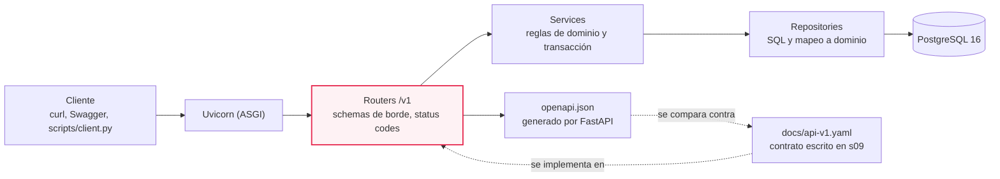
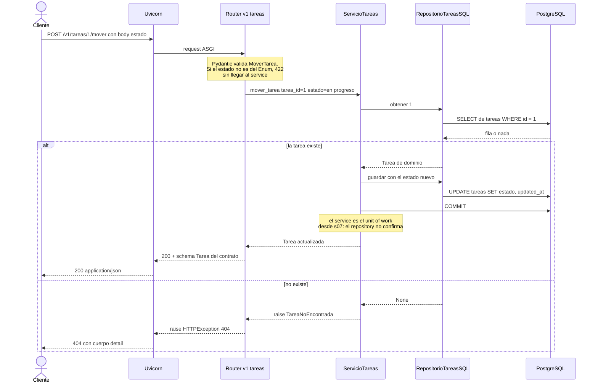
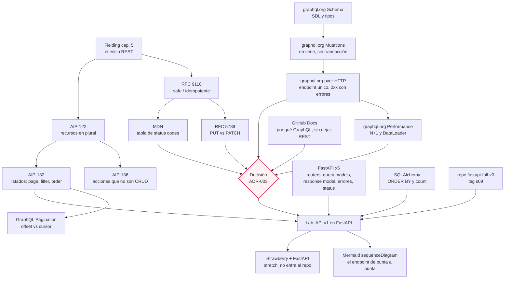

# M07·S10 — REST vs GraphQL + lab de API

**Módulo 07 · Fundamentos de Software + System Design para AI Engineers**
**Sesión 10 de 22 — Semana 2** · **Fecha:** [Completar por el profesor: fecha]
**Tema:** REST como estilo arquitectónico, convenciones de diseño, códigos de estado, listados paginados, GraphQL y la decisión registrada — más el lab que implementa la API v1 completa de TaskFlow sobre PostgreSQL.

**Duración estimada de estudio:** ~5 h 30 (notas ~1 h 30 · recursos originales ~2 h · workbook ~2 h, sin contar las 3 h de clase).

---

## 1. De qué va esta sesión

En S09 escribiste el contrato: `docs/api-v1.yaml`, OpenAPI 3.1, diecisiete operaciones y **ni una línea de código tocada**. Hoy el código pasa a cumplir ese contrato. El marco conceptual son las dos grandes familias de diseño de API —REST y GraphQL— y el cierre es doble: la API v1 andando sobre PostgreSQL, verificada endpoint por endpoint, y una decisión registrada (`ADR-003`) que explica por qué TaskFlow expone REST.

Esta es la sesión que **cierra el backend** de TaskFlow. Partís del tag `s09` y entregás el tag `s10`.

---

## 2. Objetivos de aprendizaje

Al terminar esta sesión vas a poder:

1. **Explicar** REST como estilo arquitectónico —restricciones, interfaz uniforme, recurso vs representación— y señalar qué partes cumple la API de TaskFlow y cuáles no.
2. **Aplicar** las convenciones de diseño REST: recursos como sustantivos en plural, el método HTTP correcto, *safe* vs *idempotente*, `PUT` vs `PATCH`, y qué hacer con una operación que no es CRUD.
3. **Elegir y devolver** el código de estado correcto en cada operación (200, 201, 204, 404, 422), sabiendo quién lo produce y cómo verificarlo con `curl -i`.
4. **Construir** un listado con paginación, filtros y orden por query params: envelope de respuesta, modelo de filtros reutilizable y paginación resuelta en SQL, no en Python.
5. **Leer** un schema de GraphQL en SDL y nombrar el problema que resuelve (over-fetching y under-fetching) y el que crea (N+1, caché de HTTP perdida, control de demanda a construir).
6. **Implementar y verificar** la API v1 de TaskFlow en FastAPI contra el contrato de S09, y **diagramar** un endpoint completo de punta a punta con un `sequenceDiagram`.
7. **Registrar** la decisión REST o GraphQL como `ADR-003` en `docs/trade-offs.md`, con alternativas y condición de revisión.

---

## 3. Resumen ejecutivo

Veníamos construyendo TaskFlow de abajo hacia arriba: en M07·S05 el prototipo en capas con datos en memoria, en M07·S06 el modelo de dominio y `ADR-001` (PostgreSQL), en M07·S07 la base real con SQLAlchemy y el service como unit of work, en M07·S08 los datos pensados para agentes. En M07·S09 cambiamos de dirección y trabajamos **top-down**: primero el contrato en OpenAPI, después la implementación. Hoy se paga esa deuda.

La sesión tiene dos mitades que se necesitan. La conceptual le pone nombre a lo que ya venías haciendo: REST no es "JSON sobre HTTP con verbos", es un estilo con restricciones derivadas en la tesis de Roy Fielding, y lo que tu API cumple es un subconjunto — conviene saber cuál. Sobre esa base entran las convenciones que vuelven verificable el "usá el método correcto": *safe* e *idempotente*, `PATCH` como modificación parcial, el plural de las colecciones, y qué hacer con `POST /v1/tareas/{tarea_id}/mover`, que no es una operación sobre un recurso. GraphQL entra como contraste honesto: resuelve un problema real (el cliente pide exactamente los campos que necesita) y cobra por ello (el N+1 vuelve, empujado por el cliente; la caché de HTTP se pierde; el control de demanda hay que construirlo). La clase no termina en el debate: termina en un ADR.

La otra mitad es el lab, y es donde esto importa para el rol. El agente va a escribir diecisiete endpoints en minutos: lo que decide la nota es si sabés **qué tenía que salir** y lo verificás contra el contrato. En el *AI Engineering Skills Map* de Andrew Ng (The Batch, 2026), la elección y el diseño de APIs figura como una de las competencias explícitas del desarrollador full-stack, junto a caching, persistencia y testing. Por eso una sesión entera de un bootcamp de IA se va en elegir entre dos estilos de API.

---

## 4. Conceptos clave / glosario

**REST y el estilo**

| Término | Definición · para qué · por qué así |
|---|---|
| **Estilo arquitectónico** | Conjunto de restricciones sobre cómo se organiza un sistema, sin fijar tecnología. Sirve para hablar de propiedades (escalabilidad, visibilidad) antes de elegir framework. Se expresa como restricciones y no como recetas porque cada restricción compra una propiedad y cuesta otra; la receta esconde el canje. |
| **REST** | El estilo que Fielding derivó en 2000 aplicando seis restricciones una sobre otra. Sirve para diseñar APIs que evolucionen sin que cliente y servidor se conozcan por dentro. Como las restricciones se acumulan, "medio REST" es la norma: es una dieta, no un plato. |
| **Interfaz uniforme** | La restricción que exige que todos los componentes hablen la misma interfaz genérica; tiene cuatro sub-restricciones (identificación de recursos, manipulación por representaciones, mensajes autodescriptivos, hipermedia). Sirve para que un cliente genérico —`curl`, un proxy, una caché— opere sobre cualquier API. Es lo que permite que un intermediario entienda tu respuesta sin saber qué es una "tarea". |
| **Recurso** | Un mapeo conceptual a un conjunto de entidades, no la entidad en un momento dado. Sirve para darle una URL estable a algo que cambia. Si el recurso fuera el valor actual, cada cambio de estado exigiría una URL nueva. |
| **Representación** | Una secuencia de bytes más la metadata que la describe (el `Content-Type`). Sirve para separar *qué* es el recurso de *cómo* viaja. Así el mismo recurso puede salir como JSON o como CSV sin dejar de ser el mismo. |
| **Stateless** | El servidor no guarda estado de sesión entre requests (visto en M07·S02). Sirve para poner N servidores detrás de un balanceador sin coordinarlos. Se paga repitiendo información en cada pedido; se acepta porque compra escalabilidad y visibilidad. |
| **HATEOAS** | La sub-restricción de hipermedia: la respuesta trae los links de las transiciones posibles. Sirve para que el servidor cambie sus rutas sin romper clientes. Casi ninguna API llamada REST lo implementa: conviene saber que es *lo que falta*, no un detalle. |
| **"RESTful"** | Etiqueta informal para una API con recursos y verbos HTTP, que en general no implementa hipermedia. Sirve para nombrar con honestidad lo que construimos. Es más útil preguntar "cuánto de REST cumple" —un solo endpoint → recursos → verbos → hipermedia— que discutir si merece la etiqueta. |

**Semántica de HTTP**

| Término | Definición · para qué · por qué así |
|---|---|
| **Método *safe*** | Método cuya semántica es esencialmente de solo lectura: `GET`, `HEAD`, `OPTIONS`, `TRACE`. Sirve para saber qué puede precargar un navegador o cachear un proxy. La garantía es sobre la intención, no sobre los efectos internos (un `GET` puede escribir un log). |
| **Idempotente** | Repetir el pedido tiene el mismo efecto que hacerlo una vez: `PUT` y `DELETE`, más los safe. Sirve para reintentar sin miedo cuando la red se corta antes de la respuesta. Es la propiedad que habilita el reintento automático, y la razón de que un `POST` duplicado cree dos tareas. |
| **`PUT`** | Pide que el estado del recurso destino sea creado o reemplazado por el del cuerpo. Sirve para reemplazo total. Si el cuerpo es el estado completo, mandarlo dos veces deja lo mismo: de ahí la idempotencia. |
| **`PATCH`** | El cuerpo trae instrucciones de cambio, no el estado completo; no es safe ni idempotente. Sirve para editar algunos campos sin mandar el objeto entero. Si el cuerpo fuera el objeto completo sería `PUT`: "PATCH es el PUT moderno" es el malentendido más común del tema. |
| **Acción que no es CRUD** | Operación que no se expresa cómodamente como crear/leer/actualizar/borrar (mover una tarea). Sirve para modelar verbos del dominio sin deformar el recurso. Va por `POST` porque tiene efectos; la ruta es una decisión con convención escrita (ver 5.2). |
| **Código de estado** | Número de tres dígitos agrupado en cinco clases (1xx informativo, 2xx éxito, 3xx redirección, 4xx error del cliente, 5xx del servidor). Sirve para que cliente, caché y monitoreo sepan qué pasó sin parsear el cuerpo. La clase se lee con el primer dígito: un intermediario decide sin entender tu dominio. |
| **201 / 204** | 201: éxito y se creó un recurso. 204: éxito sin cuerpo que enviar, los headers sí sirven. Sirven para distinguir "te devuelvo algo" de "creé algo" y para confirmar un borrado sin inventar cuerpo. El 204 **no debe** tener cuerpo, y ahí se rompe la implementación ingenua. |
| **400 vs 422** | 400 es un error percibido del cliente (pedido mal formado); 422 es un pedido bien formado que no se pudo seguir por errores semánticos. Sirven para separar "no te entiendo" de "te entiendo y está mal". En FastAPI el 422 lo produce Pydantic solo: por eso el 400 queda reservado en v1. |
| **409 Conflict** | El pedido choca con el estado actual del servidor. Sirve para rechazar una transición imposible sin confundirla con validación. En TaskFlow se nombra y no se implementa: no hay validación de transiciones de estado (discusión abierta desde S05). |

**Listados**

| Término | Definición · para qué · por qué así |
|---|---|
| **Envelope de listado** | Objeto que envuelve la página con su metadata: `{resultados, total, limit, offset}`. Sirve para informar cuántos elementos hay y poder agregar metadata después. Nunca un array pelado: un array no tiene dónde crecer y cambiarlo es un cambio incompatible (visto en S09). |
| **`limit`/`offset`** | "Dame 20 salteando 40". Sirve para acotar el tamaño de la respuesta y del trabajo del servidor. Se traduce directo a SQL y se prueba con `curl`; el costo es que con inserciones concurrentes las páginas siguientes se vuelven ambiguas. |
| **Cursor** | Marca opaca que indica dónde seguir. Sirve para páginas estables en conjuntos grandes. Es opaco a propósito: así el cliente no lo construye a mano y el servidor puede cambiar su contenido. |
| **Modelo de filtros** | Modelo Pydantic que agrupa los query params de un listado, recibido con `Annotated[Modelo, Query()]`. Sirve para no repetir seis parámetros con sus validaciones en cada listado. La validación queda donde se verifica y Swagger la documenta sin trabajo extra. |
| **`extra="forbid"`** | Config de Pydantic que rechaza campos no declarados. Sirve para que un `?limti=5` mal escrito falle en vez de ignorarse. Es discutible: un cliente viejo con un parámetro extra deja de funcionar. |

**GraphQL**

| Término | Definición · para qué · por qué así |
|---|---|
| **Schema** | La descripción de todo lo que el servicio puede devolver: un grafo de tipos con campos. Sirve para que el cliente sepa qué existe antes de pedir. En REST el contrato es un conjunto de rutas; acá es un grafo y el cliente arma el recorte. |
| **SDL** | El *schema definition language*: la sintaxis para escribir schemas de forma independiente del lenguaje de implementación. Sirve para diseñar y revisar el schema en un archivo de texto, como el YAML de OpenAPI. Separar contrato de código es el mismo movimiento top-down de S09. |
| **Non-Null (`!`)** | Modificador que promete que el campo siempre trae valor. Sirve para que el cliente no chequee `null` de más. La combinación importa: `[Etiqueta!]!` no es lo mismo que `[Etiqueta]!` ni que `[Etiqueta!]`. |
| **Tipos raíz** | `Query`, `Mutation` y `Subscription`: los puntos de entrada. Sirven para declarar qué se lee, qué se escribe y a qué se suscribe. La lectura y la escritura se separan en el tipo y no en el método HTTP, porque todo viaja por el mismo endpoint. |
| **Mutation** | El campo top-level que escribe. Sirve para modificar y devolver el objeto modificado. Los campos de mutation corren **en serie** (los de query, en paralelo) para evitar carreras, pero la serie **no es una transacción**: si el segundo falla, el primero no se revierte. |
| **Resolver** | La función que obtiene el valor de un campo. Sirve para conectar el grafo de tipos con la base. Al ser por campo, el servidor pierde la vista global de la consulta: de ahí sale el N+1. |
| **Over-fetching** | Traer más datos de los que la vista necesita porque el endpoint devuelve una representación fija. Sirve para nombrar el costo real de un endpoint genérico. Se paga en bytes, serialización y latencia. |
| **Under-fetching** | Que una vista necesite varias requests encadenadas porque ningún endpoint devuelve todo. Sirve para justificar los endpoints de vista. Cada salto suma un round-trip, y eso es lo que se siente en una red lenta. |
| **N+1** | Una consulta inicial que devuelve N elementos y N consultas más para resolver un campo de cada uno. Sirve para reconocer el patrón antes de producción. Ya lo viste en el ORM en S07–S08 y lo resolviste con `selectinload`; acá vuelve, empujado por la consulta del cliente. |
| **DataLoader / batching** | Juntar los pedidos de datos de un período corto y despacharlos en una sola consulta. Sirve para convertir N consultas en una. Es la respuesta estándar al N+1 de los resolvers y hay que agregarla a mano: no viene puesta. |
| **Demand control** | Los límites que acotan cuánta carga puede pedir un cliente: paginar los campos de lista, limitar profundidad y amplitud, y análisis de complejidad. Sirve para que una sola query no tire el servidor. En REST el límite es implícito porque el servidor define la forma; acá el cliente decide, así que el límite hay que escribirlo. |
| **Persisted document** | Operación registrada en el servidor a la que el cliente se refiere por identificador. Sirve para poder usar `GET` —y con eso caché de HTTP y CDN— sin chocar con el largo máximo de la URL. Es la forma de recuperar algo que REST tenía gratis. |

**Implementación y registro**

| Término | Definición · para qué · por qué así |
|---|---|
| **Schema de borde** | Modelo Pydantic de lo que entra y sale por HTTP, distinto de la entidad de dominio. Sirve para que el router devuelva lo que el contrato dice, no lo que la entidad tenga adentro. Rompe a propósito con la decisión de S05 ("Pydantic para todo") porque ahora el contrato manda y el dominio evoluciona aparte. |
| **`response_model`** | El modelo con el que FastAPI documenta, valida, serializa y **filtra** la salida. Sirve para que el `openapi.json` diga lo mismo que el YAML. Si se declaran el `response_model` y la anotación de retorno, el `response_model` tiene prioridad; lo que no está declarado, no sale. |
| **`HTTPException`** | Excepción normal de Python con datos de API: se **levanta**, no se retorna, y produce `{"detail": ...}`. Sirve para traducir una excepción de dominio a HTTP sin que el service sepa qué es HTTP. `detail` acepta cualquier valor serializable, pero el contrato declara un string y conviene respetarlo. |
| **`ADR-003`** | La entrada de decisión arquitectónica de hoy en `docs/trade-offs.md`: REST o GraphQL. Sirve para que en seis meses se entienda por qué y bajo qué condición se revisaría. El formato ADR (visto en MA·S05) obliga a escribir las alternativas descartadas, que es lo que una decisión sin registro pierde. |

---

## 5. Notas de estudio por subtema

### El diagrama ancla: dónde entra lo de hoy

Todo lo de esta sesión pasa en el **borde HTTP** de TaskFlow. Las capas de abajo ya están desde S07; lo que aparece hoy es un paquete de routers `/v1` que tiene que coincidir con un documento escrito ayer.



La flecha punteada de abajo es el entregable conceptual: el `openapi.json` que FastAPI genera es **derivado** y el YAML es la fuente. Si no coinciden, el que está mal es el código — salvo que el contrato tenga un error, y entonces se corrige a propósito y queda registrado (hoy pasa dos veces).

### 5.1 REST como estilo arquitectónico

**El problema.** Hasta ahora usaste `GET` y `POST` porque funcionan. El problema aparece cuando hay que decidir algo no obvio: ¿el cambio de estado va por `PATCH` o por una subruta? ¿El listado devuelve un array o un objeto? Sin marco, eso se resuelve por gusto personal. REST es el marco, y sirve sobre todo para saber **qué partes elegís no cumplir**.

**El concepto.** Fielding derivó REST en su tesis de 2000 (cap. 5) de una forma poco habitual: en vez de describir una arquitectura, agrega restricciones una sobre otra y en cada paso nombra qué gana y qué pierde el sistema. Son seis (§5.1):

1. **Cliente-servidor** — separar interfaz de usuario y almacenamiento; evolucionan por separado.
2. **Stateless** — cada request trae todo lo necesario.
3. **Caché** — las respuestas se marcan como cacheables o no.
4. **Interfaz uniforme** — todos los componentes hablan la misma interfaz genérica. Es la que define REST frente a otros estilos.
5. **Sistema en capas** — cada componente solo conoce la capa con la que habla (proxy, balanceador).
6. **Code-on-demand** — el servidor puede enviar código ejecutable al cliente. Es la **única opcional**.

La interfaz uniforme (§5.1.5) se desglosa en cuatro sub-restricciones: **identificación de recursos**, **manipulación a través de representaciones**, **mensajes autodescriptivos** e **hipermedia como motor del estado de la aplicación**. Y hay dos definiciones que casi nadie usa bien: un **recurso** es un *mapeo conceptual* a un conjunto de entidades, no la entidad en un momento dado (§5.2.1.1); una **representación** es una secuencia de bytes más la metadata que la describe (§5.2.1.2).

**Ejemplo práctico.** Pedí la tarea 1 y mirá los dos conceptos separados:

```bash
curl -i http://127.0.0.1:8000/v1/tareas/1
```

```
HTTP/1.1 200 OK
content-type: application/json

{"id":1,"titulo":"Revisar el contrato","descripcion":null,"estado":"backlog",
 "proyecto_id":1,"responsable_id":2,"etiqueta_ids":[1],
 "created_at":"2026-09-30T12:00:00","updated_at":"2026-09-30T12:00:00"}
```

- El **recurso** es "la tarea 1". Mañana su `estado` va a ser `hecho` y la URL va a ser la misma.
- La **representación** es ese JSON más el `content-type`. En CSV seguiría siendo el mismo recurso.
- El mensaje es **autodescriptivo** a medias: el `content-type` está, pero no hay headers de caché, así que ningún intermediario puede reutilizar la respuesta.
- No hay **hipermedia**: la respuesta no trae links a `/v1/tareas/1/comentarios` ni a `/v1/tareas/1/mover`. El cliente construye esas URLs porque leyó el contrato.

**Cuánto de REST cumple TaskFlow** (buen ejercicio de honestidad, y buena respuesta de entrevista):

| Restricción | TaskFlow v1 |
|---|---|
| Cliente-servidor | Sí, desde S05: el borde HTTP no sabe de almacenamiento. |
| Stateless | Sí: no hay sesión; la `Session` de SQLAlchemy vive **dentro** de la request (S07). |
| Caché | No se explota: las respuestas no declaran headers de caché. |
| Interfaz uniforme | Parcial: recursos identificados y manipulados por representación, con `content-type`, **sin hipermedia**. |
| Sistema en capas | Sí; es lo que permitiría poner un reverse proxy adelante sin cambiar nada. |
| Code-on-demand | No aplica (es opcional). |

La escalera mental para ubicar cualquier API: **un solo endpoint** que recibe todo → **recursos** con URL propia → **verbos HTTP** con su semántica → **hipermedia**. TaskFlow está en el tercer escalón, y está bien si se dice.

> ⚠️ Error común: creer que REST obliga a que la URL se parezca a la tabla. No hay ninguna restricción sobre eso: `GET /v1/proyectos/{proyecto_id}/tablero` es un recurso legítimo aunque no exista una tabla `tableros`.

**Para profundizar:** [Fielding, *Architectural Styles and the Design of Network-based Software Architectures*, cap. 5](https://ics.uci.edu/~fielding/pubs/dissertation/rest_arch_style.htm) — §5.1 y §5.2 son ~15 min.

### 5.2 Convenciones de diseño REST

**El problema.** "Usá el método correcto" no es verificable hasta que sabés qué garantiza cada método. Acá el gusto se convierte en regla.

**Recursos como sustantivos en plural.** La guía de diseño de APIs de Google (AIP-122, *Resource names*) lo dice sin ambigüedad: los segmentos de colección **deben ir en la forma plural** del sustantivo, los identificadores de colección van en camelCase empezando en minúscula, y cuando el sustantivo no tiene plural se usa el singular (no se inventan plurales). **Por qué así:** la URL identifica recursos, no acciones. La alternativa (`/v1/getTarea?id=1`) mete el verbo en la URL, y entonces el método HTTP deja de significar nada: todo pasa a ser `POST` y perdés caché, reintentos y la posibilidad de que un intermediario entienda tu tráfico. TaskFlow usa plural y español: `/v1/tareas`, `/v1/proyectos`, `/v1/comentarios`, `/v1/usuarios`, `/v1/etiquetas`.

**Safe e idempotente.** Es la pareja que hay que tener en la cabeza. La semántica vigente de HTTP está en la RFC 9110, *HTTP Semantics* (junio de 2022):

- **Safe** (§9.2.1): semántica "essentially read-only" → **`GET`, `HEAD`, `OPTIONS`, `TRACE`**.
- **Idempotente** (§9.2.2): **`PUT` y `DELETE`**, además de todos los safe.
- **`PUT`** (§9.3.4) pide que el estado del recurso destino sea "created or replaced".
- **`PATCH`** se define aparte, en la RFC 5789 (*PATCH Method for HTTP*, marzo de 2010): en un `PUT` el cuerpo es "a modified version of the resource stored on the origin server"; en un `PATCH`, un conjunto de instrucciones de cambio. Y lo dice explícito: **"PATCH is neither safe nor idempotent"**, aunque un cliente *puede* emitirlo de forma idempotente.

Esto explica por qué el navegador y los proxies se permiten reintentar unas cosas y no otras. Si tu cliente manda `POST /v1/tareas`, la red se corta y reintenta, hay **dos tareas**. Si manda `DELETE /v1/tareas/7` y reintenta, la segunda recibe 404 pero el estado del servidor es el mismo.

| Operación de TaskFlow | Safe | Idempotente |
|---|---|---|
| `GET /v1/tareas` | Sí | Sí |
| `POST /v1/tareas` | No | **No** — dos llamadas, dos tareas |
| `PATCH /v1/tareas/{tarea_id}` | No | No lo garantiza el método (de hecho suele serlo) |
| `DELETE /v1/tareas/{tarea_id}` | No | Sí — la segunda vez da 404 y el estado queda igual |
| `POST /v1/tareas/{tarea_id}/mover` | No | No lo garantiza el método, pero mover dos veces al mismo estado deja el mismo resultado |

**`PATCH` y no `PUT`.** El contrato define `PATCH` y **no define `PUT`**, y se defiende solo: `TareaActualizar` y `ProyectoActualizar` tienen **todos los campos opcionales**, que es exactamente la semántica de modificación parcial. Con `PUT` habría que mandar el objeto completo en cada edición, y un cliente que omitiera `descripcion` estaría pidiendo borrarla.

El detalle fino que va al código: distinguir **"campo ausente"** de **"campo en `null`"**. `{"responsable_id": null}` significa "desasigná"; `{}` significa "no toques nada".

```python
# app/routers/v1/tareas.py — el PATCH, con la distinción que importa
@router.patch("/{tarea_id}", response_model=schemas.Tarea)
def actualizar_tarea(
    tarea_id: int,
    cuerpo: schemas.TareaActualizar,
    servicio: ServicioTareas = Depends(obtener_servicio_tareas),
) -> schemas.Tarea:
    # exclude_unset=True: si el cliente no mandó "descripcion", no viaja en el dict y el
    # service no la toca. Si mandó "descripcion": null, SÍ viaja con valor None → borrarla.
    # Sin exclude_unset los dos casos serían iguales y cada PATCH pisaría con None todo
    # lo que el cliente no mencionó.
    cambios = cuerpo.model_dump(exclude_unset=True)
    try:
        return schemas.Tarea.model_validate(servicio.actualizar_tarea(tarea_id, cambios))
    except TareaNoEncontrada:
        raise HTTPException(status_code=404, detail=f"La tarea {tarea_id} no existe")
```

La alternativa era que el service recibiera el schema completo y comparara campo por campo contra el estado actual. Funciona, pero lo obliga a adivinar la intención del cliente, que es información del borde. Pasar un `dict` de cambios deja la responsabilidad donde está el conocimiento.

**La acción que no es CRUD.** `POST /v1/tareas/{tarea_id}/mover` no es una operación sobre un recurso: es un verbo del dominio. AIP-136 (*Custom methods*) dice que los custom methods "should only be used for functionality that can not be easily expressed via standard methods", que la URI "must use a `:` character followed by the custom verb" y que el método tiene que ser `GET` o `POST`, con **`POST` obligatorio si la operación tiene efectos**. O sea: la guía escribiría `POST /v1/tareas/{tarea_id}:mover`. TaskFlow eligió la subruta `/mover` por continuidad con el endpoint que existe desde S05, y lo dejó **registrado** en `docs/trade-offs.md` como desvío consciente.

> 💡 Esa es la distinción que el módulo evalúa: un desvío consciente y registrado vale; el mismo desvío por desconocimiento, no. La regla escrita existe justamente para poder apartarse de ella a propósito.

> ⚠️ Lo que **no** es aceptable es mover el estado con `PATCH` *y* con `POST .../mover` a la vez: dos caminos para el mismo cambio son dos lugares donde poner la validación de transiciones el día que exista. En el contrato, el `estado` no se cambia por `PATCH`.

**Para profundizar:** [RFC 9110](https://www.rfc-editor.org/rfc/rfc9110.html) (enorme: consulta puntual de §9.2.1, §9.2.2 y §9.3.4), [RFC 5789](https://www.rfc-editor.org/rfc/rfc5789.html), [AIP-122](https://google.aip.dev/122), [AIP-136](https://google.aip.dev/136).

### 5.3 Códigos de estado

**El problema.** El cuerpo lo entiende tu cliente; el código de estado lo entienden **todos**: el navegador, un proxy, el balanceador, el panel de monitoreo. Elegir mal no rompe la app, pero deja ciega a la infraestructura de alrededor.

Las cinco clases se leen con el primer dígito: informativos (100–199), éxito (200–299), redirección (300–399), error del cliente (400–499), error del servidor (500–599). El repertorio real de una API CRUD es corto:

| Código | Qué dice | Dónde en TaskFlow v1 |
|---|---|---|
| **200** | "The request succeeded" | Listar, obtener, actualizar, mover |
| **201** | Éxito y se creó un recurso nuevo | `POST /v1/tareas` y `POST /v1/tareas/{tarea_id}/comentarios` |
| **204** | No hay contenido que enviar, pero los headers sirven | Los dos `DELETE`. **Sin cuerpo** |
| **400** | Error percibido del cliente (p. ej. sintaxis mal formada) | Reservado: **no se usa** |
| **404** | "The server cannot find the requested resource" | Cualquier id inexistente, con `{"detail": "..."}` |
| **409** | Conflicto con el estado actual del servidor | Se nombra en clase; no se implementa |
| **422** | Pedido **bien formado** pero con errores semánticos | Lo produce FastAPI: `?limit=500`, `?orden=cualquiera`, falta `titulo` |
| **500** | Error del servidor | Nunca a mano: si aparece, es un bug |

La distinción 400 vs 422 es la que más confunde y la que el lab necesita. **400** es "no entiendo lo que me mandaste" (JSON roto). **422** es "lo entendí perfectamente y es inválido": el JSON parsea, los tipos están, pero `limit=500` supera el máximo del contrato. En FastAPI eso lo decide Pydantic **antes** de que tu función corra, y por eso el 400 queda reservado: no hay ningún caso en v1 en el que tengamos que producirlo nosotros.

```python
from fastapi import status

@router.post("", response_model=schemas.Tarea, status_code=status.HTTP_201_CREATED)
def crear_tarea(...) -> schemas.Tarea: ...

@router.delete("/{tarea_id}", status_code=status.HTTP_204_NO_CONTENT)
def eliminar_tarea(...) -> None:    # sin response_model y sin return: el 204 no lleva cuerpo
    ...
```

El `status_code` se declara en el **decorador**, no en la función, y hace tres cosas: devolver ese código, documentarlo en el OpenAPI y declarar que no hay cuerpo cuando corresponde. **Por qué las constantes y no los números:** `status_code=204` obliga a recordar qué es 204; `status.HTTP_204_NO_CONTENT` lo dice. La diferencia se cobra en el diff que revisa tu compañero.

> ⚠️ El gotcha del 204: la respuesta **no debe tener cuerpo**. Si tu `DELETE` devuelve la entidad borrada con `status_code=204`, estás produciendo una respuesta inválida y algunos clientes se rompen al parsearla. Declarala `-> None` y no retornes nada. Verificá con `curl -i`: tiene que decir `HTTP/1.1 204 No Content` y terminar ahí.

> 💡 Si te cansa repetir `try/except` en catorce endpoints, FastAPI permite registrar handlers con `@app.exception_handler()` y traducir una excepción de dominio a HTTP en un solo lugar. Hoy lo hacemos explícito en cada router —se ve mejor qué se traduce a qué— y el handler queda nombrado como la evolución natural.

**Para profundizar:** [HTTP response status codes — MDN](https://developer.mozilla.org/en-US/docs/Web/HTTP/Reference/Status) (tenelo abierto mientras implementás), [Response Status Code — FastAPI](https://fastapi.tiangolo.com/tutorial/response-status-code/), [Handling Errors — FastAPI](https://fastapi.tiangolo.com/tutorial/handling-errors/).

### 5.4 Listados: paginación, filtros y orden

**El problema.** `GET /tasks` en el tag `s09` devuelve **todas** las tareas, en un array pelado, sin filtros. Con las 6 tareas que siembra `scripts/seed.py` funciona perfecto; con 60.000 filas la respuesta pesa decenas de megas y el cliente recibe un JSON que no puede usar. Un listado sin paginación es un bug latente con fecha de vencimiento.

Un listado bien diseñado tiene tres perillas y un sobre: **paginación**, **filtros**, **orden** y **envelope**. El contraste con la guía de Google es la mejor forma de ver que son **decisiones** y no verdades. AIP-132 (*Standard methods: List*, Approved, 2019-01-21) propone `page_size` y `page_token` (en su ejemplo, sin especificar devuelve **como máximo 50** y el máximo es **1000**, coercionando los valores mayores; un `page_size` inválido tiene que dar `INVALID_ARGUMENT`), un campo `filter` de tipo string, `order_by` como lista separada por comas con `" desc"` al final del campo para descendente ("foo desc, bar"), y una respuesta con el campo repetido de recursos, `next_page_token` solo si hay más páginas y `total_size` **opcional** (puede ser una estimación si se documenta así).

TaskFlow decidió distinto en tres puntos, y los tres se defienden:

| Decisión | AIP-132 | TaskFlow v1 | Por qué |
|---|---|---|---|
| Tamaño de página | `page_size`, default 50, máx. 1000 | `limit`, default **20**, máx. **100** | El tablero muestra decenas de tareas, no miles; un tope bajo acota el daño de un cliente distraído |
| Posición | `page_token` opaco | `offset` entero | Simple, se traduce directo a SQL y se prueba con `curl`; el costo está asumido y escrito |
| Orden | `order_by` con sufijo `" desc"` | un solo `orden` con prefijo `-` | Un parámetro, un `Literal` cerrado, cero parsing. No soporta orden múltiple: no hace falta todavía |
| Total | `total_size` opcional | `total` **siempre** | El cliente necesita saber cuántas páginas hay; cuesta una consulta extra por request |

**El costo de `offset`, dicho con precisión.** La doc de GraphQL tiene la mejor explicación corta y aplica igual a REST: este estilo "can have performance and security downsides, especially for larger data sets" y, si se insertan registros después de que el usuario pidió una página, "offset calculations for subsequent pages may become ambiguous". El síntoma concreto: si alguien crea una tarea mientras el usuario pasa de la página 1 a la 2, con orden descendente por fecha, **un elemento aparece dos veces**; si se borra una, **un elemento se saltea**. La alternativa son los cursores (opacos, sugiere base64) y el patrón Connection con `edges`/`node`/`cursor` más `pageInfo` (`endCursor`, `hasNextPage`) y `totalCount`, cuya spec formal es la del proyecto Relay. Eso es lo que el trade-off de S09 dejó como "a revisar más adelante": lo importante es poder nombrar el síntoma y no solo decir "cursor escala mejor".

**Los filtros como modelo Pydantic** (disponible desde **FastAPI 0.115.0**):

```python
# app/routers/v1/schemas.py
from typing import Literal
from pydantic import BaseModel, Field
from app.models.estado import Estado


class Paginado(BaseModel):
    """Las dos perillas que comparten todos los listados del contrato."""
    model_config = {"extra": "forbid"}

    limit: int = Field(20, gt=0, le=100)    # el tope del contrato, donde se puede verificar
    offset: int = Field(0, ge=0)


class FiltrosTareas(Paginado):
    proyecto_id: int | None = None
    estado: Estado | None = None
    responsable_id: int | None = None
    etiqueta: str | None = None             # por NOMBRE, como dice el contrato
    orden: Literal["created_at", "-created_at",
                   "updated_at", "-updated_at"] = "created_at"
```

```python
# app/routers/v1/tareas.py
@router.get("", response_model=schemas.PaginaTareas)
def listar_tareas(
    filtros: Annotated[schemas.FiltrosTareas, Query()],
    servicio: ServicioTareas = Depends(obtener_servicio_tareas),
) -> schemas.PaginaTareas:
    tareas, total = servicio.listar_tareas(**filtros.model_dump())
    return schemas.PaginaTareas(
        resultados=[schemas.Tarea.model_validate(t) for t in tareas],
        total=total, limit=filtros.limit, offset=filtros.offset,
    )
```

**Por qué así**, con las alternativas descartadas:

1. **Un modelo en vez de seis parámetros sueltos.** La alternativa era declarar `limit: int = Query(20, gt=0, le=100)` y cinco más en *cada* listado: con cinco listados son treinta declaraciones que mantener sincronizadas. El modelo se declara una vez, se hereda (`FiltrosTablero` también extiende `Paginado`) y Swagger documenta cada campo igual.
2. **`Field(20, gt=0, le=100)` en vez de validar a mano.** Devuelve **422 solo**, sin una línea de validación propia. La alternativa —coercionar 500 a 100, como AIP-132— es defendible, pero esconde el error del cliente.
3. **`Literal[...]` en `orden` en vez de `str`.** Convierte texto libre en enum cerrado: `?orden=;DROP TABLE tareas` da 422 antes de llegar a tu código. Con `str` tendrías que validarlo vos, y si te olvidás ese string termina cerca del SQL.
4. **`**filtros.model_dump()` en vez de pasar el modelo.** Pasar `filtros` entero es más corto, pero obligaría al service y al repository a importar `app/routers/v1/schemas.py`: la capa de dominio pasaría a depender del borde HTTP, al revés de todo lo que venimos haciendo desde S04. Desarmarlo en valores simples mantiene la dirección de la dependencia.

El `extra="forbid"` merece párrafo propio porque **es discutible**. Con él, `?limti=5` (con el typo) devuelve un error `extra_forbidden` con `loc: ["query", "limti"]` en vez de ignorarse, y eso ahorra una hora de debugging. El costo: un cliente viejo que mande un parámetro que ya no existe deja de funcionar. Para una API con un consumidor conocido conviene; para una API pública con integradores, probablemente no. Queda anotado en la entrada `### [s10]`.

**Paginar en SQL, no en Python:**

```python
# app/repositories/tarea_repository.py
from sqlalchemy import func, select
from sqlalchemy.orm import selectinload
from app.db.models import EtiquetaORM, TareaORM

# El Literal del schema mapea a columnas acá. Es lo que evita construir SQL
# con el string que mandó el cliente.
ORDENES = {
    "created_at": TareaORM.created_at.asc(),
    "-created_at": TareaORM.created_at.desc(),
    "updated_at": TareaORM.updated_at.asc(),
    "-updated_at": TareaORM.updated_at.desc(),
}

def listar(self, *, proyecto_id=None, estado=None, responsable_id=None,
           etiqueta=None, orden="created_at", limit=20, offset=0) -> tuple[list[Tarea], int]:
    condiciones = []
    if proyecto_id is not None:
        condiciones.append(TareaORM.proyecto_id == proyecto_id)
    if estado is not None:
        condiciones.append(TareaORM.estado == estado.value)
    if responsable_id is not None:
        condiciones.append(TareaORM.responsable_id == responsable_id)

    def con_filtros(consulta):
        if etiqueta is not None:
            # El filtro es por NOMBRE: hay que pasar por la tabla de enlace tarea_etiqueta.
            consulta = consulta.join(TareaORM.etiquetas).where(EtiquetaORM.nombre == etiqueta)
        if condiciones:
            consulta = consulta.where(*condiciones)
        return consulta

    # 1) El total: mismos filtros, SIN limit/offset.
    total = self._session.scalar(con_filtros(select(func.count()).select_from(TareaORM)))

    # 2) La página. selectinload evita el N+1 de leer fila.etiquetas en _a_dominio.
    filas = self._session.scalars(
        con_filtros(select(TareaORM))
        .options(selectinload(TareaORM.etiquetas))
        .order_by(ORDENES[orden])
        .limit(limit)
        .offset(offset)
    ).all()

    return [_a_dominio(f) for f in filas], total
```

**Por qué así** — los cuatro puntos son errores que se cometen en este lab:

- **Dos consultas por request, no una.** Una de `count` para el `total` y una de página. Es el precio de prometer `total` siempre, y el argumento concreto a favor del cursor cuando la tabla crezca: con cursor no hay `count`.
- **El `count` lleva los mismos filtros y ningún `limit`.** Con `limit`, el `total` sería como máximo 100 y el cliente nunca sabría cuántas páginas hay; sin los filtros, no correspondería a los resultados.
- **`selectinload` por el N+1.** `_a_dominio` lee `fila.etiquetas` para armar `etiqueta_ids`. Sin carga anticipada, una página de 20 tareas dispara 1 consulta + 20 de etiquetas: el mismo N+1 que resolviste en S08 para el endpoint de agentes.
- **El diccionario `ORDENES`.** La alternativa, `order_by(text(orden))`, acepta cualquier string del cliente: así se arma una inyección. El `Literal` rechaza lo que no está en la lista y el diccionario solo sabe traducir lo que está: dos capas de la misma defensa.

> ⚠️ El error más caro del lab: traer todas las filas y cortar la lista en Python (`todas[offset:offset + limit]`). Funciona con 6 filas sembradas y se cae con 60.000. Si tu `listar` no tiene `.limit()` adentro, está mal.

> 💡 El `Estado` de TaskFlow tiene un valor con espacio: `en progreso`. En un query param va codificado: `?estado=en%20progreso`. Es el tipo de detalle que aparece con `curl` y no con Swagger, porque el navegador lo codifica por vos.

**Para profundizar:** [AIP-132](https://google.aip.dev/132), [GraphQL — Pagination](https://graphql.org/learn/pagination/), [Query Parameter Models — FastAPI](https://fastapi.tiangolo.com/tutorial/query-param-models/), [Using SELECT Statements — SQLAlchemy 2.0](https://docs.sqlalchemy.org/en/20/tutorial/data_select.html) (secciones *ORDER BY* y *Working with SQL Functions*).

### 5.5 GraphQL: schema, queries y mutations

**El problema.** Con REST, la forma de la respuesta la decide el servidor. Si tenés diez clientes distintos —web, móvil, un integrador externo— cada uno necesita un recorte distinto y el servidor termina con endpoints de vista para cada pantalla, o devolviendo de más para todos. GraphQL invierte eso: el servidor publica un grafo de tipos y el **cliente** escribe el recorte que necesita.

**El concepto.** El schema describe todo lo que el servicio puede devolver. Se escribe en **SDL**, el *schema definition language*, usado "to talk about GraphQL schemas in a language-agnostic way". Hay tipos de objeto con campos; campos con argumentos nombrados y valores por default; escalares built-in (`Int`, `Float`, `String`, `Boolean`, `ID`) más escalares y enums propios; el signo de exclamación como **Non-Null** (`String!` significa que "the GraphQL service promises to give you a value whenever you query this field"); listas y combinaciones de modificadores; y tres tipos raíz como puntos de entrada: `Query`, `Mutation` y `Subscription`.

Sobre HTTP, las recomendaciones oficiales (basadas en la spec *GraphQL over HTTP*, todavía en draft) son: **un solo endpoint** —"a GraphQL server operates on a single URL/endpoint, usually `/graphql`, and all GraphQL requests for a given service should be directed to this endpoint"—; `POST` obligatorio con cuerpo JSON (`query`, `operationName`, `variables`); `GET` opcional y **solo para queries**, con la operación en el query string, lo que habilita caché de HTTP y CDN a costa del largo máximo de la URL (de ahí los *persisted documents*); y lo más incómodo: si la respuesta trae `data` no nulo, el servidor debería responder **2xx aunque incluya `errors`**, "since HTTP does not yet have a status code representing 'partial success'".

**Ejemplo práctico: el schema equivalente de TaskFlow** (se escribe en el pizarrón, no entra al repo):

```graphql
enum Estado { BACKLOG, EN_PROGRESO, HECHO }

type Usuario  { id: ID!, nombre: String!, email: String! }
type Etiqueta { id: ID!, nombre: String!, color: String }

type Comentario {
  id: ID!
  texto: String!
  autor: Usuario!          # en REST esto es un responsable_id y otra request
  creadoEn: String!
}

type Tarea {
  id: ID!
  titulo: String!
  descripcion: String      # sin "!": puede venir en null, como en el contrato
  estado: Estado!
  proyecto: Proyecto!
  responsable: Usuario     # opcional: una tarea puede no tener responsable
  etiquetas: [Etiqueta!]!  # lista obligatoria de elementos obligatorios: nunca null,
                           # a lo sumo vacía — y nunca un null adentro
  comentarios(limit: Int = 20, offset: Int = 0): [Comentario!]!
}

type Proyecto {
  id: ID!
  nombre: String!
  tareas(estado: Estado, limit: Int = 20, offset: Int = 0): [Tarea!]!
}

type Query {
  tarea(id: ID!): Tarea            # sin "!": si no existe, devuelve null, no 404
  tareas(proyectoId: ID, estado: Estado, limit: Int = 20): [Tarea!]!
  tablero(proyectoId: ID!): Proyecto
}

type Mutation {
  crearTarea(titulo: String!, proyectoId: ID!): Tarea!
  moverTarea(tareaId: ID!, estado: Estado!): Tarea!
}
```

Y la consulta que el cliente escribe para armar la vista de una tarea, en **una** request:

```graphql
query VistaDeTarea($id: ID!) {
  tarea(id: $id) {
    titulo
    estado
    responsable { nombre }
    etiquetas { nombre color }
    comentarios(limit: 5) { texto autor { nombre } }
  }
}
```

**Por qué así, y qué cambia respecto de REST.** Tres cosas que conviene mirar de ese bloque:

- **El enum no puede tener un valor con espacio.** El `Estado` de TaskFlow vale `"en progreso"`; en GraphQL el valor del enum tiene que ser `EN_PROGRESO` y alguien tiene que mapear. Es el primer costo de traducción, y aparece en el primer tipo que escribís.
- **El `404` desaparece.** `tarea(id: ID!): Tarea` sin `!` en el retorno significa "si no existe, el campo viene en `null`". El error ya no viaja en el status code: el status es 200 y el cliente mira `data` y `errors`. Todo lo que aprendiste en 5.3 deja de aplicarse, y eso cambia monitoreo, alertas y caché.
- **Los argumentos de lista son el control de demanda mínimo.** `comentarios(limit: Int = 20)` existe porque, sin él, un cliente puede pedir todos los comentarios de todas las tareas de un proyecto en una sola query.

**Mutations.** Tres diferencias con las queries: la spec solo permite efectos en los campos top-level de mutation ("the resolution of fields other than top-level mutation fields must always be side effect-free and idempotent"); devuelven datos —lo convencional es devolver el objeto modificado, útil "for clients that need to fetch the new state of an object after an update"—; y la frase clave: **"While query fields are executed in parallel, mutation fields run in series"**. Eso evita que una operación compita consigo misma, pero la propia doc advierte que la ejecución en serie **no es una transacción**: si un campo posterior falla, GraphQL no revierte los anteriores.

Ahí se cae el entusiasmo fácil, y es un argumento concreto para el `ADR-003`: en TaskFlow, mover una tarea es una transacción de PostgreSQL que el service confirma (S07). Con dos mutations en un mismo documento tendrías orden garantizado pero no rollback conjunto.

> ⚠️ GraphQL se presenta como habilitador de "flexible, versionless APIs powered by a strong type system". S09 dedicó una sesión entera a versionar con `/v1`. No es una contradicción: en GraphQL el campo viejo se marca `@deprecated` y conviven en el mismo schema, pero alguien tiene que seguir manteniéndolo. "Versionless" no significa "sin costo de evolución", significa "el costo se paga campo por campo en vez de ruta por ruta".

**Para profundizar:** [GraphQL — Schemas and Types](https://graphql.org/learn/schema/), [GraphQL — Mutations](https://graphql.org/learn/mutations/), [GraphQL — Serving over HTTP](https://graphql.org/learn/serving-over-http/), [GraphQL — Learn (índice)](https://graphql.org/learn/) para lo que la clase deja afuera (subscriptions, introspección, federation), y [GraphQL Specification](https://spec.graphql.org/) si querés citar la spec: la edición vigente es **September 2025** (publicada el 3 de septiembre de 2025) y hay un working draft del 28 de septiembre de 2026. De paso, un contraste de dos minutos: GraphQL **sí** tiene una especificación fechada y versionada por edición; en REST lo único normativo es HTTP.

### 5.6 Over-fetching, under-fetching y lo que GraphQL cobra

**El problema.** Los dos términos son vocabulario de la industria y describen las dos formas en que un conjunto fijo de endpoints no le calza a una vista concreta. Con TaskFlow se ven sin esfuerzo:

- **Over-fetching:** querés mostrar una lista de títulos para un selector. `GET /v1/tareas` te trae nueve campos por tarea —descripción, timestamps, ids de etiquetas— y usás uno. Pagás bytes, serialización y memoria por datos que descartás.
- **Under-fetching:** querés armar la vista de una tarea con su responsable, sus etiquetas y sus comentarios. Con el contrato v1 son `GET /v1/tareas/1`, `GET /v1/usuarios/2`, `GET /v1/etiquetas` y `GET /v1/tareas/1/comentarios`: tres o cuatro round-trips encadenados, porque no podés pedir el usuario hasta no saber su id.

Ese es exactamente el argumento de GitHub para ofrecer, además de su REST API, una GraphQL API: eligió GraphQL porque "offers significantly more flexibility for our integrators", presenta "the ability to define precisely the data you want" como "a powerful advantage over traditional REST API endpoints", y señala que permite "replace multiple REST requests with a single call to fetch the data you specify".

**Y acá está el dato más útil de la sesión:** GitHub **no reemplazó** su REST API. Mantiene las dos en paralelo. La pregunta no es "cuál es mejor", es "quién consume esta API".

**Lo que GraphQL cobra.** Tres facturas, y conviene saber cuál se paga cuándo:

1. **N+1 en los resolvers.** La propia doc lo nombra: "This is known as the N+1 problem, where an initial request to an underlying data source (for a hero's friends) leads to N subsequent requests to resolve the data for all of the requested fields (for the friends' starship data)". La solución recomendada es batching: "multiple requests for data from a backend are collected over a short period and then dispatched in a single request to an underlying database or microservice by using a tool like Facebook's DataLoader". Algunas implementaciones traducen el *selection set* directamente a una query optimizada.
   Es **el mismo N+1 de S07–S08**, con un culpable distinto: allá lo generaba el código del servidor (y lo arreglaste con `selectinload`); acá lo genera la consulta del cliente, que vos no escribiste y no podés prever.
2. **La caché de HTTP.** Con un solo endpoint y `POST`, las cachés intermedias y las CDN no pueden ayudarte: no hay URL distinta por recurso ni método safe que indique "esto se puede guardar". Se recupera parcialmente con `GET` para queries y *persisted documents*, es decir, reconstruyendo a mano algo que REST te daba gratis.
3. **Control de demanda.** La doc remite explícitamente a *demand control*: paginar los campos de lista, **limitar profundidad y amplitud** de la operación, y **análisis de complejidad**. Sin eso, un cliente puede escribir una query anidada que haga trabajar a tu base durante minutos — y en GraphQL el cliente decide cuánta carga genera.

| | REST (TaskFlow v1) | GraphQL |
|---|---|---|
| Forma de la respuesta | la decide el servidor | la decide el cliente |
| Contrato | conjunto de rutas (`openapi.json`) | grafo de tipos (schema SDL) |
| Errores | en el status code (404, 422) | en el cuerpo, con 2xx y `errors` |
| Caché de HTTP | gratis por URL + método safe | hay que reconstruirla |
| Límite de carga | implícito: el servidor define la forma | explícito: hay que escribirlo |
| N+1 | del lado del servidor, prevenible | lo dispara la consulta del cliente |
| Transacción | del service, por endpoint | mutations en serie, sin rollback conjunto |

**Para profundizar:** [GraphQL — Performance](https://graphql.org/learn/performance/), [About the GraphQL API — GitHub Docs](https://docs.github.com/en/graphql/overview/about-the-graphql-api).

### 5.7 La decisión, registrada: `ADR-003`

**El problema.** Una discusión de arquitectura que no termina en un documento se vuelve a tener cada tres meses, con los mismos argumentos y sin memoria de lo que ya se descartó. El ADR existe para eso (visto en MA·S05): nombra alternativas, elige una, dice por qué, y —la parte que casi nadie escribe— **bajo qué condición se revisaría**.

**El criterio de corte del bloque.** No hay un umbral universal; hay preguntas que ordenan la decisión:

| Pregunta | Empuja a REST | Empuja a GraphQL |
|---|---|---|
| ¿Quién consume la API? | clientes propios, conocidos y controlados | integradores externos, muchos y desconocidos |
| ¿Cuántas formas de respuesta distintas necesitás? | pocas, estables | muchas, una por pantalla o por integrador |
| ¿Necesitás caché de HTTP y CDN? | sí, y la querés gratis | podés reconstruirla |
| ¿Quién paga el control de demanda? | nadie: el servidor define la forma | tu equipo, desde el día uno |
| ¿Tamaño del equipo? | chico: lo barato es no agregar piezas | hay gente para resolvers, batching y límites |
| ¿Operación y monitoreo? | status codes y alertas estándar | todo 200: hay que mirar el cuerpo |

**La decisión de TaskFlow, escrita.** Va en `docs/trade-offs.md`, arriba, con el formato del proyecto:

```markdown
## [s10] ADR-003 — REST o GraphQL para la API de TaskFlow
- **Fecha:** AAAA-MM-DD
- **Estado:** Aceptada
- **Decisión:** la API v1 de TaskFlow se expone como **REST sobre HTTP/JSON**. No se agrega
  endpoint GraphQL ni dependencia de un servidor GraphQL al proyecto.
- **Alternativas consideradas:**
  - **REST** — recursos en plural bajo `/v1`, un método HTTP por operación, el código de
    estado como canal de error, caché de HTTP disponible.
  - **GraphQL** — un endpoint `/graphql`, schema tipado, el cliente elige los campos.
  - **Las dos en paralelo** — REST para los clientes propios y GraphQL para integradores.
    Es lo que hace GitHub, que ofrece su GraphQL API sin retirar la REST.
- **Elección:** REST.
- **Por qué:**
  - El consumo del contrato v1 está bajo nuestro control (`scripts/client.py`, Swagger,
    `curl`): no hay integradores externos ni desconocidos, que es el caso donde GraphQL paga.
  - El over-fetching y el under-fetching existen, pero son acotados y se resuelven con
    endpoints de vista ya diseñados: `GET /v1/proyectos/{proyecto_id}/tablero` y el tablero
    autocontenido para agentes de s08.
  - Los códigos de estado y la caché de HTTP son gratis en REST y hay que reconstruirlos
    en GraphQL; el control de demanda hay que escribirlo entero.
  - Mover una tarea es una transacción que el service confirma (s07). En GraphQL, dos
    mutations de un mismo documento corren en serie pero sin rollback conjunto.
  - El costo de *probar* GraphQL es de tres líneas; el costo real son los resolvers, el
    batching contra el N+1 y los límites de profundidad y complejidad.
- **Consecuencias:** quien necesite una vista compuesta la pide como endpoint de vista, no
  como query arbitraria. El `openapi.json` sigue siendo el contrato verificable.
- **Cuándo cambiaría:** si aparecieran muchos clientes heterogéneos y desconocidos, o vistas
  que necesiten recortes distintos por pantalla, se evaluaría agregar GraphQL **al lado** de
  REST —no en su lugar— con control de demanda desde el primer día.
```

**El stretch que prueba el último bullet.** Montar GraphQL sobre una app FastAPI con Strawberry son tres líneas:

```bash
pip install 'strawberry-graphql[fastapi]'     # fuera de requirements.txt: no entra al repo
```

```python
import strawberry
from strawberry.fastapi import GraphQLRouter

graphql_app = GraphQLRouter(schema)            # schema: un strawberry.Schema con tipos y resolvers
app.include_router(graphql_app, prefix="/graphql")
```

Fijate que se monta con el **mismo `include_router`** que los routers `/v1`: GraphQL es otra forma del borde HTTP, no otra arquitectura. Y el `schema` que esa línea recibe es justamente el trabajo que el stretch deja ver — el montaje son tres líneas, el schema y sus resolvers no.

> 📝 **Nota para el profesor:** el alcance por default de GraphQL en esta sesión es **concepto y decisión obligatorios, código opcional**: el SDL equivalente se escribe en el pizarrón y Strawberry queda como stretch fuera de `requirements.txt`. Coherente con §*Notas para el docente* del plan, que marca GraphQL como el tema más recortable del módulo en una primera pasada. Si el grupo viene cómodo, el stretch da para 20 minutos reales.

### 5.8 El lab: las cinco piezas de FastAPI que cumplen el contrato

El paso a paso completo está en la **Unidad 1** de la sección 6. Acá queda el mapa conceptual: cada pieza del contrato se cumple con un mecanismo distinto de FastAPI, y los cinco se usan a la vez en un solo endpoint.

| Columna del contrato | Mecanismo | Qué resuelve |
|---|---|---|
| La ruta y el `/v1` | `APIRouter` + `include_router(..., prefix="/v1")` | el versionado deja de ser teoría y pasa a ser una línea |
| Los query params | modelo Pydantic con `Annotated[Modelo, Query()]` | filtros, orden y paginación validados y documentados |
| La forma de la salida | `response_model` | el `openapi.json` dice lo mismo que el YAML |
| Los errores | excepción de dominio + `HTTPException` | 404 con `{"detail": ...}` sin que el service sepa de HTTP |
| El código de estado | `status_code` en el decorador | 201 al crear y 204 sin cuerpo al borrar |

**`APIRouter` y el prefijo.** Un `APIRouter` es una "mini `FastAPI`" con las mismas opciones, declarada con `prefix`, `tags`, `dependencies` y `responses`. La regla del prefijo: como cada path operation tiene que empezar con `/`, **"the prefix must not include a final `/`"** → `"/v1"`, nunca `"/v1/"`. Y la pieza central de hoy: `include_router(router, prefix="/v1", tags=[...])` agrega prefijo, tags y dependencias **sin modificar el router original**; las tags del router y las de la operación se combinan, y las dependencias del router corren primero.

```python
# app/main.py
from app.routers import agentes
from app.routers.v1 import comentarios, etiquetas, proyectos, tareas, usuarios

app = FastAPI(title="TaskFlow", version="1.0.0", lifespan=lifespan)

for router in (proyectos.router, tareas.router, comentarios.router,
               usuarios.router, etiquetas.router):
    app.include_router(router, prefix="/v1")

app.include_router(agentes.router)      # s08: queda FUERA de /v1, sin tocar
```

**Por qué el `prefix` va en `include_router` y no en el `APIRouter`.** Cada router de recurso declara su propio prefijo de recurso (`APIRouter(prefix="/tareas", tags=["tareas"])`) y el `/v1` lo agrega el montaje. Resultado: `/v1/tareas`. Si el `/v1` estuviera dentro de cada `APIRouter`, un hipotético `/v2` futuro obligaría a editar los cinco archivos; así, montás el mismo paquete bajo otro prefijo sin tocarlo. Es también el motivo de que `app/routers/v1/` sea un **paquete** y no un archivo.

> 💡 `version="1.0.0"` es la versión de la **app**; el `/v1` del path es la versión mayor del **contrato**. Son dos cosas distintas y se mueven por separado: la app puede ir a `1.1.0` sin que el contrato cambie.

**Schemas de borde vs entidades de dominio.** `response_model` hace que FastAPI documente, valide, serialice y **filtre** la salida: "FastAPI will take care of filtering out all the data that is not declared in the output model". Eso es lo que te permite declarar en `app/routers/v1/schemas.py` exactamente los schemas del YAML —con los mismos nombres: `Tarea`, `TareaCrear`, `PaginaTareas`…— y que el `openapi.json` salga comparable línea por línea. La alternativa, devolver la entidad de dominio, funciona hoy y se rompe el día que el dominio gane un campo que el contrato no declara.

**Errores sin romper las capas.** El service sigue levantando excepciones de dominio (`TareaNoEncontrada`) y el router las traduce. `HTTPException` es "a normal Python exception with additional data relevant for APIs" y, por ser una excepción, **"you don't `return` it, you `raise` it"**; produce el cuerpo `{"detail": "..."}` que declara el schema `Error` del YAML. Ningún service importa `fastapi`: esa es la regla que mantiene la arquitectura en pie.

**Para profundizar:** [Bigger Applications — FastAPI](https://fastapi.tiangolo.com/tutorial/bigger-applications/), [Response Model - Return Type — FastAPI](https://fastapi.tiangolo.com/tutorial/response-model/), [Strawberry GraphQL — FastAPI integration](https://strawberry.rocks/docs/integrations/fastapi), [repo de referencia `fastapi-full-v0`](https://github.com/Luc5k4yw4lk3r/fastapi-full-v0).

### 5.9 El diagrama de secuencia de un endpoint completo

**El problema.** Un diagrama de componentes dice qué piezas hay; no dice quién llama a quién ni en qué orden, y menos todavía qué pasa cuando algo falla. El diagrama de secuencia es la prueba de que entendés el camino completo de una request. En este módulo el diagrama es entregable tanto como el código.

El endpoint elegido es **`POST /v1/tareas/{tarea_id}/mover`**, por tres razones: toca las cuatro capas, tiene transacción (el `commit` del service) y tiene una rama de error interesante (404) para el `alt`. El archivo va en `docs/diagrams/s10-secuencia-mover.mmd`.



**Por qué este diagrama y no uno más lindo.** La notación es la de Mermaid: `->>` es línea sólida con flecha y `-->>` punteada con flecha (sólida para la llamada, punteada para el retorno); `alt ... else ... end` abre las dos ramas; `Note over` ancla una aclaración a un participante. Lo que lo hace útil es el `alt`: el camino feliz solo no enseña nada que el código no diga más rápido. La rama de 404 muestra las tres cosas que la sesión quiere que queden: **el repository devuelve `None`**, **el service levanta una excepción de dominio** y **solo el router sabe que eso es un 404**.

> ⚠️ Un `.mmd` que no refleja el código real es peor que no tenerlo: el diagrama se convierte en documentación que miente. Si en tu implementación el `commit` lo hace el repository, el diagrama tiene que decir eso (y entonces hay otra conversación que tener, porque rompe la decisión de S07).

> 📝 **Nota para el profesor:** el endpoint diagramado es un default (el plan pide "un endpoint completo" sin decir cuál). Si preferís uno con más capas de lectura, `GET /v1/proyectos/{proyecto_id}/tablero` también sirve y suma el `ServicioTablero`; el de `mover` se eligió porque es el único con transacción y rama de error a la vez.

**Para profundizar:** [Sequence diagrams — Mermaid](https://mermaid.js.org/syntax/sequenceDiagram.html).

### Mapa de relaciones entre los recursos

El orden importa: la sesión arranca por el estilo, baja a las convenciones, cruza a GraphQL solo para poder decidir, y recién después entra al código.



Cuatro relaciones que el diagrama no alcanza a expresar:

- **AIP-132 y el contrato de S09 están en tensión deliberada.** Google usa `page_size`/`page_token` con default 50 y máximo 1000; TaskFlow usa `limit`/`offset` con default 20 y máximo 100. No es un error del proyecto: es el ejemplo de que una convención se adopta o se descarta con motivo.
- **La página de paginación de GraphQL se lee dos veces:** en 5.4 como la mejor explicación del límite de `offset` (que aplica a REST igual), y en 5.6 como ejemplo de lo que GraphQL estandarizó y REST dejó a criterio de cada API.
- **Los cinco recursos de FastAPI son un bloque.** Cada uno cubre una columna del contrato y la implementación de un solo endpoint los usa a los cinco a la vez: no tiene sentido leerlos por separado.
- **El repo es prerequisito material del lab**, no lectura: sin el tag `s09` clonado no hay dónde implementar.

---

## 6. Ejercicios

Formato workbook: teoría mínima → ejemplo resuelto y comentado → práctica graduada. Las soluciones están en la **sección 11**: intentá cada ejercicio antes de mirarlas.

### Unidad 1 — El lab: de `s09` a `s10`, la API v1 implementada

#### 1. Teoría mínima

Partís del tag `s09`: PostgreSQL 16 en Docker con el ER completo (6 tablas + `usuario_equipo` y `tarea_etiqueta`), el dominio Pydantic de 6 entidades en `app/models/`, repositorios SQL **solo** de tarea, proyecto y tablero, `ServicioTareas` y `ServicioTablero`, el router viejo `app/routers/tareas.py` con `/tasks` en inglés y sin filtros, el router de agentes de S08, y `docs/api-v1.yaml` con el contrato completo y **el código sin tocar**. No existe `app/routers/v1/`.

Lo que entregás en `s10`: el paquete `app/routers/v1/` con las 17 operaciones del contrato, los repositorios y servicios que faltan, el diagrama de secuencia, el `ADR-003` y el YAML corregido en dos puntos. **No hay dependencias nuevas:** todo se hace con lo que ya está en `requirements.txt`.

El ejemplo resuelto es la **rodaja vertical de `/v1/tareas`**: los seis endpoints de tareas de punta a punta. Los routers de proyectos, comentarios, usuarios y etiquetas son los ejercicios 🟡 y 🔴.

#### 2. Ejemplo resuelto y comentado

**Prerequisitos** (verificá los cuatro antes de escribir una línea):

```bash
# 1. El repo del equipo en el estado de la sesión pasada
git checkout -b s10 s09

# 2. Entorno
python -m venv .venv && source .venv/bin/activate
pip install -r requirements.txt
cp .env.example .env            # revisá POSTGRES_PORT si 5432 está ocupado

# 3. Base de datos y datos realistas
docker compose up -d            # PostgreSQL 16, contenedor taskflow-db
docker compose ps               # tiene que estar "healthy" (healthcheck pg_isready)
python scripts/seed.py          # idempotente: se puede correr dos veces

# 4. La API, cargando DATABASE_URL desde .env
uvicorn app.main:app --reload --env-file .env
```

> ⚠️ `--env-file .env` es obligatorio desde S07: sin él, `app/db/database.py` cae al default y la app se conecta a la base equivocada o no se conecta. `--reload` no se combina con `--workers`.

**Placeholders a reemplazar:** ninguno en los comandos, salvo el puerto (se cambia en `.env` con `POSTGRES_PORT`) y los ids de los `curl`, que dependen de lo que sembró `scripts/seed.py`. Antes de copiar comandos, corré `curl -s "http://127.0.0.1:8000/v1/tareas?limit=5"` y usá ids que existan. El material asume `proyecto_id=1` y `tarea_id=1`.

**Paso 1 — Leé el contrato y el alcance, en ese orden.** Abrí `docs/api-v1.yaml` y `sessions/s10.md` ("Entra / NO entra / Entregables"). Hacé la lista de las 17 operaciones en papel. Esto no es ceremonia: es lo que te permite revisar lo que el agente escriba.
*Verificación:* podés decir de memoria cuántos `POST` hay (cuatro: dos de creación, uno de comentario, uno de mover) y cuántos `DELETE` (dos).

**Paso 2 — Las excepciones de dominio se mudan a `app/services/errores.py`.**

```python
# app/services/errores.py
"""Excepciones de dominio compartidas por los services (s10).

Vivían en tarea_service.py (s05) y las importaban tablero_service y el router de
agentes. Al sumar cuatro services más, el import cruzado se volvía un nudo: ahora
hay un solo lugar del que todos importan. No heredan de nada de FastAPI: el router
las traduce a HTTP, los services no saben que HTTP existe.
"""


class ErrorDeDominio(Exception):
    """Raíz de las excepciones de negocio. Permite un except amplio en el borde."""


class ProyectoNoEncontrado(ErrorDeDominio): ...
class TareaNoEncontrada(ErrorDeDominio): ...
class UsuarioNoEncontrado(ErrorDeDominio): ...
```

En `app/services/tarea_service.py` se borran las dos clases y se importan desde acá. **Por qué así:** `app/routers/agentes.py` (S08) importa `ProyectoNoEncontrado` desde `tarea_service`; como `tarea_service` sigue importándola, ese archivo **no se toca** y sigue funcionando. La alternativa —editar agentes.py— era un cambio innecesario en un archivo que esta sesión no tiene por qué tocar.
*Verificación:* `curl -i http://127.0.0.1:8000/agent/proyectos/999/tablero` sigue dando 404.

**Paso 3 — Los schemas de borde, con los nombres del YAML.**

```python
# app/routers/v1/schemas.py (fragmento: lo de tareas)
from datetime import datetime
from typing import Literal

from pydantic import BaseModel, ConfigDict, Field

from app.models.estado import Estado


class Error(BaseModel):
    detail: str


class Paginacion(BaseModel):
    total: int
    limit: int
    offset: int


class Tarea(BaseModel):
    # from_attributes permite construir el schema desde la entidad de dominio leyendo
    # sus atributos. Es lo que hace que el router mapee dominio -> contrato en una línea.
    model_config = ConfigDict(from_attributes=True)

    id: int
    titulo: str
    descripcion: str | None = None
    estado: Estado
    proyecto_id: int
    responsable_id: int | None = None
    etiqueta_ids: list[int] = []
    created_at: datetime | None = None
    updated_at: datetime | None = None


class TareaCrear(BaseModel):
    titulo: str = Field(min_length=1, max_length=200)
    descripcion: str | None = None
    proyecto_id: int
    responsable_id: int | None = None
    etiqueta_ids: list[int] = []
    # OJO: el contrato dice que el estado inicial lo fuerza el servidor, así que
    # "estado" NO está acá. Si estuviera, un cliente podría crear tareas en "hecho".


class TareaActualizar(BaseModel):
    # Todos opcionales: es la semántica de PATCH. El estado no se cambia por acá.
    titulo: str | None = Field(default=None, min_length=1, max_length=200)
    descripcion: str | None = None
    responsable_id: int | None = None
    etiqueta_ids: list[int] | None = None


class MoverTarea(BaseModel):
    estado: Estado


class PaginaTareas(Paginacion):
    resultados: list[Tarea]


class Paginado(BaseModel):
    model_config = {"extra": "forbid"}
    limit: int = Field(20, gt=0, le=100)
    offset: int = Field(0, ge=0)


class FiltrosTareas(Paginado):
    proyecto_id: int | None = None
    estado: Estado | None = None
    responsable_id: int | None = None
    etiqueta: str | None = None
    orden: Literal["created_at", "-created_at",
                   "updated_at", "-updated_at"] = "created_at"
```

**Por qué los nombres son exactamente los del YAML.** Porque el `openapi.json` que genera FastAPI nombra los schemas con el nombre de la clase Python. Si tu clase se llama `TareaOut`, el diff contra el contrato tiene un ruido que no aporta nada; si se llama `Tarea`, el diff solo muestra diferencias reales. Lo mismo vale para las funciones de ruta: llamalas `listar_tareas`, `crear_tarea`, `obtener_tarea`, `mover_tarea`, porque FastAPI deriva el `operationId` del nombre de la función.
*Verificación:* `curl -s http://127.0.0.1:8000/openapi.json | python -m json.tool | grep -n '"Tarea"'` encuentra el schema.

**Paso 4 — El cableado por request.**

```python
# app/routers/v1/dependencias.py
from fastapi import Depends
from sqlalchemy.orm import Session

from app.db.database import get_db
from app.repositories.proyecto_repository import RepositorioProyectosSQL
from app.repositories.tarea_repository import RepositorioTareasSQL
from app.services.tarea_service import ServicioTareas


def obtener_servicio_tareas(db: Session = Depends(get_db)) -> ServicioTareas:
    # Mismo patrón que app/dependencies.py de s07: una Session por request y los
    # repositorios bound a esa sesión, así cada request tiene su transacción.
    return ServicioTareas(RepositorioTareasSQL(db), RepositorioProyectosSQL(db), db)
```

**Por qué un archivo nuevo en vez de ampliar `app/dependencies.py`:** el cableado de v1 crece a cinco services y conviene que viva al lado de los routers que lo usan. `app/dependencies.py` queda en el repo aunque, al borrar el router viejo, deje de importarse.
*Verificación:* `python -c "import app.routers.v1.dependencias"` no explota.

**Paso 5 — El repository: filtros, orden y paginación en SQL.** Es el código de 5.4, más `eliminar`:

```python
# app/repositories/tarea_repository.py (lo nuevo)
def eliminar(self, tarea_id: int) -> bool:
    fila = self._session.get(TareaORM, tarea_id)
    if fila is None:
        return False
    # Las FK de s07 no declaran ON DELETE, así que borrar la tarea con comentarios
    # vivos levantaría un error de integridad. Se limpian explícitamente:
    for comentario in list(fila.comentarios):
        self._session.delete(comentario)
    fila.etiquetas.clear()        # borra las filas de la tabla de enlace tarea_etiqueta
    self._session.delete(fila)
    self._session.flush()         # sin commit: el service es el unit of work
    return True
```

> ⚠️ `fila.comentarios.clear()` **no** sirve acá: intentaría poner `tarea_id = NULL`, y la columna no lo admite. Hay que borrar los comentarios, no desvincularlos. Esta es la consecuencia concreta de la decisión de S07 de dejar las FK sin `ON DELETE`.

*Verificación:* borrá una tarea que tenga comentarios sembrados y que no tire 500.

**Paso 6 — El service: los métodos que el contrato pide.**

```python
# app/services/tarea_service.py (lo nuevo; crear_tarea y mover_tarea quedan igual)
def listar_tareas(self, *, proyecto_id=None, estado=None, responsable_id=None,
                  etiqueta=None, orden="created_at",
                  limit=20, offset=0) -> tuple[list[Tarea], int]:
    # Solo lectura: no abre transacción propia.
    return self._repo_tareas.listar(
        proyecto_id=proyecto_id, estado=estado, responsable_id=responsable_id,
        etiqueta=etiqueta, orden=orden, limit=limit, offset=offset,
    )

def obtener_tarea(self, tarea_id: int) -> Tarea:
    tarea = self._repo_tareas.obtener(tarea_id)
    if tarea is None:
        raise TareaNoEncontrada(tarea_id)
    return tarea

def actualizar_tarea(self, tarea_id: int, cambios: dict) -> Tarea:
    tarea = self.obtener_tarea(tarea_id)          # reusa el 404
    for campo, valor in cambios.items():
        setattr(tarea, campo, valor)              # el dict ya viene filtrado por el router
    try:
        actualizada = self._repo_tareas.guardar(tarea)
        self._session.commit()
        return actualizada
    except Exception:
        self._session.rollback()
        raise

def eliminar_tarea(self, tarea_id: int) -> None:
    if not self._repo_tareas.eliminar(tarea_id):
        raise TareaNoEncontrada(tarea_id)
    try:
        self._session.commit()
    except Exception:
        self._session.rollback()
        raise
```

**Por qué `actualizar_tarea` recibe un `dict` y no el schema:** el service no importa nada de `app/routers/`. Recibe "los campos que el cliente pidió cambiar" como datos planos, y quién decidió cuáles son es asunto del borde (`exclude_unset`).
*Verificación:* `PATCH` con `{}` devuelve la tarea sin cambios y no borra nada.

**Paso 7 — El router de tareas, completo.**

```python
# app/routers/v1/tareas.py
"""Borde HTTP de /v1/tareas (s10). Implementa el contrato de docs/api-v1.yaml."""

from typing import Annotated

from fastapi import APIRouter, Depends, HTTPException, Query, status

from app.routers.v1 import schemas
from app.routers.v1.dependencias import obtener_servicio_tareas
from app.services.errores import ProyectoNoEncontrado, TareaNoEncontrada
from app.services.tarea_service import ServicioTareas

# El prefijo del recurso va acá; el /v1 lo agrega include_router en main.py.
router = APIRouter(prefix="/tareas", tags=["tareas"])


@router.get("", response_model=schemas.PaginaTareas)
def listar_tareas(
    filtros: Annotated[schemas.FiltrosTareas, Query()],
    servicio: ServicioTareas = Depends(obtener_servicio_tareas),
) -> schemas.PaginaTareas:
    tareas, total = servicio.listar_tareas(**filtros.model_dump())
    return schemas.PaginaTareas(
        resultados=[schemas.Tarea.model_validate(t) for t in tareas],
        total=total, limit=filtros.limit, offset=filtros.offset,
    )


@router.post("", response_model=schemas.Tarea, status_code=status.HTTP_201_CREATED)
def crear_tarea(
    cuerpo: schemas.TareaCrear,
    servicio: ServicioTareas = Depends(obtener_servicio_tareas),
) -> schemas.Tarea:
    # El schema de borde se traduce a la entidad de dominio: el service no conoce
    # TareaCrear. El estado inicial lo fuerza el service (backlog), como en s05.
    try:
        creada = servicio.crear_tarea(Tarea(**cuerpo.model_dump()))
    except ProyectoNoEncontrado:
        raise HTTPException(
            status_code=status.HTTP_404_NOT_FOUND,
            detail=f"El proyecto {cuerpo.proyecto_id} no existe",
        )
    return schemas.Tarea.model_validate(creada)


@router.get("/{tarea_id}", response_model=schemas.Tarea)
def obtener_tarea(
    tarea_id: int,
    servicio: ServicioTareas = Depends(obtener_servicio_tareas),
) -> schemas.Tarea:
    try:
        return schemas.Tarea.model_validate(servicio.obtener_tarea(tarea_id))
    except TareaNoEncontrada:
        raise HTTPException(status_code=404, detail=f"La tarea {tarea_id} no existe")


@router.patch("/{tarea_id}", response_model=schemas.Tarea)
def actualizar_tarea(
    tarea_id: int,
    cuerpo: schemas.TareaActualizar,
    servicio: ServicioTareas = Depends(obtener_servicio_tareas),
) -> schemas.Tarea:
    cambios = cuerpo.model_dump(exclude_unset=True)
    try:
        return schemas.Tarea.model_validate(servicio.actualizar_tarea(tarea_id, cambios))
    except TareaNoEncontrada:
        raise HTTPException(status_code=404, detail=f"La tarea {tarea_id} no existe")


@router.delete("/{tarea_id}", status_code=status.HTTP_204_NO_CONTENT)
def eliminar_tarea(
    tarea_id: int,
    servicio: ServicioTareas = Depends(obtener_servicio_tareas),
) -> None:
    # Sin response_model y sin return: el 204 no lleva cuerpo.
    try:
        servicio.eliminar_tarea(tarea_id)
    except TareaNoEncontrada:
        raise HTTPException(status_code=404, detail=f"La tarea {tarea_id} no existe")


@router.post("/{tarea_id}/mover", response_model=schemas.Tarea)
def mover_tarea(
    tarea_id: int,
    cuerpo: schemas.MoverTarea,
    servicio: ServicioTareas = Depends(obtener_servicio_tareas),
) -> schemas.Tarea:
    # Acción del dominio, no CRUD: va por POST porque tiene efectos. Devuelve 200
    # (no crea nada) con la tarea ya movida, que es lo que el cliente necesita.
    try:
        return schemas.Tarea.model_validate(servicio.mover_tarea(tarea_id, cuerpo.estado))
    except TareaNoEncontrada:
        raise HTTPException(status_code=404, detail=f"La tarea {tarea_id} no existe")
```

**Paso 8 — Montar y limpiar.** En `app/main.py`, el bloque de `include_router` de 5.8 y `version="1.0.0"`. Se **elimina** `app/routers/tareas.py` con sus tres rutas `/tasks` y `scripts/client.py` pasa a ejercitar `/v1` (`POST /v1/tareas`, `GET /v1/tareas`, `POST /v1/tareas/{tarea_id}/mover`, leyendo `resultados` del envelope en vez de una lista).
*Verificación:* `curl -i http://127.0.0.1:8000/tasks` da **404** y `python scripts/client.py` corre entero.

**Paso 9 — Verificar contra el contrato, a mano.** Sin herramientas nuevas: recorrés los paths del YAML y los comparás con el `openapi.json`.

```bash
curl -s http://127.0.0.1:8000/openapi.json | python -m json.tool > /tmp/openapi-generado.json

curl -i "http://127.0.0.1:8000/v1/tareas?limit=2&estado=backlog&orden=-created_at"
curl -i -X POST http://127.0.0.1:8000/v1/tareas \
     -H "Content-Type: application/json" \
     -d '{"titulo": "Revisar el contrato", "proyecto_id": 1}'       # espera 201
curl -i -X POST http://127.0.0.1:8000/v1/tareas/1/mover \
     -H "Content-Type: application/json" \
     -d '{"estado": "en progreso"}'                                 # espera 200
curl -i -X DELETE http://127.0.0.1:8000/v1/tareas/999               # espera 404 + detail
curl -i "http://127.0.0.1:8000/v1/tareas?limit=500"                 # espera 422
curl -i "http://127.0.0.1:8000/v1/tareas?limti=5"                   # espera 422 extra_forbidden
```

> 💡 `curl -i` muestra la línea de estado: es la única forma de comprobar que el 201 y el 204 son lo que el contrato pide. Swagger también los muestra, pero el hábito de leer el status code se construye con `curl`.

> ⚠️ Dos trampas al comparar. (1) El YAML pone el prefijo de versión en `servers: - url: /v1` y los paths arrancan en `/tareas`; FastAPI genera los paths con `/v1` adentro y sin `servers`. La URL efectiva es la misma: no es una diferencia, es la misma cosa escrita en dos lugares. (2) El YAML del tag **no trae ningún `operationId`**, así que esa columna no tiene nada que comparar; lo que sí conviene es que los nombres de tus funciones de ruta se lean como las operaciones del contrato.

**Paso 10 — Corregir el contrato en los dos puntos donde está mal.** Es el ejercicio 🟢.

**Paso 11 — El diagrama.** `docs/diagrams/s10-secuencia-mover.mmd` con el `sequenceDiagram` de 5.9. *Verificación:* abrilo en el editor y confirmá que renderiza (si sale un cartel rojo, revisá comillas y `end`).

**Paso 12 — La bitácora.** En `docs/trade-offs.md`, arriba: el `ADR-003` de 5.7 y una entrada `### [s10] Forma de los listados: envelope, filtros y orden` con las decisiones de paginación, `extra="forbid"` y la separación entre schemas de borde y entidades de dominio (que rompe a propósito con "Pydantic para todo" de S05).

**Paso 13 — Entregar.** Commits con prefijo `s10:` en la rama del equipo y **tag `s10`** al cierre. El entregable son cuatro cosas: la API v1 andando, el Swagger correcto, `docs/diagrams/s10-secuencia-mover.mmd` y `docs/trade-offs.md` con el `ADR-003`.

> 📝 **Nota para el profesor:** son los defaults que viene usando el módulo. Equipos de 3, los mismos desde S05; entrega por commits `s10:` + tag; rúbrica de 4 criterios — (a) la implementación cumple el contrato endpoint por endpoint, (b) los códigos de estado son los que el YAML declara, con el 201 y el 204 bien hechos, (c) el diagrama refleja el código real, (d) el `ADR-003` nombra alternativas y la condición que lo haría cambiar. Timing propuesto, el estándar de la semana 2: 40 repaso del contrato + REST / 60 taller guiado con el agente (Claude Code en plan mode, con `sessions/s10.md` como alcance) / 45 práctica autónoma / 20 puesta en común y decisión / 15 cierre y `ADR-003`. Dos decisiones más que conviene confirmar: que las rutas `/tasks` de S05 **se eliminan** (la alternativa es conservarlas con `deprecated=True` para mostrar un *deprecation* real y anotarlo en el ADR) y que la app pasa a `version="1.0.0"` porque el tag cierra el backend. Sigue abierta la unificación de la bitácora: esta sesión escribe **solo** en `docs/trade-offs.md`, como S06–S09.

#### 3. Ejercicios

#### 🟢 El envelope vuelve al vocabulario del proyecto

El YAML del tag `s09` nombra el campo del envelope con un término genérico que el canon del proyecto tiene prohibido, en los cuatro schemas de página (`PaginaProyectos`, `PaginaTareas`, `PaginaComentarios`, `PaginaUsuarios`). La decisión registrada en S09 es `{resultados, total, limit, offset}`.

Corregí el contrato: renombrá el campo del envelope a `resultados` en los cuatro schemas, y cambiá `GET /etiquetas` —que hoy devuelve un array pelado— para que devuelva un `PaginaEtiquetas` con el mismo envelope. Dejá anotado en el commit por qué el contrato se corrige en vez de implementar lo que decía.

<details><summary>Pista</summary>

Hay dos usos distintos de la misma palabra en ese YAML y **solo uno** se toca: el nombre de la propiedad del envelope, sí; la palabra clave de OpenAPI que declara el tipo de los elementos de un array, no — esa es sintaxis de la spec, no vocabulario del dominio.
</details>

**Lo lograste si:** los cuatro schemas de página declaran `resultados`, `PaginaEtiquetas` existe con `allOf` sobre `Paginacion`, `GET /etiquetas` acepta `limit` y `offset`, y ninguna palabra clave de array del YAML quedó renombrada.

#### 🟡 El router de comentarios

Implementá las dos operaciones de comentarios del contrato: `GET /v1/tareas/{tarea_id}/comentarios` (paginado) y `POST /v1/tareas/{tarea_id}/comentarios` (201). Pasos:

1. `app/repositories/comentario_repository.py` → `RepositorioComentariosSQL` con `listar(tarea_id, limit, offset) -> tuple[list[Comentario], int]` y `crear(comentario) -> Comentario`, con su `_a_dominio` y sin `commit`.
2. `app/services/comentario_service.py` → `ServicioComentarios`, que valida que la tarea exista (404) y es el unit of work de la escritura.
3. En `schemas.py`: `Comentario`, `ComentarioCrear` y `PaginaComentarios`, con los nombres y campos del YAML.
4. `app/routers/v1/comentarios.py` con `APIRouter(prefix="/tareas", tags=["comentarios"])` y los paths `/{tarea_id}/comentarios`.
5. Montalo en `main.py` y verificá con `curl -i`: 201 al crear, 200 paginado al listar, 404 sobre una tarea inexistente en **las dos** operaciones.

<details><summary>Pista</summary>

El router usa `prefix="/tareas"` igual que el de tareas; eso no es un conflicto, FastAPI resuelve por path completo. El `tags` distinto es lo que los separa en Swagger. La alternativa era meter estos dos endpoints en `tareas.py` y perder la separación en la documentación.
</details>

**Lo lograste si:** `POST` devuelve 201 con el comentario creado, `GET` devuelve `{resultados, total, limit, offset}`, las dos dan 404 con `{"detail": ...}` sobre `tarea_id=999`, y ningún archivo de `app/services/` importa `fastapi`.

#### 🔴 El recurso de proyectos, de cero

Implementá las seis operaciones de proyectos del contrato: `GET /v1/proyectos` (paginado y ordenado), `POST /v1/proyectos` (201), `GET /v1/proyectos/{proyecto_id}`, `PATCH /v1/proyectos/{proyecto_id}`, `DELETE /v1/proyectos/{proyecto_id}` (204) y `GET /v1/proyectos/{proyecto_id}/tablero` con filtros, orden y paginación por columna.

Solo el objetivo y el criterio: la arquitectura, los nombres y la verificación los decidís vos con lo que ya viste. El tablero de `/v1` se sirve desde `ServicioTablero` con un método nuevo que agrupa tareas de dominio por estado; **el DTO de agentes de S08 y su endpoint no se tocan** y siguen fuera de `/v1`.

**Lo lograste si:**
- Las seis operaciones responden con los códigos que declara el YAML (incluido el 204 sin cuerpo y el 404 con `detail`).
- `GET /v1/proyectos?limit=1&orden=-created_at` devuelve un envelope con `total` correcto.
- `GET /v1/proyectos/1/tablero?limit=2&estado=backlog` devuelve solo la columna pedida, con como máximo 2 tareas.
- Borrar un proyecto con tareas no devuelve 500: decidiste qué pasa y lo registraste.
- `app/repositories/proyecto_repository.py` suma `listar`, `crear`, `guardar` y `eliminar` sin que ningún service importe SQLAlchemy de más.

---

### Unidad 2 — Convenciones REST y códigos de estado

#### 1. Teoría mínima

Toda operación de una API responde cuatro preguntas: qué ruta, qué método, qué código de éxito y qué códigos de error. Las convenciones existen para que esas cuatro respuestas no se discutan de nuevo cada vez: recursos como sustantivos en plural (AIP-122), el método según su semántica (RFC 9110: safe e idempotente), `PATCH` para modificación parcial (RFC 5789), `POST` para las acciones con efectos que no son CRUD (AIP-136), y el repertorio corto de códigos del que no hace falta salir. Cuando una de las cuatro respuestas se aparta de la convención, se registra el desvío.

#### 2. Ejemplo resuelto y comentado

Las 17 operaciones del contrato v1, auditadas:

| # | Operación | Éxito | Errores | Safe | Idempotente |
|---|---|---|---|---|---|
| 1 | `GET /v1/proyectos` | 200 | 422 | Sí | Sí |
| 2 | `POST /v1/proyectos` | **201** | 422 | No | **No** |
| 3 | `GET /v1/proyectos/{proyecto_id}` | 200 | 404 | Sí | Sí |
| 4 | `PATCH /v1/proyectos/{proyecto_id}` | 200 | 404, 422 | No | No garantizado |
| 5 | `DELETE /v1/proyectos/{proyecto_id}` | **204** | 404 | No | Sí |
| 6 | `GET /v1/proyectos/{proyecto_id}/tablero` | 200 | 404, 422 | Sí | Sí |
| 7 | `GET /v1/tareas` | 200 | 422 | Sí | Sí |
| 8 | `POST /v1/tareas` | **201** | 404, 422 | No | **No** |
| 9 | `GET /v1/tareas/{tarea_id}` | 200 | 404 | Sí | Sí |
| 10 | `PATCH /v1/tareas/{tarea_id}` | 200 | 404, 422 | No | No garantizado |
| 11 | `DELETE /v1/tareas/{tarea_id}` | **204** | 404 | No | Sí |
| 12 | `POST /v1/tareas/{tarea_id}/mover` | 200 | 404, 422 | No | No garantizado (de hecho, sí) |
| 13 | `GET /v1/tareas/{tarea_id}/comentarios` | 200 | 404, 422 | Sí | Sí |
| 14 | `POST /v1/tareas/{tarea_id}/comentarios` | **201** | 404, 422 | No | **No** |
| 15 | `GET /v1/usuarios` | 200 | 422 | Sí | Sí |
| 16 | `GET /v1/usuarios/{usuario_id}` | 200 | 404 | Sí | Sí |
| 17 | `GET /v1/etiquetas` | 200 | 422 | Sí | Sí |

Dos filas que vale la pena justificar:

- **#8, `POST /v1/tareas` con 404.** Parece raro que *crear* devuelva "no encontrado", pero el 404 no es de la tarea: es del `proyecto_id` o del `responsable_id` que el cuerpo referencia. La alternativa era 422 ("el cuerpo es semánticamente inválido"), que también se defiende; el contrato eligió 404 porque el recurso referenciado es el que no existe, y la regla de negocio "una tarea pertenece a un proyecto existente" vive en el service desde S05.
- **#12, `POST .../mover` con 200 y no 201.** No se crea nada: se cambia el estado de un recurso que ya existía. Devolver 201 mentiría y el cliente podría buscar un recurso nuevo. Y el cuerpo devuelve la tarea ya movida, porque es el estado nuevo lo que el cliente necesita para redibujar.

#### 3. Ejercicios

#### 🟢 Tres filas más

Agregá a la tabla estas tres operaciones **hipotéticas** (no están en el contrato y no se implementan) con su ruta corregida si hace falta, método, código de éxito, errores posibles, y si son safe e idempotentes. Justificá cada elección en una línea:

1. "Dame todas las etiquetas de la tarea 1."
2. "Borrá todos los comentarios de la tarea 1."
3. "Asigná la tarea 1 al usuario 2."

<details><summary>Pista</summary>

La tercera ya existe en el contrato sin ruta propia. Antes de inventar un endpoint, preguntate si la operación es un campo de un recurso que ya tiene su método.
</details>

**Lo lograste si:** las tres rutas usan sustantivos en plural, ninguna tiene un verbo en la URL salvo que la hayas justificado como acción no CRUD, y la tercera no inventa un endpoint nuevo.

#### 🟡 Archivar un proyecto

El equipo pide una operación nueva: "archivar" un proyecto (no borrarlo: deja de aparecer en los listados pero se conserva). Diseñala sin implementarla, siguiendo estos pasos:

1. Decidí si es CRUD o una acción, y justificalo con el criterio de AIP-136.
2. Escribí la ruta en las dos formas posibles (la de la guía de Google y la que usa TaskFlow) y elegí una, coherente con lo que ya hay en el repo.
3. Elegí método, código de éxito y códigos de error, y decidí qué devuelve el cuerpo.
4. Decidí si es idempotente y qué pasa si el cliente la llama dos veces.
5. Escribí el fragmento de OpenAPI y la entrada `### [s10]` que registraría el desvío, si hay desvío.

**Lo lograste si:** tu fragmento es consistente con el resto del contrato (mismo estilo de ruta, mismos códigos, mismo schema `Error`), y tu registro nombra la alternativa descartada y la condición que la haría cambiar.

#### 🔴 Auditoría de una API ajena

Te pasan el borde HTTP de otro equipo, sin contexto:

```
GET    /api/getTareas?proyecto=1
POST   /api/tarea/create          -> 200 {"ok": true}
POST   /api/tarea/update/7        -> 200
GET    /api/tarea/delete/7        -> 200 {"deleted": true}
GET    /api/tareas/all            -> [ {...}, {...}, ... ]
```

Entregá una auditoría: por cada línea, qué convención rompe (con la fuente que la respalda), qué daño concreto causa en producción —no "está mal", sino *qué se rompe*— y la versión corregida. Después escribí el fragmento de OpenAPI 3.1 del recurso corregido completo (colección y elemento), con paginación, envelope y códigos de estado, al estilo de `docs/api-v1.yaml`.

**Lo lograste si:** detectaste al menos cinco problemas distintos (entre ellos el borrado por `GET` y el listado sin paginación), cada uno con su consecuencia operativa concreta, y tu fragmento de OpenAPI pasaría la misma verificación que le hacés a TaskFlow en la Unidad 1.

---

### Unidad 3 — GraphQL y la decisión registrada

#### 1. Teoría mínima

GraphQL publica un grafo de tipos (schema, en SDL) sobre **un solo endpoint**, y el cliente escribe el recorte que necesita: eso resuelve el over-fetching y el under-fetching. Lo que cobra: el N+1 vuelve, empujado por la consulta del cliente, y se mitiga con batching (DataLoader); la caché de HTTP se pierde y hay que reconstruirla; el control de demanda —paginar listas, limitar profundidad y amplitud, análisis de complejidad— hay que escribirlo. Las mutations corren en serie pero sin rollback conjunto. La decisión entre REST y GraphQL no se toma por gusto: se toma mirando quién consume la API, y se registra.

#### 2. Ejemplo resuelto y comentado

El SDL de 5.5 es el ejemplo resuelto de schema, y el `ADR-003` de 5.7 es el ejemplo resuelto de decisión registrada. Lo que falta señalar es la **traducción** entre los dos mundos, que es donde se nota el costo:

| En REST (TaskFlow v1) | En el schema equivalente | Qué se gana y qué cuesta |
|---|---|---|
| `GET /v1/tareas?proyecto_id=1&estado=backlog&limit=20` | `tareas(proyectoId: ID, estado: Estado, limit: Int = 20)` | Se gana que el cliente elija los campos. Cuesta que el `limit` con default sea tu único freno si nadie escribe los límites de profundidad. |
| 404 cuando el id no existe | `tarea(id: ID!): Tarea` (retorno nullable) | Se gana uniformidad. Cuesta que el monitoreo por status code deje de ver los errores. |
| `POST /v1/tareas/{tarea_id}/mover` | `moverTarea(tareaId: ID!, estado: Estado!): Tarea!` | Se gana que la acción se exprese sin discutir la ruta. Cuesta la transacción conjunta si hay más de una mutation. |
| `Estado` con valor `"en progreso"` | `enum Estado { BACKLOG, EN_PROGRESO, HECHO }` | No se gana nada: es puro costo de traducción, y aparece en el primer tipo que escribís. |
| Envelope `{resultados, total, limit, offset}` | patrón Connection (`edges`/`node`/`cursor`, `pageInfo`) | Se gana una convención estándar. Cuesta reescribir todos los listados. |

#### 3. Ejercicios

#### 🟢 Completar el schema

Al SDL de 5.5 le falta todo lo de comentarios del lado de la escritura y le sobra una decisión discutible. Hacé tres cambios:

1. Agregá el tipo de entrada `CrearComentario` con `autorId` y `texto`, y la mutation `comentarTarea(tareaId: ID!, entrada: CrearComentario!): Comentario!`.
2. Agregá el campo `comentarios` a `Proyecto`… y si decidís que no corresponde, explicá por qué en un comentario del propio SDL.
3. Revisá los modificadores de `etiquetas: [Etiqueta!]!` y escribí, al lado, qué significarían `[Etiqueta]!` y `[Etiqueta!]` y cuál de las tres describe mejor el campo `etiqueta_ids` del contrato REST.

**Lo lograste si:** tu SDL parsea mentalmente sin ambigüedades (cada `!` está justificado), y podés explicar la diferencia entre las tres combinaciones de modificadores sin mirar los apuntes.

#### 🟡 Dos mutations, una factura

Escribí un documento GraphQL que, en una sola request, mueva la tarea 1 a `HECHO` y le agregue un comentario. Después respondé, por escrito y con la doc oficial como respaldo:

1. ¿En qué orden se ejecutan los dos campos y por qué?
2. Si el segundo falla, ¿qué pasa con el primero? ¿Qué status code devuelve el servidor?
3. ¿Cómo se consigue el mismo comportamiento en el TaskFlow REST de hoy, y qué garantiza el service que GraphQL no garantiza?
4. ¿Qué tendrías que agregar al servidor GraphQL para igualar esa garantía?

**Lo lograste si:** nombrás la ejecución en serie, decís explícitamente que no es una transacción, identificás que el status sigue siendo 2xx si hay `data`, y tu punto 4 habla de abrir la transacción a nivel de request, no de confiar en la serie.

#### 🔴 El contra-ADR

Escribí el `ADR-003` **contrario**: el que un TaskFlow distinto aceptaría GraphQL. Inventá el contexto mínimo que lo justifique (quién consume la API y cuántos clientes hay) y escribilo completo, con el mismo formato del proyecto: decisión, alternativas, elección, por qué, consecuencias y cuándo cambiaría. Tiene que incluir, obligatoriamente:

- El plan de **control de demanda** desde el día uno, con las tres piezas que la doc oficial nombra.
- Qué pasa con el monitoreo y las alertas cuando todas las respuestas son 2xx.
- Qué hacés con la caché que REST te daba gratis.
- Qué parte de la API seguiría siendo REST, y por qué (el caso de GitHub es el precedente a mirar).
- El criterio que usarías para saber, seis meses después, si la decisión fue correcta.

**Lo lograste si:** tu ADR se puede leer al lado del de 5.7 y los dos son defendibles — porque la diferencia no está en los argumentos técnicos, que son los mismos, sino en el contexto que declarás al principio.

---

## 7. Ruta de estudio sugerida

| Orden | Qué | Tiempo | Por qué acá |
|---|---|---|---|
| 1 | Fielding, cap. 5 (§5.1 y §5.2) | 15 min | Sin esto, "REST" queda en "JSON con verbos" |
| 2 | AIP-122 y AIP-136 | 20 min | Las dos convenciones de ruta que el contrato ya usó |
| 3 | RFC 9110 §9.2.1, §9.2.2, §9.3.4 + RFC 5789 | 20 min | Consulta puntual: safe, idempotente, `PUT` vs `PATCH` |
| 4 | MDN — status codes | 10 min | Tenelo abierto durante el lab |
| 5 | AIP-132 + GraphQL Pagination | 30 min | Los listados, y el límite de `offset` dicho con precisión |
| 6 | **Unidad 2 del workbook** | 30 min | Fija convenciones y códigos antes de tocar código |
| 7 | Los cinco recursos de FastAPI (como bloque) | 60 min | Uno por columna del contrato; se usan juntos |
| 8 | SQLAlchemy — *ORDER BY* y *SQL Functions* | 15 min | La paginación se resuelve en SQL |
| 9 | **Unidad 1 del workbook (el lab)** | 2 h+ | El corazón de la sesión |
| 10 | GraphQL: Schemas and Types → Mutations → Serving over HTTP → Performance | 55 min | En ese orden: tipos, escritura, transporte, costo |
| 11 | GitHub Docs — About the GraphQL API | 10 min | El único caso real, y el que sostiene "pueden convivir" |
| 12 | **Unidad 3 del workbook** | 45 min | Cierra con el `ADR-003` |
| 13 | Mermaid — sequence diagrams + Strawberry (opcional) | 20 min | El entregable del diagrama y el stretch |

El mapa de la sección 5 muestra las dependencias reales: el bloque de REST (1–5) es prerequisito del lab, el de GraphQL (10–11) solo lo necesitás antes de decidir, y los recursos de FastAPI no se entienden sueltos. **Intentá cada ejercicio antes de mirar su solución en la sección 11.**

---

## 8. Checklist de autoevaluación

- [ ] Puedo nombrar las seis restricciones de REST y decir cuál es opcional, sin mirar los apuntes.
- [ ] Puedo explicar la diferencia entre recurso y representación con un ejemplo de TaskFlow.
- [ ] Sé decir qué métodos son safe y cuáles idempotentes, y por qué eso habilita o no un reintento.
- [ ] Puedo defender por qué el contrato usa `PATCH` y no `PUT`, y qué hace `exclude_unset`.
- [ ] Sé qué código devolver al crear, al borrar, ante un id inexistente y ante un `limit` fuera de rango — y quién produce cada uno.
- [ ] Puedo explicar por qué el listado devuelve un envelope y no un array, y qué síntoma concreto tiene la paginación por `offset`.
- [ ] Sé por qué el `count` del total va sin `limit` y por qué el listado necesita `selectinload`.
- [ ] Puedo leer un schema SDL y explicar la diferencia entre `[Etiqueta!]!`, `[Etiqueta]!` y `[Etiqueta!]`.
- [ ] Puedo nombrar las tres cosas que GraphQL cobra y la que REST te da gratis.
- [ ] Puedo defender el `ADR-003` ante alguien que prefiere GraphQL, nombrando la condición que me haría cambiar de opinión.
- [ ] Puedo dibujar de memoria el `sequenceDiagram` de `POST /v1/tareas/{tarea_id}/mover` con su rama de 404.

---

## 9. Preguntas de repaso

1. Tu API devuelve 200 en todas las respuestas, con un campo `error` en el cuerpo cuando algo falla. Funciona: el frontend lo maneja bien. ¿Qué se rompe igual, y quién se entera tarde?
2. Un cliente te reporta que al paginar el listado de tareas ve dos veces la misma tarea. El código de paginación no cambió en meses. ¿Qué le preguntás primero y qué le propondrías?
3. ¿Por qué `POST /v1/tareas/{tarea_id}/mover` y no `PATCH /v1/tareas/{tarea_id}` con `{"estado": "hecho"}`? Dame el argumento a favor de cada uno y decime en qué contexto cambiarías de opinión.
4. Un equipo quiere migrar de REST a GraphQL "para que el frontend pida solo lo que necesita". ¿Qué tres preguntas hacés antes de opinar, y qué les pedís que tengan resuelto antes de exponer el endpoint?
5. Tenés el contrato en OpenAPI y la implementación en FastAPI, que genera su propio `openapi.json`. ¿Cuál de los dos es la fuente de verdad, qué hacés cuando difieren, y cómo evitás que la pregunta se vuelva a hacer en tres meses?

---

## 10. Recursos adicionales

**Imprescindibles**

- [Fielding, *Architectural Styles and the Design of Network-based Software Architectures* — cap. 5: REST](https://ics.uci.edu/~fielding/pubs/dissertation/rest_arch_style.htm) — §5.1 y §5.2 (~15 min de los 40).
- [HTTP response status codes — MDN](https://developer.mozilla.org/en-US/docs/Web/HTTP/Reference/Status) — la tabla que tenés abierta mientras implementás.
- [Bigger Applications - Multiple Files — FastAPI](https://fastapi.tiangolo.com/tutorial/bigger-applications/) — `APIRouter`, `prefix`, tags y dependencias.
- [Query Parameter Models — FastAPI](https://fastapi.tiangolo.com/tutorial/query-param-models/) — los filtros como modelo Pydantic.
- [Response Model - Return Type — FastAPI](https://fastapi.tiangolo.com/tutorial/response-model/) — cómo la implementación *cumple* el contrato.
- [Handling Errors — FastAPI](https://fastapi.tiangolo.com/tutorial/handling-errors/) — `HTTPException` y handlers propios.
- [Response Status Code — FastAPI](https://fastapi.tiangolo.com/tutorial/response-status-code/) — 201 al crear, 204 sin cuerpo.
- [`Luc5k4yw4lk3r/fastapi-full-v0`](https://github.com/Luc5k4yw4lk3r/fastapi-full-v0) — el repo de referencia; el lab parte del tag `s09`.

**Recomendados**

- [RFC 9110 — HTTP Semantics](https://www.rfc-editor.org/rfc/rfc9110.html) — consulta puntual (§9.2.1, §9.2.2, §9.3.4): es un documento enorme.
- [RFC 5789 — PATCH Method for HTTP](https://www.rfc-editor.org/rfc/rfc5789.html) — 10 min, cierra el malentendido de `PATCH`.
- [AIP-122 — Resource names](https://google.aip.dev/122) y [AIP-136 — Custom methods](https://google.aip.dev/136) — 10 min cada una.
- [AIP-132 — Standard methods: List](https://google.aip.dev/132) — el espejo contra el que se leen las decisiones de paginación de S09.
- [GraphQL — Schemas and Types](https://graphql.org/learn/schema/) · [Mutations](https://graphql.org/learn/mutations/) · [Serving over HTTP](https://graphql.org/learn/serving-over-http/) · [Performance](https://graphql.org/learn/performance/) · [Pagination](https://graphql.org/learn/pagination/) — leelos en ese orden.
- [About the GraphQL API — GitHub Docs](https://docs.github.com/en/graphql/overview/about-the-graphql-api) — el único caso real de la sesión.
- [Using SELECT Statements — SQLAlchemy 2.0](https://docs.sqlalchemy.org/en/20/tutorial/data_select.html) — secciones *ORDER BY* y *Working with SQL Functions*.
- [Sequence diagrams — Mermaid](https://mermaid.js.org/syntax/sequenceDiagram.html) — flechas, `alt`, `opt`, notas.

**Opcionales**

- [GraphQL — Learn (índice)](https://graphql.org/learn/) — el mapa de lo que la clase deja afuera: subscriptions, introspección, federation.
- [GraphQL Specification — ediciones](https://spec.graphql.org/) — la edición vigente es September 2025 (3 de septiembre de 2025).
- [Strawberry GraphQL — FastAPI integration](https://strawberry.rocks/docs/integrations/fastapi) — el stretch: GraphQL al lado, sin entrar al repo.
- Ng, A., *AI Engineering Skills Map: Software engineering fundamentals* (The Batch, 2026), sección *Building full-stack applications* — el encuadre: por qué el diseño de APIs es competencia del AI Engineer.

---

## 11. Soluciones comentadas

### Unidad 1 — El lab: de `s09` a `s10`, la API v1 implementada

#### 🟢 El envelope vuelve al vocabulario del proyecto

El cambio en los cuatro schemas de página es el mismo. Antes:

```yaml
    PaginaTareas:
      allOf:
        - $ref: "#/components/schemas/Paginacion"
        - type: object
          properties:
            <nombre-genérico>:          # ← la propiedad del envelope: se renombra
              type: array
              items: { $ref: "#/components/schemas/Tarea" }   # ← sintaxis de OpenAPI: NO se toca
```

Después:

```yaml
    PaginaTareas:
      allOf:
        - $ref: "#/components/schemas/Paginacion"
        - type: object
          properties:
            resultados:
              type: array
              items: { $ref: "#/components/schemas/Tarea" }
```

Y el recurso de etiquetas pasa de array pelado a página:

```yaml
  /etiquetas:
    get:
      tags: [etiquetas]
      summary: Listar etiquetas (apoyo para clasificar tareas)
      parameters:
        - $ref: "#/components/parameters/limit"
        - $ref: "#/components/parameters/offset"
      responses:
        "200":
          description: Página de etiquetas
          content:
            application/json:
              schema: { $ref: "#/components/schemas/PaginaEtiquetas" }

# y en components/schemas, al lado de las otras páginas:
    PaginaEtiquetas:
      allOf:
        - $ref: "#/components/schemas/Paginacion"
        - type: object
          properties:
            resultados:
              type: array
              items: { $ref: "#/components/schemas/Etiqueta" }
```

**Por qué se corrige el contrato y no se implementa lo que decía.** Dos razones, y las dos son decisiones ya tomadas del proyecto. La primera: el nombre que traía el YAML es vocabulario genérico que el canon del proyecto tiene explícitamente prohibido, y el registro de S09 fija `{resultados, total, limit, offset}` — implementarlo tal cual habría metido ese nombre en los schemas de Python, en el `openapi.json`, en `scripts/client.py` y en cada cliente futuro. La segunda: S09 decidió que **ningún listado devuelve un array pelado**, y `GET /etiquetas` se había quedado afuera de esa decisión por omisión, no por criterio.

**La alternativa descartada** era implementar el contrato tal como estaba y corregirlo en una sesión futura. Se descarta porque el costo de renombrar un campo de envelope crece con cada cliente que lo consume: hoy son dos líneas de YAML y cuatro clases de Python; después del primer consumidor real es un cambio incompatible que necesita `/v2`.

**El error a no cometer:** renombrar también la palabra clave que declara el tipo de los elementos del array. Eso es **sintaxis de OpenAPI**, igual que `type` o `properties`: si la renombrás, el documento deja de ser OpenAPI válido y el `$ref` del elemento se pierde. La regla práctica: si la palabra está a la misma altura que `type: array`, es sintaxis; si está a la altura de `total`, `limit` y `offset`, es vocabulario del dominio.

#### 🟡 El router de comentarios

```python
# app/repositories/comentario_repository.py
"""Repositorio de comentarios sobre PostgreSQL (s10).

Misma forma que los repos de s07: traduce ORM <-> dominio con _a_dominio, no hace
commit (el service es el unit of work) y devuelve la página más el total, para que
el router pueda armar el envelope sin contar en Python.
"""

from sqlalchemy import func, select
from sqlalchemy.orm import Session

from app.db.models import ComentarioORM
from app.models.comentario import Comentario


def _a_dominio(fila: ComentarioORM) -> Comentario:
    return Comentario(
        id=fila.id, tarea_id=fila.tarea_id, autor_id=fila.autor_id,
        texto=fila.texto, created_at=fila.created_at, updated_at=fila.updated_at,
    )


class RepositorioComentariosSQL:
    def __init__(self, session: Session) -> None:
        self._session = session

    def listar(self, tarea_id: int, *, limit: int = 20,
               offset: int = 0) -> tuple[list[Comentario], int]:
        total = self._session.scalar(
            select(func.count()).select_from(ComentarioORM)
            .where(ComentarioORM.tarea_id == tarea_id)
        )
        filas = self._session.scalars(
            select(ComentarioORM)
            .where(ComentarioORM.tarea_id == tarea_id)
            .order_by(ComentarioORM.created_at.asc())   # append-only: el orden natural
            .limit(limit).offset(offset)
        ).all()
        return [_a_dominio(f) for f in filas], total

    def crear(self, comentario: Comentario) -> Comentario:
        fila = ComentarioORM(
            tarea_id=comentario.tarea_id,
            autor_id=comentario.autor_id,
            texto=comentario.texto,
        )
        self._session.add(fila)
        self._session.flush()      # para tener el id sin cerrar la transacción
        return _a_dominio(fila)
```

```python
# app/services/comentario_service.py
from sqlalchemy.orm import Session

from app.models.comentario import Comentario
from app.repositories.comentario_repository import RepositorioComentariosSQL
from app.repositories.tarea_repository import RepositorioTareasSQL
from app.services.errores import TareaNoEncontrada


class ServicioComentarios:
    def __init__(self, repo_comentarios: RepositorioComentariosSQL,
                 repo_tareas: RepositorioTareasSQL, session: Session) -> None:
        self._repo_comentarios = repo_comentarios
        self._repo_tareas = repo_tareas
        self._session = session

    def listar_comentarios(self, tarea_id: int, *, limit: int = 20,
                           offset: int = 0) -> tuple[list[Comentario], int]:
        # Regla de negocio: listar comentarios de una tarea que no existe es un 404,
        # no una lista vacía. Si devolviéramos [], el cliente no sabría si la tarea
        # no tiene comentarios o si el id está mal.
        if self._repo_tareas.obtener(tarea_id) is None:
            raise TareaNoEncontrada(tarea_id)
        return self._repo_comentarios.listar(tarea_id, limit=limit, offset=offset)

    def comentar(self, comentario: Comentario) -> Comentario:
        if self._repo_tareas.obtener(comentario.tarea_id) is None:
            raise TareaNoEncontrada(comentario.tarea_id)
        try:
            creado = self._repo_comentarios.crear(comentario)
            self._session.commit()
            return creado
        except Exception:
            self._session.rollback()
            raise
```

```python
# app/routers/v1/comentarios.py
from typing import Annotated

from fastapi import APIRouter, Depends, HTTPException, Query, status

from app.models.comentario import Comentario
from app.routers.v1 import schemas
from app.routers.v1.dependencias import obtener_servicio_comentarios
from app.services.comentario_service import ServicioComentarios
from app.services.errores import TareaNoEncontrada

# Mismo prefijo de recurso que tareas: los comentarios viven bajo la tarea en la
# jerarquía de URLs. El tag distinto es lo que los separa en Swagger.
router = APIRouter(prefix="/tareas", tags=["comentarios"])


@router.get("/{tarea_id}/comentarios", response_model=schemas.PaginaComentarios)
def listar_comentarios(
    tarea_id: int,
    paginado: Annotated[schemas.Paginado, Query()],
    servicio: ServicioComentarios = Depends(obtener_servicio_comentarios),
) -> schemas.PaginaComentarios:
    try:
        comentarios, total = servicio.listar_comentarios(
            tarea_id, limit=paginado.limit, offset=paginado.offset
        )
    except TareaNoEncontrada:
        raise HTTPException(status_code=404, detail=f"La tarea {tarea_id} no existe")
    return schemas.PaginaComentarios(
        resultados=[schemas.Comentario.model_validate(c) for c in comentarios],
        total=total, limit=paginado.limit, offset=paginado.offset,
    )


@router.post("/{tarea_id}/comentarios", response_model=schemas.Comentario,
             status_code=status.HTTP_201_CREATED)
def crear_comentario(
    tarea_id: int,
    cuerpo: schemas.ComentarioCrear,
    servicio: ServicioComentarios = Depends(obtener_servicio_comentarios),
) -> schemas.Comentario:
    # El tarea_id viene del path, no del cuerpo: el contrato no lo pide en el body
    # y tenerlo en dos lugares abriría la puerta a que no coincidan.
    creado = Comentario(tarea_id=tarea_id, **cuerpo.model_dump())
    try:
        return schemas.Comentario.model_validate(servicio.comentar(creado))
    except TareaNoEncontrada:
        raise HTTPException(status_code=404, detail=f"La tarea {tarea_id} no existe")
```

**Decisiones y alternativas:**

- **Reutilizar `Paginado` en vez de un `FiltrosComentarios`.** El contrato solo declara `limit` y `offset` para este listado: un modelo nuevo con los mismos dos campos sería duplicación. Cuando el contrato pida filtrar comentarios por autor, se crea el modelo y hereda de `Paginado`.
- **404 y no lista vacía** cuando la tarea no existe. La alternativa (devolver `{resultados: [], total: 0}`) es más simple y es lo que hace mucha API, pero esconde el bug del cliente: un `tarea_id` mal armado parece "no hay comentarios" para siempre.
- **El `tarea_id` del path y no del cuerpo.** Si estuviera en los dos lados habría que decidir qué pasa cuando difieren, y esa es una decisión que no hace falta tomar.
- **Orden ascendente fijo por `created_at`.** Los comentarios son append-only (decisión de S08): una conversación se lee de arriba hacia abajo. No se expone `orden` porque el contrato no lo pide.

Verificación esperada:

```bash
curl -i -X POST http://127.0.0.1:8000/v1/tareas/1/comentarios \
     -H "Content-Type: application/json" \
     -d '{"autor_id": 2, "texto": "Revisado contra el contrato"}'   # 201
curl -i "http://127.0.0.1:8000/v1/tareas/1/comentarios?limit=2"     # 200 + envelope
curl -i "http://127.0.0.1:8000/v1/tareas/999/comentarios"           # 404 + detail
```

#### 🔴 El recurso de proyectos, de cero

Esquema de la solución (el código completo sigue exactamente los patrones de la rodaja de tareas, así que acá va lo que **decide** el ejercicio):

```python
# app/repositories/proyecto_repository.py — lo que se suma a obtener/existe
def listar(self, *, orden="created_at", limit=20, offset=0) -> tuple[list[Proyecto], int]:
    total = self._session.scalar(select(func.count()).select_from(ProyectoORM))
    filas = self._session.scalars(
        select(ProyectoORM).order_by(ORDENES[orden]).limit(limit).offset(offset)
    ).all()
    return [_a_dominio(f) for f in filas], total

def crear(self, proyecto: Proyecto) -> Proyecto:
    fila = ProyectoORM(nombre=proyecto.nombre, equipo_id=proyecto.equipo_id,
                       descripcion=proyecto.descripcion)
    self._session.add(fila)
    self._session.flush()
    return _a_dominio(fila)

def guardar(self, proyecto: Proyecto) -> Proyecto:
    fila = self._session.get(ProyectoORM, proyecto.id)
    fila.nombre = proyecto.nombre
    fila.descripcion = proyecto.descripcion
    self._session.flush()
    return _a_dominio(fila)

def eliminar(self, proyecto_id: int) -> bool:
    fila = self._session.get(ProyectoORM, proyecto_id)
    if fila is None:
        return False
    self._session.delete(fila)
    self._session.flush()
    return True
```

```python
# app/services/proyecto_service.py — el método que decide el caso difícil
def eliminar_proyecto(self, proyecto_id: int) -> None:
    if not self._repo_proyectos.existe(proyecto_id):
        raise ProyectoNoEncontrado(proyecto_id)
    # Decisión: un proyecto con tareas NO se borra. La FK de s07 no declara
    # ON DELETE, así que la base lo rechazaría con un error de integridad y el
    # cliente vería un 500. Mejor chequearlo acá y que el router lo traduzca.
    _, total = self._repo_tareas.listar(proyecto_id=proyecto_id, limit=1)
    if total > 0:
        raise ProyectoConTareas(proyecto_id)
    try:
        self._repo_proyectos.eliminar(proyecto_id)
        self._session.commit()
    except Exception:
        self._session.rollback()
        raise
```

**Las cinco decisiones que el ejercicio exige y su justificación:**

1. **`PATCH` de proyecto no toca `equipo_id`.** El schema `ProyectoActualizar` del contrato solo declara `nombre` y `descripcion`. Mover un proyecto de equipo es una operación con consecuencias (quién lo ve, quién lo edita) y no un campo editable al pasar: si hiciera falta, sería una acción propia y registrada, no un campo más del `PATCH`.
2. **Borrar un proyecto con tareas.** Tres opciones: borrar en cascada, desvincular las tareas, o rechazar. La solución **rechaza** y el router lo traduce a **409** —es exactamente el caso del 409: el pedido choca con el estado actual del servidor—. Es la única de las tres que no destruye datos por accidente. Ojo: el contrato de S09 solo declara 204 y 404 para esta operación, así que agregar el 409 **es un cambio del contrato** y va registrado en `docs/trade-offs.md`; la alternativa conservadora es dejar el proyecto sin borrar y no exponer la operación hasta la próxima versión.
3. **El tablero de `/v1` reusa `ServicioTablero` con un método nuevo.** No se toca el `TableroAgente` de S08 ni su endpoint: ese DTO está diseñado para que un agente externo lo consuma autocontenido (nombres resueltos, `generado_en`), y el tablero de `/v1` devuelve el schema `Tablero` del contrato, con tareas agrupadas en `columnas` por estado. Dos consumidores distintos, dos representaciones — que es justamente el argumento de 5.6 sobre endpoints de vista.
4. **Paginación "por columna" en el tablero.** `limit` y `offset` se aplican **a cada columna**, no al total: una página de 20 significa "hasta 20 tareas en `backlog`, hasta 20 en `en_progreso`, hasta 20 en `hecho`". Si se aplicaran al total, el tablero llegaría con columnas truncadas de forma arbitraria según el orden. Conviene documentarlo en el `description` del endpoint porque no es obvio.
5. **El filtro `estado` del tablero devuelve solo esa columna**, con las otras dos vacías, en vez de cambiar la forma de la respuesta. La alternativa —devolver una lista plana cuando hay filtro— rompería el schema `Tablero` y obligaría al cliente a manejar dos formas distintas para el mismo endpoint.

Verificación esperada:

```bash
curl -i "http://127.0.0.1:8000/v1/proyectos?limit=1&orden=-created_at"   # 200 + envelope
curl -i -X POST http://127.0.0.1:8000/v1/proyectos \
     -H "Content-Type: application/json" \
     -d '{"nombre": "Onboarding App", "equipo_id": 1}'                   # 201
curl -i -X PATCH http://127.0.0.1:8000/v1/proyectos/1 \
     -H "Content-Type: application/json" -d '{"descripcion": null}'      # 200, descripcion en null
curl -i -X DELETE http://127.0.0.1:8000/v1/proyectos/999                 # 404
curl -i "http://127.0.0.1:8000/v1/proyectos/1/tablero?limit=2&estado=backlog"
```

### Unidad 2 — Convenciones REST y códigos de estado

#### 🟢 Tres filas más

| Pedido | Operación correcta | Éxito | Errores | Safe | Idempotente |
|---|---|---|---|---|---|
| Etiquetas de la tarea 1 | `GET /v1/tareas/1/etiquetas` | 200 | 404, 422 | Sí | Sí |
| Borrar todos los comentarios de la tarea 1 | `DELETE /v1/tareas/1/comentarios` | 204 | 404 | No | Sí |
| Asignar la tarea 1 al usuario 2 | **ninguna nueva**: `PATCH /v1/tareas/1` con `{"responsable_id": 2}` | 200 | 404, 422 | No | No garantizado |

Justificaciones, una línea cada una:

1. **Sub-colección, no endpoint nuevo.** Las etiquetas de una tarea son una colección subordinada, así que la ruta es jerárquica y en plural. Es `GET`, safe e idempotente. Si el contrato ya expone `etiqueta_ids` dentro de `Tarea`, este endpoint es opcional: el under-fetching que resuelve es de un solo campo.
2. **`DELETE` sobre la colección, no un verbo.** `POST /v1/tareas/1/borrarComentarios` metería el verbo en la URL sin necesidad: el método ya dice "borrar" y la URL ya dice "los comentarios de la tarea 1". Es idempotente (borrar dos veces deja la colección igual de vacía) y devuelve 204 porque no hay nada que informar. Ojo: si los comentarios son append-only por decisión de S08, esta operación contradice una decisión registrada — y eso también es una respuesta válida al ejercicio.
3. **La trampa.** "Asignar" ya está en el contrato: el schema `TareaActualizar` incluye `responsable_id`, y el YAML dice explícitamente que asignar responsable se hace por `PATCH`, con `null` para desasignar. Inventar `POST /v1/tareas/1/asignar` agregaría un segundo camino para el mismo cambio, que es exactamente el problema que el contrato evitó al dejar el `estado` fuera del `PATCH`. **Antes de inventar un endpoint, revisá si la operación es un campo de un recurso que ya tiene su método.**

#### 🟡 Archivar un proyecto

**1. ¿CRUD o acción?** Es una **acción**. Se podría modelar como `PATCH /v1/proyectos/{proyecto_id}` con `{"archivado": true}`, y eso es defendible si "archivado" es un campo del recurso que el cliente puede editar como cualquier otro. Pero archivar tiene efectos que un campo no sugiere —desaparece de los listados por default— y la guía de AIP-136 reserva los custom methods para lo que "can not be easily expressed via standard methods". El criterio que decide: si archivar dispara algo más que escribir un booleano (notificar, mover tareas, cortar permisos), es una acción.

**2. Las dos rutas.**

- Según la guía: `POST /v1/proyectos/{proyecto_id}:archivar` (`:` + verbo).
- Según lo que ya hay en TaskFlow: `POST /v1/proyectos/{proyecto_id}/archivar`.

**Elijo la segunda**, por consistencia interna: el repo ya tiene `POST /v1/tareas/{tarea_id}/mover` y dos convenciones distintas para la misma clase de operación son peores que una convención imperfecta. Esa consistencia es el argumento, no la estética.

**3. Método, códigos y cuerpo.** `POST` (tiene efectos, así que `GET` queda descartado por la propia guía). Éxito **200** con el proyecto ya archivado en el cuerpo —el cliente necesita el estado nuevo para redibujar, mismo criterio que `mover`—. Errores: **404** si el proyecto no existe y **422** si el cuerpo trae algo inválido. Sin cuerpo de request: no hay nada que parametrizar.

**4. Idempotencia.** El método no la garantiza, pero la operación es idempotente **de hecho**: archivar un proyecto ya archivado lo deja archivado. Decisión: responder 200 igual, sin error. La alternativa —409 si ya estaba archivado— es más estricta y obliga al cliente a conocer el estado previo para no recibir un error por algo que no es un problema.

**5. El fragmento y el registro.**

```yaml
  /proyectos/{proyecto_id}/archivar:
    parameters:
      - $ref: "#/components/parameters/proyecto_id"
    post:
      tags: [proyectos]
      summary: Archivar un proyecto (acción)
      description: |
        Archivar es idempotente de hecho: archivar un proyecto ya archivado
        devuelve 200 y no modifica nada.
      responses:
        "200":
          description: Proyecto archivado
          content:
            application/json:
              schema: { $ref: "#/components/schemas/Proyecto" }
        "404": { $ref: "#/components/responses/NoEncontrado" }
```

```markdown
### [s10] Archivar un proyecto como acción y no como campo del PATCH
- **Decisión:** `POST /v1/proyectos/{proyecto_id}/archivar`, 200 con el proyecto.
- **Alternativas:** `PATCH` con `{"archivado": true}` (más REST, un camino menos);
  `POST .../proyectos/{proyecto_id}:archivar` (lo que dice AIP-136).
- **Por qué:** archivar hace más que escribir un booleano, y la subruta mantiene una
  sola convención en el repo, igual que `POST .../mover` de s05.
- **Cuándo cambiaría:** si TaskFlow sumara varias acciones por recurso, conviene migrar
  todas a `:verbo` de una vez, con el `/v2` del contrato.
```

#### 🔴 Auditoría de una API ajena

| Línea | Qué rompe | Qué se rompe en producción |
|---|---|---|
| `GET /api/getTareas?proyecto=1` | Verbo en la URL; el sustantivo no va en plural como colección (AIP-122) | Si todo lleva el verbo adentro, el método HTTP deja de significar algo y nadie puede cachear ni reintentar con criterio. Además `?proyecto=1` es un id disfrazado de nombre: el día que se filtre por nombre no hay dónde ponerlo |
| `POST /api/tarea/create -> 200 {"ok": true}` | Verbo en la URL, recurso en singular, **200 en vez de 201**, y la respuesta no devuelve el recurso creado | El cliente no sabe qué id le asignó el servidor: tiene que hacer un `GET` del listado y adivinar cuál es el suyo. Con dos usuarios creando a la vez, adivina mal |
| `POST /api/tarea/update/7 -> 200` | Verbo en la URL; `POST` para una actualización (debería ser `PATCH` parcial o `PUT` total) | Al no ser idempotente ni declararse como parcial, nadie sabe si reintentar es seguro ni si los campos ausentes se borran. Cada cliente asume algo distinto |
| `GET /api/tarea/delete/7 -> 200` | **Borra con un método safe** (RFC 9110 §9.2.1) | Es el peor de los cinco: un crawler, un prefetch del navegador o un acelerador de links borra datos sin que nadie haga clic. Y ninguna caché intermedia tiene por qué sospechar |
| `GET /api/tareas/all -> [ ... ]` | Sin paginación y **array pelado** | Con la tabla chica anda; con 60.000 filas la respuesta tumba al cliente y hace trabajar a la base de más. Y como la raíz es un array, agregar `total` después es un cambio incompatible que obliga a versionar |

El recurso corregido, al estilo del contrato de TaskFlow:

```yaml
  /tareas:
    get:
      tags: [tareas]
      summary: Listar tareas (con filtros, orden y paginación)
      parameters:
        - name: proyecto_id
          in: query
          schema: { type: integer }
        - name: orden
          in: query
          schema: { type: string, example: "-created_at" }
        - $ref: "#/components/parameters/limit"
        - $ref: "#/components/parameters/offset"
      responses:
        "200":
          description: Página de tareas
          content:
            application/json:
              schema: { $ref: "#/components/schemas/PaginaTareas" }
    post:
      tags: [tareas]
      summary: Crear tarea
      requestBody:
        required: true
        content:
          application/json:
            schema: { $ref: "#/components/schemas/TareaCrear" }
      responses:
        "201":
          description: Tarea creada
          content:
            application/json:
              schema: { $ref: "#/components/schemas/Tarea" }
        "422": { $ref: "#/components/responses/ErrorValidacion" }

  /tareas/{tarea_id}:
    parameters:
      - $ref: "#/components/parameters/tarea_id"
    get:
      tags: [tareas]
      summary: Obtener una tarea
      responses:
        "200":
          description: Tarea
          content:
            application/json:
              schema: { $ref: "#/components/schemas/Tarea" }
        "404": { $ref: "#/components/responses/NoEncontrado" }
    patch:
      tags: [tareas]
      summary: Actualizar una tarea (parcial)
      requestBody:
        required: true
        content:
          application/json:
            schema: { $ref: "#/components/schemas/TareaActualizar" }
      responses:
        "200":
          description: Tarea actualizada
          content:
            application/json:
              schema: { $ref: "#/components/schemas/Tarea" }
        "404": { $ref: "#/components/responses/NoEncontrado" }
        "422": { $ref: "#/components/responses/ErrorValidacion" }
    delete:
      tags: [tareas]
      summary: Eliminar una tarea
      responses:
        "204": { description: Eliminada }
        "404": { $ref: "#/components/responses/NoEncontrado" }
```

**Lo que la corrección no cambia, a propósito:** el prefijo `/api` no es un error. No aporta nada (todo es API), pero tampoco rompe nada, y renombrarlo es un cambio incompatible a cambio de estética. Lo que **sí** falta y es un error de otro orden: no hay versión en la ruta, así que ninguno de estos cinco arreglos se puede hacer sin romper a los clientes actuales. Esa es la conversación que esta auditoría abre de verdad.

### Unidad 3 — GraphQL y la decisión registrada

#### 🟢 Completar el schema

```graphql
input CrearComentario {
  autorId: ID!
  texto: String!
}

type Mutation {
  crearTarea(titulo: String!, proyectoId: ID!): Tarea!
  moverTarea(tareaId: ID!, estado: Estado!): Tarea!
  comentarTarea(tareaId: ID!, entrada: CrearComentario!): Comentario!
}

type Proyecto {
  id: ID!
  nombre: String!
  tareas(estado: Estado, limit: Int = 20, offset: Int = 0): [Tarea!]!
  # NO agrego "comentarios" acá. Un comentario pertenece a una tarea, no a un
  # proyecto: ya se llega por proyecto -> tareas -> comentarios. Un atajo
  # duplicaría el camino y, sobre todo, abriría una consulta cara por default
  # (todos los comentarios de todas las tareas) sin un limit propio que la frene.
}

type Tarea {
  # ...
  etiquetas: [Etiqueta!]!
  # [Etiqueta!]!  -> la lista nunca es null (a lo sumo vacía) y ningún elemento es null
  # [Etiqueta]!   -> la lista nunca es null, pero podría traer [null, etiqueta]
  # [Etiqueta!]   -> la lista entera puede ser null, y si existe no trae nulls adentro
}
```

**Por qué `input` y no `type` para `CrearComentario`.** GraphQL separa los tipos de salida de los de entrada: un `input` solo puede tener campos de tipos escalares o de otros `input`, nunca campos con resolvers. Es la misma separación que en la Unidad 1 hicimos entre `Comentario` y `ComentarioCrear`: el objeto que entra no es el que sale.

**La respuesta a la tercera parte:** el campo `etiqueta_ids: list[int] = []` del contrato REST corresponde a **`[Etiqueta!]!`** (o a `[ID!]!` si no se resuelve el objeto). El default `[]` del schema de Python dice exactamente eso: la lista siempre está —puede estar vacía— y no contiene nulls. Las otras dos combinaciones describirían un contrato peor: `[Etiqueta]!` obligaría al cliente a chequear cada elemento, y `[Etiqueta!]` lo obligaría a distinguir "lista vacía" de "null", dos cosas que para este campo significan lo mismo.

#### 🟡 Dos mutations, una factura

```graphql
mutation CerrarTarea($id: ID!, $entrada: CrearComentario!) {
  moverTarea(tareaId: $id, estado: HECHO) {
    id
    estado
  }
  comentarTarea(tareaId: $id, entrada: $entrada) {
    id
    texto
  }
}
```

1. **En serie, y en el orden del documento.** La doc oficial es explícita: "While query fields are executed in parallel, mutation fields run in series". Primero se resuelve `moverTarea` por completo, después `comentarTarea`. Está pensado justamente para que dos escrituras del mismo documento no compitan entre sí.
2. **El primero queda aplicado.** La propia doc advierte que la ejecución en serie **no es una transacción**: si un campo posterior falla, GraphQL no revierte los anteriores. La tarea queda en `HECHO` sin comentario. Y el status code: si la respuesta trae `data` no nulo —y lo trae, porque `moverTarea` resolvió— el servidor debería responder **2xx aunque incluya `errors`**, porque HTTP no tiene un código que represente "éxito parcial". O sea: tu monitoreo por status code ve un 200 perfecto.
3. **En el TaskFlow de hoy** son dos requests (`POST /v1/tareas/1/mover` y `POST /v1/tareas/1/comentarios`) y el mismo problema existe: si la segunda falla, la primera quedó aplicada. La diferencia es **dónde está la garantía**: cada request abre su propia transacción, el service hace `commit` o `rollback` (S07), y entonces *cada operación individual* es atómica — no hay forma de que una tarea quede movida a medias. En GraphQL, el documento se ve como una sola request y el cliente **espera** atomicidad que nadie prometió.
4. **Para igualar la garantía** hay que abrir la transacción a nivel de request y confirmarla al final de la ejecución del documento, con rollback si cualquier campo falló. En la práctica se hace con un contexto por request que lleve la sesión y un wrapper que haga `commit`/`rollback` alrededor de la ejecución completa. No viene puesto, y es otra pieza de la factura: la ejecución en serie te da **orden**, no **atomicidad**.

#### 🔴 El contra-ADR

```markdown
## [s10] ADR-003 — REST o GraphQL para la API de TaskFlow
- **Fecha:** AAAA-MM-DD
- **Estado:** Aceptada
- **Contexto:** TaskFlow dejó de tener un solo consumidor. Además de nuestros propios
  clientes, hay integradores externos construyendo sobre la API (un plugin de reportes,
  una integración con una herramienta de time tracking y dos clientes móviles de
  terceros). Ninguno de ellos está bajo nuestro control, ninguno necesita los mismos
  campos y todos se quejan de la misma cosa: para armar una pantalla hacen cuatro
  requests encadenadas.
- **Decisión:** se agrega un endpoint **GraphQL en `/graphql`** para los integradores
  externos, **sin retirar la API REST `/v1`**.
- **Alternativas consideradas:**
  - **Seguir solo con REST** y agregar un endpoint de vista por caso de uso que pida un
    integrador. Es lo que venimos haciendo (el tablero de `/v1`, el tablero de agentes).
  - **Migrar todo a GraphQL** y deprecar `/v1`.
  - **Las dos en paralelo**, REST para los clientes propios y GraphQL para integradores.
- **Elección:** las dos en paralelo.
- **Por qué:**
  - El costo de los endpoints de vista crece con la cantidad de integradores, y no
    podemos adivinar los recortes que va a necesitar el próximo.
  - GitHub es el precedente: adoptó GraphQL por la flexibilidad para sus integradores y
    **mantiene su REST API en paralelo**. Migrar todo rompería a nuestros propios
    clientes sin que nadie lo pidiera.
  - Nuestro `scripts/client.py` y las herramientas internas andan bien con REST; no hay
    ningún problema que resolverles.
- **Control de demanda, desde el día uno** (es condición de la decisión, no una mejora
  posterior):
  1. **Paginación obligatoria en todo campo de lista**, con `limit` por default y tope,
     igual que el máximo de 100 del contrato REST.
  2. **Límite de profundidad y de amplitud** de la operación, rechazando la query antes
     de ejecutarla.
  3. **Análisis de complejidad**: presupuesto por operación y por cliente, con la query
     rechazada si lo excede.
  Más **batching** de los resolvers (DataLoader) contra el N+1: sin eso, una query de
  20 tareas con responsable y etiquetas dispara decenas de consultas.
- **Consecuencias — monitoreo:** las respuestas de `/graphql` son 2xx aunque traigan
  `errors`, así que la tasa de error por status code deja de servir para ese endpoint.
  Hay que instrumentar a nivel de operación: contar `errors` en el cuerpo, medir latencia
  y costo por `operationName`, y alertar sobre eso. Las alertas de `/v1` quedan como están.
- **Consecuencias — caché:** la caché de HTTP por URL no aplica a un `POST` contra un
  endpoint único. Se recupera en parte con **persisted documents** y `GET` para las
  queries, que vuelven a habilitar caché y CDN; el resto se resuelve con caché del lado
  del servidor por resolver.
- **Qué sigue siendo REST:** todo `/v1`, que es lo que consumen nuestros clientes, y el
  endpoint de lectura para agentes de s08, que ya es autocontenido por diseño y no gana
  nada con que el cliente elija campos.
- **Cuándo revisaríamos la decisión (a los 6 meses):** se evalúa con tres números —qué
  porcentaje del tráfico de integradores pasa por `/graphql`, cuántas queries rechaza el
  análisis de complejidad y cuánto bajó la cantidad de requests por pantalla—. Si el
  tráfico no se movió a GraphQL o si el costo de mantener los dos bordes supera el de
  haber escrito endpoints de vista, se deprecia `/graphql` y se vuelve a REST solo.
```

**Lo que este ejercicio enseña.** Poné los dos ADR uno al lado del otro: los argumentos técnicos son **los mismos** (over-fetching, under-fetching, N+1, caché, control de demanda) y las conclusiones son opuestas. Lo único que cambió es el **contexto declarado en la primera línea**: quién consume la API y cuántos son. Por eso un ADR sin contexto no se puede evaluar, y por eso "REST vs GraphQL" no tiene una respuesta correcta en abstracto — tiene una respuesta correcta para una situación, escrita con la fecha y la condición que la haría caducar.
