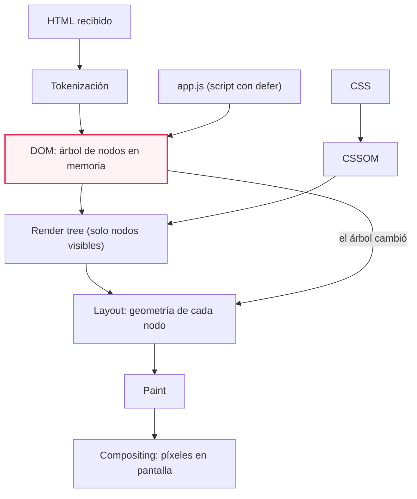
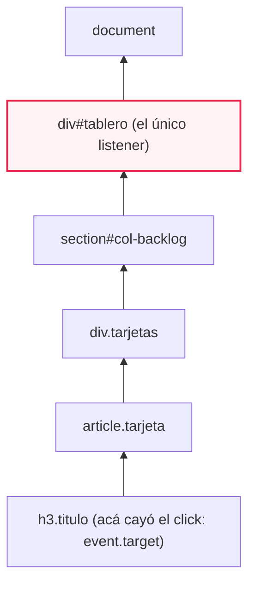
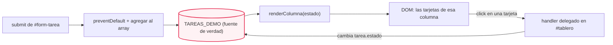
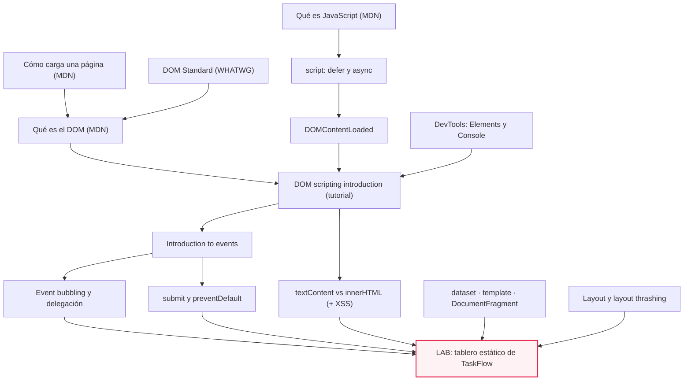
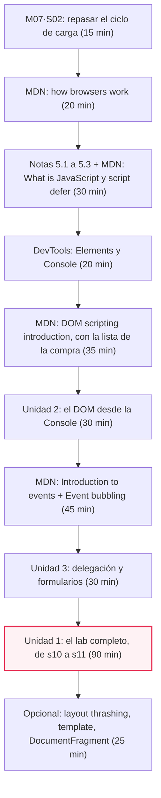

# M07·S11 — Cómo funciona el frontend: del HTML al DOM

**Módulo:** 07 — Fundamentos de Software + System Design para AI Engineers
**Sesión:** M07·S11 · Semana 2 · duración de clase 3 h
**Fecha:** [Completar por el profesor: fecha]
**Proyecto:** TaskFlow — del tag `s10` (backend cerrado) al tag `s11` (tablero estático)
**Duración estimada de estudio:** ≈ 5 h (90 min de lecturas imprescindibles · 60 min de notas · 150 min de ejercicios, con el lab incluido)

---

## 1. Qué entra y qué no entra hoy

Hoy la página **no habla con la API**. Los datos son un array hardcodeado en JavaScript y
nada sale del navegador. `fetch`, JSON, estado en el cliente, CORS, servir el frontend
desde FastAPI y el panorama de SPA/React son de **S12**.

Eso no es una limitación: es el encuadre. Si la red está en el medio desde el minuto uno,
la mitad de los errores del día son de red y nadie llega a ver lo único que esta sesión
quiere que veas: **que el navegador convierte el HTML en un árbol de objetos en memoria, y
que JavaScript dibuja la página modificando ese árbol**.

Dos reglas más del encuadre, las dos a propósito:

- **A mano, sin framework y sin build tools.** Dos archivos, `frontend/index.html` y
  `frontend/app.js`, abiertos directo desde el archivo. Ningún `npm`, ningún bundler.
- **Sin agente durante el lab.** Es la única sesión del módulo donde Claude Code o Cursor
  quedan cerrados. El motivo es el mismo que el de la sesión entera: un agente te escribe
  un tablero que funciona en 40 segundos y vos no viste ni un nodo construirse. El agente
  vuelve a entrar después, para el párrafo del README y para revisar el diagrama. De S12 en
  adelante se usa normal.

> 💡 El resto del módulo se trabaja "entendiendo para dirigir". Esta sesión es el paréntesis
> donde se construye el *entender* a mano, porque el frontend es justo la parte que un
> backender delega al agente sin poder revisarla.

---

## 2. Objetivos de aprendizaje

Al terminar esta sesión vas a poder:

1. **Explicar** qué hace el navegador entre recibir el HTML y mostrar píxeles: parsing, DOM,
   CSSOM, render tree, layout, paint — y por qué el DOM no es "el HTML".
2. **Ubicar** qué es JavaScript y dónde corre: el lenguaje frente a las Web APIs, el entorno
   de ejecución por pestaña, y cómo y cuándo entra tu script a la página.
3. **Leer y modificar** la página desde el DOM —`querySelector`, `createElement`, `append`,
   `textContent`, `classList`, `dataset`— eligiendo con criterio entre `textContent` e
   `innerHTML`.
4. **Construir** un modelo de eventos que funcione: `addEventListener`, el objeto `event`,
   `preventDefault()` en un `submit`, y delegación de eventos para que las tarjetas creadas
   en caliente respondan igual que las originales.
5. **Usar DevTools** como instrumento: el panel Elements como vista del DOM vivo y la Console
   como REPL para manipular la página sin recargarla.
6. **Entregar** el tablero estático de TaskFlow en vanilla JS (tag `s11`) y **defender** la
   estrategia de render elegida frente a las dos alternativas que descartaste.

---

## 3. Resumen ejecutivo

Llevás seis sesiones del lado del servidor. En **M07·S05** armaste el prototipo de TaskFlow
con los datos en un `dict` en memoria; en **S06** modelaste el dominio; en **S07** lo pasaste
a PostgreSQL con SQLAlchemy; en **S08** le diste datos pensados para agentes; en **S09**
diseñaste el contrato de la API v1 y en **S10** lo implementaste entero. El backend está
cerrado. La frontera frontend/backend la dibujaste en **M07·S02**, y ahí mismo viste la
secuencia de carga de una página hasta DOM y CSSOM, los nombres SSR/CSR y la pregunta de
dónde vive el estado. Hoy te paras del otro lado de esa frontera.

La sesión responde una sola pregunta, con cuatro capas: **¿qué hace exactamente el navegador
con el HTML que recibe, y cómo lo toca JavaScript?** El HTML se parsea a un árbol de objetos
en memoria —el DOM—, el CSS se parsea al CSSOM, los dos se combinan en el render tree, y de
ahí salen layout, paint y píxeles. JavaScript no "edita el HTML": modifica el árbol, y el
navegador vuelve a dibujar. Encima de eso va el modelo de eventos: el navegador te avisa que
pasó algo (`click`, `submit`) y tu código reacciona.

Por qué importa en el rol: el núcleo de IA de un producto casi siempre vive dentro de una
app más amplia, y la parte cliente es la que un especialista de backend delega al agente con
más facilidad y revisa peor. *UI components* y *page rendering* están en la lista de
competencias que maneja un desarrollador competente, y el agentic coding es justamente lo
que permite a un especialista asumir un rol full-stack —con la condición de entender cómo
funciona el stack completo (Ng, *AI Engineering Skills Map*). Tres horas moviendo nodos a
mano son el seguro contra quedar ciego del lado del cliente.

---

## 4. Conceptos clave

Cada entrada va con su definición, **para qué** sirve y **por qué** se hace así. Lo ya visto
en sesiones anteriores (DNS, TCP, TLS, HTTP, SSR/CSR, "qué es el estado" — M07·S02; el
dominio de TaskFlow — S06–S10; el REPL de Python — módulo 01) se refresca en una línea, no
se re-explica.

### Bloque A — El ciclo de carga

- **Parsing (del HTML)** — El navegador tokeniza los bytes del HTML y construye un árbol.
  *Para qué:* es el paso que convierte texto en estructura manipulable. *Por qué así:* es
  incremental, y por eso un script en el medio puede frenarlo.
- **DOM (Document Object Model)** — Interfaz de programación que representa la estructura del
  documento **en memoria**, como un árbol lógico de nodos y objetos, modificable desde un
  lenguaje de scripting (MDN, *Document Object Model*). *Para qué:* es el único objeto que tu
  código puede tocar para cambiar lo que se ve. *Por qué así:* separa la representación del
  texto fuente, así el mismo árbol se manipula desde la Console, desde un script o desde un
  framework.
- **CSSOM** — El equivalente del DOM para el CSS: el árbol de reglas de estilo parseadas.
  *Para qué:* saber qué estilo le toca a cada nodo. *Por qué así:* se construye aparte porque
  el CSS no bloquea el parseo del HTML, pero sí la ejecución de JavaScript.
- **Render tree** — Combinación de DOM y CSSOM que deja fuera los nodos que no se muestran
  (`<head>`, `display: none`) y es lo que se usa para calcular el layout de cada elemento
  visible antes de pintarlo (MDN, *Populating the page*). *Para qué:* no gastar cálculo en lo
  invisible. *Por qué así:* "lo que existe" y "lo que se ve" son dos cosas distintas.
- **Layout (reflow)** — Cálculo de la geometría de cada nodo: posición y tamaño. *Para qué:*
  saber dónde va cada cosa. *Por qué así:* alcanza normalmente a todo el documento, así que
  más nodos es más trabajo.
- **Paint y compositing** — Rasterizado de cada capa y composición final en pantalla.
  *Para qué:* los píxeles. *Por qué así:* separar paint de composite permite mover capas sin
  recalcular layout.
- **Parser-blocking JavaScript** — Un `<script>` clásico sin `async` ni `defer` bloquea el
  render y pausa el parseo del HTML (MDN, *Populating the page*). *Para qué:* entender por
  qué el orden del `<script>` cambia todo. *Por qué así:* el script podría escribir en el
  documento, así que el parser lo espera.
- **TTI (Time to Interactive)** — Punto, posterior al First Contentful Paint, en que la página
  responde a la entrada del usuario en menos de 50 ms (MDN, *Populating the page*). *Para
  qué:* medir "ya se ve" frente a "ya se puede usar". *Por qué así:* se ve antes de que
  funcione, y el usuario no lo distingue.

### Bloque B — JavaScript y dónde corre

- **JavaScript** — Lenguaje de scripting, la tercera capa del stack web (HTML estructura, CSS
  presentación, JS comportamiento). Es interpretado y los motores modernos lo compilan
  **just-in-time** durante la ejecución (MDN, *What is JavaScript?*). *Para qué:* darle
  comportamiento a la página. *Por qué así:* la compilación en tiempo de ejecución es lo que
  permite que lo que escribís se ejecute sin build.
- **Browser API / Web API** — Funcionalidad que expone el navegador y **no** es parte del
  lenguaje: el DOM es una de ellas. *Para qué:* distinguir "esto lo sabe JS" de "esto lo
  presta el navegador". *Por qué así:* Node.js ofrece JS sin DOM, y hay implementaciones del
  DOM para otros lenguajes, como `xml.dom.minidom` en Python (MDN, *Document Object Model*).
- **Entorno de ejecución por pestaña** — Cada pestaña ejecuta su código en un entorno
  separado, de modo que el código de una no puede afectar directamente a otra; es una medida
  de seguridad (MDN, *What is JavaScript?*). *Para qué:* entender el alcance de tus
  variables globales. *Por qué así:* una pestaña maliciosa no puede leer la sesión de otra.
- **`defer`** — Atributo del `<script>`: el archivo se baja en paralelo al parseo y se ejecuta
  después de que el documento fue parseado y antes de que se dispare `DOMContentLoaded`, en el
  orden en que aparece (MDN, *`<script>`*). *Para qué:* garantizar que el árbol ya existe
  cuando corre tu código. *Por qué así:* la alternativa `async` no garantiza orden, y sin
  ninguno de los dos el script bloquea el parser.
- **`DOMContentLoaded`** — Evento que se dispara cuando el HTML terminó de parsearse y los
  scripts diferidos se descargaron y ejecutaron; **no** espera imágenes, subframes ni scripts
  `async` (MDN). *Para qué:* arrancar tu código en el momento exacto. *Por qué así:* "un
  error común es usar `load` donde correspondería `DOMContentLoaded`" (MDN) — `load` espera
  la página entera y llega tarde.

### Bloque C — El DOM como API

- **`document`** — El objeto que representa la página cargada; la raíz desde la que se llega a
  cualquier nodo. *Para qué:* es tu puerta de entrada al árbol. *Por qué así:* es global y
  único por pestaña, como el estado cargado en memoria de un proceso.
- **Nodo y elemento** — Un nodo es cualquier pieza del árbol (elemento, texto, comentario); un
  elemento es el nodo que corresponde a una etiqueta. *Para qué:* saber qué podés seleccionar.
  *Por qué así:* el texto también es un nodo, y eso explica por qué `textContent` existe.
- **Selector CSS** — Expresión que describe un conjunto de nodos: `#id`, `.clase`,
  `etiqueta`, `[data-x]`, y la combinación por descendencia (`#col-backlog .tarjetas`).
  *Para qué:* decirle al DOM *cuáles* nodos querés. *Por qué así:* reutiliza el lenguaje que
  ya usa el CSS, en vez de inventar otro.
- **`querySelector` / `querySelectorAll`** — Devuelven el primer nodo que matchea un selector,
  o la lista de todos. *Para qué:* obtener referencias a nodos. *Por qué así:* un solo método
  cubre id, clase y combinaciones, y reemplaza a la familia `getElementBy*`.
- **`createElement` / `append` / `remove`** — Crear un nodo suelto, colgarlo de un padre,
  quitarlo. *Para qué:* construir la página desde datos. *Por qué así:* un `append` de un nodo
  que **ya está** en el árbol lo **mueve**, no lo copia (MDN, *DOM scripting introduction*):
  para copiarlo hay que usar `cloneNode()`.
- **`textContent`** — Propiedad que lee o escribe el contenido textual de un nodo, sin parsear
  HTML. *Para qué:* poner datos en la página sin abrir la puerta a la inyección. *Por qué
  así:* MDN la recomienda cuando el contenido es texto plano, porque `innerHTML` trabaja con
  HTML crudo y es "menos semántico y más lento, ya que necesita invocar el parser de HTML".
- **`innerHTML`** — Propiedad que lee o escribe el HTML interno de un elemento como string. Es
  "probablemente el vector más común de ataques de cross-site scripting (XSS)" (MDN): impide
  que un `<script>` inyectado se ejecute, pero sigue siendo explotable por otras vías, como
  ``. *Para qué:* insertar markup que vos controlás. *Por qué
  así:* para datos **nunca**; las mitigaciones son trusted types y la directiva CSP
  `require-trusted-types-for`, que no son tema de esta sesión.
- **`innerText`** — Variante que sí tiene en cuenta el CSS. *Para qué:* leer "lo que el
  usuario ve". *Por qué así:* leerla **dispara un reflow**, computacionalmente caro (MDN);
  `textContent` no mira estilos y devuelve el contenido de todos los nodos, incluidos
  `<script>` y `<style>`.
- **`classList`** — API para agregar, quitar y alternar clases CSS de un elemento.
  *Para qué:* cambiar la apariencia sin escribir estilos desde JS. *Por qué así:* la
  alternativa, `element.style`, mete presentación en el código y pisa la hoja de estilos.
- **`data-*` y `dataset`** — Atributos propios que cuelgan datos de un elemento; `dataset` los
  expone en JS. El nombre se convierte sacando el prefijo y pasando cada guion seguido de
  minúscula a mayúscula (`data-abc-def` → `dataset.abcDef`), y **los valores son siempre
  string** (MDN). *Para qué:* saber a qué dato de dominio corresponde un nodo. *Por qué así:*
  la alternativa —mantener un `Map` de nodo a id— se desincroniza en cuanto re-renderizás.
- **`<template>`** — Elemento cuyo contenido no se renderiza y sirve de molde para clonar; su
  `.content` es un `DocumentFragment` y sus `childNodes` están siempre vacíos (MDN).
  *Para qué:* tener el HTML de una tarjeta escrito en el HTML, no deletreado en JS. *Por qué
  así:* es la alternativa declarativa al `createElement`; hoy no la usamos porque el objetivo
  es ver el árbol construirse nodo por nodo.
- **`DocumentFragment`** — Documento mínimo sin padre, "una versión liviana de `Document`",
  que guarda estructura **fuera del árbol activo**. *Para qué:* armar varios nodos y colgarlos
  con un solo `append`. *Por qué así:* el argumento de performance que todos repiten lo
  desmiente la propia doc: el beneficio "suele estar sobrevalorado" y en algunos motores es
  más lento que agregar en un loop, así que conviene optimizar por legibilidad (MDN).

### Bloque D — Eventos

- **Evento, listener y handler** — El evento es la señal que dispara el navegador cuando pasa
  algo relevante; el listener es el registro de interés; el handler es la función que corre.
  *Para qué:* reaccionar sin preguntar en un loop. *Por qué así:* el navegador ya sabe cuándo
  pasó; vos solo decís qué hacer.
- **`addEventListener`** — Forma recomendada de registrar un handler. *Para qué:* enganchar
  código a una interacción. *Por qué así:* admite varios handlers para el mismo evento y se
  puede quitar con `removeEventListener`; la propiedad `btn.onclick` admite uno solo, y de los
  atributos inline del HTML MDN dice textualmente: "You should never use the HTML event
  handler attributes".
- **Objeto `event`** — Lo que recibe el handler: qué pasó y dónde. *Para qué:* decidir en
  función del contexto. *Por qué así:* sin él, un listener en el contenedor no sabría qué
  tarjeta clickeaste.
- **`preventDefault()`** — Cancela la acción por default del navegador para ese evento.
  *Para qué:* que un `submit` no recargue la página. *Por qué así:* el default existe y es
  razonable (enviar el form por HTTP); si querés manejarlo en JS, hay que cancelarlo
  explícitamente.
- **Bubbling y capture** — Después de llegar al nodo donde se originó, el evento sube por sus
  ancestros (bubbling); la fase de captura es el descenso previo, apagada por default y
  activable con `{ capture: true }`. Históricamente Netscape implementó solo captura e
  Internet Explorer solo bubbling, y el estándar del W3C incluye las dos (MDN, *Event
  bubbling*). *Para qué:* entender por qué un listener en el padre "ve" los clicks de los
  hijos. *Por qué así:* `stopPropagation()` corta la propagación cuando estorba.
- **`target` vs. `currentTarget`** — `event.target` es el elemento donde se originó el evento
  y no cambia al propagarse; `event.currentTarget` es el elemento cuyo handler está corriendo
  (MDN). *Para qué:* distinguir "dónde hizo click" de "quién lo atiende". *Por qué así:*
  confundirlos es el bug clásico: `target` puede ser el `<h3>` de adentro de la tarjeta.
- **Delegación de eventos** — Un solo listener en un ancestro atiende los eventos de todos sus
  descendientes, presentes y futuros. *Para qué:* que las tarjetas creadas en caliente
  respondan sin código extra. *Por qué así:* la alternativa —un listener por tarjeta— obliga
  a reengancharlo cada vez que se crea o re-renderiza un nodo, y el bug "las tarjetas nuevas
  no responden" es inevitable.
- **Evento `submit`** — Se dispara **en el `<form>`**, no en el botón; también con envío
  implícito (Enter en un campo de texto) y con `form.requestSubmit()`, pero **no** cuando un
  script llama a `form.submit()` directamente (MDN). *Para qué:* un único punto para
  interceptar la creación de una tarea. *Por qué así:* escuchar el `click` del botón te deja
  afuera el Enter.

### Bloque E — Instrumentos y conceptos del lab

- **Panel Elements (DevTools)** — Vista del DOM **vivo**, no del HTML original: "HTML
  representa el contenido inicial de la página y el DOM representa el contenido activo y
  actual" (Chrome DevTools). *Para qué:* ver el resultado de tu código. *Por qué así:* es la
  demostración empírica de que HTML y DOM son dos cosas.
- **Console como REPL** — La Console es un REPL —"Read, Evaluate, Print, and Loop"— y `$()`
  funciona como alias de `document.querySelector()` (Chrome DevTools). *Para qué:* probar una
  manipulación antes de escribirla en el archivo. *Por qué así:* es el REPL de Python que ya
  usaste, con el documento cargado como estado global.
- **Vanilla JS** — JavaScript sin frameworks ni librerías. *Para qué:* ver el mecanismo sin
  capas encima. *Por qué así:* lo que un framework automatiza, hoy lo hacés con la mano para
  saber qué automatiza.
- **Fuente única de verdad** — Una sola estructura de datos manda, y la vista es su
  proyección. *Para qué:* no tener dos estados que se contradicen. *Por qué así:* si mutás el
  DOM y el array por separado, tarde o temprano discrepan y el bug es irreproducible.
- **Layout thrashing** — Patrón en el que JS escribe estilos y lee inmediatamente un valor
  geométrico (un *forced synchronous layout*), dentro de un loop. "Los cambios a propiedades
  geométricas, como `width`, `height`, `left` o `top`, requieren layout"; la receta es leer
  primero y escribir después (Wagner, Lewis y Pollard, web.dev). *Para qué:* saber qué hace
  caro un render. *Por qué así:* es el fundamento técnico del trade-off de hoy.
- **XSS (cross-site scripting)** — Inyección de contenido ejecutable a través de datos no
  sanitizados. *Para qué:* entender por qué los datos entran por `textContent`. *Por qué
  así:* vuelve en **M07·S17**, en el bullet de seguridad shift-left; hoy lo vas a disparar a
  propósito una vez.

---

## 5. Notas de estudio por subtema

### El diagrama ancla: de los bytes a los píxeles (y la vuelta)



Leelo dos veces: la primera de arriba hacia abajo (la carga inicial), la segunda mirando la
flecha de vuelta. Esa flecha es la sesión entera: **tu script no vuelve a empezar el ciclo
desde el HTML, entra por el DOM**. El HTML del archivo ya cumplió su función y no vuelve a
mirarse.

Este diagrama es un entregable: va a `docs/diagrams/s11-html-dom-render.mmd`.

### El frontend leído desde el backend que ya tenés

No estás empezando de cero: ya tenés en la cabeza casi todas las ideas, con otros nombres.

| En el backend de TaskFlow | En el navegador | Qué comparten |
|---|---|---|
| El proceso de `uvicorn` con el estado cargado en memoria | `document`: el DOM de la pestaña | Estructura viva en memoria, no el archivo del disco |
| El REPL de Python | La Console de DevTools | Evaluás expresiones contra un estado ya cargado |
| El repositorio en memoria de S05 (`dict[int, Tarea]`) | El array `TAREAS_DEMO` | La única fuente de verdad del momento |
| "Se pierde al reiniciar con `--reload`" | "Se pierde al recargar con F5" | Nada persiste si nadie lo persiste |
| `app/models/tarea.py` (la forma del dato) | Los objetos de `TAREAS_DEMO` | El mismo vocabulario: `titulo`, `estado`, `responsable_id` |
| El router traduce HTTP a llamadas al service | El handler traduce un `click` a un cambio de estado | Un borde que recibe eventos del exterior |

> 💡 Cuando algo del DOM te confunda, traducilo a esta tabla. "¿Por qué `querySelector`
> devuelve `null`?" es la misma clase de pregunta que "¿por qué el repo me devuelve `None`?":
> o buscaste mal, o todavía no existe.

### 5.1 Qué pasa cuando el navegador carga una página

**El problema que resuelve entender esto:** vas a escribir una línea —`document.querySelector("#tablero")`—
que funciona o devuelve `null` según *cuándo* corra. Sin el modelo del ciclo de carga, eso es
magia; con el modelo, es una consecuencia.

El navegador recibe un stream de bytes de HTML y lo **tokeniza**: convierte `<article class="tarjeta">`
en "empieza un elemento `article` con un atributo `class`". Con esos tokens construye el
**DOM**: un árbol de objetos en memoria donde cada etiqueta es un nodo, cada texto es un nodo,
y la jerarquía del HTML se vuelve relación padre/hijo. En paralelo parsea el CSS al **CSSOM**.
Después combina los dos en el **render tree**, que deja afuera lo que no se muestra —el
`<head>`, cualquier cosa con `display: none`—, calcula el **layout** (dónde y de qué tamaño va
cada nodo visible), lo **pinta** y lo **compone** en pantalla.

Las cuatro estructuras se confunden todo el tiempo. Esta tabla es la que conviene tener a
mano:

| | Qué es | Quién la produce | Cuándo existe | ¿Se puede modificar desde JS? |
|---|---|---|---|---|
| **HTML** | Texto fuente del documento | Vos (o el servidor) | Antes de la carga; no cambia nunca | No: editarlo requiere editar el archivo |
| **DOM** | Árbol de nodos en memoria | El parser del navegador | Desde que el parser avanza | **Sí, es el objeto de trabajo** |
| **CSSOM** | Árbol de reglas de estilo | El parser de CSS | Tras parsear las hojas | Sí, indirectamente (clases, estilos) |
| **Render tree** | DOM + CSSOM, solo lo visible | El motor de render | Antes del layout | No directamente: es consecuencia |

**Gotcha central de la sesión.** Abrí `index.html` en el navegador, hacé *View source* y
después mirá el panel Elements con una tarjeta ya creada por JS: **son distintos**. El
`<div id="tablero">` del archivo está vacío; el del panel tiene seis `article.tarjeta`
adentro. Ninguna explicación reemplaza verlo una vez.

**Gotcha de rendimiento, para el trade-off del final:** cambiar propiedades geométricas
dispara layout, y el layout alcanza normalmente a todo el documento. Si en un loop escribís
un estilo y leés inmediatamente un valor geométrico, forzás un layout sincrónico por
iteración. La receta de web.dev es simple: **leé los valores de estilo y después hacé los
cambios**.

📚 Para profundizar: [Populating the page: how browsers work (MDN)](https://developer.mozilla.org/en-US/docs/Web/Performance/Guides/How_browsers_work)
y [Avoid large, complex layouts and layout thrashing (web.dev)](https://web.dev/articles/avoid-large-complex-layouts-and-layout-thrashing).

### 5.2 Qué es JavaScript y dónde corre

**El problema que resuelve:** venís de diez sesiones donde *vos* arrancás el proceso con
`uvicorn app.main:app --reload`. En el navegador, tu código lo ejecuta un programa de otra
persona (su navegador), en una máquina que no controlás, en un entorno aislado por pestaña
que existe mientras la pestaña existe. Casi todas las diferencias de criterio entre backend y
frontend salen de ahí.

JavaScript es la tercera capa del stack web: HTML da estructura, CSS presentación, JS
comportamiento. Es un lenguaje interpretado que los motores modernos compilan **just-in-time**
durante la ejecución —y se sigue considerando interpretado porque la compilación ocurre en
tiempo de ejecución—. Y esto es lo que más cuesta aceptar al principio: **el DOM no es parte
del lenguaje JavaScript**. Es una Web API que presta el navegador. La prueba está en los dos
extremos: Node.js te da JavaScript sin DOM, y hay implementaciones del DOM para otros
lenguajes, como `xml.dom.minidom` en Python. El DOM es además un estándar aparte, un *living
standard* de WHATWG —última actualización del 9 de octubre de 2026— que define un modelo
neutral de plataforma para eventos, cancelación de actividades y árboles de nodos.

**Cómo entra tu script a la página, y por qué el orden importa.** Hay tres modos de carga y
la diferencia no es cosmética:

| Modo | Cuándo se baja | Cuándo se ejecuta | Orden entre scripts |
|---|---|---|---|
| Clásico (sin atributos) | Al llegar el parser al `<script>` | **Inmediatamente, antes de que el navegador siga parseando** | Garantizado |
| `async` | En paralelo | En cuanto está listo | **No garantizado** |
| `defer` | En paralelo | Después de que el documento fue parseado y antes de `DOMContentLoaded` | Garantizado, por orden de aparición |

```html
<!-- Al final del <head> o del <body>: con defer, da igual. -->
<script defer src="app.js"></script>
```

**Por qué así.** Con `defer`, cuando `app.js` corre, el árbol con las tres columnas ya existe:
podés llamar a `iniciar()` en la última línea del archivo sin ninguna ceremonia. Si en cambio
pusieras el `<script>` en el `<head>` sin atributos, el script se ejecuta antes de que el
parser siga, `document.querySelector("#tablero")` devuelve `null` y perdés media hora. `async`
no sirve acá: no garantiza orden ni que el documento esté parseado. Y `type="module"` queda
afuera por una razón concreta de hoy: los módulos difieren por default (y `defer` no les hace
nada), pero **requieren el protocolo CORS para el fetch cross-origin**, y nuestra página se
abre con `file://`.

La alternativa equivalente, si preferís no depender del atributo:

```js
// Guarda defensiva: funciona igual si el script corre antes o después del parseo.
if (document.readyState === "loading") {
  document.addEventListener("DOMContentLoaded", iniciar);
} else {
  iniciar();
}
```

`DOMContentLoaded` se dispara cuando el HTML terminó de parsearse y los scripts diferidos se
descargaron y ejecutaron; **no** espera imágenes, subframes ni scripts `async`. Y ojo con el
primo: "un error común es usar `load` donde correspondería `DOMContentLoaded`" (MDN). `load`
espera la página entera, imágenes incluidas: tu tablero aparecería tarde y sin motivo.

📚 [What is JavaScript? (MDN)](https://developer.mozilla.org/en-US/docs/Learn_web_development/Core/Scripting/What_is_JavaScript) ·
[`<script>` (MDN)](https://developer.mozilla.org/en-US/docs/Web/HTML/Reference/Elements/script) ·
[DOMContentLoaded (MDN)](https://developer.mozilla.org/en-US/docs/Web/API/Document/DOMContentLoaded_event)

### 5.3 El vocabulario mínimo de HTML y de selectores

**El problema que resuelve:** en el bootcamp nunca escribiste HTML. No hace falta un curso:
hacen falta seis ideas.

1. Un **elemento** es una etiqueta de apertura, contenido y una de cierre:
   `<h3 class="titulo">Arreglar el orden de columnas</h3>`.
2. Los elementos se **anidan** y eso forma el árbol: lo que está adentro es hijo.
3. Un **atributo** es un par clave-valor en la etiqueta de apertura: `class`, `id`,
   `data-tarea-id`.
4. **`id` es único** en el documento e identifica *un* nodo (`id="col-backlog"`); **`class`
   es compartida** y agrupa nodos del mismo tipo (`class="tarjeta"`). Si dudás: `id` para
   "la columna de backlog", `class` para "todas las tarjetas".
5. Las etiquetas **semánticas** describen el rol del contenido: `<section>` para una sección,
   `<article>` para una pieza autónoma (una tarjeta), `<form>`, `<input>`, `<button>`. No es
   decoración: un `<div>` para todo funciona igual y comunica cero.
6. Un **selector CSS** describe un conjunto de nodos, y es el idioma que habla
   `querySelector`: `#col-backlog` (por id), `.tarjeta` (por clase), `article` (por etiqueta),
   `[data-tarea-id]` (por atributo), `#col-backlog .tarjetas` (descendiente: "el `.tarjetas`
   que está dentro de `#col-backlog`").

```js
document.querySelector("#tablero");                 // un nodo, por id
document.querySelectorAll(".tarjeta");              // todos los nodos con esa clase
document.querySelector("#col-hecho .tarjetas");     // descendiente: el contenedor de esa columna
```

**Por qué así:** reutilizar selectores CSS en vez de inventar una API de navegación (padre,
hijo, índice) te deja una sola sintaxis para estilar y para seleccionar. La alternativa
—`getElementById`, `getElementsByClassName`, `getElementsByTagName`— sigue funcionando, pero
son tres métodos para lo que `querySelector` hace con uno.

> 📝 **Nota para el profesor:** si el grupo llegó de M07·S02 con soltura en HTML, este bloque
> se saltea en clase y queda como referencia de lectura.

### 5.4 El DOM como API: leer y modificar la página

**El problema que resuelve:** tenés datos (un array de tareas) y necesitás que aparezcan en
pantalla, cambien cuando el usuario hace algo, y desaparezcan cuando corresponde. Todo eso es
una sola cosa: modificar el árbol.

El ciclo de trabajo tiene siempre la misma forma: **seleccionar → crear → insertar → leer o
escribir → quitar**.

```js
// 1. SELECCIONAR: pedir referencias al árbol.
const contenedor = document.querySelector("#col-backlog .tarjetas");

// 2. CREAR: un nodo suelto, que todavía no está en ninguna parte del documento.
const tarjeta = document.createElement("article");
tarjeta.className = "tarjeta";
tarjeta.dataset.tareaId = 3;        // queda en el HTML como data-tarea-id="3"

// 3. ESCRIBIR texto: textContent, nunca innerHTML para datos.
const titulo = document.createElement("h3");
titulo.className = "titulo";
titulo.textContent = "Escribir documentación de la API";

// 4. INSERTAR: recién acá el nodo entra al árbol y el navegador vuelve a dibujar.
tarjeta.append(titulo);
contenedor.append(tarjeta);

// 5. CLASES: presentación por clase, no por estilo inline.
tarjeta.classList.add("resaltada");
tarjeta.classList.toggle("resaltada");   // la saca si estaba

// 6. QUITAR.
tarjeta.remove();
```

**Por qué así, decisión por decisión:**

- **`textContent` y no `innerHTML`.** Dos argumentos independientes, no uno dogmático.
  Seguridad: `innerHTML` es "probablemente el vector más común de ataques de XSS" y, aunque
  impide que un `<script>` inyectado se ejecute, sigue siendo explotable —el ejemplo de la
  propia doc es ``—. Coste: para texto plano, `innerHTML` es
  "menos semántico y más lento, ya que necesita invocar el parser de HTML". Si alguna vez
  necesitás leer "lo que el usuario ve", existe `innerText`, pero **leerla dispara un
  reflow**, que MDN califica de computacionalmente caro.
- **`dataset` y no un `Map` paralelo.** El dato de dominio viaja pegado al nodo, así que
  cualquier handler puede recuperarlo desde el evento. El precio: **`dataset` devuelve siempre
  strings**. `tarjeta.dataset.tareaId` es `"3"`, no `3`, y `"3" === 3` es `false`. De ahí el
  `Number()` obligatorio en el lab.
- **`classList` y no `element.style`.** Escribir estilos desde JS mezcla presentación con
  comportamiento y pelea con la hoja de estilos. Una clase es un nombre que el CSS resuelve.
- **`createElement` y no un `<template>`.** Hoy el objetivo es *ver* el árbol construirse nodo
  por nodo. El camino declarativo existe y es legítimo: el HTML de la tarjeta vive en el
  `index.html` y se clona. Sabelo, y sabé que la decisión de hoy es pedagógica.

> ⚠️ **`append` sobre un nodo que ya está en el árbol lo MUEVE, no lo copia.** Es la forma más
> barata de "mover una tarjeta de columna" y a la vez la fuente de un bug clásico: si esperabas
> dos tarjetas, tenés una. Para copiar, `cloneNode()`.

#### Debugging del `null`: el error que vas a ver cinco veces

`document.querySelector(...)` devuelve `null` cuando ningún nodo matchea. El síntoma siempre
es el mismo —`TypeError: ... of null`— y las causas son tres. Distinguirlas lleva treinta
segundos si sabés cuáles son:

| Causa | Cómo se confirma | Arreglo |
|---|---|---|
| **Selector equivocado** (falta el `#` o el `.`, hay un typo, `en progreso` con espacio) | Pegá el mismo selector en la Console: `$("#col-en-progreso")`. Si ahí también da `null`, es el selector | Corregí el selector, o el `id` del HTML |
| **El script corrió antes del parseo** | El mismo selector funciona en la Console pero falla en el archivo | Poné `defer`, o la guarda de `readyState` |
| **El nodo todavía no se creó** | El selector apunta a algo que genera JS (una `.tarjeta`) y corrés antes del render | Movelo después del render, o delegá el evento |

📚 [DOM scripting introduction (MDN)](https://developer.mozilla.org/en-US/docs/Learn_web_development/Core/Scripting/DOM_scripting) ·
[DOM overview (MDN)](https://developer.mozilla.org/en-US/docs/Web/API/Document_Object_Model/Introduction) ·
[textContent (MDN)](https://developer.mozilla.org/en-US/docs/Web/API/Node/textContent) ·
[innerHTML (MDN)](https://developer.mozilla.org/en-US/docs/Web/API/Element/innerHTML)

### 5.5 El modelo de eventos: click, input, submit → JS reacciona

**El problema que resuelve:** el usuario hace cosas en momentos que no podés predecir. No
podés preguntar en un loop si ya clickeó. El navegador te avisa.

```js
document.querySelector("#tablero").addEventListener("click", (evento) => {
  const tarjeta = evento.target.closest(".tarjeta");   // ¿el click cayó dentro de una tarjeta?
  if (!tarjeta) return;                                 // cayó en el fondo de la columna: nada que hacer
  console.log("clickearon la tarea", Number(tarjeta.dataset.tareaId));
});
```

**Por qué `addEventListener` y no las dos alternativas.** La propiedad `btn.onclick` admite un
solo handler: el segundo pisa al primero en silencio. Los atributos inline del HTML
(`<button onclick="...">`) mezclan markup con código, y MDN es explícito: "You should never use
the HTML event handler attributes". Esto importa más que nunca en 2026, porque el `onclick`
inline es lo primero que propone un agente cuando le pedís "un botón que haga X": tenés que
saber por qué rechazarlo.

#### Propagación y delegación



El evento nace en el nodo más profundo y **sube** por sus ancestros: eso es el bubbling (antes
hay una fase de **captura**, el descenso, apagada por default y activable con
`{ capture: true }`). Esa subida es lo que hace posible la **delegación**: un único listener en
`#tablero` atiende los clicks de todas las tarjetas, incluidas las que todavía no existen.

Dos propiedades que no son lo mismo y hay que tener claras: `event.target` es el elemento donde
se originó el evento y **no cambia** al propagarse; `event.currentTarget` es el elemento cuyo
handler está corriendo. En el handler de arriba, `currentTarget` es siempre `#tablero`, y
`target` puede ser el `<h3 class="titulo">`, el `<p class="meta">` o el `article` mismo. De ahí
el `closest(".tarjeta")`: "subí desde donde cayó el click hasta la tarjeta que lo contiene".

**Por qué delegar y no un listener por tarjeta.** Con un listener por tarjeta, cada vez que
re-renderizás una columna tenés que acordarte de reengancharlos, y el bug "las tarjetas que
creo con el form no responden al click" es cuestión de tiempo. Con delegación el problema no
existe: el listener vive en un nodo que nunca se re-crea. Es el ejemplo más limpio del módulo
de cómo entender el mecanismo te ahorra una clase entera de código roto.

#### El `submit` y el default que hay que cancelar

```js
document.querySelector("#form-tarea").addEventListener("submit", (evento) => {
  evento.preventDefault();   // sin esto, el navegador recarga la página y se pierde todo
  const input = evento.currentTarget.elements.titulo;
  console.log("crear la tarea:", input.value.trim());
  input.value = "";
  input.focus();
});
```

El evento `submit` se dispara **en el `<form>`**, no en el botón: también cuando el usuario
aprieta Enter en el campo de texto (envío implícito) y cuando un script llama a
`form.requestSubmit()` —pero **no** cuando llama a `form.submit()` directamente—. Si escuchás
el `click` del botón, perdés el Enter; si escuchás el `submit` y te olvidás del
`preventDefault()`, el navegador hace lo que siempre quiso hacer: un request HTTP. La página
se recarga, el DOM se reconstruye desde el archivo, el array vuelve a su estado inicial y
parece que "no funciona".

> 💡 Entender que ahí el navegador quería mandar un request es el puente natural hacia **S12**:
> ese request existe y en la próxima sesión lo vas a hacer vos, en los términos que elijas.

📚 [Introduction to events (MDN)](https://developer.mozilla.org/en-US/docs/Learn_web_development/Core/Scripting/Events) ·
[Event bubbling (MDN)](https://developer.mozilla.org/en-US/docs/Learn_web_development/Core/Scripting/Event_bubbling) ·
[submit event (MDN)](https://developer.mozilla.org/en-US/docs/Web/API/HTMLFormElement/submit_event)

### 5.6 DevTools como instrumento

**El problema que resuelve:** necesitás ver el estado real de la página, no el que imaginás; y
necesitás probar una manipulación antes de escribirla en un archivo.

Dos paneles, y los dos se abren en el minuto cinco y se quedan abiertos toda la sesión:

- **Elements** muestra el DOM vivo. Podés navegar el árbol, editar texto y atributos, ocultar y
  borrar nodos, forzar pseudo-estados como `:hover`, y referenciar el nodo seleccionado desde
  la Console con `$0`. Es donde se comprueba que "HTML representa el contenido inicial de la
  página y el DOM representa el contenido activo y actual".
- **Console** es un REPL: "Read, Evaluate, Print, and Loop". Evaluás expresiones contra la
  página ya cargada, definís funciones, modificás el DOM sin tocar el archivo. `$()` funciona
  como alias de `document.querySelector()`.

```js
// En la Console, con index.html abierto. Orden de dificultad creciente.
document.querySelectorAll(".tarjeta").length;   // ¿cuántas tarjetas hay en el árbol?
const t = $(".tarjeta");                        // alias de querySelector
t.querySelector(".titulo").textContent = "<nuevo titulo>";
t.dataset.tareaId;                              // "1" (string), no 1
t.classList.toggle("resaltada");
```

**Por qué así:** la primera mitad del lab pasa en la Console a propósito. Escribir el mismo
código en un archivo te obliga a recargar para probar cada línea, y recargar destruye el
estado. El REPL te deja iterar sobre una página viva, exactamente como el REPL de Python te
deja iterar sobre objetos ya construidos.

> ⚠️ Todo lo que hacés en la Console **se pierde al recargar**: el DOM se reconstruye desde el
> archivo. Eso no es un defecto de la herramienta, es contenido: el estado que sobrevive a un
> recargado es tema de S12.

> 📝 **Nota para el profesor:** las dos páginas de DevTools de la bibliografía son de Chrome, así
> que el default es Chrome o Chromium para la clase. Firefox y Safari tienen inspector y
> consola equivalentes, y nada del código del lab depende del navegador.

📚 [Viewing and changing the DOM (Chrome DevTools)](https://developer.chrome.com/docs/devtools/dom) ·
[Run JavaScript in the Console (Chrome DevTools)](https://developer.chrome.com/docs/devtools/console/javascript)

### 5.7 La decisión de diseño del lab: cómo se re-dibuja el tablero

**El problema que resuelve:** el usuario clickea una tarjeta y la tarea pasa de `backlog` a
`en progreso`. ¿Qué hacés exactamente? Hay tres caminos y elegir sin pensarlo es la diferencia
entre un tablero que se mantiene coherente y uno que se desincroniza.



Los datos van en una sola dirección: **array → DOM**. Los eventos nunca tocan el DOM: tocan el
array y piden un re-render. Las tres opciones:

| Estrategia | Qué hace | A favor | En contra |
|---|---|---|---|
| **Mutar el nodo puntual** | `append` de la tarjeta existente en la otra columna | Mínimo trabajo: un solo nodo movido, un solo layout | Dos estados en paralelo (DOM y array) que hay que acordarse de sincronizar; se desincronizan |
| **Re-renderizar la columna afectada** ✅ | Vaciar y reconstruir origen y destino desde el array | Una sola función de datos a DOM; el DOM nunca es fuente de verdad | Recrea nodos que no cambiaron |
| **Re-renderizar el tablero entero** | Reconstruir las tres columnas | La más simple de escribir | Pierde foco y scroll; recrea todo por un click |

**La decisión de la sesión es la del medio**, y el argumento es de diseño, no de rendimiento:
una sola función (`renderColumna`) va de datos a DOM, es **idempotente** —llamarla dos veces
deja el mismo resultado—, y el array queda como única fuente de verdad. La primera opción es
más rápida y es exactamente la que produce el bug irreproducible de "la tarjeta está en
`hecho` pero el array dice `backlog`". La tercera es defendible y, en un tablero de seis
tarjetas, indistinguible; se cae sola cuando hay un input con foco o scroll en la columna.

Sobre el coste: tené cuidado con la justificación automática. Si pensás armar la columna en un
`DocumentFragment` "para hacer un solo reflow", la propia documentación de MDN te desarma el
argumento: ese beneficio "suele estar sobrevalorado" y en algunos motores el fragmento es más
lento que agregar al documento en un loop, con la conclusión de **optimizar por legibilidad**.
Lo que sí está medido es otra cosa: el *forced synchronous layout*, cuando escribís estilos y
leés un valor geométrico en el mismo loop. Separar lecturas de escrituras es la receta real.

> 💡 Esta comparación **es** la entrada de trade-off de la sesión. Si la podés defender en voz
> alta, la bitácora se escribe sola.

### Mapa de los recursos de la sesión



Cuatro cosas que el diagrama no dice:

- **El tutorial *DOM scripting introduction* y el lab son el mismo ejercicio con otro dominio.**
  La "lista de la compra dinámica" con la que cierra es el tablero con una sola columna: form +
  `preventDefault()` + `createElement` + borrar por evento. Si el tiempo aprieta, hacé la lista
  primero y después transportala a tarjetas y tres columnas.
- **Las dos páginas de DevTools son instrumento, no unidad temática.** No las leas como bloque
  aparte: tenelas al lado del primer snippet.
- **`<template>` y `DocumentFragment` entran como alternativas descartadas**, no como contenido
  a dominar. Su lugar es la bitácora.
- **`innerHTML` se lee por su sección de seguridad**, no por la propiedad. El enganche real es
  con M07·S17 (XSS, shift-left).

> **Prerrequisito duro:** el ciclo de carga de M07·S02. Si faltaste a esa sesión, leé
> *Populating the page* de MDN **antes** de esta clase, no después.

---

## 6. Ejercicios

Formato workbook: teoría mínima → ejemplo resuelto y comentado → tres ejercicios graduados.
Las soluciones están en la **sección 11**; intentá cada ejercicio antes de mirarlas.

La **Unidad 1 es el lab de la sesión**: lleva el proyecto del tag `s10` al tag `s11`. Es la
unidad más larga y la que hay que hacer completa.

---

### Unidad 1 — El lab: el tablero estático de TaskFlow

#### Teoría mínima

Hoy el frontend es autónomo: dos archivos en `frontend/`, abiertos directo desde el archivo,
sin Docker, sin Postgres, sin `uvicorn` y sin API. El array `TAREAS_DEMO` es la única fuente de
verdad; el DOM es su proyección; los eventos cambian el array y piden un re-render de las
columnas afectadas. Usamos un script clásico con `defer`, `createElement` + `textContent` para
las tarjetas, `data-tarea-id` como vínculo entre el nodo y el dato, un listener de `click`
**delegado** en `#tablero` y uno de `submit` en `#form-tarea`.

#### Prerequisitos

- El repo del equipo en el estado del tag **`s10`** (backend cerrado: API v1 completa, Postgres,
  seeds). El directorio `frontend/` ya existe pero está vacío: solo tiene un `.gitkeep`.
  Hoy creás los **dos archivos** adentro, no el directorio.
- Chrome o Chromium (los dos paneles de DevTools de la bibliografía son de ahí).
- **Nada más.** No hace falta `docker compose up`, ni `python scripts/seed.py`, ni `uvicorn`.
  Si tenés el backend levantado de la sesión anterior, no molesta, pero hoy no se usa.
- Claude Code / Cursor **cerrados** hasta el paso 9.

Placeholders que vas a reemplazar: `<ruta/al/repo>` por la ruta real de tu clon,
`<nuevo titulo>` por cualquier texto cuando te lo pida un snippet de Console.

#### Ejemplo resuelto: el lab, paso a paso

**Paso 1 — Partir del tag `s10`.**

```bash
cd <ruta/al/repo>
git switch -c s11 s10      # rama de trabajo de la sesión, desde el estado entregado en S10
ls frontend/               # debería listar solo .gitkeep
```

*Verificación:* `git status` limpio y `frontend/` vacío. Si `frontend/` no existe, creala con
`mkdir frontend`.

**Paso 2 — Escribir `frontend/index.html`.** Es el esqueleto que vas a *leer y modificar*, no
escribir de cero: está completo en la sección 11. Lo que tiene que haber, y por qué:

- Un `<form id="form-tarea">` con `<input name="titulo" required>` y un botón de `submit`.
  El `name` importa: es cómo el handler lo encuentra con `form.elements.titulo`.
- Un `<div id="tablero">` con tres `<section class="columna">`, con
  `id="col-backlog"`, `id="col-en-progreso"` e `id="col-hecho"`, y **cada una con un
  `<div class="tarjetas">` vacío**. Los ids son así porque el estado del medio, `"en progreso"`,
  **tiene un espacio**: no sirve como `id` ni como clase. Por eso en JS va un mapa explícito y
  no un `replace(" ", "-")` improvisado por cada equipo.
- Un `<style>` embebido de unas 25 líneas (flex para las columnas, borde y padding para las
  tarjetas, una clase `.resaltada`). Vive en el HTML porque hoy **no se enseña CSS**: es una
  decisión de alcance, no de buen gusto.
- `<script defer src="app.js"></script>`.

*Verificación:* el archivo abre en el navegador y muestra tres columnas vacías con sus títulos.

**Paso 3 — Abrir la página. El "servidor" de hoy es ninguno.**

```bash
xdg-open frontend/index.html        # Linux
open frontend/index.html            # macOS
start frontend\index.html           # Windows (cmd)
```

*Verificación:* la barra de direcciones dice `file:///<ruta/al/repo>/frontend/index.html` y la
Console no tiene errores (todavía no hay `app.js`: el 404 de ese archivo es esperable y
desaparece en el paso 5).

Si algún navegador del grupo se pone exigente con `file://`, el plan B es un servidor de
archivos de la librería estándar de Python:

```bash
python3 -m http.server 5500 --directory frontend
# luego: http://localhost:5500/index.html
```

> ⚠️ Ese servidor **solo sirve archivos**: no toca FastAPI, no hay API ni CORS en juego. Es un
> atajo de conveniencia, no parte del tema.

**Paso 4 — La primera mitad del lab es la Console.** Con la página abierta, tipeá en orden:

```js
// 1. Mirar el árbol.
document.querySelectorAll(".tarjeta").length;   // 0: todavía no hay tarjetas
document.querySelector("#tablero");             // el contenedor existe
$("#col-backlog .tarjetas");                    // el contenedor de la primera columna

// 2. Crear un nodo a mano e insertarlo, sin recargar nada.
const nueva = document.createElement("article");
nueva.className = "tarjeta";
nueva.textContent = "Tarea inventada desde la consola";
document.querySelector("#col-backlog .tarjetas").append(nueva);

// 3. Moverla: append sobre un nodo existente lo MUEVE, no lo copia.
document.querySelector("#col-hecho .tarjetas").append(nueva);

// 4. Borrarla.
nueva.remove();
```

*Verificación (la más importante del día):* antes del borrado, abrí *View source* y comparalo
con el panel Elements. El archivo no cambió; el DOM sí. Después apretá F5: la tarjeta
desaparece, porque el DOM se reconstruye desde el archivo.

**Paso 5 — `frontend/app.js`: los datos.** Arriba del archivo, el array y los diccionarios.
Son las **seis tareas del `scripts/seed.py`** de S08, con sus títulos exactos, y los ids por
número como en el dominio:

```js
const TAREAS_DEMO = [
  { id: 1, titulo: "Configurar el tablero inicial", descripcion: null, estado: "hecho",       proyecto_id: 1, responsable_id: 1,    etiqueta_ids: [2] },
  { id: 2, titulo: "Arreglar el orden de columnas", descripcion: null, estado: "en progreso", proyecto_id: 1, responsable_id: 2,    etiqueta_ids: [1, 3] },
  // … las otras cuatro, en la sección 11
];

const USUARIOS  = { 1: "Ada Lovelace", 2: "Lin Torvalds", 3: "Mateo Díaz", 4: "Sofía Ruiz" };
const ETIQUETAS = { 1: "bug", 2: "feature", 3: "urgente", 4: "docs" };

const COLUMNA_DE_ESTADO = {
  "backlog":     "#col-backlog",
  "en progreso": "#col-en-progreso",
  "hecho":       "#col-hecho",
};
```

**Por qué así:** los objetos tienen **la forma del dominio** de TaskFlow (`titulo`, `estado`,
`proyecto_id`, `responsable_id`, `etiqueta_ids`), la misma de `app/models/tarea.py`, para que en
S12 reemplazar el array por la respuesta de la API no obligue a reescribir el render. Y
`responsable_id` es un número, así que para mostrar "Ada Lovelace" hay que resolverlo en el
cliente con `USUARIOS`. Fijate en el detalle: **resolver nombres a mano en el cliente es
exactamente el problema que el endpoint de agentes de S08 resolvió en el servidor**, devolviendo
el tablero autocontenido con los nombres ya resueltos.

*Verificación:* en la Console, `TAREAS_DEMO.length` da `6`.

**Paso 6 — Render: de datos a DOM.** Tres funciones y nada más.

```js
function crearTarjeta(tarea) {
  const nodo = document.createElement("article");
  nodo.className = "tarjeta";
  nodo.dataset.tareaId = tarea.id;      // en el HTML: data-tarea-id="2"

  const titulo = document.createElement("h3");
  titulo.className = "titulo";
  titulo.textContent = tarea.titulo;    // texto, no HTML: los datos nunca se parsean

  nodo.append(titulo);
  return nodo;
}

function renderColumna(estado) {
  const contenedor = document.querySelector(`${COLUMNA_DE_ESTADO[estado]} .tarjetas`);
  contenedor.textContent = "";          // vaciar primero: así el render es idempotente
  for (const tarea of TAREAS_DEMO) {
    if (tarea.estado === estado) contenedor.append(crearTarjeta(tarea));
  }
}

function renderTablero() {
  for (const estado of Object.keys(COLUMNA_DE_ESTADO)) renderColumna(estado);
}
```

**Por qué así:** `renderColumna` vacía antes de llenar, y eso es lo que la hace idempotente:
podés llamarla cuatro veces y el resultado es el mismo. Si no vaciaras, cada click duplicaría
tarjetas. (`contenedor.replaceChildren()` hace lo mismo con un nombre más explícito; usamos
`textContent = ""` porque es la propiedad que ya conocés.) Y `crearTarjeta` devuelve un nodo
suelto en vez de insertarlo: la función que *crea* no decide *dónde va*, así la podés reusar
para cualquier columna.

*Verificación:* agregá `renderTablero()` al final del archivo y recargá. Tienen que aparecer
**3 tarjetas en backlog, 2 en progreso y 1 en hecho**.

**Paso 7 — Click delegado para mover de columna.**

```js
const SIGUIENTE_ESTADO = { "backlog": "en progreso", "en progreso": "hecho", "hecho": "hecho" };

function alClickearTablero(evento) {
  const tarjeta = evento.target.closest(".tarjeta");   // target puede ser el h3 de adentro
  if (!tarjeta) return;                                 // click en el fondo de la columna
  const tarea = TAREAS_DEMO.find((t) => t.id === Number(tarjeta.dataset.tareaId));
  if (!tarea) return;

  const anterior = tarea.estado;
  const siguiente = SIGUIENTE_ESTADO[anterior];
  if (siguiente === anterior) return;                   // desde "hecho" no avanza más

  tarea.estado = siguiente;      // 1) cambia el DATO
  renderColumna(anterior);       // 2) y recién después el DOM, de las dos columnas afectadas
  renderColumna(siguiente);
}
```

**Por qué así:** el listener va en `#tablero`, no en cada tarjeta, porque el nodo `#tablero`
nunca se re-crea y las tarjetas sí. El `Number()` no es decorativo: `dataset` devuelve siempre
strings, y sin la conversión `find` nunca matchea. El ciclo `backlog → en progreso → hecho` **no
valida transiciones**, igual que `mover_tarea` en el backend desde S05.

*Verificación:* un click en una tarjeta de backlog la deja en "En progreso" y la columna de
origen queda con una menos. Un click en el fondo de una columna no hace nada ni tira error.

**Paso 8 — `submit` para crear una tarea.**

```js
function alEnviarForm(evento) {
  evento.preventDefault();                 // sin esto, el navegador recarga y se pierde todo
  const input = evento.currentTarget.elements.titulo;
  const titulo = input.value.trim();
  if (!titulo) return;

  const siguienteId = Math.max(0, ...TAREAS_DEMO.map((t) => t.id)) + 1;
  TAREAS_DEMO.push({
    id: siguienteId, titulo, descripcion: null, estado: "backlog",
    proyecto_id: 1, responsable_id: null, etiqueta_ids: [],
  });

  renderColumna("backlog");
  input.value = "";
  input.focus();
}

function iniciar() {
  renderTablero();
  document.querySelector("#tablero").addEventListener("click", alClickearTablero);
  document.querySelector("#form-tarea").addEventListener("submit", alEnviarForm);
}

iniciar();   // con defer, el árbol ya existe cuando corre esta línea
```

**Por qué así:** toda tarea nace en `backlog`, como en el backend. El `id` se calcula como
"el máximo + 1", que es el equivalente de lo que hacía el repositorio en memoria de S05
asignando ids desde 1. Y el `input.focus()` al final es puro oficio: quien carga cinco tareas
seguidas no quiere volver al mouse.

*Verificación:* cargá una tarea con el botón y otra apretando **Enter** en el input: las dos
tienen que aparecer en backlog (el `submit` se dispara también con el envío implícito). Y lo
más importante: **hacé click en la tarjeta recién creada**. Tiene que moverse igual que las
otras seis — eso es la delegación funcionando. Después apretá F5: todo lo creado desaparece, y
está bien.

**Paso 9 — Los tres entregables de documentación.** Acá podés volver a abrir el agente.

- `docs/diagrams/s11-html-dom-render.mmd` con el flowchart del ciclo
  `HTML → DOM (+ CSSOM) → render tree → layout → paint`, incluyendo la rama de `app.js`
  modificando el DOM. (Es el diagrama ancla de la sección 5; está resuelto en la sección 11.)
- Dos entradas en `docs/trade-offs.md`, con la plantilla del archivo y la etiqueta `[s11]`:
  `### [s11] Estrategia de render: mutar el nodo vs. re-renderizar la columna vs. re-renderizar el tablero`
  y `### [s11] Frontend estático abierto con file:// vs. servido desde FastAPI`.
  No hay ADR nuevo: la elección de vanilla JS ya está en el canon del proyecto, no es una
  decisión de esta sesión.
- El párrafo `s11` del README, en la sección por sesión, con cómo abrir la página y la
  aclaración de que el frontend **no** necesita Postgres ni el servidor levantado.

**Paso 10 — Entrega.**

```bash
git add frontend/ docs/diagrams/s11-html-dom-render.mmd docs/trade-offs.md README.md
git commit -m "s11: frontend estático del tablero (HTML + DOM + eventos)"
git tag s11
```

*Verificación final:* `git diff --stat s10` tiene que tocar **solo** `frontend/`, `docs/` y
`README.md`. Si aparece algo de `app/`, `scripts/` o `requirements.txt`, algo se fue de
alcance: hoy el backend no se toca, no hay dependencias nuevas y no hay `npm`.

> 📝 **Nota para el profesor:** el reparto de los 180 minutos propuesto es 40 min de repaso y
> concepto (HTML → DOM → render, qué es JS y dónde corre) / 60 min de taller guiado con los
> snippets de Console / 45 min de práctica autónoma sobre `app.js` / 20 min de puesta en común
> (dos equipos muestran su `renderTablero`) / 15 min de cierre y trade-offs. Los 45 min de
> práctica autónoma conviene marcarlos como **no comprimibles**: es la única sesión del módulo
> donde el alumno escribe frontend a mano. El lab va en **pareja rotando el teclado cada 15
> min** dentro de los equipos de 3 de S05–S10 (el que mira aprende menos), y la entrega es
> commits `s11:` + tag `s11`, con los mismos cuatro criterios de rúbrica de S05–S10: (a) el
> tablero renderiza desde los datos y no desde HTML escrito a mano, (b) click y submit funcionan
> también sobre tarjetas creadas en caliente, (c) nada de texto de datos inyectado con
> `innerHTML`, (d) el diagrama y los trade-offs explican la decisión de render. Confirmar si
> esta sesión entrega por PR o solo con tag, como las anteriores.

#### 🟢 La tarjeta muestra responsable y etiquetas

`crearTarjeta` solo pinta el título. Agregale una segunda línea con el nombre del responsable y
las etiquetas, resueltos con `USUARIOS` y `ETIQUETAS`. Si la tarea no tiene responsable, tiene
que decir "sin responsable"; si no tiene etiquetas, no se muestra la lista vacía.

<details><summary>Pista</summary>

Un `<p class="meta">` dentro de la tarjeta, con `textContent`. `USUARIOS[tarea.responsable_id]`
devuelve `undefined` cuando el id es `null`, y `tarea.etiqueta_ids.map(...)` te deja el array de
nombres listo para un `join(", ")`.

</details>

**Lo lograste si:** la tarjeta de "Arreglar el orden de columnas" dice `Lin Torvalds · bug, urgente`,
la de "Publicar guía de onboarding" dice `sin responsable · docs`, y nada del texto entró por
`innerHTML`.

#### 🟡 Elegir el estado inicial de la tarea nueva

Hoy toda tarea creada desde el form nace en `backlog`. Agregá al form un `<select name="estado">`
con las tres opciones y hacé que la tarea se cree en el estado elegido.

Pasos: (1) agregá el `<select>` al `<form>` del HTML, con los tres valores exactos del dominio
(`backlog`, `en progreso`, `hecho`); (2) leelo en el handler con
`evento.currentTarget.elements.estado`; (3) usalo en el objeto que empujás al array; (4)
re-renderizá **la columna correcta**, no siempre `backlog`.

<details><summary>Pista</summary>

El `value` de cada `<option>` tiene que ser el string del estado, espacio incluido. Para el
paso 4, acordate de que `COLUMNA_DE_ESTADO` ya mapea estado → selector, así que
`renderColumna(estado)` funciona sin tocar nada más.

</details>

**Lo lograste si:** podés crear una tarea directamente en "Hecho", aparece ahí y no en backlog, y
si después la clickeás no se mueve (desde `hecho` no avanza).

#### 🔴 Contador por columna, sin duplicar lógica

Agregá al encabezado de cada columna un contador de tareas que esté siempre sincronizado: al
cargar, después de cada click y después de cada submit.

Criterio de éxito: el contador **sale del array**, no de contar nodos del DOM; no hay ningún
listener nuevo; no se repite la cuenta en tres lugares; y si llamás `renderTablero()` dos veces
seguidas desde la Console, los números no cambian ni se duplican las tarjetas.

<details><summary>Pista</summary>

Si el contador es un nodo dentro de la columna, el lugar natural para actualizarlo es la misma
función que ya re-renderiza esa columna. Pensá qué le falta a `renderColumna` para ser
responsable de *toda* la columna y no solo de su lista de tarjetas.

</details>

---

### Unidad 2 — El DOM desde la Console: leer, escribir y auditar

#### Teoría mínima

La Console es un REPL sobre la página viva: `$()` es alias de `document.querySelector()`, `$0`
es el nodo seleccionado en Elements, y todo lo que escribís modifica el DOM sin tocar el
archivo (y se pierde al recargar). Sirve para dos cosas: probar una manipulación antes de
escribirla, y **auditar** el estado real cuando algo no cuadra. Las propiedades clave son
`textContent` (texto, seguro), `classList` (clases), `dataset` (datos del nodo, siempre
strings) y `innerHTML` (HTML crudo, el vector de XSS más común).

#### Ejemplo resuelto: inspeccionar el tablero sin recargar

```js
// Con frontend/index.html abierto y el tablero renderizado.

// 1. ¿Qué hay en el árbol, realmente?
document.querySelectorAll(".tarjeta").length;                    // 6
document.querySelectorAll("#col-backlog .tarjeta").length;       // 3

// 2. Del nodo al dato de dominio. OJO: dataset siempre devuelve strings.
const t = $("#col-en-progreso .tarjeta");
t.dataset.tareaId;             // "2"
Number(t.dataset.tareaId);     // 2  ← esto es lo que matchea con TAREAS_DEMO
TAREAS_DEMO.find((x) => x.id === Number(t.dataset.tareaId)).titulo;

// 3. Escribir texto sobre un nodo existente.
t.querySelector(".titulo").textContent = "<nuevo titulo>";

// 4. Presentación por clase, no por estilo inline.
t.classList.add("resaltada");
t.classList.toggle("resaltada");

// 5. El DOM es el estado vivo: esta línea desincroniza la vista del array a propósito.
t.remove();
document.querySelectorAll(".tarjeta").length;   // 5, pero TAREAS_DEMO sigue teniendo 6
```

**Por qué así, y qué enseña el paso 5:** el DOM y el array son dos cosas, y nada los mantiene
sincronizados excepto tu código. Después de ese `remove()`, `renderColumna("en progreso")`
devuelve la tarjeta a su lugar sin que vos hagas nada: eso es la ventaja concreta de tener el
array como fuente única de verdad. Si el DOM fuera la fuente de verdad, la tarea se habría
perdido.

#### 🟢 Completar la auditoría

Completá estas tres líneas para que impriman lo que dice el comentario, sin recargar la página:

```js
// a) el título de la única tarjeta de la columna "hecho"
____;

// b) cuántas tarjetas hay en cada columna, como objeto { backlog: n, "en progreso": n, hecho: n }
____;

// c) los ids de dominio de todas las tarjetas del tablero, como números
____;
```

<details><summary>Pista</summary>

Para (b) te alcanza con `Object.keys(COLUMNA_DE_ESTADO)` y el selector descendiente de cada
columna. Para (c), `querySelectorAll` devuelve algo iterable pero no un array: convertilo con
`Array.from(...)` antes de mapear.

</details>

**Lo lograste si:** (a) imprime "Configurar el tablero inicial", (b) da 3 / 2 / 1 y (c) devuelve
números, no strings.

#### 🟡 Disparar un XSS y arreglarlo

Vas a escribir el bug a propósito, verlo disparar y volver a dejar el código sano. Pasos:

1. En `crearTarjeta`, reemplazá temporalmente `titulo.textContent = tarea.titulo` por
   `titulo.innerHTML = tarea.titulo`.
2. Creá desde el form una tarea cuyo título sea ``.
3. Observá qué pasa y explicá en una línea **por qué pasó aunque no haya ningún `<script>`**.
4. Volvé a `textContent` y repetí el paso 2. Explicá qué ves ahora en la tarjeta.
5. Escribí dos renglones en `docs/trade-offs.md` o en tus notas: los dos argumentos
   independientes por los que los datos entran por `textContent`.

<details><summary>Pista</summary>

MDN dice que `innerHTML` impide que un `<script>` inyectado se ejecute. El atributo `onerror`
no es un `<script>`: es un handler inline, y el navegador lo ejecuta cuando la imagen falla
—que es siempre, porque `src="x"` no existe.

</details>

**Lo lograste si:** viste el `alert` en el paso 2, con `textContent` el título se muestra como
texto literal, y podés nombrar los dos argumentos (seguridad y coste del parser de HTML) sin
mirar los apuntes.

#### 🔴 Auditor de desincronización

Escribí en la Console una función `auditar()` que compare el DOM contra `TAREAS_DEMO` y reporte
las diferencias: tareas del array que no tienen tarjeta, tarjetas del DOM cuyo id no está en el
array, y tarjetas que están en una columna que no corresponde a su `estado`.

Criterio de éxito: con el tablero recién renderizado, `auditar()` reporta cero problemas;
después de hacer `$(".tarjeta").remove()` o de mover una tarjeta a mano con `append`, reporta
exactamente el problema que corresponde y dice cuál es la tarea afectada.

<details><summary>Pista</summary>

Recorré las columnas con `Object.entries(COLUMNA_DE_ESTADO)` para tener a la vez el estado
esperado y el selector. Para subir de la tarjeta a su columna, `closest(".columna")` y su `id`.

</details>

---

### Unidad 3 — Eventos: delegación, `target` y formularios

#### Teoría mínima

`addEventListener` registra un handler; el evento nace en el nodo más profundo y **burbujea** por
sus ancestros, y eso permite la delegación: un listener en un ancestro estable atiende a todos
sus descendientes, incluidos los que todavía no existen. `event.target` es dónde cayó el evento
(no cambia), `event.currentTarget` es quién lo atiende. `closest(selector)` sube desde el target
hasta el ancestro que te interesa. Y `preventDefault()` cancela lo que el navegador iba a hacer
por su cuenta: en un `submit`, mandar un request y recargar.

#### Ejemplo resuelto: dos acciones con un solo listener

```js
// Un único listener en #tablero atiende dos interacciones distintas.
// Regla: primero averiguar QUÉ clickearon, después decidir.
document.querySelector("#tablero").addEventListener("click", (evento) => {
  const tarjeta = evento.target.closest(".tarjeta");
  if (!tarjeta) return;                        // click en el fondo: no es asunto nuestro

  // ¿Clickearon un botón con una acción declarada, o el cuerpo de la tarjeta?
  const boton = evento.target.closest("[data-accion]");
  const accion = boton ? boton.dataset.accion : "avanzar";

  const id = Number(tarjeta.dataset.tareaId);  // dataset devuelve "3": hay que convertir
  const tarea = TAREAS_DEMO.find((t) => t.id === id);
  if (!tarea) return;

  if (accion === "avanzar") {
    const anterior = tarea.estado;
    const siguiente = SIGUIENTE_ESTADO[anterior];
    if (siguiente === anterior) return;
    tarea.estado = siguiente;
    renderColumna(anterior);
    renderColumna(siguiente);
  }

  if (accion === "borrar") {
    const indice = TAREAS_DEMO.findIndex((t) => t.id === id);
    TAREAS_DEMO.splice(indice, 1);             // se borra del DATO
    renderColumna(tarea.estado);               // y la columna se vuelve a dibujar
  }
});
```

**Por qué así:** el `data-accion` en el botón convierte "qué hacer" en un dato del markup, en vez
de una cadena de `if` sobre clases o sobre el texto del botón. El orden importa: primero
`closest(".tarjeta")` para saber *sobre qué* tarea actuás, después `closest("[data-accion]")`
para saber *qué* hacer. Si invirtieras el orden, un click en el cuerpo de la tarjeta te dejaría
sin acción por default. Y en los dos casos se modifica el array **antes** de re-renderizar:
nunca al revés.

#### 🟢 De `target` a `currentTarget`

Tomá el handler del ejemplo y reemplazá `evento.target.closest(".tarjeta")` por
`evento.currentTarget.closest(".tarjeta")`. Probalo, explicá qué devuelve ahora y por qué el
tablero deja de responder. Después volvelo atrás.

<details><summary>Pista</summary>

`currentTarget` es el elemento cuyo handler está corriendo, y el handler vive en `#tablero`.
`closest` busca hacia **arriba**, no hacia abajo.

</details>

**Lo lograste si:** podés explicar en una oración por qué `currentTarget.closest(".tarjeta")`
devuelve `null` siempre, y por qué con `target` funciona.

#### 🟡 Botón de borrar en cada tarjeta

Agregá a cada tarjeta un botón "Borrar" y hacelo funcionar **sin agregar ningún listener nuevo**.

Pasos: (1) en `crearTarjeta`, agregá un `<button type="button" data-accion="borrar">Borrar</button>`
al nodo de la tarjeta; (2) en el handler delegado, distinguí la acción como en el ejemplo
resuelto; (3) borrá del array y re-renderizá la columna; (4) verificá que el click en el botón
**no** avance además el estado de la tarea.

<details><summary>Pista</summary>

El botón está dentro de la tarjeta, así que el click en el botón también burbujea por la
tarjeta: un mismo click podría disparar las dos acciones si tu `if` no es excluyente. `type="button"`
importa: un `<button>` dentro de un `<form>` es de tipo submit por default.

</details>

**Lo lograste si:** el botón borra solo esa tarjeta, la tarjeta no cambia de columna en el mismo
click, y los botones de las tarjetas creadas desde el form funcionan igual que los demás.

#### 🔴 Un formulario que no te deja meter basura

Rehacé el handler del `submit` para que el form sea robusto, partiendo solo de este objetivo:
no se puede crear una tarea sin título ni con un título repetido, el usuario se tiene que
enterar de por qué, y la página nunca se recarga.

Criterio de éxito: (a) con el input vacío o con espacios, no se crea nada y aparece un mensaje
en la página —no un `alert`— que desaparece cuando el próximo envío sale bien; (b) si el título
ya existe en `TAREAS_DEMO` (comparando sin distinguir mayúsculas ni espacios de los extremos),
no se crea y el mensaje lo dice; (c) funciona igual con el botón y con Enter; (d) después de un
envío exitoso el input queda vacío y con el foco; (e) el mensaje se escribe con `textContent`.

<details><summary>Pista</summary>

El título como clave natural no es un invento: en `scripts/seed.py` el `titulo` es exactamente
la clave natural de una tarea. Para el mensaje, un `<p id="aviso">` en el HTML que arranca vacío
te evita crear y destruir nodos.

</details>

---

## 7. Ruta de estudio sugerida



Las dependencias son reales: el tutorial de DOM scripting no se aprovecha sin el modelo del
ciclo de carga, y la Unidad 1 integra todo lo anterior, así que va al final aunque en clase se
haga antes. Si venís corto de tiempo, el camino mínimo es B → C → E → G → I.

Intentá **cada ejercicio antes** de abrir la sección 11. Las soluciones están comentadas con el
porqué de cada decisión, así que leerlas antes te ahorra el error que justamente las vuelve
memorables.

---

## 8. Checklist de autoevaluación

- [ ] Puedo explicar, sin mirar los apuntes, la diferencia entre HTML, DOM, CSSOM y render tree.
- [ ] Puedo justificar por qué el DOM **no** es parte del lenguaje JavaScript, con un ejemplo de
      cada lado.
- [ ] Sé qué hace `defer` y puedo predecir qué pasa si el `<script>` va en el `<head>` sin él.
- [ ] Sé elegir entre `textContent` e `innerHTML` y puedo dar los **dos** argumentos del caso.
- [ ] Sé por qué `tarjeta.dataset.tareaId` necesita un `Number()` antes de compararlo.
- [ ] Puedo explicar la delegación de eventos y el bug concreto que evita en este tablero.
- [ ] Distingo `event.target` de `event.currentTarget` y sé cuándo uso `closest()`.
- [ ] Sé por qué un `submit` sin `preventDefault()` "borra" todo lo que había creado.
- [ ] Puedo defender la estrategia de render elegida frente a las otras dos, con un argumento de
      diseño y uno de coste.
- [ ] Puedo diagnosticar un `querySelector` que devuelve `null` y decir cuál de las tres causas
      es.

---

## 9. Preguntas de repaso

1. Un compañero dice "el DOM es el HTML de la página". ¿Qué le corregirías, y qué experimento
   concreto le propondrías para que lo vea en treinta segundos?
2. Tenés un `<script>` en el `<head>` sin atributos y `document.querySelector("#tablero")`
   devuelve `null`. Explicá la causa en términos del ciclo de carga y dá **dos** arreglos
   distintos, con el trade-off de cada uno.
3. Un agente te genera un tablero donde cada tarjeta lleva `onclick="mover(3)"` y el texto se
   pinta con `innerHTML`. Listá todo lo que le pedirías cambiar y por qué, en orden de gravedad.
4. ¿Por qué un listener en el contenedor del tablero atiende los clicks de tarjetas que no
   existían cuando se registró? Explicá el mecanismo y qué rol juegan `target` y `closest()`.
5. Tenés que mover una tarjeta de columna. ¿Mutás el nodo, re-renderizás la columna o
   re-renderizás el tablero? Defendé tu elección y decí en qué escenario cambiarías de opinión.

---

## 10. Recursos adicionales

### Imprescindible

- [Populating the page: how browsers work (MDN)](https://developer.mozilla.org/en-US/docs/Web/Performance/Guides/How_browsers_work) — el recorrido completo de una navegación, etapa por etapa. 20 min.
- [DOM scripting introduction (MDN Learn)](https://developer.mozilla.org/en-US/docs/Learn_web_development/Core/Scripting/DOM_scripting) — el tutorial que más se parece al lab, con la lista de la compra dinámica. 35 min.
- [Introduction to events (MDN Learn)](https://developer.mozilla.org/en-US/docs/Learn_web_development/Core/Scripting/Events) — eventos, listeners y `preventDefault()`. 30 min.
- [Event bubbling (MDN Learn)](https://developer.mozilla.org/en-US/docs/Learn_web_development/Core/Scripting/Event_bubbling) — propagación, captura y delegación con ejemplos corribles. 25 min.
- [`<script>`: the script element (MDN)](https://developer.mozilla.org/en-US/docs/Web/HTML/Reference/Elements/script) — la semántica exacta de `defer` y `async`. 10 min.
- [Repo de referencia `fastapi-full-v0`](https://github.com/Luc5k4yw4lk3r/fastapi-full-v0) — TaskFlow, con un tag por sesión y el alcance de cada una en `sessions/`. 15 min.

### Recomendado

- [What is JavaScript? (MDN Learn)](https://developer.mozilla.org/en-US/docs/Learn_web_development/Core/Scripting/What_is_JavaScript) — el lenguaje, las browser APIs y el entorno por pestaña. 15 min.
- [Document Object Model (DOM) overview (MDN)](https://developer.mozilla.org/en-US/docs/Web/API/Document_Object_Model/Introduction) — la definición de referencia. 12 min.
- [Node: textContent (MDN)](https://developer.mozilla.org/en-US/docs/Web/API/Node/textContent) — la comparación con `innerText` e `innerHTML`. 5 min.
- [Element: innerHTML (MDN)](https://developer.mozilla.org/en-US/docs/Web/API/Element/innerHTML) — leela por su sección de seguridad. 8 min.
- [HTMLFormElement: submit event (MDN)](https://developer.mozilla.org/en-US/docs/Web/API/HTMLFormElement/submit_event) — dónde se dispara y qué lo cancela. 5 min.
- [Document: DOMContentLoaded event (MDN)](https://developer.mozilla.org/en-US/docs/Web/API/Document/DOMContentLoaded_event) — la alternativa a `defer`. 5 min.
- [HTMLElement: dataset (MDN)](https://developer.mozilla.org/en-US/docs/Web/API/HTMLElement/dataset) — `data-*`, camelCase y "todo es string". 6 min.
- [Get started with viewing and changing the DOM (Chrome DevTools)](https://developer.chrome.com/docs/devtools/dom) — el panel Elements. 20 min.
- [Run JavaScript in the Console (Chrome DevTools)](https://developer.chrome.com/docs/devtools/console/javascript) — la Console como REPL. 15 min.

### Opcional

- [DOM Standard (WHATWG)](https://dom.spec.whatwg.org/) — visita de 30 segundos a la portada: el DOM tiene estándar propio. No es lectura asignada.
- [`<template>` (MDN)](https://developer.mozilla.org/en-US/docs/Web/HTML/Reference/Elements/template) — el camino declarativo que hoy descartamos. 8 min.
- [DocumentFragment (MDN)](https://developer.mozilla.org/en-US/docs/Web/API/DocumentFragment) — y la desmentida del mito de performance. 5 min.
- [Avoid large, complex layouts and layout thrashing (web.dev)](https://web.dev/articles/avoid-large-complex-layouts-and-layout-thrashing) — qué dispara layout y cuánto cuesta. 12 min.
- Ng, A., *AI Engineering Skills Map: Software engineering fundamentals* (The Batch, 2026) — el encuadre de por qué un AI engineer estudia frontend. Material de la biblioteca del curso, sin URL pública. 5 min.

---

## 11. Soluciones comentadas

### Unidad 1 — El lab: el tablero estático de TaskFlow

#### 📦 El lab completo: los dos archivos

`frontend/index.html`:

```html
<!DOCTYPE html>
<html lang="es">
<head>
  <meta charset="utf-8" />
  <title>TaskFlow — tablero (s11)</title>
  <style>
    body { font-family: system-ui, sans-serif; margin: 1.5rem; color: #18181b; }
    h1 { font-size: 1.25rem; }
    #form-tarea { display: flex; gap: .5rem; margin-bottom: 1rem; }
    #form-tarea input { flex: 1; padding: .4rem; }
    #tablero { display: flex; gap: 1rem; align-items: flex-start; }
    .columna { flex: 1; background: #f4f4f5; border-radius: 8px; padding: .75rem; }
    .columna h2 { font-size: .95rem; margin: 0 0 .5rem; }
    .tarjetas { display: flex; flex-direction: column; gap: .5rem; min-height: 2.5rem; }
    .tarjeta { background: #fff; border: 1px solid #d4d4d8; border-radius: 6px;
               padding: .5rem; cursor: pointer; }
    .tarjeta .titulo { font-size: .9rem; margin: 0 0 .25rem; }
    .tarjeta .meta { font-size: .75rem; color: #52525b; margin: 0; }
    .resaltada { outline: 2px solid #e6284e; }
  </style>
</head>
<body>
  <h1>TaskFlow — tablero</h1>

  <!-- El form es un form de verdad: así el Enter en el input también envía (envío implícito). -->
  <form id="form-tarea">
    <input name="titulo" placeholder="Título de la tarea nueva" required />
    <button type="submit">Agregar al backlog</button>
  </form>

  <!-- Las tres columnas vienen en el HTML: son estructura, no datos.
       Los ids evitan el espacio de "en progreso", que no sirve como id ni como clase. -->
  <div id="tablero">
    <section class="columna" id="col-backlog">
      <h2>Backlog</h2>
      <div class="tarjetas"></div>
    </section>
    <section class="columna" id="col-en-progreso">
      <h2>En progreso</h2>
      <div class="tarjetas"></div>
    </section>
    <section class="columna" id="col-hecho">
      <h2>Hecho</h2>
      <div class="tarjetas"></div>
    </section>
  </div>

  <!-- defer: se baja en paralelo y se ejecuta con el documento ya parseado. -->
  <script defer src="app.js"></script>
</body>
</html>
```

**Por qué las tres columnas están en el HTML y las tarjetas no:** las columnas son estructura
fija de la página, las tarjetas son datos. Generar contenido estático desde JS es justamente
lo que el tutorial de MDN advierte que no hay que hacer: si el HTML no describe la página,
nadie puede leerla sin ejecutarla.

`frontend/app.js`:

```js
// frontend/app.js — TaskFlow s11.
// Tablero ESTÁTICO y AISLADO: no hay fetch, no hay API, no hay framework.
// Fuente de verdad: el array TAREAS_DEMO. El DOM es su proyección.

// Las 6 tareas de scripts/seed.py (s08), con la forma del dominio de app/models/tarea.py.
const TAREAS_DEMO = [
  { id: 1, titulo: "Configurar el tablero inicial",   descripcion: null, estado: "hecho",       proyecto_id: 1, responsable_id: 1,    etiqueta_ids: [2] },
  { id: 2, titulo: "Arreglar el orden de columnas",   descripcion: null, estado: "en progreso", proyecto_id: 1, responsable_id: 2,    etiqueta_ids: [1, 3] },
  { id: 3, titulo: "Escribir documentación de la API", descripcion: null, estado: "backlog",    proyecto_id: 1, responsable_id: null, etiqueta_ids: [4] },
  { id: 4, titulo: "Diseñar pantalla de bienvenida",  descripcion: null, estado: "en progreso", proyecto_id: 2, responsable_id: 3,    etiqueta_ids: [2] },
  { id: 5, titulo: "Validar formulario de registro",  descripcion: null, estado: "backlog",     proyecto_id: 2, responsable_id: 4,    etiqueta_ids: [1] },
  { id: 6, titulo: "Publicar guía de onboarding",     descripcion: null, estado: "backlog",     proyecto_id: 2, responsable_id: null, etiqueta_ids: [4] },
];

// El dominio guarda ids; la UI muestra nombres. En s08 esto lo resolvía el servidor.
const USUARIOS  = { 1: "Ada Lovelace", 2: "Lin Torvalds", 3: "Mateo Díaz", 4: "Sofía Ruiz" };
const ETIQUETAS = { 1: "bug", 2: "feature", 3: "urgente", 4: "docs" };

// Estado del dominio -> selector de la columna. Explícito porque "en progreso" lleva espacio.
const COLUMNA_DE_ESTADO = {
  "backlog":     "#col-backlog",
  "en progreso": "#col-en-progreso",
  "hecho":       "#col-hecho",
};

// Igual que mover_tarea en el backend: avanza y no valida transiciones.
const SIGUIENTE_ESTADO = {
  "backlog":     "en progreso",
  "en progreso": "hecho",
  "hecho":       "hecho",
};

// --- Render: una sola dirección, de datos a DOM --------------------------------

function crearTarjeta(tarea) {
  const nodo = document.createElement("article");
  nodo.className = "tarjeta";
  nodo.dataset.tareaId = tarea.id;          // data-tarea-id: el único vínculo nodo <-> dato

  const titulo = document.createElement("h3");
  titulo.className = "titulo";
  titulo.textContent = tarea.titulo;        // textContent: los datos no se parsean como HTML

  const meta = document.createElement("p");
  meta.className = "meta";
  meta.textContent = describir(tarea);

  nodo.append(titulo, meta);
  return nodo;                              // devuelve el nodo suelto: quien llama decide dónde va
}

function describir(tarea) {
  const responsable = USUARIOS[tarea.responsable_id] ?? "sin responsable";
  const etiquetas = tarea.etiqueta_ids.map((id) => ETIQUETAS[id]).join(", ");
  return etiquetas ? `${responsable} · ${etiquetas}` : responsable;
}

function renderColumna(estado) {
  const contenedor = document.querySelector(`${COLUMNA_DE_ESTADO[estado]} .tarjetas`);
  contenedor.textContent = "";              // vaciar primero = render idempotente
  for (const tarea of TAREAS_DEMO) {
    if (tarea.estado === estado) contenedor.append(crearTarjeta(tarea));
  }
}

function renderTablero() {
  for (const estado of Object.keys(COLUMNA_DE_ESTADO)) renderColumna(estado);
}

// --- Eventos: cambian el DATO y después piden re-render ------------------------

function alClickearTablero(evento) {
  const tarjeta = evento.target.closest(".tarjeta");   // target puede ser el h3 o el p
  if (!tarjeta) return;

  const tarea = TAREAS_DEMO.find((t) => t.id === Number(tarjeta.dataset.tareaId));
  if (!tarea) return;                                   // dataset devuelve string: Number() obligatorio

  const anterior = tarea.estado;
  const siguiente = SIGUIENTE_ESTADO[anterior];
  if (siguiente === anterior) return;

  tarea.estado = siguiente;
  renderColumna(anterior);
  renderColumna(siguiente);
}

function alEnviarForm(evento) {
  evento.preventDefault();                   // sin esto el navegador manda el form y recarga
  const input = evento.currentTarget.elements.titulo;
  const titulo = input.value.trim();
  if (!titulo) return;

  const siguienteId = Math.max(0, ...TAREAS_DEMO.map((t) => t.id)) + 1;
  TAREAS_DEMO.push({
    id: siguienteId, titulo, descripcion: null, estado: "backlog",
    proyecto_id: 1, responsable_id: null, etiqueta_ids: [],
  });

  renderColumna("backlog");
  input.value = "";
  input.focus();
}

function iniciar() {
  renderTablero();
  // Delegación: un listener en un nodo que nunca se re-crea.
  document.querySelector("#tablero").addEventListener("click", alClickearTablero);
  document.querySelector("#form-tarea").addEventListener("submit", alEnviarForm);
}

iniciar();   // seguro con defer: el documento ya está parseado
```

**Alternativas descartadas, para la bitácora:** (a) un listener por tarjeta —se rompe con las
tarjetas nuevas—; (b) `innerHTML` con un template string —más corto y es el vector de XSS más
común—; (c) `<template>` + `cloneNode` —legítimo, pero esconde la construcción del árbol, que
es lo que hoy queremos ver—; (d) armar la columna en un `DocumentFragment` —el beneficio de
performance está sobrevalorado según la propia doc, y agrega una pieza sin ganancia legible.

El diagrama entregable, `docs/diagrams/s11-html-dom-render.mmd`, es el flowchart ancla de la
sección 5 (el bloque Mermaid tal cual, sin la cerca de código).

Y las dos entradas de `docs/trade-offs.md`, con la plantilla del propio archivo:

```markdown
### [s11] Estrategia de render: mutar el nodo vs. re-renderizar la columna vs. re-renderizar el tablero
- **Fecha:** AAAA-MM-DD
- **Decisión:** el array `TAREAS_DEMO` es la única fuente de verdad y cada cambio re-renderiza
  las columnas afectadas con `renderColumna(estado)`.
- **Alternativas consideradas:**
  - Mutar el nodo puntual (`append` de la tarjeta en la otra columna) — mínimo trabajo de DOM.
  - Re-renderizar la columna afectada — una sola función de datos a DOM.
  - Re-renderizar el tablero entero — la más simple de escribir.
- **Elección:** re-renderizar la columna afectada.
- **Por qué:** mutar el nodo mantiene dos estados en paralelo (DOM y array) y se desincronizan;
  re-renderizar todo pierde foco y scroll. La opción del medio deja una única función idempotente
  de datos a DOM y el DOM nunca es fuente de verdad.
- **Consecuencias / a revisar más adelante:** recrea nodos que no cambiaron. Con muchas tarjetas
  por columna habría que medir (layout alcanza a todo el documento) o pasar a un enfoque
  declarativo; es parte de por qué existen los frameworks.

### [s11] Frontend estático abierto con file:// vs. servido desde FastAPI
- **Fecha:** AAAA-MM-DD
- **Decisión:** `frontend/index.html` se abre directo desde el archivo, con un script clásico
  con `defer`.
- **Alternativas consideradas:**
  - `file://` + script clásico con `defer` — cero infraestructura.
  - Servidor estático local (`python3 -m http.server`) — una pieza más para levantar.
  - Servir el frontend desde FastAPI — acopla el frontend al backend ya en s11.
- **Elección:** `file://`.
- **Por qué:** el frontend de s11 no hace ningún request, así que no necesita origen HTTP. Un
  `type="module"` habría requerido CORS para el fetch cross-origin y no funciona bajo `file://`:
  de ahí el script clásico con `defer`.
- **Consecuencias / a revisar más adelante:** en s12, cuando la página hable con la API, va a
  hacer falta decidir cómo se sirve y resolver CORS.
```

#### 🟢 La tarjeta muestra responsable y etiquetas

Es la función `describir(tarea)` del archivo completo, más las dos líneas de `crearTarjeta` que
crean el `<p class="meta">`.

```js
function describir(tarea) {
  const responsable = USUARIOS[tarea.responsable_id] ?? "sin responsable";
  const etiquetas = tarea.etiqueta_ids.map((id) => ETIQUETAS[id]).join(", ");
  return etiquetas ? `${responsable} · ${etiquetas}` : responsable;
}
```

**Por qué así.** `??` (no `||`) porque lo que queremos detectar es `null`/`undefined`, no
cualquier valor falsy: con `||`, un id `0` caería en el default por error. El `join(", ")` sobre
un array vacío devuelve `""`, que es falsy, así que el ternario alcanza para no mostrar un
separador suelto. Y todo se arma como **un solo string** que entra por `textContent`: si
pintaras cada etiqueta como un nodo aparte tendrías más control de estilos, pero hoy el CSS no
es el tema. La alternativa de `innerHTML` con `<span>`s queda descartada por lo de siempre: son
datos.

#### 🟡 Elegir el estado inicial de la tarea nueva

En el HTML, dentro del `<form>`:

```html
<select name="estado">
  <option value="backlog">Backlog</option>
  <option value="en progreso">En progreso</option>
  <option value="hecho">Hecho</option>
</select>
```

En `alEnviarForm`:

```js
const form = evento.currentTarget;
const titulo = form.elements.titulo.value.trim();
const estado = form.elements.estado.value;        // ya viene con el string exacto del dominio
if (!titulo) return;

TAREAS_DEMO.push({
  id: Math.max(0, ...TAREAS_DEMO.map((t) => t.id)) + 1, titulo, descripcion: null,
  estado, proyecto_id: 1, responsable_id: null, etiqueta_ids: [],
});

renderColumna(estado);                            // la columna del estado elegido, no "backlog"
form.elements.titulo.value = "";
form.elements.titulo.focus();
```

**Por qué así.** El `value` de cada `<option>` es el string exacto del dominio, espacio incluido:
así el valor que sale del form entra sin traducción en `COLUMNA_DE_ESTADO` y en el campo
`estado` del objeto. Mapear etiquetas visibles a valores de dominio en JS sería un segundo mapa
que mantener sincronizado a mano. Y `renderColumna(estado)` en vez de `renderColumna("backlog")`
es el punto del ejercicio: el render tiene que seguir al dato, no a una suposición.

Nota de alcance: esto rompe con la regla del backend de que **toda tarea nace en `backlog`**.
Está bien como ejercicio de UI, pero si lo dejás, anotalo: cuando en S12 la creación pase por la
API, el servidor va a ignorar ese campo.

#### 🔴 Contador por columna, sin duplicar lógica

```html
<!-- En cada columna del HTML, dentro del <h2>: -->
<h2>Backlog <span class="contador">0</span></h2>
```

```js
function renderColumna(estado) {
  const columna = document.querySelector(COLUMNA_DE_ESTADO[estado]);
  const contenedor = columna.querySelector(".tarjetas");
  const tareas = TAREAS_DEMO.filter((t) => t.estado === estado);   // una sola lectura del array

  contenedor.textContent = "";
  for (const tarea of tareas) contenedor.append(crearTarjeta(tarea));

  columna.querySelector(".contador").textContent = tareas.length;  // el contador sale del dato
}
```

**Por qué así, y por qué no las otras formas.** El contador se actualiza en `renderColumna`
porque esa función ya es la dueña de "cómo se ve esta columna": cualquier cosa que cambie la
columna pasa por ahí, así que no hay nada que recordar y no hace falta ningún listener nuevo.
Las alternativas y sus problemas: (a) contar nodos del DOM
(`contenedor.querySelectorAll(".tarjeta").length`) funciona, pero vuelve a poner al DOM como
fuente de verdad, que es justo lo que estamos evitando —y si alguien borra un nodo a mano desde
la Console, el contador le cree—; (b) actualizar el contador dentro de cada handler duplica la
lógica en dos lugares y se olvida en el tercero; (c) una función `actualizarContadores()` suelta
funciona pero hay que acordarse de llamarla, que es exactamente el tipo de acuerdo que se rompe.

El `filter` previo tiene un beneficio extra: la columna se recorre una sola vez y la cuenta sale
gratis de la misma lectura. La idempotencia se mantiene porque todo —tarjetas y contador— se
escribe pisando el valor anterior, nunca acumulando.

### Unidad 2 — El DOM desde la Console

#### 🟢 Completar la auditoría

```js
// a) el título de la única tarjeta de la columna "hecho"
document.querySelector("#col-hecho .tarjeta .titulo").textContent;

// b) cuántas tarjetas hay en cada columna
Object.fromEntries(
  Object.entries(COLUMNA_DE_ESTADO).map(([estado, sel]) =>
    [estado, document.querySelectorAll(`${sel} .tarjeta`).length]),
);

// c) los ids de dominio de todas las tarjetas, como números
Array.from(document.querySelectorAll(".tarjeta"), (n) => Number(n.dataset.tareaId));
```

**Por qué así.** En (a), el selector descendiente de tres niveles evita tener que guardar
variables intermedias: `querySelector` devuelve el primero que matchea y en esa columna hay uno
solo. En (b), recorrer `COLUMNA_DE_ESTADO` en vez de escribir los tres selectores a mano
significa que si mañana se agrega una columna, la auditoría la cuenta sin tocarla; es el mismo
criterio que usa `renderTablero`. En (c), `querySelectorAll` devuelve una `NodeList`, que es
iterable pero **no** un array: no tiene `map`. `Array.from(lista, fn)` resuelve conversión y
mapeo en un paso. Y el `Number()` es obligatorio porque `dataset` devuelve strings: sin él
tendrías `["1","2",…]` y cualquier comparación con el array fallaría en silencio.

#### 🟡 Disparar un XSS y arreglarlo

Con `titulo.innerHTML = tarea.titulo` y el título ``, al
crear la tarea salta el `alert`. **Por qué pasó sin ningún `<script>`:** `innerHTML` parsea el
string como HTML, así que crea un elemento `` real con su atributo `onerror`. La imagen no
existe (`src="x"`), el navegador dispara el evento `error` y ejecuta el handler inline. MDN lo
dice de frente: `innerHTML` impide que un `<script>` inyectado se ejecute, pero sigue siendo
vulnerable por otras vías, y usa exactamente este ejemplo.

Con `textContent`, el mismo título se muestra **como texto literal**: se ve
`` escrito en la tarjeta. No hay parser de HTML en el medio,
así que no hay nodo `` ni evento `error` ni nada que ejecutar.

Los dos argumentos, independientes entre sí, para la bitácora:

1. **Seguridad.** `innerHTML` es, según MDN, probablemente el vector más común de ataques de
   XSS. Hoy el título lo escribe el propio alumno; desde S12 puede venir de la API, es decir, de
   lo que escribió otra persona.
2. **Coste y semántica.** Para texto plano, `innerHTML` es "menos semántico y más lento, ya que
   necesita invocar el parser de HTML". Estás pagando un parser para poner un string.

**Qué NO alcanza como arreglo:** escapar a mano los `<` y `>`. Funciona hasta que alguien pinta
un atributo en vez de contenido y la lista de caracteres a escapar cambia. La regla que no se
rompe es más simple: **si es un dato, va por `textContent`**.

#### 🔴 Auditor de desincronización

```js
function auditar() {
  const problemas = [];
  const vistos = new Set();

  for (const [estado, selector] of Object.entries(COLUMNA_DE_ESTADO)) {
    for (const nodo of document.querySelectorAll(`${selector} .tarjeta`)) {
      const id = Number(nodo.dataset.tareaId);
      vistos.add(id);
      const tarea = TAREAS_DEMO.find((t) => t.id === id);
      if (!tarea) {
        problemas.push(`tarjeta huérfana: data-tarea-id=${id} no está en TAREAS_DEMO`);
      } else if (tarea.estado !== estado) {
        problemas.push(`"${tarea.titulo}": el dato dice "${tarea.estado}" y está en "${estado}"`);
      }
    }
  }

  for (const tarea of TAREAS_DEMO) {
    if (!vistos.has(tarea.id)) problemas.push(`"${tarea.titulo}" no tiene tarjeta en el DOM`);
  }

  console.log(problemas.length ? problemas : "sin problemas: DOM y datos coinciden");
  return problemas;
}
```

**Por qué así.** La auditoría se hace **columna por columna** y no sobre `.tarjeta` en general,
porque el estado esperado sale del contenedor: recorrer `Object.entries(COLUMNA_DE_ESTADO)` da
al mismo tiempo el selector y el estado contra el que comparar, y por eso detecta el tercer tipo
de problema (tarjeta en la columna equivocada), que es invisible si solo comparás ids. El `Set`
de ids vistos permite la segunda pasada —tareas sin tarjeta— en una sola recorrida más, en vez
de buscar un nodo por tarea. Se devuelve el array además de imprimirlo, para poder usarlo en una
expresión (`auditar().length === 0`).

La alternativa de subir desde cada tarjeta con `closest(".columna")` y leer su `id` también
funciona, pero obliga a traducir de id de columna a estado —el camino inverso al de
`COLUMNA_DE_ESTADO`— y te deja con dos mapas en lugar de uno.

### Unidad 3 — Eventos: delegación, `target` y formularios

#### 🟢 De `target` a `currentTarget`

`evento.currentTarget.closest(".tarjeta")` devuelve **siempre `null`**, así que el handler sale
por el `return` temprano y el tablero no responde a nada.

**Por qué.** `currentTarget` es el elemento cuyo handler está corriendo, y el listener está
registrado en `#tablero`. `closest()` busca hacia **arriba**: arranca en el nodo mismo y sube por
los ancestros. Desde `#tablero` hacia arriba no hay ninguna `.tarjeta` —las tarjetas están
*abajo*—, así que no encuentra nada. Con `target` funciona porque el target es el nodo más
profundo donde cayó el click (el `<h3>`, el `<p>` o el `article`), y desde ahí la `.tarjeta` está
en el camino hacia arriba, o es el nodo mismo.

Dicho de otro modo: `target` responde "¿dónde ocurrió?", `currentTarget` responde "¿quién lo está
atendiendo?". En delegación necesitás las dos, y casi siempre en esta forma: el *qué* desde
`target`, el *contexto* desde `currentTarget`.

#### 🟡 Botón de borrar en cada tarjeta

En `crearTarjeta`, antes del `return`:

```js
const borrar = document.createElement("button");
borrar.type = "button";              // sin esto, dentro de un <form> sería un submit
borrar.dataset.accion = "borrar";    // la acción viaja como dato del nodo
borrar.textContent = "Borrar";
nodo.append(titulo, meta, borrar);
```

Y el handler delegado, con las dos acciones mutuamente excluyentes:

```js
function alClickearTablero(evento) {
  const tarjeta = evento.target.closest(".tarjeta");
  if (!tarjeta) return;

  const id = Number(tarjeta.dataset.tareaId);
  const tarea = TAREAS_DEMO.find((t) => t.id === id);
  if (!tarea) return;

  const boton = evento.target.closest("[data-accion]");
  const accion = boton ? boton.dataset.accion : "avanzar";

  if (accion === "borrar") {
    TAREAS_DEMO.splice(TAREAS_DEMO.findIndex((t) => t.id === id), 1);
    renderColumna(tarea.estado);
    return;                           // return explícito: una acción por click
  }

  const anterior = tarea.estado;
  const siguiente = SIGUIENTE_ESTADO[anterior];
  if (siguiente === anterior) return;
  tarea.estado = siguiente;
  renderColumna(anterior);
  renderColumna(siguiente);
}
```

**Por qué así, y los dos bugs que evita.** Primero: el click en el botón **también** burbujea por
la tarjeta, así que sin el `return` (o sin un `if/else` excluyente) el mismo click borraría la
tarea *y* avanzaría su estado. Es el error más común del ejercicio y no se ve en la pantalla:
la tarjeta desaparece y parece correcto. Segundo: `type="button"`. Un `<button>` sin `type`
dentro de un `<form>` es de tipo submit, así que el botón de borrar dispararía el `submit` del
form y crearía una tarea nueva mientras borra otra.

La alternativa `evento.stopPropagation()` en un listener propio del botón también resuelve el
primer problema, pero rompe lo que vinimos a construir: un listener por botón hay que
reengancharlo en cada re-render, y las tarjetas nuevas quedarían sin botón funcional.
`data-accion` mantiene **un solo listener** y hace que agregar una tercera acción sea un atributo
más, no un listener más.

#### 🔴 Un formulario que no te deja meter basura

```html
<!-- Un nodo fijo para el aviso: se escribe y se vacía, no se crea ni se destruye. -->
<p id="aviso" class="meta"></p>
```

```js
function avisar(texto) {
  document.querySelector("#aviso").textContent = texto;   // textContent: el texto puede venir del usuario
}

function alEnviarForm(evento) {
  evento.preventDefault();
  const input = evento.currentTarget.elements.titulo;
  const titulo = input.value.trim();

  if (!titulo) {
    avisar("El título no puede estar vacío.");
    input.focus();
    return;
  }

  const normalizar = (t) => t.trim().toLowerCase();
  const repetida = TAREAS_DEMO.some((t) => normalizar(t.titulo) === normalizar(titulo));
  if (repetida) {
    avisar(`Ya existe una tarea con el título "${titulo}".`);
    input.select();                        // deja el texto seleccionado para reescribirlo
    return;
  }

  TAREAS_DEMO.push({
    id: Math.max(0, ...TAREAS_DEMO.map((t) => t.id)) + 1, titulo, descripcion: null,
    estado: "backlog", proyecto_id: 1, responsable_id: null, etiqueta_ids: [],
  });

  renderColumna("backlog");
  avisar("");                              // limpia el aviso anterior en el envío exitoso
  input.value = "";
  input.focus();
}
```

**Por qué así, decisión por decisión.**

- **`preventDefault()` primero, siempre.** Cualquier `return` posterior ya tiene el default
  cancelado. Si lo pusieras al final, las ramas de error recargarían la página.
- **Un nodo `#aviso` fijo, en vez de `alert()`.** El `alert` bloquea la pestaña, no se puede
  estilar y no deja ver el tablero. Y un nodo fijo evita crear y destruir nodos en cada error.
- **`textContent` para el mensaje.** El texto incluye lo que escribió el usuario. Con
  `innerHTML` acabás de reabrir el XSS en el lugar menos pensado: el cartel de error. Es el
  caso real más frecuente de la vulnerabilidad.
- **Normalizar antes de comparar.** `trim().toLowerCase()` evita que "Validar formulario" y
  "  validar formulario " convivan. El título como clave natural no es un invento de la UI:
  en `scripts/seed.py` el `titulo` **es** la clave natural de una tarea, así que el frontend
  usa el mismo criterio que el seed.
- **El `required` del HTML no alcanza.** La validación nativa del navegador evita el envío con
  el campo vacío —y si falla, se dispara `invalid` y no hay `submit`—, pero no cubre un título
  de solo espacios ni los duplicados. Se queda igual, como primera barrera, y la validación de
  dominio se hace en JS. El mismo razonamiento que en el backend: el borde valida forma, el
  dominio valida reglas.
- **Lo que *no* se hace hoy:** persistir el aviso, bloquear el botón mientras "guarda" o
  deshabilitar el form. No hay nada asincrónico todavía: el `push` al array es instantáneo. Eso
  cambia en S12, cuando entre `fetch` y haya un lapso entre "el usuario envió" y "el servidor
  confirmó".
