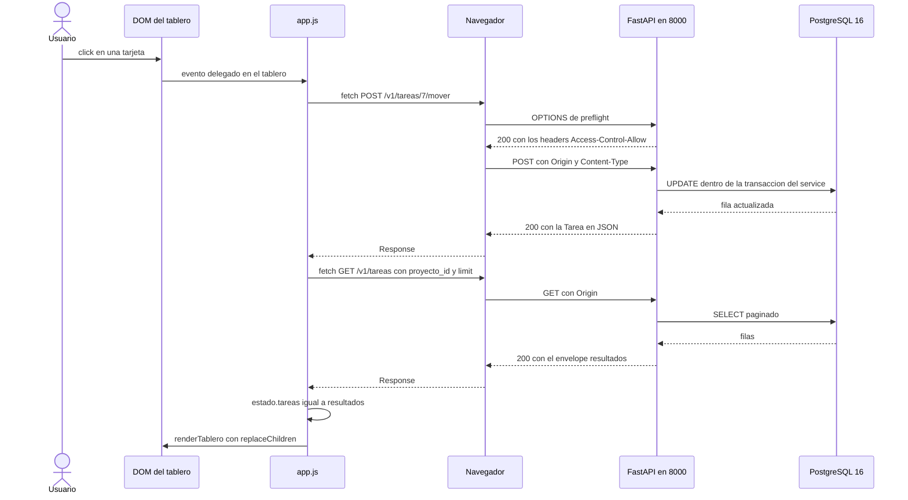
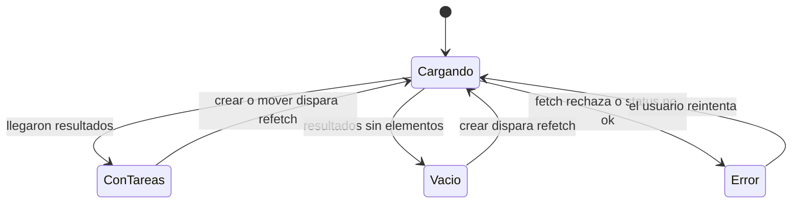
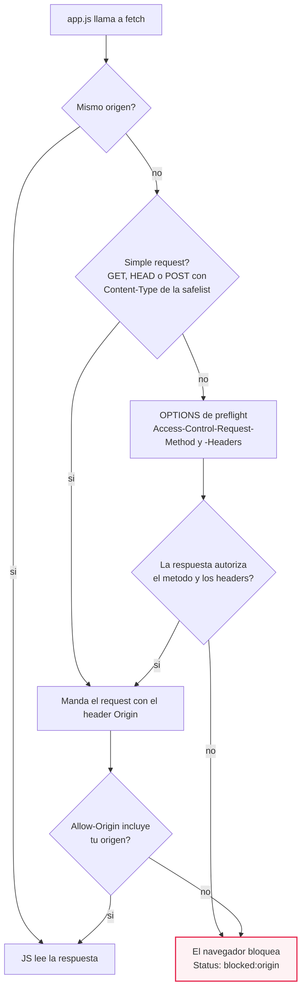
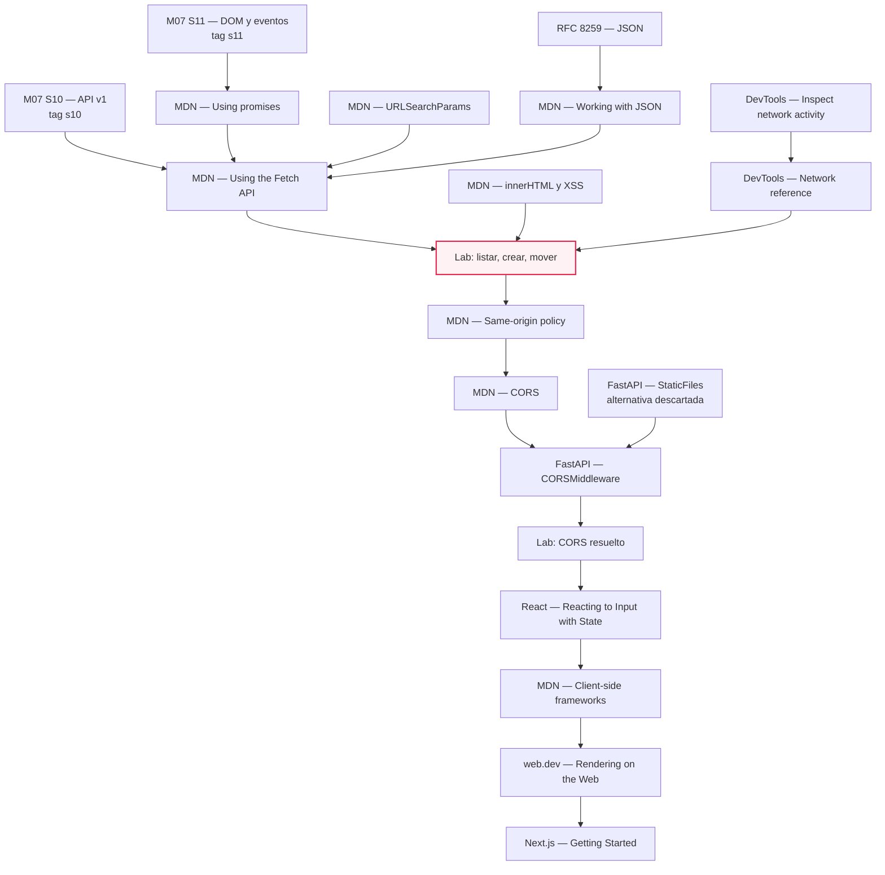
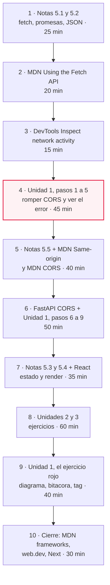

# M07·S12 — El frontend habla con tu API: fetch, JSON y estado

**Módulo:** 07 — Fundamentos de Software + System Design para AI Engineers
**Sesión:** 12 de 22 · Semana 2 · duración de clase 3 h
**Fecha:** [Completar por el profesor: fecha]
**Proyecto hilo conductor:** TaskFlow (`fastapi-full-v0`) — **entregable final del módulo**, tag `s12`
**Duración estimada de estudio:** 4 h 30 (lectura de notas ~1 h 15 · recursos ~1 h 30 · ejercicios ~1 h 45)

> 📝 **Nota para el profesor:** la fecha es lo único que no admite default. El reparto de los 180 min
> que usa este material es el ritmo estándar de semana 2 del plan: **40** repaso + concepto (del array
> de S11 al servidor como fuente de verdad; `fetch`, promesas, JSON) / **60** taller guiado (conectar
> el listado, romper CORS a propósito, arreglarlo, leerlo en DevTools) / **45** práctica autónoma o en
> pareja (crear y mover, estados de carga y error) / **20** puesta en común y decisiones de diseño /
> **15** cierre conceptual SPA vs multipágina y dónde entran React y Next. Si el taller se estira,
> conviene sacrificar la práctica autónoma y **no** el cierre: `sessions/s12.md` lo pide como
> entregable de la sesión.

---

## 1. Qué cierra esta sesión

Hoy el tablero de TaskFlow deja de ser una página que se cuenta cuentos a sí misma y empieza a hablar
con la API v1 real. Es la última sesión del proyecto: al terminar, el tag `s12` es TaskFlow
full-stack —frontend + API + PostgreSQL— funcionando de punta a punta.

---

## 2. Objetivos de aprendizaje

Al terminar esta sesión vas a poder:

1. **Escribir un cliente HTTP en el navegador** con `fetch`, promesas y `async/await`, chequeando el
   status antes de leer el cuerpo y concentrando la lógica de red en un solo lugar.
2. **Explicar JSON como idioma común** entre el navegador y FastAPI, y predecir qué sobrevive y qué no
   a un viaje de ida y vuelta (`JSON.stringify` / `response.json()`).
3. **Renderizar la respuesta de la API en el DOM** sin abrir un agujero de XSS, redibujando desde el
   estado del cliente en vez de mutar nodos a mano.
4. **Diagnosticar y resolver un error de CORS**: leer la columna Status de las DevTools, distinguir
   simple request de preflight `OPTIONS`, y configurar `CORSMiddleware` en FastAPI con criterio.
5. **Debuggear cada request desde la pestaña Network**: filtrar por Fetch/XHR, leer Headers, Payload y
   Response, y reproducir el mismo request con `curl` para separar "el servidor falló" de "el navegador
   bloqueó".
6. **Ubicar lo que construiste a mano** dentro del mapa del frontend moderno: multipágina vs SPA,
   client-side routing, CSR vs SSR, y dónde entran React y Next.

---

## 3. Resumen ejecutivo

En **M07·S10** cerraste el backend: la API v1 con sus 17 operaciones, su envelope de paginación y sus
códigos de estado sobre PostgreSQL. En **M07·S11** armaste un tablero de tres columnas en vanilla JS,
pero con un array hardcodeado dentro del propio `app.js` y la página abierta con `file://`: dos mundos
que no se hablaban. Hoy se juntan.

El contenido es el **cliente HTTP dentro del navegador**: `fetch` y el modelo de promesas con
`async/await` (el puente natural desde el `async def` de Python que viste en M07·S04), JSON como el
formato de intercambio que Pydantic ya venía produciendo, el estado del cliente como única fuente
desde la que se redibuja el DOM, y **CORS** como la primera cosa que se rompe cuando frontend y backend
dejan de compartir origen.

El hilo que une todo es una **inversión de responsabilidad**: en S11 el array local *era* la verdad y el
DOM su proyección; desde hoy la verdad está en PostgreSQL, el array local es una copia y el DOM es la
proyección de esa copia. `fetch`, el re-render desde el estado y CORS son las tres consecuencias de ese
cambio.

Por qué importa para el rol: casi todo producto de IA se consume desde una interfaz. El AI Engineer que
no sabe dónde vive el estado, por qué el navegador bloqueó su request o qué le llega realmente al
cliente, no puede diseñar la frontera entre su backend y quien lo consume —y esa frontera es una
decisión de arquitectura, no un detalle de maquetado. Es, literalmente, el ítem *state and session
management* del mapa de competencias con el que arrancó M07·S01.

---

## 4. Conceptos clave

### Red y asincronía

| Término | Qué es · para qué se usa · por qué así |
|---|---|
| **`fetch(url, opciones)`** | Función global del navegador que dispara un request HTTP y devuelve una **promesa**. Se usa para hablar con tu API sin recargar la página. Es la API moderna que reemplazó a `XMLHttpRequest`: una sola función, basada en promesas, así que se combina con `async/await` en vez de con callbacks. |
| **Promesa** | Objeto que representa un resultado que todavía no está: termina cumplida (con un valor) o rechazada (con un error). Sirve para escribir código que espera sin congelar la pantalla. Se eligió sobre los callbacks porque la anidación de callbacks obliga a manejar el error en cada nivel —el *pyramid of doom*— mientras una promesa propaga el error por toda la cadena hasta un único manejador (MDN, *Using promises*). |
| **`async` / `await`** | `async` marca una función que devuelve una promesa; `await` desenvuelve una promesa y deja seguir la línea de abajo recién cuando se resolvió. Sirve para leer código asíncrono de arriba a abajo. Es azúcar sobre `.then().catch()`: la misma semántica, pero el error se maneja con `try/catch` normal. |
| **Doble promesa de `fetch`** | `fetch` resuelve en cuanto llegaron status y headers; el **cuerpo** se lee con una segunda promesa (`response.json()`). Sirve para poder decidir con el status antes de gastar tiempo parseando. Es la razón de los dos `await` por request: cualquier otra forma obligaría a esperar el cuerpo completo para saber si hubo error. |
| **`response.ok` / `response.status`** | `status` es el código HTTP numérico; `ok` es `true` cuando el status está en el rango 200 (MDN, *Using the Fetch API*). Se usan porque **`fetch` no rechaza la promesa ante un 404 o un 500**: se cumple normalmente con un `Response` de error, y chequear el status es tu trabajo. |
| **`AbortController`** | Objeto que permite cancelar un `fetch` en vuelo. Se usa cuando el usuario navega o dispara una búsqueda nueva antes de que llegue la anterior. Hoy solo lo nombramos: en el tablero no hay request largo que valga cancelar. |

### JSON

| Término | Qué es · para qué se usa · por qué así |
|---|---|
| **JSON** | Formato de texto de intercambio de datos, independiente del lenguaje, especificado en la **RFC 8259** (Internet Standard **STD 90**, T. Bray Ed., diciembre de 2017). Se usa porque el navegador y FastAPI no comparten lenguaje ni tipos: comparten un formato. Tiene cuatro tipos primitivos (string, number, boolean, null) y dos estructurados (object, array), y nada más —por eso es portable. |
| **`JSON.stringify` / `JSON.parse`** | Serializar un valor de JS a texto JSON y deserializar texto JSON a un valor de JS. Se usan para armar el `body` de un POST y para leer una respuesta. `response.json()` hace el `parse` por vos; con `response.text()` tendrías que parsear a mano. |
| **`application/json`** | El media type registrado por la RFC 8259, sin parámetro `charset` (el JSON intercambiado entre sistemas abiertos **debe** ir en UTF-8, § 8.1). Sirve para que el servidor sepa cómo interpretar el cuerpo que le mandás. Es el valor del header `Content-Type` en toda escritura del lab. |
| **Envelope de paginación** | El objeto `{resultados, total, limit, offset}` que devuelve todo listado de la API v1. Sirve para que el cliente sepa cuántos registros hay en total sin tener que traerlos. La respuesta **no es un array pelado** por decisión de S09: así se puede agregar metadata sin romper clientes. |
| **`URLSearchParams`** | API para construir y leer query strings como estructura y no como concatenación de strings. Se usa porque codifica sola los valores: percent-encoding de todo salvo alfanuméricos ASCII, `*`, `-`, `.` y `_`, y el espacio como `+` (MDN). En TaskFlow importa porque un estado se llama `"en progreso"`, con espacio. |

### DOM, seguridad y estado

| Término | Qué es · para qué se usa · por qué así |
|---|---|
| **`textContent`** | Propiedad que escribe texto plano en un nodo, sin parsearlo como HTML. Se usa para todo dato que venga de la API. Es la recomendación explícita de MDN frente a `innerHTML` cuando el contenido es texto: el markup nunca se interpreta, así que no hay nada que inyectar. |
| **XSS (cross-site scripting)** | Vulnerabilidad en la que un dato controlado por un atacante termina ejecutándose como código en el navegador de otra persona. MDN llama a `innerHTML` "probably the most common vector for cross-site scripting (XSS) attacks". Importa hoy porque los títulos de tarea los escribió **otro usuario** y pasaron por PostgreSQL. |
| **Estado del cliente** | El objeto en memoria del navegador que guarda lo que la página "recuerda" ahora: las tareas, si está cargando, si hubo error. Sirve para tener un único lugar del que depende lo que se dibuja. Va como **un objeto** y no como tres variables sueltas para que sus campos no puedan contradecirse. |
| **Re-render desde el estado** | Volver a construir la parte afectada del DOM a partir del estado, en vez de mover o editar nodos existentes. Se usa porque elimina la sincronización manual entre datos y DOM. Cuesta más nodos creados; ahorra la clase de bug que no se ve (el dato dice una cosa y la pantalla otra). |
| **Refetch vs optimistic update** | Después de escribir, o volvés a pedirle la lista al servidor (*refetch*) o pintás el cambio al toque y lo corregís si falla (*optimistic*). Hoy usamos refetch: el servidor es la verdad, y el cliente no adivina ids, timestamps ni estados derivados. El optimistic se siente más rápido y cuesta un camino de rollback. |
| **Delegación de eventos** | Un solo listener en el contenedor que atiende los clicks de todos los hijos (visto en M07·S11). Con re-render es obligatoria: un listener por tarjeta se perdería en cada redibujado. |

### Origen y CORS

| Término | Qué es · para qué se usa · por qué así |
|---|---|
| **Origen** | La tupla **esquema/host/puerto**. Cambiar el path mantiene el origen; cambiar protocolo, puerto o host lo cambia (MDN, *Same-origin policy*). Sirve para saber si tu frontend y tu API son "el mismo sitio" para el navegador. `http://127.0.0.1:3000` y `http://localhost:3000` son **dos orígenes distintos**. |
| **Same-origin policy** | Regla del navegador que impide que un documento de un origen **lea** respuestas de otro origen. Existe para que una pestaña cualquiera no pueda leer tu webmail usando tus cookies. Bloquea lecturas, no envíos ni embeds. |
| **Origen opaco (`file://`)** | Los navegadores modernos tratan `file:///` como origen opaco: los archivos de la misma carpeta no se asumen del mismo origen y pueden disparar errores de CORS (MDN). Importa porque un origen opaco manda `Origin: null`, que **no matchea ninguna lista** de orígenes permitidos: ningún cambio en FastAPI lo arregla. |
| **CORS** | Protocolo basado en headers con el que un servidor **autoriza** a un origen a leer sus respuestas. Sirve para relajar la same-origin policy de forma explícita. La clave: el servidor otorga el permiso, **el navegador es quien bloquea** — y el JS solo ve un error genérico, con el detalle en la consola (MDN, *CORS*). |
| **Simple request** | Request que el navegador manda directo: GET, HEAD o POST, solo headers de la safelist y `Content-Type` limitado a `application/x-www-form-urlencoded`, `multipart/form-data` o `text/plain` (MDN). Cualquier otra combinación dispara preflight. |
| **Preflight `OPTIONS`** | Request previo y automático que pregunta "¿puedo mandar este método con estos headers?", con `Access-Control-Request-Method` y `-Request-Headers`. Sirve para que el servidor pueda rechazar la operación **antes** de ejecutarla. Consecuencia directa: `application/json` no está en la safelist, así que **todo POST de JSON preflightea**. |
| **`CORSMiddleware`** | Middleware ASGI de FastAPI (`from fastapi.middleware.cors import CORSMiddleware`) que agrega los headers `Access-Control-*` y responde el `OPTIONS` sin que exista ningún endpoint `OPTIONS`. Es el mismo mecanismo de middleware de M07·S04, con otra responsabilidad. Sus defaults son restrictivos a propósito: `allow_methods=['GET']`, `allow_headers=[]`, `allow_credentials=False`, `max_age=600`. |

### Panorama

| Término | Qué es · para qué se usa · por qué así |
|---|---|
| **Multipágina** | Cada navegación pide al servidor un documento HTML nuevo. Sirve cuando el contenido es mayormente lectura: el navegador te regala URLs, back/forward e historial. |
| **SPA** | Aplicación que carga un único shell HTML y actualiza el DOM para cada vista. Sirve para interfaces donde cambiar de vista no debería recargar todo. Obliga a implementar **client-side routing** para no perder URLs enlazables, back/forward y compartibilidad (MDN, *Introduction to client-side frameworks*). |
| **CSR / SSR** | Client-side rendering: el HTML llega casi vacío y el JS arma la página. Server-side rendering: el servidor manda HTML completo por navegación. La taxonomía completa (más static rendering, prerendering e hidratación) es la de *Rendering on the Web*, de Addy Osmani y Jason Miller. Tu tablero es **CSR puro**. |
| **Meta-framework** | Capa sobre un framework de UI que resuelve routing, estrategia de render y data fetching por convención. Next.js es el caso canónico y declara como prerrequisitos HTML, CSS, JavaScript **y React**: ese es el orden de estudio, y ninguno de los dos antes de entender `fetch` y el DOM. |

---

## 5. Notas de estudio por subtema

### El flujo completo de la sesión

Este es el camino que recorre un click en una tarjeta cuando el tablero ya está conectado. Es el
diagrama que `sessions/s12.md` pide como entregable (`docs/diagrams/s12-secuencia-fetch.mmd`).



Dos lecturas que el diagrama deja ver de una: el `OPTIONS` **nadie lo escribió** (lo mete el navegador),
y después de escribir hay **dos** viajes más —el POST y el refetch—, que es el precio de no adivinar.

> 💡 Mientras `pedirJSON` mande `Content-Type` en todas las llamadas, el GET del refetch **también**
> dispara su propio `OPTIONS`: un GET con `Content-Type: application/json` ya no es una simple request.
> Lo vas a ver en Network, y es un ejercicio de la sección 6.

---

### 5.1 `fetch`, promesas y `async/await`

**El problema.** Tu tablero necesita datos que están en otra computadora (o en otro proceso). Traerlos
lleva tiempo —milisegundos o segundos—, y el navegador tiene **un solo hilo** para JS: si se quedara
esperando, la página se congela, no responde clicks y no repinta. Hacen falta funciones que digan "pedí
esto y seguí; avisame cuando llegue".

**Qué es.** `fetch(url, opciones)` dispara el request y devuelve una promesa. `await` la desenvuelve.
La particularidad que define todo el resto: `fetch` resuelve **en dos etapas**. Primero llegan status y
headers (y ahí ya tenés el `Response`); el cuerpo se lee después, con otra promesa:

```js
const respuesta = await fetch("http://127.0.0.1:8000/v1/tareas?proyecto_id=1");
// Acá ya sé el status, pero todavía no leí ni un byte del cuerpo.
if (!respuesta.ok) throw new Error(`La API respondió ${respuesta.status}`);
const pagina = await respuesta.json();   // segunda promesa: parsear el cuerpo
```

**Por qué así y no de otra forma.** El error más caro de la sesión: **`fetch` no rechaza la promesa
cuando el servidor contesta 404 o 500** (MDN, *Using the Fetch API*). Se cumple con normalidad, con un
`Response` que describe el error. Solo rechaza ante error de red o esquema inválido. Si no chequeás
`respuesta.ok`, `await respuesta.json()` te va a devolver el cuerpo del error —`{"detail": "..."}` de
los exception handlers de S10— y tu código lo va a tratar como si fuera una tarea. El `if` no es
paranoia: es la mitad del contrato.

**Async en JS vs async en Python** (ya viste `async def` en M07·S04): la sintaxis es casi la misma, el
motor no. En el navegador hay un único hilo y un event loop: todo lo que está `await`-eando libera el
hilo para que el DOM siga vivo, pero si escribís un `for` de un millón de iteraciones, la pestaña se
congela igual —no hay threadpool al que mandarlo. En FastAPI, en cambio, una ruta `def` sincrónica se
corre en un threadpool externo. La promesa de JS cumple el rol del coroutine de Python: el objeto que
`await` desenvuelve.

**Gotchas**

- El cuerpo de un `Response` **se lee una sola vez**, salvo que llames a `clone()` antes (MDN). Si
  hacés `await respuesta.text()` para loguear y después `await respuesta.json()`, el segundo falla.
- Una promesa que no se `await`-ea ni se devuelve "flota": si falla, el error aparece como
  *unhandled rejection* en la consola y tu `try/catch` nunca se enteró.
- `await` solo existe dentro de una función `async`. Un listener que llama a algo asíncrono tiene que
  ser `async (evento) => { ... }`.

**Para profundizar:** MDN — *Using the Fetch API* (20 min) y MDN — *Using promises* (20 min).

---

### 5.2 JSON como idioma común

**El problema.** Pydantic trabaja con objetos de Python; el navegador, con objetos de JavaScript. No
comparten tipos, memoria ni lenguaje. Lo único que puede viajar por el cable es **texto**, y hace falta
que los dos lados interpreten ese texto igual.

**Qué es.** JSON es ese texto estandarizado: la **RFC 8259** (Internet Standard **STD 90**, T. Bray Ed.,
diciembre de 2017, que obsoleta la RFC 7159) define cuatro tipos primitivos —string, number, boolean,
null— y dos estructurados —object, array—, registra el media type `application/json` sin parámetro
`charset`, y en § 8.1 obliga a UTF-8 para el JSON que se intercambia entre sistemas que no son parte de
un ecosistema cerrado.

**Por qué así.** La lista corta de tipos es la razón de que funcione entre lenguajes distintos: si JSON
tuviera "fecha" o "set", cada lenguaje la representaría distinto. El costo lo pagás en el round-trip:

```js
const tarea = await pedirJSON("/v1/tareas/7");
typeof tarea.created_at;          // "string" — NO es un Date
tarea.created_at.slice(0, 10);    // "2026-10-12" — recortar el string funciona
new Date(tarea.created_at);       // y si necesitás comparar fechas, lo construís vos
```

Del lado de ida, el espejo exacto: lo que Pydantic hace al serializar un modelo es un `JSON.stringify`
del otro lado del cable. Por eso el POST se arma así:

```js
await fetch(API + "/v1/tareas", {
  method: "POST",
  headers: { "Content-Type": "application/json" },   // sin esto FastAPI no parsea el body
  body: JSON.stringify({ titulo, descripcion, proyecto_id: 1 }),
});
```

El `body` tiene que ser un **string**: `fetch` no serializa por vos. Si le pasás el objeto, el navegador
manda `"[object Object]"` y FastAPI devuelve 422 — un error que se lee clarísimo en la pestaña Payload de
las DevTools y es invisible desde el código.

**Gotchas**

- `undefined`, `NaN`, `Infinity`, funciones, `Date`, `Set` y `Map` **no son valores JSON válidos**, y
  JSON no admite comentarios, comas finales ni comillas simples (MDN, *Working with JSON*). Un JSON
  "casi válido" no se parsea a medias: rompe entero.
- `JSON.stringify` **descarta** las claves cuyo valor es `undefined`. Si tu objeto tenía
  `descripcion: undefined`, el campo no viaja; si querés mandar "sin descripción", mandá `null`.
- La respuesta de un listado es el envelope, no un array: `pagina.resultados`. Si hacés
  `pagina.map(...)` te explota; si hacés `renderTablero()` sobre el objeto entero, dibuja **cero
  tarjetas sin tirar ningún error**, que es peor.

**Para profundizar:** MDN — *Working with JSON* (15 min); RFC 8259 como consulta (15 min).

---

### 5.3 Renderizar la respuesta sin abrir un XSS

**El problema.** Tenés un objeto y necesitás que aparezca en la pantalla. La forma más corta es armar un
string de HTML y asignarlo a `innerHTML`. Es también la forma de ejecutar, en el navegador de tus
compañeros de equipo, el código que cualquiera haya escrito en el título de una tarea.

**Qué pasa.** `innerHTML`, al escribir, **parsea el string como HTML** y reemplaza todos los
descendientes del nodo. MDN lo llama "probably the most common vector for cross-site scripting (XSS)
attacks". Un `<script>` inyectado por `innerHTML` no se ejecuta, pero eso no alcanza: el ejemplo de la
propia doc, ``, sí dispara. La recomendación es `Node.textContent`
cuando el contenido es texto, o `TrustedHTML` con una política de saneamiento cuando de verdad hace
falta HTML.

**Por qué cambia hoy.** En S11 la regla "ningún dato entra por `innerHTML`" era higiene: los datos eran
un array de tu propio archivo. Hoy los títulos vienen del **servidor**, los escribió otra persona y
pasaron por PostgreSQL —que los guarda tal cual, porque no es su trabajo sanear HTML—. La regla pasa de
estilo a defensa. Es el gancho directo con el XSS de M07·S17.

```js
function crearTarjeta(tarea) {
  const div = document.createElement("div");
  div.className = "tarjeta";
  div.dataset.tareaId = tarea.id;        // el único vínculo nodo -> dato

  const titulo = document.createElement("div");
  titulo.className = "titulo";
  titulo.textContent = tarea.titulo;     // texto, nunca markup
  div.appendChild(titulo);
  return div;
}
```

La alternativa descartada era `div.innerHTML = '<div class="titulo">' + tarea.titulo + '</div>'`: tres
líneas menos y una vulnerabilidad. Probalo una vez en el lab —creá una tarea titulada
`` y mirá qué hace cada versión— y borralo.

**Gotchas**

- `textContent` en un nodo con hijos los borra todos. Por eso el re-render apunta al contenedor de
  tarjetas y no a la `<section>` de la columna, que contiene el `<h2>`.
- Que el dato venga de *tu* base no lo hace confiable: lo escribió un usuario.

**Para profundizar:** MDN — *Element: innerHTML property* (10 min).

---

### 5.4 Estado en el cliente: qué recuerda la página y cuándo se vuelve a dibujar

**El problema.** S11 te dejó con dos cosas que había que mantener sincronizadas a mano: el array de
tareas y el DOM. Funcionaba porque el click hacía las dos cosas seguidas. Con datos del servidor ya no
alcanza: el `id` y los timestamps los asigna PostgreSQL, el estado real puede haberlo cambiado otro
usuario, y una escritura puede fallar a mitad de camino. Manipular la UI paso a paso "gets exponentially
more difficult to manage in more complex systems" (React, *Reacting to Input with State*).

**El modelo.** Un solo objeto es la fuente de verdad del navegador, y toda operación termina
redibujando desde ahí:

```js
// Única fuente de verdad del cliente. El DOM es su proyección, nunca al revés.
const estado = { tareas: [], cargando: false, error: null };
```

Los tres campos no son casuales: son los **estados visuales** del tablero. React propone cinco pasos
para pensar una UI declarativamente —identificar los estados visuales, determinar qué los dispara,
representarlos con estado, eliminar el estado no esencial y conectar los handlers—, y usa la analogía
del taxi: decir el destino en vez de dar indicaciones giro por giro. Aplicado al tablero, los estados y
sus disparadores son estos:



Fijate que los disparadores son humanos (click, submit) **y de la computadora**: la respuesta de red es
el disparador nuevo que trae S12. Y que `Vacio` y `Error` son estados distintos: "cargó bien y no hay
nada" no es lo mismo que "no pude cargar", y si los colapsás en una pantalla en blanco, nadie puede
debuggear nada.

**El re-render.**

```js
function renderTablero() {
  for (const nombre of ESTADOS) {
    const contenedor = columnaDe(nombre);                       // el div.tarjetas, no la columna
    const tarjetas = estado.tareas
      .filter((t) => t.estado === nombre)
      .map(crearTarjeta);
    contenedor.replaceChildren(...tarjetas);                    // reemplaza; deja el <h2> intacto
  }
}

async function recargarYRender() {
  estado.cargando = true;
  estado.error = null;
  mostrarAviso(null);
  try {
    estado.tareas = await cargarTareas();
  } catch (error) {
    estado.error = error.message;
    mostrarAviso(`No pude hablar con la API: ${error.message}`);
  } finally {
    estado.cargando = false;
    renderTablero();      // se redibuja SIEMPRE, también por el camino de error
  }
}
```

**Por qué así.** `replaceChildren` reconstruye la columna en vez de mover el nodo existente, que es lo
que hacía S11. El trade-off es explícito: creás más nodos de los necesarios (con 6 tareas, irrelevante;
con 5.000 y sin paginación, no) y a cambio eliminás la clase entera de bugs donde el dato dice una cosa
y la pantalla otra. El `finally` es la otra decisión importante: si el `renderTablero()` viviera solo en
el camino feliz, un error de red te deja la pantalla congelada con datos viejos y sin ninguna señal.

**Refetch vs optimistic update.** Después de mover una tarea podrías pintar el cambio al instante y
pedirle perdón al usuario si el servidor lo rechaza (*optimistic*). Elegimos **refetch**: el servidor es
la verdad, y el cliente no tiene cómo saber qué más cambió ese `UPDATE` (el `updated_at`, por ejemplo).
Cuesta un viaje más de red; ahorra un camino de rollback y la posibilidad de mostrar un estado que la
base nunca tuvo. Con el tablero en localhost no se nota; en una app real, la decisión se toma por
pantalla, no por app.

**Gotchas**

- **Doble click = race condition.** Dos clicks rápidos en la misma tarjeta disparan dos `POST .../mover`
  y la tarea avanza dos estados, o el segundo refetch llega antes que el primero y el tablero parpadea
  hacia atrás. La defensa barata es deshabilitar el disparador mientras hay un request en vuelo (para
  eso existe `estado.cargando`); la caprichosa, cancelar el request anterior con `AbortController`.
- Si tu función `columnaDe(estado)` recibe un parámetro llamado `estado`, **tapa** al objeto global
  `estado` dentro de la función. Renombralo a `estadoTarea`; el bug que produce es de los que se miran
  diez minutos.
- `estado.tareas` queda en `[]` si la carga falla, porque `cargarTareas()` lanzó. Eso es deliberado:
  mostrar una lista a medias es peor que mostrar el aviso de error.

**Para profundizar:** React — *Reacting to Input with State* (20 min) y MDN — *Introduction to
client-side frameworks* (20 min), que muestra la misma lista de tareas hecha a mano y nombra el problema
("every time we change our application's state, we need to update the UI to match").

---

### 5.5 CORS: por qué el navegador bloquea y qué tiene que responder FastAPI

**El problema.** El tablero y la API ahora son **dos orígenes**: `http://127.0.0.1:3000` y
`http://127.0.0.1:8000`. El navegador, por defecto, no deja que un documento de un origen lea respuestas
de otro. Tu `fetch` sale, el servidor contesta 200, y tu `catch` recibe un error genérico. Nada en el
código está mal.

**Qué está pasando.** Un **origen** es la tupla esquema/host/puerto; cambiar el path lo mantiene,
cambiar protocolo, puerto o host lo cambia (MDN, *Same-origin policy*). La **same-origin policy** existe
para que una página cualquiera no pueda leer, con tus cookies, el contenido de tu webmail. **CORS** es el
mecanismo por el que un servidor relaja esa regla para orígenes concretos, con headers. Lo esencial:
**el servidor otorga el permiso y el navegador lo aplica**; el JS solo ve un error genérico y el detalle
queda en la consola (MDN, *CORS*).



**Simple vs preflight.** Una *simple request* usa GET, HEAD o POST, solo headers de la safelist de CORS y
un `Content-Type` limitado a `application/x-www-form-urlencoded`, `multipart/form-data` o `text/plain`.
Todo lo demás dispara un `OPTIONS` previo con `Access-Control-Request-Method` y
`Access-Control-Request-Headers`, que el servidor responde con `Access-Control-Allow-Origin`,
`-Allow-Methods`, `-Allow-Headers`, `-Allow-Credentials`, `-Max-Age` y `-Expose-Headers` (MDN).
Corolario que explica media clase: **`application/json` no está en la safelist**, así que tu POST de JSON
*siempre* preflightea, y vas a ver en Network un `OPTIONS` que nadie escribió.

**Lo que CORS no es.** CORS **no protege al servidor**. En una simple request el request llega y se
ejecuta: lo que el navegador bloquea es que tu JS *lea* la respuesta. La prueba, en una línea:

```bash
curl -i -X POST http://127.0.0.1:8000/v1/tareas \
  -H "Content-Type: application/json" \
  -d '{"titulo": "Probar CORS desde curl", "proyecto_id": 1}'
```

Esto devuelve `201` **con o sin** `CORSMiddleware`, porque `curl` no es un navegador y no aplica la
política de mismo origen. Si tu API necesita protección de verdad, eso es autenticación y autorización
—S16 y S17—, no CORS.

**El lado servidor.** Son seis líneas en `app/main.py`:

```python
from fastapi.middleware.cors import CORSMiddleware   # FastAPI re-exporta el de Starlette

ORIGENES_FRONTEND = [
    "http://127.0.0.1:3000",
    "http://localhost:3000",     # mismo host, OTRO origen: van los dos
]

app.add_middleware(
    CORSMiddleware,
    allow_origins=ORIGENES_FRONTEND,
    allow_credentials=False,                                        # sin cookies por ahora
    allow_methods=["GET", "POST", "PATCH", "DELETE", "OPTIONS"],    # el default es solo ["GET"]
    allow_headers=["Content-Type"],
)
```

**Por qué así, parámetro por parámetro.**

- `allow_origins` con **lista explícita** y no `["*"]`: se ve qué habilita cada línea, y `["*"]` deja de
  servir en cuanto entren cookies —con `allow_credentials=True`, ninguno de los tres parámetros puede ser
  `['*']` (doc de FastAPI, *CORS*)—. Mejor aprender la forma que vas a necesitar en S16–S17.
- Los **dos** orígenes del frontend: `http://localhost:3000` y `http://127.0.0.1:3000` son orígenes
  distintos aunque apunten a la misma máquina (la propia doc de FastAPI lo dice con
  `http://localhost`, `https://localhost` y `http://localhost:8080`). Si listás uno y abrís el otro, el
  error vuelve y parece magia negra.
- `allow_methods` **explícito**: el default del middleware es `['GET']`. Si no lo declarás, agregás el
  middleware, el listado empieza a funcionar... y el POST sigue bloqueado. Es el segundo error del lab y
  el más desconcertante de los dos.
- `allow_headers=["Content-Type"]`: el middleware siempre permite `Accept`, `Accept-Language`,
  `Content-Language` y `Content-Type` en simple requests, pero el preflight de un POST con JSON pide
  `Content-Type` explícitamente. Declararlo evita depender de ese detalle.

**El otro origen: cómo se sirve el frontend.** Y para que haya dos orígenes hace falta servir la página
por HTTP, no abrirla del disco:

```bash
python -m http.server 3000 --directory frontend --bind 127.0.0.1
```

- `python -m http.server` corre el módulo de la biblioteca estándar como script: no instala nada. Su
  propia doc advierte que "`http.server` is not recommended for production. It only implements basic
  security checks".
- `3000` — **hay que pasarlo**: el default es 8000, que ya ocupa Uvicorn. Ese número es lo que convierte
  al frontend en un origen distinto.
- `--directory frontend` (desde Python 3.7) sirve esa carpeta y no el directorio actual. Sin esto el
  navegador vería todo el repo, incluido `.env`.
- `--bind 127.0.0.1` (desde 3.4) escucha solo en loopback, en vez de exponerse en todas las interfaces.

> ⚠️ La página se abre en `http://127.0.0.1:3000/index.html`, **nunca** con `file://`. Un origen opaco
> manda `Origin: null`, que no matchea ninguna lista de `allow_origins`: con `file://` el error de CORS
> no se puede arreglar desde FastAPI, y vas a perder media hora peleando con un error que no es el que
> creés.

**La alternativa que elimina CORS.** Si el frontend se sirviera desde el **mismo** origen que la API, no
habría cross-origin y el middleware sobraría. FastAPI lo permite montando archivos estáticos:
`app.mount("/static", StaticFiles(directory="static"), name="static")` —lo montado es una
sub-aplicación independiente, que no aparece en el esquema OpenAPI de la app principal—. El lab la
**descarta a propósito**, porque `sessions/s12.md` pide que el error de CORS aparezca de verdad y se
resuelva; pero la decisión va a la bitácora con las dos opciones sobre la mesa, que es el criterio del
módulo. Un proxy inverso delante de los dos (visto en M07·S02) es la tercera opción, y la que suele
ganar en producción —despliegue es S18—.

**Gotchas**

- Agregar el middleware y seguir viendo el error: casi siempre es el puerto o el host mal listado, o que
  Uvicorn no recargó (`--reload` sí toma los cambios de `main.py`).
- El `OPTIONS` lo responde el middleware; **no** declares un endpoint `OPTIONS`.
- El error de CORS no se "arregla" desde el frontend. No hay header que puedas mandar vos para
  autorizarte: el permiso lo da el servidor.

**Para profundizar, en este orden:** MDN — *Same-origin policy* (12 min) → MDN — *CORS* (25 min) →
FastAPI — *CORS* (10 min). Conviene leerlos **después** de ver el error, no antes.

---

### 5.6 Leer cada request en las DevTools

**El problema.** Cuando algo falla entre tu JS y tu API hay cuatro sospechosos: la URL, el método, el
cuerpo y el navegador. Desde el código no se distinguen; en la pestaña Network, sí.

**Lo mínimo que tenés que saber.** DevTools **solo registra actividad de red mientras está abierto**, así
que la secuencia correcta es abrir el panel y *después* recargar (Chrome DevTools, *Inspect network
activity*). Cada fila del Network Log es un recurso; las columnas por default son Status, Type,
Initiator, Size y Time. Con el filtro **Fetch/XHR** te quedás solo con tus requests. Y el dato que vale
oro para hoy: la columna **Status** muestra el código HTTP, un error de CORS, un `(blocked:origin)`
cuando los headers de CORS están mal configurados, o `(failed)` con el mensaje de error (Chrome
DevTools, *Network features reference*).

**Cómo se usa en el lab.** Click en el request y:

| Pestaña | Qué contesta |
|---|---|
| **Headers** | ¿Mandé el `Origin` que listé en FastAPI? ¿La respuesta trae los `Access-Control-Allow-*`? |
| **Payload** | ¿El body que salió es el JSON que creía, o un `"[object Object]"`? |
| **Response** | ¿Llegó el envelope con `resultados`, o el `{"detail": ...}` de un 404? |
| **Timing** | ¿Dónde se fue el tiempo? (Queueing, DNS, Waiting/TTFB) |

Y el puente con la terminal: **"Copy as cURL"** en el menú contextual de la columna Name te da el mismo
request para pegarlo en una terminal. Si por `curl` responde 201 y en el navegador falla, la respuesta
está contestada: el servidor hizo su trabajo y el que bloqueó fue el navegador.

> 💡 El throttling del panel (con "Empty Cache And Hard Reload") simula una conexión lenta: es la demo
> más barata del estado "cargando" del subtema 5.4, que en localhost no se ve nunca.

> ⚠️ El lab está escrito sobre **Chrome o Chromium**: los nombres de pestañas y los mensajes de la
> columna Status son los de Chrome. En otros navegadores el panel equivalente existe, pero las etiquetas
> y los textos difieren.

**Para profundizar:** Chrome DevTools — *Inspect network activity* (15 min, hacelo antes del lab) y
*Network features reference* (consulta durante el lab).

---

### 5.7 Panorama: multipágina, SPA, y dónde entran React y Next

**Para qué este subtema.** Acabás de escribir a mano un cliente HTTP, un sistema de render y un manejo
de estado. Sin un mapa, es imposible saber si lo que hiciste es "lo que se hace" o una rareza
pedagógica. Esto es el mapa —sin código, solo para ubicarte—.

**Multipágina vs SPA.** En una app multipágina, cada navegación pide un documento nuevo al servidor: el
navegador te da URLs, back/forward y compartibilidad gratis. Una **SPA** carga un único shell HTML y
actualiza el DOM para cada vista; por eso tiene que implementar **client-side routing** para no perder
esas tres cosas, y abre huecos de accesibilidad —manejo del foco, anuncio del título de página— que,
señala MDN, ningún framework resolvió perfectamente.

**Qué problema resuelven los frameworks.** Uno solo, y es el de hoy: "every time we change our
application's state, we need to update the UI to match" (MDN, *Introduction to client-side frameworks*).
Tu `renderTablero()` es exactamente eso, escrito a mano. MDN aclara dos cosas que conviene retener: los
frameworks **no agregan capacidades nuevas al navegador**, y puede que no necesites ninguno. La misma
página ubica React (Facebook, 2013), Vue (Evan You, 2014), Angular (Google, 14 de septiembre de 2016) y
Ember (diciembre de 2011).

**Cómo se llama lo que construiste.** Tu tablero es **CSR puro**: el HTML llega prácticamente vacío y el
JS arma la UI pidiendo datos. La taxonomía completa —SSR, static rendering, CSR, prerendering,
hidratación y rehidratación— es la de *Rendering on the Web*, de Addy Osmani y Jason Miller (web.dev,
2019, actualizado en 2026), y nombra el costo exacto de cada estrategia: el CSR carga el costo del
JavaScript en el cliente y ese costo crece con la aplicación, lo que puede afectar el Interaction to
Next Paint; el SSR mejora el First Contentful Paint pero puede empeorar el Time to First Byte. Ninguna
es "la buena": se mezclan por página.

**Dónde entra Next.** Next.js se presenta como la forma de construir "full-stack web applications with
the Next.js App Router" y declara como prerrequisitos HTML, CSS, JavaScript **y React**. Su índice es el
mejor resumen de qué agrega un meta-framework: routing por convención de archivos, layouts y páginas,
Server y Client Components, data fetching y mutación, caching y revalidación, Route Handlers (el backend
dentro del frontend) y despliegue. Es decir: resuelve por convención las tres cosas que hoy hiciste a
mano o decidiste no hacer —routing, estrategia de render y data fetching—.

**El orden de estudio, entonces:** `fetch` y DOM (hoy) → React → Next. Leído al revés, un framework
parece magia; leído en este orden, parece lo que es: una respuesta a un problema que ya sufriste.

---

### 5.8 Cierre: dónde está la frontera entre tu frontend y tu backend

Esta es la única sesión del módulo en la que escribís código de frontend que habla con tu propio
backend, y por eso es donde se ve la frontera. Cada decisión de hoy la movió de lugar: traer
`GET /v1/tareas?proyecto_id=1` y agrupar por estado **en el cliente** pone la lógica de agrupación en el
navegador; pedir `GET /v1/proyectos/{proyecto_id}/tablero` —ya agrupado por el servidor, como el
endpoint para agentes de S08— la pone en la API. Ninguna es incorrecta: una reparte trabajo al cliente y
deja la API genérica; la otra acopla la API a una pantalla y ahorra viajes. Eso es una decisión de
arquitectura, y va a la bitácora.

El mapa de competencias de software engineering para AI engineers de **Andrew Ng** nombra, entre los
componentes que maneja un desarrollador competente, UI components, caching, page rendering, elección y
diseño de APIs, authentication, **state and session management**, asynchronous processing, data
persistence, testing, security y accessibility. Ese ítem —dónde vive el estado— es justo lo que hiciste
hoy. Ng observa además que el agentic coding permite que perfiles especializados (front-end, mobile)
asuman un rol full-stack, con el agente cubriendo lo menos familiar, pero que **entender el stack
completo sigue siendo importante**: podés dirigir al agente para que escriba este `app.js` en treinta
segundos; no podés darte cuenta de que puso `allow_origins=["*"]` si no sabés qué significa.

---

### Mapa de recursos de la sesión



Tres cosas que el diagrama no dice:

- **El orden del lab no es el orden conceptual.** Los recursos de CORS se usan mejor como lectura de
  diagnóstico que como lectura previa: primero el error, después MDN.
- **Los dos recursos de DevTools son una secuencia**, no alternativas: *Inspect network activity* antes
  del lab, *Network features reference* durante.
- **`StaticFiles` entra por la puerta de atrás**: no es un recurso del lab, es la alternativa que el lab
  descarta. Se lee para poder escribir la bitácora con dos opciones reales.

---

## 6. Ejercicios

Hacé cada ejercicio **antes** de mirar su solución en la sección 11. Las soluciones están ahí con los
mismos títulos.

### Unidad 1 — El lab: conectar el tablero a la API v1 (entregable final)

#### Teoría mínima

El tablero de S11 tiene datos propios; la API v1 de S10 tiene los datos reales. Conectarlos es: (a)
servir el frontend por HTTP en otro puerto, (b) reemplazar el array por `fetch`, (c) autorizar el
cross-origin en FastAPI, (d) guardar lo que llegó en un objeto `estado` y redibujar desde ahí. El orden
importa: primero se rompe CORS a propósito, se lee el error, y recién después se arregla. Al final, el
tag `s12` es el entregable del módulo.

#### Prerequisitos

- Repo `fastapi-full-v0` en el tag `s11`, rama de trabajo nueva: `git switch -c s12 s11`.
- Docker corriendo, `.env` con las `POSTGRES_*` y la `DATABASE_URL` (desde S07).
- Python 3.12 con las dependencias de `requirements.txt` ya instaladas. **No hay dependencia nueva**:
  `CORSMiddleware` viene con FastAPI y `http.server` con Python.
- Chrome o Chromium para las DevTools.

**Placeholders que vas a tocar:** `API` (origen de la API, si Uvicorn no está en 8000), `PROYECTO_ID`
(el proyecto que muestra el tablero; default `1`, el `General` que siembra el lifespan) y el puerto
`3000` del frontend, que aparece en **dos** lugares: el comando de `http.server` y `ORIGENES_FRONTEND`.

#### Ejemplo resuelto y comentado

**Paso 0 — mirá de dónde partís.** El `app.js` del tag y el de la clase anterior no son idénticos.
Abrí el tuyo y ubicate:

| Si tu `frontend/app.js` tiene… | Venís de… | Qué cambia para vos |
|---|---|---|
| `ESTADOS`, `tareas`, `siguienteId`, `renderInicial`, `avanzarEstado`, un `addEventListener` dentro de `crearTarjeta` y `div.dataset.id` | el tag `s11` | hacés los pasos 2 y 6 completos (contenedores de tarjetas, delegación, re-render) |
| `TAREAS_DEMO`, `COLUMNA_DE_ESTADO`, `renderColumna`/`renderTablero`, `data-tarea-id` y un solo listener en `#tablero` | el material de S11 | el refactor de delegación ya está hecho; en el paso 6 solo cambiás **de dónde salen los datos** |

En los dos casos el destino es el mismo y los nombres del entregable son los de este material. Donde un
paso sea un refactor que quizá ya tengas, está dicho en la línea.

**Paso 1 — levantá las tres piezas, en tres terminales.**

```bash
# Terminal 1 — base de datos (ya visto en S05 y S07)
docker compose up -d
python scripts/seed.py            # idempotente: 2 equipos, 4 usuarios, 2 proyectos, 6 tareas

# Terminal 2 — API, origen http://127.0.0.1:8000
uvicorn app.main:app --reload --env-file .env

# Terminal 3 — frontend, origen http://127.0.0.1:3000
python -m http.server 3000 --directory frontend --bind 127.0.0.1
```

*Por qué el seed:* sin datos, el tablero arranca vacío y no podés distinguir "cargó bien y no hay nada"
de "falló la carga" — que es justo el estado visual que hay que aprender a ver.

✅ **Verificación:** `curl -s "http://127.0.0.1:8000/v1/tareas?proyecto_id=1&limit=100"` devuelve un
objeto con `resultados`, `total`, `limit` y `offset`. Y `http://127.0.0.1:3000/index.html` abre el
tablero (todavía con los datos hardcodeados). **Cerrá la pestaña de `file://` para no confundirte.**

**Paso 2 — preparale el lugar al re-render en `index.html`.** Dentro de cada `<section class="columna">`
agregá un contenedor de tarjetas, y arriba del tablero un párrafo de aviso:

```html
<div class="tablero" id="tablero">
  <section class="columna" id="col-backlog">
    <h2>backlog</h2>
    <div class="tarjetas" id="tarjetas-backlog"></div>
  </section>
  <!-- idem con id="tarjetas-en-progreso" y id="tarjetas-hecho" -->
</div>
```

```html
<p id="aviso" hidden></p>
```

*Por qué:* el re-render va a hacer `replaceChildren` en el contenedor. Si lo hiciera sobre la
`<section>`, **borraría el `<h2>`** de la columna en el primer redibujado. Y `#tablero` es el nodo
donde se cuelga el único listener delegado (si venís del material de S11 ya lo tenés).

✅ **Verificación:** la página se ve igual, y en la pestaña Elements cada columna tiene un
`div.tarjetas` vacío.

**Paso 3 — metele un `fetch` ingenuo y rompé CORS a propósito.** En `app.js`, arriba, y sin tocar nada
más todavía:

```js
const API = "http://127.0.0.1:8000";
const PROYECTO_ID = 1;

async function cargarTareas() {
  const respuesta = await fetch(`${API}/v1/tareas?proyecto_id=${PROYECTO_ID}&limit=100`);
  const pagina = await respuesta.json();
  console.log(pagina);
}
cargarTareas();
```

**Abrí las DevTools primero y recargá después**: el panel Network no registra nada de lo que pasó
mientras estaba cerrado.

✅ **Verificación (el momento didáctico de la sesión):** con el filtro **Fetch/XHR**, el request a
`/v1/tareas` aparece con un error de CORS o `(blocked:origin)` en la columna Status, y la consola explica
que la respuesta no trae `Access-Control-Allow-Origin`. Ahora la prueba de que el servidor no bloqueó
nada: `curl -i "http://127.0.0.1:8000/v1/tareas?proyecto_id=1&limit=100"` devuelve 200 con el JSON
completo. Mismo request, dos resultados: **el que bloquea es el navegador**.

**Paso 4 — autorizá el origen en `app/main.py` (todavía incompleto, a propósito).**

```python
from fastapi.middleware.cors import CORSMiddleware

ORIGENES_FRONTEND = ["http://127.0.0.1:3000", "http://localhost:3000"]

app.add_middleware(CORSMiddleware, allow_origins=ORIGENES_FRONTEND)
```

✅ **Verificación:** recargá. El GET pasa a **200** y en la pestaña Response ves el envelope. En Response
Headers aparece `access-control-allow-origin`. Guardá esta captura: es la primera evidencia del
entregable.

**Paso 5 — leé el envelope.** Cambiá el `console.log` por el dato que necesitás:

```js
async function cargarTareas() {
  const query = new URLSearchParams({ proyecto_id: PROYECTO_ID, limit: 100 });
  const respuesta = await fetch(`${API}/v1/tareas?${query}`);
  if (!respuesta.ok) throw new Error(`La API respondió ${respuesta.status}`);
  const pagina = await respuesta.json();
  return pagina.resultados;          // NO es un array pelado
}
```

*Por qué `URLSearchParams`:* codifica los valores sola. Hoy `proyecto_id` y `limit` son números, pero en
cuanto filtres por `estado=en progreso` —con espacio— la concatenación a mano deja de matchear.

✅ **Verificación:** `console.log(await cargarTareas())` imprime un array de 6 objetos con `id`,
`titulo`, `estado`, `created_at`… Mirá que `created_at` es un **string**.

**Paso 6 — estado, re-render y delegación.** Acá se reemplaza el array hardcodeado. Agregá el objeto
`estado`, `renderTablero`, `mostrarAviso` y `recargarYRender` (código completo en la solución), apuntá
`columnaDe` a los contenedores nuevos, y sacale a `crearTarjeta` el listener propio:

```js
const estado = { tareas: [], cargando: false, error: null };

function columnaDe(estadoTarea) {                 // ojo con el nombre del parámetro
  return document.getElementById("tarjetas-" + estadoTarea.replace(" ", "-"));
}
```

Si venís del tag, este paso incluye tres renombres: `tareas` → `estado.tareas`,
`div.dataset.id` → `div.dataset.tareaId` (atributo `data-tarea-id`) y el listener de cada tarjeta por un
**único listener delegado** en `#tablero`. Si tu `app.js` ya quedó con un solo listener delegado, ese
pedazo ya está: solo cambiás de dónde salen los datos. Borrá también `TAREAS_DEMO`/`tareas`,
`siguienteId` y `renderInicial`/`avanzarEstado`: la verdad ya no vive acá.

✅ **Verificación:** recargá y el tablero muestra las **6 tareas del seed** repartidas por estado. Cambiá
un estado a mano con `curl` y recargá: el tablero sigue a la base, no a tu memoria.

**Paso 7 — crear una tarea y encontrarse con el segundo error.** Cableá el submit del form al POST:

```js
async function crearTarea(titulo, descripcion) {
  const respuesta = await fetch(`${API}/v1/tareas`, {
    method: "POST",
    headers: { "Content-Type": "application/json" },
    body: JSON.stringify({ titulo, descripcion, proyecto_id: PROYECTO_ID }),
  });
  if (!respuesta.ok) throw new Error(`La API respondió ${respuesta.status}`);
  return await respuesta.json();
}
```

✅ **Verificación (el error más desconcertante del lab):** el POST falla, **aunque el middleware ya
está**. En Network ves un `OPTIONS` que nunca escribiste, con el preflight rechazado. El motivo:
`allow_methods` por default es `['GET']`. Reproducilo sin navegador:

```bash
curl -i -X OPTIONS http://127.0.0.1:8000/v1/tareas \
  -H "Origin: http://127.0.0.1:3000" \
  -H "Access-Control-Request-Method: POST" \
  -H "Access-Control-Request-Headers: content-type"
```

**Paso 8 — completá el middleware y subí la versión.**

```python
app.add_middleware(
    CORSMiddleware,
    allow_origins=ORIGENES_FRONTEND,
    allow_credentials=False,
    allow_methods=["GET", "POST", "PATCH", "DELETE", "OPTIONS"],
    allow_headers=["Content-Type"],
)
```

Y en el `FastAPI(...)`, `version="1.1.0"`: el criterio del repo es que la versión sube cuando cambia el
backend, y hoy cambió.

✅ **Verificación:** el `curl -i -X OPTIONS` de arriba ahora trae `Access-Control-Allow-Origin`,
`-Allow-Methods`, `-Allow-Headers` y `-Max-Age`. En el navegador, el `OPTIONS` da 200 y el `POST` 201, y
la tarea nueva aparece en el tablero después del refetch. Segunda captura para el entregable.

**Paso 9 — mover de estado.** El click en una tarjeta avanza su estado contra la API:

```js
async function moverTarea(tareaId, nuevoEstado) {
  return await pedirJSON(`/v1/tareas/${tareaId}/mover`, {
    method: "POST",
    body: JSON.stringify({ estado: nuevoEstado }),
  });
}
```

> ⚠️ **El gotcha más silencioso del lab.** `sessions/s12.md` dice que el cambio de estado va "vía
> PATCH", y la API implementada **no lo permite**: el schema `TareaActualizar` de
> `PATCH /v1/tareas/{tarea_id}` acepta `titulo`, `descripcion`, `responsable_id` y `etiqueta_ids`, pero
> **no `estado`**. Si mandás el estado por PATCH, la API te devuelve **200 con la tarea sin cambios**
> —tu fetch "funciona", el tablero no se mueve y no hay ningún error que mirar—. El cambio de estado es
> `POST /v1/tareas/{tarea_id}/mover` con body `{"estado": ...}`, como lo fijó S05 y lo documentó el
> contrato de S09. Gana la API implementada sobre la nota de la sesión, y esto es exactamente el tipo de
> desajuste contrato ↔ implementación que el módulo entero viene enseñando a detectar.

✅ **Verificación:** click en una tarjeta de `backlog` → en Network, `OPTIONS` 200 + `POST .../mover` 200
+ `GET /v1/tareas` del refetch; la tarjeta aparece en `en progreso`. Recargá la página: **sigue ahí**.
Eso es la base, no tu memoria.

**Paso 10 — cerrá el entregable.** `docs/diagrams/s12-secuencia-fetch.mmd` con el diagrama de secuencia
del flujo completo, tres entradas `### [s12]` en `docs/trade-offs.md` (cómo se sirve el frontend y cómo
se resuelve CORS / de dónde sale el tablero / estrategia de render), el paso del frontend en el
`README.md` y el tag `s12`. Está desarrollado en el ejercicio 🔴 de esta unidad.

> 📝 **Nota para el profesor:** defaults de nivel 3 de este lab, todos ya escritos arriba y listos para
> usar: equipos de 2–3 personas, los mismos de S05, sin rotación (es el entregable final); entrega con
> commits `s12:` sobre la rama `s12` y **tag `s12`** al cierre; rúbrica, los mismos 4 criterios de
> S05–S11 con el peso en poder explicar (a) por qué apareció el error de CORS y por qué el middleware lo
> arregla, (b) por qué el estado del cliente es una copia y no la verdad, y (c) qué cambiaría si el
> frontend se sirviera desde el mismo origen; evidencia de DevTools, dos capturas en `docs/` (una con el
> preflight bloqueado y otra con el POST en 201); navegador Chrome/Chromium; `version` `1.0.0` → `1.1.0`;
> las tres decisiones van como `### [s12]` y la serie ADR **no** avanza (la próxima sigue siendo
> `ADR-004`); agente de código **apagado** en el tramo de CORS —si está suelto, lo primero que hace es
> poner `allow_origins=["*"]` y la lección se pierde— y encendido para el refactor y el diagrama. Si el
> 3000 está ocupado, cualquier otro puerto sirve: hay que cambiarlo en los dos lados.

#### 🟢 Mudar el frontend al puerto 4000

Serví el tablero en `4000` en vez de `3000` y dejalo funcionando. No vale `allow_origins=["*"]`.

<details><summary>Pista</summary>

El puerto aparece en dos lugares y los dos tienen que coincidir. Y acordate de que `localhost` y
`127.0.0.1` son orígenes distintos.

</details>

**Lo lograste si:** el tablero carga las 6 tareas desde `http://127.0.0.1:4000/index.html`, y abrir
`http://127.0.0.1:3000` ya no sirve nada. Bonus: contá qué error te dio si cambiaste solo un lado.

#### 🟡 Los cuatro estados visuales del tablero

Hacé visibles los estados de carga. Pasos: (1) mostrá "Cargando tareas…" en `#aviso` mientras
`estado.cargando` es `true`; (2) si `estado.tareas` quedó vacío y no hubo error, mostrá un mensaje de
tablero vacío distinto del de error; (3) usá el **throttling** de DevTools para verlos de verdad en
localhost; (4) deshabilitá el botón del form mientras hay un request en vuelo.

<details><summary>Pista</summary>

No agregues banderas nuevas: `estado` ya tiene `cargando` y `error`. El lugar natural para decidir qué
se muestra es una sola función que lea el estado —la misma idea de "eliminar el estado no esencial" de
React—.

</details>

**Lo lograste si:** con throttling lento ves "Cargando…", después las tarjetas; apagando Uvicorn ves el
aviso de error y **no** una pantalla congelada; y con un proyecto sin tareas (`PROYECTO_ID` del otro
proyecto del seed) ves el mensaje de vacío.

#### 🔴 Cerrar el entregable final del módulo

Dejá el tag `s12` listo para entregar: TaskFlow full-stack funcionando (frontend + API + Postgres), el
diagrama de secuencia en `docs/diagrams/s12-secuencia-fetch.mmd` (DOM → fetch → preflight → API → BD →
render), las **tres** entradas `### [s12]` en `docs/trade-offs.md` con sus alternativas reales, el paso
del frontend en el `README.md` y las dos capturas de Network en `docs/`.

**Lo lograste si:** alguien que clona el tag y sigue el README levanta las tres piezas y mueve una tarea
sin preguntarte nada; el `.mmd` renderiza; y cada entrada de bitácora nombra al menos dos opciones y por
qué se descartó la otra.

---

### Unidad 2 — `pedirJSON`: una sola puerta para hablar HTTP

#### Teoría mínima

Cada llamada a la API necesita las mismas cuatro cosas: la URL completa, el header `Content-Type`, el
chequeo de `respuesta.ok` y el `await respuesta.json()`. Repetirlas en cada función es la forma más
segura de olvidarse una. `pedirJSON` las concentra en un lugar: las funciones de arriba quedan
declarativas (`crearTarea`, `moverTarea`) y el único lugar donde se habla HTTP es ese. Usalo siempre que
tengas más de dos llamadas a la misma API.

#### Ejemplo resuelto y comentado

```js
const API = "http://127.0.0.1:8000";     // placeholder: el origen de tu API
const PROYECTO_ID = 1;                   // el proyecto "General" del seed

async function pedirJSON(ruta, opciones = {}) {
  const respuesta = await fetch(API + ruta, {
    ...opciones,                          // method y body los pone quien llama
    headers: {                            // los headers se mergean, no se pisan:
      "Content-Type": "application/json", // así quien llama puede agregar sin perder este
      ...(opciones.headers || {}),
    },
  });

  if (!respuesta.ok) {
    // fetch NO rechaza ante un 404 o un 500: se cumple con un Response de error.
    // Si no cortás acá, el cuerpo del error sigue viaje como si fuera un dato válido.
    throw new Error(`La API respondió ${respuesta.status}`);
  }

  if (respuesta.status === 204) return null;   // DELETE no manda cuerpo: json() fallaría
  return await respuesta.json();               // segunda promesa: el cuerpo parseado
}

async function cargarTareas() {
  // URLSearchParams en vez de concatenar: codifica los valores (en TaskFlow hay un
  // estado con espacio, "en progreso", que concatenado a mano no matchea el filtro).
  const query = new URLSearchParams({ proyecto_id: PROYECTO_ID, limit: 100 });
  const pagina = await pedirJSON(`/v1/tareas?${query}`);
  return pagina.resultados;   // el envelope {resultados, total, limit, offset} de S09/S10
}

async function crearTarea(titulo, descripcion) {
  return await pedirJSON("/v1/tareas", {
    method: "POST",
    body: JSON.stringify({ titulo, descripcion, proyecto_id: PROYECTO_ID }),
  });
}

async function moverTarea(tareaId, nuevoEstado) {
  // El cambio de estado NO es PATCH: PATCH /v1/tareas/{tarea_id} no acepta `estado`.
  return await pedirJSON(`/v1/tareas/${tareaId}/mover`, {
    method: "POST",
    body: JSON.stringify({ estado: nuevoEstado }),
  });
}
```

**Por qué así.** Las alternativas eran: (a) repetir `fetch` en cada función —tres copias del mismo `if`,
y el día que agregás la cuarta llamada te olvidás—; (b) usar una librería de cliente HTTP —sin build
tools, y el objetivo es entender `fetch`—; (c) tirar el error como objeto propio con el status adentro,
que es lo que harías en producción para poder decidir por código (`404` → "esa tarea ya no existe",
`422` → "revisá el formulario"). Hoy alcanza con el mensaje; en el ejercicio 🟡 vas a necesitar el
status.

#### 🟢 Mandar `Content-Type` solo cuando hay cuerpo

Un GET con `Content-Type: application/json` deja de ser una simple request y se come un preflight
`OPTIONS` que no necesitaba. Modificá `pedirJSON` para que agregue el header **solo** si `opciones.body`
existe, y comprobalo en Network.

<details><summary>Pista</summary>

Armá el objeto de headers condicionalmente antes de llamar a `fetch`. El `GET` no tiene `body`.

</details>

**Lo lograste si:** después del cambio, el `GET /v1/tareas` ya no dispara `OPTIONS` en el panel Network,
y el `POST` lo sigue disparando. Y podés explicar por qué el POST no puede evitarlo.

#### 🟡 Un panel de detalle con manejo de 404

Al hacer click en una tarjeta con la tecla Shift apretada, mostrá en `#aviso` el detalle de la tarea
(`GET /v1/tareas/{tarea_id}`) con su título, estado y fecha de creación legible. Pasos: (1) agregá
`obtenerTarea(tareaId)` usando `pedirJSON`; (2) hacé que `pedirJSON` adjunte el status al error; (3) si
el status es 404, mostrá "esa tarea ya no existe" y disparás un refetch; cualquier otro error, el
mensaje genérico; (4) formateá `created_at`, que llega como string.

<details><summary>Pista</summary>

`const error = new Error(...); error.status = respuesta.status; throw error;`. Para probar el 404, borrá
la tarea con `curl -X DELETE` sin recargar el tablero y después clickeala.

</details>

**Lo lograste si:** con la tarea existente ves el detalle; con una tarea borrada por detrás ves el
mensaje de "ya no existe" y el tablero se actualiza solo.

#### 🔴 Tablero filtrado y ordenado desde la UI

Agregá al tablero un control de filtro por responsable y un orden configurable, usando los query params
que la API v1 ya soporta (`responsable_id`, `orden` con `created_at` o `-created_at`, además de
`proyecto_id`, `limit` y `offset`). Criterio: el filtro vive en el **estado del cliente**, el request se
arma con `URLSearchParams` y el re-render no cambia ni una línea.

**Lo lograste si:** cambiar el filtro dispara un request nuevo (verificable en Network) y repinta el
tablero; el orden se nota en el DOM; `renderTablero()` quedó intacto; y ningún valor del query string
quedó concatenado a mano.

---

### Unidad 3 — CORS: romper primero, entender después

#### Teoría mínima

Dos orígenes distintos (esquema/host/puerto) y el navegador no te deja leer la respuesta del otro. El
permiso lo da **el servidor**, con headers `Access-Control-*`; el bloqueo lo aplica **el navegador**. Si
el request no es una simple request —y un POST con `application/json` nunca lo es—, el navegador manda
primero un `OPTIONS` de preflight. En FastAPI todo esto se resuelve con `CORSMiddleware`, cuyos defaults
son restrictivos a propósito: `allow_methods=['GET']`, `allow_headers=[]`, `allow_credentials=False`,
`max_age=600`.

#### Ejemplo resuelto y comentado

```python
# app/main.py — después de crear la app, antes o después de montar los routers.
from fastapi.middleware.cors import CORSMiddleware
# Equivalente: from starlette.middleware.cors import CORSMiddleware. No hay dependencia nueva.

ORIGENES_FRONTEND = [
    "http://127.0.0.1:3000",   # el origen de python -m http.server
    "http://localhost:3000",   # el MISMO host es OTRO origen: el navegador compara strings
]

app.add_middleware(
    CORSMiddleware,
    allow_origins=ORIGENES_FRONTEND,
    # Sin cookies ni Authorization. Es el default, y acá es deliberado: la auth llega en
    # S16-S17, y recién ahí importa que con allow_credentials=True ninguno de los tres
    # parámetros puede ser ["*"].
    allow_credentials=False,
    # El default es ["GET"]. Sin esta línea, el listado anda y el POST sigue bloqueado.
    allow_methods=["GET", "POST", "PATCH", "DELETE", "OPTIONS"],
    # El middleware ya permite Content-Type en simple requests, pero el preflight de un
    # POST con JSON lo pide explícitamente. Declararlo evita depender de ese detalle.
    allow_headers=["Content-Type"],
)
```

Y las dos verificaciones sin navegador, que son el corazón conceptual del tema:

```bash
# 1) El preflight, a mano. Antes del middleware no trae ningún header Access-Control-*;
#    después trae Allow-Origin, Allow-Methods, Allow-Headers y Max-Age.
curl -i -X OPTIONS http://127.0.0.1:8000/v1/tareas \
  -H "Origin: http://127.0.0.1:3000" \
  -H "Access-Control-Request-Method: POST" \
  -H "Access-Control-Request-Headers: content-type"

# 2) La prueba de que el servidor nunca bloqueó nada: esto da 201 con o sin middleware.
curl -i -X POST http://127.0.0.1:8000/v1/tareas \
  -H "Content-Type: application/json" \
  -d '{"titulo": "Probar CORS desde curl", "proyecto_id": 1}'
```

**Por qué la lista explícita y no `["*"]`.** `["*"]` solo habilita requests **sin** credenciales, así que
es una decisión que se vence sola en S16–S17; y, sobre todo, esconde el aprendizaje: con la lista, cada
línea del middleware se corresponde con algo que vas a ver en Network. La alternativa de fondo —servir el
frontend desde el mismo origen con `StaticFiles` y no necesitar CORS— se descarta en este lab a
propósito, pero se registra en la bitácora.

#### 🟢 Sacar el POST de `allow_methods`

Quitá `"POST"` de `allow_methods`, reiniciá si hace falta y volvé a intentar crear una tarea desde el
tablero. Antes de mirar, escribí en una línea qué esperás ver en Network y en la consola. Después
comparalo con lo que pasa de verdad, y devolvé el POST a su lugar.

<details><summary>Pista</summary>

El request que falla no es el POST.

</details>

**Lo lograste si:** podés explicar qué request falló, con qué status, por qué el POST ni siquiera salió
y por qué el listado siguió funcionando.

#### 🟡 Demostrar que CORS lo aplica el navegador

Armá la evidencia, en cuatro pasos: (1) comentá el `app.add_middleware(...)` y recargá el tablero con
DevTools abierto; guardá la captura del Status bloqueado; (2) en el mismo request, usá **"Copy as cURL"**
y pegalo en una terminal; anotá el status que devuelve; (3) descomentá el middleware, recargá y guardá la
segunda captura; (4) escribí tres líneas explicando por qué `curl` y el navegador ven cosas distintas.

<details><summary>Pista</summary>

El `curl` copiado incluye el header `Origin`. El servidor responde igual; lo que cambia es quién lee la
respuesta.

</details>

**Lo lograste si:** tus dos capturas muestran el mismo request con Status distinto, el `curl` devolvió
2xx en los dos casos, y tu explicación no dice "CORS protege la API".

#### 🔴 La entrada de bitácora de CORS

Escribí la entrada `### [s12]` de `docs/trade-offs.md` sobre cómo se sirve el frontend y cómo se resuelve
el cross-origin, con el formato del repo y **tres** opciones reales sobre la mesa: servidor estático
aparte + `CORSMiddleware` con lista explícita; `StaticFiles` montado en la misma app (mismo origen, sin
CORS); proxy inverso delante de los dos. Para cada una: qué gano, qué pago y qué la dispararía. Cerrá con
la elegida, el motivo y qué te haría cambiar de opinión.

**Lo lograste si:** la entrada se sostiene sin que estés al lado para explicarla, nombra el impacto en el
despliegue y no usa la palabra "mejor" sin un criterio al lado.

---

## 7. Ruta de estudio sugerida



Las dependencias son reales: el paso 4 **tiene que** ir antes del 5 (el material de CORS se entiende
leyéndolo con el error en la pantalla, no antes), y el bloque de cierre (10) solo tiene sentido después
de haber escrito el render a mano. `URLSearchParams`, `innerHTML` y la *Network features reference* son
consulta puntual, no lectura lineal: abrilos cuando el paso correspondiente los pida. Intentá cada
ejercicio antes de abrir su solución en la sección 11.

---

## 8. Checklist de autoevaluación

- [ ] Puedo explicar, sin mirar los apuntes, por qué `fetch` **no** rechaza la promesa ante un 404 y qué
      tengo que escribir por eso.
- [ ] Sé decir qué son las dos promesas de un `fetch` y por qué el cuerpo se lee aparte.
- [ ] Puedo nombrar las tres partes de un origen y decidir si dos URLs son el mismo origen.
- [ ] Puedo explicar quién otorga el permiso de CORS y quién lo aplica, y por qué `curl` no se entera.
- [ ] Sé por qué un POST con `application/json` dispara un `OPTIONS` que yo no escribí.
- [ ] Puedo configurar `CORSMiddleware` de memoria y explicar qué pasa si no declaro `allow_methods`.
- [ ] Puedo explicar por qué el estado del cliente es una **copia** y no la verdad, y qué implica para el
      refetch.
- [ ] Sé por qué el re-render apunta al contenedor de tarjetas y no a la columna entera.
- [ ] Puedo justificar `textContent` sobre `innerHTML` con un ejemplo concreto de dato del servidor.
- [ ] Puedo ubicar mi tablero en la taxonomía de render y decir qué resolvería un meta-framework.

---

## 9. Preguntas de repaso

1. Tu frontend hace `fetch` a tu API y en la consola ves un error de CORS, pero `curl` al mismo endpoint
   devuelve 200. ¿Qué está pasando exactamente, y en qué orden lo diagnosticás?
2. Agregás `CORSMiddleware` y el listado empieza a funcionar, pero el POST sigue fallando. ¿Qué mirás
   primero y por qué? ¿Qué request es el que falla?
3. ¿Por qué un cliente HTTP escrito con `fetch` necesita un `if (!respuesta.ok)` y un backend en Python
   con `httpx` suele no necesitarlo? ¿Qué decisión de diseño de cada librería hay detrás?
4. Después de mover una tarea, ¿refetch u optimistic update? Defendé tu elección y decí en qué caso
   cambiarías de opinión.
5. Un compañero propone resolver el cross-origin con `allow_origins=["*"]` porque "es solo para
   desarrollo". ¿Qué le contestás, y qué cambia cuando la app tenga login?

---

## 10. Recursos adicionales

### Imprescindible

- **MDN — Using the Fetch API** · [developer.mozilla.org](https://developer.mozilla.org/en-US/docs/Web/API/Fetch_API/Using_Fetch) — 20 min. El patrón `await fetch` → `if (!ok) throw` → `await json()` sale de acá.
- **MDN — Cross-Origin Resource Sharing (CORS)** · [developer.mozilla.org](https://developer.mozilla.org/en-US/docs/Web/HTTP/CORS) — 25 min. Simple vs preflight y el catálogo de headers.
- **MDN — Same-origin policy** · [developer.mozilla.org](https://developer.mozilla.org/en-US/docs/Web/Security/Same-origin_policy) — 12 min. La tupla del origen y el origen opaco de `file://`.
- **FastAPI — CORS (Cross-Origin Resource Sharing)** · [fastapi.tiangolo.com](https://fastapi.tiangolo.com/tutorial/cors/) — 10 min. El middleware y cada parámetro con su default.
- **Chrome DevTools — Inspect network activity** · [developer.chrome.com](https://developer.chrome.com/docs/devtools/network) — 15 min. Hacelo **antes** del lab.
- **Repo de referencia `fastapi-full-v0`** · [github.com](https://github.com/Luc5k4yw4lk3r/fastapi-full-v0) — el tag `s11` es tu punto de partida y `sessions/s12.md` el alcance declarado de hoy.

### Recomendado

- **MDN — Using promises** · [developer.mozilla.org](https://developer.mozilla.org/en-US/docs/Web/JavaScript/Guide/Using_promises) — 20 min. El puente desde `async def` de Python.
- **MDN — Working with JSON** · [developer.mozilla.org](https://developer.mozilla.org/en-US/docs/Learn_web_development/Core/Scripting/JSON) — 15 min. Qué no sobrevive a un round-trip.
- **MDN — Element: innerHTML property** · [developer.mozilla.org](https://developer.mozilla.org/en-US/docs/Web/API/Element/innerHTML) — 10 min. Por qué `textContent`.
- **MDN — URLSearchParams** · [developer.mozilla.org](https://developer.mozilla.org/en-US/docs/Web/API/URLSearchParams) — 8 min. Consulta puntual.
- **React — Reacting to Input with State** · [react.dev](https://react.dev/learn/reacting-to-input-with-state) — 20 min. Los cinco pasos y la analogía del taxi, aplicables sin usar React.
- **Chrome DevTools — Network features reference** · [developer.chrome.com](https://developer.chrome.com/docs/devtools/network/reference) — consulta. Filtro Fetch/XHR, Payload, `(blocked:origin)`, Copy as cURL.
- **Python — `http.server`** · [docs.python.org](https://docs.python.org/3/library/http.server.html) — 5 min. El comando que crea el segundo origen.

### Opcional

- **MDN — Introduction to client-side frameworks** · [developer.mozilla.org](https://developer.mozilla.org/en-US/docs/Learn_web_development/Core/Frameworks_libraries/Introduction) — 20 min. Qué es una SPA sin venderte ningún framework.
- **web.dev — Rendering on the Web** · [web.dev](https://web.dev/articles/rendering-on-the-web) — 30 min. Osmani y Miller: la taxonomía SSR/CSR y sus costos.
- **Next.js — Getting Started** · [nextjs.org](https://nextjs.org/docs/app/getting-started) — 10 min de índice. Para ver qué resuelve un meta-framework.
- **FastAPI — Static Files** · [fastapi.tiangolo.com](https://fastapi.tiangolo.com/tutorial/static-files/) — 6 min. La alternativa que elimina CORS, y que este lab descarta a propósito.
- **RFC 8259 — JSON (STD 90)** · [rfc-editor.org](https://www.rfc-editor.org/rfc/rfc8259) — consulta. La fuente primaria del formato.
- **Ng, A., *AI Engineering Skills Map: Software engineering fundamentals*** (The Batch, 2026) — 10 min. El encuadre del cierre: *state and session management* como competencia. Sin URL pública; está en la biblioteca del profesor.

---

## 11. Soluciones comentadas

### Unidad 1 — El lab: conectar el tablero a la API v1 (entregable final)

#### Código final del lab

**`frontend/app.js`**

```js
// TaskFlow — Frontend del tablero (s12)
//
// El tablero YA NO tiene datos propios: los pide a la API v1 con fetch.
// PostgreSQL es la fuente de verdad; estado.tareas es una copia; el DOM es la
// proyección de esa copia.

// --- Configuración: lo único que cambia si la API se mueve de lugar ---
const API = "http://127.0.0.1:8000";
const PROYECTO_ID = 1;

const ESTADOS = ["backlog", "en progreso", "hecho"];
const SIGUIENTE = { "backlog": "en progreso", "en progreso": "hecho", "hecho": "backlog" };

// --- Estado del cliente: los tres campos son los estados visuales del tablero ---
const estado = { tareas: [], cargando: false, error: null };

// --- Capa de red: el único lugar donde se habla HTTP ---
async function pedirJSON(ruta, opciones = {}) {
  const respuesta = await fetch(API + ruta, {
    ...opciones,
    headers: { "Content-Type": "application/json", ...(opciones.headers || {}) },
  });
  if (!respuesta.ok) throw new Error(`La API respondió ${respuesta.status}`);
  if (respuesta.status === 204) return null;
  return await respuesta.json();
}

async function cargarTareas() {
  const query = new URLSearchParams({ proyecto_id: PROYECTO_ID, limit: 100 });
  const pagina = await pedirJSON(`/v1/tareas?${query}`);
  return pagina.resultados;
}

async function crearTarea(titulo, descripcion) {
  return await pedirJSON("/v1/tareas", {
    method: "POST",
    body: JSON.stringify({ titulo, descripcion, proyecto_id: PROYECTO_ID }),
  });
}

async function moverTarea(tareaId, nuevoEstado) {
  // El estado NO se cambia con PATCH: TareaActualizar no tiene campo `estado`.
  return await pedirJSON(`/v1/tareas/${tareaId}/mover`, {
    method: "POST",
    body: JSON.stringify({ estado: nuevoEstado }),
  });
}

// --- Render ---
// El parámetro se llama estadoTarea y no estado para no tapar al objeto global.
function columnaDe(estadoTarea) {
  return document.getElementById("tarjetas-" + estadoTarea.replace(" ", "-"));
}

function crearTarjeta(tarea) {
  const div = document.createElement("div");
  div.className = "tarjeta";
  div.dataset.tareaId = tarea.id;          // único vínculo nodo -> dato
  const titulo = document.createElement("div");
  titulo.className = "titulo";
  titulo.textContent = tarea.titulo;       // textContent: el título lo escribió otra persona
  div.appendChild(titulo);
  if (tarea.descripcion) {
    const desc = document.createElement("div");
    desc.className = "desc";
    desc.textContent = tarea.descripcion;
    div.appendChild(desc);
  }
  return div;                               // sin listener propio: la delegación lo cubre
}

function renderTablero() {
  for (const nombre of ESTADOS) {
    const contenedor = columnaDe(nombre);
    const tarjetas = estado.tareas.filter((t) => t.estado === nombre).map(crearTarjeta);
    contenedor.replaceChildren(...tarjetas);   // reemplaza las tarjetas, deja el <h2>
  }
}

function mostrarAviso(mensaje) {
  const aviso = document.getElementById("aviso");
  aviso.textContent = mensaje ?? "";
  aviso.hidden = !mensaje;
}

async function recargarYRender() {
  estado.cargando = true;
  estado.error = null;
  mostrarAviso(null);
  try {
    estado.tareas = await cargarTareas();
  } catch (error) {
    estado.error = error.message;
    mostrarAviso(`No pude hablar con la API: ${error.message}`);
  } finally {
    estado.cargando = false;
    renderTablero();                          // se redibuja también por el camino de error
  }
}

// --- Eventos: un solo listener delegado sobrevive al re-render ---
document.getElementById("tablero").addEventListener("click", async (evento) => {
  const nodo = evento.target.closest(".tarjeta");
  if (!nodo) return;
  const tareaId = Number(nodo.dataset.tareaId);
  const tarea = estado.tareas.find((t) => t.id === tareaId);
  if (!tarea) return;
  try {
    await moverTarea(tareaId, SIGUIENTE[tarea.estado]);
  } catch (error) {
    mostrarAviso(`No pude mover la tarea: ${error.message}`);
    return;
  }
  await recargarYRender();                    // refetch: la verdad la tiene el servidor
});

document.getElementById("form-tarea").addEventListener("submit", async (evento) => {
  evento.preventDefault();                    // sin esto el navegador recarga la página
  const inputTitulo = document.getElementById("input-titulo");
  const inputDesc = document.getElementById("input-desc");
  const titulo = inputTitulo.value.trim();
  if (!titulo) return;
  try {
    await crearTarea(titulo, inputDesc.value.trim());
  } catch (error) {
    mostrarAviso(`No pude crear la tarea: ${error.message}`);
    return;
  }
  evento.target.reset();
  inputTitulo.focus();
  await recargarYRender();
});

// --- Arranque: la primera carga del tablero es un request, no un array ---
recargarYRender();
```

**`frontend/index.html`** (solo lo que cambia respecto de S11)

```html
  <p class="hint">
    s12: el tablero lee y escribe en la API v1. Click en una tarjeta para moverla de estado.
  </p>

  <p id="aviso" hidden></p>

  <div class="tablero" id="tablero">
    <section class="columna" id="col-backlog">
      <h2>backlog</h2>
      <div class="tarjetas" id="tarjetas-backlog"></div>
    </section>
    <section class="columna" id="col-en-progreso">
      <h2>en progreso</h2>
      <div class="tarjetas" id="tarjetas-en-progreso"></div>
    </section>
    <section class="columna" id="col-hecho">
      <h2>hecho</h2>
      <div class="tarjetas" id="tarjetas-hecho"></div>
    </section>
  </div>

  <script defer src="app.js"></script>
```

Y en el `<style>`, tres reglas: el aviso, el contenedor de tarjetas y la descripción.

```css
#aviso { background: #FEF2F4; border: 1px solid #E6284E; color: #8a1030;
         border-radius: 6px; padding: .5rem .7rem; font-size: .9rem; margin-bottom: 1rem; }
.tarjetas { min-height: 2rem; }
/* .desc es la clase del tag s11; .meta, la del material de S11. Las dos se ven igual. */
.tarjeta .desc, .tarjeta .meta { color: #667; font-size: .85rem; margin-top: .2rem; }
```

**Por qué estas decisiones y no otras.** `id="tablero"` en el contenedor porque la delegación necesita un
nodo estable del que colgarse (si venís del material de S11 ya estaba); `div.tarjetas` separado de la
`<section>` porque `replaceChildren` sobre la columna se comería el `<h2>`; `#aviso` como nodo único en
vez de un `alert()` porque un `alert` bloquea el hilo y no se puede estilar ni testear; `defer` en el
`<script>` para que el orden de carga no dependa de dónde esté la etiqueta —ahora que la página se sirve
por HTTP también serían posibles los módulos ES (`type="module"`), que con `file://` no funcionaban por
esta misma razón: los módulos exigen CORS—.

#### 🟢 Mudar el frontend al puerto 4000

Dos cambios, y los dos son obligatorios:

```bash
python -m http.server 4000 --directory frontend --bind 127.0.0.1
```

```python
ORIGENES_FRONTEND = ["http://127.0.0.1:4000", "http://localhost:4000"]
```

Si cambiás solo el comando, el navegador manda `Origin: http://127.0.0.1:4000`, el middleware compara
contra su lista, no matchea, no agrega `Access-Control-Allow-Origin` y volvés al error del paso 3 —con
el agravante de que "no toqué nada del código" es mentira: tocaste el origen—. Si cambiás solo el
middleware, el frontend sigue en 3000 y anda, lo cual es peor, porque te deja creyendo que la lista no
importa.

Se descarta `allow_origins=["*"]`: resolvería el ejercicio y borraría el aprendizaje, además de ser una
decisión que se vence en S16–S17 (con credenciales no se puede usar el wildcard). La lección del
ejercicio es que **un origen es configuración compartida entre dos procesos**: el puerto vive en dos
archivos distintos y tiene que decir lo mismo en los dos.

#### 🟡 Los cuatro estados visuales del tablero

Una sola función decide qué se muestra, leyendo el estado. Es el paso "eliminar el estado no esencial"
de React: no agregamos banderas nuevas, derivamos el mensaje de las que ya hay.

```js
function mensajeDeEstado() {
  if (estado.cargando) return "Cargando tareas…";
  if (estado.error) return `No pude hablar con la API: ${estado.error}`;
  if (estado.tareas.length === 0) return "Este proyecto todavía no tiene tareas.";
  return null;                       // con datos, el aviso se esconde
}

async function recargarYRender() {
  estado.cargando = true;
  estado.error = null;
  mostrarAviso(mensajeDeEstado());   // pinta "Cargando…" ANTES del await
  botonesHabilitados(false);
  try {
    estado.tareas = await cargarTareas();
  } catch (error) {
    estado.error = error.message;
  } finally {
    estado.cargando = false;
    renderTablero();
    mostrarAviso(mensajeDeEstado()); // un solo lugar decide el mensaje final
    botonesHabilitados(true);
  }
}

function botonesHabilitados(habilitados) {
  document.querySelector("#form-tarea button").disabled = !habilitados;
}
```

Detalles que importan: `mostrarAviso` se llama **dos veces**, antes y después del `await`, porque entre
una y otra pasa el tiempo de red —si solo lo llamaras al final, el estado "cargando" no existiría en la
pantalla—. El `finally` garantiza que los botones se vuelvan a habilitar incluso si el request falló; si
los habilitaras en el `try`, un error te deja el form muerto. Y deshabilitar el botón es, además, la
defensa barata contra el doble submit: dos POST seguidos crean dos tareas.

Para verlo en localhost hace falta el **throttling** de DevTools con "Empty Cache And Hard Reload": sin
latencia artificial, el estado "cargando" dura menos que un frame. La alternativa —meter un
`await new Promise(r => setTimeout(r, 1500))`— sirve para la demo, pero es código que después hay que
acordarse de borrar; el throttling no toca tu código.

#### 🔴 Cerrar el entregable final del módulo

**`docs/diagrams/s12-secuencia-fetch.mmd`**

```
sequenceDiagram
    actor U as Usuario
    participant DOM as DOM del tablero
    participant JS as app.js
    participant NAV as Navegador
    participant API as FastAPI en 8000
    participant DB as PostgreSQL 16

    U->>DOM: click en una tarjeta
    DOM->>JS: evento delegado en el tablero
    JS->>NAV: fetch POST /v1/tareas/7/mover
    NAV->>API: OPTIONS de preflight
    API-->>NAV: 200 con los headers Access-Control-Allow
    NAV->>API: POST con Origin y Content-Type
    API->>DB: UPDATE dentro de la transaccion del service
    DB-->>API: fila actualizada
    API-->>NAV: 200 con la Tarea en JSON
    NAV-->>JS: Response
    JS->>NAV: fetch GET /v1/tareas con proyecto_id y limit
    NAV->>API: GET con Origin
    API->>DB: SELECT paginado
    DB-->>API: filas
    API-->>NAV: 200 con el envelope resultados
    NAV-->>JS: Response
    JS->>JS: estado.tareas igual a resultados
    JS->>DOM: renderTablero con replaceChildren
```

El `.mmd` va sin la cerca de ```` ```mermaid ```` (el archivo **es** Mermaid; la cerca es para
embeberlo en Markdown). Se eligió `sequenceDiagram` y no `flowchart` porque lo que hay que mostrar es
**quién le habla a quién y en qué orden**, incluido el `OPTIONS` que no está en el código: un flowchart
de cajas perdería justo eso. Los dos participantes que la gente olvida dibujar son el navegador —el que
bloquea— y PostgreSQL —el que tiene la verdad—.

**`docs/trade-offs.md`** — tres entradas nuevas, arriba del resto, con el formato `### [sXX] título` del
repo:

```markdown
### [s12] Cómo se sirve el frontend y cómo se resuelve el cross-origin

Opciones: (1) servidor estático aparte en 3000 + `CORSMiddleware` con lista explícita de
orígenes; (2) `StaticFiles` montado en la misma app FastAPI (mismo origen, sin CORS);
(3) proxy inverso delante de los dos.
Elegida: (1). Gano: dos procesos independientes, el frontend se puede desplegar aparte, y el
mecanismo de CORS queda visible y entendido. Pago: configuración duplicada (el puerto vive en
dos lados) y un preflight por escritura. Dispararía el cambio a (2) un deploy de un solo
contenedor; a (3), TLS y dominio propio en producción (S18).

### [s12] De dónde salen los datos del tablero

Opciones: (1) `GET /v1/tareas?proyecto_id=1&limit=100` y agrupar por estado en el cliente;
(2) `GET /v1/proyectos/{proyecto_id}/tablero`, agrupado por el servidor.
Elegida: (1). Gano: la API queda genérica y sirve a cualquier cliente; el agrupamiento es una
decisión de presentación y vive en la presentación. Pago: traer tareas que la pantalla no
muestra y mover la lógica al navegador. Dispararía el cambio a (2) un tablero con muchas
tareas por proyecto o un segundo cliente que necesite lo mismo ya agrupado.

### [s12] Estrategia de render

Opciones: (1) re-render de la columna desde el estado con `replaceChildren`; (2) mutar los
nodos existentes a mano, como en s11.
Elegida: (1), que cierra la consecuencia que la entrada [s11] había dejado anotada. Gano: una
sola fuente de verdad, imposible que el DOM y los datos se contradigan, y el camino de error
redibuja igual. Pago: nodos recreados en cada pasada. Dispararía el cambio a una estrategia
con diff (o a un framework) una lista larga donde el re-render se note.
```

**`README.md`** suma el paso del frontend en "Cómo correr" —el comando de `http.server` con la nota de
abrir `http://127.0.0.1:3000` y **no** `file://`— y el párrafo `s12` en `## Estado`. **El tag** al cierre:
commits con prefijo `s12:` sobre la rama `s12` y `git tag s12`.

Lo que **no** entra, aunque tiente: auth y `allow_credentials=True` (S16–S17), despliegue de los dos
orígenes (S18), `StaticFiles` implementado (queda registrado, no codeado) y cualquier framework o build
tool (fuera del alcance del módulo, por `sessions/s12.md`).

---

### Unidad 2 — `pedirJSON`: una sola puerta para hablar HTTP

#### 🟢 Mandar `Content-Type` solo cuando hay cuerpo

```js
async function pedirJSON(ruta, opciones = {}) {
  const headers = { ...(opciones.headers || {}) };
  // Content-Type describe el CUERPO. Sin cuerpo no tiene nada que describir, y
  // mandarlo saca al request de la safelist de CORS: un GET que preflightea de gratis.
  if (opciones.body) headers["Content-Type"] = "application/json";

  const respuesta = await fetch(API + ruta, { ...opciones, headers });
  if (!respuesta.ok) throw new Error(`La API respondió ${respuesta.status}`);
  if (respuesta.status === 204) return null;
  return await respuesta.json();
}
```

En Network, el `GET /v1/tareas` pasa a ser una sola fila; el `POST` sigue mostrando `OPTIONS` + `POST`, y
no hay forma de evitarlo: `application/json` no está en la safelist de `Content-Type`, así que todo POST
de JSON preflightea. La alternativa sería mandar el body como `text/plain` para esquivar el preflight;
es un truco conocido y una mala idea —FastAPI dejaría de parsear el JSON, y estarías mintiendo sobre el
contenido para saltear un control de seguridad del navegador—.

El entregable del lab deja la versión simple (header siempre) porque es la que se lee de un saque en
clase; esta es la que conviene en un proyecto real, y la diferencia se ve en el panel, que es el punto.

#### 🟡 Un panel de detalle con manejo de 404

```js
async function pedirJSON(ruta, opciones = {}) {
  const respuesta = await fetch(API + ruta, {
    ...opciones,
    headers: { "Content-Type": "application/json", ...(opciones.headers || {}) },
  });
  if (!respuesta.ok) {
    // El mensaje es para el humano; el status, para que el código pueda DECIDIR.
    const error = new Error(`La API respondió ${respuesta.status}`);
    error.status = respuesta.status;
    throw error;
  }
  if (respuesta.status === 204) return null;
  return await respuesta.json();
}

async function obtenerTarea(tareaId) {
  return await pedirJSON(`/v1/tareas/${tareaId}`);
}

async function mostrarDetalle(tareaId) {
  try {
    const tarea = await obtenerTarea(tareaId);
    const creada = tarea.created_at.slice(0, 16).replace("T", " ");   // llega como string
    mostrarAviso(`#${tarea.id} · ${tarea.titulo} · ${tarea.estado} · creada ${creada}`);
  } catch (error) {
    if (error.status === 404) {
      mostrarAviso("Esa tarea ya no existe. Actualizando el tablero…");
      await recargarYRender();        // el estado del cliente estaba viejo: lo resincronizamos
    } else {
      mostrarAviso(`No pude traer el detalle: ${error.message}`);
    }
  }
}
```

Y en el listener delegado, antes de mover:

```js
if (evento.shiftKey) { await mostrarDetalle(tareaId); return; }
```

Por qué el `status` en el error y no un `if` sobre el texto del mensaje: parsear strings para tomar
decisiones es frágil (cambia el mensaje y se rompe la lógica). Por qué el 404 dispara un refetch y no
solo un cartel: un 404 significa que tu copia local está desactualizada, y el modelo de la sesión dice
que cuando la copia y la verdad discrepan, gana la verdad. El `created_at` se recorta como string porque
JSON no tiene tipo fecha; si necesitaras comparar u ordenar, ahí sí construirías un `Date`.

#### 🔴 Tablero filtrado y ordenado desde la UI

```html
<select id="filtro-responsable">
  <option value="">Todos los responsables</option>
  <!-- las opciones se llenan desde GET /v1/usuarios -->
</select>
<select id="orden">
  <option value="-created_at">Más nuevas primero</option>
  <option value="created_at">Más viejas primero</option>
</select>
```

```js
// El filtro es ESTADO, no DOM: el <select> es la entrada, la verdad del filtro vive acá.
const estado = { tareas: [], cargando: false, error: null,
                 filtros: { responsable_id: "", orden: "-created_at" } };

async function cargarTareas() {
  const params = { proyecto_id: PROYECTO_ID, limit: 100, orden: estado.filtros.orden };
  // Un parámetro vacío NO se manda: `responsable_id=` haría fallar la validación del
  // modelo de filtros (los filtros de la API v1 están tipados y con extra="forbid").
  if (estado.filtros.responsable_id) params.responsable_id = estado.filtros.responsable_id;
  const query = new URLSearchParams(params);
  const pagina = await pedirJSON(`/v1/tareas?${query}`);
  return pagina.resultados;
}

async function cargarResponsables() {
  const pagina = await pedirJSON("/v1/usuarios?limit=100");
  const select = document.getElementById("filtro-responsable");
  for (const usuario of pagina.resultados) {
    const opcion = document.createElement("option");
    opcion.value = usuario.id;
    opcion.textContent = usuario.nombre;    // textContent: viene del servidor
    select.appendChild(opcion);
  }
}

for (const id of ["filtro-responsable", "orden"]) {
  document.getElementById(id).addEventListener("change", async (evento) => {
    const clave = id === "orden" ? "orden" : "responsable_id";
    estado.filtros[clave] = evento.target.value;
    await recargarYRender();                 // el filtro se aplica en el servidor
  });
}
```

Decisiones y descartes. **Filtrar en el servidor y no en el cliente**: el cliente ya tiene las tareas
cargadas y podría filtrarlas con un `.filter()`, pero entonces el filtro mentiría en cuanto haya más
tareas que el `limit` —estarías filtrando una página, no el proyecto—. **El filtro en el estado y no
leído del DOM** en cada request: si el DOM es la fuente del filtro, tenés dos verdades otra vez, que es
el problema que la sesión vino a resolver. **`renderTablero()` no se toca**: eso es la señal de que la
separación red → estado → render está bien hecha. Y los parámetros vacíos se omiten en vez de mandarse
vacíos, porque los modelos de filtros de la API v1 rechazan lo que no entienden.

---

### Unidad 3 — CORS: romper primero, entender después

#### 🟢 Sacar el POST de `allow_methods`

```python
allow_methods=["GET", "PATCH", "DELETE", "OPTIONS"],   # sin POST, a propósito
```

Qué pasa, en orden: el navegador ve un POST con `Content-Type: application/json`, que no es simple
request, así que manda el preflight `OPTIONS /v1/tareas` con
`Access-Control-Request-Method: POST`. El middleware compara `POST` contra su lista, no está, y responde
el preflight con un **400** y sin `Access-Control-Allow-Methods`. El navegador entonces **no manda el
POST**: en Network ves el `OPTIONS` fallado y ninguna fila de POST, y en la consola un error de CORS que
menciona el método. Tu `catch` recibe el mismo error genérico de siempre.

Lo que no pasa: el listado sigue funcionando, porque `GET` sí está permitido. Esa asimetría es la pista
diagnóstica —"lee pero no escribe" casi siempre es `allow_methods`—. Y en el servidor no quedó ningún
rastro: el endpoint de creación nunca se ejecutó, porque el navegador cortó antes. Esto es la diferencia
entre el preflight y una simple request: un POST de formulario clásico (sin JSON) **sí** habría llegado
al endpoint, y solo la lectura de la respuesta habría quedado bloqueada.

#### 🟡 Demostrar que CORS lo aplica el navegador

La evidencia esperada:

| Paso | Qué hace | Qué devuelve |
|---|---|---|
| Sin middleware, navegador | `GET /v1/tareas` desde `127.0.0.1:3000` | Status con error de CORS o `(blocked:origin)`; tablero vacío |
| Sin middleware, "Copy as cURL" | el mismo request, con el header `Origin`, desde la terminal | **200** y el JSON completo |
| Con middleware, navegador | el mismo request | **200**, envelope visible en Response, `access-control-allow-origin` en Response Headers |
| Con middleware, `curl` | ídem | **200** (igual que antes: para `curl` nunca cambió nada) |

La explicación de tres líneas, que es lo que se evalúa: *el servidor ejecutó y respondió lo mismo en los
cuatro casos. Lo único que cambió es si el navegador le entregó esa respuesta al JavaScript de la página,
y eso lo decide con los headers `Access-Control-*`. `curl` no implementa la same-origin policy, así que
no tiene ninguna decisión que tomar.*

El error a evitar: escribir "CORS protege la API". No la protege. En una simple request el request llega
y se ejecuta —un POST que inserta una fila, inserta la fila— y lo que se bloquea es la lectura de la
respuesta. La protección del servidor es autenticación y autorización, y llega en S16–S17.

#### 🔴 La entrada de bitácora de CORS

La entrada está escrita completa arriba, en la solución del 🔴 de la Unidad 1 (`### [s12] Cómo se sirve el
frontend y cómo se resuelve el cross-origin`). Lo que se evalúa acá es el razonamiento, y estos son los
cuatro criterios:

1. **Las tres opciones aparecen como opciones reales**, no como una elegida y dos de relleno.
   `StaticFiles` es genuinamente más simple: un proceso, un origen, cero CORS, y por eso es la que suele
   ganar en proyectos chicos. Se descartó por una razón **pedagógica** declarada, y eso hay que escribirlo
   así: la bitácora no es marketing de la decisión.
2. **El costo de la elegida está dicho.** Dos procesos, el puerto duplicado en dos archivos y un
   preflight por cada escritura.
3. **Hay un disparador de cambio.** "Un deploy de un solo contenedor" o "TLS y dominio propio" son
   disparadores; "si no funciona" no lo es. Esto es lo que distingue una decisión de una opinión, y es el
   criterio que el módulo viene usando desde `ADR-001`.
4. **No se promueve a ADR sin justificarlo.** Las tres decisiones de hoy van como `### [s12]` y la serie
   queda en `ADR-003` (la próxima sigue siendo `ADR-004`). Hay un argumento honesto para lo contrario
   —"dónde vive la frontera frontend/backend y quién sirve el HTML" es costoso de revertir y afecta al
   despliegue—, y si lo usás, decilo en la entrada.
