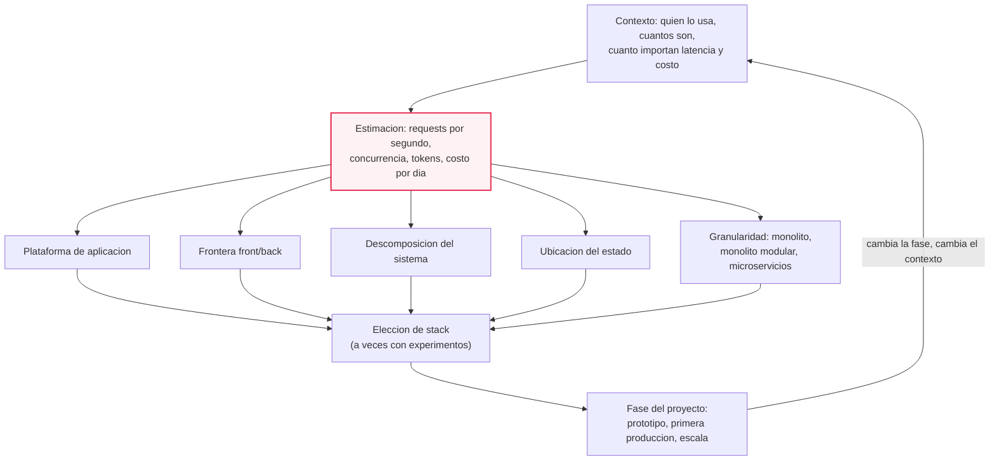
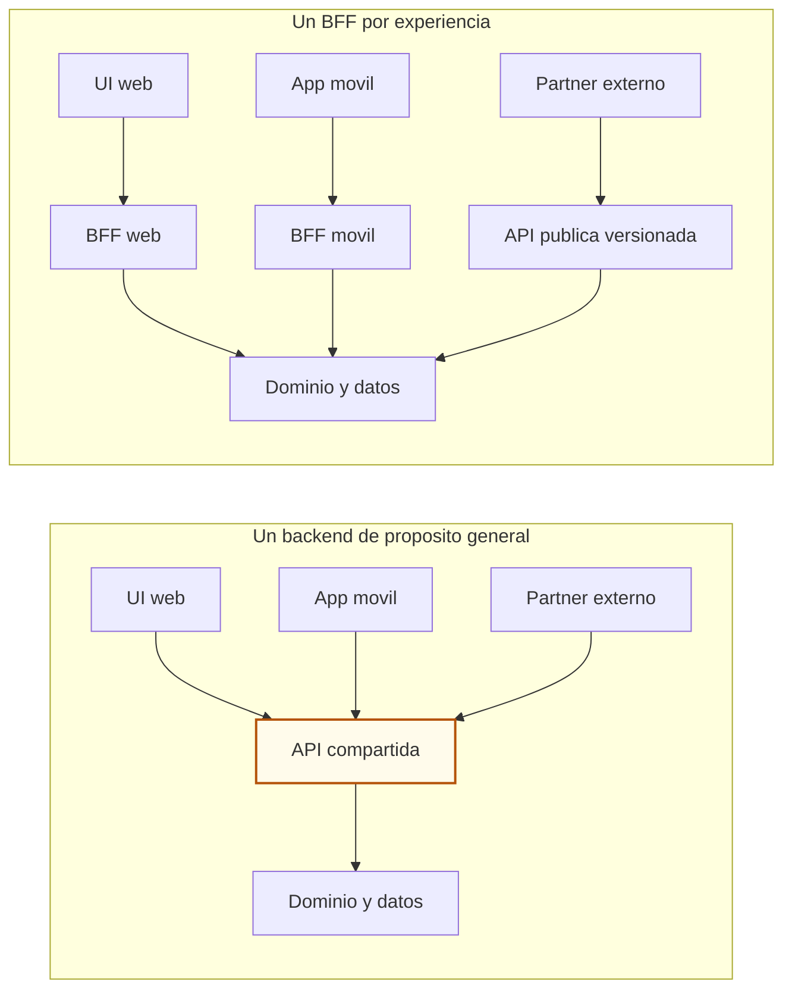
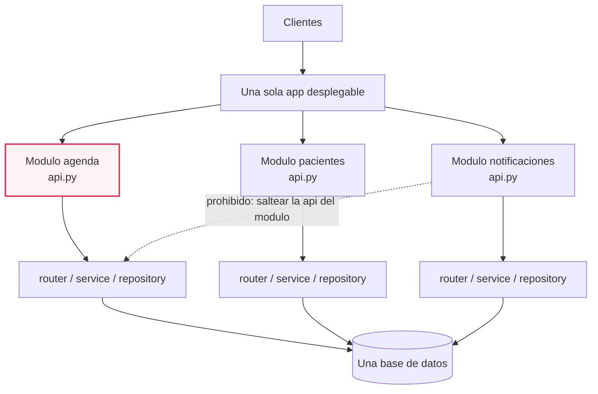
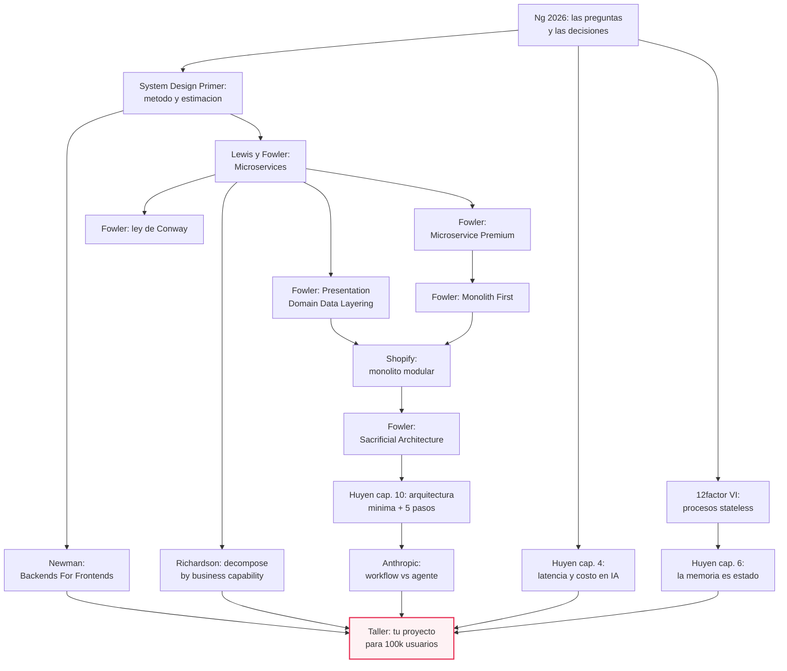

# M07·S13 — Diseñar la arquitectura según el contexto

**Módulo:** 07 — Fundamentos de Software + System Design para AI Engineers
**Sesión:** 13 de 22 · abre la **semana 3** (arquitectura, escalabilidad, seguridad y confiabilidad)
**Fecha:** [Completar por el profesor: fecha]
**Duración de la clase:** 3 h (ritmo pausado: un foco por sesión, mucha pizarra y discusión)
**Duración estimada de estudio:** ~2 h 30 min de lectura de estas notas + ~2 h de ejercicios + ~2 h 30 min si querés leer los recursos originales de la ruta mínima

---

## 1. De qué va esta sesión

Hasta acá construiste cosas: un webserver, una base de datos, un contrato de API, una UI que le habla a esa API. Hoy se cambia la pregunta. No es "¿cómo hago X?", es **"¿qué sistema hace falta acá?"** — y la respuesta no existe en abstracto.

La tesis de la sesión es una sola: **no hay una arquitectura correcta; hay una arquitectura correcta para un contexto**. Antes de dibujar la primera caja hay que contestar quién usa el sistema, cuántos son, cuánto importa la latencia y cuánto importa el costo. Con esas respuestas —y convertidas en números— recién se pueden tomar las decisiones grandes: dónde cae la frontera entre front y back, cómo se corta el sistema en piezas, dónde vive el estado y qué granularidad conviene. Y todo eso se mueve con la fase del proyecto: la arquitectura del prototipo de la semana 1 no es la de producción.

> ⚠️ **Lo que hoy NO se responde.** Escalado vertical vs horizontal es **S14**; load balancing, health checks y SPOF son **S15**; manejo de fallos y autenticación, **S16–S17**. Hoy se *plantean* las preguntas y se marcan en el diagrama como pregunta abierta. Si en el taller empezás a dibujar balanceadores y réplicas, te fuiste de tema a propósito y vas a llegar a S14 sin nada que hacer.

---

## 2. Objetivos de aprendizaje

Al terminar esta sesión vas a poder:

1. **Formular las preguntas que preceden al diseño** (quién lo usa, cuántos, qué latencia tolera, qué costo tolera) y **convertir "100k usuarios" en números** con una estimación *back-of-the-envelope* de supuestos declarados.
2. **Decidir dónde cae la frontera front/back** de una aplicación y justificar con criterio si corresponde un BFF o todavía no.
3. **Descomponer un sistema por capacidades de negocio**, explicar en qué se diferencia del corte por capas técnicas y detectar cuándo el nivel superior de módulos tiene que cambiar de eje.
4. **Ubicar el estado** de una aplicación (sesión, contadores, jobs, historial de conversación) y explicar qué se rompe si vive dentro del proceso.
5. **Elegir granularidad** entre monolito, monolito modular y microservicios, y defender la elección con el argumento de la prima de complejidad en lugar de con la moda.
6. **Rediseñar en pizarra la arquitectura de tu proyecto "para 100k usuarios"** y defenderla nombrando el supuesto, la alternativa descartada y qué tendría que pasar para cambiarla.

---

## 3. Resumen ejecutivo

En M07·S01 arrancaste el *trade-off journal* con la idea de que el salto de mid a senior es poder decir *por qué esto y no aquello*. En S02 dibujaste una arquitectura de single server y viste qué es el estado; en S04 cortaste el webserver en capas (router → service → repository); en S06–S07 modelaste el dominio y lo llevaste a PostgreSQL; en S09–S10 elegiste y diseñaste el estilo de API; en S11–S12 pusiste una UI de navegador contra esa API. Hoy se juntan todas esas piezas en una sola pregunta de nivel superior: **dado este contexto, ¿qué sistema hace falta?**

La sesión usa como índice el párrafo del *AI Engineering Skills Map* de Andrew Ng sobre diseño de arquitecturas: un buen diseño parte de cuántos usuarios hay y de cuánto importan la latencia y el costo, y con eso decide plataforma de aplicación, frontera frontend/backend, descomposición del sistema, ubicación del estado y granularidad arquitectónica, además de elegir el stack —a veces corriendo experimentos antes de decidir. El cierre de ese párrafo es la otra mitad de la sesión: la arquitectura correcta es un **blanco móvil** que depende de la fase del proyecto.

Por qué te importa como AI Engineer: el núcleo de IA de un producto vive dentro de una aplicación más amplia, y en esa aplicación la latencia y el costo **los domina la llamada al modelo**, no el webserver. Para muchas apps de IA con 100k usuarios el cuello de botella no es FastAPI: es la cuota y el precio de la API del modelo. Si no sabés estimar eso, no podés dirigir ni al agente ni la conversación con el negocio.

El lab es un **taller de pizarra**, sin código: cada equipo rediseña la arquitectura de su proyecto pensándola para 100k usuarios y la discute con otro equipo.

---

## 4. Conceptos clave

### Bloque A — El contexto y su aritmética

**Contexto de diseño.** El conjunto de hechos sobre quién usa el sistema, cuántos son, qué espera y cuánto se puede gastar en darlo. *Para qué:* es lo único que permite decidir entre dos arquitecturas que, en abstracto, son las dos "correctas". *Por qué así:* la alternativa —elegir por lo que se usa en la industria o por lo que el agente propone primero— produce sistemas sobredimensionados o sistemas que se caen el primer día, y en los dos casos nadie puede explicar la decisión.

**Estimación *back-of-the-envelope*.** Cuenta de servilleta que convierte un enunciado vago en órdenes de magnitud: requests por día, requests por segundo, concurrencia, tokens, costo. *Para qué:* darte un número con el que razonar; "100k usuarios" no dice nada, "35 requests por segundo en el pico" sí. *Por qué así:* se hace con órdenes de magnitud y supuestos explícitos porque el objetivo no es acertar el número, es **acotar el problema y poder discutir el supuesto**. Un número mal estimado pero declarado se corrige en dos minutos; una decisión tomada sin número no se puede ni discutir.

**QPS (queries/requests por segundo).** Throughput: cuántas peticiones por segundo llega a atender el sistema. *Para qué:* es la unidad en la que se dimensiona capacidad. *Por qué así:* porque el hardware y las cuotas se compran en unidades de trabajo por segundo, no en usuarios.

**Usuarios registrados vs activos vs concurrentes.** Registrados: los que existen en la base. Activos: los que usan el sistema en una ventana (día, mes). Concurrentes: los que tienen un request en vuelo **en este instante**. *Para qué:* separar las tres cosas es lo que convierte "100k usuarios" en carga real. *Por qué así:* es el error típico del taller — dimensionar para 100.000 requests simultáneos cuando el sistema real ve dos órdenes de magnitud menos, y comprar una arquitectura que nadie necesita.

**Factor de pico.** Cuántas veces el tráfico del momento más cargado supera al promedio del día. *Para qué:* una arquitectura se dimensiona por el **pico**, no por el promedio, porque es en el pico cuando se cae. *Por qué así:* el tráfico humano no es uniforme (hay horario de oficina, hay lunes a la mañana); promediar sobre 86.400 segundos esconde exactamente el momento que importa.

**Relación concurrencia ≈ throughput × latencia.** Si llegan 30 requests por segundo y cada uno tarda 2 segundos, hay unos 60 requests en vuelo a la vez. *Para qué:* traduce latencia a trabajo simultáneo, que es lo que consume memoria, conexiones a la base y workers. *Por qué así:* es aritmética de colas, no una ley que haya que creer: si el trabajo entra a un ritmo y cada unidad permanece un tiempo, la cantidad presente es el producto. Su consecuencia incómoda: **bajar la latencia también baja la concurrencia**, así que optimizar una llamada lenta puede valer más que agregar máquinas.

**Usefulness threshold.** El umbral de "qué tan buena tiene que ser" una aplicación de IA para que valga la pena usarla, definido con grupos de métricas: calidad de las respuestas, latencia, costo por request de inferencia y otras como interpretabilidad y fairness (Chip Huyen, *AI Engineering*, O'Reilly, 2025, cap. 4). *Para qué:* ponerle número a "¿importa la latencia? ¿importa el costo?" antes de diseñar. *Por qué así:* sin umbral declarado, cualquier latencia parece aceptable en la demo y ninguna lo es en producción.

**TTFT y TPOT.** *Time to first token* (cuánto tarda en aparecer la primera palabra) y *time per output token* (cuánto tarda cada token siguiente); junto con la latencia total son las métricas de latencia de una app de IA (Huyen, 2025, cap. 4). *Para qué:* distinguir "se siente rápido" de "termina rápido". *Por qué así:* con streaming, el usuario percibe el TTFT; el costo de cómputo lo manda la latencia total. Son dos objetivos distintos y se optimizan distinto.

**Last mile challenge.** Que una demo se arma en un fin de semana y el producto tarda meses o años (Huyen, 2025, cap. 4). *Para qué:* calibrar expectativas de plazo en la conversación con el negocio. *Por qué así:* la diferencia entre los dos no es el modelo, es todo lo que esta sesión discute.

### Bloque B — La frontera front/back

**Frontera front/back.** La línea que decide qué corre en el cliente y qué corre en el servidor. *Para qué:* es la primera decisión de arquitectura que no se puede deshacer barato, porque determina qué secretos existen, qué se puede cachear y a quién le duele cada cambio. *Por qué así:* no es una línea técnica fija: depende de cuántos tipos de cliente hay y de quién mantiene qué (lo viste del lado del navegador en S11–S12).

**API backend de propósito general.** Un único backend que sirve a la vez a la web, al móvil y a terceros. *Para qué:* es el default razonable cuando hay un solo tipo de cliente. *Por qué así:* cuando hay varios, se vuelve cuello de botella — muchos equipos tocando el mismo deployable, los equipos de front haciendo cola ante un equipo de middleware, y la API inflándose porque el móvil necesita llamadas distintas, menos llamadas y menos datos que el escritorio (Sam Newman, *Pattern: Backends For Frontends*, 18 de noviembre de 2015).

**BFF (*Backend For Frontend*).** Un componente de servidor **por experiencia de usuario**, acoplado a esa UI y mantenido por el mismo equipo que la construye (Newman, 2015). *Para qué:* devolverle a cada equipo de front la capacidad de cambiar su backend sin pedir permiso, y agregar del lado del servidor lo que esa UI necesita. *Por qué así:* la alternativa es una API compartida que se vuelve el mínimo común múltiplo de todos los clientes. **No** conviene si solo hay una UI web sin agregación significativa del lado servidor, o si desplegar servicios extra es caro (Newman, 2015) — es decir, no conviene en tu proyecto todavía, y eso también es una decisión que se anota.

### Bloque C — Descomposición

**Descomposición del sistema.** Cómo se corta el sistema en piezas y qué eje se usa para cortar. *Para qué:* decide quién puede trabajar sin pisar a quién y qué cambios van a ser caros para siempre. *Por qué así:* hay dos ejes posibles —capas horizontales (presentación / dominio / datos) y módulos de dominio— y la pregunta no es cuál es mejor, es cuál va **arriba**.

**Capacidad de negocio.** "Something that a business does in order to generate value": algo que el negocio hace para generar valor; suele corresponderse con un objeto del dominio (gestión de pedidos, gestión de clientes) y se organiza en jerarquías de varios niveles (Chris Richardson, *Pattern: Decompose by business capability*, microservices.io). *Para qué:* es el criterio de corte que da una arquitectura estable, porque las capacidades de un negocio cambian despacio. *Por qué así:* la alternativa —cortar por capa tecnológica o por entidad de base de datos— produce piezas que cambian juntas siempre, que es exactamente lo que un límite tendría que evitar.

**Corte por capacidades vs corte por capas técnicas.** Los microservicios se cortan por capacidad de negocio, con equipos cross-funcionales que tienen las skills para desarrollar el servicio de punta a punta, en vez de por capa tecnológica: UI, lógica de servidor, base de datos (James Lewis y Martin Fowler, *Microservices*, 25 de marzo de 2014, sección *Organized around Business Capabilities*). *Para qué:* tener el vocabulario de la pregunta del taller: ¿tus piezas son "turnos, pacientes, notificaciones" o son "routers, services, repositories"? *Por qué así:* con el corte por capas, cualquier feature nueva toca las tres capas y tres equipos; con el corte por capacidad, toca un módulo.

**Presentation-Domain-Data Layering.** Partir un programa en presentación, dominio y datos. Su mayor beneficio es **reducir el alcance de la atención**: poder razonar sobre cada capa con cierta independencia de las otras (Martin Fowler, *PresentationDomainDataLayering*, 26 de agosto de 2015). *Para qué:* es la modularización que ya hiciste en S04 y está bien. *Por qué así:* lo importante es el límite de arriba — a medida que la aplicación crece, "you should split your top level into domain oriented modules which are internally layered": el nivel superior pasa a ser módulos de dominio estratificados por dentro, y los namespaces de primer nivel tipo *view-model-data* son aceptables en sistemas chicos, no en grandes (Fowler, 2015).

**Ley de Conway.** Toda organización que diseña un sistema produce un diseño cuya estructura es copia de la estructura de comunicación de la organización — enunciada por Melvin Conway en 1968 en *Datamation*, y bautizada "ley de Conway" por Fred Brooks en *The Mythical Man-Month*, según Martin Fowler (*Conway's Law*, 20 de octubre de 2022). *Para qué:* explicar por qué una descomposición "linda" en la pizarra no sobrevive al equipo real que la va a construir. *Por qué así:* con equipos de 2–3 personas que se comunican todo el tiempo, el diseño que sale es un monolito — y eso no es una concesión, es la ley funcionando.

**Maniobra inversa de Conway.** Cambiar deliberadamente la organización de los equipos para favorecer la arquitectura que se quiere; el término lo acuñaron Jonny LeRoy y Matt Simons en un artículo de *Cutter IT* de diciembre de 2010 (citados en Fowler, 2022). *Para qué:* saber que la palanca organizativa existe. *Por qué así:* con la advertencia de Fowler: no es un arreglo instantáneo, reorganizar equipos sin tocar el código genera fricción, y la descomposición modular del sistema y la estructura de la organización se diseñan y evolucionan **juntas**.

### Bloque D — El estado

**Proceso stateless.** Un proceso que no guarda nada que haga falta después del request: "twelve-factor processes are stateless and share-nothing", y "any data that needs to persist must be stored in a stateful backing service, typically a database" (*The Twelve-Factor App*, factor VI, *Processes*). *Para qué:* es la precondición para poder correr más de una copia del proceso (que es S14). *Por qué así:* si el proceso recuerda, las copias no son intercambiables y el sistema queda clavado en una sola máquina.

**Backing service.** El servicio con estado al que el proceso le delega lo que hay que recordar: base de datos, caché, cola. *Para qué:* sacar el estado de donde no se puede replicar y ponerlo donde sí. *Por qué así:* mueve el problema a una pieza diseñada para tenerlo, con durabilidad y concurrencia resueltas (lo que trabajaste en S07).

**Sticky sessions.** Mandar siempre al mismo usuario al mismo servidor para que su estado en memoria siga ahí. *Para qué:* nada que convenga: "sticky sessions are a violation of twelve-factor and should never be used or relied upon" (*Twelve-Factor App*, VI). *Por qué así:* es un parche que cambia un problema de diseño por una dependencia de infraestructura, y se rompe el día que ese servidor se reinicia.

**Los tres mecanismos de memoria de un modelo.** *Internal knowledge*: los pesos, que solo cambian si se actualiza el modelo. *Short-term memory*: el contexto — rápido, de capacidad limitada y que **no persiste entre tareas**. *Long-term memory*: fuentes externas accedidas vía retrieval, que persiste entre tareas y, a diferencia del conocimiento interno, **se puede borrar sin tocar el modelo** (Huyen, 2025, cap. 6). *Para qué:* decidir qué parte del estado de una app de IA va al contexto, qué parte a un backing service y qué parte no va a ninguna parte. *Por qué así:* la decisión por frecuencia de uso y por persistencia necesaria; y porque poder **borrar** la memoria de largo plazo sin reentrenar es lo que hace posible atender un pedido de borrado de un usuario.

### Bloque E — Granularidad y evolución

**Monolito.** Una aplicación que se despliega como **una sola unidad**: un deployable, un proceso (o N copias del mismo proceso), típicamente una base de datos. *Para qué:* es la granularidad por defecto y la correcta para la enorme mayoría de los sistemas. *Por qué así:* monolito **no** es sinónimo de código desordenado. Un monolito puede estar perfectamente modularizado por dentro; lo que lo define es la unidad de despliegue, no la calidad interna. Confundir las dos cosas es el malentendido que vende microservicios.

**Big ball of mud.** El sistema sin estructura reconocible, donde cualquier cosa llama a cualquier cosa. *Para qué:* tener un nombre para el verdadero enemigo. *Por qué así:* es ortogonal a la granularidad — existen monolitos limpios y existen constelaciones de microservicios que son una bola de barro distribuida, que es la bola de barro más caras de arreglar.

**Monolito modular.** "A system where all of the code powers a single application and there are strictly enforced boundaries between different domains": todo el código corre en una sola aplicación y hay límites **estrictamente aplicados** entre dominios (Kirsten Westeinde, *Deconstructing the Monolith*, Shopify Engineering, 21 de febrero de 2019). *Para qué:* quedarse con el beneficio del corte por dominio sin pagar la cuenta de la red, los pipelines por servicio y los deploys coordinados. *Por qué así:* Shopify evaluó monolito tradicional, microservicios y monolito modular, y eligió el tercero; descartó microservicios por los pipelines de test y deploy e infraestructura por servicio, por los datos que no están disponibles cuando se los necesita al no haber base compartida, por la latencia y la menor confiabilidad de las llamadas de red, y por los refactors grandes que cruzan servicios y exigen deploys coordinados (Westeinde, 2019).

**Componentización por dominio.** Reorganizar el código por conceptos reales del negocio —pedidos, envíos, inventario, facturación— en lugar de por conceptos de software, "modelos, vistas, controladores" (Westeinde, 2019). *Para qué:* que el código y la gente que lo entiende sean fáciles de encontrar, que cada pieza se entienda sola y que el acoplamiento innecesario quede a la vista. *Por qué así:* es la versión ejecutable de lo que dice Fowler sobre el nivel superior de módulos, y se puede hacer hoy en una sola app FastAPI.

**Microservicios.** Una aplicación como suite de servicios chicos, desplegables de forma independiente, cada uno corriendo en su propio proceso, comunicándose con mecanismos livianos —habitualmente APIs de recursos HTTP—, organizados alrededor de capacidades de negocio, con despliegue automatizado y gestión central mínima (Lewis y Fowler, 2014). *Para qué:* escalar y desplegar partes del sistema por separado cuando el sistema es lo bastante grande como para que eso valga la pena. *Por qué así:* su promesa responde a una frustración real del monolito — "scaling requires scaling of the entire application rather than parts of it that require greater resource" (Lewis y Fowler, 2014) — pero esa promesa se cobra (ver abajo).

**Microservice premium.** La prima de complejidad que cobran los microservicios y que solo se paga sola en sistemas lo bastante complejos. La recomendación es explícita: "don't even consider microservices unless you have a system that's too complex to manage as a monolith", y la mayoría de los sistemas deberían construirse como una sola aplicación monolítica, con mucha atención a la **modularidad interna** (Martin Fowler, *Microservice Premium*, 13 de mayo de 2015). *Para qué:* es el criterio que podés escribir hoy en el trade-off journal. *Por qué así:* Fowler reconoce el problema del otro lado — un monolito con límites de módulo bien definidos es posible en teoría, pero en la práctica esos límites se cruzan con facilidad y el monolito se enreda (2015). O sea: el monolito es el default, pero el default tiene deberes.

**Monolith first.** Arrancar con un monolito aunque se espere escala, por dos razones: *yagni* —al principio no se sabe si la aplicación va a tener éxito, lo que importa es velocidad y feedback rápido, y la prima frena al equipo— y **límites inestables**: los microservicios funcionan bien solo con buenos límites de servicio, que son difíciles de trazar de entrada, y refactorizar cruzando servicios es mucho más caro que dentro de un monolito (Martin Fowler, *Monolith First*, 3 de junio de 2015). *Para qué:* contestar la objeción "si vamos a tener 100k usuarios, ¿no conviene arrancar con microservicios?". *Por qué así:* Fowler reporta como observación propia —no como estudio— que casi todas las historias exitosas de microservicios empezaron con un monolito que creció demasiado y se partió, y que los sistemas construidos como microservicios desde cero terminaron a menudo "in serious trouble" (2015). Sus tres alternativas: arquitectura sacrificial, arrancar con un par de servicios gruesos y partirlos después, y extraer servicios de a poco desde los bordes del monolito.

**Arquitectura sacrificial.** Diseñar algo sabiendo que se va a tirar y reemplazar; tirar y reconstruir puede ser señal de éxito, no de fracaso, porque cuando un sistema crece sus necesidades de arquitectura cambian de naturaleza: "the right architecture to support 1996-ebay isn't going to be the right architecture for 2006-ebay" (Martin Fowler, *Sacrificial Architecture*, 20 de octubre de 2014). *Para qué:* darle al taller su regla de alcance. *Por qué así:* Fowler reporta la regla de diseñar un sistema para diez veces sus necesidades actuales, en su forma completa "design for ~10X growth, but plan to rewrite before ~100X", que atribuye en una nota al pie a una keynote de Jeff Dean. Y el consejo operativo: la buena modularidad es lo que hace barato reemplazar, una versión temprana es un buen lugar para descubrir cuál es la estructura de módulos correcta, y con el sistema ya crecido es más efectivo **sacrificar módulos individuales** que el sistema entero.

**Workflow vs agent.** *Workflows*: sistemas donde los LLM y las herramientas se orquestan por caminos de código predefinidos. *Agents*: sistemas donde el LLM dirige dinámicamente su propio proceso y su uso de herramientas (Anthropic, *Building effective agents*, 19 de diciembre de 2024). *Para qué:* es la decisión de granularidad del lado de IA, y se paga en las dos monedas del subtema 1: "agentic systems often trade latency and cost for better task performance". *Por qué así:* la recomendación es buscar primero la solución más simple que funcione, que puede ser **no construir un sistema agéntico en absoluto** — para muchas aplicaciones alcanza con mejorar una sola llamada al modelo con retrieval y ejemplos en el contexto (Anthropic, 2024).

> 💡 Ya los conocés y hoy se aplican, no se re-explican: estado y single server (S02), capas router → service → repository (S04), estilo de API y protocolos (S09–S10), estado en el cliente (S12), C4 nivel 2 y ADR (módulo A), y la arquitectura mínima de una app de foundation models con sus cinco pasos de expansión (S01 y S05).

---

## 5. Notas de estudio por subtema

### El diagrama ancla: del contexto a las decisiones

Toda la sesión cabe en este flujo. Se lee de arriba hacia abajo una vez, y después se vuelve a leer cada vez que cambia la fase del proyecto.



El nodo resaltado es el que casi todos se saltean. Sin ese paso, las cinco decisiones de abajo se toman por intuición o por lo que el agente escribió primero.

El marco sale del *AI Engineering Skills Map* de Andrew Ng (2026), sección *Designing system architectures*: un buen diseño de sistema parte de entender qué tiene que hacer el software —cuántos usuarios hay, cuánto importan la latencia y el costo— y a partir de ahí decide plataforma de aplicación, frontera frontend/backend, descomposición, dónde vive el estado y granularidad arquitectónica, además de elegir el stack. Y la flecha de vuelta también es de Ng: la arquitectura correcta es un blanco móvil que depende de la fase del proyecto — la del prototipo rápido puede no servir para el primer sistema en producción, y esa puede cambiar cuando la aplicación escala.

---

### 5.1 Las preguntas que preceden al diseño

**El problema que resuelve.** Te dan una frase: "queremos una app de reservas de turnos para la red de clínicas". Si abrís el editor con eso, el sistema que sale es el sistema que a vos te resultó cómodo escribir, no el que el problema pedía. Las preguntas de arranque existen para que el diseño tenga restricciones antes de tener cajas.

**Qué preguntar.** El método de cuatro pasos de *The System Design Primer* (Donne Martin) empieza justamente por ahí: (1) *outline use cases, constraints and assumptions*; (2) diseño de alto nivel con los componentes principales y sus conexiones; (3) diseño en detalle de los componentes núcleo; (4) escalar el diseño identificando cuellos de botella. Para el paso 1, la lista de preguntas es: quién lo va a usar, cómo lo va a usar, cuántos usuarios hay, qué hace el sistema, cuáles son sus entradas y salidas, cuántos datos se esperan, cuántos requests por segundo y qué relación lectura/escritura tiene.

> ⚠️ Hoy el taller llega **hasta el paso 3**. El paso 4 ("scale the design") es S14 y S15. Esto no es un recorte arbitrario: escalar un diseño que todavía no tiene componentes definidos es dibujar cajas de adorno.

**Y en una app de IA, ¿qué cambia?** Las preguntas son las mismas, pero las respuestas las domina otra cosa. En una app de foundation models la latencia y el costo los manda **la llamada al modelo**, no el webserver. Por eso el vocabulario de Huyen es útil acá: el *usefulness threshold* se define con grupos de métricas —calidad, latencia (TTFT, TPOT y total), costo por request de inferencia, y otras como interpretabilidad y fairness (Huyen, 2025, cap. 4)—, y lo que tenés que escribir antes de diseñar es el valor de esas métricas que hace al producto útil. Con 100k usuarios, el cuello de botella probable no es cuántos workers de Uvicorn tenés: es la cuota del proveedor y el precio por token.

#### Ejemplo práctico: la plantilla de la cuenta

Esta es la plantilla que vas a usar en el taller. **Todos los valores marcados con `<...>` son supuestos del ejercicio, no datos de la industria**: se declaran por escrito y se discuten.

```text
Usuarios registrados (U)            = 100.000                 # dato del enunciado
Fraccion activa por dia (a)         = <A_DIARIA>               # ej. supuesto: 0,2
Interacciones por usuario activo    = <REQ_POR_USUARIO_DIA>    # ej. supuesto: 10

Requests/dia   = U x a x REQ_POR_USUARIO_DIA
QPS promedio   = Requests/dia / 86.400                         # segundos en un dia
QPS pico       = QPS promedio x <FACTOR_PICO>                  # ej. supuesto: 3-5
Concurrencia   ~ QPS pico x <LATENCIA_MEDIA_S>                 # requests en vuelo a la vez

Llamadas al LLM por request         = <LLM_CALLS>              # 1 si es chat simple; mas si hay agente
Tokens/dia     = Requests/dia x LLM_CALLS x <TOKENS_POR_LLAMADA>
Costo/dia      = Tokens/dia x <PRECIO_POR_TOKEN>               # de la pagina de precios del proveedor, con fecha de consulta
```

**Por qué está escrita así, línea por línea:**

- `U` son usuarios **registrados**. No son activos y mucho menos concurrentes. Si en el taller alguien dimensiona para 100.000 requests simultáneos, revisá esta línea primero.
- `<A_DIARIA>`, `<REQ_POR_USUARIO_DIA>` y `<FACTOR_PICO>` son los tres supuestos que el equipo declara. El valor exacto importa menos que dejarlo explícito: es lo que hace que la discusión con el otro equipo sea sobre el supuesto y no sobre el resultado.
- `86.400` es aritmética (segundos en un día), no un dato que haya que citar.
- `QPS pico` existe porque un sistema se dimensiona por el pico: el promedio diario esconde el lunes a las 9.
- `Concurrencia ≈ QPS × latencia` es aritmética de colas: si entran requests a un ritmo y cada uno permanece un tiempo, la cantidad presente es el producto. Es la línea que conecta este subtema con "optimizar la latencia es una palanca de capacidad".
- `<LLM_CALLS>` es donde entra la decisión workflow vs agente: un agente multiplica las llamadas por request y, con ellas, la latencia y el costo.
- `<PRECIO_POR_TOKEN>` se saca de la página de precios del proveedor **anotando la fecha de consulta**. Los precios cambian; una hoja de costeo sin fecha no se puede auditar (práctica que ya usaste en el módulo A).

**Alternativa descartada y qué pasaría si se hiciera distinto:** podrías saltarte la cuenta y dimensionar "por las dudas, con margen". Lo que pasa entonces es que el margen no tiene unidad: nadie puede decir si sobra o falta, y la primera vez que el sistema se cae no hay ningún número contra el que comparar. La cuenta no es para acertar, es para tener algo que corregir.

**Gotchas**
- Mezclar unidades: requests por día con QPS en la misma línea. Escribí la unidad al lado de cada número.
- Estimar con tres decimales. Es *back-of-the-envelope*: redondeá a órdenes de magnitud y seguí.
- Olvidar la relación lectura/escritura. Un tablero que se lee 50 veces por cada escritura tiene un problema completamente distinto al de uno que se escribe todo el tiempo.
- En apps de IA: contar un request = una llamada al modelo. Con retrieval, guardrails y routing, un request puede ser varias llamadas.

> 💡 **Para profundizar:** *The System Design Primer* (repositorio de Donne Martin), sección "How to approach a system design interview question". Tiene además apéndices de estimación —la tabla de potencias de dos y una de números de latencia— que vale la pena hojear. Lo que sí hay que llevarse de ese apéndice es el concepto, no los valores: las operaciones difieren en **órdenes de magnitud** (memoria ≪ disco ≪ red local ≪ red intercontinental), y es por eso que más adelante una llamada de red entre servicios no es equivalente a una llamada de función en memoria.

---

### 5.2 La frontera front/back

**El problema que resuelve.** "El backend expone la API y el frontend la consume" alcanza mientras hay un solo frontend. El día que hay una web, una app móvil y un partner que integra, la misma API tiene que servir a tres consumidores con necesidades incompatibles — y la pregunta "¿dónde cae la frontera?" deja de ser retórica.

**Qué dice el patrón.** Newman describe el problema del backend de API de propósito general: los cambios de muchos equipos caen en el mismo deployable, la entrega se frena, la propiedad se va a un equipo de middleware y los equipos de front hacen cola. Encima, una experiencia móvil necesita llamadas distintas, menos llamadas y menos datos que la de escritorio, así que la API compartida se infla con parámetros y variantes. La solución del patrón es un componente de servidor **por experiencia de usuario**, acoplado a esa UI y mantenido por el mismo equipo que la construye.



El nodo marcado es el que se convierte en cuello de botella, y no por razones técnicas: por razones de propiedad y de cola de trabajo.

**Cuándo NO.** El propio patrón trae su condición de no aplicación: si solo hay una UI web sin agregación significativa del lado servidor, o si el costo de desplegar servicios extra es alto, no corresponde. Para un equipo de 2–3 personas con una sola UI de navegador, la respuesta por defecto es **"todavía no"**. Eso no es pereza: es una decisión de contexto, y se anota igual que las otras, con su alternativa descartada.

#### Ejemplo práctico: la frontera de una app de IA

En una app con LLM, la frontera tiene una parte que no se negocia. Todo esto vive del lado del servidor:

| Pieza | Por qué en el backend |
|---|---|
| La llamada al modelo | Es donde está el secreto y donde se controla el gasto |
| La API key del proveedor | Cualquier cosa que llegue al navegador es pública: el usuario abre DevTools y la lee |
| La construcción del contexto (retrieval, prompt del sistema) | Es lógica de producto y a veces propiedad intelectual; en el cliente se puede alterar |
| Los guardrails | Un guardrail que corre en el cliente es un guardrail que el cliente puede desactivar |
| Los límites de costo y de rate por usuario | Si no hay un punto único que cuente, no hay límite |

Y del lado del cliente queda lo que mejora la experiencia percibida: el render incremental del streaming, el estado de la conversación visible, los reintentos de UI. El TTFT se *siente* en el cliente, pero se *produce* en el backend.

**Alternativa descartada:** llamar al proveedor directo desde el navegador. Funciona en la demo y es más corto de escribir. Lo que pasa después es que la key se filtra, el costo se vuelve ilimitado y no hay dónde poner un guardrail ni un log.

**Gotchas**
- Confundir BFF con microservicio. Un BFF es un backend **de una experiencia**, no un servicio de dominio: no es dueño de datos.
- Llamar BFF a la capa de routers que ya tenés. Si hay un solo cliente, eso es tu API, nada más.
- Decidir el estilo de API (REST, GraphQL, WebSocket, colas, gRPC) en abstracto. Es **una decisión de arquitectura más** y depende de quién consume y con qué latencia — exactamente el criterio que trabajaste en S09–S10, ahora aplicado desde arriba.

> 💡 **Para profundizar:** Sam Newman, *Pattern: Backends For Frontends*.

---

### 5.3 Descomposición: por capacidades, no solo por capas

**El problema que resuelve.** Cuando una feature nueva te obliga a tocar seis archivos en cuatro carpetas distintas, no tenés un problema de prolijidad: tenés un problema de eje de corte. La descomposición decide qué cambios van a ser baratos y qué cambios van a ser caros para siempre.

**Los dos ejes.** Hay dos dimensiones de modularidad y se suelen confundir:

- **Capas horizontales** (presentación / dominio / datos). Es lo que hiciste en S04 con router → service → repository. Su mayor beneficio es reducir el alcance de la atención: poder razonar sobre una capa casi independientemente de las otras, además de facilitar reemplazar implementaciones y testear el dominio (Fowler, *PresentationDomainDataLayering*, 2015).
- **Módulos de dominio** (turnos / pacientes / notificaciones / facturación). Es el corte por **capacidad de negocio**: algo que el negocio hace para generar valor, que suele corresponderse con un objeto del dominio y se organiza en jerarquías de varios niveles (Richardson, microservices.io).

La pregunta no es cuál de los dos, es **cuál va arriba**. Y la respuesta depende del tamaño: a medida que el sistema crece, cada capa se vuelve lo bastante compleja como para necesitar más módulos, y ahí el nivel superior ya no conviene que sea presentación/dominio/datos — "you should split your top level into domain oriented modules which are internally layered". Namespaces de primer nivel tipo view-model-data son aceptables en sistemas chicos, no en grandes (Fowler, 2015).

Por eso lo que hiciste en S04 **estaba bien y aun así cambia**: a ese tamaño el corte por capas era el correcto; a otro tamaño, el de arriba pasa a ser por dominio con las capas adentro.

**Por qué por capacidades y no por entidad de base de datos.** El argumento fuerte es de Lewis y Fowler: los servicios se cortan por capacidad de negocio —cada uno con su UI, su almacenamiento y sus colaboraciones externas, con equipos cross-funcionales que tienen las skills para desarrollarlo de punta a punta— en vez de por capa tecnológica (UI, lógica de servidor, base de datos), y la razón que citan es la ley de Conway. Richardson agrega los beneficios: arquitectura estable (las capacidades cambian despacio), equipos autónomos alineados al valor, servicios cohesivos y poco acoplados. Y agrega la advertencia que el taller necesita: identificar las capacidades exige entender el negocio y es un proceso **iterativo**; los puntos de partida son la estructura organizacional y un modelo de dominio de alto nivel. Nadie acierta el corte en la primera pizarra.

**La ley de Conway, y para qué te sirve hoy.** Toda organización que diseña un sistema produce un diseño cuya estructura es copia de la estructura de comunicación de la organización (Melvin Conway, 1968, según Fowler, 2022). Leído en un bootcamp: con equipos de 2–3 personas que hablan todo el tiempo, el diseño natural es un sistema único. La palanca inversa existe —la *inverse Conway maneuver*, cambiar la organización para favorecer la arquitectura deseada, acuñada por LeRoy y Simons en *Cutter IT* de diciembre de 2010— pero Fowler advierte que no es instantánea: reorganizar equipos sin tocar el código genera fricción, conviene hacer cambios chicos y medirlos, y la descomposición modular y la estructura organizacional se diseñan y evolucionan juntas.

#### Ejemplo práctico: de capas a capacidades en una app de reservas de turnos

Tomemos una app de reservas de turnos de un centro médico. Así está cortada hoy, por capas:

```text
app/
  routers/      turnos.py  pacientes.py  profesionales.py  notificaciones.py
  services/     turnos.py  pacientes.py  profesionales.py  notificaciones.py
  repositories/ turnos.py  pacientes.py  profesionales.py  notificaciones.py
```

Y así queda con el nivel superior por capacidad de negocio, con las capas adentro:

```text
app/
  agenda/           # capacidad: dar y mover turnos
    api.py          # <- la unica puerta del modulo
    router.py  service.py  repository.py  models.py
  pacientes/        # capacidad: administrar la ficha del paciente
    api.py
    router.py  service.py  repository.py  models.py
  notificaciones/   # capacidad: avisarle al paciente
    api.py
    router.py  service.py  repository.py  models.py
  main.py           # arma la app con los routers de cada modulo
```

**Por qué así y no de otra forma:**
- El nivel superior nombra lo que el negocio hace (`agenda`, `pacientes`, `notificaciones`), no lo que el framework necesita. Es la componentización por conceptos del negocio, en vez de por conceptos de software (Westeinde, 2019).
- Cada módulo expone `api.py` como **única puerta**. Es la pieza que hace que el límite sea real y no decorativo: `notificaciones` llama a `agenda.api.obtener_turno(...)`, nunca a `agenda.repository`. Sin esa convención, el límite existe solo en el diagrama — y Fowler es claro en que esos límites se cruzan con facilidad.
- Las capas **no desaparecen**: viven adentro de cada módulo. Seguís teniendo router, service y repository; lo que cambió es qué está arriba.
- Qué pasa si se hace distinto: si dejás el corte por capas arriba, cada capacidad nueva te obliga a tocar tres carpetas, y nada te impide que `notificaciones` consulte directo las tablas de `agenda`. Ese acoplamiento no se ve en ningún diagrama y es el que después hace imposible extraer un servicio.

**Gotchas**
- Confundir "capacidad de negocio" con "tabla". `tarea`, `comentario` y `etiqueta` pueden pertenecer todas a la misma capacidad.
- Cortar por sustantivo técnico: un módulo `utils` o `common` que crece sin límite es la señal de que el corte no está terminado.
- Creer que el corte se hace una vez. Es iterativo (Richardson): se revisa cuando el dominio se entiende mejor.

> 💡 **Para profundizar, en este orden:** Lewis y Fowler, *Microservices* (solo la definición y las secciones "Componentization via Services" y "Organized around Business Capabilities"); Richardson, *Pattern: Decompose by business capability*; Fowler, *PresentationDomainDataLayering*; Fowler, *Conway's Law*.

---

### 5.4 Dónde vive el estado

**El problema que resuelve.** El estado es lo que hace que un sistema no se pueda replicar. Mientras corre una sola copia del proceso, dónde vive el estado parece un detalle; el día que querés correr dos, es *la* restricción. Y esa decisión, si no la tomás vos, la toma el código por omisión.

**La regla canónica.** Los procesos de una app twelve-factor son *stateless* y *share-nothing*; todo dato que tenga que persistir va a un **backing service** con estado, típicamente una base de datos; y las *sticky sessions* son una violación del modelo y no deberían usarse ni asumirse (*The Twelve-Factor App*, factor VI). Ya lo viste en S02 y lo tocaste con `SessionMiddleware` en S04. Lo que cambia hoy es que se convierte en **pregunta de diseño**: en tu proyecto, ¿dónde vive hoy cada cosa que el sistema recuerda?

| Qué recuerda el sistema | Dónde suele estar sin que nadie lo decida | Dónde tiene que estar para poder replicar |
|---|---|---|
| Sesión del usuario | Diccionario en memoria del proceso | Cookie firmada o store compartido (Redis / tabla) |
| Contadores de uso o de rate limit | Variable global | Store compartido con operación atómica |
| Jobs en curso / tareas largas | Lista en memoria | Cola + tabla de estado del job |
| Caché de respuestas | `dict` del proceso | Caché compartida (y asumir que puede estar vacía) |
| Archivos subidos | Disco local del contenedor | Object storage |
| Historial de conversación con el modelo | `dict` por `user_id` en memoria | Tabla o store, accedido por un repository |

**La versión IA del problema.** En una app con LLM, la pregunta se vuelve filosa: **la memoria de la conversación es estado**. La taxonomía de Huyen (2025, cap. 6) da el vocabulario: el *internal knowledge* son los pesos y solo cambian si se actualiza el modelo; la *short-term memory* es el contexto, rápido, de capacidad limitada y que **no persiste entre tareas**; la *long-term memory* son fuentes externas accedidas vía retrieval, que sí persiste y que —a diferencia del conocimiento interno— **se puede borrar sin tocar el modelo**. Qué va a cada mecanismo se decide por frecuencia de uso, y persistir entre sesiones es lo que permite personalizar: un asistente que olvida tus preferencias es inútil.

Traducido a arquitectura: si el historial vive en la memoria del proceso de FastAPI, ya tomaste tres decisiones sin tomarlas. Se pierde con cada `--reload` y con cada deploy; no se comparte entre réplicas (el usuario que cae en otra copia "pierde la memoria"); y no se puede borrar a pedido del usuario, porque no sabés dónde está.

#### Ejemplo práctico: el estado escondido, y cómo sacarlo

Este patrón aparece en el 90 % de los prototipos de asistente, incluido el que escribe un agente de código si no se lo especifica:

```python
# app/main.py  —  el estado escondido
from fastapi import FastAPI
from pydantic import BaseModel

app = FastAPI()

# Esto es una decision de arquitectura disfrazada de variable.
HISTORIAL: dict[str, list[dict]] = {}

class Turno(BaseModel):
    usuario_id: str
    mensaje: str

@app.post("/chat")
def chat(turno: Turno):
    mensajes = HISTORIAL.setdefault(turno.usuario_id, [])
    mensajes.append({"rol": "user", "contenido": turno.mensaje})
    respuesta = llamar_al_modelo(mensajes)          # short-term memory = esta lista
    mensajes.append({"rol": "assistant", "contenido": respuesta})
    return {"respuesta": respuesta}
```

La versión que sí se puede replicar no cambia la lógica: cambia **quién es dueño del recuerdo**.

```python
# app/conversaciones/api.py  —  el estado afuera, detras de una interfaz
from typing import Protocol

class RepositorioHistorial(Protocol):
    """Interfaz del almacen de conversaciones.

    Existe para que el service NO sepa si el historial esta en memoria,
    en Postgres o en Redis. Es la misma costura que usas desde S04 para
    cambiar el repository sin tocar el service.
    """
    def leer(self, usuario_id: str) -> list[dict]: ...
    def agregar(self, usuario_id: str, mensaje: dict) -> None: ...
    def borrar(self, usuario_id: str) -> None: ...   # un usuario puede pedir que se borre
```

```python
# app/main.py  —  el router no sabe donde vive el estado
from fastapi import Depends, FastAPI

app = FastAPI()

@app.post("/chat")
def chat(turno: Turno, repo: RepositorioHistorial = Depends(obtener_repo_historial)):
    repo.agregar(turno.usuario_id, {"rol": "user", "contenido": turno.mensaje})
    mensajes = repo.leer(turno.usuario_id)        # puede venir recortado por ventana
    respuesta = llamar_al_modelo(mensajes)
    repo.agregar(turno.usuario_id, {"rol": "assistant", "contenido": respuesta})
    return {"respuesta": respuesta}
```

**Por qué así, y qué alternativas se descartaron:**
- **`Protocol` en vez de una clase concreta:** el objetivo no es la elegancia, es que el día de S14 puedas cambiar la implementación sin abrir el router. Si tipás el parámetro como `RepositorioPostgres`, el router queda atado a Postgres y la decisión deja de ser reversible.
- **`Depends` en vez de importar el repo adentro de la función:** así el cableado vive en un solo lugar y en los tests podés inyectar una implementación en memoria. Es el mismo mecanismo de S04.
- **Un método `borrar` explícito:** lo pide la propiedad de la *long-term memory* de Huyen — se puede borrar sin tocar el modelo. Si no existe el método, el sistema no puede cumplir un pedido de borrado, y eso es una restricción de producto, no un detalle.
- **Qué pasa si se deja la versión de arriba:** sigue funcionando perfecto con una réplica, y falla de la forma más confusa posible con dos (el usuario "pierde" la conversación de forma intermitente, según a qué copia cayó). Es el tipo de bug que no reproduce en local.

**Gotchas**
- Pensar que `SessionMiddleware` con cookie firmada "saca el estado": saca el estado del servidor, sí, pero lo que va en la cookie es legible por el cliente (firmada no es cifrada) y tiene límite de tamaño. No pongas el historial ahí.
- Mandar el historial completo al modelo para siempre. La short-term memory tiene capacidad limitada: hay que decidir la ventana, y eso también es arquitectura.
- Olvidar el estado que no parece estado: contadores, flags de feature, caché, archivos temporales.

> 💡 **Para profundizar:** *The Twelve-Factor App*, factor VI (*Processes*) — cinco minutos de lectura. La parte de IA es Huyen, cap. 6 (biblioteca del profesor).

---

### 5.5 Granularidad: monolito, monolito modular, microservicios

**El problema que resuelve.** "¿Hacemos microservicios?" es la pregunta más mal planteada de la industria. Bien planteada es: *¿cuántas unidades de despliegue puede sostener este equipo, y qué compra cada unidad extra?*

**Las tres opciones, y qué se paga en cada una.**

| | Monolito | Monolito modular | Microservicios |
|---|---|---|---|
| Unidades de despliegue | 1 | 1 | N |
| Límites entre dominios | Convención, fáciles de cruzar | **Estrictamente aplicados**, con API pública por módulo | Físicos: proceso y red |
| Llamada entre piezas | En memoria | En memoria, pero vía la API del módulo | Por red: latencia + modo de falla nuevo |
| Datos | Una base, joins disponibles | Una base, con acceso por módulo | Base por servicio, sin joins cruzados |
| Refactor que cruza dominios | Barato | Barato | Caro: deploys coordinados |
| Escalar una parte sola | No | No | Sí |
| Infraestructura | Una pipeline | Una pipeline | Pipeline + infra por servicio |
| Cuándo | Default. Casi siempre | Cuando el monolito se enreda y el equipo crece | Cuando el sistema es demasiado complejo para manejarlo como monolito |

El criterio duro es el de Fowler: "don't even consider microservices unless you have a system that's too complex to manage as a monolith"; la mayoría de los sistemas deberían construirse como una sola aplicación monolítica, con mucha atención a la modularidad **interna** (*Microservice Premium*, 2015). La página trae un gráfico cualitativo de productividad contra complejidad —sin números— cuya forma dice lo esencial: por debajo de cierto umbral de complejidad, el monolito gana; por encima, los microservicios. Nadie sabe exactamente dónde está el umbral, y eso es parte del argumento.

Y el camino es el de *Monolith First*: arrancar monolito aunque se espere escala, por *yagni* (al principio no se sabe si la aplicación va a tener éxito; lo que importa es velocidad y feedback, y la prima frena al equipo) y por **límites inestables** (los buenos límites de servicio son difíciles de trazar de entrada, y refactorizar cruzando servicios es mucho más caro que dentro de un monolito). Fowler reporta como observación propia —no como estudio— que casi todas las historias exitosas de microservicios empezaron con un monolito que creció y se partió, y que los construidos como microservicios desde cero terminaron a menudo "in serious trouble".

> ⚠️ **Monolito ≠ big ball of mud.** Lo que define a un monolito es que se despliega como una unidad, no que esté desordenado. Un monolito puede tener límites internos impecables; una constelación de microservicios puede ser una bola de barro distribuida, que es la versión caras de arreglar. Cuando alguien dice "el monolito no escala", preguntá si habla de la unidad de despliegue o de la prolijidad del código.

**El punto intermedio, con un caso real.** El monolito modular es "a system where all of the code powers a single application and there are strictly enforced boundaries between different domains" (Westeinde, Shopify Engineering, 2019). Shopify evaluó las tres opciones y eligió esta. Descartó microservicios por motivos concretos y todos operativos: pipelines de test y deploy por servicio más infraestructura propia; datos que no están disponibles cuando se los necesita, porque no hay base compartida; la latencia y la pérdida de confiabilidad de las llamadas de red; y los refactors grandes que cruzan varios servicios y exigen deploys coordinados. Lo que sí hizo fue la **componentización**: reorganizar el código por conceptos reales del negocio —pedidos, envíos, inventario, facturación— en lugar de por conceptos de software ("modelos, vistas, controladores"), para que el código y la gente que lo entiende sean fáciles de encontrar, para que cada pieza se entienda sola y para que el acoplamiento innecesario quede a la vista.



Una sola unidad de despliegue, una sola base, límites de dominio arriba y capas adentro. La flecha punteada es la regla que hay que **aplicar de verdad** —en revisión de código, con un test de importaciones, con lo que sea— porque es justo la que se cruza sola.

**Los costos operativos de los microservicios, en una línea cada uno** (se nombran hoy y se trabajan en S18–S21): cada llamada en memoria se convierte en una llamada de red, con su latencia y su modo de falla nuevo; la consistencia entre bases separadas deja de ser una transacción y pasa a ser un problema de diseño; la observabilidad se vuelve distribuida (un request atraviesa N servicios y hay que poder seguirlo); y algunos cambios exigen desplegar varios servicios en orden.

#### Ejemplo práctico: cómo se escribe esta decisión en el trade-off journal

Una decisión de granularidad sin registro escrito no es una decisión, es una costumbre. El formato es el que usás desde S01:

```markdown
## [s13] Granularidad: monolito modular para la app de turnos

**Contexto.** Equipo de 3 personas. Hoy: ~200 usuarios internos. Escenario del
ejercicio: 100.000 usuarios registrados, ~20 % activos por dia, ~10 interacciones
por usuario activo (supuestos declarados) → ~35 requests/s en el pico estimado.
Tres capacidades identificadas: agenda, pacientes, notificaciones.

**Decision.** Una sola unidad de despliegue, con el nivel superior cortado por
capacidad y `api.py` como unica puerta de cada modulo.

**Alternativas descartadas.**
- *Monolito por capas (lo que tenemos).* Descartada porque notificaciones ya
  consulta tablas de agenda y el acoplamiento no se ve en ningun diagrama.
- *Microservicios.* Descartada por la prima de complejidad: con 3 personas, una
  pipeline y una infra por servicio consumen mas tiempo del que liberan, y
  todavia no entendemos los limites lo bastante bien como para trazarlos de
  forma estable.

**Que tendria que pasar para cambiarla.**
- Que notificaciones necesite escalar de forma independiente del resto.
- Que un refactor dentro de un modulo rompa otro modulo mas de una vez por mes.
- Que el equipo pase de 3 a dos equipos separados con dueños distintos.
```

**Por qué el apartado "qué tendría que pasar para cambiarla" es el más importante:** convierte la decisión en una hipótesis con condición de salida, en vez de en una opinión. Es lo que te permite defenderla sin pelear ("hoy no, y te digo exactamente cuándo sí") y lo que hace que el journal sirva dentro de seis meses.

**Gotchas**
- Elegir microservicios "porque así escala". Lo que escala sin microservicios es casi todo; lo que no escala nunca es un equipo de 3 personas operando ocho servicios.
- Hacer monolito modular sin aplicar los límites. Sin la regla de `api.py` sostenida en revisión, en tres sprints tenés el monolito de antes con carpetas nuevas.
- Partir el sistema antes de entender el dominio. Es el argumento de los límites inestables: no se puede cortar bien lo que todavía no se entiende.

> 💡 **Para profundizar, en este orden:** Fowler, *Microservice Premium* (8 min) → Fowler, *Monolith First* (10 min) → Westeinde, *Deconstructing the Monolith* (Shopify Engineering, 20 min).

---

### 5.6 La arquitectura como objetivo móvil

**El problema que resuelve.** La pregunta "¿esta arquitectura está bien?" no tiene respuesta sin la pregunta "¿para cuándo?". Un diseño que era correcto para el prototipo puede ser incorrecto para la primera producción, y eso no significa que alguien se haya equivocado.

**La formulación.** Ng lo pone como cierre de las decisiones de diseño: la arquitectura correcta es un blanco móvil que depende de la fase del proyecto — la del prototipo rápido puede no servir para el primer sistema en producción, y esa puede cambiar cuando la aplicación escala. Fowler le pone el nombre y el criterio operativo: tirar un código y reconstruirlo varias veces puede ser **señal de éxito y no de fracaso**, porque cuando un sistema crece sus necesidades de arquitectura cambian de naturaleza; el ejemplo que da es eBay — "the right architecture to support 1996-ebay isn't going to be the right architecture for 2006-ebay" (*Sacrificial Architecture*, 2014).

De ahí sale la regla de alcance del taller. Fowler reporta la regla de diseñar un sistema para diez veces sus necesidades actuales, en su forma completa "design for ~10X growth, but plan to rewrite before ~100X", que atribuye en nota al pie a una keynote de Jeff Dean. Rediseñar "para 100k usuarios" **no** es diseñar para cien millones: es un orden de magnitud por vez. Y el consejo práctico cierra el círculo con el subtema 5: la buena modularidad es lo que hace barato reemplazar, una versión temprana es un buen lugar para descubrir cuál es la estructura de módulos correcta, y a medida que el sistema crece es más efectivo **sacrificar módulos individuales** que el sistema entero.

**La versión IA del mismo principio.** Una app de foundation models arranca con la arquitectura mínima —query → Model API → respuesta, sin construcción de contexto, sin guardrails y sin optimización— y crece en cinco pasos, en el orden que Huyen ve comúnmente en producción: enriquecer el contexto, poner guardrails, agregar router y gateway de modelos, optimizar latencia y costo con caching, y agregar lógica compleja y *write actions*. Ese orden es el que ella observa y se adapta a cada aplicación (Huyen, 2025, cap. 10). Dos advertencias de ese capítulo ordenan toda la sesión:

1. **Cada componente agregado vuelve al sistema más capaz y suma complejidad y modos de falla**, y lo hace más difícil de debuggear. Por eso el paso siguiente a agregar un componente siempre es observabilidad.
2. **Conviene construir primero sin orquestador**, porque abstrae detalles críticos del funcionamiento y complica el debugging.

Y una regla de diseño concreta: con requisitos estrictos de latencia, conviene paralelizar todo lo posible en el pipeline — por ejemplo, hacer el routing y la remoción de PII al mismo tiempo.

**La decisión de granularidad del lado de IA** es workflow vs agente, y se razona igual que monolito vs microservicios: *workflows* son sistemas donde los LLM y las herramientas se orquestan por caminos de código predefinidos; *agents* son sistemas donde el LLM dirige dinámicamente su propio proceso y su uso de herramientas. "Agentic systems often trade latency and cost for better task performance", así que la recomendación es buscar primero la solución más simple que funcione — que puede ser no construir un sistema agéntico en absoluto; para muchas aplicaciones alcanza con mejorar una sola llamada al modelo con retrieval y ejemplos en el contexto (Anthropic, *Building effective agents*, 19 de diciembre de 2024).

#### Ejemplo práctico: "para 100k usuarios" en un asistente de soporte

Supongamos un asistente de soporte con RAG que hoy atiende a un equipo interno y mañana atiende a los clientes de una ticketera de eventos. Qué **no** hay que hacer: agregar los cinco pasos de golpe. Qué sí:

| Problema que aparece a esa escala | Componente que lo responde | Qué suma de complejidad |
|---|---|---|
| Las respuestas se inventan datos del evento | Enriquecer el contexto (retrieval) | Un índice que hay que mantener fresco |
| Alguien pide cosas fuera de alcance | Guardrails | Un punto más donde una request puede ser rechazada mal |
| El modelo bueno es caro para preguntas triviales | Router + gateway de modelos | Dos modelos que hay que evaluar, no uno |
| El 30 % de las preguntas son la misma | Caching | Invalidación: respuestas viejas servidas como nuevas |
| Hay que crear el ticket, no solo responder | *Write actions* | Efectos secundarios: ahora un error escribe en el mundo real |

La disciplina es la misma del *back-of-the-envelope*: cada fila se agrega cuando el problema de la primera columna **aparece de verdad y se puede nombrar**, no porque esté en una lista de buenas prácticas. Y cada vez que agregás una fila, lo siguiente es poder observarla.

**Gotchas**
- Diseñar para 1000× porque "es gratis pensarlo". No es gratis: lo que construís con esa arquitectura es más lento de cambiar durante todo el tiempo en que no hace falta.
- Interpretar "sacrificial" como "escribir mal a propósito". Es lo contrario: la modularidad es justamente lo que hace barato tirar una parte.
- Usar un framework de orquestación en el primer día del prototipo, y después no poder explicar por qué el sistema contestó eso.

> 💡 **Para profundizar:** Fowler, *Sacrificial Architecture* (8 min); Anthropic, *Building effective agents* (para la clase alcanzan la introducción y "When (and when not) to use agents": 5 min). La parte de los cinco pasos es Huyen, cap. 10 (biblioteca del profesor).

---

### Cómo se relacionan los recursos de la sesión



Cuatro relaciones que el diagrama no alcanza a decir:

- **Ng es el índice; el resto son los capítulos.** Cada subtema de hoy es una de las decisiones que Ng enumera.
- ***Microservice Premium* y *Monolith First* son el mismo argumento desde dos lados:** el primero dice cuándo *no* conviene (debajo del umbral de complejidad), el segundo dice cómo *llegar* (arrancar monolito y cortar cuando se conoce el dominio). Se leen juntos. Shopify es la evidencia de que hay un tercer camino, y el único de los tres que es un caso real documentado por su propio equipo.
- **Fowler (capas) y Shopify (dominios) son la misma transición contada dos veces:** el bliki dice *cuándo* el nivel superior deja de ser por capas; el caso de Shopify muestra *cómo se ve* cuando ya pasó. En ese orden explican por qué lo que hiciste en S04 estaba bien y por qué igual cambia.
- **12factor y Huyen cap. 6 dicen lo mismo en dos vocabularios:** el estado va afuera del proceso, y la memoria de la conversación es estado. Ese es el puente explícito a S14 — sin estado local, se puede replicar.

---

## 6. Guía práctica: el taller "tu proyecto para 100k usuarios"

Esta sesión no tiene lab de código: el taller de pizarra **ocupa el lugar del lab**. Lo que sigue es el walkthrough completo, pensado para que lo puedas seguir de cero (en clase o solo, con tu propio proyecto).

### Prerequisitos

- El diagrama de arquitectura actual de tu proyecto (el de componentes de S05 o el C4 nivel 2 más reciente). Si no lo tenés a mano, dibujalo primero: 10 minutos.
- El modelo de dominio / ER que hiciste en S06–S07, aunque sea en una foto.
- La página de precios del proveedor de modelos, **si tu proyecto tiene un componente de IA**. Si no lo tiene, el bloque de tokens y costo de la plantilla no aplica y se declara "N/A".
- Una pizarra o Excalidraw abierto, y un archivo markdown para ir anotando las decisiones a medida que salen (no al final: al final nadie se acuerda del supuesto).
- **Equipos de 2–3 personas**, los mismos de M07·S05, cada uno sobre su propio proyecto.

### Reparto de los 180 minutos

| Bloque | Tiempo | Qué pasa |
|---|---|---|
| Concepto | ~45 min | Subtemas 1 a 6, con el 3 (descomposición) y el 5 (granularidad) como bloque central |
| Pizarra | ~50 min | Pasos 1 a 3: estimación y primer diagrama "para 100k" |
| Taller extendido | ~50 min | Pasos 4 y 5: iterar el diagrama y escribir las decisiones |
| Puesta en común | ~35 min | Paso 6: defensa entre equipos, con rotación |

### Paso 1 — Escribí el contexto antes de dibujar (10 min)

En el markdown, tres listas cortas:

```markdown
## Casos de uso (que tiene que hacer el sistema)
1. ...
2. ...
3. ...   <- maximo cinco; si son mas, no son casos de uso, son features

## Restricciones (lo que no se puede negociar)
- Latencia aceptable para la accion mas sensible: <X> ms / s
- Costo mensual tope: <Y>
- Datos que no pueden salir de ...

## Supuestos (lo que estamos asumiendo porque no lo sabemos)
- 100.000 usuarios REGISTRADOS
- <A_DIARIA> activos por dia
- <REQ_POR_USUARIO_DIA> interacciones por usuario activo
- Factor de pico <FACTOR_PICO>
```

**Placeholders a reemplazar:** `<X>`, `<Y>`, `<A_DIARIA>`, `<REQ_POR_USUARIO_DIA>`, `<FACTOR_PICO>`.
**Valores por defecto del ejercicio** (podés cambiarlos si los justificás): 20 % activos por día, 10 interacciones por usuario activo, factor de pico ×3 a ×5. Son **supuestos pedagógicos**, elegidos para que la cuenta dé un número manejable: no son típicos de nada ni benchmark de ninguna industria.

✅ **Verificación:** cada supuesto tiene un número y ninguno dice "muchos" o "pocos".

### Paso 2 — La cuenta (15 min)

Copiá la plantilla de la sección 5.1 y completala. Redondeá sin culpa.

✅ **Verificación:** tenés cuatro números escritos — requests/día, QPS promedio, QPS pico, concurrencia estimada — y, si hay IA, tokens/día y costo/día con la fecha de consulta del precio. Si alguien del equipo no puede explicar de dónde salió uno de ellos, volvé al paso 1.

### Paso 3 — Diagrama de alto nivel (25 min)

Dibujá los componentes principales y sus conexiones, al nivel de **C4 nivel 2 (container)**: qué unidades desplegables hay, qué tecnología usa cada una y quién le habla a quién. Nada de clases, nada de funciones.

Reglas del dibujo de hoy:
- Una caja por **unidad de despliegue**, no por carpeta.
- Marcá con un color distinto dónde vive cada pedazo de estado.
- Si tu proyecto tiene IA, la llamada al modelo es una caja externa con su propia flecha: es la que domina latencia y costo.

✅ **Verificación:** señalá cualquier caja del diagrama y el equipo puede decir qué número del paso 2 la justifica.

### Paso 4 — Las cuatro decisiones, con su alternativa descartada (25 min)

Para cada una, dos o tres líneas en el markdown:

1. **Frontera front/back.** ¿Qué corre en el cliente y qué en el servidor? ¿Hace falta un BFF, o la respuesta es "todavía no" y por qué?
2. **Descomposición.** Listá las capacidades de negocio de tu proyecto. Comparalas con los módulos que tenés hoy: ¿coinciden? ¿Cuál es el módulo que más se cruza con los otros?
3. **Ubicación del estado.** Completá la tabla de la sección 5.4 con tu proyecto. Marcá en rojo lo que hoy vive dentro del proceso.
4. **Granularidad.** Monolito, monolito modular o microservicios, con el criterio de la prima de complejidad. Y el estilo de API (lo de S09–S10) como una decisión más que depende de quién consume.

Si tu proyecto tiene un componente de IA, hay una quinta: **workflow o agente**, con su efecto en `<LLM_CALLS>` del paso 2.

✅ **Verificación:** cada decisión tiene las tres partes: el supuesto en que se apoya, la alternativa que se descartó y **qué tendría que pasar para cambiarla**.

### Paso 5 — Marcá lo que queda abierto (5 min)

En el diagrama, escribí literalmente "pregunta abierta — S14/S15" donde haya:
- más de una copia del mismo proceso,
- un balanceador,
- una réplica de base de datos,
- autoscaling.

**No los dibujes hoy.** El objetivo de esta sesión es tener un diseño cuyos cuellos de botella estén *identificados*; atacarlos es el trabajo de las dos sesiones siguientes.

✅ **Verificación:** hay al menos dos preguntas abiertas marcadas. Si no hay ninguna, el diseño está mintiendo.

### Paso 6 — Puesta en común entre equipos (35 min)

Los equipos se agrupan **de a dos**. Cada uno presenta en 5 minutos su diagrama y sus **tres decisiones principales**. El otro equipo hace dos preguntas, y las dos son del tipo:

> "¿Qué tendría que ser cierto para que esto se rompa?"

Después se **rota una vez**, así cada equipo presenta a dos equipos distintos y escucha a dos.

✅ **Verificación:** salís con al menos una decisión modificada o con un supuesto nuevo anotado. Un taller donde nadie cambió nada es un taller donde nadie se escuchó.

### Entregable

En el repo del equipo:

1. `docs/arquitectura/s13-arquitectura-100k.md` con: la estimación completa (supuestos incluidos), el diagrama —foto del Excalidraw **más** la versión en Mermaid / C4 container, que es la que se diffea en el PR— y las cuatro decisiones con su alternativa descartada y su condición de cambio.
2. Una entrada nueva en el trade-off journal sobre la **granularidad elegida**: `docs/trade-offs.md`, entrada `[s13]`, con el formato del ejemplo de la sección 5.5. Si tu equipo numera las entradas como `TJ-NNN`, agregá el número siguiente libre entre paréntesis en el título.

> 📝 **Nota para el profesor:** el reparto 45/50/50/35, los supuestos del ejercicio (100.000 registrados, 20 % activos, 10 interacciones, pico ×3–5), el formato de la discusión (parejas de equipos, 5 min + 2 preguntas, una rotación), los equipos de S05, la herramienta de diagrama (Excalidraw en clase + C4 container en Mermaid) y el entregable `docs/arquitectura/s13-arquitectura-100k.md` son defaults de este material: están escritos funcionales para que el alumno pueda hacer el taller sin esperar nada, pero son lo primero que conviene ajustar al grupo real. Dos cosas que convendría unificar antes de publicar: (a) la convención del journal, porque hoy conviven `TJ-NNN` en `tradeoff-journal.md` y entradas `[sNN]` en `docs/trade-offs.md` —el material usa la segunda y menciona la primera entre paréntesis—; y (b) confirmar que el grupo cursó el módulo A, ya que el paso 3 asume C4 nivel 2 como visto (si no, hace falta un repaso de 5 minutos de qué es un *container* en C4 y que *container ≠ Docker*).

---

## 7. Ejercicios

Formato workbook: cada unidad arranca con la teoría mínima para hacerla sola, sigue con un ejemplo resuelto y comentado, y cierra con tres ejercicios graduados. **Intentá cada uno antes de mirar su solución en la sección 12.**

🟢 completar o modificar · 🟡 guiado · 🔴 desde cero

---

### Unidad 1 — Estimación back-of-the-envelope

**Teoría mínima.** Una estimación *back-of-the-envelope* convierte un enunciado vago ("100k usuarios") en los números con los que se dimensiona un sistema: requests por día, QPS promedio, QPS pico, concurrencia y —si hay IA— tokens y costo. Se hace con órdenes de magnitud y **supuestos declarados**, porque el objetivo no es acertar sino acotar y poder discutir el supuesto. Se usa en el paso 1 del método de diseño, antes de dibujar cualquier caja. Tres reglas: usuarios registrados ≠ activos ≠ concurrentes; se dimensiona por el **pico**; y `concurrencia ≈ QPS × latencia`.

#### Ejemplo resuelto y comentado

**Caso:** asistente de soporte con RAG para los clientes de una ticketera de eventos. 100.000 usuarios registrados. Chat simple: una llamada al modelo por mensaje.

```text
# 1. Supuestos declarados (pedagogicos, no datos de industria)
U                     = 100.000 usuarios registrados
a                     = 0,2            # 20 % entra algun dia dado
req_por_usuario_dia   = 10             # 10 mensajes por sesion de soporte
factor_pico           = 4              # el pico es 4x el promedio
latencia_media        = 3 s            # dominada por la llamada al modelo
llm_calls             = 1              # chat simple, sin agente
tokens_por_llamada    = 2.000          # contexto recuperado + pregunta + respuesta

# 2. Carga
requests_dia = 100.000 x 0,2 x 10            = 200.000 requests/dia
qps_promedio = 200.000 / 86.400              ~ 2,3 requests/s
qps_pico     = 2,3 x 4                       ~ 9,3 requests/s
concurrencia = 9,3 x 3 s                     ~ 28 requests en vuelo

# 3. Volumen de modelo
tokens_dia   = 200.000 x 1 x 2.000           = 400.000.000 tokens/dia
costo_dia    = 400.000.000 x <PRECIO_POR_TOKEN>   # de la pagina del proveedor, con fecha
```

**Lectura de los números, que es la parte que importa:**

- **9,3 QPS en el pico no es un problema de webserver.** Un solo proceso FastAPI atiende ese orden de magnitud sin transpirar. Conclusión incómoda y correcta: para este sistema, "100k usuarios" **no** justifica microservicios ni nada parecido del lado de la aplicación.
- **28 requests en vuelo sí es un número que mirar**, y no por CPU: son 28 llamadas simultáneas a la API del modelo. Ahí es donde hay que ir a mirar la cuota del proveedor, no el tamaño de la máquina.
- **400 millones de tokens por día es el número que decide el producto.** El costo del modelo va a dominar el costo total por órdenes de magnitud sobre el hosting. Si el negocio no tolera ese costo, la decisión de arquitectura no es "más servidores": es bajar `tokens_por_llamada` (recortar el contexto recuperado), bajar `req_por_usuario_dia` (que el asistente resuelva en menos vueltas), cachear las preguntas repetidas o rutear las fáciles a un modelo más chico.
- **Por qué `latencia_media = 3 s` y no 100 ms:** porque la latencia la manda la llamada al modelo y no el framework. Si pusieras 100 ms, la concurrencia estimada bajaría a 1 y el diseño quedaría ciego justo en el recurso escaso.

**Por qué se escribe en este orden y no directo al resultado:** los supuestos arriba, separados y con nombre, son lo que se audita. En la puesta en común nadie va a discutir "9,3 QPS"; van a discutir "¿por qué 20 % activos?" — y eso es exactamente la discusión que sirve.

#### 🟢 Recalcular con un agente en el medio

Tomá el ejemplo resuelto y cambiá dos supuestos: el asistente pasa a ser **agéntico** (`llm_calls = 4` por request, porque decide, busca, vuelve a buscar y responde) y la latencia media sube a 9 s. Recalculá concurrencia, tokens/día, y escribí en dos líneas qué decisión de arquitectura cambia por el nuevo número.

<details><summary>Pista</summary>
No recalcules `requests_dia`: los supuestos de uso no cambiaron. Fijate qué pasa con la concurrencia y con los tokens, y acordate del trade-off que Anthropic enuncia sobre los sistemas agénticos.
</details>

**Lo lograste si:** tenés los dos números nuevos, y tu conclusión nombra latencia y costo como el precio del cambio (no "hay que agregar servidores").

#### 🟡 Estimar un sistema de lectura intensiva

Una **biblioteca municipal** quiere una app de catálogo y préstamos: 100.000 usuarios registrados, sin ningún componente de IA. El catálogo se consulta mucho más de lo que se presta.

Pasos:
1. Declará los supuestos, incluyendo explícitamente una **relación lectura/escritura** (cuántas consultas al catálogo por cada préstamo).
2. Calculá requests/día, QPS promedio y QPS pico **separando lecturas de escrituras**.
3. Estimá la concurrencia con una latencia media de 150 ms.
4. Escribí una sola frase: cuál de los dos números —lecturas o escrituras— condiciona el diseño, y por qué.

<details><summary>Pista</summary>
La relación lectura/escritura es una de las preguntas del paso 1 del método. Un sistema con 50 lecturas por escritura tiene un problema distinto del que tiene uno balanceado: pensá qué se puede cachear y qué no.
</details>

**Lo lograste si:** tus QPS de lectura y de escritura difieren en al menos un orden de magnitud, y tu frase final menciona qué parte del sistema es la que hay que dimensionar.

#### 🔴 La estimación completa de tu proyecto, en tres escenarios

Hacé la estimación de **tu propio proyecto** en tres escenarios: hoy (los usuarios reales que tiene), 100k registrados y 1M registrados. Para cada escenario, un número de QPS pico y de concurrencia; y para el salto de cada escenario al siguiente, **una sola decisión de arquitectura** que ese salto obligue a tomar.

Criterio de éxito:
- Los supuestos están declarados una vez y se reutilizan en los tres escenarios (si cambian entre escenarios, se dice por qué).
- Ninguna de las tres decisiones es "escalar horizontalmente" (eso es S14 y acá todavía no se puede justificar).
- Cerrás con una frase que explique por qué **no** conviene diseñar hoy para el escenario de 1M.

---

### Unidad 2 — Frontera front/back y descomposición por capacidades

**Teoría mínima.** La frontera front/back decide qué corre en el cliente y qué en el servidor; un BFF es un backend **por experiencia de usuario**, y solo se justifica cuando hay varios tipos de cliente con necesidades distintas y equipos que se estorban. La descomposición decide el eje de corte: capas horizontales (presentación/dominio/datos) o módulos de dominio. Las dos existen; la pregunta es **cuál va arriba**, y a medida que el sistema crece el de arriba pasa a ser el de dominio, con las capas adentro. El criterio de corte es la **capacidad de negocio**: algo que el negocio hace para generar valor.

#### Ejemplo resuelto y comentado

**Caso:** la app de reservas de turnos del centro médico de la sección 5.3. Tiene una UI web para pacientes, una pantalla interna para recepción, y una obra social que quiere consultar turnos por API.

**Paso 1 — listar las capacidades de negocio** (lo que el negocio *hace*, no las tablas que tiene):

| Capacidad | Qué hace el negocio | Entidades que caen adentro |
|---|---|---|
| Agenda | Ofrecer, reservar, mover y cancelar turnos | Turno, Disponibilidad, Profesional |
| Pacientes | Administrar la ficha y el historial del paciente | Paciente, Cobertura |
| Notificaciones | Avisarle al paciente de su turno | Aviso, Plantilla, EnvíoFallido |
| Facturación a obras sociales | Cobrar la prestación | Prestación, Liquidación |

**Paso 2 — comparar con los módulos que existen hoy.** Hoy hay `routers/`, `services/` y `repositories/`, con un archivo por entidad en cada uno. Coincidencia con las capacidades: parcial. Y aparece el hallazgo: el código que arma el texto del aviso está en `services/turnos.py`, o sea que la capacidad "notificaciones" **no existe como pieza**: está repartida.

**Paso 3 — decidir el corte de arriba.** Cuatro módulos de dominio (`agenda`, `pacientes`, `notificaciones`, `facturacion`), cada uno con `api.py` como única puerta y router/service/repository adentro. Capacidad con más cruces: `notificaciones`, que necesita leer turnos y pacientes → su `api.py` consume `agenda.api` y `pacientes.api`, nunca sus repositories.

**Paso 4 — decidir la frontera front/back.**

| Cliente | Qué necesita | Decisión |
|---|---|---|
| UI web de pacientes | Pocas llamadas, vista armada del turno con nombre del profesional | Se sirve desde la API de la app |
| Pantalla interna de recepción | Vista densa, muchos turnos por pantalla, filtros | Se sirve desde la misma API, con otros endpoints |
| Obra social | Contrato estable, versionado, sin sorpresas | **API pública versionada**, separada de los endpoints internos |

Decisión: **todavía no hay BFF.** Hay una API de aplicación para las dos UI propias y una API pública versionada para el tercero. Alternativa descartada: un BFF por UI. Se descarta porque son dos UI mantenidas por el mismo equipo de 3 personas y no hay agregación significativa del lado servidor que las diferencie — las dos condiciones de no-aplicación del patrón. **Qué lo cambiaría:** que recepción pase a tener equipo propio, o que aparezca una app móvil con necesidades de payload distintas.

**Por qué este orden de pasos y no otro:** se listan capacidades **antes** de mirar el código. Si mirás el código primero, las "capacidades" que vas a encontrar son las carpetas que ya existen, y el ejercicio se vuelve circular. Y el corte es iterativo por diseño: nadie acierta la lista de capacidades en la primera pizarra, así que lo que se entrega es la versión 1 con la advertencia escrita.

#### 🟢 Reclasificar un árbol de carpetas

Te dan la estructura de un sistema de **ticketera de eventos** cortado por capas:

```text
app/
  routers/      eventos.py  entradas.py  pagos.py  emails.py  reportes.py
  services/     eventos.py  entradas.py  pagos.py  emails.py  reportes.py
  repositories/ eventos.py  entradas.py  pagos.py  emails.py  reportes.py
  utils/        helpers.py  common.py
```

Reescribí el árbol con el nivel superior por **capacidad de negocio**, con las capas adentro y `api.py` por módulo. Decí además qué hacés con `utils/helpers.py` y `utils/common.py`, y por qué.

<details><summary>Pista</summary>
Cinco archivos por capa no significan cinco capacidades: "emails" y "reportes" probablemente no son capacidades del negocio, son medios. Y una carpeta `common` que crece sin límite suele ser la señal de que falta un módulo.
</details>

**Lo lograste si:** tu nivel superior nombra cosas que el negocio hace, el número de módulos no es necesariamente cinco, y tomaste una decisión explícita (no "lo dejo igual") sobre `utils/`.

#### 🟡 Decidir si corresponde un BFF

Una plataforma de cursos online tiene: (a) una web pública de catálogo, (b) una app móvil de alumno donde se ve el video y el progreso, (c) un panel de administración para el equipo interno y (d) tres universidades que integran por API para sincronizar matrículas. Equipos: uno de backend (4 personas), uno de web (2), uno de móvil (2).

Pasos:
1. Para cada cliente, escribí qué necesita que los otros no (cantidad de llamadas, tamaño del payload, estabilidad del contrato).
2. Decidí qué piezas de servidor hay: una sola API, un BFF por experiencia, o una mezcla.
3. Justificá con **las dos condiciones de no-aplicación** del patrón: ¿se cumplen o no?
4. Escribí qué tendría que pasar para que la decisión cambie.

<details><summary>Pista</summary>
Mirá la organización, no solo la técnica: Newman habla de equipos haciendo cola ante un equipo de middleware. Con un equipo de backend de 4 personas y dos equipos de front, ¿quién va a esperar a quién?
</details>

**Lo lograste si:** tu decisión distingue los clientes propios de la integración de terceros, y la justificación menciona propiedad y cola de trabajo, no solo formato de payload.

#### 🔴 Mapa de capacidades de tu proyecto, y el primer módulo que extraerías

Para **tu propio proyecto**, entregá:
1. La lista de capacidades de negocio, con las entidades que caen en cada una.
2. El árbol de carpetas propuesto con el nivel superior por capacidad.
3. La capacidad que **más se cruza** con las otras, y qué regla concreta vas a aplicar para que su límite sea real.
4. Si mañana hubiera que extraer **un solo** módulo a un servicio aparte, cuál sería y por qué — con el costo de red y de datos que eso trae.

Criterio de éxito: las capacidades están nombradas con verbos del negocio; la regla del punto 3 es verificable por alguien que no seas vos (una revisión, un test de importaciones, algo); y el punto 4 nombra al menos dos costos operativos concretos, no "es más complejo".

---

### Unidad 3 — Ubicación del estado y decisión de granularidad

**Teoría mínima.** Los procesos stateless y share-nothing son la precondición para replicar: todo lo que haya que recordar va a un backing service, y las sticky sessions son un parche que no hay que usar ni asumir. En una app de IA, la memoria de la conversación **es estado**: el contexto es memoria de corto plazo que no persiste entre tareas, y lo que tiene que sobrevivir va a una memoria de largo plazo externa, que además se puede borrar sin tocar el modelo. La decisión de granularidad se toma con la prima de complejidad: monolito por default y con modularidad interna, monolito modular cuando el monolito se enreda, microservicios solo si el sistema es demasiado complejo para manejarlo como monolito.

#### Ejemplo resuelto y comentado

**Caso:** la app de reservas de turnos, más un asistente que contesta preguntas de los pacientes sobre su turno.

**Paso 1 — inventario del estado.**

| Qué recuerda | Dónde está hoy | Se rompe al replicar? | Adónde va |
|---|---|---|---|
| Sesión de recepción | `SessionMiddleware` con cookie firmada | No, si la `secret_key` es la misma en todas las copias | Se queda (con la key compartida por config) |
| Contador de avisos enviados por día | Variable global del proceso | **Sí** — cada copia cuenta lo suyo | Tabla, con `UPDATE` atómico |
| Jobs de envío de avisos en curso | Lista en memoria | **Sí** — un reinicio los pierde en silencio | Tabla de jobs + estado |
| Historial del asistente por paciente | `dict` por `paciente_id` en memoria | **Sí** — y además no se puede borrar a pedido | Repository, detrás de un `Protocol` |
| PDFs de comprobantes generados | Disco del contenedor | **Sí** | Object storage |

**Paso 2 — el estado del asistente, decidido con el vocabulario de memoria.**

- *Short-term*: los últimos N turnos de la conversación, que van al contexto del modelo. Decisión explícita: N = 10 turnos o hasta un tope de tokens, lo que llegue primero. **Por qué un tope:** el contexto tiene capacidad limitada; si no se decide la ventana, la decide el error del proveedor cuando se pasa.
- *Long-term*: las preferencias del paciente (canal de contacto preferido, idioma). Van a una tabla, se recuperan por `paciente_id` y **se pueden borrar** sin tocar nada del modelo.
- *Lo que no va a ninguna parte*: el texto completo de cada conversación pasada, si el producto no lo necesita. Guardar por si acaso es una decisión de arquitectura y de privacidad, no un default.

**Paso 3 — la decisión de granularidad**, escrita en el journal con el formato de la sección 5.5: monolito modular, con las tres alternativas descartadas y las tres condiciones de cambio.

**Por qué se hace el inventario antes de decidir granularidad y no al revés:** la ubicación del estado es la que dice si el sistema **puede** replicarse; la granularidad es qué piezas hay. Si decidís granularidad primero, podés terminar con tres módulos lindos que comparten una variable global — y ninguno de los tres se puede mover.

#### 🟢 Sacar el estado escondido

Tomá este endpoint y convertilo en la versión replicable, siguiendo el patrón de la sección 5.4:

```python
# app/main.py
from fastapi import FastAPI, HTTPException

app = FastAPI()

AVISOS_ENVIADOS_HOY: dict[str, int] = {}   # paciente_id -> cantidad
TOPE_DIARIO = 3

@app.post("/pacientes/{paciente_id}/avisos")
def enviar_aviso(paciente_id: str, texto: str):
    enviados = AVISOS_ENVIADOS_HOY.get(paciente_id, 0)
    if enviados >= TOPE_DIARIO:
        raise HTTPException(status_code=429, detail="tope diario alcanzado")
    enviar_sms(paciente_id, texto)
    AVISOS_ENVIADOS_HOY[paciente_id] = enviados + 1
    return {"enviados_hoy": enviados + 1}
```

Escribí la versión con el contador afuera del proceso, y agregá en dos líneas por qué el `get` + `+1` es un problema aparte del de la replicación.

<details><summary>Pista</summary>
Hay dos bugs escondidos, no uno: dónde vive el contador, y el hecho de leer-decidir-escribir en tres pasos. El segundo ya lo viste en S07.
</details>

**Lo lograste si:** el contador vive en un backing service, el router no sabe cuál es, y nombraste el problema de check-then-act.

#### 🟡 El inventario de estado de una app, y qué se rompe

Una **ticketera de eventos** tiene hoy, todo en un solo proceso FastAPI: login con sesión en memoria, un carrito de compra por usuario (también en memoria, con 10 minutos de reserva de las entradas), un contador de entradas disponibles por evento leído de la base pero cacheado 30 segundos en un `dict`, y los PDF de las entradas generados en `/tmp`.

Pasos:
1. Armá la tabla de inventario de estado (qué recuerda / dónde está / se rompe al replicar / adónde va).
2. Para cada fila que se rompe, describí **el síntoma que vería un usuario** — no la causa técnica.
3. Ordená las cuatro filas por riesgo: cuál arreglarías primero y por qué.
4. Nombrá una cosa del sistema que **no** hay que mover, y por qué.

<details><summary>Pista</summary>
El carrito con reserva de 10 minutos es el más interesante: no es solo estado, es estado **con tiempo**. Pensá qué pasa si el proceso que lo tenía se muere.
</details>

**Lo lograste si:** los síntomas del punto 2 están escritos en lenguaje de usuario ("me vació el carrito", "compré una entrada que ya no existía") y tu orden de prioridad está justificado por impacto, no por facilidad.

#### 🔴 La entrada de granularidad de tu proyecto, con condición de salida

Escribí la entrada `[s13]` del trade-off journal de **tu proyecto** decidiendo la granularidad. Tiene que incluir:
- el contexto con **los números** de tu estimación de la Unidad 1 (no "esperamos crecer");
- la decisión;
- **las dos alternativas descartadas** (la que tenés hoy y la más ambiciosa), cada una con el motivo concreto por el que se descarta;
- tres **condiciones de cambio** observables: cosas que alguien podría verificar en seis meses y decir "pasó".

Criterio de éxito: ninguna de las tres condiciones de cambio contiene la palabra "muchos" ni "escala"; todas son verificables. Y la entrada se entiende sin que vos estés al lado explicándola.

---

## 8. Ruta de estudio sugerida

El orden importa: hay dependencias reales. *Microservice Premium* se entiende mucho mejor después de haber leído cómo se corta un sistema, y Shopify se entiende después de los dos blikis de Fowler.

**Ruta mínima (~55 min) — si tenés una hora**

| # | Recurso | Tiempo | Para qué |
|---|---|---|---|
| 1 | Ng (2026), *AI Engineering Skills Map*, sección *Designing system architectures* | 5 min | Es el índice de toda la sesión |
| 2 | *The System Design Primer*, "How to approach a system design interview question" | 15 min | El método de cuatro pasos y las preguntas del paso 1 |
| 3 | Fowler, *Microservice Premium* | 8 min | El criterio de granularidad, en su forma más corta |
| 4 | Fowler, *Monolith First* | 10 min | Cómo se llega, y la respuesta a "¿y si vamos a crecer?" |
| 5 | *The Twelve-Factor App*, factor VI (*Processes*) | 5 min | La regla del estado, en una página |
| 6 | Anthropic, *Building effective agents* — intro y "When (and when not) to use agents" | 5 min | La misma tesis, del lado de IA |
| 7 | **Unidad 1 de ejercicios** | ~40 min | La cuenta, que es la herramienta del taller |

**Ruta completa (~2 h 30 min de lectura)**

1. Ng (2026), *Designing system architectures* — 5 min.
2. *The System Design Primer*, cómo encarar un diseño + hojear los apéndices de estimación — 15 min.
3. Huyen (2025), cap. 4: *usefulness threshold*, latencia y costo — 20 min. → **Unidad 1 de ejercicios**.
4. Newman, *Backends For Frontends* — 15 min.
5. Fowler, *Conway's Law* — 8 min.
6. Lewis y Fowler, *Microservices* — definición + "Componentization via Services" + "Organized around Business Capabilities" — 10 min.
7. Richardson, *Decompose by business capability* — 8 min.
8. Fowler, *PresentationDomainDataLayering* — 10 min. → **Unidad 2 de ejercicios**.
9. Fowler, *Microservice Premium* — 8 min.
10. Fowler, *Monolith First* — 10 min.
11. Westeinde, *Deconstructing the Monolith* (Shopify) — 20 min.
12. Fowler, *Sacrificial Architecture* — 8 min.
13. Huyen (2025), cap. 10: arquitectura mínima y los cinco pasos — 40 min.
14. Anthropic, *Building effective agents* — 25 min (o 5 min las dos secciones clave). → **Unidad 3 de ejercicios**.

*The Twelve-Factor App* factor VI y Huyen cap. 6 se pueden leer en cualquier momento: son repaso aplicado de S02 y S04.

> 💡 Hacé cada unidad de ejercicios **antes** de leer su solución en la sección 12. La diferencia entre leer la solución y producirla es exactamente la diferencia que se evalúa en la defensa técnica de S22.

---

## 9. Checklist de autoevaluación

- [ ] Puedo nombrar, sin mirar los apuntes, las preguntas que preceden al diseño y las cinco decisiones que se toman con sus respuestas.
- [ ] Puedo convertir "100k usuarios" en QPS pico y concurrencia, declarando cada supuesto.
- [ ] Puedo explicar la diferencia entre usuarios registrados, activos y concurrentes, y por qué un sistema se dimensiona por el pico.
- [ ] Puedo decidir si un proyecto necesita un BFF y justificar el "todavía no" con las condiciones de no-aplicación del patrón.
- [ ] Puedo listar las capacidades de negocio de un sistema y explicar en qué se diferencia ese corte del corte por capas.
- [ ] Puedo explicar por qué un monolito no es lo mismo que una *big ball of mud*.
- [ ] Puedo decir qué es un monolito modular y qué límite concreto lo distingue de un monolito cualquiera.
- [ ] Puedo encontrar el estado escondido en un endpoint de FastAPI y decir qué se rompe al correr dos copias.
- [ ] Puedo explicar por qué el historial de una conversación con un LLM es estado, y qué parte va al contexto y qué parte a un backing service.
- [ ] Puedo defender una decisión de arquitectura nombrando el supuesto, la alternativa descartada y qué tendría que pasar para cambiarla.

---

## 10. Preguntas de repaso

1. Te dicen "necesitamos que el sistema aguante 100.000 usuarios". ¿Qué preguntás antes de dibujar nada, y cómo convertís la respuesta en un número con el que se pueda diseñar?
2. Un compañero propone arrancar el proyecto con microservicios porque "si después crece, partirlo va a ser carísimo". Contestale con argumentos, y decí en qué caso tendría razón.
3. ¿Qué diferencia hay entre cortar un sistema por capas y cortarlo por capacidades de negocio? ¿Cuándo cambia cuál de los dos ejes va arriba, y cómo te das cuenta de que llegó ese momento?
4. En una app con un asistente conversacional, ¿dónde vive el estado? Enumerá qué recuerda el sistema y qué se rompe con cada pieza el día que corrés dos copias del proceso.
5. "La arquitectura correcta es un blanco móvil." ¿Qué implica eso para lo que estás construyendo hoy, y cómo evitás que se convierta en excusa para no decidir nada?

---

## 11. Recursos adicionales

### Imprescindibles

- **Andrew Ng (2026), *AI Engineering Skills Map: Software engineering fundamentals*** — sección *Designing system architectures*. Biblioteca del profesor (sin URL pública; la vía pública es The Batch, ya usada en M07·S01). Lectura: 5 min. Es el índice de la sesión.
- **[The System Design Primer — Donne Martin](https://github.com/donnemartin/system-design-primer)** — "How to approach a system design interview question" y los apéndices de estimación. 15 min. Es la herramienta concreta del taller.
- **[Martin Fowler — *Microservice Premium*](https://martinfowler.com/bliki/MicroservicePremium.html)** — 8 min. El criterio de granularidad en su forma más corta.
- **[Martin Fowler — *Monolith First*](https://martinfowler.com/bliki/MonolithFirst.html)** — 10 min. La respuesta a "¿y si vamos a crecer?".
- **[The Twelve-Factor App — VI. Processes](https://12factor.net/processes)** — 5 min. La regla del estado.

### Recomendados

- **[Sam Newman — *Pattern: Backends For Frontends*](https://samnewman.io/patterns/architectural/bff/)** — 15 min. La frontera front/back, con sus condiciones de no-aplicación.
- **[James Lewis y Martin Fowler — *Microservices*](https://martinfowler.com/articles/microservices.html)** — 30–40 min completo; para la clase alcanzan la definición y las secciones "Componentization via Services" y "Organized around Business Capabilities" (10 min).
- **[Chris Richardson — *Pattern: Decompose by business capability*](https://microservices.io/patterns/decomposition/decompose-by-business-capability.html)** — 8 min. El procedimiento del corte, y la advertencia de que es iterativo.
- **[Martin Fowler — *PresentationDomainDataLayering*](https://martinfowler.com/bliki/PresentationDomainDataLayering.html)** — 10 min. Cuándo el nivel superior deja de ser por capas.
- **[Kirsten Westeinde — *Deconstructing the Monolith* (Shopify Engineering)](https://shopify.engineering/deconstructing-monolith-designing-software-maximizes-developer-productivity)** — 20 min. El monolito modular en un caso real documentado por su propio equipo.
- **[Martin Fowler — *Sacrificial Architecture*](https://martinfowler.com/bliki/SacrificialArchitecture.html)** — 8 min. La formulación canónica del blanco móvil.
- **[Anthropic — *Building effective agents*](https://www.anthropic.com/engineering/building-effective-agents)** — 25 min; para la clase, la introducción y "When (and when not) to use agents" (5 min).
- **Chip Huyen (2025), *AI Engineering* (O'Reilly) — cap. 4** (usefulness threshold, TTFT/TPOT, costo por request, last mile). Biblioteca del profesor, sin URL pública. 20 min.

### Opcionales

- **[Martin Fowler — *Conway's Law*](https://martinfowler.com/bliki/ConwaysLaw.html)** — 8 min. El ángulo organizacional de la descomposición y la maniobra inversa.
- **Chip Huyen (2025), *AI Engineering* — cap. 10** (arquitectura mínima y los cinco pasos de expansión). Biblioteca del profesor. 40 min. Ya se usó en S01, S02 y S05: acá se aplica como mapa de "qué agregaría y por qué".
- **Chip Huyen (2025), *AI Engineering* — cap. 6** (los tres mecanismos de memoria). Biblioteca del profesor. 20 min. Es el vocabulario del estado en una app de IA.

---

## 12. Soluciones comentadas

### Unidad 1 — Estimación back-of-the-envelope

#### 🟢 Recalcular con un agente en el medio

```text
# Los supuestos de uso NO cambian: sigue habiendo 200.000 requests/dia.
requests_dia = 200.000
qps_pico     ~ 9,3 requests/s          # igual que antes: el trafico no cambio

# Lo que cambia es cuanto dura cada request y cuantas llamadas hace.
concurrencia = 9,3 x 9 s        ~ 84 requests en vuelo   (antes ~28)
tokens_dia   = 200.000 x 4 x 2.000 = 1.600.000.000 tokens/dia  (antes 400 M)
```

**Qué decisión cambia.** Nada del lado del webserver: 9,3 QPS sigue siendo trivial. Lo que cambia son las dos monedas del subtema 1: la concurrencia de llamadas al proveedor se triplica (84 llamadas simultáneas, que es un número que hay que cotejar contra la cuota) y el consumo de tokens se cuadruplica. Es exactamente el trade-off que enuncia Anthropic: "agentic systems often trade latency and cost for better task performance". La decisión no es infraestructura, es **producto**: ¿el salto de calidad del agente justifica 4× el costo y 3× la latencia percibida? Y si la respuesta es sí solo para algunas consultas, la decisión de arquitectura que aparece es un router que mande las fáciles al camino de una sola llamada.

**Por qué no se recalculan los requests:** porque pasar de workflow a agente cambia cómo se resuelve cada interacción, no cuántas interacciones pide el usuario. Confundir esas dos cosas es el error que hace que la cuenta deje de servir.

#### 🟡 Estimar un sistema de lectura intensiva

```text
# 1. Supuestos declarados
U                        = 100.000 usuarios registrados
a                        = 0,05      # una biblioteca municipal se usa poco por dia
sesiones_por_activo_dia  = 1
consultas_por_sesion     = 12        # busca, filtra, abre fichas
prestamos_por_sesion     = 0,25      # 1 de cada 4 sesiones termina en prestamo
factor_pico              = 4
latencia_media           = 0,15 s

# 2. Carga, separando lecturas de escrituras
activos_dia   = 100.000 x 0,05                  = 5.000
lecturas_dia  = 5.000 x 12                      = 60.000
escrituras_dia= 5.000 x 0,25                    = 1.250
relacion L/E  = 60.000 / 1.250                  ~ 48 : 1

qps_lectura_prom  = 60.000 / 86.400             ~ 0,7 /s
qps_lectura_pico  = 0,7 x 4                     ~ 2,8 /s
qps_escritura_pico= (1.250 / 86.400) x 4        ~ 0,06 /s

# 3. Concurrencia
concurrencia ~ (2,8 + 0,06) x 0,15 s            ~ 0,43 requests en vuelo
```

**Frase final:** el diseño lo condicionan **las lecturas**, porque son casi dos órdenes de magnitud más que las escrituras; es la parte que conviene poder cachear y la que justifica pensar índices en el catálogo. Las escrituras son tan pocas que ninguna decisión de arquitectura debería tomarse por ellas — salvo las de corrección: un préstamo es la operación que no puede duplicarse ni perderse, aunque sean 1.250 por día.

**Por qué separar lecturas de escrituras y no sumar todo:** porque las dos se escalan y se protegen distinto. Una lectura se puede servir vieja por 30 segundos; un préstamo, no. Si las sumás, el número promedio esconde las dos conversaciones útiles. Es justamente la pregunta de read/write ratio del paso 1 del método.

**Nota sobre la concurrencia:** menos de 1 request en vuelo significa que, con estos supuestos, el sistema está casi siempre vacío. Es un resultado perfectamente válido y es información: dice que la decisión de arquitectura de este sistema **no es de capacidad**, es de disponibilidad y de correctitud.

#### 🔴 La estimación completa de tu proyecto, en tres escenarios

No hay una única respuesta, pero una buena tiene esta forma (ejemplo sobre una app de reservas de turnos):

```text
# Supuestos (unicos para los tres escenarios)
a = 0,15   req_por_usuario_dia = 6   factor_pico = 5   latencia_media = 0,2 s
# Cambio declarado: en el escenario de 1M, a baja a 0,10 porque el crecimiento
# trae usuarios mas ocasionales. Es un supuesto, no un dato.

Hoy (2.000 registrados):   1.800 req/dia  → qps_pico ~ 0,1   → concurrencia ~ 0,02
100k registrados:         90.000 req/dia  → qps_pico ~ 5,2   → concurrencia ~ 1,0
1M registrados:          600.000 req/dia  → qps_pico ~ 35    → concurrencia ~ 7
```

| Salto | Decisión que obliga | Por qué esa y no otra |
|---|---|---|
| Hoy → 100k | **Sacar todo el estado del proceso** (contadores, jobs, caché, archivos) | Es la precondición de cualquier cosa que venga después; mientras haya estado en memoria, ninguna otra decisión es ejecutable |
| 100k → 1M | **Cambiar el nivel superior de módulos de capas a capacidades**, con límites aplicados | A ese volumen el equipo ya no es de 3 personas, y el costo de que `notificaciones` toque las tablas de `agenda` pasa de molestia a bloqueo |

**Por qué no diseñar hoy para 1M:** porque todo lo que agregues para 1M lo vas a mantener, debuggear y explicar durante todo el tiempo en que tenés 2.000 usuarios — y la probabilidad de que los límites que tracés hoy sean los correctos para 1M es baja, porque todavía no conocés el dominio lo suficiente. Es el argumento de los límites inestables de *Monolith First*, y la regla de alcance de *Sacrificial Architecture*: un orden de magnitud por vez, con buena modularidad como seguro para poder reemplazar después.

**Por qué ninguna de las decisiones es "escalar horizontalmente":** porque con 35 QPS pico no está justificado todavía, y porque el ejercicio de hoy es *identificar* los cuellos de botella, no atacarlos. Atacarlos es S14 y S15.

---

### Unidad 2 — Frontera front/back y descomposición por capacidades

#### 🟢 Reclasificar un árbol de carpetas

```text
app/
  eventos/            # capacidad: publicar y administrar eventos
    api.py
    router.py  service.py  repository.py  models.py
  ventas/             # capacidad: vender entradas y cobrarlas
    api.py
    router.py  service.py  repository.py  models.py
    pagos/            # subcapacidad: cobrar (jerarquia de capacidades)
      api.py  service.py  gateway.py
  notificaciones/     # capacidad: comunicarse con el comprador
    api.py
    router.py  service.py  repository.py  templates/
  main.py             # arma la app con los routers de cada modulo
  platform/           # NO es una capacidad: es infraestructura compartida
    config.py  db.py  http.py
```

**Las decisiones, una por una:**

- **`emails` desaparece como módulo de primer nivel** y se vuelve un detalle de implementación de `notificaciones`. "Email" es un **medio**, no algo que el negocio haga para generar valor; si mañana se agrega SMS o push, con el corte anterior aparecería un módulo `sms` al lado de `emails` y la lógica de "avisarle al comprador" quedaría repartida en tres lugares.
- **`pagos` queda como subcapacidad de `ventas`**, no como hermana. Las capacidades se organizan en jerarquías de varios niveles (Richardson): cobrar es parte de vender. Si en el futuro el cobro se usa para algo que no es vender entradas, se promueve — y ese es un cambio barato.
- **`entradas` desaparece como módulo** porque la entrada es la *entidad* de la capacidad `ventas`, no una capacidad en sí. Error clásico: confundir tabla con capacidad.
- **`reportes` desaparece.** Un reporte es una **vista** sobre datos de otras capacidades, no una capacidad propia. Dos salidas válidas: endpoints de lectura en cada módulo, o —si los reportes crecen— un módulo de lectura explícito que consuma los `api.py` de los demás y no sus repositories. Lo que no vale es que `reportes` haga `SELECT` sobre las tablas de `eventos`: eso es el acoplamiento invisible que después impide mover nada.
- **`utils/helpers.py` y `utils/common.py` se disuelven.** Se abre el archivo y cada función se manda a la capacidad a la que pertenece; lo que de verdad es transversal (config, sesión de base, cliente HTTP) va a `platform/`, con un nombre que declara que **no** es una capacidad de negocio. La alternativa —dejar `utils/`— garantiza que en tres meses sea el módulo más grande del repo y que todos dependan de él, que es la definición práctica de un límite que no existe.

**Qué pasa si se hace distinto:** si dejás los cinco módulos originales con nombre nuevo, el ejercicio fue cosmético. La prueba de que el corte es real es que puedas nombrar, para cada módulo, **qué hace el negocio con él**.

#### 🟡 Decidir si corresponde un BFF

**Paso 1 — qué necesita cada cliente que los otros no:**

| Cliente | Necesidad distintiva |
|---|---|
| Web pública de catálogo | Muchas lecturas, payload orientado a SEO y a render rápido, cacheable |
| App móvil de alumno | **Menos llamadas y menos datos**: una pantalla = una respuesta agregada (curso + progreso + próxima lección) |
| Panel de administración | Payloads densos, operaciones de escritura masiva, nada cacheable |
| Tres universidades | **Contrato estable y versionado**: no pueden desplegar cuando vos desplegás |

**Paso 2 — decisión: una mezcla.**
- Un **BFF para la app móvil**, mantenido por el equipo de móvil.
- La **web y el panel** se sirven desde la API de aplicación (son del mismo mundo y hoy no se estorban lo suficiente).
- Una **API pública versionada** para las universidades, separada y con política de deprecación.

**Paso 3 — las dos condiciones de no-aplicación, evaluadas:**
- *"Solo hay una UI web sin agregación significativa del lado servidor"* → **no se cumple**. Hay cuatro consumidores y el móvil sí necesita agregación real (armar una pantalla con datos de varias capacidades en una sola llamada, para gastar menos red y batería).
- *"El costo de desplegar servicios extra es alto"* → **no se cumple tanto como para bloquear**: ya hay tres equipos y pipelines; agregar un deployable más es incremental, no fundacional.

Y el argumento organizacional, que es el que decide: con un backend de 4 personas y dos equipos de front, el backend se convierte en el equipo de middleware ante el que los otros dos hacen cola. Darle al equipo móvil su propio backend le devuelve la capacidad de cambiar sin pedir turno. Es la ley de Conway usada a favor.

**Paso 4 — qué lo cambiaría.** Si la app móvil se discontinúa, el BFF móvil se absorbe. Si la web y el panel empiezan a pelearse por el mismo deployable (dos equipos distintos, releases que se bloquean), aparece un segundo BFF. Si las universidades pasan de tres a treinta, la API pública probablemente necesite su propio equipo y su propio ciclo.

**Alternativa descartada: un BFF por cada uno de los cuatro.** Se descarta porque dos de los cuatro consumidores no tienen hoy ni equipo propio ni necesidad de agregación distinta: serían dos deployables que solo agregan pipeline, latencia y un lugar más donde fallar.

#### 🔴 Mapa de capacidades de tu proyecto, y el primer módulo que extraerías

Respuesta modelo sobre la app de reservas de turnos (la tuya cambia; la **forma** no):

1. **Capacidades:** `agenda` (Turno, Disponibilidad, Profesional), `pacientes` (Paciente, Cobertura), `notificaciones` (Aviso, Plantilla, EnvíoFallido), `facturacion` (Prestación, Liquidación).
2. **Árbol:** nivel superior por capacidad, `api.py` por módulo, router/service/repository adentro, `platform/` para lo transversal.
3. **La que más se cruza: `notificaciones`.** Necesita datos de `agenda` y de `pacientes` para armar cualquier aviso. **Regla concreta y verificable:** un test que recorra los imports del paquete `notificaciones` y falle si aparece `agenda.repository`, `pacientes.repository` o cualquier módulo de base de datos que no sea el propio. Por qué un test y no una convención: porque Fowler lo dice sin ambigüedad — los límites de módulo bien definidos son posibles en teoría y en la práctica se cruzan con facilidad. Una convención que no falla el build no es un límite, es una sugerencia.
4. **Primer módulo a extraer: `notificaciones`.** Por qué es el mejor candidato: su trabajo es asíncrono (nadie espera el aviso para seguir usando la app), su dependencia de los otros es de **lectura** y su patrón de carga es distinto del resto (ráfagas, reintentos). Es un borde del sistema, que es justo de donde recomienda extraer la estrategia gradual de *Monolith First*.
   **Los costos concretos que trae:** (a) la lectura de un turno pasa de ser una llamada en memoria a una llamada de red, con latencia y con un modo de falla nuevo que antes no existía (el servicio puede estar lento o caído, y hay que decidir qué hace el aviso en ese caso); (b) los datos de avisos dejan de estar en la misma base, así que "¿a qué paciente le fallaron los avisos este mes?" deja de ser un join y pasa a ser una composición en la aplicación o una copia de datos; (c) un request que antes se seguía en un log ahora atraviesa dos servicios y necesita observabilidad distribuida para poder debuggearse.

**Por qué el punto 4 se responde aunque hoy no se vaya a extraer nada:** porque elegir el candidato obliga a mirar el acoplamiento real, y porque el ejercicio de nombrar los tres costos es lo que impide que "extraigamos un servicio" vuelva a sonar gratis en la próxima reunión.

---

### Unidad 3 — Ubicación del estado y decisión de granularidad

#### 🟢 Sacar el estado escondido

```python
# app/notificaciones/api.py
from typing import Protocol

class ContadorAvisos(Protocol):
    """Contador de avisos por paciente y por dia, fuera del proceso.

    Es un Protocol y no una clase concreta para que el router no sepa si el
    contador vive en Postgres o en Redis. La decision de cual usar se toma en
    el cableado, y se puede cambiar sin tocar este archivo.
    """
    def incrementar_si_debajo_de(self, paciente_id: str, tope: int) -> int | None:
        """Suma 1 y devuelve el nuevo total, o None si ya estaba en el tope.

        Una sola operacion, no leer-y-despues-escribir: la decision y el
        incremento tienen que ser atomicos o el tope no se cumple.
        """
        ...
```

```python
# app/notificaciones/repository_sql.py
from sqlalchemy import text

class ContadorAvisosSQL:
    def __init__(self, session):
        self._session = session

    def incrementar_si_debajo_de(self, paciente_id: str, tope: int) -> int | None:
        # Un solo statement: la base decide y cuenta en la misma operacion.
        # El WHERE con el tope es lo que hace imposible pasarse, incluso con
        # N procesos y N requests simultaneos del mismo paciente.
        fila = self._session.execute(
            text("""
                INSERT INTO avisos_diarios (paciente_id, dia, enviados)
                VALUES (:pid, CURRENT_DATE, 1)
                ON CONFLICT (paciente_id, dia) DO UPDATE
                   SET enviados = avisos_diarios.enviados + 1
                 WHERE avisos_diarios.enviados < :tope
             RETURNING enviados
            """),
            {"pid": paciente_id, "tope": tope},
        ).first()
        self._session.commit()
        return None if fila is None else fila[0]
```

```python
# app/main.py
from fastapi import Depends, FastAPI, HTTPException

app = FastAPI()
TOPE_DIARIO = 3

@app.post("/pacientes/{paciente_id}/avisos")
def enviar_aviso(
    paciente_id: str,
    texto: str,
    contador: ContadorAvisos = Depends(obtener_contador_avisos),
):
    nuevo_total = contador.incrementar_si_debajo_de(paciente_id, TOPE_DIARIO)
    if nuevo_total is None:
        raise HTTPException(status_code=429, detail="tope diario alcanzado")
    enviar_sms(paciente_id, texto)        # ver nota al pie sobre el orden
    return {"enviados_hoy": nuevo_total}
```

**Los dos problemas, separados:**

1. **Dónde vive el contador.** `AVISOS_ENVIADOS_HOY` es un `dict` del proceso: con dos copias, cada una cuenta lo suyo y el tope real pasa a ser 3 × número de copias. Además se reinicia con cada deploy, sin que nadie se entere. Es la violación directa del factor VI: todo dato que tenga que persistir va a un backing service.
2. **El `get` + `+1`, que es un problema aparte.** Leer, decidir y escribir en tres pasos es *check-then-act*: entre la lectura y la escritura puede entrar otro request del mismo paciente, y los dos pasan el `if`. Esto **ya pasa hoy con una sola copia del proceso**, porque FastAPI atiende requests concurrentes. Por eso la solución no es solo mover el contador, es volver la operación atómica: un único statement que decide e incrementa a la vez. Es el mismo razonamiento de compare-and-set que viste en S07.

**Alternativa descartada:** un `lock` en el proceso alrededor del `get`/`set`. Arregla el síntoma con una copia y falla con dos, que es la peor combinación posible: funciona en desarrollo y se rompe en producción.

**Nota de diseño que el ejercicio no pedía pero vale:** el orden "contar y después enviar" hace que un fallo del SMS consuma cupo. Es una decisión, no un descuido, y se anota: se eligió no pasarse del tope aunque eso signifique perder un aviso ocasional. La alternativa (enviar y después contar) se pasa del tope cuando hay concurrencia.

#### 🟡 El inventario de estado de una app, y qué se rompe

**1. Inventario**

| Qué recuerda | Dónde está | Se rompe al replicar | Adónde va |
|---|---|---|---|
| Sesión de login | Memoria del proceso | **Sí** | Cookie firmada con `secret_key` compartida, o store de sesiones |
| Carrito con reserva de 10 min | Memoria del proceso | **Sí**, y además es estado con tiempo | Tabla de reservas con `expira_en`, más un proceso que libera las vencidas |
| Caché de entradas disponibles (30 s) | `dict` del proceso | **Sí**, de forma silenciosa | Caché compartida, o mejor: no cachear el número que decide la venta |
| PDFs de entradas | `/tmp` del contenedor | **Sí** | Object storage |

**2. Síntomas que vería un usuario**

- Sesión: "me desloguea solo cada dos clics" (cae en una copia que no lo conoce).
- Carrito: "me vació el carrito y perdí las entradas que tenía apartadas" — o peor, "la entrada me quedó apartada para siempre y nadie más la puede comprar", si el proceso que tenía la reserva se murió sin liberarla.
- Caché: "compré una entrada y después me dijeron que no había" (dos copias con caché desincronizada vendieron la misma).
- PDF: "el link de mi entrada da error" (el PDF está en el disco de otra copia).

**3. Orden por riesgo**

1. **La caché de disponibilidad.** Es la única que produce un error **con consecuencia económica y legal**: vender dos veces la misma entrada. Y es la más engañosa, porque 30 segundos parecen inofensivos — hasta que son 30 segundos de venta de un recital.
2. **El carrito con reserva.** Impacto alto y doble: pérdida de venta y stock bloqueado para siempre. Además necesita rediseño, no solo mudanza: el tiempo de expiración tiene que vivir con el dato.
3. **Los PDFs.** Impacto visible y molesto, pero no corrompe nada y se puede regenerar.
4. **La sesión.** Molesta mucho, se arregla barato (cookie firmada con la key compartida por configuración) y no pierde dinero.

**Por qué este orden y no el inverso:** se ordena por **consecuencia**, no por facilidad de arreglo. El criterio es el del *blast radius*: el estado cuya pérdida o inconsistencia produce un daño irreversible va primero, aunque arreglarlo sea más caro.

**4. Lo que NO hay que mover: el precio y la disponibilidad reales en la base de datos.** El impulso de "sacar el estado del proceso" a veces se confunde con "poner todo en una caché compartida para que vaya rápido". La disponibilidad de entradas es el dato que decide la venta: tiene que leerse y decrementarse en la base, en una operación atómica. La caché es válida para *mostrar* un número aproximado en el catálogo ("quedan pocas"), nunca para *decidir* la venta. Mover un dato a un backing service no es lo mismo que relajar su consistencia.

#### 🔴 La entrada de granularidad de tu proyecto, con condición de salida

Respuesta modelo (sobre la ticketera; la tuya usa tu proyecto y tus números):

```markdown
## [s13] Granularidad: monolito modular para la ticketera

**Contexto.** Equipo de 3 personas. Hoy ~2.000 usuarios registrados.
Escenario del ejercicio: 100.000 registrados, 15 % activos por dia,
6 interacciones por activo, pico x5 → ~5 requests/s en el pico,
~1 request en vuelo. Relacion lectura/escritura del catalogo ~48:1.
Cuatro capacidades identificadas: eventos, ventas (con pagos),
notificaciones, reportes como vista.

**Decision.** Una sola unidad de despliegue, con el nivel superior cortado por
capacidad, `api.py` como unica puerta de cada modulo y un test de imports que
falla si un modulo toca el repositorio de otro.

**Alternativas descartadas.**
- *Seguir con el corte por capas (routers/services/repositories).* Se descarta
  porque `reportes` ya hace SELECT sobre las tablas de `eventos` y
  `notificaciones` arma textos desde `services/ventas.py`: el acoplamiento
  existe, no se ve en ningun diagrama y hoy nada lo frena.
- *Microservicios (un servicio por capacidad).* Se descarta por la prima de
  complejidad: con 5 requests/s en el pico no hay ninguna parte que necesite
  escalar por separado, y con 3 personas cuatro pipelines y cuatro infras
  consumen mas tiempo del que liberan. Ademas todavia no conocemos los limites
  lo bastante bien como para trazarlos de forma estable, y refactorizar cruzando
  servicios es mucho mas caro que dentro de un monolito.

**Condiciones de cambio (verificables).**
1. Que `notificaciones` necesite su propia ventana de despliegue porque sus
   releases bloquean los de ventas mas de dos veces en un trimestre.
2. Que el envio de avisos genere rafagas que degraden la latencia del checkout
   (medido: p95 del checkout por encima del objetivo durante una rafaga).
3. Que el equipo pase de 3 personas a dos equipos con dueños distintos de
   `ventas` y de `notificaciones`.
```

**Por qué esta entrada está bien armada:**

- **El contexto tiene números**, no adjetivos. Sin eso, la decisión no se puede revisar: en seis meses nadie sabe si el escenario cambió.
- **Las dos alternativas descartadas son las dos reales:** el statu quo y la ambiciosa. Descartar solo la ambiciosa deja la impresión de que no había nada que decidir; descartar solo el statu quo esconde que hubo tentación de sobrediseñar.
- **Las condiciones de cambio son observables.** "Cuando escalemos" no sirve: nadie puede verificar eso. "El p95 del checkout por encima del objetivo durante una ráfaga" sí — alguien lo mide y la condición se cumple o no. Esto es lo que convierte la decisión en una hipótesis con fecha de revisión en vez de en una preferencia.
- **La condición 3 es organizacional a propósito.** Es la ley de Conway operando: el día que hay dos equipos con dueños distintos, la arquitectura de un solo deployable empieza a pelearse con la estructura de comunicación, y la decisión correcta cambia sin que cambie una sola línea de la carga técnica.
