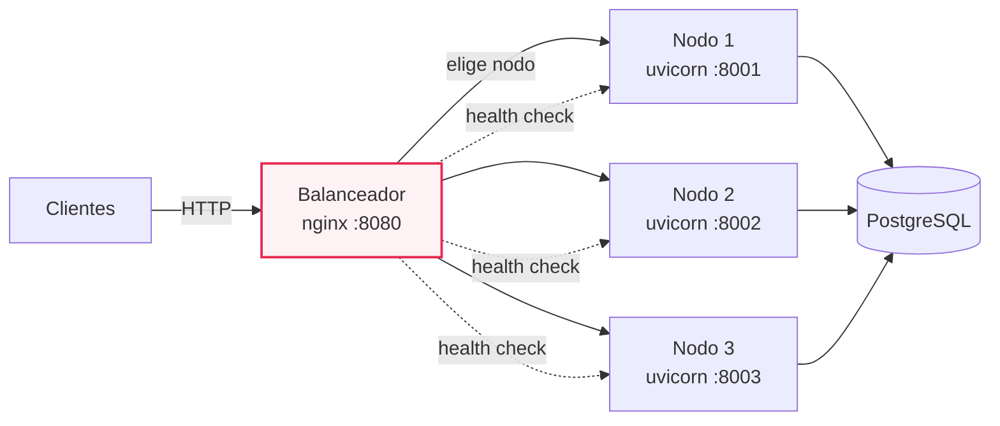
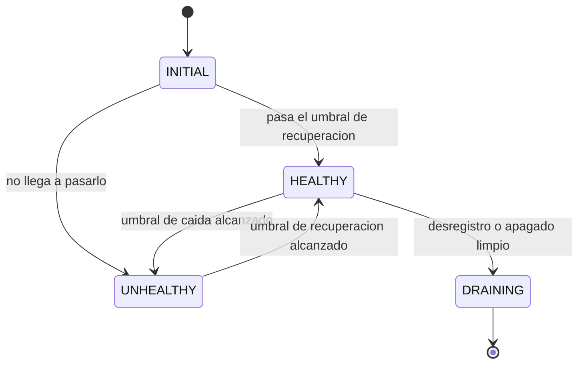
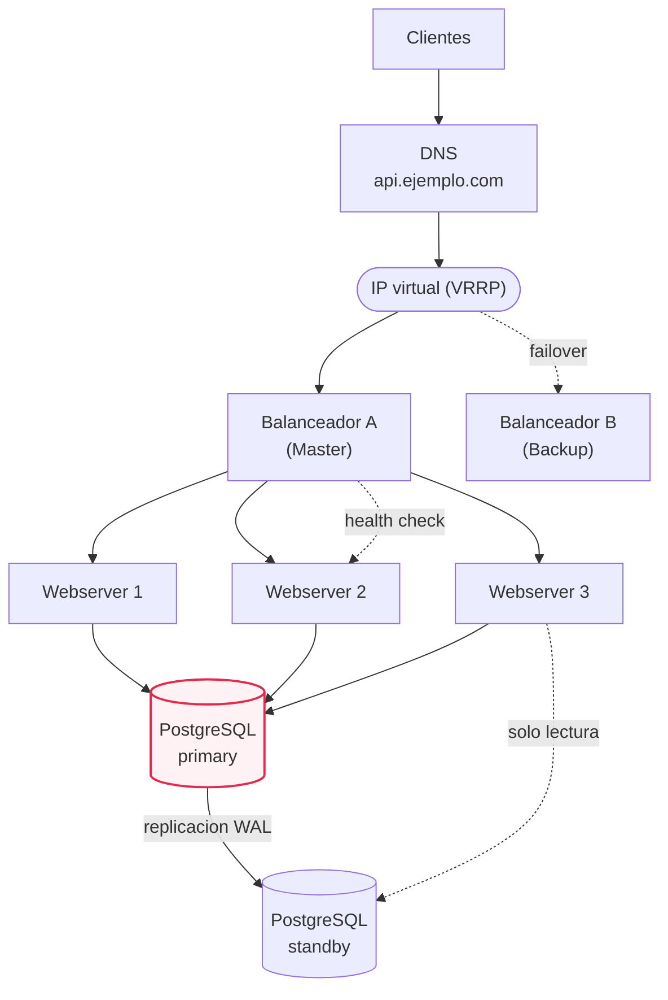
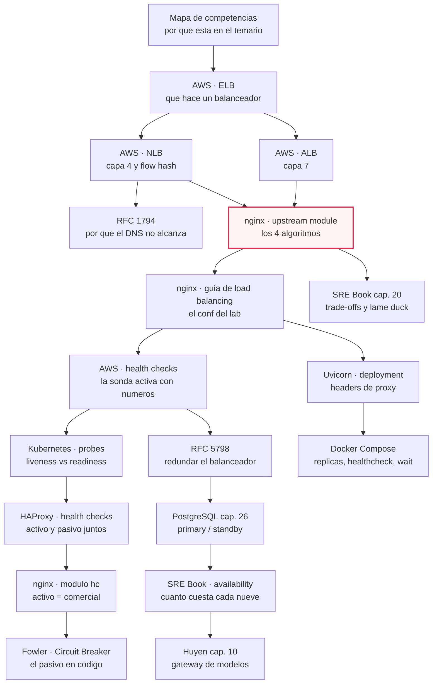
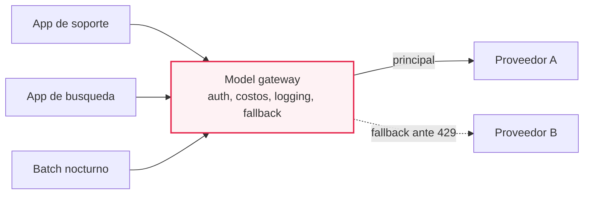
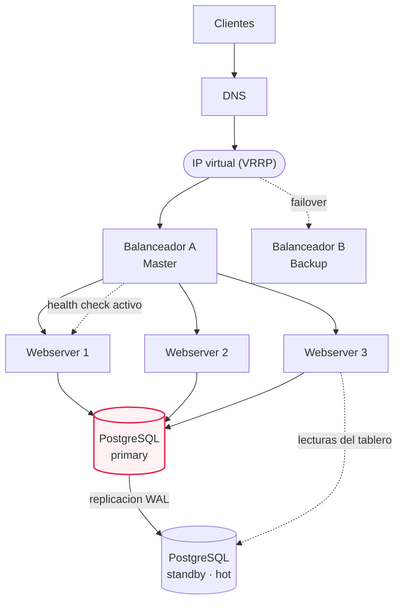

# M07·S15 — Load balancing, health checks y eliminación del SPOF

**Módulo:** 07 — Fundamentos de Software + System Design para AI Engineers
**Sesión:** 15 (semana 3, ritmo pausado: un foco por sesión)
**Fecha:** [Completar por el profesor: fecha]
**Tiempo estimado de estudio:** 4 h 30 min (notas ~75 min · recursos ~2 h · lab y ejercicios ~90 min)

## 1. De qué va esta sesión

Tres preguntas ordenan toda la sesión:

1. **¿Quién decide a qué nodo va cada request?** → el load balancer y su algoritmo.
2. **¿Cómo se da cuenta de que un nodo se cayó?** → el health check.
3. **¿Qué pieza de mi diagrama, si falla, se lleva puesto todo?** → el SPOF.

Y la ironía que las une: el balanceador se agrega para eliminar el punto único de falla de los
servidores de aplicación y, mal desplegado, **se convierte él mismo en el nuevo punto único de
falla**.

---

## 2. Objetivos de aprendizaje

Al terminar esta sesión vas a poder:

1. **Explicar** qué hace un load balancer, dónde se para en la topología y qué cambia entre
   balancear en capa 4 y en capa 7 — y por qué el DNS no alcanza como mecanismo de reparto.
2. **Elegir con criterio** entre Round Robin, Weighted Round Robin, Least Connections, IP Hash y
   Consistent Hashing según el patrón de tráfico, y **configurar** el elegido en nginx.
3. **Configurar y razonar** health checks activos y pasivos, distinguiendo las dos preguntas que
   responden: "¿este nodo sale de rotación?" y "¿este nodo se reinicia?".
4. **Recorrer una topología** componente por componente identificando los SPOF, y proponer para
   cada uno la redundancia que lo elimina (par de balanceadores con IP virtual, N nodos de
   aplicación, réplica primary/standby de la base).
5. **Montar y debuggear** un lab de tres nodos del webserver detrás de un balanceador local,
   demostrando la distribución del tráfico y la retirada de un nodo caído.
6. **Dibujar y defender** el diagrama de la topología con redundancia, nombrando qué se gana, qué
   se paga y qué quedó sin par.

---

## 3. Resumen ejecutivo

En la sesión de **arquitectura según el contexto (S13)** aprendiste a preguntar antes de dibujar:
cuántos usuarios, cuánta latencia, cuánto costo. En la de **escalabilidad vertical vs horizontal
(S14)** usaste esas respuestas para hacer crecer el diagrama de single server a arquitectura
escalada, y ahí quedó una deuda explícita: dijimos "ponemos varios nodos" y dibujamos una caja con
la palabra *balanceador* adentro, sin abrirla. **Hoy la abrimos.**

Los tres mecanismos se explican juntos porque se sostienen entre sí. Un balanceador sin health
check es un repartidor ciego: sigue mandando tráfico al nodo caído. Un health check sin nadie que
lo consulte es un endpoint decorativo. Y una topología con balanceador y N nodos pero con un solo
balanceador no eliminó el SPOF: lo movió. El ejercicio central de la sesión es ese recorrido —
listar los componentes, preguntarle a cada uno "si vos te caés, ¿qué deja de funcionar?", y
clasificar la respuesta en *redundado*, *degradado* o *caído*.

Para el rol de AI Engineer esto no es infraestructura ajena. La pieza que en una app de IA
concentra todo el tráfico —el **model gateway**, por donde pasan todas las llamadas a los modelos—
es un balanceador con health check pasivo: ahí viven el fallback cuando un proveedor te
rate-limitea, el balanceo entre modelos, el logging y el control de costos. Si todas las
aplicaciones de la organización hablan con los modelos a través de él, el gateway necesita el
mismo tratamiento de redundancia que el balanceador de este material.

El lab es **liviano a propósito**: tres procesos Uvicorn, un nginx local y un `/health` que se
puede apagar a mano. El entregable grande de la sesión es el **diagrama**.

---

## 4. Conceptos clave / glosario

### 4.1 El balanceador y dónde se para

**Load balancer** — Componente que recibe todo el tráfico entrante y lo reparte entre varios
destinos equivalentes (*targets*, *backends*, *upstreams*: tres nombres para lo mismo).
*Para qué:* para que la caída o la saturación de un nodo no sea la caída del servicio, y para poder
agregar o quitar capacidad sin cortar requests. *Por qué así:* el cliente no puede ni debe conocer
la lista de nodos; si la conociera, cada alta o baja obligaría a actualizar a todos los clientes.

**Reverse proxy** — Proxy del lado del servidor: el cliente le habla a él creyendo que es la
aplicación (visto en S02). *Para qué:* tener un único lugar donde terminar TLS, loguear y limitar
tasa. *Por qué así:* todo balanceador L7 es un reverse proxy; la diferencia es que además elige
entre varios backends. Analogía: el mostrador de recepción de una clínica — no atiende, deriva.

**IP virtual (VIP)** — Dirección IP que no pertenece de forma fija a una máquina, sino que sostiene
en cada momento el nodo activo de un par redundante. *Para qué:* que los clientes apunten siempre a
la misma dirección aunque cambie la máquina que contesta. *Por qué así:* la alternativa —cambiar el
DNS cuando el nodo cae— depende de que los clientes respeten el TTL, y no lo hacen.

**Balanceo en capa 4 (L4)** — Elige destino mirando solo transporte: protocolo, IPs y puertos; no
abre el contenido. *Para qué:* repartir cualquier tráfico TCP/UDP a muy alta velocidad. *Por qué
así:* no leer el contenido es la razón de su velocidad y también de su límite: no puede rutear por
path ni por header.

**Balanceo en capa 7 (L7)** — Habla el protocolo de aplicación: lee método, path, headers y query
params. *Para qué:* rutear `/api/*` a un grupo y `/admin/*` a otro, sondear por HTTP, terminar TLS.
*Por qué así:* paga el parseo del request a cambio de decisiones informadas. Es el modo del lab.

**Listener / rule / target group** — El modelo de piezas de un balanceador L7: el *listener* es
protocolo y puerto donde escucha; las *rules* son condiciones con prioridad que eligen una acción;
el *target group* es un conjunto de destinos **con su propio health check y su propio algoritmo**.
*Para qué:* separar "dónde escucho" de "cómo decido" de "a quién le mando". *Por qué así:* es el
mismo modelo que vas a reconocer en nginx como `listen` + `location` + `upstream`, y que el
algoritmo se configure **por grupo** es lo que te deja tratar distinto a un grupo con caché.

**DNS round robin** — Repartir publicando varias IPs para el mismo nombre y rotando el orden.
*Para qué:* es el reparto más barato: no hay componente nuevo que operar. *Por qué no alcanza:* el
DNS **no sabe si el servidor está vivo** y el TTL le pone un piso a la reacción. Sirve para repartir
entre *sitios*, no como failover rápido entre nodos.

### 4.2 Algoritmos

**Round Robin (RR)** — Se recorre la lista de nodos en orden, un request a cada uno por turno.
*Para qué:* reparto parejo **en cantidad de requests** sin medir nada. *Por qué así:* es el default
de casi todas las implementaciones porque no necesita estado ni telemetría. Su supuesto oculto: que
todos los requests cuestan parecido.

**Weighted Round Robin (WRR)** — RR con un peso por nodo: peso 3 recibe tres veces más turnos que
peso 1. *Para qué:* flotas heterogéneas, o meter un nodo nuevo de a poco. *Por qué así:* arregla el
supuesto "todos los nodos son iguales" sin medir nada en vivo — el peso lo pone el operador.

**Least Connections** — Al nodo con **menos conexiones activas** ahora. *Para qué:* cuando los
requests duran tiempos muy distintos (un listado de 5 ms y un reporte de 8 s en la misma API).
*Por qué así:* las conexiones abiertas son un proxy *barato* de "cuán ocupado estás"; no mide CPU,
pero no exige que el backend reporte nada.

**Least outstanding requests / least time** — Variantes: contar requests en vuelo, o elegir el de
menor tiempo medio de respuesta. *Para qué:* la misma idea con una señal más fina. *Por qué así:*
cuanto más se parece la señal a "carga real", mejor reparte y más estado hay que mantener.

**IP Hash / flow hash** — Un hash de datos del origen (la IP del cliente, o la 5-tupla de la
conexión) determina el nodo; el mismo cliente cae siempre en el mismo. *Para qué:* afinidad sin
guardar tabla de sesiones. *Por qué así:* la alternativa (cookie de afinidad) exige entender HTTP y
escribir estado; el hash es una función pura y no cuesta memoria.

**Afinidad de sesión (sticky session)** — Que los requests de un usuario vayan siempre al mismo
nodo. *Para qué:* tolerar una app que guarda estado en memoria del proceso. *Por qué así:* es un
**parche**, no un diseño — como vimos en S14, la respuesta buena es sacar el estado del nodo. La
afinidad lo tolera a cambio de reparto desparejo y de perder la sesión cuando ese nodo cae.

**Consistent hashing** — Forma de hashear claves a nodos en la que agregar o quitar un nodo **no
remapea casi nada**: solo las claves del nodo que entró o salió. *Para qué:* cuando el nodo tiene
caché caliente adentro — con hash común, sumar un nodo invalida la caché de todos. *Por qué así:*
el hash módulo-N cambia el divisor cuando cambia N, y con eso cambia el destino de casi todas las
claves. Analogía: un reloj redondo donde cada nodo se para en una hora y cada clave va al primer
nodo que encuentra girando a la derecha; si saco un nodo, solo sus claves pasan al siguiente.

**`random two`** — Elegir dos nodos al azar y, entre esos dos, aplicar un criterio de carga.
*Para qué:* casi el beneficio de Least Connections sin mirar el estado de toda la flota en cada
decisión. *Por qué así:* comparar dos candidatos al azar evita el peor efecto del azar puro (que
todos coincidan en el mismo nodo) a costo mínimo.

### 4.3 Health checks

**Health check** — Mecanismo por el cual el balanceador decide si un nodo puede recibir tráfico, y
lo saca o lo reincorpora. *Para qué:* que "el nodo está roto" se convierta automáticamente en "el
nodo no recibe requests". *Por qué así:* la alternativa es sacarlo a mano, y entonces cada caída
dura lo que tarde alguien en despertarse.

**Sonda activa** — El balanceador *pregunta* periódicamente (ej. `GET /health` cada N segundos).
*Para qué:* detectar el nodo enfermo **antes** de que un usuario real coma el error. *Por qué así:*
cuesta tráfico y configuración, pero es el único modo de detectar al nodo que *responde* pero no
*sirve*.

**Sonda pasiva** — El balanceador *observa* el tráfico real y marca como fallado al nodo que
acumula errores. *Para qué:* detección gratis, sin endpoint ni tráfico de sondeo. *Por qué así:* el
precio es que la detección **la pagan los usuarios** con errores.

**Umbral de caída / de recuperación (histéresis)** — Cuántos fallos consecutivos sacan un nodo y
cuántos éxitos lo devuelven; suelen ser distintos. *Para qué:* no sacar un nodo por un error
aislado ni reinsertar uno que se tambalea. *Por qué así:* con umbrales iguales, un nodo
intermitente entraría y saldría todo el tiempo (*flapping*). Asimétricos = "salí rápido, volvé
despacio".

**Liveness probe** — Responde "¿hay que reiniciar este proceso?". *Para qué:* recuperar un proceso
colgado. *Por qué con cuidado:* la acción que dispara es **reiniciar**, que es destructiva; si la
liveness consulta la base, una caída de la base reinicia toda tu flota.

**Readiness probe** — Responde "¿este nodo puede atender tráfico ahora?". *Para qué:* sacar de
rotación un nodo que arranca, calienta caché o se está apagando, **sin reiniciarlo**. *Por qué
así:* un nodo que todavía no cargó su configuración no está roto, está ocupado; reiniciarlo no
ayuda.

**Startup probe** — La sonda de arranque: mientras corre, las otras dos no se ejecutan. *Para qué:*
apps de arranque lento, que la liveness mataría antes de que terminen de levantar. *Por qué así:*
es la alternativa a aflojar los umbrales de la liveness para siempre.

**Draining / desregistro** — El nodo ya no recibe requests nuevos pero termina los que tiene en
vuelo. *Para qué:* desplegar o apagar sin cortar requests a mitad de camino. *Por qué así:* la
alternativa es matar el proceso y devolverle un error a quien esperaba.

**Lame duck** — Un backend que escucha y puede servir, pero que **pide explícitamente a los
clientes que dejen de mandarle requests**. *Para qué:* apagado limpio iniciado por el nodo que sabe
que se va. *Por qué así:* no hay que esperar a que el balanceador lo descubra por fallos.

**Fail-open** — Si *todos* los nodos de un grupo están marcados como enfermos, el balanceador les
manda tráfico igual. *Para qué:* no convertir un health check mal configurado en una caída total.
*Por qué así:* "todos enfermos a la vez" es muchísimo más probable que sea la sonda mintiendo que
una falla simultánea real; entre servir con nodos dudosos y no servir nada, se elige lo primero.

**Sinkholing** — El nodo muy enfermo **atrae** tráfico porque falla tan rápido que siempre tiene
pocos requests activos. *Para qué saberlo:* para no confiar ciegamente en Least Connections.
*Por qué pasa:* el contador de requests activos mide ocupación, no salud. Se mitiga contando los
errores recientes como si fueran requests activos.

### 4.4 SPOF y redundancia

**SPOF (single point of failure)** — Componente cuya falla individual deja al sistema entero o a
una función crítica fuera de servicio. *Para qué el concepto:* tener un nombre que te obligue a
recorrer el diagrama y señalarlos uno por uno. *Por qué así:* es una propiedad **de la topología**,
no de la calidad del componente — un servidor excelente del que hay uno solo sigue siendo un SPOF.

**Redundancia activo-pasivo** — Dos instancias: una atiende, la otra espera lista. *Para qué:*
eliminar un SPOF sin hacer que coordinen el trabajo. *Por qué así:* más simple que activo-activo,
pero pagás capacidad ociosa y el failover tarda lo que tarde la detección.

**Redundancia activo-activo** — Las dos atienden al mismo tiempo. *Para qué:* aprovechar el
hardware redundante. *Por qué así:* no desperdiciás capacidad, pero necesitás que *algo* reparta
entre las dos y que ninguna guarde estado que la otra no vea.

**VRRP** — Protocolo de elección que asigna dinámicamente la responsabilidad de una IP virtual a
uno de varios routers: el que la sostiene es el **Master**, los demás **Backup**; si el Master cae,
el Backup de mayor prioridad toma la dirección. *Para qué:* que el componente al que todos apuntan
por defecto no sea único, sin tocar la configuración de los clientes. *Por qué así:* la elección la
hacen los routers entre ellos; los hosts siguen usando la misma dirección y no se enteran.

**Primary / standby** — El nodo de base de datos que acepta escrituras y el que recibe sus cambios
y lo reemplaza si cae. *Para qué:* eliminar el SPOF que queda después de redundar balanceador y
aplicación. *Por qué esa palabra:* vas a encontrar "master-slave" en material viejo y en
entrevistas, pero la documentación de PostgreSQL —el motor que usamos desde S07— usa **primary** y
**standby**, y es el vocabulario con el que conviene escribir hoy.

**Hot standby** — Standby que además responde consultas de **solo lectura**. *Para qué:* sacarle
lecturas al primary, no solo esperar un desastre. *Por qué con cuidado:* te expone al retraso de
replicación, así que hay que decidir qué lecturas toleran datos un poco viejos.

**Promoción (failover)** — Convertir el standby en primary cuando el primary deja de estar.
*Para qué:* recuperar la capacidad de escritura. *Por qué duele:* hay que garantizar que el viejo
primary no vuelva a aceptar escrituras, y quien decide promover es a su vez un punto de decisión.

**Zona de disponibilidad** — Ubicación con infraestructura (energía, red) independiente dentro de
una región. *Para qué:* sobrevivir a la falla de un edificio, no solo de una máquina. *Por qué
así:* la redundancia solo vale hasta donde llega la **independencia de las fallas**.

**Disponibilidad en nueves / presupuesto de caída** — Expresar la disponibilidad como porcentaje y
traducirla a tiempo de caída permitido. *Para qué:* convertir "tiene que ser muy confiable" en una
cuenta. *Por qué así:* un número te deja decidir. Enlaza con el **error budget** de S01.

**Circuit breaker** — Objeto que envuelve una llamada a un servicio externo, cuenta sus fallos y,
al pasar un umbral, deja de intentar y falla de inmediato; después de una espera prueba una llamada
y decide si volver a dejar pasar. *Para qué:* dejar de castigar a un servicio enfermo y de hacer
esperar al usuario por algo que ya sabemos que falla. *Por qué acá:* es **la misma idea del health
check pasivo** pero del lado del cliente, en código. El diseño ante fallos completo —reintentos,
timeouts, degradación elegante— es materia de **S16**.

**Model gateway** — Capa intermedia que unifica el acceso a varios modelos: todo el tráfico de la
organización hacia los LLM pasa por ahí. *Para qué:* un solo lugar para control de acceso, límites
de costo, logging y analytics, balanceo de carga y políticas de **fallback** ante rate limits o
fallas de API (rutear a un modelo alternativo, reintentar tras una espera corta). *Por qué así:* el
cliente no tiene por qué conocer la lista de proveedores — y tiene el mismo problema que el
balanceador: si todo pasa por ahí, **es un SPOF**. (El *router* es otra pieza: decide a qué solución
mandar cada query y tiene que ser rápido y barato.)

**`X-Forwarded-For` / `X-Real-IP`** — Headers con los que un proxy le cuenta al backend quién era
el cliente original. *Para qué:* que tus logs, rate limits y lógica por IP no vean a todos los
usuarios como si fueran el balanceador. *Por qué con cuidado:* cualquiera puede mandar esos
headers, así que la app tiene que configurar **de qué clientes** se los cree.

---

## 5. Notas de estudio por subtema

### El diagrama ancla: dónde se para cada pieza

Esta es la topología que vas a construir en el lab y la base sobre la que después vas a buscar
SPOF. Las líneas punteadas son la sonda: no transportan tráfico de usuario.



El nodo resaltado es el balanceador, y está resaltado por el motivo incómodo de la sesión: es la
pieza que acabamos de agregar **para** eliminar un SPOF y es, en este dibujo, el SPOF más evidente
que hay. Guardá esa imagen: el recorrido de 5.4 arranca de acá.

---

### 5.1 Qué es un load balancer y dónde se para

**El problema primero.** Tenés tres nodos del webserver corriendo. ¿A cuál le pega el navegador del
usuario? Si le das las tres direcciones, cada alta o baja de nodo te obliga a avisarle a todo el
mundo, y además el usuario no tiene forma de saber cuál está sano. La única salida razonable es que
exista **un punto único de contacto** que sepa la lista y decida: eso es el load balancer.

Un balanceador distribuye el tráfico entrante entre varios destinos, posiblemente en más de una
zona de disponibilidad, y —esto suele quedar afuera de las explicaciones— **monitorea la salud de
sus destinos registrados y rutea solo a los sanos**. Un balanceador que no sabe quién está sano no
es un balanceador: es un repartidor ciego. Por eso los dos temas vienen juntos.

Lo que compra además del reparto: agregar y quitar capacidad **sin interrumpir** el flujo de
requests; un solo lugar donde terminar TLS (el *offload* de cifrado) en vez de poner certificados
en cada nodo; y un solo lugar donde loguear, limitar tasa y mirar métricas de tráfico.

**L4 vs L7: qué habilita leer el contenido.**

| | Capa 4 (transporte) | Capa 7 (aplicación) |
|---|---|---|
| Qué mira | Protocolo, IPs y puertos | Todo el request HTTP |
| Cómo elige | Un *flow hash* sobre protocolo, IP y puerto de origen y destino (y el número de secuencia TCP) | Reglas sobre path, host, header, método, query param |
| Afinidad | Por conexión: una conexión TCP va a un solo destino durante toda su vida | La que configures (cookie, hash de una clave, nada) |
| Health check | Por conexión / puerto | Por HTTP, con path y código esperado |
| Terminación TLS | Puede pasarla de largo | Habitual que la termine ahí |
| Costo | Más barato: no parsea nada | Paga el parseo del request |

La documentación de AWS lo dice con nombre y apellido: el Application Load Balancer "functions at
the application layer, the seventh layer of the Open Systems Interconnection (OSI) model", y el
Network Load Balancer "functions at the fourth layer of the Open Systems Interconnection (OSI)
model". Esa frase es la que justifica el atajo mental **"un balanceador L7 entiende HTTP"**.

El modelo de piezas del L7 se repite en todas las herramientas:

```
listener (protocolo + puerto)
   └── rule (prioridad + condición + acción)
          └── target group (destinos + health check + algoritmo)
                 └── targets
```

Cuando en el lab escribas un `upstream` con tres `server` y un `listen 8080` apuntando con
`proxy_pass`, estás escribiendo exactamente eso: `listen` es el listener, el `location` es la regla
y el `upstream` es el target group. Y fijate en un detalle que parece burocrático y no lo es: **el
algoritmo y la sonda se configuran por target group**. Eso es lo que te permite que el grupo que
sirve el tablero (con caché) use consistent hashing y el grupo que sirve la API sin estado use
round robin, en el mismo balanceador.

**¿Y por qué no reparto con el DNS y me ahorro el balanceador?** Es la primera objeción que aparece
siempre, y la respuesta está escrita desde 1995. La RFC 1794 (IETF, abril de 1995, T. Brisco,
Rutgers; informativa) discute usar el DNS para repartir carga devolviendo varias direcciones y
rotando el orden, y lo valioso hoy no es el mecanismo que propone sino las limitaciones que
reconoce:

- El DNS **no sabe nada del estado de los servidores**: rota direcciones sin mirar la carga real.
- El TTL le pone un piso a la reacción. La RFC señala que BIND trata cualquier TTL menor a 300
  segundos como irracional y lo sustituye por 300, lo que "greatly hampers the functionality of
  volatile zones".
- Si un host se cae **dentro** del período del TTL, los clientes siguen yendo a la dirección caída.
- El reordenamiento del lado del cliente es imposible de predecir.

Treinta años después el argumento es el mismo, y tiene su versión moderna: un Network Load Balancer
que se queda sin destinos sanos en una zona **retira la IP de esa zona del DNS**… lo que solo
funciona si el cliente respeta el TTL. Cuando no lo respeta, los requests fallan.

> 💡 La conclusión no es "el DNS no sirve". Es: **el DNS sirve para repartir entre sitios o entre
> balanceadores (grano grueso, cambios lentos), y no sirve como failover rápido entre nodos.** Para
> eso necesitás alguien que sondee y reaccione en segundos.

**Gotchas.** Confundir "tengo un balanceador" con "tengo alta disponibilidad" (si el balanceador es
uno, la disponibilidad del sistema la fija él). Asumir que L7 es "mejor" que L4 (si lo que repartís
no es HTTP, L7 no es opción; y si necesitás throughput bruto, el parseo se paga). Y olvidar que al
meter un proxy adelante **cambia la IP de origen que ve tu app** — el bug silencioso de 5.5.

📖 *What is Elastic Load Balancing?* (5 min), *What is an Application Load Balancer?* y *What is a
Network Load Balancer?* (el contraste L7/L4). La RFC 1794 se lee en 15 minutos y es la mejor
munición contra "lo hago con DNS".

---

### 5.2 Algoritmos de balanceo

**El problema primero.** El balanceador tiene tres nodos sanos y un request en la mano. Tiene que
elegir uno **ahora**, en microsegundos, sin preguntarle nada a nadie si puede evitarlo. Todos los
algoritmos son respuestas distintas a "¿qué información uso para elegir, y cuánto pago por
tenerla?".

**La escala de sofisticación**, de menos a más información: Round Robin (cero) → Weighted Round
Robin (estática, la pone el operador) → Least Connections (dinámica, medida por el balanceador) →
least time / least outstanding requests (dinámica más fina) → IP Hash / consistent hash (por
propiedad del request: resuelve afinidad, no reparto).

Y acá el dato para cuando alguien proponga "poné round robin y listo": los autores del *Google SRE
Book* reportan, sobre la operación de sus propios sistemas, que "Round Robin can result in a spread
of up to 2x in CPU consumption from the least to the most loaded task". Es decir: repartir la misma
**cantidad** de requests no reparte la misma **carga**. Lo atribuyen a cuatro causas que aplican a
cualquier sistema: el *subsetting* chico (cada cliente habla con un subconjunto de backends, que
puede quedar desbalanceado), el costo variable de las queries (dos requests al mismo endpoint
pueden diferir en órdenes de magnitud), la diversidad de máquinas, y factores impredecibles como
vecinos ruidosos y reinicios.

> ⚠️ Ese 2× es **experiencia operativa reportada por Google**, no una constante del universo. No lo
> uses como "los sistemas pierden 2× con round robin": usalo como "medido en sistemas reales, round
> robin puede dejarte un nodo al doble de carga que otro".

**Least Connections y su letra chica.** Si tus requests duran tiempos muy distintos, gana claro: el
nodo que agarró tres reportes pesados tiene tres conexiones abiertas y deja de recibir. Pero el
contador de requests activos es un **proxy débil** de la capacidad real (no mide CPU ni memoria), y
cada cliente solo ve sus propios requests, así que con varios clientes balanceando en paralelo
nadie tiene la foto completa.

Y tiene un modo de falla contraintuitivo: el **sinkholing**. Un nodo muy enfermo devuelve errores
*rápido*; como contesta rápido, casi nunca tiene requests activos; como no tiene requests activos,
el algoritmo lo elige. El nodo más roto termina recibiendo **más** tráfico que los sanos. La
mitigación es contar los errores recientes como si fueran requests activos, para que el nodo que
falla pague el costo de fallar.

El refinamiento que cierra el círculo es **Weighted Round Robin con score reportado**: en vez de
que el balanceador adivine la capacidad, el backend reporta la suya. Es la versión más informada y
la que más acoplamiento exige.

**IP Hash y por qué existe.** No está en la lista para repartir mejor, sino para que el mismo
cliente caiga siempre en el mismo nodo. En nginx, `ip_hash` usa los **tres primeros octetos** de la
IPv4 del cliente (o la IPv6 completa) como clave, y manda al mismo servidor salvo que esté no
disponible. En un NLB, el *flow hash* de 5-tupla logra lo análogo a nivel de conexión.

> ⚠️ Que use tres octetos y no los cuatro tiene una consecuencia medible: todos los clientes de la
> misma red `/24` caen en el mismo nodo. Si tus usuarios salen por el NAT de una oficina, "balanceo
> por IP" puede significar "una oficina entera en un solo nodo".

Y el encuadre que ya dejamos sentado en S14: la afinidad de sesión es un **parche para estado que
no debería estar en el nodo**. Si la necesitás, la pregunta correcta no es "¿qué algoritmo de
afinidad uso?" sino "¿por qué este nodo guarda algo que los demás no ven?".

**Consistent hashing: el único que vale la pena entender por dentro.** Supongamos que repartís por
`proyecto_id` para que cada nodo cachee los tableros de los mismos proyectos. Con un hash común
harías `hash(proyecto_id) % 3`. Funciona… hasta que agregás el cuarto nodo: el divisor pasa a 4 y
**casi todas** las claves cambian de destino. No es un problema de justicia en el reparto: acabás
de invalidar la caché de toda la flota, justo cuando agregaste capacidad porque estabas al límite.

El consistent hashing resuelve eso con una idea geométrica:

1. Imaginá un círculo (un **anillo**) donde caen todos los valores posibles del hash.
2. Cada **nodo** se hashea a una posición del anillo. Con varias posiciones por nodo (*nodos
   virtuales*) el reparto queda más parejo, porque un solo punto por nodo deja arcos de tamaños muy
   distintos.
3. Cada **clave** se hashea al anillo y se asigna al primer nodo que aparece girando siempre en la
   misma dirección.

Con eso, agregar un nodo le roba claves **solo a sus vecinos del anillo** y quitar uno le pasa las
suyas **solo al siguiente**: el resto no se mueve, y se remapea del orden de 1/N.

La documentación de nginx lo dice desde el lado práctico: con `hash`, agregar o quitar un servidor
puede remapear la mayoría de las claves; con el parámetro `consistent` se usa "the ketama
consistent hashing method" y entonces "only a few keys will be remapped to different servers", lo
que **mejora el hit ratio de los servidores con caché**. Esa frase es la mejor definición corta de
para qué existe este algoritmo: no es "más justo", es el que **no te tira la caché a la basura**.

**Cómo se escribe en nginx.** Los cuatro algoritmos de la sesión son cuatro líneas alternativas
dentro del mismo bloque:

```nginx
upstream webserver {
    # Opción A — no se escribe nada: weighted round robin (el default de nginx).
    # Opción B — least_conn;                        al que menos conexiones activas tiene
    # Opción C — ip_hash;                           afinidad por los 3 primeros octetos del cliente
    # Opción D — hash $arg_proyecto_id consistent;  afinidad por clave, con ketama

    server 127.0.0.1:8001;
    server 127.0.0.1:8002 weight=2;   # recibe el doble de turnos que los otros
    server 127.0.0.1:8003;
}
```

**Por qué así y no de otra forma:** el método va como **primera línea del bloque**, antes de los
`server`, porque aplica al grupo entero — es propiedad del target group, no de cada destino. El
peso, en cambio, es por servidor, porque describe a ese nodo. Si no declarás ningún método, nginx
reparte con weighted round robin: ese es el default documentado, así que **no elegir también es
elegir**. Y ojo con una restricción que te va a morder: `backup` y `slow_start` **no** se pueden
combinar con `hash`, `ip_hash` ni `random`, porque esos métodos necesitan un conjunto de destinos
estable para que el mapeo tenga sentido.

**Cómo elegir, en una tabla**

| Si tu tráfico… | Usá | Porque |
|---|---|---|
| son requests cortos y parecidos | Round Robin (el default) | no hay nada que medir; refinar es complejidad sin retorno |
| tiene nodos de capacidad distinta | Weighted Round Robin | el desbalance es conocido y estático: ponelo en el peso |
| mezcla requests de 5 ms con requests de 8 s | Least Connections | la cantidad de requests no dice nada; la ocupación sí |
| necesita que un usuario vuelva al mismo nodo | IP Hash (o cookie) | afinidad sin estado en el balanceador — pero preguntate por qué la necesitás |
| tiene caché caliente por clave en cada nodo | `hash <clave> consistent` | sumar un nodo no invalida la caché de los demás |
| quiere algo mejor que RR sin mirar toda la flota | `random two` | comparar dos candidatos al azar evita el peor caso del azar puro |

**Gotchas.** **Medir con un solo cliente**: si lanzás 30 requests desde tu máquina con `ip_hash`
vas a ver 30/0/0 y pensar que está roto — no está roto, sos un solo cliente. Elegir Least
Connections "porque suena mejor" y heredar el sinkholing sin saberlo. Usar `hash` sin `consistent`
en un grupo con caché (funciona perfecto hasta el día que escalás). Y creer que el algoritmo
arregla la salud: ningún algoritmo saca un nodo caído de rotación — eso lo hace el health check.

📖 *Module ngx_http_upstream_module* (nginx) es **el recurso central de la sesión**: los cuatro
algoritmos en una sola fuente, con la sintaxis exacta del lab. *Using nginx as HTTP load balancer*
es la versión narrativa. *Load Balancing in the Datacenter* (SRE Book, cap. 20) convierte la lista
en trade-offs.

---

### 5.3 Health checks: sondas activas y pasivas

**El problema primero.** El nodo 2 se colgó. El balanceador no lo sabe. Durante los próximos N
segundos, uno de cada tres usuarios recibe un error. Todo lo de esta sección responde "¿cuánto vale
N y quién lo decide?".

**Las dos familias.** La **activa**: el balanceador *pregunta* cada cierto intervalo y decide por
el resultado; detecta el nodo enfermo antes de que ningún usuario lo toque. La **pasiva**: no manda
sondas, mira cómo le va al tráfico real y marca como fallado por un rato al nodo que acumula
errores; es gratis, pero la detección la pagan los usuarios.

La guía de nginx describe la pasiva en una frase que conviene leer despacio: "If the response from
a particular server fails with an error, nginx will mark this server as failed, and will try to
avoid selecting this server for subsequent inbound requests for a while." Fijate en los dos hedges:
*try to avoid* y *for a while*. No es una exclusión determinista ni permanente.

Y un dato que te ahorra una tarde de frustración: **nginx open source solo hace health checks
pasivos.** Las sondas activas viven en la directiva `health_check` del módulo
`ngx_http_upstream_hc_module`, que arranca declarando *"This module is available as part of our
commercial subscription"* (sus defaults, para referencia: `interval` 5 s, `fails` 1, `passes` 1,
`uri` `/`, más un bloque `match` para exigir un status o incluso un cuerpo concreto). Si necesitás
sondas activas sin pagar licencia, **HAProxy** las trae en la versión libre.

**La anatomía de una sonda activa, con números.** Cuatro parámetros, siempre los mismos. Con los
valores por defecto de un target group de Application Load Balancer:

| Parámetro | Qué controla | Rango y default (ALB) |
|---|---|---|
| Intervalo | cada cuánto se sondea | 5–300 s, default **30** |
| Timeout | cuánto se espera la respuesta | 2–120 s, default **5** |
| Umbral de caída | fallos consecutivos para sacar el target | 2–10, default **2** |
| Umbral de recuperación | éxitos consecutivos para reincorporarlo | 2–10, default **5** |
| Qué cuenta como sano | el código aceptado (`Matcher`) | default **200** |
| Dónde se pregunta | el path (`HealthCheckPath`) | default `/` |

**Hacé la cuenta, porque es la pregunta de diseño real.** Con intervalo 30 s y umbral de caída 2, un
nodo que se cae recién sale de servicio después de dos sondas fallidas consecutivas: **hasta un
minuto sirviendo errores**. Bajar el intervalo acelera la detección y aumenta el tráfico de sondeo
y el riesgo de *flapping*. Esa es la decisión, y depende de tu presupuesto de caída (volvemos en
5.4). Notá también que los umbrales son **asimétricos** por diseño: salís con 2 fallos, volvés con
5 éxitos. Salí rápido, volvé despacio.

**Los estados de un destino.** Un target de ALB vive en uno de seis estados: `initial`, `healthy`,
`unhealthy`, `unused`, `draining`, `unavailable`. El ciclo que importa:



Dos lecturas. Primera: `UNHEALTHY` **no** es terminal — se sigue sondeando al nodo caído, porque es
la única forma de saber que volvió (HAProxy lo dice explícito: un servidor DOWN sale de rotación
pero se lo sigue sondeando). Segunda: `DRAINING` es una salida *ordenada*, no un fallo — el nodo ya
no recibe requests nuevos pero termina los que tiene en vuelo.

**Liveness vs readiness: la distinción más importante del subtema.** La documentación de Kubernetes
la formula de manera citable: "Liveness probes determine when to restart a container" y "Readiness
probes determine when a container is ready to accept traffic". Las consecuencias son
completamente distintas:

- Una **readiness** fallida saca la IP del Pod de los EndpointSlices de los Services que lo
  seleccionan —deja de recibir tráfico— **sin reiniciar** el contenedor.
- Una **liveness** fallida **mata y reinicia** el contenedor.
- La **startup probe** existe para apps de arranque lento: mientras corre, las otras dos no se
  ejecutan.

Los cuatro mecanismos con los que se puede sondear: `exec` (sano si el comando devuelve exit code
0), `grpc` (sano con status `SERVING`), `httpGet` (sano con un código en el rango de éxito) y
`tcpSocket` (sano si se puede abrir la conexión).

> 💡 **Podés usar esta distinción sin usar Kubernetes.** Es la pregunta de diseño, no la
> herramienta: *¿este nodo tiene que salir de rotación, o tiene que reiniciarse?* Dos preguntas →
> dos endpoints. El `/health` del lab es una **readiness probe**, y lo que más importa es que no
> mienta.

**El mismo patrón, cuatro nombres.** Probablemente lo más útil que te llevás de la sesión: el
health check **no es una feature de una herramienta, es un patrón**.

| Concepto | ALB (AWS) | Kubernetes | HAProxy | Docker Compose | nginx OSS |
|---|---|---|---|---|---|
| Intervalo | `HealthCheckIntervalSeconds` (30) | `periodSeconds` | `inter` (2 s) | `interval` | — (no tiene sonda activa) |
| Timeout | `HealthCheckTimeoutSeconds` (5) | | | `timeout` | — |
| Umbral de caída | `UnhealthyThresholdCount` (2) | `failureThreshold` | `fall` (3) | `retries` | `max_fails` (1) · **pasivo** |
| Umbral de recuperación | `HealthyThresholdCount` (5) | | `rise` (2) | | `fail_timeout` · **pasivo** |
| Arranque lento | | startup probe | | `start_period` | `slow_start` |
| Qué cuenta como sano | `Matcher` (200) | `httpGet` con código de éxito | 2xx o 3xx con `option httpchk` | el comando de `test` termina bien | que la conexión no falle |

Del lado de HAProxy, para completar: `check` habilita la sonda por servidor (chequeo TCP: pasa si
el servidor acepta la conexión) y `option httpchk` la hace por HTTP, con un `OPTIONS /` por
defecto. Y hace también chequeos **pasivos** en la misma sintaxis: `observe layer4` /
`observe layer7` sobre el tráfico real, con `error-limit` y `on-error mark-down`. Es el único de los
cuatro que te muestra activo y pasivo en la misma página.

**El `/health` del lado de la app: superficial o profundo.** Tu endpoint puede responder dos
preguntas muy distintas: **superficial** ("¿este proceso puede atender un request?", sin tocar
dependencias) o **profundo** ("¿este proceso y todo lo que necesita están bien?", consultando base,
caché y proveedores). El profundo parece más honesto y es más peligroso: si tu `/health` consulta
PostgreSQL y PostgreSQL se cae, **todos** tus nodos reprueban la sonda al mismo tiempo y
convertiste "la base está caída, las lecturas cacheadas funcionan" en "no hay servicio". Peor: si
esa sonda es una *liveness*, reiniciás la flota entera mientras la base está caída.

Ahí entra el **fail-open**, el detalle que más sorprende y el que mejor enseña la filosofía del
mecanismo: si un target group contiene solo targets enfermos, el balanceador les rutea igual — "If
a target group contains only unhealthy registered targets, the load balancer routes requests to all
those targets, regardless of their health status". Traducido: *"todos enfermos" se interpreta como
"el health check está mintiendo", no como "cortemos el servicio"*.

> 📌 **Criterio de este bloque** (es la posición que adoptamos, no sale de las fuentes): el endpoint
> que consulta el balanceador es **superficial**, porque la pregunta que el balanceador necesita
> contestar es "¿le mando este request a este nodo?". Las dependencias se vigilan con
> observabilidad y alertas (semana 4), no sacando nodos de rotación.

**Lame duck y apagado limpio.** El caso del nodo que **sabe** que se va a apagar (un deploy, un
scale-in): esperar a que el balanceador lo descubra por fallos es regalar errores. La alternativa es
el estado *lame duck* — "The backend task is listening on its port and can serve, but is explicitly
asking clients to stop sending requests". El nodo recibe un SIGTERM, empieza a reprobar la
readiness, deja de recibir tráfico nuevo, termina los requests en vuelo y recién entonces muere. Es
la misma idea que el `draining` de los estados, vista desde el nodo.

**El circuit breaker, solo como puente.** Si llevás la sonda pasiva adentro de tu aplicación, te
queda el patrón **Circuit Breaker**, que Martin Fowler describe en *CircuitBreaker* (6 de marzo de
2014, atribuyendo la popularización del patrón a Michael Nygard en *Release It!*): "You wrap a
protected function call in a circuit breaker object, which monitors for failures". Tres estados:
**closed** (las llamadas pasan, se cuentan los fallos y un éxito resetea el contador), **open** (las
llamadas fallan de inmediato, sin tocar el servicio enfermo) y **half-open** (tras una espera se
deja pasar una llamada de prueba: si anda vuelve a closed, si falla reabre). El umbral puede ser por
conteo o por tasa de error, hay dos timeouts (el de la invocación y el de reset), y Fowler
recomienda alertar cuando un breaker se dispara, loguear cada cambio de estado y dejar que
operaciones lo abra o lo cierre a mano.

Entra acá **solo** por una razón: es exactamente el marcado pasivo del balanceador, pero en código
y del lado del cliente. Mismo mecanismo, dos capas. El diseño ante fallos completo —reintentos,
timeouts, degradación elegante, blast radius— **se desarrolla en S16**.

**Gotchas.** Tener `/health` y no tener quién lo consulte (el error estrella del lab: nginx OSS
nunca va a mirar tu endpoint). Sonda profunda en la liveness. Intervalos agresivos "por las dudas"
(más sondeo, más flapping, más carga). Devolver **200** con un cuerpo que diga `"unhealthy"`: el
balanceador decide por el código, no por tu JSON. Y confundir "el contenedor arrancó" con "el
servicio está sano" — de ahí la existencia de `--wait` y de `depends_on: condition:
service_healthy`.

📖 *Health checks for Application Load Balancer target groups* (los números), *Liveness, Readiness,
and Startup Probes* (la distinción), *Enable health checks* de HAProxy (activo y pasivo juntos),
*Module ngx_http_upstream_hc_module* (qué queda detrás de la licencia) y *Circuit Breaker*.

---

### 5.4 Eliminación del SPOF: recorrer la topología y redundar

**El problema primero.** Tenés un diagrama lindo con un balanceador y tres nodos y sentís que ya
está. No está. La pregunta que falta no es "¿está bien dibujado?" sino **"¿qué pieza de este dibujo
no tiene par?"**. Este subtema es un método, no una lista de componentes.

**El método, en cuatro pasos.** Es el ejercicio de pizarra de la sesión y vale para cualquier
topología:

1. **Listá los componentes.** Todos, incluidos los que no dibujaste porque te parecen "de
   infraestructura": DNS, balanceador, nodos de aplicación, base de datos, caché, cola, worker,
   almacenamiento de archivos, proveedor externo, y —no lo olvides— la **zona de disponibilidad**
   completa y la **red** que los une.
2. **Preguntale a cada uno: "si vos te caés, ¿qué deja de funcionar?"** Respondé con funciones de
   producto, no con cajas: "no se puede crear una tarea", "el tablero se lee pero no se escribe".
3. **Clasificá la respuesta** en tres cubetas: **redundado** (hay otro que toma el trabajo, el
   usuario no nota nada o nota un hipo), **degradado** (se pierde una función y el resto sigue
   andando — eso se diseña, y se llama *graceful degradation*) y **caído** (se pierde el servicio:
   eso es un **SPOF**).
4. **Para cada SPOF, decidí:** redundarlo, degradar elegantemente, o **aceptarlo explícitamente**.

> 💡 El paso 4 es el que convierte el ejercicio en ingeniería. No todos los SPOF se eliminan: la
> redundancia cuesta plata, operación y complejidad. Aceptar un SPOF es una decisión válida y
> profesional **si está escrita y justificada**; lo que no es profesional es no saber que lo tenés.

**Por qué agregar piezas empeora las cosas antes de mejorarlas.** Una intuición importante, sin
fórmulas: cuando los componentes están **en serie** —el request pasa por el DNS, el balanceador, el
nodo y la base— alcanza con que falle uno para que falle todo, así que cada pieza nueva en serie es
una oportunidad más de falla. Cuando están **en paralelo** —dos balanceadores, tres nodos, dos
réplicas— hace falta que fallen todos a la vez, así que la redundancia empuja en la dirección
opuesta. De ahí el resultado incómodo: **meter un balanceador delante de tres nodos puede bajar la
disponibilidad** si el balanceador es uno solo, porque sumaste una pieza en serie para redundar
otra.

**Caso 1: ¿quién balancea al balanceador?** La respuesta canónica es el patrón **activo-pasivo con
IP virtual**, y su fuente primaria es un estándar de routers, no un blog. La RFC 5798 (IETF, marzo
de 2010, editada por S. Nadas, Ericsson; Standards Track, obsoleta la RFC 3768) plantea el problema
en dos párrafos *isomorfos* al nuestro: si todos los hosts de una LAN apuntan a un router por
defecto configurado estáticamente, ese router **es** un punto único de falla. VRRP define una
elección que asigna dinámicamente la responsabilidad de una **IP virtual** a uno de varios routers:
el que la controla es el **Master**, los demás son **Backup**, y si el Master cae, el Backup de
mayor prioridad toma la dirección. Los hosts siguen usando el mismo default gateway sin
reconfigurarse.

Cambiá "router" por "balanceador" y tenés la receta completa. En Linux, la herramienta que suele
usarse para montar esto es keepalived, y el "par de balanceadores con VIP" que ves en cualquier
topología on-premise es exactamente este patrón.

| | Activo-pasivo (VIP) | Activo-activo (DNS) |
|---|---|---|
| Capacidad usada | la mitad espera | las dos atienden |
| Failover | en segundos, transparente para el cliente | depende del TTL y del cliente |
| Complejidad | protocolo de elección entre los nodos | ninguna extra en el balanceador |
| Riesgo propio | *split brain* si los dos se creen Master | tráfico a una IP muerta durante el TTL |

**Caso 2: la base de datos, el SPOF que queda.** Después de redundar el balanceador y poner N nodos
de aplicación, el recorrido llega a la base y ahí se termina la fiesta: hay un solo lugar que acepta
escrituras. La respuesta es la replicación, y PostgreSQL —el motor que usás desde S07— compara en su
capítulo de alta disponibilidad ocho estrategias: *shared disk failover*, replicación de sistema de
archivos o dispositivo de bloques, *write-ahead log shipping*, replicación lógica, replicación
*primary-standby* basada en triggers, middleware de replicación por SQL, y multimaster asincrónico y
sincrónico (más dos soluciones que no entran en esas categorías: particionado de datos y ejecución
paralela en varios servidores).

Dos cosas para llevarse. **El vocabulario:** la documentación de PostgreSQL usa **primary** y
**standby**; "master" aparece solo en el nombre consagrado *multimaster*. Vas a encontrar
"master-slave" en material viejo y en entrevistas —conocelo para entender a quien lo diga—, pero el
término vigente del motor que usamos es primary/standby. Y **que el standby puede trabajar:** en la
tabla comparativa, la fila "Replicas accept read-only queries" aparece marcada "with hot standby"
para WAL shipping — un standby en modo *hot standby* responde consultas de solo lectura. Eso te da
una palanca de escalado de lecturas, con la contrapartida de leer datos que pueden estar atrasados.

El failover de la base es **promoción**: convertir el standby en primary. Es la operación más
delicada de la topología, porque hay que garantizar que el viejo primary no siga aceptando
escrituras. El escalado de datos en serio —sharding, indexing, replicación— es materia de la semana
4.

**Caso 3: la zona de disponibilidad.** Dos nodos en el mismo rack te cubren de un disco quemado, no
de un corte de energía del edificio. Por eso los balanceadores manejados tienen nodos **por zona** y
*cross-zone load balancing* (poder mandar tráfico a destinos de otras zonas). La regla general: **la
redundancia vale hasta donde llega la independencia de las fallas**. Si tus dos réplicas comparten la
fuente de alimentación, tenés una réplica.

**La topología con redundancia.** Esto es lo que tiene que quedar dibujado al final de la pizarra:



Tres convenciones de dibujo que conviene copiar:

- **El nodo resaltado es el SPOF que queda.** El primary acepta las escrituras; si cae, hay que
  promover el standby, y eso no es instantáneo ni gratis. Que el diagrama señale el punto débil en
  vez de esconderlo es la diferencia entre un diagrama de ingeniería y una lámina de marketing.
- **Las líneas punteadas son caminos que no transportan tráfico de usuario**: el failover (solo se
  usa cuando algo falla) y la sonda.
- **El DNS está dibujado.** Es el componente que todo el mundo olvida y es el primero de la cadena.

**Qué compra cada nueve.** Para que la discusión no quede en adjetivos, la tabla de disponibilidad
del apéndice A del *Google SRE Book* traduce el porcentaje a tiempo de caída permitido por año,
asumiendo cero downtime planificado:

| Disponibilidad | Caída permitida por año |
|---|---|
| 99 % | 3,65 días |
| 99,9 % | 8,76 horas |
| 99,99 % | 52,6 minutos |
| 99,999 % | 5,26 minutos |

Y ahora la mejor cuenta de la sesión, que sale de cruzar esta tabla con 5.3: si tu objetivo es
**99,99 %**, tenés **52,6 minutos al año** de presupuesto. Si tu sonda tiene intervalo 30 s y umbral
de caída 2, cada caída de un nodo se come **hasta un minuto** sirviendo errores. Una sola caída por
semana ya no entra en el presupuesto. Esa cuenta es la que convierte "pongamos los defaults" en una
decisión: o bajás el intervalo, o aceptás un objetivo más modesto, o necesitás que el nodo se retire
solo (lame duck) en vez de ser descubierto. Enlaza directo con el **error budget** de S01.

**El ancla de IA: el gateway también es un SPOF.** Cerrá el recorrido con la pieza que te va a tocar
diseñar. En una app de foundation models, el **model gateway** es la capa intermedia que unifica el
acceso a varios modelos, y justamente porque todo el tráfico pasa por ahí se le cuelga todo: control
de acceso, gestión y límite de costos, políticas de **fallback** ante rate limits o fallas de API
(rutear a modelos alternativos, reintentar tras una espera corta), balanceo de carga, logging y
analytics.

Leelo con los ojos de hoy: *eso es un balanceador con health check pasivo*, aplicado a proveedores
de LLM en vez de a nodos propios. El fallback ante un 429 **es** el marcado pasivo de un upstream
que falla. Y entonces el ejercicio de SPOF se aplica solo: si todas las aplicaciones de la
organización hablan con los modelos a través del gateway, el gateway necesita el mismo tratamiento
de redundancia que el balanceador. (No lo confundas con el **router**, que es otra pieza: decide a
qué solución mandar cada query y tiene que ser rápido y barato.)

**Gotchas.** Redundar lo que ya estaba redundado y dejar el único sin par (tres nodos de aplicación
y un balanceador: pasa siempre). Olvidar el DNS, la red y la zona en la lista. Confiar en un standby
que nadie probó promover — una réplica sin procedimiento de promoción ensayado es un backup caro, no
alta disponibilidad. Pedir "cinco nueves" sin hacer la cuenta. Y creer que redundancia =
disponibilidad: si las dos instancias comparten una dependencia (la misma base, la misma zona, la
misma configuración rota), fallan juntas.

📖 RFC 5798 (alcanzan las secciones 1–2), *Comparison of Different Solutions* (PostgreSQL cap. 26),
la *Availability Table* del SRE Book (3 min) y el capítulo 10 de Huyen sobre model router y model
gateway.

---

### 5.5 El bug silencioso: los headers de proxy

**El problema primero.** Metés nginx adelante y, de golpe, **todos** los requests llegan a tu app
con la misma IP de origen: la del balanceador. Tus logs mienten, tu rate limit por IP limita a todos
juntos y cualquier lógica por cliente queda arruinada. No hay error, no hay excepción, no hay nada
en la consola. Solo datos mal.

**Por qué pasa.** Es la consecuencia natural de un reverse proxy: desde el punto de vista de tu app,
**el cliente es nginx**. La conexión TCP que ve es la de nginx. Alguien tiene que contarle quién era
el cliente original.

**Cómo se arregla, de los dos lados.**

```nginx
location / {
    proxy_pass http://webserver;

    proxy_set_header Host              $host;                        # el host que pidió el cliente
    proxy_set_header X-Real-IP         $remote_addr;                 # la IP del cliente
    proxy_set_header X-Forwarded-For   $proxy_add_x_forwarded_for;   # la cadena de proxies
    proxy_set_header X-Forwarded-Proto $scheme;                      # http o https
}
```

```bash
# Del lado de la app: leer los headers, y solo del proxy en el que confiás.
NODO=nodo-1 uvicorn app.main:app --host 127.0.0.1 --port 8001 \
  --proxy-headers --forwarded-allow-ips 127.0.0.1
```

**Por qué así.** Uvicorn soporta `X-Forwarded-For` y `X-Forwarded-Proto` y "can use these headers to
correctly set the client and protocol in the request", pero su documentación avisa exactamente lo que
hay que entender: "as anyone can set these headers you must configure which 'clients' you will trust
to have set them correctly". De ahí `--forwarded-allow-ips`, con su advertencia explícita: **"Only
trust clients you can actually trust!"**. La alternativa —`--forwarded-allow-ips '*'`— funciona
siempre y es un agujero: cualquiera que alcance tu app puede mandarte un `X-Forwarded-For` con la IP
que quiera y hacerse pasar por otro. Solo es aceptable si el proxy **reescribe** el header en vez de
agregarse a la cadena y si nadie puede llegar a la app sin pasar por el proxy.

**El corolario conceptual:** esto demuestra por qué `ip_hash` se calcula **en el balanceador** y no
en tu app — el balanceador es el único que ve la IP real sin intermediarios.

> ⚠️ `$host` también importa: sin reenviarlo, tu app ve el host interno (`webserver`) en vez del que
> pidió el usuario, y cualquier URL que generes (redirects, links absolutos) sale mal.

Dos detalles más de Uvicorn para el lab: `--workers` corre varios procesos detrás de un solo puerto,
pero `--workers` y `--reload` **son mutuamente excluyentes**. Y para este lab **no** queremos
`--workers`: queremos procesos separados en puertos distintos, porque si no no podemos apagar un nodo
y ver la reacción del balanceador (con `--workers` el reparto lo hace el kernel y no lo controlás).

📖 *Deployment* (Uvicorn), secciones de proxies y de workers.

---

### 5.6 Mapa de los recursos de la sesión

Diecinueve recursos es mucho; no se leen todos. Este mapa dice **qué se apoya en qué**, para que
elijas con criterio si tenés dos horas o veinte minutos.



Lo que el diagrama no alcanza a decir:

- **Si solo leés uno, leé el resaltado**: el módulo `ngx_http_upstream_module` es el único que cubre
  los cuatro algoritmos en una sola fuente primaria, con la sintaxis exacta del lab.
- **Los tres de AWS son un trío, no tres lecturas.** El de ELB define; el de ALB y el de NLB son el
  contraste L7/L4 y se leen pegados; el de health checks del target group trae los números.
- **Las dos RFC son la misma lección en dos capas.** La 1794 muestra por qué un mecanismo sin
  conocimiento del estado del servidor (el DNS) no sirve para failover; la 5798, cómo se resuelve de
  verdad. Leelas en ese orden aunque estén en subtemas distintos.
- **nginx OSS y HAProxy se leen en par.** El módulo `hc` dice que las sondas activas son de pago; la
  página de HAProxy muestra las mismas sondas gratis, y encima activo y pasivo en la misma sintaxis.
- **El health check aparece cuatro veces con cuatro nombres.** Esa repetición *es* el contenido.
- **Los de Docker y Uvicorn son del lab, no de la teoría.** El de Uvicorn es el único imprescindible,
  porque sin él tu app ve la IP del balanceador.

---

## 6. Guía práctica paso a paso: tres nodos detrás de un balanceador local

El objetivo es **ver con los ojos** las dos cosas que la teoría te contó: cómo reparte cada
algoritmo, y qué pasa (y qué **no** pasa) cuando un nodo deja de estar sano. Es liviano a propósito:
no hay base de datos, no hay migraciones, no hay seed. Un archivo de ~30 líneas, tres terminales y
un `nginx.conf` que entra en una pantalla.

### 6.0 Prerequisitos y placeholders

| Necesitás | Cómo lo tenés | Verificación |
|---|---|---|
| Python con FastAPI y Uvicorn | el entorno virtual de S03: `pip install "fastapi[standard]"` | `uvicorn --help` imprime las opciones |
| nginx instalado localmente | con el gestor de paquetes de tu sistema | el paso 3 lo verifica con `nginx -t` |
| `curl` | viene con el sistema | `curl --version` |
| Cuatro terminales | tres para los nodos, una para medir | — |

Placeholders a reemplazar: `<NOMBRE_DEL_NODO>` → el nombre del nodo (`nodo-1`, `nodo-2`, `nodo-3`;
en el lab lo pasamos por variable de entorno y el código lo lee solo) y `<RUTA_ABSOLUTA>` → la ruta
absoluta de la carpeta donde guardaste `nginx.conf` (usá la ruta completa: nginx no maneja rutas
relativas de forma confiable acá).

```
s15-lab/
├── app/
│   └── main.py
└── nginx.conf
```

### Paso 1 — El webserver con su endpoint de health

```python
# app/main.py — webserver mínimo del lab de balanceo
import os

from fastapi import FastAPI, Response, status

app = FastAPI()

# Interruptor de la demo: permite "enfermar" el nodo sin matar el proceso.
SANO = True
NODO = os.getenv("NODO", "<NOMBRE_DEL_NODO>")


@app.get("/health")
def health(response: Response):
    """Readiness probe: ¿este nodo puede recibir tráfico ahora?"""
    if not SANO:
        response.status_code = status.HTTP_503_SERVICE_UNAVAILABLE
        return {"status": "unhealthy", "nodo": NODO}
    return {"status": "ok", "nodo": NODO}


@app.post("/admin/enfermar")
def enfermar():
    """Solo para el lab: deja de pasar el health check sin apagar el proceso."""
    global SANO
    SANO = False
    return {"sano": SANO, "nodo": NODO}


@app.get("/quien-soy")
def quien_soy():
    """Para ver a qué nodo cayó cada request."""
    return {"nodo": NODO}
```

**Por qué cada decisión:**

- **`/health` devuelve 200 cuando el nodo puede atender y 503 cuando no.** El código es lo que
  importa: la sonda decide por el status (en un target group de ALB el `Matcher` por defecto es 200;
  las sondas HTTP de HAProxy aceptan 2xx o 3xx por defecto). Devolver 200 con un cuerpo que diga
  `"unhealthy"` no saca el nodo de rotación: nadie lee tu JSON.
- **`POST /admin/enfermar` existe solo para la clase.** Es el caso más interesante: un nodo que
  **sigue vivo pero ya no sirve**. Si solo matás procesos, nunca ves la diferencia entre sonda
  activa y pasiva. (En un sistema real no existiría, o viviría detrás de auth y de una red interna.)
- **`/quien-soy`** es lo que te permite *ver* el algoritmo: sin una respuesta que diga quién
  contestó, no hay nada que medir.
- **`SANO` es una variable de módulo, no una fila en una base.** A propósito: el estado se pierde al
  reiniciar el proceso, que es lo que discutimos en S14 sobre procesos stateless. Y como vive en
  *ese* proceso, enfermar el nodo 2 no afecta al 1 ni al 3 — justo lo que queremos.
- **`os.getenv("NODO", ...)`** para que el mismo archivo sirva para los tres nodos: la identidad
  viene del entorno, no del código (la misma config por entorno de S05).

> 💡 Este `/health` es **superficial**: no toca ninguna dependencia. Es una decisión, no un atajo.
> Volvé a 5.3 si no te acordás por qué un health check profundo puede sacar toda la flota de
> rotación a la vez.

**Verificación:** levantá un solo nodo con
`NODO=nodo-1 uvicorn app.main:app --host 127.0.0.1 --port 8001` y, en otra terminal:

```bash
curl -i localhost:8001/health      # esperás 200 y {"status":"ok","nodo":"nodo-1"}
curl -s localhost:8001/quien-soy   # esperás {"nodo":"nodo-1"}
```

Si `curl -i` muestra `200 OK`, el paso 1 está. Bajalo con Ctrl+C antes de seguir.

### Paso 2 — Tres nodos, tres terminales

```bash
# Terminal 1
NODO=nodo-1 uvicorn app.main:app --host 127.0.0.1 --port 8001
# Terminal 2
NODO=nodo-2 uvicorn app.main:app --host 127.0.0.1 --port 8002
# Terminal 3
NODO=nodo-3 uvicorn app.main:app --host 127.0.0.1 --port 8003
```

**Por qué así:** `--host 127.0.0.1` porque los nodos solo tienen que ser alcanzables por el
balanceador, que corre en la misma máquina. **Tres procesos separados, no `uvicorn --workers 3`**:
con `--workers` hay un solo puerto y el reparto lo hace el kernel, así que no podrías apagar un
nodo para ver la reacción del balanceador, que es justo lo que venimos a ver (y además `--workers`
y `--reload` son mutuamente excluyentes). **Sin `--reload`**: queremos procesos que mueran cuando
nosotros decidamos, no cuando guardemos un archivo. **Tres nodos y no dos**: con dos no se
distingue round robin de `ip_hash` (una caída da 50/50 y el hash también). Es una decisión
pedagógica, no una recomendación de producción.

**Verificación:** `for p in 8001 8002 8003; do curl -s localhost:$p/quien-soy; echo; done` tiene que
devolver los tres nombres.

### Paso 3 — El balanceador

```nginx
# nginx.conf — balanceador local del lab
events {}

http {
    upstream webserver {
        # El método va como PRIMERA línea del bloque, antes de los server.
        # Opción A (lo que hay ahora, por omisión): weighted round robin.
        # Opción B: least_conn;
        # Opción C: ip_hash;
        # Opción D: hash $arg_proyecto_id consistent;

        server 127.0.0.1:8001 max_fails=2 fail_timeout=10s;
        server 127.0.0.1:8002 max_fails=2 fail_timeout=10s;
        server 127.0.0.1:8003 max_fails=2 fail_timeout=10s;
        # server 127.0.0.1:8009 backup;   # solo recibe si los de arriba no están
    }

    server {
        listen 8080;

        location / {
            proxy_pass http://webserver;

            # Sin estos headers, la app ve la IP de nginx como IP del cliente.
            proxy_set_header Host              $host;
            proxy_set_header X-Real-IP         $remote_addr;
            proxy_set_header X-Forwarded-For   $proxy_add_x_forwarded_for;
            proxy_set_header X-Forwarded-Proto $scheme;
        }
    }
}
```

**Qué hace cada parte y por qué:**

- **`upstream webserver`** es el grupo de servidores — el *target group* de 5.1. El nombre que le
  pongas es el que usás después en `proxy_pass`.
- **`events {}` vacío** está porque nginx lo exige en un archivo de configuración completo. No es
  decoración: si lo sacás, no arranca.
- **`listen 8080` + `location /` + `proxy_pass`** es listener + regla + acción. Elegimos 8080 y no
  80 para no necesitar permisos de root.
- **`max_fails=2 fail_timeout=10s`** es el health check **pasivo**, lo único que nginx open source
  ofrece: dos fallos de comunicación dentro de 10 segundos y nginx considera al servidor no
  disponible durante otros 10 segundos. El default es **1** fallo; lo subimos a 2 para que un hipo
  aislado no saque un nodo.
- **`backup`** (comentado) marca un servidor que solo recibe cuando los primarios no están: es
  redundancia activo-pasivo a nivel de upstream. **No** se puede combinar con `hash`, `ip_hash` ni
  `random`.
- **Los cuatro `proxy_set_header`** son el arreglo del bug silencioso de 5.5.

```bash
nginx -c <RUTA_ABSOLUTA>/nginx.conf -t              # validar la sintaxis ANTES de arrancar
nginx -c <RUTA_ABSOLUTA>/nginx.conf                 # arrancar
nginx -s reload -c <RUTA_ABSOLUTA>/nginx.conf       # recargar tras cambiar el algoritmo
nginx -s quit -c <RUTA_ABSOLUTA>/nginx.conf         # apagar (al final del lab)
```

**Verificación:** `curl -s localhost:8080/quien-soy` tiene que contestar **alguno** de los tres
nodos. Si te da connection refused, nginx no arrancó: corré la variante `-t`, que te dice en qué
línea está el problema.

> ⚠️ Si `nginx -t` se queja de que no puede escribir logs o abrir un directorio temporal, es porque
> la configuración mínima hereda rutas del paquete del sistema. Dos salidas: correr nginx con los
> permisos adecuados, o agregar directivas de `error_log` y `pid` apuntando a tu carpeta del lab.

### Paso 4 — Ver el algoritmo

Todo el instrumental que necesitás es `sort | uniq -c`:

```bash
for i in $(seq 1 30); do curl -s localhost:8080/quien-soy; echo; done | sort | uniq -c
```

| Algoritmo | Resultado con un solo cliente | Por qué |
|---|---|---|
| (default) weighted round robin | ~10 / 10 / 10 | turno por turno, pesos iguales |
| `least_conn` | parecido a RR | requests tan cortos que casi nunca hay conexiones acumuladas |
| `ip_hash` | 30 / 0 / 0 | sos **un** cliente: una sola clave de hash |
| `hash $arg_proyecto_id consistent` | depende del query param | la clave es el `proyecto_id` |

Para probar la opción D hace falta variar la clave:

```bash
for i in $(seq 1 30); do curl -s "localhost:8080/quien-soy?proyecto_id=$i"; echo; done | sort | uniq -c
```

**Cómo se cambia de algoritmo:** editás **una línea** del bloque `upstream`, recargás con
`nginx -s reload` y volvés a medir. Esa es la razón pedagógica de haber elegido nginx: el ciclo
cambio-medición dura diez segundos.

**Verificación:** tenés anotados los cuatro repartos medidos. Si con `ip_hash` no te dio 30/0/0,
revisá que hayas recargado nginx.

### Paso 5 — El contraste que justifica toda la sesión

**Caso A: el nodo muere.**

```bash
# Ctrl+C en la terminal del nodo 3, o:
kill $(lsof -t -i:8003)

for i in $(seq 1 30); do curl -s localhost:8080/quien-soy; echo; done | sort | uniq -c
```

Esperado: tras los primeros fallos, nginx deja de elegir el nodo 3 y el reparto queda ~15/15. **Ese
es el health check pasivo funcionando**: nginx no preguntó nada, se enteró porque la conexión falló.

> 💡 Mirá con atención las **primeras** respuestas después de matar el nodo: puede que recibas uno o
> dos errores antes de que quede marcado. No es un bug: es el precio exacto de la sonda pasiva — la
> detección la pagan los usuarios.

**Caso B: el nodo se enferma pero sigue vivo.**

```bash
curl -s -X POST localhost:8002/admin/enfermar     # ahora /health devuelve 503
curl -i localhost:8002/health                     # comprobalo: 503
for i in $(seq 1 30); do curl -s localhost:8080/quien-soy; echo; done | sort | uniq -c
```

Esperado: **el nodo 2 sigue recibiendo tráfico.** Y tiene todo el sentido: `/quien-soy` sigue
devolviendo 200, nginx open source no tiene sondas activas y por lo tanto **nadie está consultando
tu `/health`**. Este es el punto más importante del lab entero:

1. Un `/health` sin nadie que lo consulte **no sirve de nada**.
2. La sonda pasiva detecta nodos *muertos*, no nodos *enfermos*.
3. Por eso existen las sondas activas — y en nginx están detrás de la suscripción comercial, así que
   la decisión de herramienta es real: nginx OSS + pasivo, HAProxy + activo gratis, o pagar.

**Verificación:** podés explicar, sin mirar los apuntes, por qué matar el nodo 3 lo saca de rotación
y enfermar el nodo 2 no.

### Paso 6 — El entregable: el diagrama y la tabla de SPOF

Partí de la arquitectura escalada que dejaste en la sesión de escalado vertical vs horizontal (S14)
—si no la tenés, arrancá del single server de S02— y aplicale el método de 5.4. Primero la tabla,
que es lo que ordena el dibujo:

| Componente | Si cae… | Clasificación | Cómo se redunda | Qué cuesta |
|---|---|---|---|---|
| DNS | nadie resuelve el nombre | caído | varios servidores autoritativos del proveedor | lo paga el proveedor |
| Balanceador | nadie entra | **caído (SPOF)** | par activo-pasivo con IP virtual (VRRP) | una máquina casi ociosa + operar el failover |
| Nodo de aplicación | se pierde 1/N de la capacidad | redundado | ya hay N nodos | nada nuevo |
| PostgreSQL primary | no se escribe; se puede leer del standby | **caído para escrituras** | standby + procedimiento de promoción | réplica + ensayar la promoción |
| Zona de disponibilidad | se cae todo lo que vive ahí | depende | distribuir nodos y réplicas entre zonas | latencia entre zonas + tráfico |

Después el diagrama (usá el de 5.4 como plantilla) y por último la entrada en tu **bitácora de
trade-offs**, con el formato "gano / pago / lo dispara" que venís usando desde S14:

```markdown
## [s15] Algoritmo de balanceo del webserver

**Decisión:** weighted round robin (el default de nginx), sin afinidad de sesión.

**Alternativas descartadas:**
- `least_conn`: aporta cuando los requests duran tiempos muy distintos; hoy todos los
  endpoints responden en el mismo orden de magnitud, así que agrega medición sin retorno.
- `ip_hash`: solo haría falta si el nodo guardara estado del usuario. No lo guarda, y
  además metería desbalance con clientes detrás de NAT (usa 3 octetos).

**Gano:** cero configuración y reparto parejo en cantidad de requests.
**Pago:** reparto desparejo en carga si aparecen endpoints caros; detección de nodos
  enfermos nula, porque nginx OSS solo tiene sondas pasivas.
**Lo dispara:** que aparezca un endpoint de reporte o exportación (→ `least_conn`), o que
  necesitemos detectar nodos vivos-pero-enfermos (→ HAProxy, o nginx comercial).
```

### 6.7 Variante opcional: tres réplicas con Docker Compose

Si terminaste antes y venís cómodo con el `compose.yaml` de S05, esta variante levanta los nodos sin
abrir tres terminales. Necesitás además un `Dockerfile` que instale FastAPI y arranque Uvicorn con
`--host 0.0.0.0` (dentro del contenedor, escuchar en `127.0.0.1` lo haría inalcanzable desde afuera:
ese es el error número uno de esta variante).

```yaml
# compose.yaml
services:
  webserver:
    build: .
    environment:
      NODO: "{{.Task.Slot}}"       # o dejarlo vacío y leer HOSTNAME en la app
    expose:
      - "8000"
    deploy:
      replicas: 3
    healthcheck:
      test: ["CMD-SHELL", "curl -fsS http://localhost:8000/health || exit 1"]
      interval: 5s
      timeout: 2s
      retries: 2
      start_period: 5s

  balanceador:
    image: nginx:1.27
    ports:
      - "8080:8080"
    volumes:
      - ./nginx.conf:/etc/nginx/nginx.conf:ro
    depends_on:
      webserver:
        condition: service_healthy
```

```bash
docker compose up -d --wait                # arranca y espera a que los health checks pasen
docker compose up -d --scale webserver=5   # cambiar el número de nodos sin tocar el archivo
docker compose ps                          # la columna STATUS muestra (healthy) / (unhealthy)
docker stop <NOMBRE_DEL_CONTENEDOR>        # apagar UNA réplica (el nombre sale de `ps`) y medir
```

**Qué mirar acá, que es donde está el valor:**

- **`deploy.replicas`** "specifies the number of containers that should be running at any given
  time" con `mode: replicated` (el default). Tener el número **declarado en el archivo** es la forma
  en que se escribe en un repo de verdad; `--scale` lo sobrescribe desde la CLI para experimentar.
- **El `healthcheck` de Compose es el tercer lugar donde ves el mismo patrón** —después de AWS y
  Kubernetes— con otro nombre: es "a check that's run to determine whether or not the service
  containers are 'healthy'", y `retries: 2` + `interval: 5s` son los mismos dos parámetros que
  `UnhealthyThresholdCount` e `HealthCheckIntervalSeconds` en un ALB y que `fall` e `inter` en
  HAProxy. `start_period` es la startup probe de Kubernetes con otro nombre.
- **`--wait`** "Wait for services to be running|healthy", y `depends_on` con
  `condition: service_healthy` hace lo mismo entre servicios: es el health check usado como **orden
  de arranque**, no como balanceo. Es la diferencia entre "el contenedor arrancó" y "el servicio está
  sano", que ya viste con `pg_isready` en S05.
- **En esta variante el `upstream` apunta a `server webserver:8000;` una sola vez**, porque el DNS
  interno de Compose resuelve el nombre del servicio a las IPs de todas las réplicas. Es cómodo, pero
  **ahí el reparto lo está haciendo la resolución de nombres** y vuelven todos los problemas de la
  RFC 1794 (nginx resuelve el nombre al arrancar). Para el lab de algoritmos, los tres `server`
  explícitos son mucho más didácticos.

### 6.8 Cómo se trabaja y cómo se entrega

- **Equipos:** los mismos equipos de 3 que vienen de S05. El lab se hace individualmente o en
  parejas dentro del equipo —levantar tres procesos no requiere tres personas—; **el diagrama y la
  defensa son del equipo**.
- **Reparto de los 180 minutos** (ritmo pausado de la semana 3): ~45 min concepto (balanceador,
  algoritmos, health checks) → ~50 min **pizarra** (recorrer la topología buscando SPOF y dibujar la
  versión redundante) → ~50 min lab de los tres nodos → ~35 min puesta en común, donde cada equipo
  defiende qué algoritmo eligió y qué SPOF le queda. La pizarra va **antes** del teclado.
- **Entregable:** un documento `s15-topologia-redundante.md` en la carpeta de arquitectura de tu
  repo del proyecto, con el diagrama Mermaid y la tabla de SPOF, más la entrada `[s15]` en tu
  bitácora de trade-offs. Commits con prefijo `s15:`.
- **Cómo se evalúa** (cuatro criterios con peso igual): (a) el diagrama identifica correctamente los
  SPOF que quedan; (b) la elección de algoritmo está justificada por el patrón de tráfico y no por
  costumbre; (c) el health check distingue "sacar de rotación" de "reiniciar"; (d) la bitácora nombra
  qué se gana, qué se paga y qué dispararía revisar la decisión.

> 📝 **Nota para el profesor:** todo lo de 6.8 está escrito como default usable, en línea con
> S05–S14; ajustá lo que corresponda. Conviene confirmar antes de publicar: **(1)** herramienta del
> balanceador — se eligió **nginx local** (es el que más se encuentra en la vida real, el conf entra
> en una pantalla y cambiar de algoritmo es una línea), con HAProxy declarado como alternativa para
> quien quiera sondas activas sin licencia; **(2)** tres nodos y modo "tres terminales con Uvicorn"
> como default, con Compose como stretch; **(3)** que el lab corra sobre un `app/main.py` genérico y
> **no** sobre el proyecto del curso (meter el balanceador delante del proyecto real arrastra base
> de datos, seed y migraciones a un lab que el plan quiere liviano; si preferís lo contrario, lo
> único que cambia es el comando de arranque de los tres nodos); **(4)** la ruta real del diagrama
> de arquitectura escalada de S14 en los repos de los equipos, que la renumeración del plan movió;
> **(5)** la entrada de bitácora va como `[s15]` sin número `TJ-` — sigue pendiente unificar las dos
> convenciones arrastradas desde S05; **(6)** el límite con S16: el circuit breaker entra **solo**
> como "la versión en código del marcado pasivo".

---

## 7. Ejercicios

Tres unidades, una por pieza de la sesión. Cada una arranca con la teoría mínima para que se pueda
hacer sola, sigue con un ejemplo resuelto y comentado, y cierra con tres ejercicios graduados.
**Intentá cada ejercicio antes de mirar su solución en la sección 12.**

### Unidad 1 — Elegir y verificar el algoritmo de balanceo

**Teoría mínima.** El algoritmo se declara como primera línea del bloque `upstream`; si no declarás
nada, nginx reparte con weighted round robin. Round Robin no mira nada, `least_conn` manda al que
menos conexiones activas tiene (considerando pesos, y los empates por weighted round robin),
`ip_hash` da afinidad por cliente usando los tres primeros octetos de la IPv4, y
`hash <clave> consistent` da afinidad por una clave arbitraria con remapeo mínimo al cambiar la
cantidad de nodos. Se elige por el **patrón de tráfico**: requests parejos → RR; duraciones muy
dispares → `least_conn`; caché caliente por clave en cada nodo → `hash … consistent`. Y se verifica
midiendo, no leyendo.

**Ejemplo resuelto.** Un grupo de tres nodos donde el tercero es una máquina más chica y hay
endpoints de exportación que tardan segundos:

```nginx
upstream webserver {
    least_conn;                                        # (1)

    server 127.0.0.1:8001 weight=2 max_fails=2 fail_timeout=10s;   # (2)
    server 127.0.0.1:8002 weight=2 max_fails=2 fail_timeout=10s;
    server 127.0.0.1:8003 weight=1 max_fails=2 fail_timeout=10s;   # (3)
}
```

1. **`least_conn` primero.** Va antes de los `server` porque es propiedad del grupo entero, no de
   cada destino. Lo elegimos porque la mezcla "listado rápido + exportación lenta" es exactamente el
   caso donde contar requests no dice nada y contar ocupación sí. Si hubiéramos dejado el default,
   el nodo que agarró dos exportaciones seguiría recibiendo su turno igual.
2. **`weight=2` en los dos nodos grandes.** `least_conn` **considera los pesos**: no es "al que
   menos conexiones tiene" sino "al que menos conexiones tiene en relación a su capacidad
   declarada". Sin pesos, el nodo chico recibiría lo mismo que los grandes y se saturaría primero.
3. **`weight=1` en el chico.** Recibe la mitad de carga relativa. La alternativa —sacarlo del
   upstream— tira capacidad que sí sirve; la otra alternativa —dejarlo con peso 2— lo convierte en
   el cuello de botella de todo el grupo.

Verificación, con el método del lab:

```bash
for i in $(seq 1 60); do curl -s localhost:8080/quien-soy; echo; done | sort | uniq -c
# Esperado aproximado: 24 / 24 / 12 (relación 2:2:1)
```

#### 🟢 De round robin a consistent hashing

Partí del `nginx.conf` del paso 3. El webserver va a empezar a cachear en memoria el tablero de
cada proyecto, y el `proyecto_id` viene como query param. Cambiá el upstream para que los requests
del mismo proyecto caigan siempre en el mismo nodo **sin** invalidar la caché de todos cuando se
agregue un cuarto nodo, recargá nginx y medí la distribución con 30 `proyecto_id` distintos.

<details><summary>Pista</summary>

La clave puede ser cualquier variable de nginx; el query param `proyecto_id` se lee como
`$arg_proyecto_id`. Y falta una palabra al final de la directiva para que el remapeo sea mínimo.
Ojo: con este método no podés dejar un `server … backup`.
</details>

**Lo lograste si:** los 30 requests se reparten entre los tres nodos de forma estable (repetir el
mismo `proyecto_id` siempre cae en el mismo nodo) y podés explicar qué cambia si sacás la palabra
`consistent`.

#### 🟡 Elegir el algoritmo para tres patrones de tráfico

Para cada uno de estos tres servicios, elegí el algoritmo, escribí la línea de nginx y justificá en
dos oraciones qué alternativa descartaste:

1. Una API de tareas donde todos los endpoints responden en milisegundos y los nodos son idénticos.
2. Un servicio de generación de informes donde un request puede tardar entre 50 ms y 20 segundos.
3. Un servicio de lectura de tableros donde cada nodo mantiene una caché en memoria por
   `proyecto_id`, y la flota crece y se encoge con el día.

Pasos: (a) identificá si el problema es *reparto de carga* o *afinidad*; (b) si es carga, preguntate
si las duraciones son parejas; (c) si es afinidad, preguntate si hay caché involucrada; (d) escribí
la directiva y la justificación.

<details><summary>Pista</summary>

Uno de los tres casos se resuelve **no escribiendo nada**, y eso también es una decisión que hay
que justificar.
</details>

**Lo lograste si:** las tres respuestas nombran el patrón de tráfico (no la moda) y al menos una
menciona explícitamente qué se rompería con la opción descartada.

#### 🔴 El experimento del cuarto nodo

Diseñá y ejecutá un experimento que **demuestre con números** la diferencia entre `hash` y
`hash … consistent`. Objetivo: mostrar cuántas claves cambian de nodo al agregar un cuarto nodo al
upstream, en los dos modos.

Criterio de éxito: entregás una tabla con (a) la cantidad de claves que cambiaron de nodo con
`hash` sin `consistent` y (b) con `consistent`, sobre el mismo conjunto de al menos 100 claves; una
explicación de por qué los números son los que son; y una conclusión de una línea sobre cuándo esta
diferencia te importa y cuándo no.

<details><summary>Pista</summary>

Necesitás **registrar** el mapeo clave → nodo antes y después. `/quien-soy` ya te devuelve el nodo;
guardá la salida de los 100 requests en un archivo antes de agregar el cuarto `server`, y compará
los dos archivos. Para el cuarto nodo levantá un `nodo-4` en otro puerto.
</details>

---

### Unidad 2 — Health checks: endpoint, sondas y umbrales

**Teoría mínima.** El health check tiene dos mitades que se diseñan por separado: el **endpoint**
que expone tu app y la **sonda** que lo consulta. El endpoint responde por **status code** (200
sano, 503 no), y conviene que sea superficial: si consulta la base, una caída de la base marca toda
la flota como enferma a la vez. La sonda puede ser **activa** (pregunta cada `intervalo`, saca el
nodo tras el `umbral de caída` y lo devuelve tras el `umbral de recuperación`) o **pasiva** (observa
el tráfico real; es lo único que ofrece nginx open source, con `max_fails` y `fail_timeout`). Y hay
dos preguntas distintas: *readiness* ("¿sale de rotación?") y *liveness* ("¿se reinicia?").

**Ejemplo resuelto.** Los dos endpoints separados, como corresponde:

```python
# app/main.py (fragmento)
import os
import time

from fastapi import FastAPI, Response, status

app = FastAPI()

ARRANCO_EN = time.monotonic()
CALENTAMIENTO_S = 10.0          # (1)
SANO = True
NODO = os.getenv("NODO", "nodo-1")


@app.get("/health/live")
def live():
    """Liveness: ¿el proceso responde? Nada más. NO toca dependencias."""   # (2)
    return {"status": "alive", "nodo": NODO}


@app.get("/health/ready")
def ready(response: Response):
    """Readiness: ¿puede atender tráfico AHORA?"""
    if not SANO:                                                            # (3)
        response.status_code = status.HTTP_503_SERVICE_UNAVAILABLE
        return {"status": "unhealthy", "motivo": "marcado a mano", "nodo": NODO}
    if time.monotonic() - ARRANCO_EN < CALENTAMIENTO_S:                      # (4)
        response.status_code = status.HTTP_503_SERVICE_UNAVAILABLE
        return {"status": "warming-up", "nodo": NODO}
    return {"status": "ok", "nodo": NODO}
```

1. **`CALENTAMIENTO_S` simula el arranque lento** (cargar configuración, llenar una caché, abrir el
   pool de conexiones). Es lo que en Kubernetes resolvería una *startup probe* y en Compose el
   `start_period`.
2. **La liveness no toca dependencias, a propósito.** Su acción es **reiniciar**. Si consultara
   PostgreSQL, una caída de la base reiniciaría toda tu flota mientras la base está caída: el peor
   momento posible para perder los procesos.
3. **El interruptor manual va en readiness, no en liveness.** Queremos poder sacar un nodo de
   rotación sin matarlo — es exactamente lo que hace un apagado limpio (lame duck).
4. **El calentamiento también va en readiness.** Un nodo que arranca no está roto, está ocupado:
   reiniciarlo no ayudaría y sería un loop infinito de reinicios.

Y las dos sondas en Compose, que es donde las podés ver funcionar sin pagar licencia:

```yaml
healthcheck:
  test: ["CMD-SHELL", "curl -fsS http://localhost:8000/health/ready || exit 1"]
  interval: 5s        # cada cuánto pregunta
  timeout: 2s         # cuánto espera la respuesta
  retries: 2          # umbral de caída: 2 fallos consecutivos
  start_period: 10s   # ventana de arranque, alineada con CALENTAMIENTO_S
```

El `start_period` coincide con `CALENTAMIENTO_S` **a propósito**: si fuera más corto, el nodo
aparecería como `unhealthy` durante su arranque normal y ensuciarías tus alertas con falsos
positivos.

#### 🟢 Health check profundo, y por qué duele

Agregá al ejemplo un endpoint `/health/deep` que además verifique una dependencia (simulala con una
variable `BASE_DISPONIBLE` y un endpoint `POST /admin/caer-base` que la apague). Después respondé
por escrito, en tres líneas: si configuráramos la sonda del balanceador contra `/health/deep` y la
"base" se cayera, ¿qué pasaría con los tres nodos, y qué comportamiento del balanceador evitaría que
el servicio desaparezca por completo?

<details><summary>Pista</summary>

Los tres nodos comparten la misma dependencia, así que la sonda les da el mismo resultado al mismo
tiempo. Buscá en 5.3 el nombre del comportamiento que trata "todos enfermos" como "la sonda está
mintiendo".
</details>

**Lo lograste si:** nombrás el *fail-open* y podés explicar por qué un health check profundo es más
peligroso en una *liveness* que en una *readiness*.

#### 🟡 Dimensionar la sonda contra un presupuesto de caída

Tu servicio tiene un objetivo de disponibilidad de **99,99 %** y, por historial, un nodo se cae una
vez por semana. Querés que el tiempo total de errores por detección tardía quepa en el presupuesto
anual.

Pasos: (a) buscá en 5.4 cuántos minutos al año permite 99,99 %; (b) calculá el peor caso de
detección con intervalo 30 s y umbral de caída 2; (c) multiplicá por 52 caídas al año y comparalo
con el presupuesto; (d) proponé una configuración de `intervalo` y `umbral de caída` que deje el
total de detección por debajo de un **20 %** del presupuesto, y (e) nombrá los dos costos que pagás
al bajar el intervalo.

<details><summary>Pista</summary>

El peor caso de detección es aproximadamente `intervalo × umbral de caída`. Y recordá que el tráfico
de sondeo lo multiplicás por la cantidad de nodos.
</details>

**Lo lograste si:** tu respuesta tiene una cuenta explícita, una configuración concreta y menciona
*flapping* entre los costos.

#### 🔴 Apagado limpio de punta a punta

Implementá un apagado limpio (*lame duck*) en el webserver del lab y demostrá que no se pierde
ningún request. Objetivo: al pedir el apagado, el nodo debe empezar a reprobar la readiness,
terminar los requests en vuelo y recién después salir.

Criterio de éxito: (a) existe una forma de iniciar el apagado que no mata el proceso de inmediato;
(b) `/health/ready` devuelve 503 desde ese momento; (c) mientras un request lento está en curso, el
proceso no muere; (d) entregás evidencia —la salida de tus comandos— de que una tanda de requests
lanzada durante el apagado no produjo ningún error en el cliente; y (e) explicás qué pieza de la
cadena (sonda activa, sonda pasiva, `draining`) hace falta para que esto funcione de verdad en
producción y por qué con nginx open source no alcanza.

<details><summary>Pista</summary>

Te hacen falta tres cosas: un endpoint o señal que marque "me estoy yendo", un endpoint lento para
tener un request en vuelo (`time.sleep` sirve), y pensar **quién** tiene que enterarse de la
readiness en 503. Si nadie la consulta, el apagado "limpio" no cambia nada: ese es justamente el
punto que tenés que explicar en (e).
</details>

---

### Unidad 3 — Recorrer la topología y eliminar el SPOF

**Teoría mínima.** Un SPOF es un componente cuya falla individual se lleva puesto el servicio. Se
buscan con un método de cuatro pasos: listar **todos** los componentes (incluidos DNS, red y zona),
preguntarle a cada uno "si vos te caés, ¿qué deja de funcionar?", clasificar en *redundado /
degradado / caído*, y decidir para cada caído si se redunda, se degrada elegantemente o se acepta
por escrito. Las respuestas típicas: par de balanceadores activo-pasivo con IP virtual (el patrón
que VRRP estandarizó para routers), N nodos de aplicación, y primary + standby en la base con un
procedimiento de promoción. Y el límite: la redundancia vale hasta donde llega la independencia de
las fallas.

**Ejemplo resuelto.** Recorrido de la arquitectura del lab, con el formato del entregable:

| # | Componente | Si cae… | Clasificación | Decisión | Qué cuesta |
|---|---|---|---|---|---|
| 1 | DNS | nadie resuelve el nombre | caído | **aceptado**: el proveedor ya corre varios autoritativos | nada propio |
| 2 | Balanceador (uno) | nadie entra al sistema | **caído** | **redundar**: par activo-pasivo con IP virtual | una máquina casi ociosa + operar y probar el failover |
| 3 | Webserver (3 nodos) | se pierde 1/3 de la capacidad | redundado | **nada**: ya está | — |
| 4 | PostgreSQL primary | no se puede escribir; las lecturas se pueden servir del standby | **caído para escrituras**, degradado para lecturas | **redundar**: standby + procedimiento de promoción ensayado | réplica + ensayo periódico |
| 5 | Zona de disponibilidad | se cae todo lo que vive ahí | **caído** | **aceptado por ahora**, con fecha de revisión | distribuir cuesta latencia y tráfico entre zonas |
| 6 | Red interna | los nodos no llegan a la base | caído | **aceptado**: fuera de nuestro control en este despliegue | — |

Por qué está escrita así:

- **La fila 1 y la fila 5 están "aceptadas", y eso es una respuesta válida.** Lo que no sería válido
  es que no estuvieran en la tabla. Un SPOF aceptado por escrito es una decisión; uno no listado es
  una sorpresa futura.
- **La fila 4 tiene dos clasificaciones a la vez** porque el impacto depende de la operación: las
  escrituras caen, las lecturas sobreviven si hay *hot standby*. Clasificar por función y no por
  componente es lo que hace útil la tabla.
- **"Qué cuesta" no es decorativo.** Sin esa columna, la conclusión de cualquier recorrido es
  "redundemos todo", que no es una decisión de ingeniería sino una lista de deseos.
- **La fila 2 es la que justifica la sesión:** el balanceador que agregamos para redundar los nodos
  es, hoy, el SPOF más caro que tenemos.

#### 🟢 Agregar la cola y el worker al recorrido

Tomá la tabla de arriba y agregale dos componentes: una **cola de mensajes** y un **worker** que
consume de ella para mandar notificaciones (el tipo de pieza que viste en S09 y S14). Completá las
cinco columnas para cada uno, y marcá cuál de los dos puede clasificarse como *degradado* en vez de
*caído* y por qué.

<details><summary>Pista</summary>

Preguntate qué ve el **usuario** cuando el worker se muere: ¿no puede crear una tarea, o la crea y
la notificación llega tarde? La respuesta cambia la clasificación — y es la definición misma de
degradación elegante.
</details>

**Lo lograste si:** tus dos filas distinguen la pérdida de una *función secundaria* de la pérdida
del servicio, y la columna "qué cuesta" dice algo concreto.

#### 🟡 Redundar el model gateway

Una organización tiene un **model gateway** por el que pasan todas las llamadas a los proveedores de
LLM: ahí viven el control de acceso, los límites de costo, el logging y las políticas de fallback
ante rate limits.

Pasos: (a) dibujá en Mermaid la topología actual (varias apps → gateway → dos proveedores de
modelos); (b) aplicá el método de cuatro pasos y listá los SPOF; (c) proponé la redundancia para
cada uno, distinguiendo lo que podés redundar vos de lo que no; (d) explicá por qué el fallback
entre proveedores **ya es** un health check pasivo, y qué le falta para ser uno activo; (e) nombrá
el riesgo que la redundancia del gateway **no** resuelve.

<details><summary>Pista</summary>

Para (e): si el gateway cae porque alguien desplegó una configuración rota, ¿cuántas de las dos
instancias redundantes van a tener esa configuración? La independencia de las fallas no es solo
física.
</details>

**Lo lograste si:** el diagrama marca el SPOF que queda, y tu respuesta de (d) usa las palabras
"intervalo" y "umbral" para describir qué le falta al fallback.

#### 🔴 Topología redundante defendible

Diseñá y defendé la topología redundante del sistema del curso para un objetivo de disponibilidad
que vos elijas y justifiques.

Criterio de éxito, cinco puntos: (a) un diagrama Mermaid con el DNS dibujado, el camino de failover
punteado y **un solo** nodo resaltado, que es el SPOF que decidís dejar; (b) la tabla de recorrido
completa, con la columna "qué cuesta" llena; (c) un objetivo de disponibilidad declarado, con su
presupuesto de caída anual tomado de 5.4 y la cuenta de cuánto se come tu configuración de sonda;
(d) una entrada de bitácora en formato "gano / pago / lo dispara" sobre la decisión más discutible
de las que tomaste; (e) tres preguntas que creés que te va a hacer el jurado, con su respuesta de
dos líneas.

<details><summary>Pista</summary>

El punto (e) es el que más rinde en la defensa: anticipá "¿por qué activo-pasivo y no
activo-activo?", "¿qué pasa si se cae la zona entera?" y "¿probaste la promoción del standby?".
</details>

---

## 8. Ruta de estudio sugerida

Orden recomendado, con tiempos. Las dependencias reales están dibujadas en el mapa de 5.6:
consultalo si querés saltearte algo.

**Bloque 1 — Encuadre y qué es un balanceador (~30 min).** Leé 5.1 de estas notas y después el trío
de AWS: *What is Elastic Load Balancing?* (5 min) → *What is an Application Load Balancer?* (10 min)
→ *What is a Network Load Balancer?* (10 min). Cerralo con la RFC 1794 (15 min) si querés tener el
argumento completo contra "lo hago con DNS"; si andás corto, alcanza el párrafo de 5.1.

**Bloque 2 — Algoritmos (~45 min).** Leé 5.2 y después *Module ngx_http_upstream_module* como
referencia, buscando las cinco directivas de la sesión (25 min). *Using nginx as HTTP load balancer*
(10 min) es la versión narrativa y de ahí sale el conf del lab. Si te interesan los trade-offs a
escala, *Load Balancing in the Datacenter* (30 min, avanzado) es opcional pero es el mejor del lote.

**→ Acá hacé la Unidad 1 de los ejercicios (~40 min).** Tenés que haber leído el módulo `upstream`
antes; el resto se hace con el lab andando.

**Bloque 3 — Health checks (~45 min).** Leé 5.3 y después, en este orden: *Health checks for ALB
target groups* (15 min, los números) → *Liveness, Readiness, and Startup Probes* (20 min, la
distinción) → *Enable health checks* de HAProxy (15 min, activo y pasivo juntos) → el módulo `hc` de
nginx (8 min, el que te dice qué está detrás de la licencia). *Circuit Breaker* de Fowler (15 min)
va al final y solo como puente a S16.

**→ Acá hacé la Unidad 2 (~45 min).**

**Bloque 4 — El lab (~50 min).** Seguí la sección 6 de punta a punta. La doc de *Deployment* de
Uvicorn (12 min) es imprescindible antes del paso 3; las tres páginas de Docker (~20 min) solo si
vas a hacer la variante de Compose.

**Bloque 5 — SPOF y redundancia (~40 min).** Leé 5.4 y después la *Availability Table* del SRE Book
(3 min), las secciones 1–2 de la RFC 5798 (20 min) y *Comparison of Different Solutions* de
PostgreSQL (20 min). Cerrá con el capítulo 10 de Huyen sobre model router y model gateway (20 min),
que es el que te conecta todo con tu rol.

**→ Acá hacé la Unidad 3 (~50 min)**, que es la que produce el entregable de la sesión.

> 💡 **Intentá cada ejercicio antes de abrir la sección 12.** Las soluciones están escritas para
> comparar criterios, no para copiar: la mitad del valor está en las alternativas que explican por
> qué se descartaron.

---

## 9. Checklist de autoevaluación

- [ ] Puedo explicar qué hace un load balancer y por qué un balanceador sin health check es un
      repartidor ciego, sin mirar los apuntes.
- [ ] Puedo decir en qué se diferencia balancear en capa 4 de balancear en capa 7, y dar un caso
      donde L7 no es una opción.
- [ ] Sé responder "¿y por qué no reparto con el DNS?" con dos argumentos concretos.
- [ ] Puedo elegir entre Round Robin, Least Connections, IP Hash y `hash … consistent` a partir del
      patrón de tráfico, y escribir la línea de nginx correspondiente.
- [ ] Puedo explicar con el anillo por qué el consistent hashing no invalida la caché de todos los
      nodos al agregar uno.
- [ ] Sé qué cambia entre una sonda activa y una pasiva, y cuál de las dos ofrece nginx open source.
- [ ] Puedo explicar la diferencia entre liveness y readiness **por la acción que disparan**, y por
      qué eso decide qué puede consultar cada endpoint.
- [ ] Puedo calcular cuánto tarda en salir de rotación un nodo caído dados el intervalo y el umbral,
      y cruzarlo con un presupuesto de caída anual.
- [ ] Puedo recorrer una topología y clasificar cada componente en redundado / degradado / caído,
      diciendo qué cuesta redundar cada uno.
- [ ] Puedo explicar por qué un model gateway es un balanceador con health check pasivo, y qué
      implica eso para su redundancia.

---

## 10. Preguntas de repaso

1. Tenés tres nodos de aplicación detrás de un balanceador y alguien dice "listo, ya no tenemos
   punto único de falla". ¿Qué le contestás, y cómo se lo demostrás con el diagrama en la mano?
2. ¿En qué caso elegirías `least_conn` sobre el round robin por defecto, y qué modo de falla
   conocido estás aceptando al hacerlo? ¿Cómo se mitiga?
3. Tu `/health` consulta la base de datos para "ser honesto". Explicá qué pasa en tu flota cuando la
   base se cae, qué comportamiento del balanceador amortigua el desastre, y qué cambiaría si esa
   sonda fuera una liveness en vez de una readiness.
4. El objetivo de disponibilidad es 99,99 %. Tu sonda activa tiene intervalo 30 s y umbral de caída
   2. ¿Cuánto presupuesto de caída te come cada caída de un nodo, y qué tres palancas tenés para que
   la cuenta cierre?
5. Tenés que redundar el balanceador. Explicá activo-pasivo con IP virtual y activo-activo con DNS:
   qué compra cada uno, qué riesgo propio tiene cada uno, y con cuál te quedarías para un sistema que
   necesita failover en segundos.

---

## 11. Recursos adicionales

### Imprescindibles

- **[Module ngx_http_upstream_module (nginx)](https://nginx.org/en/docs/http/ngx_http_upstream_module.html)** —
  los cuatro algoritmos de la sesión en una sola fuente primaria, con la sintaxis del lab.
  Referencia, 25 min.
- **[Using nginx as HTTP load balancer](https://nginx.org/en/docs/http/load_balancing.html)** — la
  guía narrativa: `upstream`, `proxy_pass` y el health check pasivo. 10 min.
- **[Health checks for Application Load Balancer target groups](https://docs.aws.amazon.com/elasticloadbalancing/latest/application/target-group-health-checks.html)** —
  la sonda activa con números: intervalo, timeout, umbrales, estados y *fail-open*. 15 min.
- **[Liveness, Readiness, and Startup Probes (Kubernetes)](https://kubernetes.io/docs/concepts/configuration/liveness-readiness-startup-probes/)** —
  la distinción conceptual más importante del subtema de health checks. 20 min.
- **[Deployment (Uvicorn)](https://www.uvicorn.dev/deployment/)** — headers de proxy y workers. Sin
  esto, el lab tiene un bug garantizado y silencioso. 12 min.

### Recomendados

- **[What is Elastic Load Balancing?](https://docs.aws.amazon.com/elasticloadbalancing/latest/userguide/what-is-load-balancing.html)** —
  la definición más corta y citable de para qué existe la pieza. 5 min.
- **[What is an Application Load Balancer?](https://docs.aws.amazon.com/elasticloadbalancing/latest/application/introduction.html)** —
  anatomía de un balanceador de capa 7: listener, rules, target groups. 10 min.
- **[What is a Network Load Balancer?](https://docs.aws.amazon.com/elasticloadbalancing/latest/network/introduction.html)** —
  el contraste de capa 4 y el flow hash de 5-tupla. 10 min.
- **[Enable health checks (HAProxy)](https://www.haproxy.com/documentation/haproxy-configuration-tutorials/reliability/health-checks/)** —
  `check`, `option httpchk`, `inter`/`fall`/`rise` y los chequeos pasivos con `observe`. El único
  recurso con activo y pasivo en la misma página. 15 min.
- **[Module ngx_http_upstream_hc_module (nginx)](https://nginx.org/en/docs/http/ngx_http_upstream_hc_module.html)** —
  la directiva `health_check` y el aviso de que es parte de la suscripción comercial. 8 min.
- **[RFC 1794 — DNS Support for Load Balancing](https://www.rfc-editor.org/rfc/rfc1794.html)** — por
  qué el DNS no alcanza, escrito en 1995 y todavía vigente. 15 min.
- **[Comparison of Different Solutions (PostgreSQL, cap. 26)](https://www.postgresql.org/docs/current/different-replication-solutions.html)** —
  las ocho estrategias de alta disponibilidad y el vocabulario primary/standby. 20 min.
- **[Availability Table (Google SRE Book, apéndice A)](https://sre.google/sre-book/availability-table/)** —
  cuánto downtime permite cada nivel de nueves. 3 min, y rinde muchísimo.
- **Huyen, C., *AI Engineering: Building Applications with Foundation Models* (2025), cap. 10** —
  model router y model gateway: el ancla de IA de la sesión. 20 min.

### Opcionales

- **[Load Balancing in the Datacenter (Google SRE Book, cap. 20)](https://sre.google/sre-book/load-balancing-datacenter/)** —
  por qué los algoritmos simples no alcanzan a escala; *sinkholing* y *lame duck*. Avanzado, 30 min.
- **[RFC 5798 — VRRP v3](https://www.rfc-editor.org/rfc/rfc5798.html)** — el estándar del patrón
  activo-pasivo con IP virtual. Con las secciones 1–2 alcanza. 20 min.
- **[Circuit Breaker (Martin Fowler)](https://martinfowler.com/bliki/CircuitBreaker.html)** — el
  health check pasivo llevado al código. Puente a S16. 15 min.
- **[docker compose up — referencia de CLI](https://docs.docker.com/reference/cli/docker/compose/up/)** —
  `--scale` y `--wait`. 5 min.
- **[Compose Deploy Specification — `replicas`](https://docs.docker.com/reference/compose-file/deploy/)** —
  dejar el número de nodos declarado en el archivo. 5 min.
- **[Compose Services — `healthcheck` y `depends_on`](https://docs.docker.com/reference/compose-file/services/)** —
  el mismo patrón de sonda, tercer nombre. 10 min.
- **Ng, A., *AI Engineering Skills Map: Software engineering fundamentals* (2026)**, sección
  *Scaling and operating in production* — dónde encaja esta sesión en el mapa de competencias del
  módulo. 5 min.

---

## 12. Soluciones comentadas

### Unidad 1 — Elegir y verificar el algoritmo de balanceo

#### 🟢 De round robin a consistent hashing

```nginx
upstream webserver {
    hash $arg_proyecto_id consistent;

    server 127.0.0.1:8001 max_fails=2 fail_timeout=10s;
    server 127.0.0.1:8002 max_fails=2 fail_timeout=10s;
    server 127.0.0.1:8003 max_fails=2 fail_timeout=10s;
    # Nada de `backup` acá: no se puede combinar con hash.
}
```

```bash
nginx -s reload -c <RUTA_ABSOLUTA>/nginx.conf
for i in $(seq 1 30); do curl -s "localhost:8080/quien-soy?proyecto_id=$i"; echo; done | sort | uniq -c
# Reparto entre los tres nodos, y el mismo proyecto_id cae siempre en el mismo nodo:
curl -s "localhost:8080/quien-soy?proyecto_id=7"   # repetilo: contesta siempre el mismo
```

**Por qué así.** La clave es `$arg_proyecto_id`, la variable de nginx que expone el query param
`proyecto_id`; podría ser cualquier otra variable (un header, una cookie, parte del path), y esa
flexibilidad es justamente la ventaja de `hash` sobre `ip_hash`: hasheás **lo que define la
afinidad**, no lo que el transporte te dio de casualidad.

**Qué pasa si sacás `consistent`:** el mapeo pasa a depender de la cantidad de servidores del grupo,
así que agregar el cuarto nodo remapea la mayoría de las claves y todos los nodos pierden su caché a
la vez. Con `consistent` se usa el método ketama y solo unas pocas claves se remapean — que es la
única razón para elegir este algoritmo.

**Alternativas descartadas.** `ip_hash` daría afinidad por cliente, no por proyecto: dos usuarios
distintos del mismo proyecto caerían en nodos distintos y cachearían el mismo tablero dos veces, que
es exactamente lo que queríamos evitar. Y dejar round robin con una caché por nodo significa que cada
nodo termina cacheando *todos* los proyectos: la caché ocupa N veces más memoria y acierta menos.

#### 🟡 Elegir el algoritmo para tres patrones de tráfico

**1. API de tareas, endpoints en milisegundos, nodos idénticos → no escribir nada.**

```nginx
upstream webserver {
    # weighted round robin: el default de nginx, no hace falta declararlo
    server 127.0.0.1:8001;
    server 127.0.0.1:8002;
    server 127.0.0.1:8003;
}
```

Descartado `least_conn`: con requests tan cortos, la cantidad de conexiones activas es casi siempre
0 o 1 en todos los nodos, así que la señal no informa nada y agregás una medición que no cambia la
decisión. El default reparte parejo porque acá el supuesto de "todos los requests cuestan parecido"
**sí** se cumple.

**2. Informes de 50 ms a 20 s → `least_conn`.**

```nginx
upstream informes {
    least_conn;
    server 10.0.0.11:8000;
    server 10.0.0.12:8000;
}
```

Descartado round robin: es el caso de libro donde falla. Con RR, el nodo que agarró dos informes de
20 segundos recibe su turno igual que el nodo libre, y un request corto puede quedar encolado detrás
de dos reportes. `least_conn` usa la ocupación real. Acepto a cambio el riesgo de *sinkholing* (un
nodo que falle rápido atraería tráfico), y lo vigilo con la tasa de error por nodo.

**3. Lectura de tableros con caché por `proyecto_id` y flota elástica →
`hash $arg_proyecto_id consistent`.**

Descartado `ip_hash`: la afinidad que necesito es por **proyecto**, no por cliente. Y descartado
`hash` sin `consistent`: justamente porque la flota **crece y se encoge con el día**, cada cambio de
tamaño remapearía casi todas las claves y la caché nunca se calentaría. Es el escenario donde el
consistent hashing paga su complejidad.

#### 🔴 El experimento del cuarto nodo

**Diseño.** Hay que medir el mapeo clave → nodo antes y después de agregar un nodo, en los dos
modos, sobre el mismo conjunto de claves.

```bash
# 0) Levantá un cuarto nodo, apagado por ahora (otra terminal, puerto 8004).
#    NODO=nodo-4 uvicorn app.main:app --host 127.0.0.1 --port 8004

medir () {   # $1 = archivo de salida
  for i in $(seq 1 100); do
    printf '%s %s\n' "$i" "$(curl -s "localhost:8080/quien-soy?proyecto_id=$i")"
  done > "$1"
}

# 1) Modo hash SIN consistent, 3 nodos
#    (editá nginx.conf: `hash $arg_proyecto_id;`) y recargá
medir antes-simple.txt

# 2) Agregá el 4º server al upstream, recargá y volvé a medir
medir despues-simple.txt
diff <(cat antes-simple.txt) <(cat despues-simple.txt) | grep -c '^<'   # claves que cambiaron

# 3) Repetí todo con `hash $arg_proyecto_id consistent;`
medir antes-consistent.txt
#    (agregá el 4º server, recargá)
medir despues-consistent.txt
diff <(cat antes-consistent.txt) <(cat despues-consistent.txt) | grep -c '^<'
```

**Resultado esperado y por qué.** Con `hash` simple vas a ver que **la mayoría** de las 100 claves
cambiaron de nodo: el mapeo depende de la cantidad de servidores, y al pasar de 3 a 4 cambia para
casi todas. Con `consistent`, el número de claves que cambian es **mucho menor** y se concentra en
las que "le tocan" al nodo nuevo: es la propiedad de remapear solo unas pocas claves, del orden de
1/N. Los números exactos dependen de la función de hash y de las posiciones de los nodos en el
anillo, así que lo que se compara es el **orden de magnitud**, no una cifra.

**Conclusión de una línea (la que se espera):** esta diferencia importa cuando el nodo tiene estado
caliente que se pierde al remapear (una caché, un conjunto de conexiones, trabajo en curso por
clave) y **no** importa si los nodos son intercambiables y sin estado — en ese caso el consistent
hashing es complejidad sin beneficio.

**Por qué el experimento se diseña así:** medir el *mapeo* y no el *reparto* es lo que separa las
dos propiedades. Las dos configuraciones reparten parecido entre nodos (las dos son hashes); lo que
cambia es **cuántas claves se mudan** cuando el grupo cambia de tamaño, y eso solo se ve comparando
dos fotos.

---

### Unidad 2 — Health checks: endpoint, sondas y umbrales

#### 🟢 Health check profundo, y por qué duele

```python
# app/main.py (agregado)
BASE_DISPONIBLE = True


@app.post("/admin/caer-base")
def caer_base():
    """Solo para el lab: simula que la dependencia se cayó."""
    global BASE_DISPONIBLE
    BASE_DISPONIBLE = False
    return {"base_disponible": BASE_DISPONIBLE, "nodo": NODO}


@app.get("/health/deep")
def deep(response: Response):
    """Health check PROFUNDO: verifica la dependencia. Ver la discusión."""
    if not BASE_DISPONIBLE:
        response.status_code = status.HTTP_503_SERVICE_UNAVAILABLE
        return {"status": "unhealthy", "motivo": "base no disponible", "nodo": NODO}
    return {"status": "ok", "nodo": NODO}
```

**Las tres líneas de respuesta.** Si la sonda del balanceador apuntara a `/health/deep` y la base se
cayera, **los tres nodos reprobarían la sonda al mismo tiempo**, porque comparten la dependencia: no
es una falla independiente por nodo, es una falla correlacionada. El balanceador los sacaría todos y
el servicio desaparecería por completo, incluso para los endpoints que no necesitan la base. Lo que
evita el desastre total es el **fail-open**: cuando un target group queda con solo targets enfermos,
el balanceador les rutea igual, porque "todos enfermos" se interpreta como "la sonda está mintiendo"
y no como "cortemos el servicio".

**Por qué duele más en una liveness.** La readiness fallida solo saca de rotación: cuando la base
vuelve, los nodos vuelven. La liveness fallida **mata y reinicia** el contenedor, así que una caída
de la base reiniciaría tu flota entera en loop, perdiendo cachés calientes y conexiones justo en el
peor momento. De ahí la regla: **la liveness no consulta dependencias externas**.

**Alternativa descartada:** hacer que `/health/deep` devuelva 200 con un cuerpo que describa el
estado degradado. Suena elegante, pero el balanceador decide por el **código**, así que el endpoint
dejaría de servir para su propósito; si querés publicar el detalle, va en un endpoint aparte
pensado para observabilidad y alertas, no para la sonda.

#### 🟡 Dimensionar la sonda contra un presupuesto de caída

**(a) Presupuesto.** 99,99 % permite **52,6 minutos al año** de caída.

**(b) Peor caso de detección con los defaults.** Aproximadamente `intervalo × umbral de caída` =
30 s × 2 = **60 segundos** por caída. (Peor caso: el nodo se cae justo después de una sonda exitosa,
así que hay que esperar dos intervalos completos.)

**(c) Comparación.** 52 caídas al año × 60 s = **52 minutos**. Contra un presupuesto de 52,6
minutos: la detección sola se come **casi todo**, y eso sin contar el tiempo de la caída real ni
ningún otro incidente. Los defaults no sirven para este objetivo.

**(d) Configuración propuesta.** Objetivo: quedar por debajo del 20 % de 52,6 min ≈ **10,5 minutos
al año**, o sea ≈ **12 segundos** por caída. Con `intervalo = 5 s` y `umbral de caída = 2` el peor
caso es 10 s → 52 × 10 s ≈ **8,7 minutos al año**: entra. (Con intervalo 5 s y umbral 3 serían 15 s
→ 13 min, que ya no entra: por eso el umbral se queda en 2.)

**(e) Los dos costos.** Primero, **tráfico y carga de sondeo**: pasás de una sonda cada 30 s a una
cada 5 s, multiplicado por la cantidad de nodos y por la cantidad de nodos del balanceador que
sondean. Segundo, **riesgo de flapping y de falsos positivos**: con un umbral bajo y un intervalo
corto, un hipo de red de dos segundos saca un nodo sano de rotación; por eso el umbral de
recuperación se deja más alto que el de caída (salí rápido, volvé despacio).

**Alternativa descartada:** bajar el umbral de caída a 1 en vez del intervalo. Detecta igual de
rápido y es mucho más frágil: un solo error transitorio —un timeout por GC, un pico de latencia—
saca el nodo. Pagar con más tráfico de sondeo es más barato que pagar con inestabilidad.

**Lo que esta cuenta enseña de verdad:** la configuración de la sonda **es** una decisión de
disponibilidad, no un detalle de infraestructura. Y la tercera palanca, además de intervalo y
umbral, es **que el nodo se retire solo** (lame duck): si el apagado es iniciado por el nodo, la
detección tarda cero.

#### 🔴 Apagado limpio de punta a punta

```python
# app/main.py — versión con apagado limpio
import asyncio
import os
import time

from fastapi import FastAPI, Response, status

app = FastAPI()

NODO = os.getenv("NODO", "nodo-1")
APAGANDO = False
EN_VUELO = 0


@app.middleware("http")
async def contar_en_vuelo(request, call_next):
    """Cuenta requests en curso para saber cuándo se puede morir tranquilo."""
    global EN_VUELO
    EN_VUELO += 1
    try:
        return await call_next(request)
    finally:
        EN_VUELO -= 1


@app.get("/health/ready")
def ready(response: Response):
    if APAGANDO:                                  # (1)
        response.status_code = status.HTTP_503_SERVICE_UNAVAILABLE
        return {"status": "draining", "en_vuelo": EN_VUELO, "nodo": NODO}
    return {"status": "ok", "nodo": NODO}


@app.get("/lento")
async def lento():
    """Endpoint lento para tener un request en vuelo durante el apagado."""
    await asyncio.sleep(5)
    return {"ok": True, "nodo": NODO}


@app.post("/admin/apagar")
async def apagar():
    """Lame duck: deja de aceptar tráfico nuevo y espera lo que hay en vuelo."""
    global APAGANDO
    APAGANDO = True                               # (2)
    asyncio.create_task(_terminar())
    return {"status": "draining", "en_vuelo": EN_VUELO, "nodo": NODO}


async def _terminar():
    while EN_VUELO > 1:                           # (3)
        await asyncio.sleep(0.2)
    await asyncio.sleep(1)                        # (4)
    os._exit(0)
```

**Por qué cada decisión:**

1. **El flag se chequea en readiness, no en liveness.** Un nodo que se está apagando no está roto:
   reiniciarlo sería lo contrario de lo que queremos.
2. **`APAGANDO = True` antes de cualquier otra cosa.** El orden importa: primero dejás de ser
   elegible, después esperás. Al revés, seguís recibiendo requests nuevos mientras drenás y nunca
   terminás.
3. **`> 1` y no `> 0`** porque el propio request a `/admin/apagar` está contado como en vuelo. Es el
   clásico off-by-one de este patrón.
4. **El segundo de gracia** le da margen al balanceador para que registre el 503 y deje de elegir el
   nodo. En producción ese valor se calcula como `intervalo × umbral de caída` de la sonda: si te
   apagás antes de que la sonda te saque, perdés requests igual.

**Evidencia esperada (c y d):**

```bash
curl -s localhost:8001/lento &            # request en vuelo, 5 segundos
sleep 1
curl -s -X POST localhost:8001/admin/apagar   # {"status":"draining","en_vuelo":2,...}
curl -i -s localhost:8001/health/ready | head -1   # HTTP/1.1 503 Service Unavailable
wait                                      # el request lento termina con 200, el proceso no murió
```

**(e) Qué falta para que esto sirva en producción.** Hace falta una **sonda activa** que consulte
`/health/ready`: el apagado limpio funciona porque *alguien* se entera del 503 y deja de mandar
tráfico. Con nginx open source —que solo tiene sondas pasivas— tu 503 no lo lee nadie: el nodo
seguiría recibiendo requests nuevos hasta que `max_fails` errores reales lo marquen, y entonces el
apagado "limpio" te costó exactamente los mismos errores que un `kill`. Las salidas reales son tres:
HAProxy (sondas activas en la versión libre), nginx comercial, o un orquestador que desregistre el
nodo del upstream antes de apagarlo (el `draining` de un target group).

**Alternativa descartada:** manejar `SIGTERM` directamente y confiar en el apagado ordenado del
servidor ASGI. Es lo correcto en producción y conviene hacerlo **además**, pero para el lab no
muestra nada: no podés ver el estado intermedio ni consultar la readiness mientras drena. El
endpoint lo hace observable, que es el objetivo pedagógico.

---

### Unidad 3 — Recorrer la topología y eliminar el SPOF

#### 🟢 Agregar la cola y el worker al recorrido

| # | Componente | Si cae… | Clasificación | Decisión | Qué cuesta |
|---|---|---|---|---|---|
| 7 | Cola de mensajes (una instancia) | no se pueden encolar notificaciones; según cómo esté escrito el endpoint, puede fallar la creación de la tarea | **caído** (si la escritura depende de la cola) | redundar la cola **y** desacoplar: escribir el evento en la base y encolar aparte, para que la creación nunca dependa de la cola | instancia replicada + la complejidad del desacople |
| 8 | Worker de notificaciones | la tarea se crea igual; las notificaciones se acumulan y salen con retraso | **degradado** | aceptar, con alerta de antigüedad de la cola; levantar un segundo worker si el retraso molesta | monitoreo del lag; un worker extra es barato |

**El que puede clasificarse como degradado es el worker, y la razón es el usuario.** Si el worker
muere, el usuario **igual crea su tarea**: lo único que pasa es que la notificación llega tarde. Eso
es degradación elegante, y la pista para reconocerla es que la respuesta al paso 2 del método nombra
una función *secundaria*, no el servicio.

La cola, en cambio, **puede** ser un SPOF duro, y depende de una decisión de diseño que ya conocés:
si el endpoint encola de forma sincrónica y propaga el error, la caída de la cola se convierte en
"no se puede crear una tarea". Si en cambio el evento se escribe en la misma transacción que la
tarea y otro proceso lo publica después, la cola caída es degradación. **La clasificación no es una
propiedad del componente: es una consecuencia de cómo lo acoplaste.** Esa es la lección del
ejercicio.

**Por qué la columna "qué cuesta" dice "la complejidad del desacople" y no "nada":** desacoplar
cambia las garantías de entrega y te obliga a hacer el consumidor idempotente. Es un costo real, y
ocultarlo haría que la tabla recomiende siempre desacoplar.

#### 🟡 Redundar el model gateway

**(a) Topología actual**



**(b) y (c) Recorrido y decisiones**

| Componente | Si cae… | Clasificación | Decisión |
|---|---|---|---|
| Gateway (una instancia) | **ninguna app de la organización puede llamar a un modelo** | caído | redundar: varias instancias detrás de un balanceador, con la configuración versionada y desplegada igual en todas |
| Proveedor A | se pierde el camino principal | degradado | ya está: el fallback rutea a B (es la política que vive en el gateway) |
| Proveedor B | se pierde el fallback | degradado | aceptar, o sumar un tercer proveedor si el caso lo justifica |
| Almacén de logs / contadores de costo | se pierde trazabilidad y control de gasto | degradado **si** el gateway sigue sirviendo sin poder loguear; caído si loguear es bloqueante | decidir explícitamente: servir sin log (y alertar) o fallar. Es una decisión de negocio, no técnica |
| Store de configuración y límites | el gateway no sabe qué permitir | caído | cachear la última configuración válida en memoria y servir con ella |

Lo que podés redundar vos: las instancias del gateway, su configuración, el almacén de logs, el
caché de configuración. Lo que **no**: el proveedor de modelos. Ahí tu única palanca es tener más de
uno y una política de fallback — exactamente lo que el gateway existe para implementar.

**(d) Por qué el fallback ya es un health check pasivo.** Porque la señal viene del **tráfico real**:
el gateway se enteró de que el proveedor A está mal porque un request de un usuario devolvió un 429
o un error de API, y a partir de ahí rutea a B. Es literalmente "si falla, dejá de mandarle", que es
la definición del marcado pasivo. Lo que le falta para ser **activo** son los dos parámetros que
viste en 5.3: un **intervalo** (sondear al proveedor con un request barato cada tantos segundos,
aunque nadie esté usándolo) y un **umbral** de fallos consecutivos para marcarlo caído y de éxitos
para reincorporarlo. Sin eso, el primer usuario después de cada recuperación es el que descubre que
el proveedor volvió… o que sigue caído.

**(e) El riesgo que la redundancia no resuelve.** Las dos instancias del gateway comparten la misma
**configuración** y el mismo **código**. Un deploy de una política rota, un límite de costo mal
puesto o un bug en el ruteo se replica en las dos al mismo tiempo: fallan juntas. La independencia de
las fallas no es solo física, también es de software — y la respuesta a eso no es más redundancia,
son despliegues progresivos y rollback rápido (semana 4).

#### 🔴 Topología redundante defendible

Solución de referencia. **Objetivo declarado: 99,9 %**, es decir **8,76 horas al año** de
presupuesto. Se justifica así: el sistema es una herramienta de trabajo interno en horario de
oficina, no un servicio de pagos; subir a 99,99 % (52,6 min) exigiría failover automático de base de
datos y multi-zona, y el costo de operarlo no se paga con el impacto real de una caída de veinte
minutos.

**(a) Diagrama**



**(b) Tabla de recorrido:** la del ejemplo resuelto de la unidad, más las filas 7 y 8 del ejercicio
🟢. El único SPOF que queda **aceptado a conciencia** es el primary (promoción manual) y la zona
única.

**(c) La cuenta.** Presupuesto: 8,76 h/año = 525,6 minutos. Configuración de sonda elegida:
intervalo 10 s, umbral de caída 2 → peor caso 20 s por caída de nodo. Con 52 caídas al año: ~17
minutos, el **3 %** del presupuesto. Queda margen de sobra para lo que de verdad se lo va a comer:
la promoción manual del primary, que con detección humana y procedimiento ensayado se estima en
decenas de minutos por incidente. **Esa es la conclusión que hay que defender:** el presupuesto no
lo gasta el balanceo, lo gasta el failover de la base.

**(d) Entrada de bitácora**

```markdown
## [s15] Promoción manual del standby de PostgreSQL

**Decisión:** standby en hot standby, con promoción **manual** y procedimiento escrito y
ensayado una vez por trimestre. Sin failover automático.

**Alternativas descartadas:**
- Failover automático con un orquestador: elimina el tiempo de reacción humana, pero
  introduce el riesgo de promover por un falso positivo de red y terminar con dos primarios
  aceptando escrituras. Para nuestro objetivo de 99,9 % no hace falta.
- Sin standby: deja las escrituras sin ninguna red de contención y además nos obliga a
  servir todas las lecturas del primary.

**Gano:** las lecturas del tablero salen del standby; ante una pérdida del primary hay un
  camino de recuperación conocido en vez de un restore desde backup.
**Pago:** una instancia más de base; lecturas con posible retraso de replicación; y el
  tiempo de reacción humana entra entero en el presupuesto de caída.
**Lo dispara:** que el objetivo suba a 99,99 %, o que una promoción real demuestre que el
  procedimiento manual tarda más de lo estimado.
```

**(e) Las tres preguntas del jurado**

1. *¿Por qué activo-pasivo y no activo-activo en el balanceador?* Porque necesitamos failover en
   segundos y transparente para el cliente, y el activo-activo con DNS depende del TTL y de que el
   cliente lo respete. La capacidad ociosa del Backup es un costo que aceptamos a cambio de eso.
2. *¿Qué pasa si se cae la zona entera?* Se cae el servicio: está declarado como SPOF aceptado. La
   mitigación sería distribuir nodos y réplica entre zonas, y el costo es latencia y tráfico entre
   zonas; con el objetivo de 99,9 % no se paga.
3. *¿Probaste la promoción del standby?* Es la pregunta que hundiría la defensa si la respuesta
   fuera "no". Por eso el procedimiento ensayado trimestralmente está **dentro** de la decisión y no
   como una intención: una réplica sin promoción probada es un backup caro, no alta disponibilidad.
