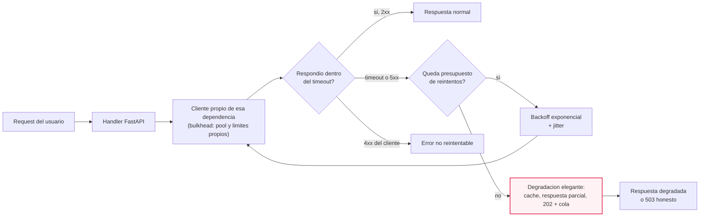
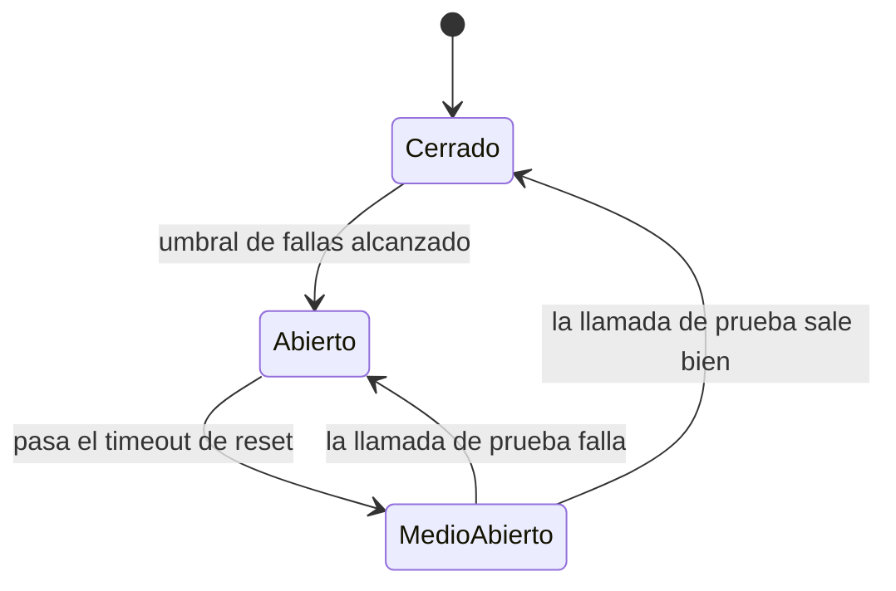
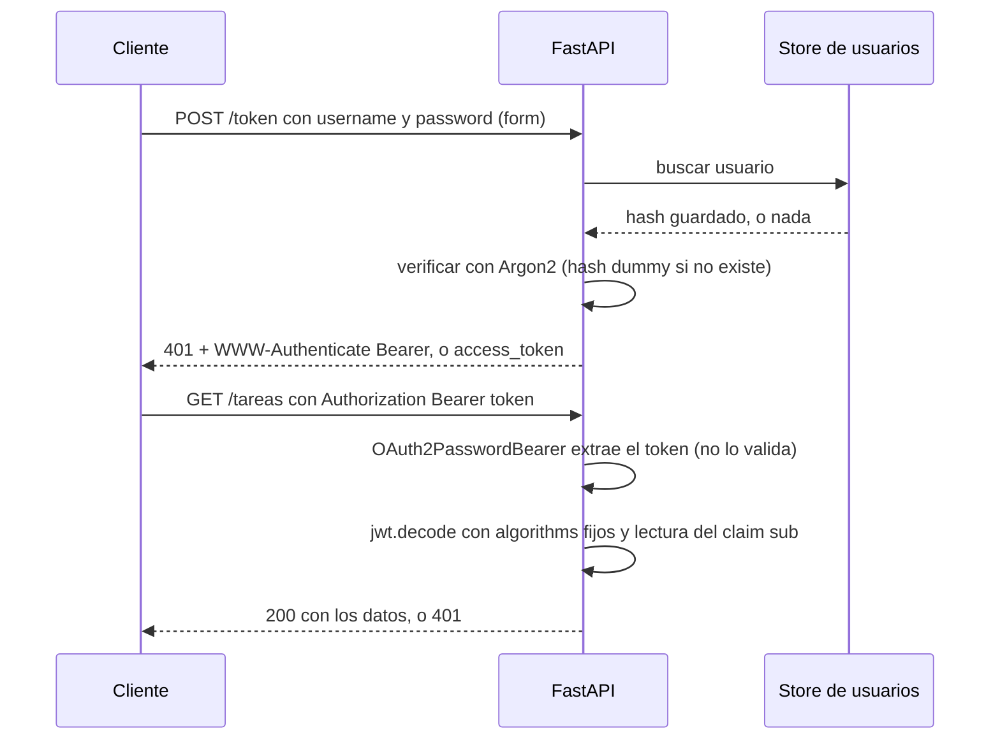
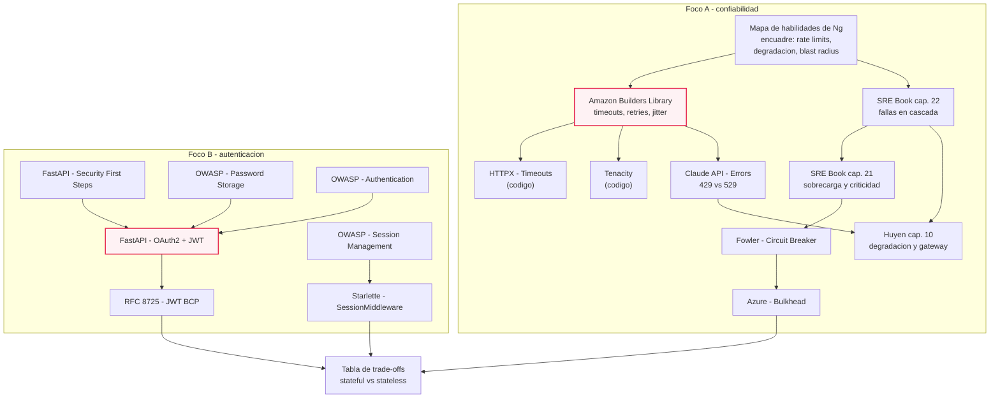

# M07·S16 — Confiabilidad: diseño ante fallos + autenticación

**Módulo:** 07 — Fundamentos de Software + System Design para AI Engineers
**Sesión:** 16 · Semana 3 (ritmo pausado) · bloque de 3 h
**Fecha:** [Completar por el profesor: fecha]
**Tema:** qué hace tu app cuando una dependencia externa está caída, lenta o rate-limiteada; y cómo sabe tu app quién está del otro lado (sesiones + cookies vs JWT).

**Duración estimada de estudio:** 4 h (ruta mínima) a 8 h (todos los recursos) — documento ~60 min · recursos imprescindibles ~2 h · lab (§6) ~90 min · ejercicios (§7) ~2 h.

---

## 1. Objetivos de aprendizaje

Al terminar esta sesión vas a poder:

1. **Diagnosticar** los tres modos de falla de una dependencia —caída, lenta, rate-limiteada— y explicar por qué "lenta" es la que más daño hace.
2. **Elegir con método** el timeout de una llamada (en vez de tirar un número) y **configurar** reintentos con backoff exponencial, jitter y tope sobre un cliente HTTP real.
3. **Diseñar** una respuesta degradada antes que una caída: decidir qué peticiones valen más, qué se sirve incompleto y qué se difiere.
4. **Acotar el blast radius** con aislamiento por pools (bulkhead) y **evaluar** si un circuit breaker aporta o estorba, sosteniendo las dos posiciones del debate.
5. **Distinguir** autenticación de autorización e **implementar** autenticación con JWT en FastAPI: hash con Argon2, endpoint `/token`, dependencia que valida el token y 401 correctos.
6. **Defender** stateful (sesiones + cookies) vs stateless (JWT) con los ejes de revocación, escalado horizontal, confidencialidad y blast radius de una fuga, y explicar qué resuelven los refresh tokens.
7. **Dirigir al agente** en estos temas: pedirle explícitamente la política de reintentos y de expiración, y detectar en la revisión los defaults peligrosos que deja puestos.

---

## 2. Resumen ejecutivo

Las dos mitades de esta sesión parecen temas distintos y son el mismo: **qué hace tu sistema cuando algo que no controla se porta mal**. En la primera, ese "algo" es una dependencia externa —una API de terceros, la base de datos y, en un producto de IA, la API del modelo—. En la segunda, ese "algo" es el usuario: tu app necesita saber quién está del otro lado, y la decisión de **dónde vive el estado de sesión** es la misma discusión que la sesión de escalado vertical vs horizontal dejó abierta cuando sacamos el estado del servidor para poder correr réplicas.

Venimos de tres sesiones de arquitectura: diseñar según el contexto, escalar de single server a arquitectura escalada, y la inmediatamente anterior de load balancing, health checks y eliminación del SPOF. Ahí aprendimos a sacar nodos caídos de rotación. Hoy aparece el caso incómodo: **un health check que solo mira si tu proceso responde no detecta que la dependencia de abajo está muerta**. Las defensas de hoy —timeouts, reintentos, degradación, aislamiento— son las que operan dentro de tu proceso, antes de que el balanceador se entere.

Por qué le importa a un AI Engineer: en un producto con LLM la dependencia más caprichosa es la API del modelo, y sus fallas no son excepcionales sino **esperables** (rate limits, sobrecarga del proveedor, latencias de decenas de segundos). Y la autenticación es el requisito de entrada de cualquier app con usuarios: sin identidad no hay autorización, ni cuotas por usuario, ni forma de atribuir costo de inferencia. Las dos decisiones —política de reintentos y stateful vs stateless— se toman **antes** de escribir el código y se le dictan al agente, porque ninguna se arregla después sin romper clientes.

> ⚠️ **Fronteras.** Autorización y RBAC, WAF, VPN, CSRF, XSS y prompt injection son de la sesión siguiente. Acá solo distinguimos autenticación de autorización y dejamos la segunda anunciada.

---

## 3. Conceptos clave / glosario

Formato de cada entrada: **definición** · *para qué* · *por qué así*.

### Foco A — Confiabilidad

- **Modo de falla.** La forma concreta en que una dependencia deja de servirte: caída, lenta o rate-limiteada. *Para qué:* para no escribir un solo `try/except` genérico, porque cada modo pide otra defensa. *Por qué así:* "si falla, reintentá" convierte una dependencia lenta en una caída tuya.
- **Falla en cascada.** Una sobrecarga chica que se propaga hacia arriba hasta tirar el sistema, porque cada capa reacciona de una forma que empeora el problema. *Para qué:* explica por qué un incidente parcial se vuelve total. *Por qué así:* el fenómeno vive en la interacción, no en el componente.
- **Timeout de conexión vs de lectura.** El primero acota cuánto esperás para **establecer** la conexión; el segundo, cuánto esperás a que lleguen datos. *Para qué:* ponerle números distintos a dos cosas distintas. *Por qué así:* conectar es rápido o no conecta; leer puede tardar legítimamente mucho si hay un modelo generando.
- **Deadline (y su propagación).** El instante en que la respuesta deja de ser útil, fijado una vez arriba de la pila y pasado hacia abajo. *Para qué:* que nadie trabaje sobre una petición ya abandonada. *Por qué así:* con un timeout nuevo por salto, el total es la suma de todos. Analogía: un vuelo con escalas no te regala dos horas nuevas en cada escala.
- **Backoff exponencial.** Esperar cada vez más entre reintentos, con tope. *Para qué:* no golpear a algo que ya está mal. *Por qué así:* reintentar al instante agrega carga en el momento de menor capacidad.
- **Jitter.** Aleatorizar esa espera. *Para qué:* desincronizar a los clientes que fallaron juntos. *Por qué así:* sin jitter vuelven todos a la vez y repiten la contención. Analogía: si todo el edificio sale a las 8:00 en punto, el ascensor se tapa.
- **Presupuesto de reintentos.** Un límite global a la proporción de tráfico que puede ser reintentos. *Para qué:* que los reintentos no se coman la capacidad cuando *todo* falla. *Por qué así:* el tope por llamada no limita nada si el 100 % de las llamadas falla. Se implementa con **token bucket** (visto al hablar de rate limits en la sesión de escalado).
- **Amplificación por capas.** Los reintentos de cada capa **se multiplican**, no se suman. *Para qué:* justifica la regla de reintentar en una sola capa. *Por qué así:* tres intentos en cinco niveles son 3⁵ llamadas al servicio de abajo.
- **Idempotencia** (ya vista en la sesión de APIs y protocolos). Que repetir la operación no cambie el resultado. *Para qué:* es la **precondición** del reintento. *Por qué así:* un timeout no prueba que el efecto no ocurrió.
- **Degradación elegante (graceful degradation).** Reducir la cantidad o la calidad del trabajo en vez de no responder. *Para qué:* darle al usuario algo útil (dato cacheado, respuesta parcial, una feature menos). *Por qué así:* la alternativa binaria "perfecto o 500" convierte un problema parcial en una caída total.
- **Load shedding.** Tirar deliberadamente una proporción de la carga al acercarse a la sobrecarga. *Para qué:* atender bien a una parte en vez de atender mal a todos. *Por qué así:* un servidor sobrecargado no es "más lento": no completa casi nada y gasta igual.
- **Criticidad de las peticiones.** Etiquetar cada request según cuánto importa. *Para qué:* que el shedding tenga criterio (se tira el refresco del tablero antes que el login). *Por qué así:* sin etiquetas, tirar el 10 % de la carga tira también el 10 % de lo crítico.
- **Bulkhead (mamparo).** Partir los recursos —pools, threads, procesos— para que cada dependencia consuma solo los suyos. *Para qué:* que la dependencia lenta agote *su* pool y no el de las demás. *Por qué así:* con pool compartido, la más lenta se queda con todas las conexiones. Analogía: el casco compartimentado de un barco.
- **Circuit breaker.** Envoltorio de tres estados —cerrado, abierto, medio abierto— que corta las llamadas tras N fallas y las reintenta pasado un timeout. *Para qué:* dejar de esperar a algo que no responde y fallar rápido. *Por qué así:* seguir llamando y timeouteando gasta tu capacidad. Es un patrón **discutido**: ver §5.5.
- **Blast radius.** El alcance del daño de una falla: cuántos usuarios, cuántas features, cuánto tiempo. *Para qué:* criterio de diseño — entre dos arquitecturas que fallan igual de seguido, gana la que falla más chico. *Por qué así:* la confiabilidad perfecta no existe; el objetivo realista es acotar.
- **Model gateway.** Capa intermedia única por la que pasan todas las llamadas a modelos. *Para qué:* un solo lugar para la política de fallback, el control de acceso, el límite de costo y el logging. *Por qué así:* si la política vive en cada handler, cambiarla implica tocar N archivos y nadie sabe cuál es la política real.
- **429 vs 529** (API de Claude). **429 `rate_limit_error`** = tu organización llegó a un límite; **529 `overloaded_error`** = la API está temporalmente sobrecargada por el tráfico de todos. *Para qué:* no tratarlos igual. *Por qué así:* la variante de 429 por tope de gasto del tier **no trae `retry-after`** y no se arregla esperando.

### Foco B — Autenticación

- **Autenticación.** Establecer **quién** hace la petición; produce una identidad. *Para qué:* es el requisito de entrada de todo lo demás. *Por qué así:* se resuelve una vez por request, al borde, para que el resto del código reciba un usuario ya resuelto.
- **Autorización.** Decidir **qué puede hacer** esa identidad; produce un permiso. *Para qué:* que un usuario autenticado no toque lo que no es suyo. *Por qué así:* se separa porque los permisos cambian mucho más seguido que la identidad. Su desarrollo —RBAC— es de la sesión siguiente.
- **Hash adaptativo / memory-hard.** Función de hash diseñada para ser **lenta** y costosa en memoria, con parámetros ajustables. *Para qué:* que probar candidatos a gran escala sea inviable. *Por qué así:* MD5, SHA-1 y SHA-256 no sirven acá: son rápidos por diseño, y esa velocidad se la regalás al atacante.
- **Argon2id.** El algoritmo que OWASP pone primero para guardar contraseñas (mínimo 19 MiB de memoria, 2 iteraciones, paralelismo 1). *Para qué:* es el default razonable de hoy. *Por qué así:* la doc de FastAPI recomienda `pwdlib` con Argon2, así que la línea de código y la recomendación de seguridad coinciden.
- **Salt.** Valor aleatorio y único por contraseña que se hashea con ella. *Para qué:* que dos contraseñas iguales den hashes distintos y las tablas precomputadas no sirvan. *Por qué así:* lo genera la librería; no es secreto y se guarda al lado del hash.
- **Pepper.** Secreto guardado **fuera** de la base que se suma al hasheo. *Para qué:* defensa en profundidad si te roban solo la base. *Por qué así:* por sí solo no agrega seguridad, y cambiarlo obliga a resetear todas las contraseñas.
- **Enumeración de usuarios.** Averiguar qué cuentas existen por las diferencias de respuesta del login. *Para qué:* es la primera fuga a cerrar. *Por qué así:* hay que cerrar las **tres** vías juntas —mensaje, status code y tiempo de respuesta—; cerrar dos no sirve.
- **Session ID.** Identificador opaco y aleatorio que apunta a los datos de sesión guardados en el servidor. *Para qué:* que el cliente lleve una referencia y no los datos. *Por qué así:* necesita ≥64 bits de entropía (16 caracteres hex como mínimo; 128 bits si lo genera tu app) con un CSPRNG, porque su única defensa es ser inadivinable.
- **Idle timeout vs absolute timeout.** El primero mata la sesión tras inactividad; el segundo, a las N horas de creada. *Para qué:* el idle cubre la laptop abandonada; el absoluto acota el daño de un ID robado. *Por qué así:* los dos se aplican **del lado del servidor**; un `Max-Age` es una sugerencia que el atacante ignora.
- **Session fixation.** El atacante fija un session ID conocido antes del login y hereda la sesión. *Para qué:* justifica regenerar el ID en cada cambio de privilegio. *Por qué así:* reusar el ID es gratis para el atacante.
- **JWT.** Token autocontenido de tres partes en base64url —header, payload, firma— que el servidor firma y el cliente presenta. *Para qué:* validar identidad **sin consultar un store**. *Por qué así:* lo define el RFC 7519 (mayo de 2015) y sus buenas prácticas están en el RFC 8725 (BCP 225, febrero de 2020).
- **Claim.** Cada campo del payload (`sub`, `exp`, `iss`, `aud`, `jti`…). *Para qué:* transportar lo mínimo sin ir a la base. *Por qué así:* `sub` tiene que ser único en toda la aplicación, y conviene prefijarlo por tipo de entidad (`username:johndoe`).
- **Firma ≠ cifrado.** El JWT está **firmado, no cifrado**: cualquiera lee el payload; la firma solo detecta manipulación. *Para qué:* regla de diseño — nada secreto adentro. *Por qué así:* la firma protege integridad, no confidencialidad; igual que la cookie firmada de Starlette, *readable but not modifiable*.
- **Access token y refresh token.** El primero es de vida corta y viaja en cada request; el segundo es de vida larga, vive en un store y solo sirve para pedir uno nuevo. *Para qué:* expiraciones cortas sin obligar a loguearse cada media hora. *Por qué así:* concentra la revocabilidad en un solo punto (§5.11).
- **`jti` y denylist.** Identificador único del token y lista server-side de los revocados. *Para qué:* poder revocar antes de la expiración. *Por qué así:* es la confesión de que revocar **requiere estado compartido**.
- **Stateful vs stateless (en auth).** Si el servidor guarda la sesión y el cliente lleva una referencia, es stateful; si el cliente lleva la identidad firmada, es stateless. *Para qué:* es la decisión de arquitectura de la sesión. *Por qué así:* el eje real no es "cookie o token" sino **quién puede invalidar la credencial** (§5.12).
- **`OAuth2PasswordBearer`.** Clase de FastAPI que busca el header `Authorization`, verifica que sea `Bearer` + algo y **devuelve el token como `str` sin validarlo**. *Para qué:* separar extraer de validar. *Por qué así:* hereda de `SecurityBase`, así que FastAPI mete el esquema en el OpenAPI (de ahí el botón *Authorize* de `/docs`); su `tokenUrl` **no crea** el endpoint.

---

## 4. Diagrama ancla: el camino de una request y sus cuatro defensas

Las cuatro herramientas del foco A no son alternativas: son cuatro puntos del mismo camino, y cada una tapa un agujero que las otras dejan.



El nodo resaltado es el que casi nunca está en el código real. A un agente al que le pedís "manejá los errores" le sale el `try/except` y el reintento; la rama de degradación hay que pedirla, porque implica una decisión de producto que el agente no puede tomar por vos.

---

## 5. Notas de estudio por subtema

### 5.1 · Los tres modos de falla de una dependencia

**El problema.** Tu endpoint llama a algo que no controlás, y ese algo falla de tres formas distintas; la intuición de "lo intento de nuevo" sirve para una sola.

1. **Caída.** La conexión se rechaza o el host no existe. Es el modo **más amable**: falla rápido, el error es claro y no te deja recursos ocupados.
2. **Lenta.** Acepta la conexión y tarda. Es el **más peligroso**: cada request que espera retiene un worker, una conexión del pool y memoria. Sin timeout, una dependencia lenta no te da errores, te da una app que no responde — mucho más difícil de diagnosticar.
3. **Rate-limiteada.** Contesta rápido y bien formado, pero con error de cuota. En un producto de IA no es una excepción: es un modo de operación **esperable**. Diseñar alrededor de las fallas posibles incluye tratar el rate limit de una API como algo normal, no como un bug.

> 💡 Pregunta de examen: *¿por qué "lenta" es peor que "caída"?* Porque la caída libera recursos y la lentitud los retiene. Y tu propio health check no la ve: el proceso responde.

**Enganche con la sesión anterior.** Los health checks retiran de rotación un nodo que no responde. Si todas tus réplicas están sanas y la dependencia de abajo está lenta, el balanceador no tiene a quién sacar: las defensas de hoy viven **dentro** de tu proceso.

**La falla en cascada** es el fenómeno que lo une todo: una sobrecarga chica se propaga y tira el sistema, y los reintentos la aceleran. El capítulo 22 del SRE Book de Google (*Addressing Cascading Failures*, de Mike Ulrich) agrega la parte que nadie hace: **testear** para esto, cargando cada componente hasta que rompa y mirando si rechaza con elegancia o explota.

**Error común.** Tratar los tres modos con un `except Exception`: se come el 4xx (que no hay que reintentar), oculta qué pasó y vuelve indistinguible "la dependencia está mal" de "mi código tiene un bug".

📎 [Addressing Cascading Failures — SRE Book, cap. 22](https://sre.google/sre-book/addressing-cascading-failures/)

---

### 5.2 · Timeouts y deadlines

**El problema.** Todo cliente HTTP tiene un timeout por default y ningún default puede estar bien para dos dependencias distintas. HTTPX, por ejemplo, levanta `TimeoutException` tras **5 segundos** de inactividad de red: razonable, pero es *el mismo* número para un `SELECT` local y para una generación de LLM. Si no lo fijás, elegiste sin saberlo.

**Cuatro timeouts, no uno.** HTTPX expone `connect`, `read`, `write` y `pool`, cada uno con su excepción (`ConnectTimeout`, `ReadTimeout`, `WriteTimeout`, `PoolTimeout`):

- **`connect`** — establecer TCP y TLS: o es rápido, o no va a conectar. Valores bajos.
- **`read`** — esperar datos ya conectado: acá un modelo generando puede tardar decenas de segundos legítimamente.
- **`pool`** — esperar una conexión **de tu propio pool**. Si salta, el problema no es la red: te quedaste sin conexiones. Es el puente al bulkhead de §5.5.

> 💡 El artículo de la Amazon Builders' Library trae el caso perfecto: un timeout de 20 ms que funcionaba y empezaba a fallar tras cada deploy, porque incluía el establecimiento de la conexión TLS —que pasa justo cuando los pools están vacíos—. Sin separar conectar de leer, ese bug no se puede ni nombrar.

**Cómo se elige el número, con método.** Lo que ningún framework responde. El procedimiento del artículo de AWS: **definí qué tasa de falsos timeouts tolerás y usá el percentil de latencia del servicio de abajo que corresponde.** Si tolerás 0,1 % de falsos timeouts, tu timeout es el p99.9. Eso convierte "¿2 segundos o 5?" en una medición — y te obliga a tener la medición.

**Deadlines.** Si cada capa elige su timeout, el total es la suma y nadie controla el total. El capítulo 22 del SRE Book recomienda fijar el deadline **una vez** en la cima de la pila y **propagarlo** hacia abajo; las cancelaciones también se propagan. El beneficio no es solo aritmético: evita que las capas de abajo sigan trabajando sobre requests que el cliente ya abandonó, justo cuando el sistema está saturado.

#### Ejemplo práctico: un cliente por dependencia

```python
# clientes.py
import httpx

# Un cliente POR dependencia: es, al mismo tiempo, el bulkhead mas barato que existe.
modelo = httpx.Client(
    base_url="https://api.<PROVEEDOR>.com",
    timeout=httpx.Timeout(30.0, connect=5.0),   # read/write/pool = 30 s, connect = 5 s
    limits=httpx.Limits(max_connections=10),
)

servicio_interno = httpx.Client(
    base_url="http://<HOST_INTERNO>:8001",
    timeout=httpx.Timeout(2.0, connect=0.5),    # un servicio propio, en la misma red
    limits=httpx.Limits(max_connections=20),
)
```

**Por qué así.** El primer posicional de `httpx.Timeout` fija los cuatro y después se pisa solo `connect`: es la forma más corta de decir "conectar tiene que ser rápido, leer puede tardar". Los números son **distintos por dependencia a propósito**: 30 s de lectura para una API de modelo es plausible, pero 30 s para un servicio interno significa que algo está roto y no te vas a enterar. `limits` fija el tamaño del pool: con el pool lleno la siguiente llamada espera y, pasado el timeout de `pool`, levanta `PoolTimeout` — **ese es el momento exacto en que una dependencia lenta se convierte en una caída tuya**. La alternativa descartada es un único `Client` global con el timeout por default: una línea menos y, cuando el modelo se pone lento, se lleva las conexiones de todos los demás endpoints. Placeholders: `<PROVEEDOR>`, `<HOST_INTERNO>`. Los valores son un **punto de partida**, no una recomendación: recalculalos con el método del percentil en cuanto tengas latencias medidas.

**Errores comunes.** Un timeout generoso "por si acaso" (60 s en un endpoint que el usuario abandona a los 3 solo garantiza 57 s de trabajo inútil); desactivarlo en desarrollo y olvidarlo así; ponerlo y no mirar nunca cuántos saltan.

📎 [Timeouts, retries, and backoff with jitter — Amazon Builders' Library](https://builder.aws.com/content/3EumjoZascWd1oZiEgL8ORlv3qE/timeouts-retries-and-backoff-with-jitter) · [Timeouts — HTTPX](https://www.python-httpx.org/advanced/timeouts/)

---

### 5.3 · Reintentos: backoff, jitter, idempotencia y presupuesto

**El problema.** Muchas fallas son transitorias, así que reintentar es la defensa más barata que existe. Pero **los reintentos son egoístas**: mejoran la disponibilidad de *tu* request gastando capacidad del servicio de abajo, justo cuando ese servicio tiene menos para dar.

**Las cuatro decisiones de toda política de reintentos:**

1. **¿Cuántas veces?** Un tope. Sin tope, un incidente de 10 minutos son 10 minutos de tu app golpeando algo muerto.
2. **¿Cuánto espero?** Backoff exponencial con tope **y con jitter**. Ojo con un efecto secundario: con el backoff topeado, los clientes terminan reintentando constantemente a esa tasa máxima, así que el tope de espera **no reemplaza** al tope de intentos. Y sin jitter, las llamadas que fallaron juntas vuelven a competir juntas.
3. **¿Ante qué?** Timeouts y 5xx sí; **4xx no**, porque el mismo request va a volver a fallar.
4. **¿Es seguro?** Solo si la operación es **idempotente** o trae idempotency key (visto en la sesión de APIs y protocolos). Un timeout **no prueba** que el efecto no ocurrió: puede que el servidor haya procesado el cobro y se haya perdido la respuesta. El ejemplo de AWS es la API `RunInstances` de EC2, que usa tokens justamente para que el reintento sea seguro.

**La amplificación, que es la parte contraintuitiva.** Los reintentos de cada capa **se multiplican**: con 3 reintentos por capa en una pila de 5 niveles, la base de datos recibe **243 veces** la carga original (la aritmética del propio ejemplo: 3⁵). De ahí la regla, casi siempre violada: **reintentar en una sola capa**. El capítulo 21 del SRE Book lo dice como "reintentar solo en la capa inmediatamente superior a la que rechaza", y le pone nombre a lo otro: *explosión combinatoria de reintentos*.

**Presupuesto de reintentos.** El tope por llamada no limita el total: si el 100 % de tus requests falla, el 100 % reintenta tres veces. Dos mecanismos:

- **Token bucket local** (vía AWS): se reintenta mientras haya tokens y, agotados, se sigue a una tasa fija. AWS incorporó este comportamiento a su SDK en 2016.
- **Presupuesto por cliente** (vía Google): el capítulo 21 describe hasta **3 intentos por request** y solo mientras la **ratio de reintentos del cliente esté por debajo del 10 %**. Con los dos límites, el crecimiento de carga en el peor caso baja de **~3× a ~1,1×**. Esa cifra es la que convierte el presupuesto en algo no opcional.

El mismo capítulo agrega el **adaptive throttling**: cada cliente lleva la cuenta de sus `requests` y sus `accepts` de los últimos dos minutos y sigue mandando mientras `requests` no supere K veces `accepts` (Google prefiere en general K = 2). Es elegante porque no requiere coordinar nada.

#### Ejemplo práctico: reintentos declarativos con Tenacity

```python
import logging
import httpx
from tenacity import (retry, stop_after_attempt, wait_random_exponential,
                      retry_if_exception_type, before_sleep_log)
from clientes import modelo

logger = logging.getLogger(__name__)
RETRIABLES = (httpx.TimeoutException, httpx.ConnectError)


@retry(
    stop=stop_after_attempt(3),                              # tope de intentos, no infinito
    wait=wait_random_exponential(multiplier=1, max=20),      # exponencial CON jitter, tope 20 s
    retry=retry_if_exception_type(RETRIABLES),               # solo lo que vale reintentar
    before_sleep=before_sleep_log(logger, logging.WARNING),  # cada espera queda en el log
    reraise=True,                                            # al final, la excepcion original
)
def pedir_al_modelo(payload: dict) -> dict:
    r = modelo.post("/v1/messages", json=payload)
    if r.status_code in (429, 500, 503, 529):   # transitorios del servidor -> reintentables
        r.raise_for_status()
    if r.status_code >= 400:                    # 4xx del cliente -> NO se reintenta
        raise ValueError(f"error no reintentable: {r.status_code} {r.text}")
    return r.json()
```

**Por qué está cada argumento (y qué pasa si lo sacás):**

- `stop_after_attempt(3)` — **sin `stop`, `@retry` reintenta para siempre.** Es el default más peligroso de la librería y el que un agente deja puesto si no se lo corregís.
- `wait_random_exponential(multiplier=1, max=20)` — sin `wait` no espera **nada** entre intentos: tres golpes en milisegundos, lo contrario de lo que necesita un servicio sobrecargado. Esta política es exponencial **y** aleatorizada: backoff con jitter en una línea.
- `retry_if_exception_type(...)` — la traducción de "4xx no, 5xx y timeouts sí". Sin esto, Tenacity reintenta ante **cualquier** excepción, incluido tu `ValueError`.
- `before_sleep_log(...)` — si los reintentos no se loguean, el síntoma que ve el equipo es "está lento", nunca "está reintentando". (Dónde mirar esos logs es tema de la sesión de observabilidad.)
- `reraise=True` — sin esto, Tenacity envuelve el fallo final en `RetryError` y perdés la excepción real, que es la que necesitás para decidir si degradás o devolvés 503.
- **Lo que no resuelve:** es un presupuesto **por llamada**, no global. La regla de una sola capa y el presupuesto global siguen siendo tuyos.

**Errores comunes.** Envolver una operación no idempotente (un `POST /pagos` sin idempotency key puede cobrar dos veces); reintentar un 429 sin mirar `retry-after` (si el proveedor te dice cuánto esperar, tu backoff es peor que su número); reintentar en el service *y* en el repository *y* en el cliente HTTP porque cada capa la escribió un prompt distinto.

📎 [Tenacity](https://tenacity.readthedocs.io/en/latest/) · [Handling Overload — SRE Book, cap. 21](https://sre.google/sre-book/handling-overload/)

---

### 5.4 · Degradación elegante y load shedding

**El problema.** Llega un punto en que no hay reintento que te salve. La pregunta deja de ser técnica y pasa a ser de producto: **¿qué le mostrás al usuario?** La respuesta por default del código generado es un 500, y casi siempre hay algo mejor.

**Las dos definiciones** (capítulo 22 del SRE Book): **load shedding** es dropear una proporción de la carga a medida que el servidor se acerca a la sobrecarga, y la **degradación elegante** lo extiende reduciendo la cantidad de trabajo que hay que hacer, típicamente bajando la calidad de la respuesta. El shedding decide *a quién* no atender; la degradación, *qué tan bien* atender a todos.

**Primero hay que etiquetar.** La idea más útil del capítulo 21: **no todas las peticiones valen lo mismo**. Google las etiqueta en cuatro niveles —`CRITICAL_PLUS`, `CRITICAL`, `SHEDDABLE_PLUS`, `SHEDDABLE`— y la criticidad **se propaga automáticamente a las llamadas salientes**, así que una petición poco crítica no dispara trabajo crítico más abajo. No necesitás cuatro niveles; sí necesitás dos: *esto no se tira nunca* y *esto se tira primero*. Dato relacionado del mismo capítulo: **medir capacidad en queries por segundo suele ser una mala métrica**, porque el costo de cada request varía; conviene medir en recursos (CPU, memoria). Si tu regla de shedding es "a partir de 500 req/s", estás midiendo lo que no importa.

#### Ejemplo práctico: degradar un endpoint sin IA

Un endpoint que lista tareas y, para cada una, le pide al servicio de notificaciones los comentarios sin leer. El enriquecimiento es lindo; el listado es el producto.

```python
@router.get("/tablero")
def ver_tablero(response: Response, proyecto_id: int):
    tareas = repo.listar_tareas(proyecto_id)      # critico: si esto falla, no hay respuesta

    # Enriquecimiento SHEDDABLE: si el servicio secundario no esta, se omite.
    degradado = False
    try:
        no_leidos = contar_no_leidos(proyecto_id)
    except ServicioNoDisponible:
        no_leidos, degradado = {}, True
        response.headers["X-Degraded"] = "notificaciones"   # para el cliente y para el log

    return {
        "tareas": [{**t.model_dump(), "no_leidos": no_leidos.get(t.id)} for t in tareas],
        "parcial": degradado,
    }
```

**Por qué así, y qué alternativa se descarta:**

1. **El fallo del servicio secundario no se propaga.** Dejar que la excepción suba convierte la falla de una feature accesoria en un 500 del tablero entero: el error de blast radius más común que existe.
2. **La degradación es explícita** (`parcial`, `X-Degraded`). Devolver `no_leidos: null` en silencio es peor que el error: el frontend muestra "0 comentarios" y el usuario decide con datos falsos. Degradar no es mentir.
3. **Lo crítico no se envuelve.** `listar_tareas` no tiene fallback: si no hay tareas no hay respuesta posible, y ahí corresponde un 503 honesto (con `Retry-After` si sabés cuánto).

**El catálogo de formas de degradar**, de más a menos deseable:

| Forma | Cuándo aplica | Costo |
|---|---|---|
| Servir datos cacheados, aunque viejos | Lectura donde la frescura no es crítica | Hay que declarar la antigüedad |
| Respuesta parcial (omitir enriquecimiento) | Features accesorias de una vista | Requiere contrato que lo permita |
| Deshabilitar una feature secundaria entera | Está rota, no lenta | Decisión de producto, idealmente con feature flag |
| Diferir: `202 Accepted` + cola + worker | Escritura que no hace falta confirmar al instante | Requiere cola e idempotencia (ya vistas) |
| Rechazo explícito (load shedding) con 503 | Sobrecarga: preferís atender bien a una parte | Hay que elegir a quién rechazar: criticidad |

**En un producto de IA hay una capa más**, porque lo que falla no es solo la disponibilidad sino la **calidad de la respuesta**. El catálogo de Chip Huyen (*AI Engineering*, 2025, cap. 10) ordena por costo: **reintentar** es barato y funciona por una razón que no aplica a un CRUD —el modelo es probabilístico, así que la misma query puede dar otra respuesta—, pero si se hace *después* de la falla **duplica la latencia percibida**; **llamar en paralelo** y elegir la mejor respuesta evita ese costo a cambio de llamadas redundantes (la decisión contraintuitiva de la sesión: vale cuando la latencia percibida es parte del producto); **derivar a un humano**, con tres disparadores habituales —frases detectadas en la query, un modelo de sentimiento que detecta enojo, o una cantidad de turnos superada para que el usuario no quede en un loop—. Dos avisos del mismo capítulo: uno de los trade-offs de los guardrails es **confiabilidad contra latencia** (hay equipos que no los implementan porque la latencia les importa más), y en **streaming** es difícil evaluar respuestas parciales, así que algo inseguro puede llegar al usuario antes de que se determine que había que bloquearlo. Lo ya mostrado no se retira.

> ⚠️ **El modo degradado se oxida.** El capítulo 22 lo dice sin vueltas: casi nunca corre en estado estable, así que hay que **ejercitarlo con regularidad**. Un fallback que nadie ejecutó en seis meses es código que vas a estrenar durante un incidente.

**Errores comunes.** Degradar en silencio; proteger lo crítico y dejar lo accesorio sin fallback (al revés de lo que corresponde); un fallback que llama a otra cosa que también puede fallar, sin timeout propio.

---

### 5.5 · Minimizar el blast radius: bulkhead y circuit breaker

**El problema.** Ya tenés timeouts, reintentos acotados y respuesta degradada. Falta la pregunta estructural: cuando una dependencia se cae, **¿cuánto de tu sistema se cae con ella?**

#### Bulkhead: aislamiento por pools

El mecanismo con mejor relación costo/beneficio de la sesión: **un pool de conexiones propio por dependencia**, para que un servicio que no responde agote *su* pool y no el del resto. El nombre viene de los compartimentos del casco de un barco: si se perfora una sección, solo esa se inunda. El Azure Architecture Center lo ficha también como *cell-based architecture* y lista las variantes —particionar los recursos del consumidor (pools, thread pools, semáforos, procesos, contenedores) o particionar las instancias del servicio por cliente—, además de colas separadas por tipo de mensaje. Lo que esto corta es el **agotamiento del pool**: con pool compartido, la dependencia más lenta se queda con todas las conexiones y tus endpoints que no la usan empiezan a fallar. Si ya viste `PoolTimeout`, ya viste el mecanismo.

Tres notas de criterio del mismo catálogo: **la granularidad importa** (partir de más desperdicia recursos reservados que nadie comparte); **usá los límites de la plataforma** en vez de reimplementarlos; y una pertinente para este bootcamp: **las cargas de IA e inferencia suelen necesitar bulkheads estrictos**, por las cuotas y los límites de concurrencia a nivel de despliegue, aislando los despliegues de modelo por workload o por tenant.

#### Circuit breaker: dejar de llamar a lo que no responde

El patrón que Martin Fowler describe en su bliki del 6 de marzo de 2014, acreditándolo a Michael Nygard, que lo popularizó en *Release It!*.



- **Cerrado:** las llamadas pasan y el breaker cuenta fallas.
- **Abierto:** alcanzado el umbral, deja de llamar y **devuelve error sin intentar**. Eso es lo que te ahorra: workers esperando timeouts.
- **Medio abierto:** pasado el timeout de reset, deja pasar **una** llamada de prueba; si sale bien se cierra, si falla se abre otra vez.

Las dos cosas que casi siempre se olvidan y que Fowler sí dice: **el cliente tiene que decidir qué hacer cuando está abierto** (fallar, encolar para después, mostrar datos viejos) —el breaker te da un error inmediato, no una respuesta, así que sin fallback solo lograste fallar más rápido—; y **el estado tiene que ser observable y manipulable a mano**: cada cambio se loguea y operaciones debería poder abrirlo o cerrarlo. Un breaker invisible produce incidentes fantasma ("el servicio está bien pero la app dice que no"). Detalles finos: un **timeout de invocación cuenta como falla** (si no, el breaker nunca se abre ante el modo "lenta", que es el que más importa) y **no todos los errores deberían abrirlo** (un 404 no dice nada sobre la salud de la dependencia).

#### La tensión: dos fuentes buenas que no coinciden

Acá hay un desacuerdo real entre fuentes de calidad, y la sesión **no lo resuelve por decreto**: poder sostenerlo es parte de lo que se evalúa.

| | **Fowler y el catálogo de Azure** | **El artículo de la Amazon Builders' Library** |
|---|---|---|
| Qué proponen | El circuit breaker como patrón de primera línea, con su mecánica completa, combinable con retry, throttling y bulkhead | Preferir un **presupuesto de reintentos con token bucket**; el breaker queda como recurso con reservas |
| La objeción | — | El breaker **agrega comportamiento modal difícil de testear** y **puede retrasar la recuperación** |
| En qué coinciden | Hay que acotar el daño y dejar de gastar capacidad en algo que no responde | ídem |

Cómo sostener cada lado: **a favor del breaker**, cuando el costo de la llamada fallida es alto (un worker bloqueado 30 s) y la dependencia tiene fallas largas y totales, fallar rápido es una mejora grande y evidente. **A favor del presupuesto**, el breaker introduce estados que casi nunca se ejercitan —el mismo problema del modo degradado— y, cuando la dependencia vuelve, un breaker abierto puede demorar en notarlo; un token bucket no tiene modos: siempre se comporta igual, solo con menos reintentos.

> 💡 La lectura útil es que **no son el mismo tipo de herramienta**. El bulkhead es estructural y casi no tiene contras: siempre vale. El presupuesto es aritmético y previsible. El breaker es *modal*, y los modos hay que ejercitarlos. Con tiempo limitado, el orden es: bulkhead → presupuesto → breaker.

Y la regla que atraviesa los tres: **reintentar en una sola capa**. Si cada capa tiene su breaker, su presupuesto y sus reintentos, nadie puede predecir qué hace el sistema bajo carga.

**Errores comunes.** Un breaker por proceso con 20 réplicas (la dependencia recibe 20 llamadas de prueba, no una); umbral contado sin ventana de tiempo ("10 fallas" desde que arrancó el proceso); abrir el breaker ante 4xx y cortar el servicio por culpa de un cliente que manda mal el request.

📎 [Circuit Breaker — Martin Fowler](https://martinfowler.com/bliki/CircuitBreaker.html) · [Bulkhead pattern — Azure Architecture Center](https://learn.microsoft.com/en-us/azure/architecture/patterns/bulkhead)

---

### 5.6 · El caso de la API del modelo

**El problema.** En un producto de IA la dependencia más caprichosa es la API del modelo: cuotas que no crecen con tus réplicas (visto en la sesión de escalado), latencias largas y errores propios. Y la pregunta que el alumno no sabe que tiene que hacerse: **¿qué parte de esto ya lo hace el SDK y qué me toca a mí?**

**Qué te devuelve el proveedor.** La referencia de errores de la API de Claude es el mejor ejemplo concreto:

| Código | Error | Qué hacer |
|---|---|---|
| **429** | `rate_limit_error` | Tu organización llegó a un límite: esperá y reintentá respetando `retry-after` |
| **429** (variante) | tope de gasto del tier | **No trae `retry-after`** y va a seguir fallando hasta que se restablezca el acceso: reintentar no sirve |
| **529** | `overloaded_error` | La API está temporalmente sobrecargada por el tráfico de todos; no es culpa tuya |
| **504** | `timeout_error` | Timeout del lado del proveedor |
| **500** | `api_error` | Error interno: la doc indica explícitamente reintentar con backoff exponencial |

Dos detalles de oro: **en streaming sobre SSE el error puede llegar *después* de un 200**, así que el manejo de errores **no puede mirar solo el status code** (si tu código decide "salió bien" con el header, se te escapa la mitad de los fallos); y el `request-id` es lo que te permite trazar un fallo con el proveedor. Para requests de más de 10 minutos, la recomendación es usar streaming o la Batch API.

**Qué ya hace el SDK.** El SDK oficial **ya reintenta los fallos transitorios** —errores de conexión, rate limits y 5xx— con backoff exponencial, **dos veces por defecto**, respetando `retry-after`. Se configura con `max_retries`:

```python
import anthropic

# Ya reintenta transitorios con backoff exponencial, dos veces por defecto,
# respetando retry-after. max_retries=0 lo desactiva.
client = anthropic.Anthropic(max_retries=2)
```

**Por qué esto ordena todo el foco A.** Si el SDK reintenta dos veces y vos envolvés la llamada en un `@retry(stop_after_attempt(3))`, el peor caso son **6 llamadas**, no 3 — y tu log muestra 3. Decidir **una** capa y desactivar la otra es la decisión de diseño; el número es lo de menos. La regla de "una sola capa" te muerde en la primera línea de código.

**Dónde vive la política: el model gateway.** Una capa intermedia única para hablar con todos los modelos. Como **todo el tráfico ya pasa por ahí**, es el lugar natural de las políticas de fallback ante rate limits y caídas de API —rutear a un modelo alternativo, reintentar tras una espera corta—, además del control de acceso, el límite de costos, el balanceo, el logging y a veces el caching y los guardrails. Huyen señala que esas fallas son **comunes**, no excepcionales, y que el gateway mínimo es literalmente un wrapper con una función por proveedor y un endpoint que despacha; hay opciones off-the-shelf (Portkey, MLflow AI Gateway, Kong, Cloudflare). Beneficios concretos: cambia la API del proveedor → **cambiás un solo lugar**, y no hace falta repartir el token de la organización entre todos los servicios.

```python
# gateway.py — el gateway minimo: un solo punto de salida hacia cualquier modelo.
# Por que aca y no en cada handler: la politica de reintentos, el limite de costo
# y el fallback se cambian en un archivo, no en N routers.
def generar(prompt: str, criticidad: str = "normal") -> dict:
    try:
        return pedir_al_modelo({"prompt": prompt})      # reintentos de §5.3, UNA capa
    except ServicioNoDisponible:
        if criticidad == "normal":
            return pedir_al_modelo_alternativo(prompt)  # fallback a un modelo mas chico
        raise                                           # critico: que decida el handler
```

**Errores comunes.** Tratar el 429 por tope de gasto como un 429 normal; en streaming, cerrar el `try` con el status code; dejar la política en cada handler y descubrir en el incidente que hay tres políticas distintas.

📎 [Claude API errors](https://platform.claude.com/docs/en/api/errors)

---

### 5.7 · La dependencia que casi nadie protege: la base de datos

**El problema.** Todo lo anterior suena a "API de terceros", pero la dependencia que más veces te va a tirar la app es tu propia base. Caso típico: alguien agrega un filtro al listado, la consulta pierde el índice, pasa a tardar 4 segundos y **toda la app empieza a devolver 503**, incluidos los endpoints que no tocan esa tabla.

**Por qué pasa.** Tu app habla con Postgres por un **pool de conexiones** de tamaño fijo por réplica (lo vimos al conectar la capa `repository`, con la sesión por request). Si cada request retiene una conexión 4 segundos en vez de 20 ms, la cantidad de requests simultáneas que podés atender se divide por 200. Cuando el pool se vacía, las nuevas esperan y después fallan: **es el agotamiento del pool, aplicado a tu base**.

**Las cuatro defensas, instanciadas:** timeout de statement (el equivalente del `read`: cortar la consulta del lado del servidor); pool dimensionado y con timeout propio (esperar una conexión tiene que fallar rápido y de forma distinguible de "la base no responde"); bulkhead (pool separado para reportes o trabajo analítico, o una réplica de lectura aparte); degradación (si el enriquecimiento no vuelve, serví el listado sin él).

```python
engine = create_engine(
    "postgresql+psycopg://<USUARIO>:<PASSWORD>@<HOST>:5432/<BASE>",
    pool_size=10,          # conexiones POR PROCESO, no globales
    max_overflow=5,        # margen para picos cortos
    pool_timeout=2,        # esperar una conexion falla rapido, no cuelga el worker
    pool_pre_ping=True,    # descarta conexiones muertas (reinicio de la base, failover)
    # Techo para cualquier consulta de esta app: ninguna retiene una conexion mas de 3 s.
    connect_args={"options": "-c statement_timeout=3000"},
)
```

**Por qué así.** Un `pool_timeout` bajo convierte "la app cuelga" en "la app te dice que está saturada", y entonces podés devolver 503 con criterio. `statement_timeout` es la red de contención contra la query que nadie midió. La alternativa —pool grande sin timeouts— parece más tolerante y solo mueve el colapso más adelante, haciéndolo más difícil de diagnosticar.

> ⚠️ **El pool es por proceso.** Con 4 réplicas y `pool_size=10`, la base ve hasta 40 conexiones más el overflow. Al escalar horizontalmente el cuello se muda a la base: exactamente lo que vimos en la sesión de escalado, ahora con el número que hay que calcular.

**Errores comunes.** Subir `pool_size` como respuesta a la saturación (más conexiones a una base saturada la saturan más); no fijar `statement_timeout` porque "hay un reporte que tarda" (ese reporte merece su propio engine, no un permiso global); reintentar una escritura que falló por timeout sin saber si se aplicó.

---

### 5.8 · Autenticación vs autorización

**El problema.** Son dos preguntas distintas que se confunden siempre, y en FastAPI más, porque **se implementan con el mismo mecanismo**.

- **Autenticación** responde *¿quién sos?* y produce una **identidad**. Entrada: credenciales. Salida: un usuario.
- **Autorización** responde *¿qué podés hacer?* y produce un **permiso**. Entrada: identidad + recurso + acción. Salida: sí o no.

El orden no es negociable: sin identidad no hay nada que autorizar. Y los códigos lo reflejan: **401** es "no sé quién sos" (y lleva `WWW-Authenticate`), **403** es "sé quién sos y no te alcanza".

**Por qué se confunden en el código de un agente.** En FastAPI las dos se montan con `Depends` (visto en la sesión de componentes avanzados): `get_current_user` autentica, `requiere_rol("owner")` autoriza. Son dos funciones con la misma forma, en el mismo archivo, inyectadas en la misma línea. Si le pedís a un agente "protegé este endpoint", lo normal es que te devuelva una función que valida el token *y* chequea permisos. Funciona, y es un problema: los permisos cambian mucho más seguido que el mecanismo de identidad, y mezclarlos te obliga a tocar el código de autenticación cada vez que cambia una regla de negocio.

```python
# Lo que construimos hoy: identidad.
@router.get("/tareas/")
def listar(usuario: Annotated[Usuario, Depends(get_current_user)]): ...

# Lo que viene en la sesion siguiente: permiso. Misma forma, otra responsabilidad.
# @router.delete("/proyectos/{pid}")
# def borrar(usuario: Annotated[Usuario, Depends(requiere_rol("owner"))]): ...
```

---

### 5.9 · Credenciales: hashing y endurecimiento del login

**El problema.** El login es la puerta del sistema y la parte que el agente resuelve en dos líneas que nadie revisa. Hay dos trabajos: guardar bien la contraseña y no filtrar información al responder.

#### Guardar la contraseña

No se guarda la contraseña: se guarda su hash, con una función diseñada para ser lenta. **MD5, SHA-1 y SHA-256 no sirven** porque son rápidos por diseño, y esa velocidad es exactamente lo que le regalás al atacante. El orden de preferencia de OWASP:

| Algoritmo | Parámetros mínimos | Cuándo |
|---|---|---|
| **Argon2id** | 19 MiB de memoria, 2 iteraciones, paralelismo 1 | Primera opción |
| **scrypt** | N=2^17, r=8, p=1 | Si Argon2id no está disponible |
| **bcrypt** | factor de trabajo ≥ 10 | Solo legacy. Límite de **72 bytes** de entrada, que la app tiene que hacer cumplir |
| **PBKDF2** | PBKDF2-HMAC-SHA256, 600.000 iteraciones | Cuando hay que cumplir FIPS-140 |

Más el **salt** (único y aleatorio por contraseña, generado por la librería; anula las tablas precomputadas) y el **pepper** (secreto fuera de la base; defensa en profundidad, y cambiarlo obliga a resetear todas las contraseñas). La buena noticia: la doc de FastAPI recomienda `pwdlib` instalado como `"pwdlib[argon2]"` —porque Argon2 es el algoritmo recomendado— con `PasswordHash.recommended()`; `passlib` aparece ahí solo para **leer hashes viejos**, no para hashear nuevo.

```python
from pwdlib import PasswordHash

password_hash = PasswordHash.recommended()   # Argon2, con parametros razonables ya puestos
hashed = password_hash.hash("<PASSWORD>")    # al registrar
ok = password_hash.verify("<INTENTO>", hashed)   # al loguear
```

**Por qué `recommended()` y no parámetros a mano:** los parámetros buenos cambian con el hardware, y una constante hardcodeada hoy va a estar vieja en tres años. Elegirlos vos solo tiene sentido si vas a medir el tiempo de hasheo en tu hardware y revisarlo periódicamente.

#### No filtrar en la respuesta

Las **tres fugas que delatan si un usuario existe**, que hay que cerrar **juntas**:

1. **El mensaje de error.** Uno genérico para todos los casos; el ejemplo de OWASP es literalmente *"Login failed; Invalid user ID or password."*
2. **El status code.** Consistente: no 200 para éxito y 403 para fallo, ni variaciones por caso.
3. **El tiempo de respuesta.** Si cuando el usuario no existe salteás el hasheo y respondés en 2 ms, mientras con uno válido tardás 80 ms, el atacante enumera cuentas con un cronómetro. La contramedida es **hashear igual** contra un hash dummy — por eso existe el `DUMMY_HASH` del ejemplo de FastAPI.

**Bloqueo por intentos fallidos.** El contador se asocia a la **cuenta y no a la IP**, porque las IPs se rotan con dos líneas de código. Hay que definir umbral, ventana de observación y duración. Y la advertencia: **el bloqueo mal hecho se convierte en un vector de denegación de servicio** — si cualquiera puede bloquear la cuenta de cualquiera fallando cinco veces, le regalaste un botón de apagado.

**Política de contraseñas según OWASP** (que a su vez se apoya en NIST SP 800-63B): mínimo **15 caracteres sin MFA** y **8 con MFA**, máximo de al menos **64** para permitir passphrases, **sin reglas de composición** —textualmente, "no debería haber requisito de mayúsculas, minúsculas, números o caracteres especiales"— y **sin caducidad obligatoria**. Además: cribar contra listas de contraseñas filtradas, TLS en el login y después, y loguear todos los fallos de autenticación.

> 💡 Suele sorprender: las reglas de composición y el cambio cada 90 días son **contraproducentes**, porque empujan a `Password1!` y después `Password2!`. Largo y memorable le gana a corto y retorcido.

**Errores comunes.** Devolver 404 si el usuario no existe y 401 si la contraseña está mal (es un enumerador de cuentas con formato JSON); guardar la contraseña "por si hay que recuperarla"; loguear el body del login.

📎 [Password Storage Cheat Sheet — OWASP](https://cheatsheetseries.owasp.org/cheatsheets/Password_Storage_Cheat_Sheet.html) · [Authentication Cheat Sheet — OWASP](https://cheatsheetseries.owasp.org/cheatsheets/Authentication_Cheat_Sheet.html)

---

### 5.10 · Sesiones + cookies (stateful)

**El problema.** HTTP no recuerda nada entre requests. La vía clásica: el servidor guarda los datos de la sesión y le da al cliente un **session ID** opaco, que el navegador devuelve en una cookie.

**El session ID.** Su única defensa es ser inadivinable: al menos **64 bits de entropía** (16 caracteres hex como mínimo; **128 bits** si lo generás vos), con un **CSPRNG**. OWASP agrega cambiarle el nombre por defecto del framework, porque el nombre delata tu stack.

| Atributo de la cookie | Qué hace | Por qué |
|---|---|---|
| `Secure` | Solo se manda por HTTPS | Sin esto, un downgrade filtra el ID en claro |
| `HttpOnly` | JavaScript no la lee | Mitiga el robo por XSS. **No** hace nada contra CSRF |
| `SameSite=Strict` (o `Lax`) | Limita el envío cross-site | Fijalo **explícitamente**; no te apoyes en el default |
| `__Host-` (prefijo) | Exige `Secure`, sin `Domain` y `Path=/` | El navegador hace cumplir las tres condiciones |
| `Domain` sin setear | No se manda a subdominios | Un subdominio comprometido no se lleva la sesión |
| `Path` angosto | Menos superficie | Reduce a quién se manda |
| `Max-Age` | Vida de la cookie | Tiene precedencia sobre `Expires` |

> ⚠️ **CSRF, en una línea y con puntero.** `HttpOnly` **no** protege contra CSRF; `SameSite=Strict|Lax` lo mitiga. El tratamiento completo —tokens anti-CSRF— es de la sesión siguiente.

**Los dos timeouts.** **Idle** (2–5 min en aplicaciones de alto valor, 15–30 min en las de bajo riesgo) y **absoluto** (según el uso típico; el ejemplo de la guía es 4–8 h, la jornada de oficina). Los dos **obligatoriamente del lado del servidor**: el atacante que robó el ID no usa tu navegador.

**Las dos reglas que más se incumplen:** **regenerar el session ID** después del login o de cualquier cambio de privilegio, destruyendo el anterior (contramedida de session fixation; y como corolario, nunca aceptar un ID que no generaste); e **invalidar la sesión en el servidor** al cerrar sesión o al expirar, porque borrar la cookie del cliente no invalida una copia del ID.

#### Ejemplo práctico: `SessionMiddleware` y el contraejemplo más útil de la sesión

FastAPI hereda el `SessionMiddleware` de Starlette (presentado en la sesión de componentes avanzados): sesiones basadas en **cookie firmada**, con datos *readable but not modifiable* por el cliente, cookie **siempre** `HttpOnly`, y acceso vía `request.session`.

```python
app.add_middleware(
    SessionMiddleware,
    secret_key="<REEMPLAZAR: misma clave en todas las replicas>",
    session_cookie="id",   # el default es "session"; OWASP pide cambiar el nombre por defecto
    max_age=1800,          # 30 min; el default de Starlette son DOS SEMANAS
    same_site="strict",    # el default es "lax"
    https_only=True,       # el default es False; la doc recomienda True en produccion
)

@app.post("/login-sesion")
def login_sesion(request: Request):
    request.session.clear()                  # regenerar al cambiar de privilegio
    request.session["sub"] = "username:ana"
    return {"ok": True}

@app.post("/logout-sesion")
def logout_sesion(request: Request):
    request.session.clear()
    return {"ok": True}
```

**Los tres defaults que hay que pisar:** `max_age` de **dos semanas** (una sesión de dos semanas no es una sesión, es una credencial permanente), `same_site='lax'` y `https_only=False`. Ningún agente los pisa por su cuenta: es una instrucción que tenés que dar.

Y el detalle que convierte esto en la mejor discusión de la clase: **este middleware guarda la sesión en la cookie, no en el servidor.** Es "stateful" en la API (`request.session` parece un diccionario del servidor) y "stateless" en el almacenamiento — y por lo tanto **tampoco se puede revocar**, igual que un JWT. `clear()` le dice al navegador que olvide la cookie; una copia de esa cookie sigue siendo válida hasta que expire. Para revocar de verdad hace falta un **store**: el `sub` en la cookie y la validez en Postgres o Redis. Y ahí vuelve el estado compartido de la sesión de escalado: la `secret_key` tiene que ser **la misma en todas las réplicas**, o cada una rechaza las cookies de las otras.

> 💡 Gotcha de la doc de Starlette que cuesta una hora de debug: los cambios **anidados** no se guardan solos. `request.session["carrito"].append(x)` no persiste; hay que reasignar.

**Errores comunes.** Guardar datos sensibles creyendo que la cookie está cifrada (está **firmada**: el cliente la lee); confiar en `max_age` como control de seguridad; no llamar a `clear()` antes de setear la identidad.

📎 [Session Management Cheat Sheet — OWASP](https://cheatsheetseries.owasp.org/cheatsheets/Session_Management_Cheat_Sheet.html) · [Middleware — Starlette](https://www.starlette.dev/middleware/)

---

### 5.11 · Tokens JWT (stateless)

**El problema.** Si querés validar la identidad **sin ir a un store** —porque tenés varias réplicas, o varios servicios que verifican al mismo usuario—, necesitás una credencial **autocontenida**.

**Anatomía.** Tres partes separadas por puntos, cada una en base64url:

```
eyJhbGciOiJIUzI1NiIsInR5cCI6IkpXVCJ9 . eyJzdWIiOiJ1c2VybmFtZTphbmEiLCJleHAiOjE3... . 4pRz0...
└──────────── header ──────────────┘   └─────────── payload (claims) ───────────┘   └ firma ┘
      {"alg":"HS256","typ":"JWT"}          {"sub":"username:ana","exp":1764000000}
```

**Firma ≠ cifrado**, la propiedad más malentendida: base64url no es seguridad, es codificación. Cualquiera —incluido el usuario— puede pegar el token en un decodificador y leer el payload; la firma solo **detecta manipulación**. Consecuencia: **nada secreto adentro del token**.

#### El flujo completo en FastAPI



Lo importante son los **dos pasos separados**: `OAuth2PasswordBearer` busca el header `Authorization`, verifica que sea `Bearer` + token y **devuelve el token como `str` sin validarlo**; si el header falta, FastAPI responde **401 y tu función no se ejecuta**. La validación es tuya, en `get_current_user`.

```python
SECRET_KEY = "<REEMPLAZAR: salida de openssl rand -hex 32, por variable de entorno>"
ALGORITHM = "HS256"
ACCESS_TOKEN_EXPIRE_MINUTES = 30


def crear_access_token(data: dict, expires_delta: timedelta | None = None) -> str:
    to_encode = data.copy()
    expire = datetime.now(timezone.utc) + (expires_delta or timedelta(minutes=15))
    to_encode.update({"exp": expire})          # datetimes aware, nunca naive
    return jwt.encode(to_encode, SECRET_KEY, algorithm=ALGORITHM)


def get_current_user(token: Annotated[str, Depends(oauth2_scheme)]):
    credenciales_invalidas = HTTPException(
        status_code=status.HTTP_401_UNAUTHORIZED,
        detail="No se pudo validar las credenciales",
        headers={"WWW-Authenticate": "Bearer"},
    )
    try:
        # algorithms=[...] es obligatorio: fija que algoritmos se aceptan (RFC 8725 §3.1).
        payload = jwt.decode(token, SECRET_KEY, algorithms=[ALGORITHM])
        sub = payload.get("sub")
        if sub is None:
            raise credenciales_invalidas
    except InvalidTokenError:
        raise credenciales_invalidas
    return buscar_usuario(sub)
```

*(El flujo completo con `/token`, el hash dummy y el usuario activo está armado paso a paso en §6.)*

**Las decisiones que hay que poder defender, no solo copiar:**

- `algorithms=[ALGORITHM]` **no es decoración**: es la mitigación de la confusión de algoritmos. El **verificador** decide qué algoritmo acepta, nunca el header del token; si confiaras en el header, un atacante podría mandar `alg: none`.
- `{"exp": ...}` con `datetime.now(timezone.utc)`: la expiración es **el único freno** que tiene un token robado.
- `"sub": f"username:{...}"`: tiene que ser único en toda la aplicación, prefijado por tipo de entidad para no colisionar si mañana emitís tokens para servicios además de personas.
- El 401 lleva `WWW-Authenticate: Bearer`: es la parte del contrato HTTP que le dice al cliente **cómo** autenticarse.

**La clave de firma** se genera con el comando que indica la doc de FastAPI:

```bash
openssl rand -hex 32
```

Nunca la del ejemplo de la página, nunca commiteada: va por variable de entorno (`.env` / `.env.example`, el patrón que ya venimos usando). Y una propiedad clave: **si la clave cambia, todos los tokens vivos dejan de validar** — el botón de pánico de la vía stateless.

**Lo que dice el estándar.** RFC 8725, *JSON Web Token Best Current Practices* (BCP 225, febrero de 2020, de Yaron Sheffer, Dick Hardt y Michael B. Jones), actualiza el RFC 7519 —el que **define** el JWT (Jones, Bradley y Sakimura, mayo de 2015)—. Su valor es volver "lo que hay que revisar antes de producción" una checklist numerada:

| Sección | Qué pide | En tu código |
|---|---|---|
| §3.1 | Que el llamador especifique los algoritmos aceptados y se rechacen los demás; cada clave asociada a exactamente un algoritmo | `algorithms=[ALGORITHM]` existe por esto |
| §3.2 | Evitar el algoritmo `none` | Se sigue de §3.1 |
| §3.5 | Claves de alta entropía; **nunca** una contraseña humana como clave HMAC | `openssl rand -hex 32`, no `"mi-clave-secreta"` |
| §3.8 | Validar emisor y sujeto | Validar `sub` (y `iss` si emitís desde varios lugares) |
| §3.9 | Incluir y validar `aud` cuando varias partes reciben tokens del mismo emisor | Si tu token sirve para dos APIs, `aud` deja de ser opcional |
| §3.10 | No confiar en los claims recibidos: sanitizar `kid`, proteger `jku`/`x5u` contra SSRF con allowlist | Aplica con claves rotativas o remotas |
| §3.11 | Tipado explícito con `typ` | Distingue un access token de un refresh token del mismo emisor |

Y una regla transversal: **si falla cualquier operación criptográfica, se rechaza el token entero.** No hay validación parcial.

#### Refresh tokens y revocación: el hueco que el tutorial no cubre

El tutorial de JWT de FastAPI te deja un sistema que funciona y **no cubre revocación de tokens ni refresh tokens**. No es un olvido: es el flanco débil de la vía stateless.

**El problema.** Un JWT es válido hasta que expira y el servidor no puede cambiar de opinión: si se filtra, si echan a un empleado o si alguien cambia su contraseña, el token sigue andando. De ahí la tensión: expiración corta (los 30 min del tutorial) acota el daño pero molesta al usuario; expiración larga es cómoda y multiplica el blast radius.

**La respuesta canónica: dos tokens con roles distintos.**

| | **Access token** | **Refresh token** |
|---|---|---|
| Vida | Corta (minutos) | Larga (días o semanas) |
| Se manda | En cada request, header `Authorization` | Solo al endpoint de refresh |
| Dónde se guarda | Memoria del cliente | Cookie `HttpOnly` o almacenamiento seguro |
| ¿Lo conoce el servidor? | No: se valida por firma | **Sí**: está en un store, con su estado |
| ¿Se puede revocar? | No (hay que esperar el `exp`) | **Sí**: se borra del store |

La movida es concentrar la revocabilidad en **un solo punto**. El access token sigue siendo stateless y rapidísimo de validar; el refresh —que se usa una vez cada tantos minutos— sí consulta el store. Pagás una lectura de base cada 30 minutos en vez de una por request.

**Tres mecanismos que completan el cuadro:**

1. **Rotación del refresh.** Cada canje invalida el anterior y emite uno nuevo. Si el viejo reaparece, alguien tiene una copia: se revoca toda la familia de tokens de esa sesión. Detección de robo casi gratis.
2. **Denylist por `jti`.** Dale a cada token un `jti` único y mantené la lista de los revocados, consultada al validar. Solo hay que guardarlos hasta su `exp`, así que la lista no crece sin control. Es lo que mata un access token concreto antes de tiempo.
3. **Marca de corte por usuario.** Un campo `tokens_validos_desde` y rechazar todo token emitido antes. Es la forma más barata de "cerrar sesión en todos los dispositivos" y de reaccionar a un cambio de contraseña: una columna y una comparación.

> ⚠️ **La parte honesta.** Las tres opciones meten **estado compartido** en una arquitectura elegida para no tenerlo. Eso no invalida el JWT: lo pone en su lugar. La vía stateless no elimina el store, lo reduce a una consulta cada tantos minutos. Quien te diga que JWT es "stateless y revocable" está escondiendo esta tabla.

**Errores comunes.** Guardar el refresh en `localStorage` junto al access (un XSS se lleva los dos y la rotación no sirve); `jwt.decode` sin `algorithms`; usar una frase humana como `SECRET_KEY` (lo que RFC 8725 §3.5 prohíbe); meter permisos o datos sensibles en el payload "para no consultar la base" — funciona, es público y queda congelado hasta que el token expire.

📎 [OAuth2 with Password (and hashing), Bearer with JWT tokens — FastAPI](https://fastapi.tiangolo.com/tutorial/security/oauth2-jwt/) · [Security — First Steps](https://fastapi.tiangolo.com/tutorial/security/first-steps/) · [RFC 8725](https://www.rfc-editor.org/rfc/rfc8725.html)

---

### 5.12 · El trade-off, leído como decisión de arquitectura

**El problema.** "¿Cookies o JWT?" está mal planteado. La pregunta real es: **¿dónde vive el estado de sesión y quién puede invalidarlo?** La prueba de que el eje no es el formato es el `SessionMiddleware`: usa cookies y no se puede revocar, porque los datos viven en la cookie. El eje verdadero es **store compartido vs portador autocontenido**.

| Eje | Sesión con store server-side | JWT (o cookie firmada autocontenida) |
|---|---|---|
| **Revocación** | Inmediata: se borra del store. Y el servidor **tiene que** invalidar activamente | No existe sin agregar estado (denylist por `jti`, rotación, marca de corte) |
| **Dónde vive el estado** | En un backing service compartido por las réplicas | En el cliente; el servidor solo guarda la clave de firma |
| **Escalado horizontal** | Requiere el store compartido (o sticky sessions, que es peor) | Natural: cualquier réplica valida sin consultar nada |
| **Latencia de validación** | Una lectura al store por request | Verificación de firma en memoria |
| **Confidencialidad** | Los datos están en el servidor; el cliente lleva una referencia opaca | El payload es legible. **Nada secreto adentro** |
| **Blast radius de una fuga** | Un session ID robado = **una** sesión, y se mata sola | Una `SECRET_KEY` filtrada = **todos** los tokens vivos hasta que expiren |
| **Costo de hacerlo bien** | Largo de configurar: entropía, atributos de cookie, dos timeouts server-side, regeneración, invalidación | Corto de implementar, largo de **operar**: expiración, refresh, rotación, revocación |

**La tesis que une los dos focos.** Mirá la fila del blast radius con los ojos del foco A: **la vida del token es un presupuesto de blast radius**. Un `exp` de 30 minutos no es una molestia de UX, es la decisión de cuánto daño tolerás si la credencial se filtra — el mismo razonamiento con el que le diste a cada dependencia su propio pool. Los dos focos de hoy son la misma idea aplicada a dos cosas distintas: acotar el alcance del daño, porque el daño va a ocurrir.

**Cómo decidir, en la práctica.**

- **Un frontend propio, un backend, usuarios que esperan "cerrar sesión en todos los dispositivos" y necesidad de bloquear cuentas al instante** → sesión con store: la revocación inmediata vale más que la latencia que ahorrás.
- **Varios servicios que verifican al mismo usuario, clientes móviles, o una API para terceros** → JWT con expiración corta y refresh revocable: la portabilidad vale más que la revocación inmediata.
- **Lo que no es una opción:** elegir JWT porque "es stateless" y descubrir en el primer incidente que no podés cerrarle la sesión a nadie.

Y la regla transversal: ni la cookie firmada ni el JWT están cifrados. En los dos casos, **nada secreto adentro**.

> 📝 **Nota para el profesor:** el default del lab es **JWT como camino implementado** (es lo que la doc de FastAPI resuelve de punta a punta y lo que el alumno va a encontrar en la mayoría de los proyectos) y **sesiones como demo tuya de 10–15 min** en el bloque de concepto, mostrando la cookie firmada en DevTools y discutiendo la revocación; la tabla de arriba está pensada para completarse entre todos en la puesta en común. Si preferís implementar las dos vías, el lab de 50 min no alcanza: habría que recortar la pizarra del foco A.

---

### Mapa de relaciones entre los recursos

Las flechas son "leé esto antes que aquello", no "esto cita a aquello".



Los dos nodos resaltados son los recursos columna de cada foco: si solo vas a leer dos cosas, leé esas. Y mirá las tres flechas que llegan a la tabla de trade-offs: esa tabla no sale de ningún recurso, se construye cruzando la rama stateful, la rama stateless y el blast radius del foco A.

---

## 6. Guía práctica paso a paso

Lab guiado en dos partes —**A) confiabilidad** contra una dependencia que se porta mal y **B) autenticación** con JWT— sobre un **webserver FastAPI genérico**, una carpeta por parte. El objetivo es ver los mecanismos aislados, sin el ruido de un dominio.

**Prerequisitos.** Python 3.10+; haber levantado antes un webserver FastAPI con `uvicorn` y usado `/docs`; terminal con `curl` y `openssl`; el agente de código a mano (default: Claude Code en plan mode).

**Lo que vas a tener al final:**

```
s16-confiabilidad/   mock_dependencia.py · clientes.py · cliente_mock.py · main.py
s16-auth/            main.py · .env.example
```

### Paso 0 · Entorno y dependencias

```bash
mkdir -p s16-confiabilidad s16-auth && cd s16-confiabilidad
python -m venv .venv && source .venv/bin/activate

# foco B — autenticación
pip install "fastapi[standard]"        # trae Uvicorn y python-multipart (form del /token)
pip install pyjwt                      # firmar/verificar JWT; "pyjwt[crypto]" si usás RSA/ECDSA
pip install "pwdlib[argon2]"           # hash de contraseñas con Argon2
pip install itsdangerous               # requerido por SessionMiddleware de Starlette

# foco A — confiabilidad
pip install httpx tenacity             # cliente HTTP con timeouts + reintentos declarativos
```

`"fastapi[standard]"` ya lo usaste; se repite para que la carpeta sea autocontenida, y trae `python-multipart`, que es lo que `OAuth2PasswordRequestForm` necesita. `pwdlib[argon2]` es lo que recomienda la doc oficial hoy (si ves `passlib` en un tutorial viejo: ahí aparece solo para **leer hashes antiguos**). `itsdangerous` es la dependencia del `SessionMiddleware`: si falta, el middleware no se puede ni importar.

✅ `python -c "import fastapi, httpx, tenacity, jwt, pwdlib; print('ok')"` imprime `ok`.

### Parte A — Una dependencia que se porta mal

#### Paso A1 · Levantar la dependencia defectuosa

No vamos a gastar créditos de API para ver un 429: nos lo fabricamos.

```python
# mock_dependencia.py — los tres modos de falla, a pedido
import asyncio, random
from fastapi import FastAPI, Response

app = FastAPI()


@app.get("/ok")
async def ok():
    return {"dato": "valor fresco"}


@app.get("/lento")
async def lento(segundos: float = 10.0):
    """Modo LENTO: acepta la conexion y tarda. El mas peligroso de los tres."""
    await asyncio.sleep(segundos)
    return {"dato": "llegue tarde"}


@app.get("/limitado")
async def limitado(response: Response, con_retry_after: bool = True):
    """Modo RATE-LIMITEADO: responde rapido, pero con error de cuota."""
    response.status_code = 429
    if con_retry_after:
        response.headers["retry-after"] = "2"
    return {"error": {"type": "rate_limit_error"}}


@app.get("/inestable")
async def inestable(response: Response):
    """Falla transitoria: 50% de 503. Es lo que el reintento SI arregla."""
    if random.random() < 0.5:
        response.status_code = 503
        return {"error": "temporalmente no disponible"}
    return {"dato": "salio en el reintento"}
```

**Por qué un mock y no la API real:** es reproducible, no gasta créditos y te deja provocar cada modo cuando querés. El modo **caído** no necesita endpoint: lo conseguís apagando este proceso.

```bash
uvicorn mock_dependencia:app --port 8001     # en una terminal aparte
```

✅ `curl -i http://localhost:8001/ok` → 200; `curl -i http://localhost:8001/limitado` → 429 con `retry-after: 2`.

#### Paso A2 · Sentir el problema antes de resolverlo

```bash
time curl -s "http://localhost:8001/lento?segundos=10" > /dev/null
```

✅ Tarda ~10 s. Con el cliente HTTP por default, cada request así retiene un worker y una conexión del pool esos 10 segundos.

#### Paso A3 · Timeouts explícitos, un cliente por dependencia

```python
# clientes.py
import httpx

# Un cliente POR dependencia: el bulkhead mas barato que existe.
mock = httpx.Client(
    base_url="http://localhost:8001",
    timeout=httpx.Timeout(2.0, connect=0.5),    # read/write/pool = 2 s, connect = 0,5 s
    limits=httpx.Limits(max_connections=5),
)

# Segunda dependencia, con numeros distintos A PROPOSITO: una API de modelo puede
# tardar decenas de segundos generando, y eso NO es una falla.
modelo = httpx.Client(
    base_url="https://api.<PROVEEDOR>.com",
    timeout=httpx.Timeout(30.0, connect=5.0),
    limits=httpx.Limits(max_connections=10),
)
```

Placeholder `<PROVEEDOR>` (no hace falta que exista: este cliente todavía no se usa). Los números son **punto de partida**: el método real es el del percentil de §5.2.

✅ Verificación:

```bash
python -c "
from clientes import mock
import httpx, time
t0 = time.time()
try:
    mock.get('/lento', params={'segundos': 10})
except httpx.ReadTimeout:
    print(f'ReadTimeout a los {time.time()-t0:.1f}s  <- el timeout funciona')
"
```

Tiene que imprimir ~2,0 s, no 10. **Esa diferencia es el foco A en una línea.**

#### Paso A4 · Reintentos con backoff, jitter y tope

```python
# cliente_mock.py
import logging
import httpx
from tenacity import (retry, stop_after_attempt, wait_random_exponential,
                      retry_if_exception_type, before_sleep_log)
from clientes import mock

logging.basicConfig(level=logging.INFO)
logger = logging.getLogger(__name__)


class ServicioNoDisponible(Exception):
    """Lo que ve el handler cuando ya se agotaron los intentos."""


RETRIABLES = (httpx.TimeoutException, httpx.ConnectError, httpx.HTTPStatusError)


@retry(
    stop=stop_after_attempt(3),                              # sin esto, reintenta PARA SIEMPRE
    wait=wait_random_exponential(multiplier=0.5, max=5),     # exponencial CON jitter
    retry=retry_if_exception_type(RETRIABLES),               # el 4xx no entra aca
    before_sleep=before_sleep_log(logger, logging.WARNING),  # cada espera, en el log
    reraise=True,                                            # al final, la excepcion real
)
def _pedir(path: str) -> dict:
    r = mock.get(path)
    if r.status_code in (429, 500, 503, 529):   # transitorios -> reintentables
        r.raise_for_status()
    if r.status_code >= 400:                    # 4xx del cliente -> NO se reintenta
        raise ValueError(f"error no reintentable: {r.status_code} {r.text}")
    return r.json()


def pedir(path: str) -> dict:
    """Frontera: hacia afuera, una sola excepcion de dominio."""
    try:
        return _pedir(path)
    except (httpx.HTTPError, httpx.TimeoutException) as e:
        raise ServicioNoDisponible(str(e)) from e
```

**Por qué partida en dos funciones:** `_pedir` tiene la política; `pedir` traduce lo que sobrevive a una excepción de dominio. Dejar que `httpx.ReadTimeout` burbujee hasta el router acopla tu capa web a la librería HTTP: el día que cambies de cliente, cambiás los `except` de toda la app.

✅ Corré `python -c "from cliente_mock import pedir; print(pedir('/inestable'))"` varias veces: a veces sale a la primera, a veces ves uno o dos `WARNING` de reintento. **Esas líneas son el entregable del paso:** sin ellas, el síntoma visible sería "está lento". Después probá el caso que el reintento **no** arregla (`pedir('/lento?segundos=10')`) y mirá cuánto tarda antes de fallar: 3 intentos × 2 s + backoffs.

> ⚠️ Reintentar ante una dependencia **lenta** multiplica tu latencia antes de fallar. Es el argumento más fuerte a favor de un presupuesto global o de un breaker.

#### Paso A5 · Degradación elegante en el endpoint

```python
# main.py
from fastapi import FastAPI, Response
from cliente_mock import pedir, ServicioNoDisponible

app = FastAPI()
_ultimo_bueno: dict | None = None     # cache de ultimo recurso; en produccion, Redis


@app.get("/panel")
def panel(response: Response):
    global _ultimo_bueno
    try:
        datos = pedir("/ok")
        _ultimo_bueno = datos
        return {"datos": datos, "origen": "fresco", "parcial": False}
    except ServicioNoDisponible:
        if _ultimo_bueno is not None:
            response.headers["X-Degraded"] = "cache"      # degradar, pero DECLARADO
            return {"datos": _ultimo_bueno, "origen": "cache", "parcial": True}
        response.status_code = 503                        # 503 honesto, no un 200 con mentira
        response.headers["Retry-After"] = "5"
        return {"error": "dependencia no disponible", "parcial": True}
```

**Por qué así.** Un 500 dice "mi código tiene un bug" y un 503 dice "no puedo ahora, volvé": son mensajes distintos para el cliente y para tu dashboard. La degradación se declara (`origen`, `parcial`, `X-Degraded`), porque degradar en silencio es peor que fallar. Y el cache es de **último recurso**, no de performance: no tiene TTL a propósito, porque en modo degradado un dato viejo vale más que nada (en producción va a Redis, con marca de cuándo se guardó).

✅ Camino completo:

```bash
uvicorn main:app --port 8000               # en otra terminal
curl -i http://localhost:8000/panel        # 200, origen "fresco"
# apagá el mock (Ctrl+C en la terminal del 8001)
curl -i http://localhost:8000/panel        # 200, origen "cache", header X-Degraded
```

Y si reiniciás tu app con el mock caído: **503 con `Retry-After`**, porque todavía no hay cache. Los tres comportamientos en 20 líneas.

#### Paso A6 · Dirigir al agente (y revisar lo que devuelve)

Hasta acá lo escribiste a mano para entenderlo. Ahora, la parte que vas a hacer en tu trabajo.

**Prompt que no sirve:** `Agregale manejo de errores y reintentos a la llamada HTTP de main.py.`

**Prompt que sí, porque toma las decisiones en vez de delegarlas:**

```
En s16-confiabilidad/, agregá resiliencia a la llamada al servicio del puerto 8001.
Requisitos NO negociables:
- Timeouts explícitos con httpx.Timeout: connect distinto de read, justificados en comentario.
- Un httpx.Client por dependencia, con limits propio. No un cliente global compartido.
- Reintentos con tenacity: tope de 3 intentos, wait_random_exponential (exponencial con
  jitter) y reintento SOLO ante timeouts, errores de conexión y 5xx/429. Un 4xx nunca.
- before_sleep_log para que cada espera quede logueada. reraise=True.
- El router no debe ver excepciones de httpx: traducilas a una excepción de dominio.
- Degradación: si la dependencia no está, servir el último valor cacheado marcando la
  respuesta como parcial; si no hay cache, 503 con Retry-After.
Antes de escribir código, listame qué alternativas descartaste y por qué.
```

**Checklist de revisión** — los cinco defaults peligrosos:

| # | Qué buscar | Por qué importa |
|---|---|---|
| 1 | ¿`@retry` tiene `stop`? | Sin `stop`, reintenta **para siempre** |
| 2 | ¿El `wait` tiene jitter? | Un exponencial sin aleatoriedad sincroniza todos tus procesos |
| 3 | ¿Hay un `except Exception` que se come el 4xx? | Reintentar un 4xx es gasto puro y oculta bugs tuyos |
| 4 | ¿Hay reintentos en más de una capa? | Se multiplican (amplificación de §5.3) |
| 5 | ¿El timeout es uno solo para todo? | Conectar y leer no se miden igual |

### Parte B — Autenticación con JWT

#### Paso B1 · Generar la clave de firma

```bash
cd ../s16-auth && openssl rand -hex 32
```

```bash
# .env  (NO se commitea)          # .env.example  (sí se commitea)
SECRET_KEY=<la salida del comando>  SECRET_KEY=
```

**Por qué no la del tutorial:** la clave del ejemplo es pública, así que cualquiera puede firmar tokens válidos para tu app. Y recordá: si la clave cambia, **todos los tokens vivos dejan de validar** — problema si pasa por accidente, botón de pánico si lo hacés a propósito.

✅ El comando imprime 64 caracteres hexadecimales.

#### Paso B2 · Primer paso: extraer el token, sin validarlo

```python
# main.py
from typing import Annotated
from fastapi import Depends, FastAPI
from fastapi.security import OAuth2PasswordBearer

app = FastAPI()
# tokenUrl NO crea /token: solo declara donde pedirlo, para el OpenAPI (de ahi salen
# el boton Authorize y el candado de /docs). Es relativo.
oauth2_scheme = OAuth2PasswordBearer(tokenUrl="token")


@app.get("/tareas/")
def leer_items(token: Annotated[str, Depends(oauth2_scheme)]):
    # Todavia NO validamos el token. Pero ya es un avance: si el header falta o no es
    # Bearer, FastAPI devolvio 401 y esta funcion ni se ejecuto.
    return {"token_recibido": token}
```

**Por qué arrancar acá:** separa **extraer** de **validar**. Si empezás pegando el ejemplo completo de JWT, nunca ves esa frontera y después no sabés dónde poner la validación de `aud` ni la consulta a la denylist.

✅ `curl -i http://localhost:8000/tareas/` → 401 (tu función no corrió); con `-H "Authorization: Bearer abc123"` → 200 devolviendo `abc123`. En `/docs` ya aparecen el botón **Authorize** y el candado.

#### Paso B3 · Usuarios y hash de contraseñas

```python
from pwdlib import PasswordHash
from pydantic import BaseModel

password_hash = PasswordHash.recommended()        # Argon2
DUMMY_HASH = password_hash.hash("dummypassword")  # contra ataques de temporizacion


class Usuario(BaseModel):
    username: str
    deshabilitado: bool = False


USUARIOS = {                                      # en produccion, la tabla de la base
    "ana": {"username": "ana", "deshabilitado": False,
            "hashed_password": password_hash.hash("<PASSWORD_DE_PRUEBA>")}
}


def autenticar(username: str, password: str) -> Usuario | None:
    registro = USUARIOS.get(username)
    # Clave: si el usuario NO existe, hasheamos IGUAL contra el dummy, para que el
    # tiempo de respuesta no delate que usernames son validos.
    hash_a_verificar = registro["hashed_password"] if registro else DUMMY_HASH
    ok = password_hash.verify(password, hash_a_verificar)
    if not registro or not ok:
        return None
    return Usuario(username=registro["username"], deshabilitado=registro["deshabilitado"])
```

**Por qué el `DUMMY_HASH` y no un `return None` temprano:** el `return None` es más fácil de leer y **es la vulnerabilidad** — responder en 2 ms cuando el usuario no existe y en 80 ms cuando existe es un oráculo de cuentas válidas.

✅ En un `python -i`: `autenticar("ana", "<PASSWORD_DE_PRUEBA>")` devuelve usuario; `autenticar("ana", "otra")` y `autenticar("noexiste", "x")` devuelven `None` **tardando parecido**.

#### Paso B4 · El endpoint `/token`

```python
import os
from datetime import datetime, timedelta, timezone
import jwt
from fastapi import HTTPException, status
from fastapi.security import OAuth2PasswordRequestForm

SECRET_KEY = os.environ["SECRET_KEY"]   # falla al arrancar si falta: mejor que un default
ALGORITHM = "HS256"
ACCESS_TOKEN_EXPIRE_MINUTES = 30


def crear_access_token(data: dict, expires_delta: timedelta | None = None) -> str:
    to_encode = data.copy()
    expire = datetime.now(timezone.utc) + (expires_delta or timedelta(minutes=15))
    to_encode.update({"exp": expire})       # datetimes aware, nunca naive
    return jwt.encode(to_encode, SECRET_KEY, algorithm=ALGORITHM)


@app.post("/token")
def login(form_data: Annotated[OAuth2PasswordRequestForm, Depends()]):
    usuario = autenticar(form_data.username, form_data.password)
    if not usuario:
        # UN solo mensaje y UN solo status para todos los casos de fallo.
        raise HTTPException(
            status_code=status.HTTP_401_UNAUTHORIZED,
            detail="Login failed; usuario o contraseña inválidos",
            headers={"WWW-Authenticate": "Bearer"},
        )
    token = crear_access_token(
        data={"sub": f"username:{usuario.username}"},   # unico en toda la app, prefijado
        expires_delta=timedelta(minutes=ACCESS_TOKEN_EXPIRE_MINUTES),
    )
    return {"access_token": token, "token_type": "bearer"}
```

**Por qué `os.environ[...]` y no `os.getenv("SECRET_KEY", "dev")`:** el default silencioso es la forma más común de desplegar producción con la clave de desarrollo. Fallar al arrancar es ruidoso y barato.

✅ El form va **form-urlencoded**, no JSON (es `OAuth2PasswordRequestForm`):

```bash
curl -i -X POST http://localhost:8000/token -d "username=ana&password=<PASSWORD_DE_PRUEBA>"
```

Y comprobá las tres fugas, que es el ejercicio de seguridad del paso:

```bash
time curl -s -o /dev/null -w "%{http_code}\n" -X POST http://localhost:8000/token \
  -d "username=ana&password=incorrecta"
time curl -s -o /dev/null -w "%{http_code}\n" -X POST http://localhost:8000/token \
  -d "username=noexiste&password=incorrecta"
```

Mismo status, mismo mensaje y tiempos **parecidos**. Si el segundo es mucho más rápido, te falta el `DUMMY_HASH`.

#### Paso B5 · Validar el token: `get_current_user`

```python
from jwt.exceptions import InvalidTokenError


def buscar_usuario(sub: str) -> Usuario | None:
    if not sub.startswith("username:"):
        return None
    registro = USUARIOS.get(sub.removeprefix("username:"))
    if not registro:
        return None
    return Usuario(username=registro["username"], deshabilitado=registro["deshabilitado"])


def get_current_user(token: Annotated[str, Depends(oauth2_scheme)]) -> Usuario:
    credenciales_invalidas = HTTPException(
        status_code=status.HTTP_401_UNAUTHORIZED,
        detail="No se pudo validar las credenciales",
        headers={"WWW-Authenticate": "Bearer"},
    )
    try:
        # algorithms=[...] es OBLIGATORIO: el verificador decide que algoritmo acepta,
        # nunca el header del token que llega (RFC 8725 §3.1).
        payload = jwt.decode(token, SECRET_KEY, algorithms=[ALGORITHM])
        sub = payload.get("sub")
        if sub is None:
            raise credenciales_invalidas
    except InvalidTokenError:          # firma mala, exp vencido, token malformado
        raise credenciales_invalidas
    usuario = buscar_usuario(sub)
    if usuario is None:
        raise credenciales_invalidas
    return usuario


def get_current_active_user(
    usuario: Annotated[Usuario, Depends(get_current_user)],
) -> Usuario:
    # Autenticado NO es lo mismo que habilitado: un token valido de una cuenta dada
    # de baja sigue siendo un token valido. Esto es lo que lo frena.
    if usuario.deshabilitado:
        raise HTTPException(status_code=400, detail="Usuario deshabilitado")
    return usuario


@app.get("/usuarios/yo")
def leer_mi_usuario(usuario: Annotated[Usuario, Depends(get_current_active_user)]):
    return usuario
```

**Por qué dos dependencias encadenadas:** `get_current_user` responde *¿quién sos?* y `get_current_active_user` agrega *¿seguís habilitado?*. Separarlas te deja endpoints que aceptan usuarios deshabilitados (uno que explique por qué la cuenta está bloqueada, por ejemplo) sin duplicar la lógica del token — y es el molde de la autorización de la sesión siguiente: una dependencia más en la cadena. **Y por qué `InvalidTokenError` y no `Exception`:** capturar `Exception` te haría devolver 401 ante un bug tuyo, el peor error de diagnóstico posible.

✅ Flujo completo:

```bash
TOKEN=$(curl -s -X POST http://localhost:8000/token \
  -d "username=ana&password=<PASSWORD_DE_PRUEBA>" \
  | python -c "import sys,json; print(json.load(sys.stdin)['access_token'])")

curl -i http://localhost:8000/usuarios/yo -H "Authorization: Bearer $TOKEN"        # 200
curl -i http://localhost:8000/usuarios/yo -H "Authorization: Bearer ${TOKEN}roto"  # 401
curl -i http://localhost:8000/usuarios/yo                                          # 401
```

Y el paso que más enseña: decodificá el payload del token y leelo.

```bash
python -c "
import base64, json
p = '$TOKEN'.split('.')[1]; p += '=' * (-len(p) % 4)
print(json.dumps(json.loads(base64.urlsafe_b64decode(p)), indent=2))
"
```

Vas a ver tu `sub` y tu `exp` en texto claro, **sin la clave**. Eso es "firmado, no cifrado".

#### Paso B6 · La rama stateful, para comparar

Agregá el `SessionMiddleware` con los tres defaults pisados (código en §5.10) y hacé una sola cosa: logueate con `/login-sesion`, mirá la cookie en DevTools (*Application* → *Cookies*) y comprobá que (1) está **firmada, no cifrada** —podés decodificarla con base64—, (2) lleva `HttpOnly` **siempre**, y (3) si copiás su valor, llamás a `/logout-sesion` y después mandás la cookie copiada con `curl`, **sigue funcionando**.

✅ El punto 3 funciona, y ese es el hallazgo: este middleware guarda la sesión en la cookie, así que `clear()` no revoca nada. La vía stateful **revocable** necesita un store.

#### Paso B7 · Cierre: las dos entradas de bitácora

1. **Política de timeouts y reintentos:** qué números elegiste y con qué criterio, qué capa reintenta (¿tu código o el SDK?), y qué pasaría si la dependencia estuviera caída 10 minutos.
2. **Stateful vs stateless:** qué elegiste, qué descartaste y **qué tendría que cambiar en el contexto para que cambies de opinión** — esa última parte es la que distingue una decisión de una preferencia.

> 📝 **Nota para el profesor:** el lab está escrito para los ~50 min que el plan protege, con la Parte B como bloque principal y la Parte A en versión corta (A1–A3 en vivo, A4–A5 en parejas). Defaults asumidos, todos ajustables: **entrega** en carpeta o rama propia de la sesión (`s16-confiabilidad/` y `s16-auth/`) más las dos entradas de bitácora; **equipos**, los mismos del proyecto, con el lab en parejas dentro del equipo para que las dos personas toquen el código de auth; **agente**, Claude Code en plan mode; **dependencia defectuosa**, el mock local de A1 (golpear la API real para ver un 429 verdadero depende de tener una cuenta con tier bajo y no es reproducible en clase); **JWT implementado** y sesiones como demo corta. Reparto propuesto de los 180 min: 15 repaso y encuadre · 40 concepto del foco A · 25 pizarra del foco A (el camino de una request con sus cuatro defensas; el breaker como diagrama de estados) · 30 concepto del foco B con la demo de sesiones · 50 lab · 20 puesta en común y bitácora. Si hay que recortar, se recorta la pizarra, no el lab. Rúbrica sugerida, con los cuatro criterios de las sesiones anteriores: (a) el código de auth anda y el alumno explica el flujo del token paso a paso, (b) las políticas de timeout y reintento están justificadas y no son el default de la librería, (c) la entrada de bitácora nombra la alternativa descartada y qué la haría cambiar, (d) el alumno identifica al menos un lugar del código del agente donde la decisión quedó implícita.

---

## 7. Ejercicios

Tres unidades. Cada una: teoría mínima → ejemplo resuelto y comentado → tres ejercicios graduados. **Intentá cada ejercicio antes de mirar su solución en la sección 12.**

### Unidad 1 — Timeouts explícitos y aislamiento por dependencia

**Teoría mínima.** Un timeout acota cuánto esperás; un pool propio acota a quién te llevás puesto cuando esperás. Van juntos porque el daño de una dependencia lenta se materializa en el pool: conexiones retenidas que otros endpoints necesitaban. Los cuatro timeouts de HTTPX (`connect`, `read`, `write`, `pool`) miden cosas distintas, y el número de cada uno no se adivina: sale de un percentil de latencia y de la tasa de falsos timeouts que tolerás. Usalo siempre que llames por red a algo que no controlás; y si tenés dos dependencias con perfiles distintos, siempre dos clientes.

**Ejemplo resuelto.** Elegir los números para una dependencia medida y escribirlos:

```python
# Datos medidos del servicio de perfiles (ultimos 7 dias):
#   p50 = 40 ms · p99 = 180 ms · p99.9 = 450 ms · conexion TLS p99 = 120 ms
#
# Decision: toleramos 0,1 % de falsos timeouts  ->  usamos el p99.9  ->  read = 450 ms.
# Le damos un margen chico (x1.5) porque el p99.9 se mueve con cada deploy: read = 0.7 s.
# connect = 0,3 s: el p99 de la conexion es 120 ms, y conectar es rapido o no conecta.
import httpx

perfiles = httpx.Client(
    base_url="http://perfiles.interno:8002",
    timeout=httpx.Timeout(0.7, connect=0.3),
    limits=httpx.Limits(max_connections=15),   # pool PROPIO: ver comentario de abajo
)

# Por que un cliente aparte y no el global: si perfiles se degrada a 3 s por request,
# con 15 conexiones solo se "inunda" este compartimento. Los endpoints que no usan
# perfiles siguen teniendo conexiones libres en sus propios clientes.
# Alternativa descartada: httpx.Client() global con timeout por default (5 s). Habria
# tapado el pool compartido y convertido una degradacion de perfiles en una caida total.
```

#### 🟢 Un cliente para el endpoint de streaming

El mismo servicio de arriba suma un endpoint que devuelve un reporte por streaming y tarda legítimamente hasta 25 segundos. Agregá un tercer cliente HTTPX para ese caso, dejando los otros dos intactos, y justificá en comentarios cada número y por qué no se puede reutilizar el cliente `perfiles`.

<details><summary>Pista</summary>Pensá qué timeout cambia y qué timeout no debería cambiar nunca. Y acordate de que el tamaño del pool también comunica algo: ¿cuántos reportes simultáneos querés permitir?</details>

**Lo lograste si…** tenés un cliente nuevo con `read` alto y `connect` bajo, un `max_connections` chico y justificado, y podés explicar en una línea por qué subir el `read` del cliente `perfiles` habría sido un error.

#### 🟡 Elegir timeouts desde una tabla de percentiles

Tenés tres dependencias medidas:

| Dependencia | p50 | p99 | p99.9 | Criticidad |
|---|---|---|---|---|
| Base de datos (consulta del listado) | 15 ms | 90 ms | 400 ms | crítica |
| Servicio de notificaciones | 60 ms | 300 ms | 2,5 s | accesoria |
| API del modelo (generación corta) | 1,8 s | 6 s | 22 s | crítica |

Para cada una: elegí la tasa tolerable de falsos timeouts, derivá el timeout de lectura, elegí el de conexión, decidí el tamaño del pool y escribí el código de los tres clientes. Justificá por qué la de notificaciones puede tener una tasa de falsos timeouts **más alta** que las otras dos.

<details><summary>Pista</summary>La tasa tolerable de falsos timeouts no es la misma para una dependencia crítica que para una accesoria: si el fallback de notificaciones es "omitir el dato", cortar antes es casi gratis.</details>

**Lo lograste si…** tus tres timeouts salen de un percentil elegido explícitamente, el de notificaciones es más agresivo que su p99.9 y podés decir qué le pasa al usuario en cada caso cuando el timeout salta.

#### 🔴 Demostrar el bulkhead con una medición

Escribí un script que **pruebe** —con números, no con argumentos— que el aislamiento por pools sirve. Objetivo: comparar dos escenarios golpeando el mock del lab (§6, paso A1) con varias requests concurrentes a `/lento` y a `/ok`.

- Escenario A: un único `httpx.Client` compartido con `max_connections` bajo, usado para las dos rutas.
- Escenario B: dos clientes, uno por ruta, cada uno con su pool.

**Criterio de éxito:** en el escenario A las llamadas a `/ok` se degradan (tardan mucho más de lo normal o levantan `PoolTimeout`) por culpa de `/lento`; en el B, las llamadas a `/ok` siguen respondiendo en milisegundos. El script imprime las latencias de `/ok` en los dos escenarios y una conclusión en una línea.

<details><summary>Pista</summary>`concurrent.futures.ThreadPoolExecutor` alcanza y mantiene el ejemplo síncrono. Para que el efecto se vea, el `max_connections` del escenario A tiene que ser menor que la cantidad de llamadas concurrentes a `/lento`.</details>

**Lo lograste si…** los números del escenario A y del B son claramente distintos y podés señalar en el output el momento exacto en que una dependencia lenta se convirtió en una caída propia.

---

### Unidad 2 — Política de fallo: reintentos con presupuesto y degradación

**Teoría mínima.** Una política de fallo responde cuatro preguntas (cuántas veces, cuánto espero, ante qué, es seguro) y una quinta que casi nadie escribe: **qué devuelvo cuando ya no hay reintento**. Los reintentos se multiplican por capa, así que se reintenta en una sola; y el tope por llamada no acota el total, para lo cual hace falta un presupuesto global. Cuando el presupuesto se agota, la respuesta no es un 500: es un dato cacheado, una respuesta parcial, un `202` o un 503 honesto — siempre declarado.

**Ejemplo resuelto.** El predicado de reintentabilidad, que es la pieza que más se hace mal:

```python
# politica.py
import httpx

# 1) Que se reintenta y que no, en un solo lugar y testeable.
TRANSITORIOS = {429, 500, 502, 503, 504, 529}


def es_reintentable(resp: httpx.Response) -> bool:
    """Un 4xx (salvo 429) NO se reintenta: el mismo request va a volver a fallar.

    Por que una funcion y no la condicion inline en el cliente: asi se puede
    testear sin red, y es el unico lugar donde cambia la politica si el proveedor
    agrega un codigo nuevo.
    """
    if resp.status_code not in TRANSITORIOS:
        return False
    # Caso fino: un 429 SIN retry-after puede ser un tope de gasto, que no se
    # arregla esperando. Lo tratamos como no reintentable y lo logueamos distinto.
    if resp.status_code == 429 and "retry-after" not in resp.headers:
        return False
    return True


# 2) Cuanto esperar: si el proveedor te dice cuanto, tu backoff no sabe mas que el.
def espera_sugerida(resp: httpx.Response) -> float | None:
    valor = resp.headers.get("retry-after")
    return float(valor) if valor and valor.isdigit() else None
```

Con ese predicado, el decorador del lab (§6, paso A4) queda estable: la política vive en `politica.py` y el cliente solo la aplica. La alternativa —condiciones de status esparcidas en cada llamada— es la razón por la que, en un incidente, nadie sabe qué reintenta qué.

#### 🟢 Arreglá el `@retry` que dejó el agente

Un agente produjo esto. Encontrá **cuatro** problemas y corregilos, dejando un comentario por línea que explique qué pasaba antes:

```python
@retry
def pedir_tablero():
    try:
        r = cliente.get("/tablero")
        return r.json()
    except Exception:
        raise
```

<details><summary>Pista</summary>Mirá los defaults de `@retry` sin argumentos, y qué pasa con un 404 y con un 500 en ese código. ¿Qué status code está mirando?</details>

**Lo lograste si…** tu versión tiene tope de intentos, espera con jitter, un filtro de excepciones que excluye el 4xx, `reraise=True`, y verifica el status code en vez de asumir que `.json()` salió bien.

#### 🟡 De la tabla de errores al código

Para cada error de esta tabla, decidí si se reintenta y por qué; después implementá la política completa (predicado + espera) y tres tests sin red que la prueben.

| Caso | ¿Reintenta? |
|---|---|
| `400 Bad Request` | |
| `401 Unauthorized` | |
| `404 Not Found` | |
| `409 Conflict` | |
| `429` con `retry-after: 3` | |
| `429` sin `retry-after` (tope de gasto del tier) | |
| `500` | |
| `503` | |
| `529` | |
| `ReadTimeout` del cliente | |
| Error a mitad de un stream, después de un 200 | |

<details><summary>Pista</summary>Dos filas son trampas: una es el 429 sin `retry-after`, y la otra es la del stream — ahí la pregunta no es "¿reintento?" sino "¿cómo me enteré de que falló?". Y pensá si reintentar un stream parcialmente mostrado al usuario es siquiera posible.</details>

**Lo lograste si…** tu predicado trata distinto los dos 429, justificás el 409 (¿es transitorio o es un conflicto real?) y tenés una respuesta explícita para el caso del stream.

#### 🔴 Presupuesto global y la decisión breaker vs presupuesto

Objetivo: que tu app no pueda gastar más del 10 % de su tráfico hacia una dependencia en reintentos, y que la decisión quede defendida por escrito.

**Criterio de éxito:**
1. Un presupuesto global por dependencia, implementado con token bucket, que el decorador de reintentos consulta antes de cada reintento; agotado el presupuesto, la llamada falla sin reintentar.
2. Una prueba que lo demuestre: con la dependencia caída y N llamadas, el total de requests salientes se mantiene cerca de N y no cerca de 3N.
3. Una entrada de bitácora que elija entre **circuit breaker** y **presupuesto de reintentos** para tu caso, nombrando la objeción de la fuente que descartás (§5.5) y qué tendría que pasar para que cambies de opinión.

<details><summary>Pista</summary>El bucket necesita dos números: capacidad y tasa de recarga. Expresalos en función del tráfico normal, no en abstracto. Y acordate de que el presupuesto es **por dependencia**: un diccionario de buckets, no uno global.</details>

**Lo lograste si…** la prueba muestra la diferencia de volumen entre con y sin presupuesto, y tu entrada de bitácora sostiene la decisión sin decir "es lo que recomienda X".

---

### Unidad 3 — Autenticación con JWT en FastAPI

**Teoría mínima.** Autenticar es establecer una identidad y entregar una credencial verificable. Con JWT: `/token` valida usuario y contraseña con un hash adaptativo, firma un token con `exp` corto, y una dependencia (`get_current_user`) lo verifica fijando los algoritmos aceptados. Dos trampas ineludibles: el login no debe filtrar qué cuentas existen (mensaje, status y **tiempo** iguales), y el token está firmado, no cifrado (nada secreto adentro, y no hay revocación sin agregar estado).

**Ejemplo resuelto.** El código completo y comentado está en §6 (pasos B3–B5). Lo que conviene mirar como "ejemplo resuelto" de esta unidad son sus cuatro decisiones y su porqué:

| Decisión | Por qué, y qué se descartó |
|---|---|
| `PasswordHash.recommended()` | Argon2 con parámetros al día; se descarta fijarlos a mano, que envejece mal, y cualquier hash rápido, que es una vulnerabilidad |
| `DUMMY_HASH` cuando el usuario no existe | Cierra la fuga de temporización; se descarta el `return None` temprano, que es más legible y delata cuentas |
| `jwt.decode(..., algorithms=[ALGORITHM])` | El verificador decide el algoritmo (RFC 8725 §3.1); se descarta confiar en el header del token, que habilita `alg: none` |
| `exp` de 30 minutos | Presupuesto de blast radius; se descarta la expiración larga, que es cómoda y multiplica el daño de una fuga |

#### 🟢 Cerrá las tres fugas de este login

```python
@app.post("/login")
def login(username: str, password: str):
    u = USUARIOS.get(username)
    if not u:
        raise HTTPException(status_code=404, detail="Usuario no encontrado")
    if not password_hash.verify(password, u["hashed_password"]):
        raise HTTPException(status_code=403, detail="Contraseña incorrecta")
    return {"access_token": crear_access_token({"sub": f"username:{username}"})}
```

Corregilo para que no se pueda deducir si una cuenta existe, por ninguna de las tres vías. Agregá un comentario por cambio explicando **cuál** de las tres fugas cierra.

<details><summary>Pista</summary>Hay tres cambios obligatorios y uno más que no es una fuga pero sí un bug de contrato: mirá el header que le falta a la respuesta 401.</details>

**Lo lograste si…** los dos casos de fallo devuelven el mismo status, el mismo mensaje y tardan parecido, y el 401 lleva `WWW-Authenticate: Bearer`.

#### 🟡 Refresh token con rotación y denylist por `jti`

Extendé el webserver de §6 para que el access token dure 5 minutos y exista un refresh revocable. Pasos marcados:

1. Agregá `jti` (un UUID) y `typ` (`"access"` / `"refresh"`) a los claims, y rechazá en `get_current_user` cualquier token cuyo `typ` no sea `"access"`.
2. En `/token`, emití además un refresh token de vida larga y **guardalo en un store** (un `dict` alcanza) asociado al usuario, con su `jti`.
3. Creá `POST /refresh`: valida el refresh, comprueba que su `jti` **está** en el store, lo borra (rotación), emite un par nuevo y guarda el `jti` nuevo.
4. Si llega un refresh cuyo `jti` **no** está en el store, revocá todos los refresh de ese usuario y devolvé 401.
5. Creá `POST /logout` que borre del store los refresh del usuario.

<details><summary>Pista</summary>El paso 4 es el que detecta robos: un refresh válido por firma pero ausente del store significa que ya fue canjeado, así que hay dos copias circulando. Y pensá por qué la denylist se aplica al refresh y no a cada access token.</details>

**Lo lograste si…** podés loguearte, refrescar, y después comprobar que (a) el refresh viejo ya no sirve, (b) reusarlo mata la sesión entera, y (c) después de `/logout` el refresh no funciona aunque su `exp` siga vigente.

#### 🔴 La rama stateful revocable y la defensa de la decisión

Objetivo: implementar la alternativa completa a JWT y poder defender cuál elegís.

**Criterio de éxito:**
1. Autenticación con **sesión server-side**: un session ID de al menos 128 bits generado con un CSPRNG, guardado en un store (un `dict` alcanza) con `creada_en` y `ultimo_uso`, y entregado en una cookie con `Secure`, `HttpOnly` y `SameSite` fijados explícitamente.
2. Idle timeout y timeout absoluto **aplicados del lado del servidor**, con los valores elegidos y justificados.
3. Regeneración del ID en el login y **invalidación server-side** en el logout, demostrada: después del logout, reenviar la cookie vieja a mano con `curl` devuelve 401.
4. La tabla de trade-offs de §5.12 completada para **tu** caso, con una decisión final y la condición que te haría cambiarla.

<details><summary>Pista</summary>`secrets.token_urlsafe(32)` te da entropía de sobra. Para el punto 3, el contraste con el `SessionMiddleware` del paso B6 del lab es el corazón del ejercicio: ahí la cookie vieja **seguía** funcionando.</details>

**Lo lograste si…** la cookie vieja deja de servir después del logout (lo que el `SessionMiddleware` no te da), los dos timeouts se aplican en el servidor, y tu defensa menciona revocación, escalado y blast radius.

---

## 8. Ruta de estudio sugerida

El orden tiene dependencias reales: leer el capítulo 21 del SRE Book antes del 22 deja las técnicas sin el problema que las justifica, y leer el tutorial de JWT antes de OWASP hace que copies código sin entender por qué hace lo que hace. El mapa de §5 muestra esas dependencias; esta es la versión con tiempos.

**Foco A — de la idea al código (≈2 h 20 si leés todo)**

1. **Mapa de habilidades de Ng, sección de sistemas seguros y confiables** (10 min). Te deja el vocabulario en inglés con el que vas a buscar después. Nada más: no tiene detalle y no hace falta.
2. **Amazon Builders' Library, timeouts/retries/backoff con jitter** (25 min). La columna del foco. Antes que cualquier capítulo del SRE Book: es más corto, da el método del timeout y plantea el problema de la amplificación.
3. **SRE Book cap. 22** (35 min) → **cap. 21** (35 min), **en ese orden**: el 22 explica el fenómeno (falla en cascada), el 21 las defensas del servidor (criticidad, throttling del cliente, presupuesto).
4. **HTTPX Timeouts** (8 min) + **Tenacity** (10 min), juntos e inmediatamente después del artículo de AWS: cada argumento del decorador es una decisión de ese artículo. → **Unidad 1 y Unidad 2 de ejercicios** (≈60 min).
5. **Fowler, Circuit Breaker** (15 min) → **Azure, Bulkhead** (12 min). El breaker protege *de una* dependencia, el bulkhead *entre* dependencias. Leé el breaker sabiendo lo que AWS dice en contra: esa tensión es contenido.
6. **Claude API errors** (15 min) → **Huyen, cap. 10** (30 min): primero qué te devuelve el proveedor y qué ya reintenta el SDK, después dónde poner la política (el gateway) y qué hacer cuando no hay respuesta buena.

**Foco B — del mecanismo a la decisión (≈1 h 40)**

7. **FastAPI, Security First Steps** (12 min), antes de todo lo demás: deja claro que extraer el token y validarlo son dos pasos.
8. **OWASP Password Storage** (15 min) + **OWASP Authentication** (20 min), **antes** del tutorial de JWT: son las que explican por qué el tutorial usa `pwdlib[argon2]`, el hash dummy y el 401 genérico. Leídas después, ya copiaste el código sin entenderlo.
9. **FastAPI, OAuth2 + JWT** (30 min + lab). El recurso del lab. → **§6 Parte B** y **Unidad 3 de ejercicios** (≈90 min).
10. **RFC 8725** (20 min, lectura selectiva: §3.1, §3.2, §3.8–3.11), **después** de tener el código andando. Antes es ilegible; después, cada recomendación se mapea a una línea.
11. **OWASP Session Management** (25 min) → **Starlette, Middleware** (10 min): OWASP dice cómo *debería* ser una sesión y Starlette muestra que su implementación por defecto se desvía en tres parámetros y en algo más grande (la sesión vive en la cookie).
12. Cerrá completando la **tabla de trade-offs de §5.12** con tu caso. Es el destino de los dos caminos.

**Ruta mínima si tenés 2 horas:** pasos 2, 4, 7, 8 y 9, más el lab de §6. Con eso podés hacer la sesión siguiente sin deuda.

---

## 9. Checklist de autoevaluación

- [ ] Puedo explicar los tres modos de falla y por qué "lenta" es peor que "caída", sin mirar los apuntes.
- [ ] Sé derivar un timeout de lectura a partir de un percentil de latencia y justificar la tasa de falsos timeouts que elegí.
- [ ] Puedo nombrar los cuatro timeouts de HTTPX y decir qué mide cada uno.
- [ ] Sé escribir un `@retry` de Tenacity con tope, jitter, filtro de excepciones y `reraise`, y explicar qué pasa si saco cada argumento.
- [ ] Puedo explicar la amplificación por capas con números y decir en qué capa de mi app reintento.
- [ ] Sé qué parte de los reintentos ya hace el SDK del proveedor y qué me queda a mí.
- [ ] Puedo diseñar tres formas de degradar un endpoint concreto y decir cómo se declara la degradación en la respuesta.
- [ ] Puedo dibujar el circuit breaker de memoria y sostener **las dos** posiciones del debate breaker vs presupuesto de reintentos.
- [ ] Sé por qué un hash rápido es una vulnerabilidad y puedo nombrar las tres fugas del login y cómo se cierran.
- [ ] Puedo explicar por qué un JWT no se puede revocar y qué agrega exactamente un refresh token.
- [ ] Puedo completar la tabla stateful vs stateless y defender una elección para un contexto dado.

---

## 10. Preguntas de repaso

1. Una dependencia interna empieza a responder en 4 segundos en vez de 40 ms, pero no devuelve errores. Tu app empieza a dar 503 en endpoints que no usan esa dependencia. Contá qué está pasando, cómo lo confirmarías y qué dos cambios harías primero.
2. Tu API llama a la API de un modelo usando el SDK oficial y vos envolviste la llamada en un reintento propio de 3 intentos. Un compañero dice que en el peor caso son 3 llamadas. ¿Tiene razón? ¿Qué política dejarías y por qué?
3. Te piden implementar un circuit breaker alrededor de una API de terceros. ¿Qué preguntás antes de escribir código, y en qué caso argumentarías que un presupuesto de reintentos es mejor opción?
4. Diseñaste autenticación con JWT de 30 minutos. El equipo de soporte pide poder "cerrarle la sesión" a un usuario al instante. Explicá por qué eso no funciona tal como está y describí tres formas de resolverlo con sus costos.
5. Un endpoint de login devuelve 404 cuando el usuario no existe y 401 cuando la contraseña está mal, con mensajes distintos. Además, cuando el usuario no existe responde en 3 ms y cuando existe en 90 ms. ¿Qué tres problemas hay, en qué orden los arreglás, y por qué arreglar solo dos no sirve?

---

## 11. Recursos adicionales

### Imprescindibles

- [Timeouts, retries, and backoff with jitter — Amazon Builders' Library](https://builder.aws.com/content/3EumjoZascWd1oZiEgL8ORlv3qE/timeouts-retries-and-backoff-with-jitter) · 25 min · el método para elegir el timeout, la amplificación por capas y el token bucket de reintentos.
- [Timeouts — HTTPX](https://www.python-httpx.org/advanced/timeouts/) · 8 min · los cuatro timeouts, sus excepciones y el default de 5 segundos.
- [Tenacity — documentación oficial](https://tenacity.readthedocs.io/en/latest/) · 10 min · `@retry` y sus políticas; ojo con el default de reintentar infinito.
- [Security — First Steps (FastAPI)](https://fastapi.tiangolo.com/tutorial/security/first-steps/) · 12 min · `OAuth2PasswordBearer`, el 401 automático y el botón *Authorize*.
- [OAuth2 with Password (and hashing), Bearer with JWT tokens (FastAPI)](https://fastapi.tiangolo.com/tutorial/security/oauth2-jwt/) · 30 min + lab · la implementación de referencia de punta a punta.
- [Password Storage Cheat Sheet — OWASP](https://cheatsheetseries.owasp.org/cheatsheets/Password_Storage_Cheat_Sheet.html) · 15 min · qué algoritmo y con qué parámetros.
- [Authentication Cheat Sheet — OWASP](https://cheatsheetseries.owasp.org/cheatsheets/Authentication_Cheat_Sheet.html) · 20 min · endurecimiento del login, enumeración y bloqueo de cuentas.

### Recomendados

- [Addressing Cascading Failures — SRE Book, cap. 22](https://sre.google/sre-book/addressing-cascading-failures/) · 35 min · fallas en cascada, load shedding, degradación elegante y propagación de deadlines.
- [Circuit Breaker — Martin Fowler](https://martinfowler.com/bliki/CircuitBreaker.html) · 15 min · los tres estados y las dos cosas que todos olvidan.
- [Bulkhead pattern — Azure Architecture Center](https://learn.microsoft.com/en-us/azure/architecture/patterns/bulkhead) · 12 min · aislamiento por pools, variantes y el caso de las cargas de IA.
- [Claude API errors](https://platform.claude.com/docs/en/api/errors) · 15 min · 429 vs 529, `retry-after`, reintentos del SDK y el error a mitad de stream.
- [Session Management Cheat Sheet — OWASP](https://cheatsheetseries.owasp.org/cheatsheets/Session_Management_Cheat_Sheet.html) · 25 min · entropía del session ID, atributos de cookie, los dos timeouts y la invalidación.
- [Middleware — Starlette (`SessionMiddleware`)](https://www.starlette.dev/middleware/) · 10 min · la cookie firmada y sus defaults.
- [RFC 8725 — JSON Web Token Best Current Practices (BCP 225)](https://www.rfc-editor.org/rfc/rfc8725.html) · 20 min en lectura selectiva (§3.1, §3.2, §3.8–3.11) · qué revisar antes de llevar un JWT a producción.
- Ng, A. (2026), *AI Engineering Skills Map: Software engineering fundamentals*, sección "Making systems secure and reliable" · 10 min · el encuadre de la competencia: diseñar para las fallas, degradación elegante, blast radius. *(Material del profesor, sin URL pública.)*
- Huyen, C. (2025), *AI Engineering: Building Applications with Foundation Models*, cap. 10 — políticas de manejo de fallas (pp. 946–953) y model gateway (pp. 958–961) · 30 + 20 min · el ancla a IA de la sesión. *(Material del profesor, sin URL pública.)*

### Opcional

- [Handling Overload — SRE Book, cap. 21](https://sre.google/sre-book/handling-overload/) · 35 min · nivel avanzado: criticidad, adaptive throttling y los números del presupuesto de reintentos.

---

## 12. Soluciones comentadas

### Unidad 1 — Timeouts explícitos y aislamiento por dependencia

#### 🟢 Un cliente para el endpoint de streaming

```python
reportes = httpx.Client(
    base_url="http://perfiles.interno:8002",
    # read = 30 s: el reporte tarda legitimamente hasta 25 s. Le damos margen, porque
    # cortar a los 25 exactos convertiria el caso normal mas lento en un falso timeout.
    # connect sigue bajo (0,3 s): conectar no cambia porque la respuesta sea larga.
    timeout=httpx.Timeout(30.0, connect=0.3),
    # Pool chico A PROPOSITO: cada reporte retiene una conexion ~25 s. Con 3, el peor
    # caso son 3 conexiones ocupadas; con 15 habria 15 conexiones tomadas casi un minuto.
    limits=httpx.Limits(max_connections=3),
)
```

**Por qué un cliente nuevo y no subir el `read` de `perfiles`:** ese `read` de 0,7 s **es** la defensa de las consultas rápidas. Si lo subís a 30 s para que entre el reporte, una consulta de perfiles degradada queda 30 segundos reteniendo una conexión en vez de fallar en 0,7 — o sea, perdés la protección de las 999 llamadas normales para acomodar una excepción. El pool chico, además, funciona como límite de concurrencia: si llegan cinco pedidos de reporte simultáneos, los dos últimos esperan (o cortan por `PoolTimeout`) en vez de ocupar el servicio entero. Alternativa descartada: un parámetro `timeout=` por request sobre el cliente existente. Funciona para el timeout, pero **no te da pool separado**, que es la mitad del problema.

#### 🟡 Elegir timeouts desde una tabla de percentiles

```python
# Base de datos (critica): toleramos 0,1 % de falsos timeouts -> p99.9 = 400 ms.
# Margen x1.5 por variabilidad de deploys -> read 0,6 s. connect muy bajo: es la red interna.
# Pool: el mas grande, porque es la dependencia del camino critico.
db = httpx.Client(base_url="http://db-proxy:5432",
                  timeout=httpx.Timeout(0.6, connect=0.2),
                  limits=httpx.Limits(max_connections=20))

# Notificaciones (accesoria): toleramos ~1 % de falsos timeouts -> p99 = 300 ms -> read 0,4 s.
# Mas agresivo que su p99.9 (2,5 s) A PROPOSITO: el fallback es omitir el dato, asi que
# cortar temprano cuesta un campo vacio y ahorra una conexion retenida 2,5 s.
notificaciones = httpx.Client(base_url="http://notif:8003",
                              timeout=httpx.Timeout(0.4, connect=0.2),
                              limits=httpx.Limits(max_connections=5))

# API del modelo (critica y lenta): 0,1 % de falsos timeouts -> p99.9 = 22 s -> read 30 s.
# connect alto (5 s) porque hay TLS contra internet, no la red interna.
modelo = httpx.Client(base_url="https://api.<PROVEEDOR>.com",
                      timeout=httpx.Timeout(30.0, connect=5.0),
                      limits=httpx.Limits(max_connections=10))
```

**Por qué notificaciones puede ser más agresiva:** la tasa tolerable de falsos timeouts no es una propiedad de la dependencia, es una propiedad del **costo de equivocarse**. Cortar una llamada a notificaciones que iba a tardar 2 s te cuesta un campo `no_leidos` vacío y declarado como parcial; cortar una generación del modelo te cuesta la respuesta entera y, además, ya pagaste los tokens. Qué ve el usuario en cada caso: base de datos → 503 honesto; notificaciones → tablero completo sin el contador; modelo → el fallback del gateway (modelo alternativo o mensaje de reintento). **Alternativa descartada:** un timeout único de 30 s para las tres, que es lo que sale por default si no se hace este ejercicio — y que convierte cualquier degradación en una caída.

#### 🔴 Demostrar el bulkhead con una medición

```python
# bulkhead_demo.py
import time
from concurrent.futures import ThreadPoolExecutor

import httpx

URL = "http://localhost:8001"


def latencias_ok(cliente_ok: httpx.Client, cliente_lento: httpx.Client) -> list[float]:
    """Lanza 6 llamadas a /lento y despues mide 5 llamadas a /ok."""
    with ThreadPoolExecutor(max_workers=12) as pool:
        # Ocupamos la dependencia lenta en segundo plano.
        for _ in range(6):
            pool.submit(lambda: _silencioso(cliente_lento, "/lento?segundos=8"))
        time.sleep(0.5)                       # dejamos que tomen las conexiones
        tiempos = []
        for _ in range(5):
            t0 = time.perf_counter()
            _silencioso(cliente_ok, "/ok")
            tiempos.append(time.perf_counter() - t0)
        return tiempos


def _silencioso(cliente: httpx.Client, path: str) -> None:
    try:
        cliente.get(path)
    except httpx.HTTPError:
        pass                                   # para la demo, el error no importa


# --- Escenario A: UN cliente compartido, pool chico -------------------------------
compartido = httpx.Client(base_url=URL, timeout=httpx.Timeout(10.0, pool=2.0),
                          limits=httpx.Limits(max_connections=4))
a = latencias_ok(compartido, compartido)

# --- Escenario B: un cliente POR dependencia --------------------------------------
c_ok = httpx.Client(base_url=URL, timeout=httpx.Timeout(2.0, pool=2.0),
                    limits=httpx.Limits(max_connections=4))
c_lento = httpx.Client(base_url=URL, timeout=httpx.Timeout(10.0, pool=2.0),
                       limits=httpx.Limits(max_connections=4))
b = latencias_ok(c_ok, c_lento)

print(f"A (pool compartido): /ok tardo {[round(x, 2) for x in a]} s")
print(f"B (pool por dependencia): /ok tardo {[round(x, 2) for x in b]} s")
print("Conclusion: con pool compartido, /ok paga la lentitud de /lento; aislado, no.")
```

**Qué tiene que pasar y por qué.** En A, las 6 llamadas a `/lento` toman las 4 conexiones del pool compartido; las de `/ok` esperan una conexión libre y terminan tardando segundos o levantando `PoolTimeout` (que el helper se come, pero se ve en el tiempo). En B, `/ok` tiene su propio pool intacto y responde en milisegundos. **Decisiones del diseño de la prueba:** `max_connections=4` tiene que ser **menor** que las 6 llamadas lentas, porque si el pool alcanza para todas no hay contención y la prueba no prueba nada; y el `pool=2.0` explícito hace que la espera por conexión sea visible y acotada en vez de colgar la demo. **Alternativa descartada:** medir con `asyncio` y `AsyncClient` — es más fiel a producción, pero mezcla el efecto del event loop con el del pool y vuelve el resultado más difícil de atribuir. Para *demostrar* el bulkhead, el modelo de hilos es más claro.

### Unidad 2 — Política de fallo: reintentos con presupuesto y degradación

#### 🟢 Arreglá el `@retry` que dejó el agente

```python
@retry(
    stop=stop_after_attempt(3),            # ANTES: sin stop, @retry reintenta PARA SIEMPRE
    wait=wait_random_exponential(multiplier=0.5, max=5),
                                           # ANTES: sin wait, no esperaba nada entre intentos
    retry=retry_if_exception_type((httpx.TimeoutException, httpx.ConnectError,
                                   httpx.HTTPStatusError)),
                                           # ANTES: reintentaba ante CUALQUIER excepcion,
                                           # incluido un bug propio o un 4xx
    before_sleep=before_sleep_log(logger, logging.WARNING),
    reraise=True,                          # ANTES: el fallo final venia como RetryError
)
def pedir_tablero():
    r = cliente.get("/tablero")
    # ANTES: hacia r.json() sin mirar el status. Un 500 con cuerpo de error devolvia
    # "datos" invalidos como si todo hubiera salido bien.
    if r.status_code in (429, 500, 502, 503, 504, 529):
        r.raise_for_status()               # transitorio -> que lo reintente tenacity
    if r.status_code >= 400:
        raise ValueError(f"no reintentable: {r.status_code}")   # 4xx -> cortar aca
    return r.json()
```

**Los cuatro problemas, en orden de gravedad:** (1) sin `stop`, un incidente largo es tu app golpeando indefinidamente; (2) sin `wait`, los tres intentos salen en milisegundos y son indistinguibles de un solo golpe triple; (3) el `except Exception: raise` no filtraba nada y dejaba que se reintentara un 4xx o un `KeyError` tuyo; (4) no miraba el status code, así que un 500 pasaba como éxito. El `reraise=True` es el quinto detalle: sin él, el `except ServicioNoDisponible` de arriba nunca matchea porque lo que llega es un `RetryError`.

#### 🟡 De la tabla de errores al código

| Caso | ¿Reintenta? | Por qué |
|---|---|---|
| `400` | No | El request está mal formado: repetirlo da lo mismo |
| `401` | No | Falta credencial o está vencida: hay que renovarla, no reintentar |
| `404` | No | El recurso no existe; reintentar es gasto puro |
| `409` | No (por default) | Es un conflicto de estado real, no transitorio. Solo se reintenta si tu dominio define una resolución (ej. versión optimista con reintento del `UPDATE`) |
| `429` con `retry-after: 3` | **Sí**, esperando 3 s | El proveedor te dice cuánto; su número le gana a tu backoff |
| `429` sin `retry-after` | No | Puede ser el tope de gasto del tier, que no se arregla esperando. Se loguea aparte y se alerta |
| `500` | Sí | Error interno, típicamente transitorio |
| `503` | Sí | No disponible ahora |
| `529` | Sí | Sobrecarga del proveedor, no es culpa tuya |
| `ReadTimeout` | Sí, **solo si la operación es idempotente** | El timeout no prueba que el efecto no ocurrió |
| Error a mitad de stream tras un 200 | Caso aparte | No lo detecta el status code: hay que manejarlo leyendo los eventos. Y lo ya mostrado al usuario no se puede retirar |

```python
def es_reintentable(resp: httpx.Response) -> bool:
    if resp.status_code == 429:
        return "retry-after" in resp.headers      # sin el header, puede ser tope de gasto
    return resp.status_code in {500, 502, 503, 504, 529}


def espera(resp: httpx.Response, intento: int) -> float:
    sugerida = resp.headers.get("retry-after")
    if sugerida and sugerida.isdigit():
        return float(sugerida)                    # el proveedor sabe mas que tu formula
    return min(0.5 * 2 ** intento, 20)            # backoff; el jitter lo agrega tenacity


# Tests sin red: por eso el predicado toma una Response y no hace la llamada.
def test_429_sin_header_no_reintenta():
    r = httpx.Response(429, headers={})
    assert es_reintentable(r) is False

def test_429_con_header_reintenta_con_su_espera():
    r = httpx.Response(429, headers={"retry-after": "3"})
    assert es_reintentable(r) and espera(r, 0) == 3.0

def test_404_no_reintenta():
    assert es_reintentable(httpx.Response(404)) is False
```

**Las dos trampas.** El 429 sin `retry-after` es la que más cuesta: el instinto dice "429 = esperá", y la variante por tope de gasto va a seguir fallando, así que reintentarla es quemar presupuesto y, peor, ocultar que alguien tiene que ir a cambiar el tier. El stream es la otra: la pregunta no es si reintentar sino **cómo te enteraste**, porque el status code ya dijo 200. Y sobre el stream parcialmente mostrado, la respuesta honesta es que no se puede "deshacer": lo ya enviado al usuario está enviado. **Alternativa descartada** para el predicado: mirar la excepción en vez de la respuesta. Es más corto, pero pierde los headers —y sin `retry-after` no podés distinguir los dos 429—.

#### 🔴 Presupuesto global y la decisión breaker vs presupuesto

```python
# presupuesto.py
import threading, time


class Presupuesto:
    """Token bucket de reintentos, por dependencia.

    capacidad: cuantos reintentos en rafaga se permiten.
    recarga: tokens por segundo, fijada como ~10% del trafico normal hacia esa
    dependencia. Por que 10%: es el orden de magnitud con el que un presupuesto
    deja de amplificar la carga en un incidente generalizado.
    """

    def __init__(self, capacidad: float, recarga: float):
        self.capacidad, self.recarga = capacidad, recarga
        self._tokens, self._t = capacidad, time.monotonic()
        self._lock = threading.Lock()

    def tomar(self) -> bool:
        with self._lock:                      # el bucket es compartido entre hilos
            ahora = time.monotonic()
            self._tokens = min(self.capacidad,
                               self._tokens + (ahora - self._t) * self.recarga)
            self._t = ahora
            if self._tokens >= 1:
                self._tokens -= 1
                return True
            return False                      # sin presupuesto: NO se reintenta


PRESUPUESTOS = {"modelo": Presupuesto(capacidad=10, recarga=2.0)}   # uno POR dependencia


def hay_presupuesto(dependencia: str):
    """Predicado para tenacity: solo reintenta si queda presupuesto global."""
    def _predicado(estado) -> bool:
        return PRESUPUESTOS[dependencia].tomar()
    return _predicado
```

Se combina con el decorador así:

```python
from tenacity import retry_any, retry_if_exception_type, stop_after_attempt

@retry(
    stop=stop_after_attempt(3),
    wait=wait_random_exponential(multiplier=0.5, max=5),
    # Dos condiciones que tienen que cumplirse: excepcion reintentable Y presupuesto.
    retry=lambda estado: (
        retry_if_exception_type(RETRIABLES)(estado)
        and PRESUPUESTOS["modelo"].tomar()
    ),
    reraise=True,
)
def pedir_al_modelo(payload: dict) -> dict:
    ...
```

**La prueba:** con la dependencia caída, lanzá 100 llamadas y contá los requests salientes (un contador en el mock o en un wrapper del cliente). Sin presupuesto: ~300. Con `capacidad=10` y `recarga=2/s`, el total queda cerca de 100 + (10 + 2 × duración de la prueba) — o sea, apenas por encima de 100 en vez de triplicarlo.

**Entrada de bitácora (modelo de respuesta):**

> **Decisión:** presupuesto de reintentos con token bucket por dependencia, sin circuit breaker, para la llamada a la API del modelo.
> **Alternativas:** (a) circuit breaker de tres estados; (b) solo tope por llamada, sin presupuesto global.
> **Por qué:** nuestra dependencia falla sobre todo de forma *parcial y breve* (429 y 529 intermitentes), no con caídas largas y totales. En ese régimen, el breaker abierto rechazaría llamadas que habrían funcionado, y su estado modal es difícil de testear y puede retrasar la recuperación —la objeción explícita del artículo de la Amazon Builders' Library—. El token bucket no tiene modos: siempre se comporta igual, solo con menos reintentos. La opción (b) se descarta porque el tope por llamada no acota el total cuando falla todo.
> **Qué me haría cambiar:** si el patrón de fallas pasa a ser caídas totales de más de un minuto, el costo de seguir intentando (workers bloqueados el tiempo completo del timeout) supera la rigidez del breaker, y ahí lo implemento —con log de cada cambio de estado y la posibilidad de abrirlo a mano—.

### Unidad 3 — Autenticación con JWT en FastAPI

#### 🟢 Cerrá las tres fugas de este login

```python
@app.post("/token")
def login(form_data: Annotated[OAuth2PasswordRequestForm, Depends()]):
    # Fuga 3 (temporizacion): autenticar() hashea contra DUMMY_HASH cuando el usuario
    # no existe, para que los dos caminos tarden lo mismo.
    usuario = autenticar(form_data.username, form_data.password)
    if not usuario:
        raise HTTPException(
            # Fuga 2 (status code): UN solo status para los dos casos de fallo.
            # Antes: 404 si no existia y 403 si la password estaba mal.
            status_code=status.HTTP_401_UNAUTHORIZED,
            # Fuga 1 (mensaje): UN solo mensaje generico.
            detail="Login failed; usuario o contraseña inválidos",
            # Bug de contrato: el 401 tiene que decir COMO autenticarse.
            headers={"WWW-Authenticate": "Bearer"},
        )
    return {"access_token": crear_access_token({"sub": f"username:{usuario.username}"}),
            "token_type": "bearer"}
```

**Por qué arreglar solo dos no sirve.** Las tres fugas responden la misma pregunta por vías distintas. Si unificás mensaje y status pero seguís salteando el hasheo cuando el usuario no existe, el atacante enumera cuentas con un cronómetro: la diferencia entre 3 ms y 90 ms es trivial de medir incluso con ruido de red, promediando. Y al revés: si pones el hash dummy pero devolvés 404, ni hace falta medir nada. **Alternativa descartada:** agregar un `sleep` aleatorio para "igualar" los tiempos. No iguala nada —el promedio sigue delatando la diferencia— y empeora la latencia de todos los logins válidos.

#### 🟡 Refresh token con rotación y denylist por `jti`

```python
import uuid
from datetime import timedelta

REFRESH_EXPIRE_DAYS = 7
ACCESS_EXPIRE_MINUTES = 5

# Store de refresh vivos: {username: {jti, ...}}. Es el UNICO estado compartido que
# agregamos, y es lo que hace revocable a la via stateless.
REFRESH_VIVOS: dict[str, set[str]] = {}


def _emitir_par(username: str) -> dict:
    acc_jti, ref_jti = str(uuid.uuid4()), str(uuid.uuid4())
    access = crear_access_token(
        {"sub": f"username:{username}", "jti": acc_jti, "typ": "access"},
        timedelta(minutes=ACCESS_EXPIRE_MINUTES))
    refresh = crear_access_token(
        {"sub": f"username:{username}", "jti": ref_jti, "typ": "refresh"},
        timedelta(days=REFRESH_EXPIRE_DAYS))
    REFRESH_VIVOS.setdefault(username, set()).add(ref_jti)
    return {"access_token": access, "refresh_token": refresh, "token_type": "bearer"}


@app.post("/refresh")
def refrescar(refresh_token: Annotated[str, Body(embed=True)]):
    no_autorizado = HTTPException(status_code=401, detail="Refresh inválido",
                                  headers={"WWW-Authenticate": "Bearer"})
    try:
        payload = jwt.decode(refresh_token, SECRET_KEY, algorithms=[ALGORITHM])
    except InvalidTokenError:
        raise no_autorizado
    # typ explicito: un access token NO sirve para refrescar, aunque la firma sea valida
    # (RFC 8725 §3.11: reglas de validacion distintas por tipo de token).
    if payload.get("typ") != "refresh":
        raise no_autorizado

    username = payload["sub"].removeprefix("username:")
    jti = payload.get("jti")
    vivos = REFRESH_VIVOS.get(username, set())
    if jti not in vivos:
        # Firma valida pero jti ausente => ya fue canjeado => hay DOS copias circulando.
        # Reaccion: matar toda la familia. Es deteccion de robo casi gratis.
        REFRESH_VIVOS[username] = set()
        raise no_autorizado

    vivos.discard(jti)          # ROTACION: el refresh usado no vuelve a servir
    return _emitir_par(username)


@app.post("/logout")
def logout(usuario: Annotated[Usuario, Depends(get_current_active_user)]):
    REFRESH_VIVOS[usuario.username] = set()     # revocacion real, del lado del servidor
    return {"ok": True}
```

Y en `get_current_user`, una línea más: `if payload.get("typ") != "access": raise credenciales_invalidas`.

**Por qué la denylist va en el refresh y no en cada access token.** Si consultaras el store en cada request, perderías justamente lo que fuiste a buscar con JWT: validar sin tocar la base. Concentrando el estado en el refresh, pagás una lectura cada 5 minutos en vez de una por request, y a cambio aceptás una ventana de hasta 5 minutos en la que un access token revocado sigue siendo válido. **Ese es el trade-off explícito**, y es aceptable porque el `exp` corto lo acota. **Alternativas descartadas:** (a) access tokens de vida larga sin refresh — cómodo y con blast radius enorme; (b) denylist de access tokens consultada en cada request — correcto pero convierte tu arquitectura stateless en stateful sin ninguno de sus beneficios; (c) guardar el refresh en `localStorage` — un XSS se lleva todo y la rotación no detecta nada.

#### 🔴 La rama stateful revocable y la defensa de la decisión

```python
import secrets
from datetime import datetime, timedelta, timezone
from fastapi import Cookie, FastAPI, HTTPException, Response

IDLE = timedelta(minutes=20)        # app de riesgo medio: 15-30 min es el rango habitual
ABSOLUTO = timedelta(hours=8)       # una jornada de trabajo

SESIONES: dict[str, dict] = {}      # el store: lo que hace revocable a esta via


@app.post("/login-sesion")
def login_sesion(response: Response, username: str, password: str):
    usuario = autenticar(username, password)          # mismo login endurecido de antes
    if not usuario:
        raise HTTPException(401, "Login failed; usuario o contraseña inválidos")

    # 128 bits de entropia con CSPRNG. token_urlsafe(32) da 256 bits: de sobra.
    sid = secrets.token_urlsafe(32)
    ahora = datetime.now(timezone.utc)
    SESIONES[sid] = {"sub": f"username:{usuario.username}",
                     "creada_en": ahora, "ultimo_uso": ahora}

    response.set_cookie(
        key="id", value=sid,          # nombre propio, no el default del framework
        httponly=True,                # JS no la lee (mitiga XSS; NO cubre CSRF)
        secure=True,                  # solo por HTTPS
        samesite="strict",            # explicito, no el default
        max_age=int(IDLE.total_seconds()),   # conveniencia del navegador, NO el control
    )
    return {"ok": True}


def sesion_actual(id: Annotated[str | None, Cookie()] = None) -> dict:
    no_autorizado = HTTPException(401, "Sesión inválida")
    if not id or id not in SESIONES:           # nunca aceptamos un ID que no generamos
        raise no_autorizado
    s, ahora = SESIONES[id], datetime.now(timezone.utc)
    # Los DOS timeouts, aplicados en el SERVIDOR: la cookie no decide nada.
    if ahora - s["ultimo_uso"] > IDLE or ahora - s["creada_en"] > ABSOLUTO:
        del SESIONES[id]                       # invalidacion activa al expirar
        raise no_autorizado
    s["ultimo_uso"] = ahora
    return s


@app.post("/logout-sesion")
def logout_sesion(response: Response, sesion: Annotated[dict, Depends(sesion_actual)],
                  id: Annotated[str, Cookie()] = ""):
    del SESIONES[id]                 # invalidacion SERVER-SIDE: la cookie copiada muere
    response.delete_cookie("id")     # cortesia para el navegador, no control de seguridad
    return {"ok": True}
```

**Verificación del punto 3:** guardá el valor de la cookie, llamá a `/logout-sesion`, y reenviá la cookie vieja con `curl -H "Cookie: id=<valor>"`. Devuelve 401, porque el ID ya no está en `SESIONES`. **Ese es el contraste con el `SessionMiddleware`** del paso B6 del lab: ahí la cookie copiada seguía funcionando después del `clear()`, porque la sesión vivía en la cookie y no en el servidor.

**Decisiones y alternativas descartadas.** `secrets` y no `random`: `random` no es criptográficamente seguro y sus salidas son predecibles a partir de unas pocas muestras. `max_age` en la cookie **además** de los timeouts del servidor: sirve para que el navegador limpie sola la cookie, pero el control real son las dos comparaciones de `sesion_actual()` — si confiaras solo en `max_age`, un atacante con el ID robado simplemente no lo expiraría. Y el `ultimo_uso` se actualiza en cada request: eso es el idle timeout; si no lo actualizaras, tendrías dos timeouts absolutos.

**Tabla de trade-offs completada (ejemplo de defensa para una API con frontend propio y panel interno):**

| Eje | Sesión con store | JWT | Nuestro caso |
|---|---|---|---|
| Revocación | Inmediata | Requiere estado extra | **Pesa a favor de la sesión**: soporte necesita bloquear cuentas al instante |
| Escalado horizontal | Store compartido | Natural | A favor del JWT, pero ya tenemos Postgres compartido: el costo marginal es bajo |
| Latencia | Una lectura por request | En memoria | Neutro: la lectura del store es ~1 ms contra endpoints de decenas de ms |
| Confidencialidad | Datos en el servidor | Payload legible | A favor de la sesión |
| Blast radius de fuga | Una sesión | Todos los tokens vivos hasta el `exp` | **A favor de la sesión** |

> **Decisión:** sesión server-side con store en Postgres. **Qué me haría cambiar:** si aparece un cliente móvil o un segundo servicio que tenga que verificar la misma identidad sin consultar nuestra base, migro a JWT con `exp` corto y refresh rotativo —y acepto la ventana de revocación que eso implica—.
